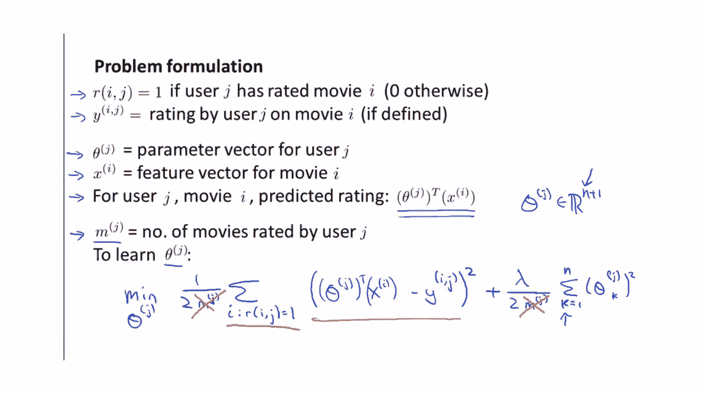
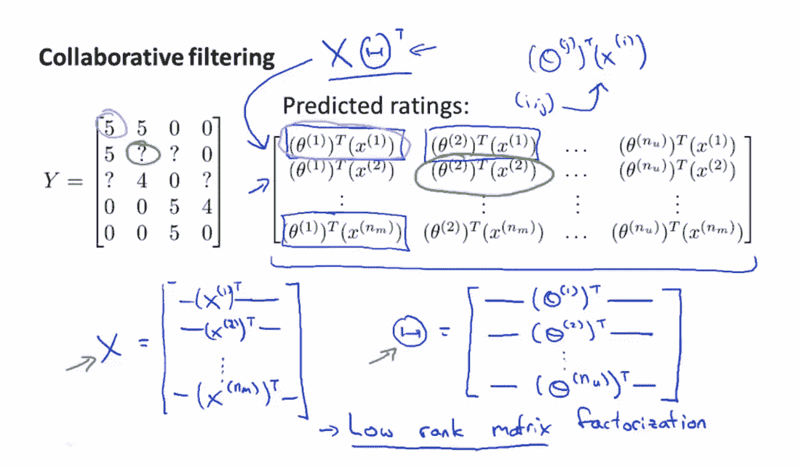
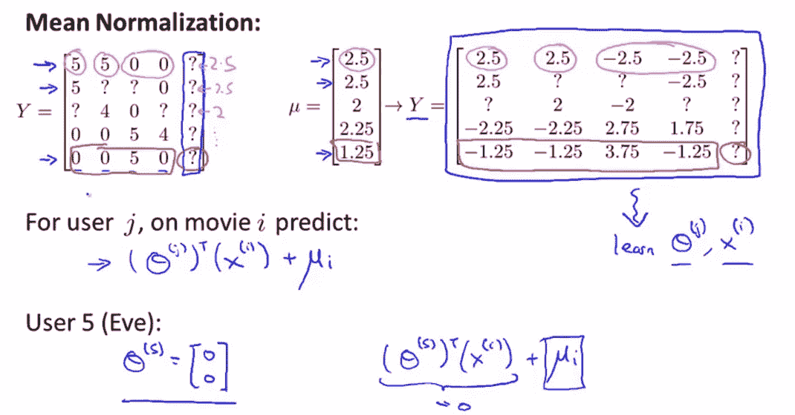

# 第八周

> 来源：[https://v11enp9ok1h.feishu.cn/docx/Fvw8d3fw4orH0Wx1swicf2p7nIg](https://v11enp9ok1h.feishu.cn/docx/Fvw8d3fw4orH0Wx1swicf2p7nIg)

## 推荐系统

### 基于内容的推荐算法

一种做法是，我们将每部电影中爱情成分、动作成分等评值作为特征，而某用户对不同电影的打分作为标签。这样，为了做出预测，可以看作一个线性回归问题，对于用户 $j$，预测其给电影   评分为  。

更正式的问题描述：

当学习   时，优化目标为：

通过梯度下降来更新参数：

两者的区别是因为一般不将偏置项   计算在正则化项中。

### 协同过滤基本思想

实际上，获取电影的众多特征需要花费很高的人力。我们可以反向来思考这个问题，假设我们拥有了用户的偏好向量 $\theta^{(j)}$，为了学习 $x^{(i)}$，有：

学习   时，则优化目标为：

这被称为**协同过滤（Collaborative filtering）**。

### 协同过滤算法

为了更高效地解得   和 $x$，我们将两个代价函数合为一个：

总结一下协同过滤算法：

1.  将 $x^{(1)}, x^{(2)}, ..., x^{(n_u)}, \theta^{(1)}, \theta^{(2)$初始化为较小的任意值；

1.  用梯度下降来最小化 $J(x^{(1)}, x^{(2)}, ..., x^{(n\_u)}, \theta^{(1)}, \theta^{(2)}, ... ,\theta^{(n\_u)})$；

1.  用某个用户的参数   和某部电影的特征   来预测他会给这部他没看过的电影打分为 $\theta^Tx$。

### 矢量化：低秩矩阵分解

我们还可以通过特征来找到相关的电影，尽管这些特性可能不具有可解释性。

### 实施细节：均值规范化

对于一个新用户或者没有给任何电影评过分的用户，显然上述方法只会预测这名用户会给所有电影打 0 分。因此，我们要对每部电影的评分做一个均一化：

## 大规模机器学习

### 随机梯度下降

当我们每次使用全部的数据来进行梯度下降时，有公式：

每次求和的计算量太大，迭代速度慢，计算机的内存也可能不能支持所有数据。这种方法被称为**批量梯度下降（Batch gradient descent）**。

与此相对，有**随机梯度下降（Stochastic gradient descent）**，在随机打乱所有数据后，每次只用一个训练数据来进行梯度下降以更新参数。这样，收敛速度更快。尽管这样做可能很难完全收敛，但可以非常接近全局最小值。

### Mini-batch 梯度下降

**Mini-batch 梯度下降**每次迭代会使用 b 个样本。b 是一个称为 mini-batch 大小的参数，通常选取范围为 2 - 100。

使用 Mini-batch 梯度下降有时会比随机梯度下降有更快的收敛速度，这是因为在向量化后，可以合理使用并行运算。

每一个 Mini-batch 再计算一次   并和之前进行比对，可以确认梯度下降在正确执行，同时可以考虑将学习率调小使收敛更充分。

### 在线学习

**在线学习机制（Online learning setting）**可以支持有大量用户流的网站来快速调整模型，适应用户的喜好变化。每次将新鲜的用户数据用于梯度下降以调整参数，这些数据不用保存，用完即可丢弃。

### MapReduce

MapReduce 指均分训练集，将每个子集分发给一台主机并行计算，最后结果汇总到一台机器，以加快计算速度。只要学习算法可以表示成一系列的求和形式，或者表示成在训练集上对函数的求和形式，就可以使用 MapReduce 技巧。把主机换成多核 CPU 的每个核同理。