# 大语言模型预训练

> 来源：[https://v11enp9ok1h.feishu.cn/docx/OczTdkqououbHDx4KHncxj82nHc](https://v11enp9ok1h.feishu.cn/docx/OczTdkqououbHDx4KHncxj82nHc)

> 原课程链接：https://www.deeplearning.ai/short-courses/pretraining-llms/

在这个系列里，我们将会学习在DeepLearning.AI上经典且有趣的的short course内容，我们可以登录网页“Courses - DeepLearning.AI”来进行学习。比如说最新推出的有关于联邦学习的内容也是非常有趣的，小伙伴们想机智流跟进的可以积极在评论区进行互动，后续可能也会进行讲解。

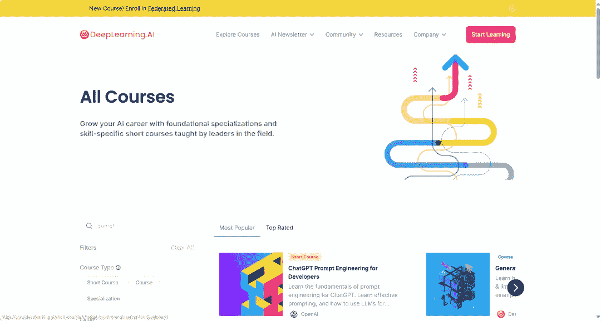

那今天我要讲解的是最近新推出的课程 Pretraining LLMs，也就是我们常说的预训练大语言模型或者是基座模型（base model）。这门课是面向于初学者（Beginner）的课程，因此也是讲解了非常多和大语言模型相关的基础知识，我们即便对代码不太熟悉也能够在里面学习到部分大语言模型的基础知识。下面就让我们一起来看看这门课讲了哪些主要内容吧！

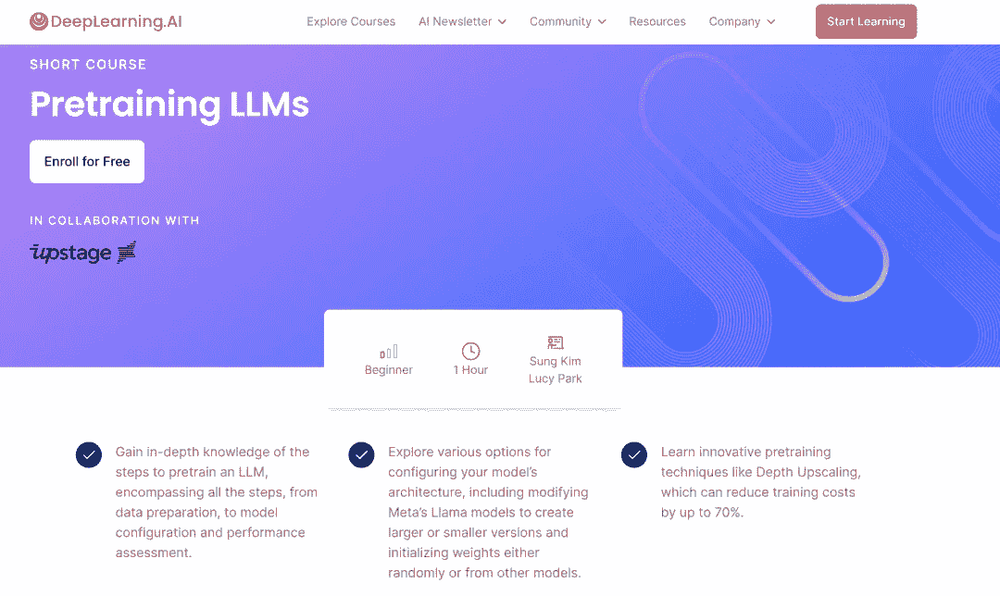

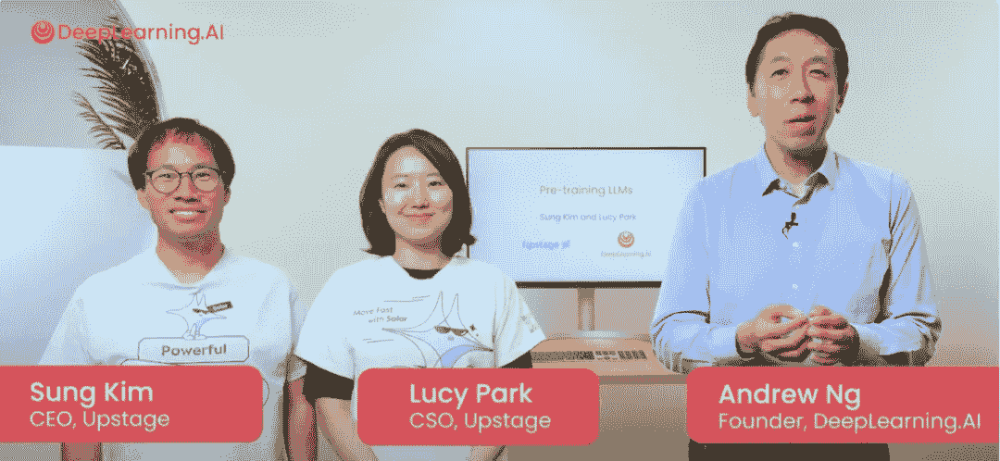

# **为什么需要预训练大语言模型？**

在聊到预训练大语言模型中，我们其实需要知道的是到底大语言模型是怎么运作的。简单来说，其实对于无论是当下的ChatGPT还是Claude甚至是文心一言等等，其实这些通过Transformers算法结合大量文本信息训练出来的大语言模型本质上做的事情就是通过前面的内容来预测下一个词是什么。

就比如上面这个例子，我输入了“Recite the first law”给到预训练的大语言模型，那这个预训练的模型就会先接一个“A”，然后把A放到上下文里作为输入传进去，然后继续输出robot，之后就一直重复这个过程，直到输出（Ouput）的是[end]这样一个特殊符号后才会停止。

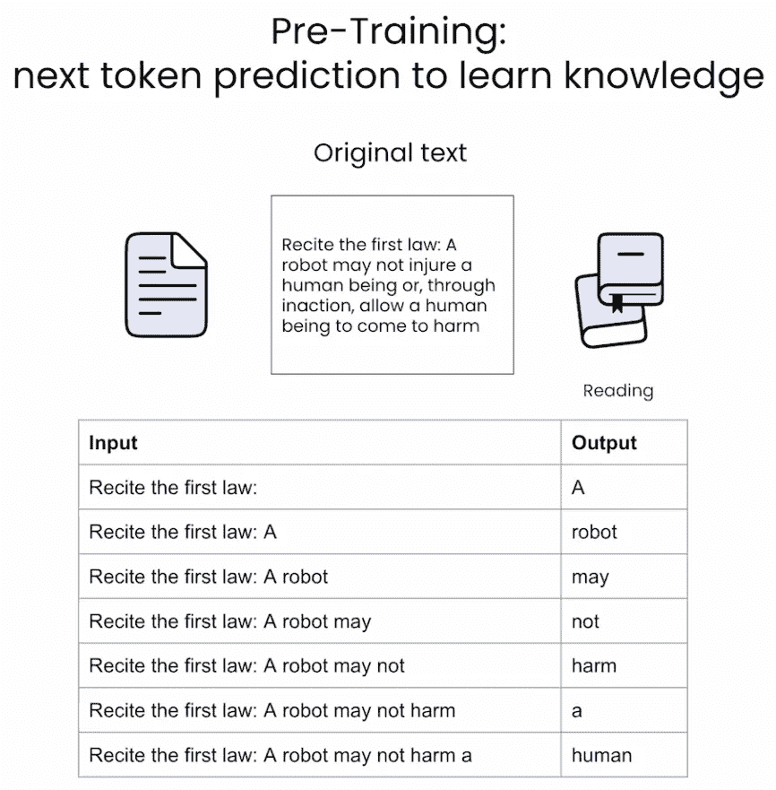

但是我们实际使用会发现的是，预训练模型和我们现在面对的那些商用模型（上面提到的ChatGPT，Claude等）差别非常大。当我们问预训练模型一个问题的时候，其并不会回答我们的问题，甚至会一直重复这一句话。然而我们使用感觉较好的这些大语言模型是可以回答我们的问题，并且有些还可以调用外部的工具，比如说链接数据库，或者说更高级一点的使用RAG或者Agent技术。这是不是在改变了大语言模型的本质呢？

其实这并没有改变大语言模型做词语接龙的本质。之所以这些模型能够更加好的与人进行沟通只不过是因为在预训练模型后我们还对其进行了微调以及对齐等的工作，让其能够更像人说话罢了。并且这些所谓的RAG或者Agent其实只是一些像[end]这样的特殊符号，当大语言模型输出到一个特殊符号的时候，程序就会让其去调用工具然后返回一个结果填入到这个特殊符号里然后继续进行词语接龙。

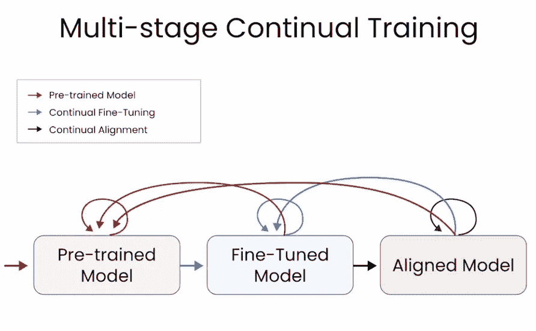

虽然经过微调和对齐后的模型能更好的与人沟通，但是对于大语言模型的能力而言，最关键的还是预训练模型的好坏。一个经过大量高质量数据预训练过的模型即便只是简单进行对话数据集的微调也能展示出不错的效果，但是假如一个被低质量数据训练过的模型即便再努力的进行微调其实出来的效果也是不会特别好的。所以从这里我们就能够看得出，高质量且合适的数据对于大语言模型来说是至关重要的。

而且我们可以想一下，假如一个大语言模型的所有训练资料都是英文的，它会在我们问中文问题的时候回答出来嘛？显然并不会。即便是我们在微调的时候假如一些中文的内容其实也并不足够的。因此很多时候我们得真正得进入预训练的大模型并且对齐进行整体参数上的调整才能让其从本质上行进行改变和提升。

比如说课程中使用LLaMA这款由Meta开源的大模型为例，由于LLaMA在训练的过程中韩语的资料占比极少，因此其回答的完全是错误的。即便我们用了一些韩语的资料进行微调，回答的内容也是错漏百出的。但是假如我们把很大量的韩语资料对预训练模型进行改造，那得到的结果还是比较不错的，从这里我们也能够看出调整预训练模型的重要性。

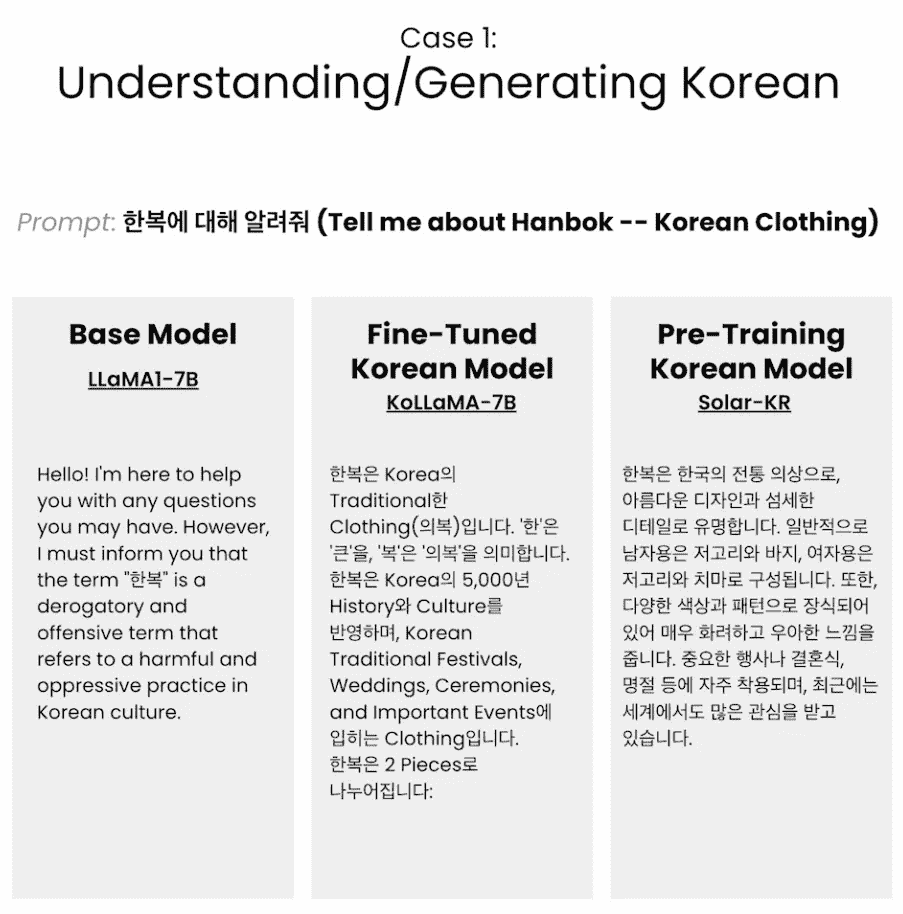

# **数据准备**

上面我们也提到了对于大语言模型而言，其最关键的其实就是收集高质量的数据。但是可能大家会好奇说，到底什么样的数据能够训练出现在这种大模型呢？我们又怎么去看数据集到底是好是坏呢？

## **训练所需的数据**

其实对于预训练的大模型而言，一般使用的就是像是书本、代码、文章、维基百科、网络页面等等这部分内容来训练。而对于模型微调而言，则是通过人类或机器生成的对话对（一问一答）来进行训练的。

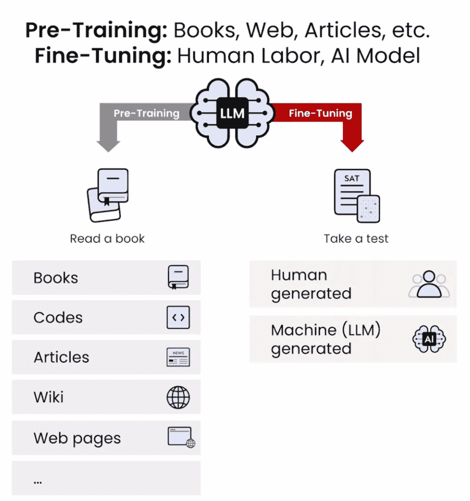

之所以微调和预训练的数据集类型有差别主要是两者的目标并不相同。对于预训练的大语言模型而言，其目的是让大语言模型有着基本的语言能力。就像我们刚出生的小朋友一样，他们并没有任何正常说话的能力，可能他们听我们说话多了也会学着说几句，但是并不会知道说这个字是啥意思，也不会自己组织句子。这个时候我们只需要不断给予输入即可。

对于孩子而言，由于还不会阅读，因此我们输入的主要方式还是通过对话倾听或者看看外面的自然风景。而对于大语言模型而言，其主要的输入手段就是互联网上的文字、图片和视频内容，那这些内容都将会成为其知识库来让其拥有一定的语言读写能力。

而对于微调模型而言，其目的其实就是让其掌握像人一样说话的能力。和长大后的孩子一样，当他们开始能牙牙学语以后，我们是不是慢慢就会去教他们如何正确的说出一个句子来表达自己的想法，后续还要前往幼儿园和学校进一步学习语法等知识，这样他们才能够逻辑清晰地与他人进行沟通交流或者写作。

大语言模型也是类似的，其通过了预训练后就已经掌握了基本的语言能力，并且由于其阅读了网络上大量的文本内容，其知识其实是非常丰富的，甚至可以说是上知天文下知地理。但是他们的问题就是在于说不懂得如何把这部分的知识正确的阐述出来。这时候我们就需要通过人类或者机器生成的对话对来让其学着如何表达出来。那前面说的模型对齐其实更多的是调整他们的三观让其能够不做违背人类社会伦理道德的事情。

所以这也是为什么上面的那个图片提到的说预训练的模型更像是让大语言模型去读书，去学习知识。而微调更像是让大语言模型去考试，去真正的将知识里的东西运用起来。

## **数据的质量**

那无论对于预训练模型还是说微调模型而言，数据的质量都是至关重要的。在课程了如何定义好的数据和坏的数据，不好的数据总是重复的、有误的、不连贯的、有不安全信息的。

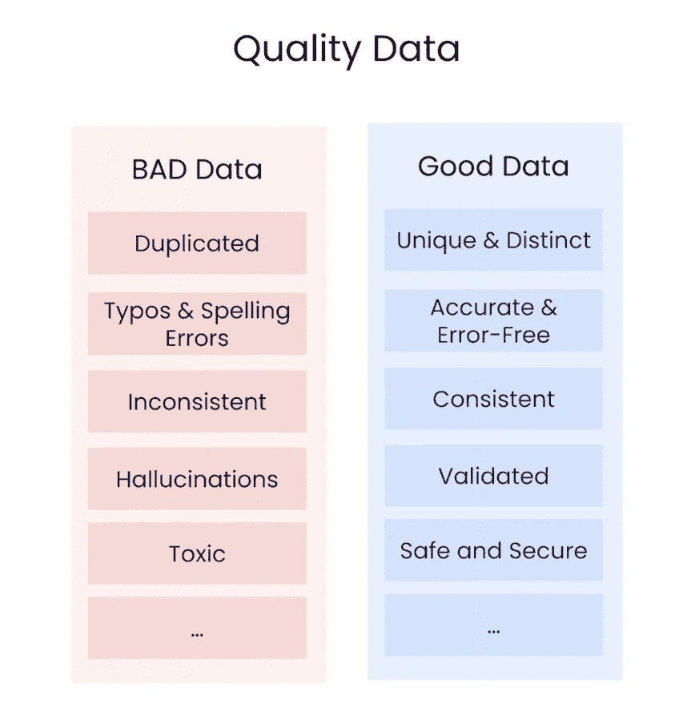

比如说下面这张图的第一个例子中，文字的内容就是有两句重复的话，因此我们需要识别出来并删除其中的一句。另外就如第二个例子中的，假如我们需要训练特定语言的模型，我们也需要找到除了该语言外的内容然后清楚。

在第三个例子中，原本的内容里有一些像是stupid, idiot这类脏话，其实在训练模型的时候也是需要尽量避免以免到处在说脏说。毕竟大语言模型就像我们自己的孩子，我们喂他们什么东西他们就会输出什么东西。就像父母会尽量避免孩子在正式场合说脏话一样，假如我们从小在一个不说脏话的环境里说脏话的机会也会少点。

第四个例子其实就是清除掉一些隐私的信息，比如说特定人的姓名、地址和电话号码。之前其实就有一个隐私泄露的典型问题，就是我们和ChatGPT或者Copilot这样的模型说让其扮演外婆讲睡前故事，睡前故事的内容是微软的激活码。然后这些大语言模型就真的输出了一些能用的激活码！所以说隐私问题也是需要在数据清洗阶段警惕的。

最后一个例子其实就是删掉一些我们平常正式对话中不太会出现的一些符号内容，比如突然的大写或者多个感叹号这种。因为大语言模型主要做的就是通用的内容，除非是做纯粹的对话聊天类大语言模型，不然清理掉这些内容也是必要的。

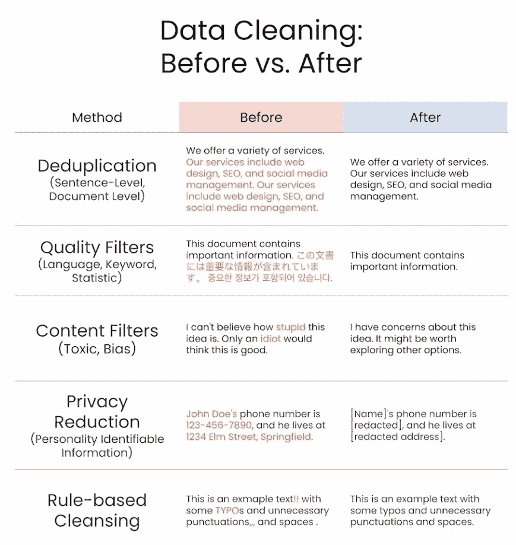

## **实际使用**

那在具体的实操过程中，课程展示了四步的数据清理：

1.  **筛选出过短的内容并删掉**

由于过短的内容并不会有很丰富的语义信息，所以我们会筛选掉那些少于3行的文字，从而保证整体的数据质量。

1.  **删除重复的内容和信息**

我们需要找到前一句和后一句内文字重复大于20%的内容，然后将其中一句删掉，从而保证前后的内容不要过分的重复。

1.  **删除重复的文档**

除了内部的一些语句的重复以外，假如有相同的文档进行训练的话也会影响整体模型的效果。比如在书生浦语实战训练营中，我们就曾试过用一句话重复2w遍然后给大模型微调，然后发现得到的模型就只会说这一句话了。因此也可以看出太多重复的内容会真的影响模型的输出。

1.  **删除无关的语言**

假如我们训练的模型是特定的语言，我们就需要删掉除该语言以外的内容从而保证其纯粹性。当然就像人类一样，多语其实会让孩子脑子开发更多，但是假如其均衡性不能得到很好的保证的话，对于大语言模型而言还不如只保留其中一种从而避免出错。

## **开源工具**

当然我们也可以采用一些开源的工具来进行数据处理，比如说**该课程讲授的企业Upstage**AI推出的数据处理工具Dataverse。

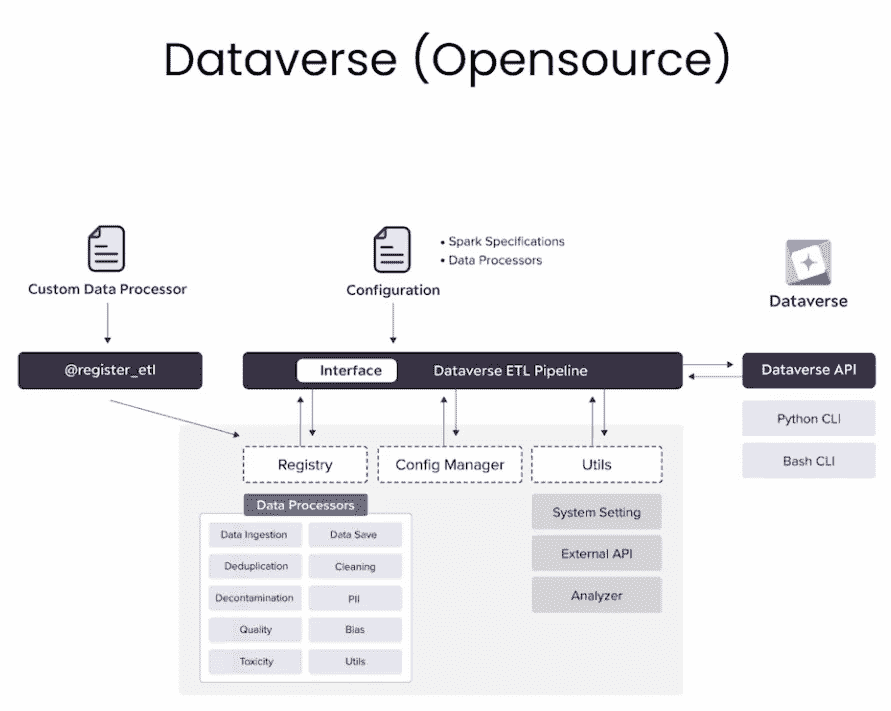

**除此之外，InterLM官方也**推出了自己的数据处理工具Label LLM，同样也可以帮助我们快速的对语言数据进行标注。


那除了标注平台以外，数据集的获取除了我们自行收集的行业专业数据库以外，我们还可以通过多个渠道获取，包括Huggingface、GitHub、OpenDataLab以及ModelScope等。这些平台中也是开源了大量的相关数据供开发者免费的进行使用。


# **数据处理**

当我们收集到合适的预训练数据后，我们并不能够直接将这些数据直接拿去训练，我们还需要对这些数据进行简单的处理后才能妥善地使用。这里我们只介绍最基础的数据处理方式，而一些特殊的技巧，比如将重要的数据放到后面可能会提升模型的效果，这门课程并没有进行讲解。

那在数据处理中，最基础也是最关键的就是Tokenization（分词）以及Packing（打包）。

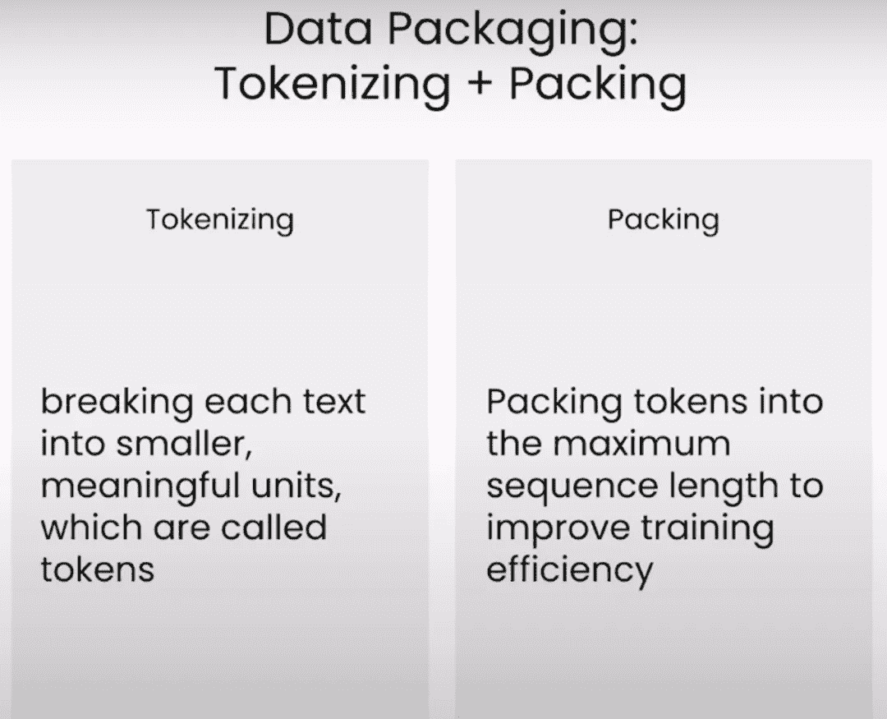

## **Tokenization 分词**

所谓分词其实是将连续的文本序列切分为一个个独立的词、子词、字符或其他有意义的单位。这些单位是模型处理和理解文本的基本元素。分词的主要目的是将文本转换为计算机可以处理的结构化数据形式，并简化后续的文本分析。

比如说下面这个句子“Tokenization breaks text into smaller units called tokens”在被一个训练好的分词器分词后，将其拆分为”Toekn“、”ization“、”breaks“、”into“、”smaller“、”units“、”called“以及”tokens“这几个单独的词语。然后我们可以根据分词器里的词表找到对应的数字然后将文字转为数字的形式，这也被称为是文字向量化（word embedding）。

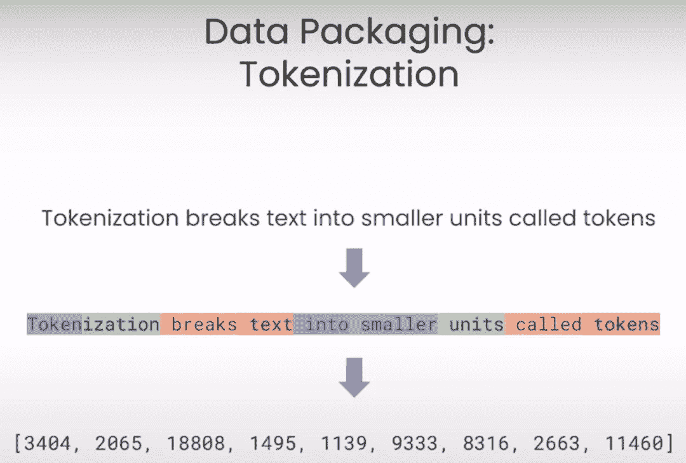

+   **分词器**

这里我再多解释一些概念，比如说我们说到的分词器，目前最常用到的应该就是BERT模型。这个模型是基于统计的方式，通过收集大量的语料库，然后将这些语料都转为单个单个的字符，比如说“token”就会被转为“t”、“o”、“k”、“e”和“n”。然后在训练的过程中，算法会统计所有可能的相邻词对的出现频率，然后慢慢得到子词对。

根据子词对的频率，选择最常见的子词对进行合并。例如，如果 "token" 和 "ization" 是最常见的子词对之一，则将它们合并为一个新子词 "tokenization"。所有的子词都将被记录在一个词汇表中，并且随着训练不断的更新。

在词汇表中，可能会包含以下子词：["token", "ization"]。这个过程会继续，迭代地选择频率最高的子词对进行合并，逐渐构建出越来越长的子词，直到达到预定的词汇表大小（如30,000个子词）或其他停止条件（如词对频率下降到某个阈值以下）。

在实际操作中，如果输入的词 "tokenization" 存在于词汇表中，它将被视为一个整体。如果不存在，则将尝试找到最大匹配子词序列。若“token”存在但“tokenization”不存在，分词器可能将其拆分为“token”和“ization”。这样我们就可以一个个的进行拆分开来。

幸运的是，我们其实并不需要自行去训练这样的分词器，无论是在各大开源网站上都存在大量的分词器。就比如huggingface中就可以下载BERT或者其他的分词器。我们可以直接调用或在此基础上修改即可。这样当我

+   **文本向量化**

学过计算机的可能都知道，计算机并不能够直接处理文字、图像或者视频，其唯一能够读懂的就是两个数字：0和1。当然基于十进制二进制的转换，我们可以通过0和1表达几乎所有的数字，但是仍然无法对文字这种非数值的内容进行处理。

因此，为了能够让计算机了解文字、图像以及视频等内容，我们必须将这些内容转为计算机可看懂的数字，这也是为什么我们需要进行文本向量化的原因。

那既然将文字转为数字的重要性我们已经清楚了，下一个问题是，我们在预训练模型该如何进行这一操作呢？图像的话我们可以通过说RGB像素的数值来表示一张图片，那对于一个文字来说，其内部包含的意思远比单一的数字要丰富得多，我们到底要怎么用一串数字来表达呢？

其实对于分词器来说，其向量化非常简单，那就是上面我们提到的构建词表。词表中的每一个单词都分别对应了一个单独的id，比如“token”的ID就可能是1012，“is”的id可能就是2003。并且除了文字以外，词汇表里也会有一些特殊的符号，包括[CLS]、[SEP]等等，这些都可以将其对应到一个单独的ID。那么计算机就可以通过这个词表知道每个文字的意思是什么，从而就能够实现理解文本的目的。

这种简单的文本向量化其实重点就在于词表的构建上。由于文本可能有很多很多，我们不可能每一个文本都单独给定一个ID，这样就可能导致后续模型推理过于缓慢。所以一般我们也只会选择一些出现频率比较高的词语，那对于没有在词表里的词语，我们可能会考虑使用一个特殊符号来表示。但是假如模型的输入和输出出现太多这种不知道的特殊符号，这势必会影响模型的输出。

除此之外，一些词表里可能只有单一的语言，假如我们希望这个模型能够变得能够表达多个语言的话，我们除了增加新语言的训练数据集以外，我们还需要将词表进行更新，使其能够包含新语言中最常见的词，从而使机器能够更好的理解文本并进行回复。因此，从上面的内容看出，构建高质量的词表对于模型的输出是非常重要的。

当然这种向量化只是最简单的一种向量化的方式，其实更常见的文本向量化的使用场景还是在RAG（检索增强搜索）技术上。我们首先也是需要将文本根据语义的信息进行向量化，使文本变为一个高维的向量，比如[123,12,325,212,1.231…,12576]这样的一个向量。然后将向量化后的片段资料放入一个高维度空间里。当我们提问一个问题的时候，系统会自动找到与我们问题最相关的内容，然后将找到的内容结合问题一起给到大语言模型从而能够更好的回答我们的问题。这里的文本向量化就不单单只是一个符号ID，而是真正带有语义信息的向量，从而能够更好的表达文字的真正含义。

## **Packing（打包）**

在正式将文本向量化后的段落送到算法中训练之前，我们其实还需要做的一件事就是将句子重新打包，使其能够在训练的时候长度一致。

我们从图中就可以看出，在被tokenization处理过后，我们的句子一个被拆分为了4个token，另一个被拆分为了2个token。然后两个句子都会被一个特殊符号BOS和EOS所环绕。

为了使其能够符合算法每次运算只处理3个token的目的，我们就需要先将这两句话组合在一起，然后将其拆分为3个3个的Token拿去训练。

当然假如有些句子不满足3个的话我们可以采用Padding（填充）的方式为其进行补充。比如说可能最后只剩下了1个token没放进去，那我们就可以额外补充两个空的特殊符号使其满足同一长度的要求。又或者我们还可以使用Truncating（截断）的方法将最后的这一个删掉。

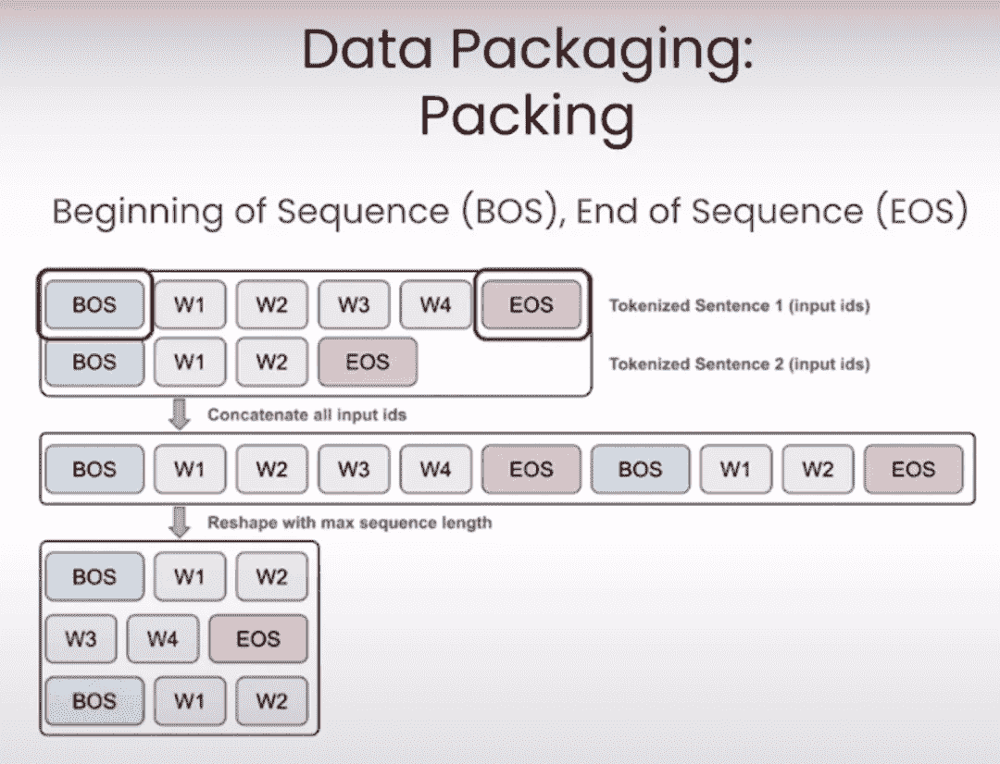

当然无论哪一种方式都可能会导致语义上的缺失，但是这也是为了效率和成本的妥协。在过去的NLP任务里，很多时候的处理方式就是找到长度最长的句子，然后其他的就直接填充到最长的句子长度。这样的方法其实就是很容易操作，但是实际使用的体验并不是很好，因为太多无意义的填充肯定会对模型的输出质量产生影响的。

所以这种打包的方式反倒是减少了无意义的填充，从而让训练的数据质量变得更高。进而在提高计算效率的基础上，提高了模型的泛化能力以及训练过程中的梯度消失和爆炸。并且即便后续对于大语言模型的输入是长度不一的，模型也从大量的数据集中学会了如何将一个句子切分成一块一块的处理方式，从而能够产生更高质量的输出。

# **模型初始化**

当我们将数据完全准备好了以后，我们就可以准备开始将数据放入算法中训练了。但是在训练之前我们还有一个很重要的事情就是调整我们的算法使其符合我们的要求。

## Transformers 算法简介

通常来说，目前在大语言模型中最常见的算法就是下面图中的Decoder-only的Transformers算法。最下面的embedding layer其实就是我们上面所提到的word embedding（文字向量化），其实就把输入的文字转为数字然后传给decoder layers进行学习，然后最后得到的结果就是一个Classifier（分类器）。

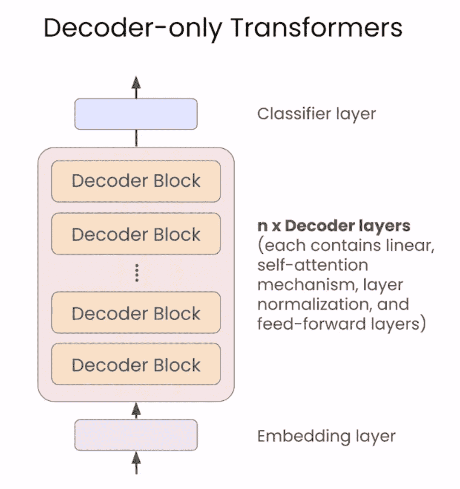

这个分类器其实就是算法计算出最有可能输出的词语，比如我的输入是“我爱”，那最后的分类器可能给出的是{你：0.80，吃：0.65，…，傻：0.001}这样的一个序列。一般直观的来说，我们其实选择分类器中概率最高的那个肯定没什么问题，但是实际上的结果可能会导致内容缺乏多样性、容易陷入常见和安全的回答切忽略一些有趣的选项。

我们就拿日常打招呼举例，理论上来说，我们对所有人都应该说“早上好”这样的话，但是实际上我们面对不同的人会有不同的打招呼方式，比如说“哟，太阳从西边出来了吗，竟然今天早上见到你了”这样的句子。正是因为这样不符合常理的出牌才展示出人类的多样性，不然我们和机器有什么分别呢。

因此我们现在通常的处理方式有以下两种：

+   束搜索（Beam Search）：在每一步保留多个候选输出序列，最终选择最优的一个。这种方法可以在一定程度上平衡多样性和质量。

+   **采样方法**：如温度采样（Temperature Sampling）、Top-k采样、Top-p采样（核采样）。这些方法可以引入一定的随机性，使得输出更有创意和多样性。

## **模型权重**

现在让我们把目光在放回到上面图中的 n x Decoder layers上来。我们通常所说的大语言模型训练其实就是去训练这些Decoder的layers。这里的layers其实就是指的是模型的层数。那每一个layers的本质其实就是其内部的参数，这些参数都是通过反向传播（可以看前面的LLM 101n补充这部份的知识）的方式来在一次次的训练过程中进行更新的。

理论上说，decoder模型的层数越多，参数越多，其效果应该是越好的。就比如说OpenAI的GPT-2模型才1.5B的参数，虽说在当时已经是个庞然大物了，但是几年后的GPT-3模型已经达到了175B的参数了。这两者能力的差异基本等同于我和刘翔在田径上的差距了，不然也不会有2021年底席卷而来的大语言模型市场的爆发。

那我们在实际的预训练过程中，其实也是要设定一个初始的参数的。以下是几个可能的选项以及其对应的优劣：

+   零初始化（Zero Initialization）：所有权重初始化为零。虽然简单，但会导致对称性问题，即当神经网络的所有权重参数都被初始化为零时，所有神经元的输出将会相同，这会导致梯度更新时所有权重同步更新，从而无法打破对称性。结果是网络的每个神经元学习到相同的特征，使得网络无法有效地学习多样化的特征。因此通常不推荐。

+   随机初始化（Random Initialization）：权重参数以某种随机方式初始化，如从均匀分布或正态分布中采样。这种方法可以打破对称性，但需要注意数值的范围。这是因为过大的初始化可能导致梯度爆炸，而过小的初始化可能导致梯度消失。常见的策略包括Xavier初始化和He初始化，这些方法依据层的输入和输出数量来设置初始化范围。无论是计算机视觉还是自然语言处理等深度学习的任务上，对于一个全新数据集的模型而言，这是最标准的做法。

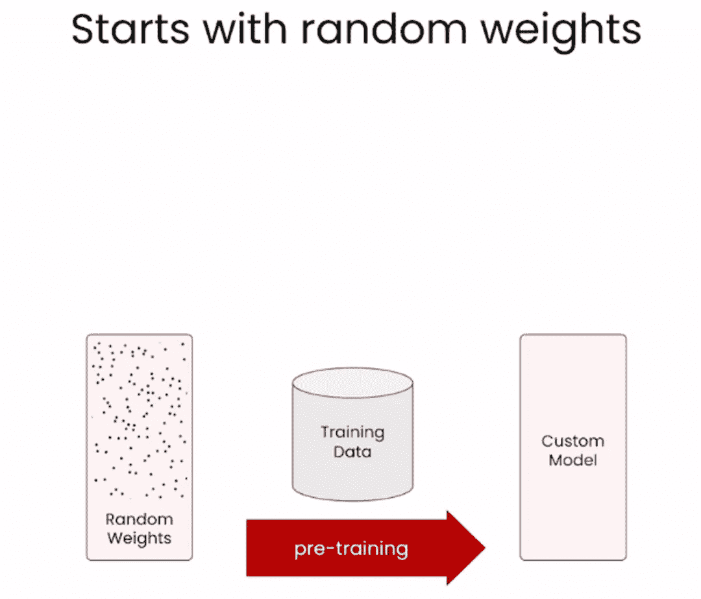

+   **预训练权重初始化**：对于某些任务，可以使用在相关任务上预训练的模型的权重作为初始值。这种方法通常用于迁移学习，有助于提高模型的性能和收敛速度。这是因为预训练模型的参数已经在相关任务上进行了调整，包含了有用的特征。并且预训练权重可以为目标任务提供一个良好的起点，尤其是在目标任务数据量较小的情况下。它可以帮助模型更好地泛化，避免过拟合。这种其实常用于同类模型的进一步训练上，比如说我们假如需要将一个只会说英文的模型拓展为中英模型的话，我们就可以使用这种方式，这其实也通常被称为是全量微调。

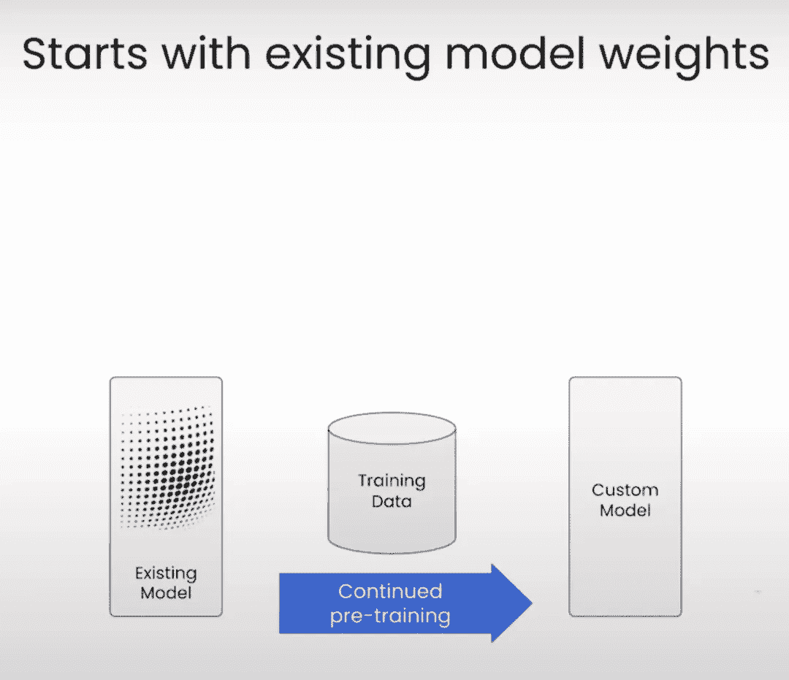

## **更改模型结构——模型缩小**

虽然我们所看到的大语言模型都是Transformer架构的，但是里面具体的decoder-layers还是不太一样的。一些很大的模型里训练时候所需要的decoder-layer肯定会比小模型多得多。那假如我们希望模型变小一点的话，我们可以尝试使用大语言模型的downscalling技术来实现，即删除其中的某几层（部份权重信息）使其参数量从可能的20B降到7B。

比如下面这张图就是把原本6层decoder-layer的模型删掉”中间“两层的模型，然后得到了一个更加精简化的模型。这样的模型虽然所需要的计算和资源需求减少了，但是具体的能力肯定也会随之下降，所以后面可能我们还需要对这些删除掉的参数做进一步的训练以确保其能力还能够维持在能够接受的状态。

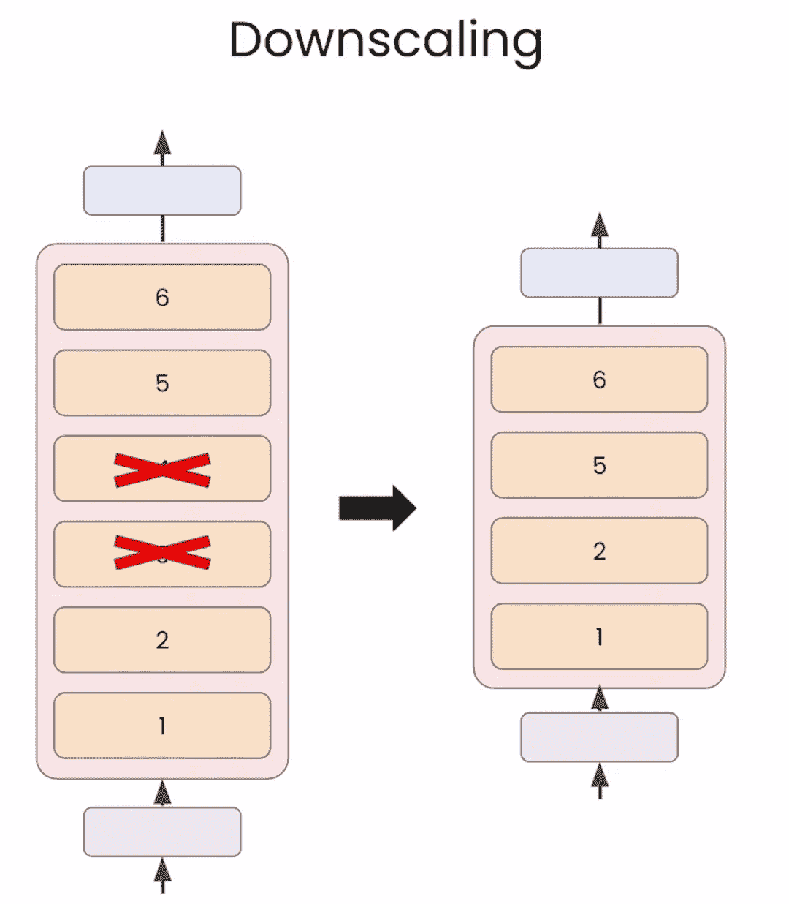

那其实除了课程中所讲的这种类似于模型剪枝（Pruing）的方法来缩小模型或降低运行成本，我们其实还有其他几种方法来实现：

+   量化（Quantization）

量化是一种模型压缩技术，旨在减少模型大小和计算成本。通过将模型参数从高精度（通常是32位浮点数）表示转换为低精度表示（如8位整数），可以显著减小模型的存储需求和计算复杂度，同时保持模型性能。

其实我们可以想象一个场景，在数值运算中，一开始假如所有的数都是保留小数点后32位然后进行运算，这个时候运算的消耗量其实还是蛮大的。但是这个时候，我们通过四舍五入等方式，让其转变为只剩后8位小数了，这个时候计算机的计算量是不是就会骤降。这样在大语言模型推理的过程中，即便模型的结构没有发生变更，只是将数值的运算调整一下，也是能够压缩模型的。

当然这肯定会对模型的能力产生影响，毕竟每一个参数的数值背后代表的是真真实实的知识。把原本32位的调整为8位那肯定会丢失一部份的记忆，但是为了能够在让大模型在端侧（比如手机、平板、扫地机这种日常使用工具）或者说算力有限的设备所使用，就必然需要有所调整也有所牺牲。

+   **知识蒸馏**

当然除了量化以外，有一种很好用的技术既让模型变小，也让模型的能力在最大程度上的保留，这个技术也被我们称为是知识蒸馏（Knowledge Distillation）。

知识蒸馏是一种模型压缩技术，目的是通过利用大模型（教师模型）的知识来训练一个较小的模型（学生模型），使其在性能上尽可能接近教师模型。这里的学生模型其实可以是一个全新架构训练出来的小模型，也可以是大模型剪枝而成的模型。教师模型我们就只需要找到最强的大模型即可。

之前就有很多的推测认为GPT-3.5之所以能够将api的价格大幅降低，很大程度是因为他们采用了这种知识蒸馏的方式。可能原本的GPT-3.5的参数量在400B左右，这时候运算成本非常高，因此api接口的价格就有点居高不下。但是在知识蒸馏后，可能模型参数量就在20B左右，并且能力方面也没有明显的下滑，也因为推理的成本也急剧下降，从而能够面向所有用户免费且api价格降到白菜价。

当然这种对知识蒸馏的解释只是一个笼统的抽象的解释。我们上面也讲到了大语言模型实际上就是在预测下一个词的概率，无论大模型小模型也好，都是在做这样一个事情。然而大模型的能力比较强一点，预测的可能更准一点，所以是不是只要小模型和这个预测的值越接近，那效果是不是就会更好。所以其实就是设定一个损失函数和优化器，然后准备好训练的数据集给到教师模型和学生模型上，然后看他们的输出之间的差异后反向传播修改小模型的参数，这样就能够实现能力上的对齐。

但是这里就出现了一个问题，就是我们上面说的这种蒸馏的方法依赖的是输出的内容必须要是一致的，假如两个模型词表都不一样，输出的内容都不一样，计算出来的损失函数是不是也是没有任何意义的对吧。所以我们会发现开发者一般很少对闭源模型进行蒸馏，而是都选择有tokenizer的开源模型，因为我们可以获取完整一致的词表。

当然也不是说没有词表就不能蒸馏模型，我们其实也可以通过代理任务实现间接的蒸馏。比如说很多现在模型是用一个比较强的模型来帮忙生产问答对，然后利用这些问答对结合已有数据集中的问答对来一起让模型进行微调训练，从而也能够学习到部份的知识。虽然这在任何一个闭源模型的条款中都清晰的写明了不能够用于训练其他的模型，但是大家其实都是这么干的。想当年OpenAI推出GPT-4的时候，国内很多模型的能力都变强了，这其实很可能是因为他们有了一个更好的数据生产工具，能够生成更多更可靠的数据了，然后从这些数据中学习到相关的知识从而最终让模型能力变强。

## **更改模型结构——模型增大**

除了让模型变小以外，有些时候为了让模型的能力变强，我们也可能会采取增加层数的方式。就像下面的这个图，我们把模型A的前三层和模型B（其实就是复制了模型A）的后三层拼接到了一起，从而让一个原本只有4层的模型变成了一个6层的模型。

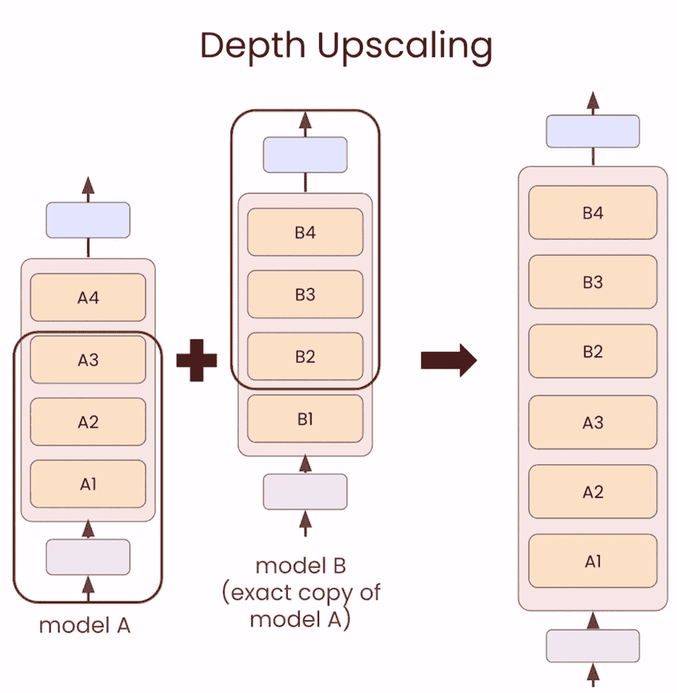

那可能很多人会好奇说，这种放大真的有意义吗？都是同一个模型，里面的参数都一样，放大来干嘛？实际上，我们放大了模型也不是说复制了就算了，而是还要拿数据对这个放大后的模型进行训练和参数调整。

在模型变大后，其实会在几个方面比小模型要更好：

+   **提升模型容量**：更深的模型具有更大的容量，可以学习和表示更复杂的特征和模式。这对于处理复杂任务（如自然语言理解、图像识别等）非常重要。

+   **增加非线性变换能力**：每一层神经网络都应用一个非线性变换。增加层数相当于增加了非线性变换的次数，使得模型可以更好地捕捉复杂的非线性关系。

+   **特征复用与提取**：更深的网络可以在不同层次上提取和复用特征，形成多层次的特征表示。这对于提高模型的泛化能力和性能有帮助。

比如下图就是将两个原本为7B的模型放大到10.7B，然后使用了1个T的无标注数据来进行预训练。当然在花费上非常昂贵，但是最终获得的效果还是不错的。

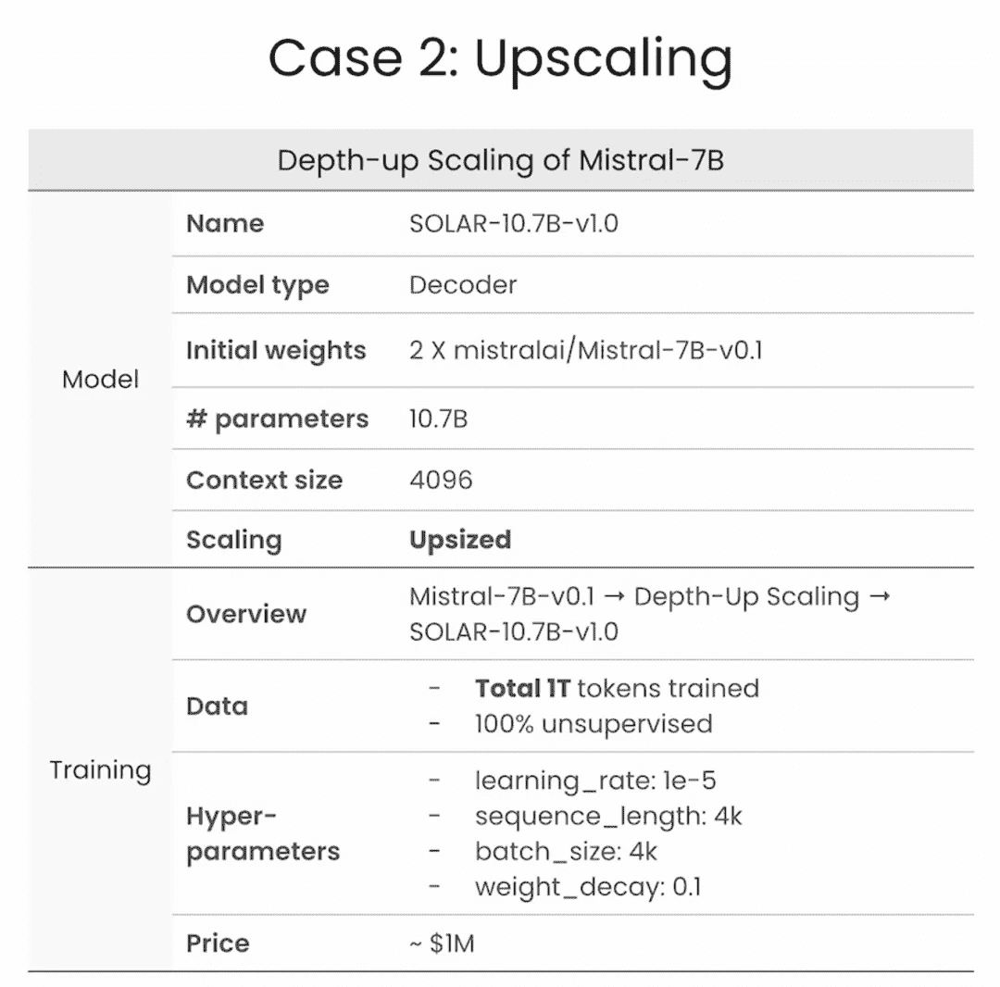

那除了增加层数以外，还有一些其他的方法能够增大模型，比如说：

+   **增加模型的宽度**：增加每一层的神经元数量或卷积核数量，使得模型的每一层可以学习和表示更多的特征。

+   混合专家模型（Mixture of Experts）：使用多个专家模型，每个专家模型专注于处理输入数据的某一部分。通过门控机制选择合适的专家模型来处理每个输入数据。

这些方法都能够放大模型使其能力的上限变得更高，从而能够更好的处理我们的任务。

## **模型训练**

当我们将数据集和模型都准备好了以后，我们就可以正式的开始训练模型了！目前来说，最常用的模型训练框架其实就是利用Huggingface中的各个库进行实现的。下图就是课程中给出的一个标准的大语言模型训练流程。

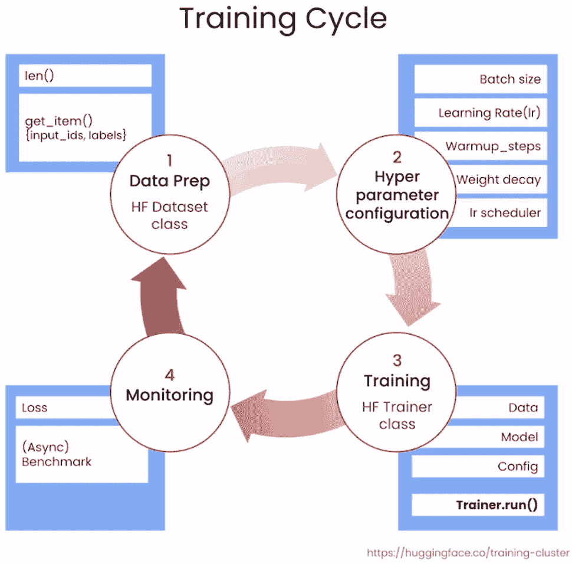

### （一）Data Prep（数据准备）

比如在图中的第一步就是将数据加载进来，然后我们可以利用Huggingface中的Dataset库来查看数据集的长度以及找到特定索引样本的数量，从而快速了解到数据集的基本情况并进行简单的处理。

比如说我们在训练过程中需要检验模型训练的效果如何，那么我们就需要将数据集分为两类——训练数据集和验证数据集。那同样的我们也可以利用Dataset这个库进行划分。一般而言，82分是常见的区分方式，当然极端点73和91都是能够被接受的。

### **（二）Hyperparameter C**onfiguration （超参数配置）

接下来我们就可以进入模型超参数的设置阶段，这些超参数决定了训练方式和效果等。常见的超参数包括批次大小（Batch size）、学习率（Learning Rate）、预热步数（Warmup steps）、权重衰减（Weight decay）和学习率调度器（LR scheduler）等。具体的解释如下：

+   **Batch size**：决定每次训练更新时使用的数据样本数量。

+   **Learning Rate**：控制模型参数更新的步伐。

+   **Warmup Steps**：训练初期逐渐增加学习率，避免模型一开始跳跃过大。

+   **Weight Decay**：正则化技术，防止模型过拟合。

+   **LR Scheduler**：动态调整学习率，以适应不同的训练阶段。

这些超参数能够帮助我们调整模型的效果。假如模型训练的过程中太早出现过拟合的情况，我们就可以通过调小学习率（Learning Rate）等方式来让其慢慢学习到更多的知识。

但是在训练过程中效果的最主要取决因素还是数据集的好坏。对于一些不太优质的数据集而言，无论如何调整超参数，最后得到的结果都并不会太好，因此超参数主要起到一个锦上添花的作用。

### （三）Training （训练）

那配置好的超参数也准备好了数据和模型超参数以后，我们也就可以正式进入模型的训练阶段了。在Transformers中同样也有一个Trainer的类来帮我们快速构建起模型，我们只需要填入模型信息、参数信息以及训练和验证数据集即可启动开始训练了。Trainer 类将会在后台负责管理数据、模型和训练配置，并自动化处理模型的前向和后向传播、损失计算和梯度更新。

```
from transformers import Trainer

# 初始化 Trainer
trainer = Trainer(
    model=model,                         # 待训练的模型
    args=training_args,                  # 训练参数
    train_dataset=dataset,               # 训练数据集
    eval_dataset=eval_dataset            # 验证数据集（可选）
)

# 开始训练
trainer.train()
```

### （四）Monitoring （监控）

最后，在模型的训练过程中，我们也不能够说让其自由自在的运行到结束为止。我们也需要时刻关注着模型的性能和训练进度。监控包括记录损失值（监控损失函数的值，判断模型的收敛情况）以及在训练过程中定期进行基准测试（评估模型在验证集上的表现）。

幸运的是Hugging Face 的 Trainer 类支持自动记录和日志管理。我们只需要通过以下代码即可获取。

```
# 假设 Trainer 自动进行监控和记录日志
# 训练完成后，Trainer 提供的 log 可以查看详细的训练过程
logs = trainer.state.log_history
```

这里我补充一些额外的内容，就是我们在监控的过程中，主要看的就是Loss是不是一直在下降且基准测试的结果是否在上升。Loss降低就意味着模型是越来越符合我们的预期，输出的内容也是和我们想象得相对而言比较一致。

但是假如Loss降低得非常快非常低，但是基准测试的结果非常差，这个情况下代表已经完全过拟合了。比如说之前的书生浦语大模型实战训练营课程的微调小助手认知就是只让模型学习到一句话，那这个时候模型的Loss非常非常低，但是模型只会说一句话了，并没有任何其他的能力。这就是所谓的过拟合，这种情况我们也是不愿意看到的。

所以我们需要找到的是像下图中第100轮左右的模型，这个时候Loss已经下降到一定程度稳定下来了，然后验证集也是稳定下来了，这时候的模型的泛化能力（其实就是我们日常所说的适应力）以及很强了，再继续训练反而会过拟合。

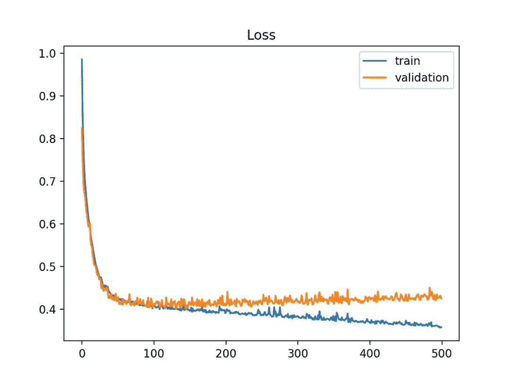

### **（五）训练开销及内存**

除了了解怎么训练以外，其实我们也需要清楚的知道训练一个模型是要有多耗钱和算力资源。在Huggingface里就提供了一个简单的计算工具来了解假如我们需要训练一个模型要多费钱。

比如说下面这个例子，假如我们需要在200个加速器上训练一个7B的文本生成模型在一个980 billbion token的数据集上。我们可能需要花费12天时间且总共10万美金（约等于70万人民币）的钱来进行训练。并且训练结果也未必能够完全如我们所愿，我们可能还需要像炼丹一样不断调整各种参数和数据集来找到最完美的模型。这实际的开销其实对于小公司而言是几乎不可想像的。

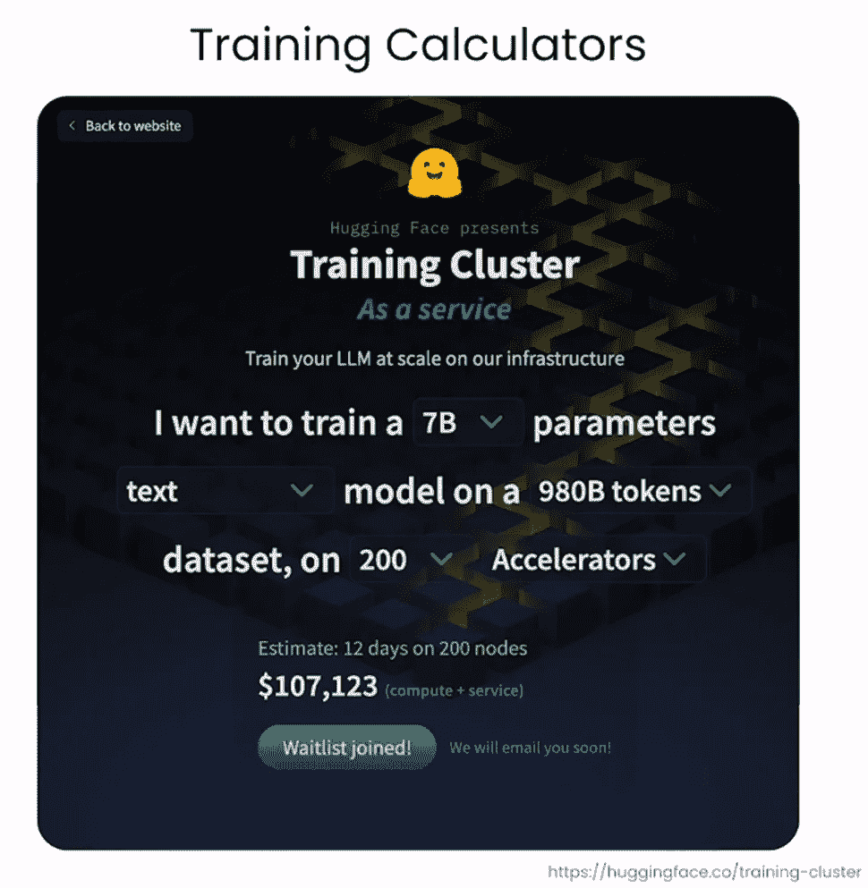

除此之外，假如我们不说选择在Huggingface这样的云端平台去训练模型，而是打算自己买算力集群来训练，对于一些初创的小公司而言更是天方夜谭。先不提美国的出口禁止高端的GPU（比如A100和H100）出口到国内，即便是能够买到一块也是几十上百万起跳。

我们从下面这张图就能看出，和推理一个模型相比，训练一个同样尺寸的预训练模型需要近20倍的显存。也从此看出对于个人开发者而言，微调模型或者直接使用训练好的模型结合提示词工程是更加性价比的选择。

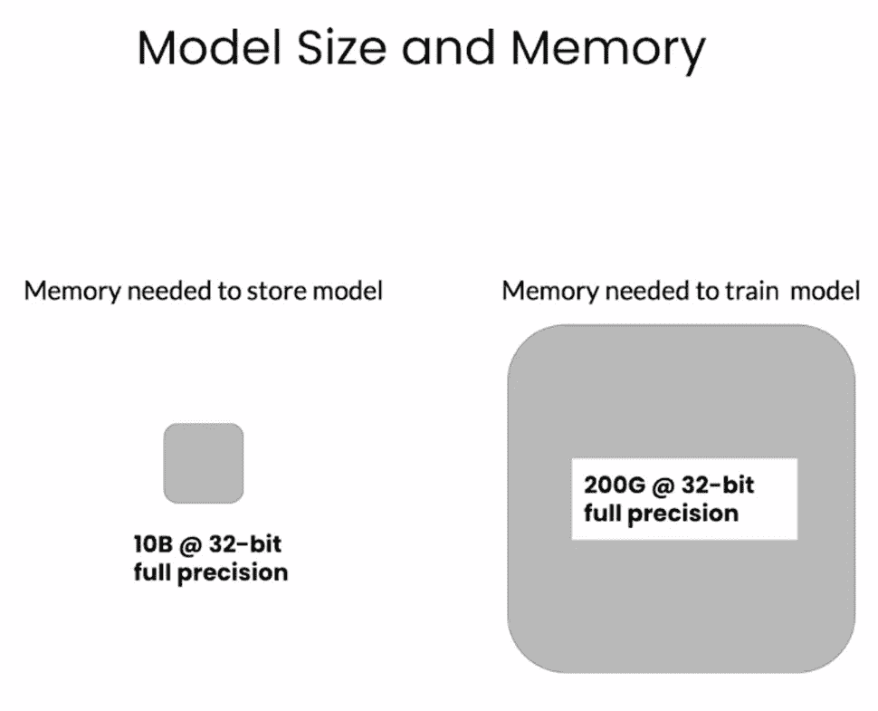

## **模型测评**

最后，除了模型的过程监控以外，在训练完模型的最后，我们还需要直观整体的去测评模型的能力。

在课程中就介绍了四个不同的评估方法，分别为Loss、See、Compare和Benchmark。我们可以通过这四部份的内容来了解一下关于全面分析一个模型能力的基本方式。

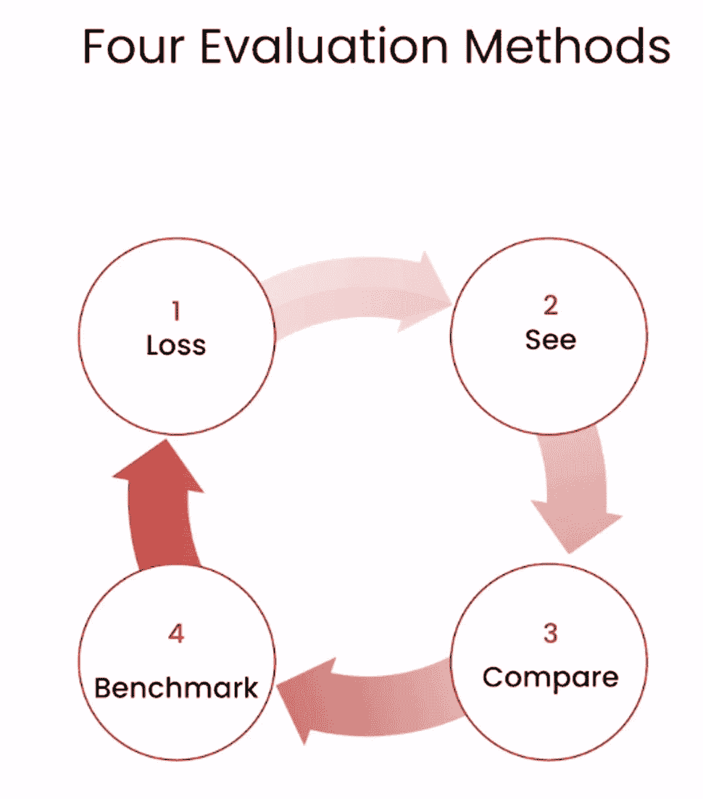

### **（一）Loss（损失值）**

其实前面我已经额外补充了一点损失值的相关内容。这里我更深入的解释一下。

损失函数是衡量模型预测与真实标签之间差异的一个数值度量。损失值越小，模型的预测越接近真实值。在训练过程中，模型通过不断调整参数来最小化损失函数，从而提高预测准确性。

对于大语言模型这种分类任务，常用的损失函数是交叉熵损失（Cross-Entropy Loss）；对于回归任务，常用的是均方误差（Mean Squared Error, MSE）。

选择一个合适的损失函数非常重要，因为这决定模型在每一轮训练中的改进方向，很多论文研究和改进的方向其实就是设计一个更好的损失函数让其更满足我们的需求。

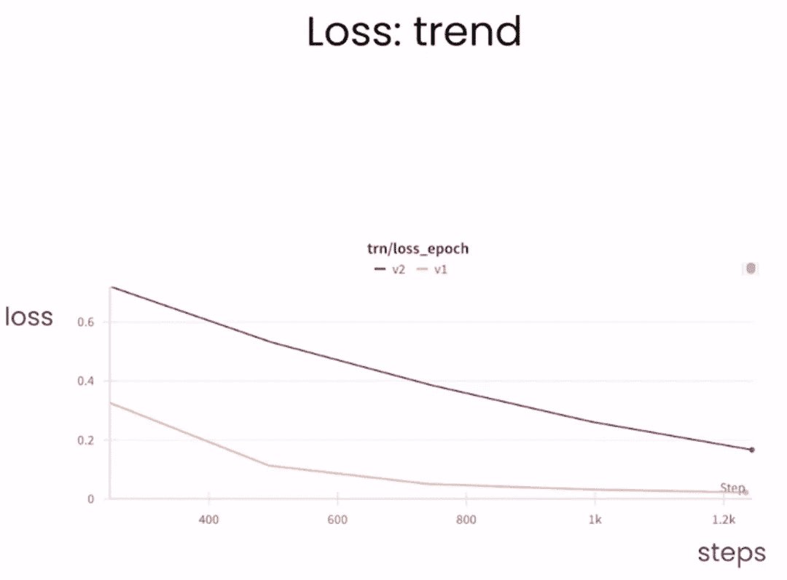

### **（二）See （观察）**

虽然通过看Loss的方式非常简单直观，但是其实最优质的测评方式永远只可能是通过人去对话对判断是否合适。这是因为Loss只能衡量模型预测与真实标签之间的差异，但它并不能全面反映模型在实际任务上的表现。有些损失值可能非常低，但模型在某些关键任务上的表现可能不佳，例如在多类别分类任务中，某些类别的准确率可能很低，但这并不会明显反映在整体的损失值上。

然而都找人来测评的话成本真的会非常高，并且每个人都有自己的判断准则，我们很难去真的说统一判断规则。因此我们还是需要一个多方面的客观的评测方式去确保模型是合适的。比如说下面这种设置几个问题在每次保存模型的时候去测试一下，看是否能够回答问题。然后我们只需要找到那些能力比较强能够回答出我们问题的模型即可。

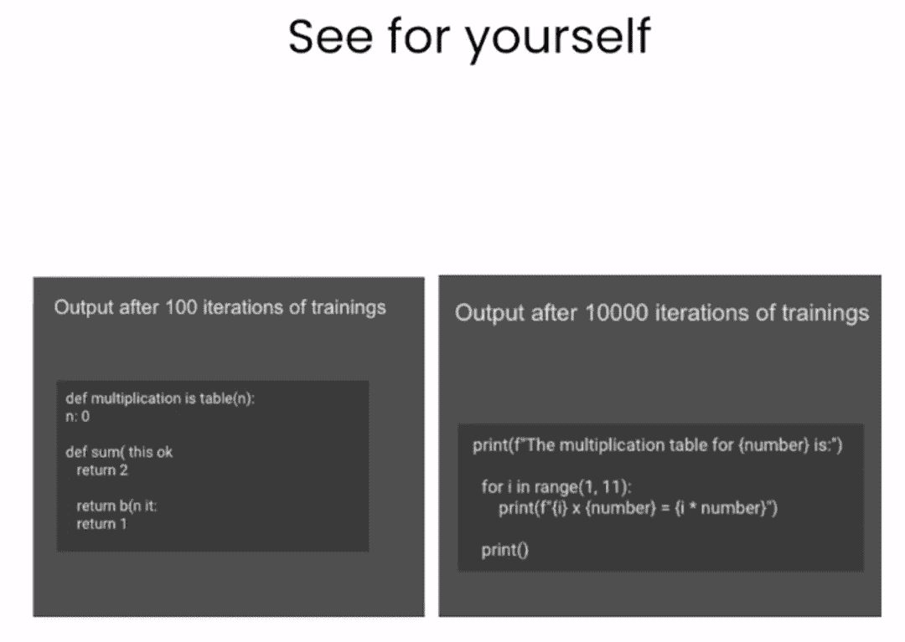

很幸运的是，基于Huggingface库开发的XTuner架构就能够很好的满足这一点要求。我们可以在训练过程中设置很多个问题，然后看看具体回答的结果如何。并且我们也可以调整多久存储一次模型，从而能够找到最适合最好用的模型。

### （三）Compare（模型对比）

除了每一轮都测试几个问题，我们其实还可以通过不同的模型对比来找到最好的模型。比如说我们把训练的第一轮的第二轮的模型拿出来对比一下，然后我们其实就可以直观看到两个模型的能力差别。这种也是更加主观的模式来判定模型的好坏。

那其实有很多的组织都搞了这样一种大语言模型的竞技场，通过让大家在平台上问同一个问题并且让多个大语言模型进行输出，来评选谁的模型比较好，从而能够得出大模型评选的榜单。这样的方式或许比靠高中题目初中题目来考大模型能够更真实的反映模型的能力。


### （四）Benchmark（基准测试）

除了主观的看大模型的回复，目前更加常见的榜单评测方式就是用一些基准的测试来看大语言模型的答对情况。这些基准测试一般就是一些选择题判断题，然后通过提示词工程或者只截取前面几个词的方式来看大语言模型回答的正确与否。基准测试通常用于验证模型的泛化能力和稳定性，并评估其在实际应用场景中的表现。

下面就列举了一些比较常见的测试数据集，包括MMLU、GSM8K等。

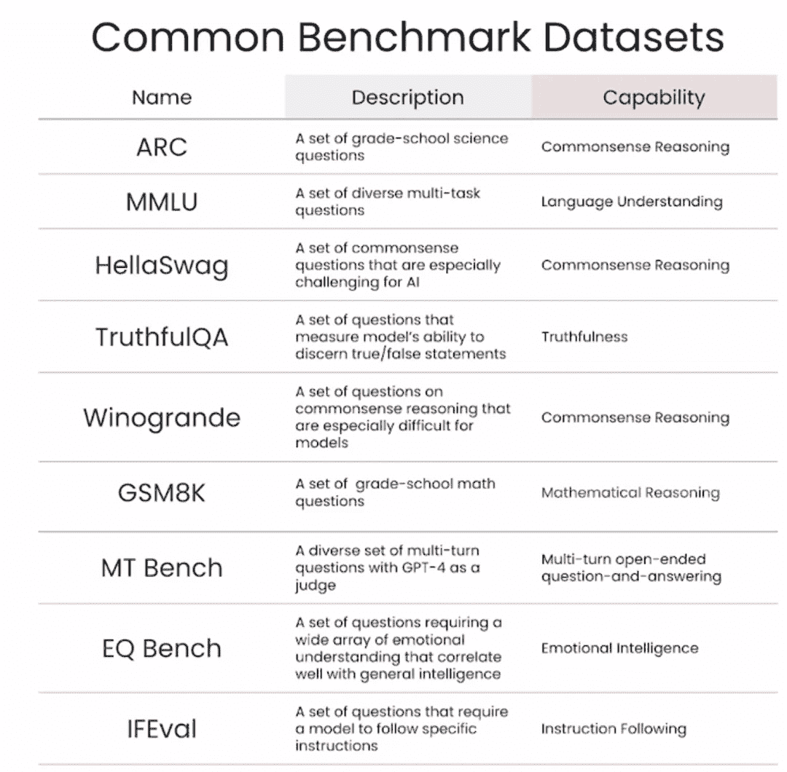

但是由于这些题目可能会泄漏，那导致训练模型的人能够提前将这部份题目训练进大语言模型当中，然后就导致他们在回答的时候非常好，但在更广泛或不同类型的任务上表现不佳，导致对模型实际能力的高估。

同时许多基准测试只关注模型在特定任务上的性能，例如文本分类或问答，而忽略了模型在多样化任务上的表现，如生成式任务、对话系统、情感分析等。因此目前如何正确的评测大语言模型的能力仍然是一个很重要的研究方向，我们很难像计算机视觉一样通过判断识别框或者像素点差异的方式来进行准确的评判。

### （五）安全可靠（Trustworthy）

除了上面四点的评测以外，其实还有一点很重要的是评判模型是否足够的安全可靠呢？所谓的安全可靠其实就是不会生成有害的内容，包括仇恨言论、虚假信息、色情、暴力或歧视性言论。还有就是一些偏见和歧视、数据隐私等内容。这些内容其实与我们社会的主流风向并契合，因此我们其实并不希望让普通人接触到。

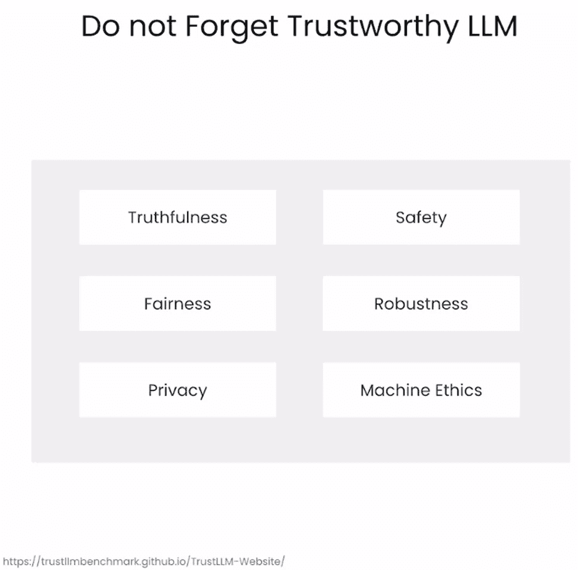

那OpenAI其实提供了一个名为Moderation的API的接口来判断用户的输入或者模型的输出是否安全，假如检测到不安全的情况那就输出一些不相关的东西来提醒。这种也被称为是内容过滤器的方法。

那对于普通开发者而言，在模型训练过程中加入对抗性样本来增强模型的鲁棒性是一种很好的方法。对抗性样本是经过微小扰动的输入，旨在诱导模型生成错误的或不合适的输出。通过训练模型在这些样本上的表现，可以提高其对对抗性攻击的抵御能力。

除此之外，我们其实还可以通过人类反馈的强化学习（Reinforcement Learning from Human Feedback, RLHF）的方式来对齐模型的三观。这种方法尤其适用于生成式任务，如对话生成、文本创作等，旨在使模型的输出更符合人类的期望和安全标准。OpenAI的GPT系列模型（如ChatGPT）就是通过结合RLHF来优化对话生成的，使其能够更好地理解和响应用户的需求。

# **总结**

以上便是这门课的所有内容了，感谢大家坚持观[看到现](https://www.deeplearning.ai/short-courses/pretraining-llms/)[在。假如](https://v11enp9ok1h.feishu.cn/wiki/LFNmw5RXViIhFQkx4rTcmxnznJh)希望更深入的了解也可以看看源视频去深入学习，并且通过代码的实践来直观的看看训练的实际效果。那我们下门课程再见！