# 提示词工程

> 来源：[https://v11enp9ok1h.feishu.cn/docx/JckWdLJftotmZYxf9i1cdrHXnnc](https://v11enp9ok1h.feishu.cn/docx/JckWdLJftotmZYxf9i1cdrHXnnc)

[大语言模型预训练](https://v11enp9ok1h.feishu.cn/wiki/DfOOwfE7IiBVdBk0fUGc8xL0nrf)前[大语言模型微调](https://v11enp9ok1h.feishu.cn/wiki/LFNmw5RXViIhFQkx4rTcmxnznJh)节课的内容中，我们讲述了两个重要的内容—— 和 。对于初学者而言，这是非常重要且必须了解的观念。不知道大家还记不记得在微调课程上，我们就已经对比过提示词工程和微调之间的差别（感兴趣的朋友可以点击上方的“微调”链接来查看)，那时候我们就已经提到提示词工程是一项无门槛提升大语言模型能力的方式。显然这个技术对于所有使用大语言模型的人而言都极其的关键及重要。


因此**这节课我们通过由Meta推出的课程Prom**pt Engineering with Llama 2&3，在与Llama2模型的互动中，深入地看看Prompt Engineering（提示词工程）应该如何进行实践。在去年其实OpenAI就已经在DeepLearning.AI上推出过一门名为ChatGPT Prompt Engineering for Developers的课程，因此在这门课程也会结合一部分这方面的知识来共同讲述。


回想起大语言模型刚刚推出的那段时间，许多大佬包括英伟达的CEO黄仁勋以及百度的CEO李彦宏都说未来可能人们不再需要编程，而只需要写好提示词就行了。一年多过去了，对于我的体会而言，目前的生成式AI其实还不足够智能到实现完全通过提示词就获取到足以满足我们工作所需的代码。并且随着模型能力的提升，提示词工程貌似也没有那么的重要了，我们即便很简单的话就能够让模型理解我们想要的是什么，并且给予我们答案。

然而这其实并不能意味着提示词工程不重要，这是因为我们假如真的要使用商业应用开发，为了满足端侧的推理，我们一般都要部署上开源的小模型。在这个情况下，由于小模型的指令跟随能力较弱，因此需要给出更加精准精确的提示词才能使其很好的完成任务。在这门课程的实战中我们就能看到这一点，7B的小模型很多时候看不懂我们说的内容，除非我们给出详细易懂的提示词。因此，可能日常使用上有无提示词是影响不大的，但是对于真正的应用而言，提高提示词的能力是至关重要的。

那下面就让我们跟随着Meta公司合作伙伴工程高级总监Amit Sangani的脚步来学习一下这门课程的内容吧！这门课程也是非常初学者向的课程，从前期的对模型介绍，然后到真正的使用api来获取模型的回复，再到后续对提示词工程的介绍以及其他模型的介绍。学完这门课就能够让我们对Llama2的全家族模型有了一个全面的了解与认识，就让我们开始吧！


# **LLama简介**

从下图可以看出，对于Llama2模型而言，其有三个尺寸，分别为7B、13B和70B（B代表Billon个参数，7B就是70亿参数，13B就是130亿个参数，以此类推）。那这些没有经过后续Instruction Tuning（指令微调）的模型都是被我们称为是base model（基座模型）。这其实就与我们前两节课所呼应上了，第一节课我们学习的预训练模型其实就是讲述如何训练出一个好的基座模型，然后第二节课所讲述的重点之一就是如何通过指令微调来让模型听得懂人话以及能说人话。为了更好的体现模型的能力，那我们这门课将会使用的也就是那些Llama 2 7B Chat这类型模型。

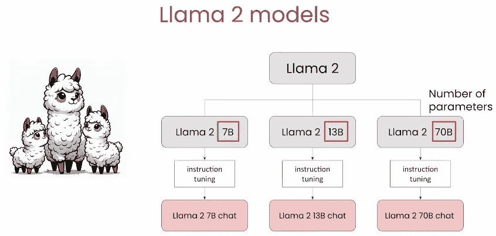

从Llama2官方给出的模型效果看出，整体而言，Llama2已经远超其中比较好的开源模型Falcon 40B，甚至能力已经接近于2021年爆火的GPT3.5的能力与水平了。并且相比于GPT3.5，Llama是开源了自己的全部权重和代码，假如我们的算力资源满足要求，我们可以在Huggingface、ModelScope以及OpenXLab上直接进行下载。

顺带提一句就是，其实正是由于Llama模型从一开始的开源开放，国产的各种“自研“大模型就像雨后春笋一般生长了起来。确实一个能力媲美于GPT3.5的模型其实是能够给各行各业注入一股新的能力。但这也正是Meta希望看到的，Meta通过开源Llama模型系列，不仅推动了AI技术的普及和发展，也巧妙地扩大了自身在AI领域的影响力。通过让更多企业和开发者参与到模型的改进和应用中来，Meta实际上在构建一个庞大的AI生态系统。因此你可以说Meta在做慈善，给全世界的AI开发者注入强心剂，那你也可以说Meta图的是整个生态的构建与Meta公司自身的商业价值。要知道Meta之前说All in元宇宙时股价跌到谷底，现在开源Llama后股价可是节节攀升的，所以或许这也就是开源的魅力吧。

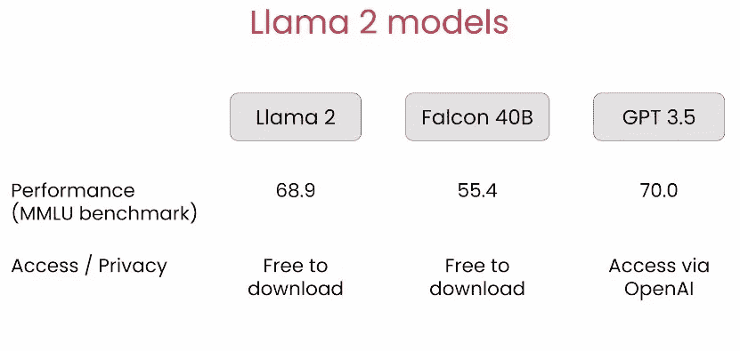

除了正常对话的Chat模型以外，Lla**ma家族中还有一款专**门用于代码撰写的模型Code Llama。这款模型也是基于预训练出来的Llama 2 7B/13B/34B制作而成，并且所有的模型都经过了大量的代码文件进行训练。

那Code Llama分为了三个不同的版本，分别是只经过了长文本微调的基础版本（Code Llama）。其目的使其能够处理更长的输入序列。这样可以提高模型理解和生成长文本或代码的能力，使其在处理需要更多上下文信息的任务时表现更好。

然后进阶版本（Code Llama - Instruct）就是在假如长文本理解的基础上还添加了指令微调的模块，使其能够更好地跟随者我们的提示词完成任务。还有一个Code Llama - Python就是专精于回答Python的问题。除了代码训练以外额外添加了大量的Python代码训练，使得模型在处理Python相关任务时会有更出色的表现。

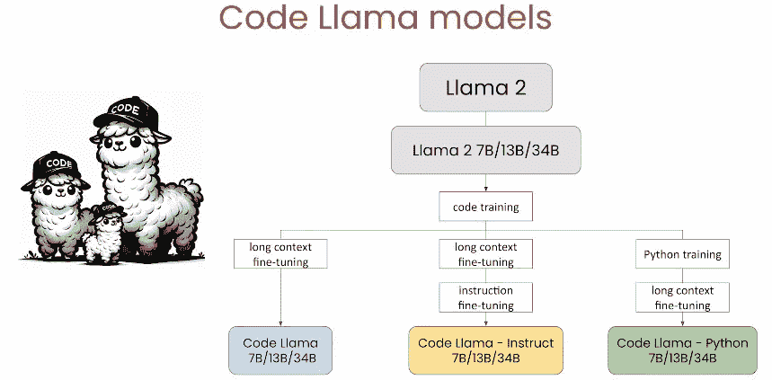

**最后，Llama2还提供**了一个专注于生成式AI安全性的模型——Purple Llama。其主要要解决的问题就是AI生成的代码是安全的且没有信息攻击的风险。并且还有就是希望LLM输出的内容是安全的、诚实的以及无害的。

我们可以通过**CyberSecEval****的工具来评估LLM的输**出是否安全，并且我们也可以利用一个名为Llama Guard的分类器来判断内容是否安全。

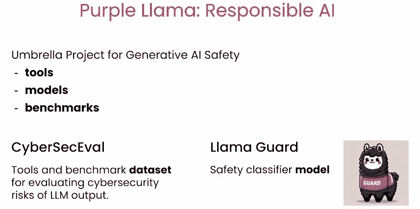

# **开始尝试Llama2**

## **使用方式**

我们有多种方式可以接触到Llama模型，我们可以通过相关托管平台提供的API上付费使用Llama2模型，也可以通过自己在云服务器上配置好模型然后给出API在本地连接。假如本地算力足够的话，我们其实也可以直接在本地电脑上直接配置。在这里面，看似在本地电脑部署不怎么需要花钱，但是实际上，在本地部署的前提是你的本地电脑已经有足够的算力资源了，比如说一个7B的模型可能就需要一张4080以上的显卡才能流程的运行起来。而且真正部署的时候其实会遇到有很多的问题，因此前两种直接调用API的方式是更适合于刚入门者使用。

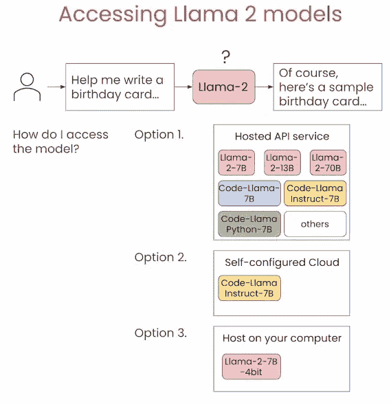

那我们所说的这些托管平台包括了Amazon Bedrock, Google[ Cloud, Mic](https://www.together.ai/)**roso**[ft A](https://siliconflow.cn/zh-cn/about)zure等。这节课我们所使用的托管平台就是Together.ai。我们可以登录官网查找到更多的信息。另外，国内比较大的模型托管平台是硅基流动，也是提供了很多模型的API接口，更多信息可以查看链接。下面我们就对Together AI提供的接口展示一下我们如何调用和使用。

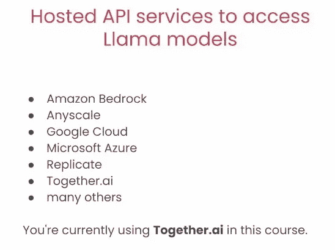

## 查看提示词结构（Verbose）

首先我们需要知道的是，我们输入给大语言模型的提示词并非是我们原来的句子。在当我们输入提示词给到Llama模型的时候，为了能够让模型更清楚理解我的的内容和信息，我们的提示词会自动加上一个开头[INST]和一个结尾的特殊符号[/INST]，这些符号也被称为是Instruction Tags。

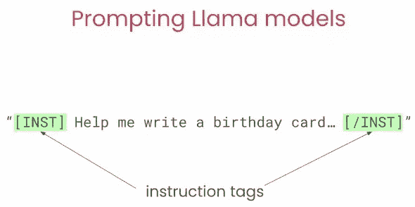

当然，对于用户而言，这些其实并不太需要考虑。因为假如我们是通过这种商业API调用的话一般都是会自动帮我们加上的。我们可以通过代码看得更加清晰。只要我们加上verbose=True，我们就能够看到我们完整输入的提示词（prompt）以及所使用的模型（model）。默认情况下，直接调用llama所使用的模型就是llama-2-7b-chat模型。

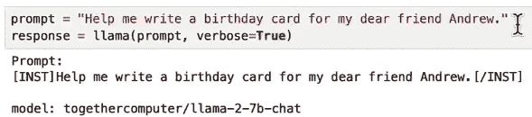

## **指定模型（Model）**

我们也可以感受一下预训练模型的样子。我们可以通过设置model=“xxx”来指定模型，这里我们选择的是”togethercomputer/llama-2-7b”来进行测试。当我们问“法国的首都在哪里”的时候，其回答的是”what is the capital of Germany”这样的答复，因此可以看出对于这种没有经过指令微调的基座模型，指令跟随的能力是非常差的。

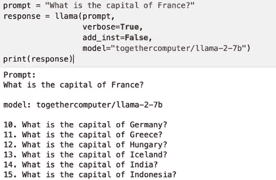

## 随机性控制（Temperature）

假如我们希望回复是连续的，而不是有一定随机性的话，我们也可以考虑在代码中加入一个参数temperature来进行控制。当我们将temperature的值调为0（可以理解为模型回复随机性为0）时，只要我们问的是同一个问题，无论在什么时候问都会得到同样的答复。

```
prompt = &quot;&quot;&quot;
Help me write a birthday card for my dear friend Andrew.
Here are details about my friend:
He likes long walks on the beach and reading in the bookstore.
His hobbies include reading research papers and speaking at conferences.
His favorite color is light blue.
He likes pandas.
&quot;&quot;&quot;
response = llama(prompt, temperature=0.0)
print(response)
```

> Temperature 是一个用于控制语言模型输出随机性的关键参数。它通常是一个介于 0 到 1 之间的数值，影响模型在生成文本时的"创造性"程度。较低的 temperature 会使模型倾向于选择最可能的词，产生更加保守和一致的输出；而较高的 temperature 则会增加低概率词被选中的机会，导致更加多样化但可能不那么连贯的结果。

> [temperature，topk傻傻分不清？一文带你读懂LLM推理超参](https://larkcommunity.feishu.cn/wiki/Vyl1wWDFNi0jdRkBeyVcvNHbnLh)一步理解temperature可以阅读我们往期文章

## 控制最长输出（Max_Token）

对于llama2模型而言，输入输出的尺寸也是有限制的，其输入输出的总和不能够超过4097个token。就比如下面这个例子，我们给的输入是3974个token，那我们剩下给输出的token就只剩下4097-3974=123个token了，假如我们设置的输出超过123个token的话，这个程序就会报错。

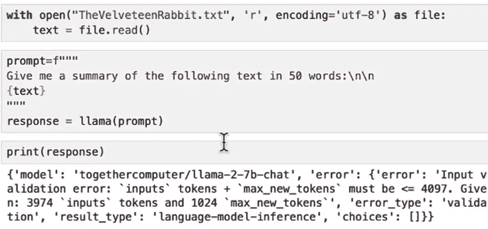

因此我们需要设定response的max_token为123才能保证程序的正确运行。因此的话，我们也可以自动为模型添加一个检查输入的token然后用4097减去它，这样除非输入本身就大于4097个token了，不然就能够保证程序不会出现报错。

```
# set max_tokens to stay within limit on input + output tokens
prompt = f&quot;&quot;&quot;
Give me a summary of the following text in 50 words:\n\n
{text}
&quot;&quot;&quot;
response = llama(prompt,
                max_tokens=123)
```

## **记忆**

对于我们直接调用的模型，其实是不会记得我们之前输入的上下文的。

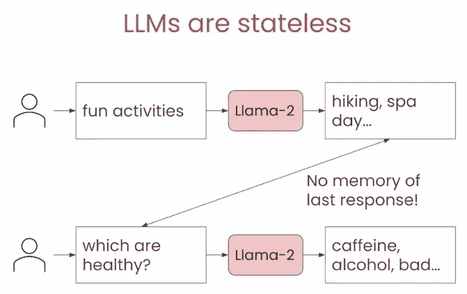

这主要是因为我们并没有将之前的内容输入作为上下文输入给模型让其为我们回复。

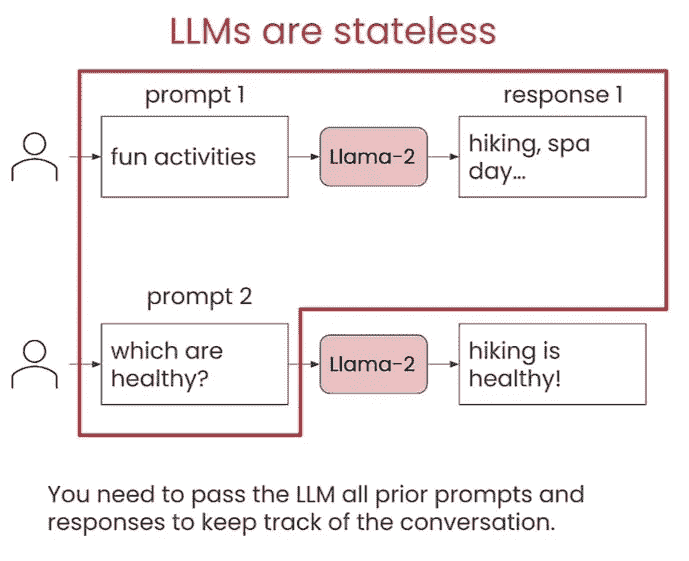

但是这里所说的上下文并不是直接把对**话输入进去即可，其实**理**论上我们是需要加**上start tags和end tags以及prompt相关的[INST]这种特殊符号才能让模型完全看懂这是上下文的内容。不然的话模型就只是看到了一大段话而看不懂这是一轮轮的对话。

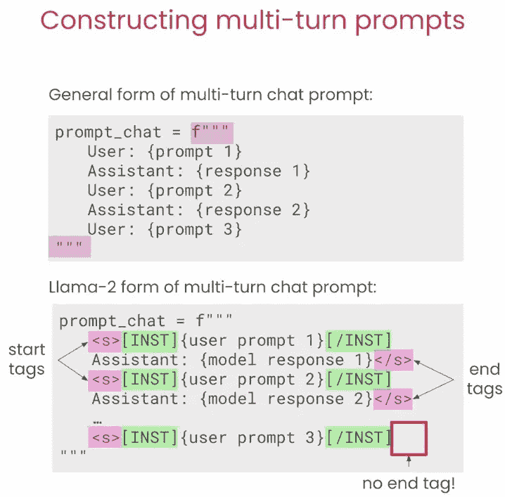

那其实我们可以在代码层面上手动添加。比如下面这样，我们设定好了第一个prompt以及回复response，然后再添加第二个想要其回答的问题。接下来我们自己构建起一个chat_prompt把这两个都囊括进去，并且添加上这些特殊符号后，统一作为新的prompt传给模型。这个时候模型也会基于我们之前的回复给予我们答案。

```
prompt_1 = &quot;&quot;&quot;
    What are fun activities I can do this weekend?
&quot;&quot;&quot;
response_1 = llama(prompt_1)

prompt_2 = &quot;&quot;&quot;
Which of these would be good for my health?
&quot;&quot;&quot;

chat_prompt = f&quot;&quot;&quot;
&lt;s&gt;[INST] {prompt_1} [/INST]
{response_1}
&lt;/s&gt;
&lt;s&gt;[INST] {prompt_2} [/INST]
&quot;&quot;&quot;
print(chat_prompt)

response_2 = llama(chat_prompt,
                 add_inst=False,
                 verbose=True)
                 
print(response_2)
```

除此之外，我们其实可以直接从Together.AI中的一个名为llama_chat的库调用一些方法让我们不用手动添加这些特殊符号。

我们从代码中可以看到，我们只需要输入prompts = [prompt_1, prompt_2]（也就是之前所有输入的prompt）以及responses = [response_1]（之前所有输出的response）就可以让系统自动为我们加上特殊符号，然后在输入到模型的时候把这些prompts和reponses放进去即可。

```
# 之前是from utils import llama
from utils import llama_chat

prompt_1 = &quot;&quot;&quot;
    What are fun activities I can do this weekend?
&quot;&quot;&quot;
response_1 = llama(prompt_1)

prompt_2 = &quot;&quot;&quot;
Which of these would be good for my health?
&quot;&quot;&quot;

prompts = [prompt_1,prompt_2]
responses = [response_1]

# Pass prompts and responses to llama_chat function
response_2 = llama_chat(prompts,responses,verbose=True)

print(response_2)
```

当然，随着我们聊天得越多，上下文其实也会越来越长，可能就会超过模型规定的最大上下文数，导致模型无法使用。而且越长的长下文代表需要花费的算力或者说金钱就越多，因此如何选择合适的记忆方式是一个非常值得考究的话题。

之前在Langchain里就有过几个方案，一个就是和这个一样全部保留，还有就是总结一些这些上下文然后进行传递，另外还有就是只保留上一次的对话内容，最后还有就是只保留500个token的内容。这些都是可选择的方案，大家也可以根据情况酌情选择。

# **提示词工程技巧**

Prompt Engineering 是一种技术，允许你通过特定指令或包含不同类型的信息（即"上下文"）来引导模型改善其对你任务的响应。有几种方法可以实现这一点：

1.  提供你正在尝试执行的任务的示例

1.  指定模型如何格式化响应

1.  要求模型在创建响应时假设特定的"角色或人格"

1.  包含额外的信息或数据供模型在其响应中使用

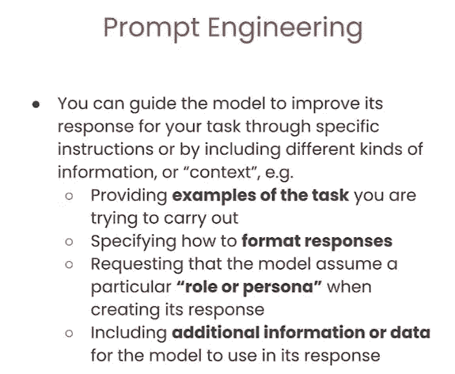

需要注意的是，有些时候，有些任务解决不了，可能是因为模型太小、能力不够的原因，用参数量大一点的模型可能会更好。然后其实对于比较弱的模型而言，提示词工程是非常重要的，但是对于更强的模型而言，详细复杂的提示词反而变得没那么重要，因为模型的能力已经很强了，只要你表达出你基本的意思它就能够理解了。而弱的模型一定要你把问题说得很清楚才看得懂。

## Zero-shot prompting（不包含示例的提示词）

那对于提示词工程而言，最简单的就是直接来进行提问，比如说直接就是用冒号来让其理解含义。下面这个例子就是如此，就直接用Message: xxx Sentiment: 的方式来让模型理解，甚至没有通过这样一句“你认为这句话Message:”xxx“的Sentiment是什么呢？”。在这种情况下，对于小模型而言是很难准确的按照要求来进行回复，因为语义信息非常不明显，因此可能我们还需要进一步的调整。

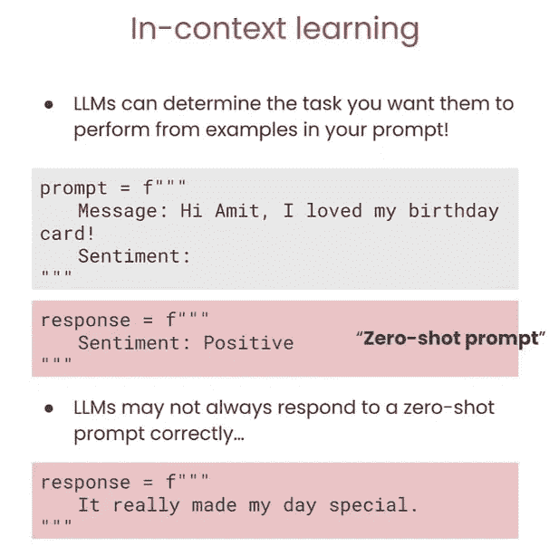

## Few-shot prompting（包含少量示例的提示词）

那在直接询问的基础上，Few-shot prompting的意思就是给几个相关的例子作为案例，让模型理解他需要输出的内容是什么。就比如下面同样的问题给到模型，但是不同的是在问问题之前给出了一个完整的案例告诉模型回答的模型。在这种情况下，小模型更有可能能够准确回答出问题。由此得出，在询问问题的时候，给出示范案例是能够显著提升模型输出效果的，尤其是在格式上有要求的情况下。

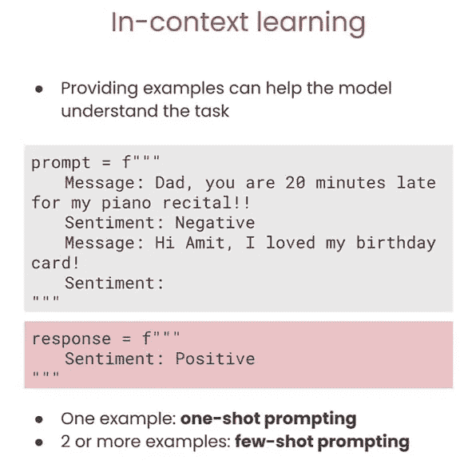

## **明确输出格式**

假如我们格式上有任何要求的话，其实我们需要清晰的给模型表达出来。比如说上面语义的案例，我们假如修改为“你认为这句话Message:”xxx“的Sentiment是什么呢？最后请以 Sentiment: Positive 或者 Sentiment: Negative的格式输出” 的话，模型是更有可能回复出来的。下面的例子也是一样，假如我们只想让其输出Positive或者Negative的话，那明确的在最后告知只用输出一个词是非常有必要的。

```
prompt = &quot;&quot;&quot;
Message: Hi Dad, you&#x27;re 20 minutes late to my piano recital!
Sentiment: Negative

Message: Can&#x27;t wait to order pizza for dinner tonight
Sentiment: Positive

Message: Hi Amit, thanks for the thoughtful birthday card!
Sentiment: ?

Give a one word response.
&quot;&quot;&quot;
response = llama(prompt)
print(response)
```

在实际使用过程中，我们会发现大语言模型经常会“偷懒”，即便我们让其写1500字的文章，我们会发现其最多写了800字。那因此假如我们想让其写1500字的话我们最好说请写2500字左右的文章，这样扩大自己要求的说法可能让模型更好的满足我们的需求。不过模型输出的上下文也是有上限的，所以我们假如发现模型一直卡在输出某一个长度，那可能这个就是其最大的长度了。不过我们可以分段让其进行扩写从而获得我们想要的字数。

## **角色定义**

有些时候我们可以指定某个角色给到模型让其扮演，从而能够回答得更加专业。比如当我们直接问一个问题的时候，可能模型只会很泛泛的回答你，但是当我们指定某个角色的时候，或许模型能够根据训练时角色的资料带入到该角色相关的领域内，从而给出更加特质化的回复。

比如下面我们指定是生活导师的话，回复会更加像一名循循善诱的导师而非单纯给你建议的人。假如我们在请教如何讲解某个内容的时候说请作为一名新老师给学生讲课的场景，那给出的内容会更简单易懂且好操作。角色扮演能让模型对同一问题的输出变得多样化，从而让我们从各个角度来看待并解决问题。

```
role = &quot;&quot;&quot;
Your role is a life coach \
who gives advice to people about living a good life.\
You attempt to provide unbiased advice.
You respond in the tone of an English pirate.
&quot;&quot;&quot;

prompt = f&quot;&quot;&quot;
{role}
How can I answer this question from my friend:
What is the meaning of life?
&quot;&quot;&quot;
response = llama(prompt)
print(response)
```

## **需求总结**

大语言模型也特别擅长于总结内容，从而节省我们的时间。我们其实只需要把原文放进去，然后告诉其总结并给出具体的要求即可获取到一大段好的回复。

```
email = &quot;&quot;&quot;
Dear Amit,

An increasing variety of large language models (LLMs) are open source, or close to it. The proliferation of models with relatively permissive licenses gives developers more options for building applications.

Here are some different ways to build applications based on LLMs, in increasing order of cost/complexity:

Prompting. Giving a pretrained LLM instructions lets you build a prototype in minutes or hours without a training set. Earlier this year, I saw a lot of people start experimenting with prompting, and that momentum continues unabated. Several of our short courses teach best practices for this approach.
One-shot or few-shot prompting. In addition to a prompt, giving the LLM a handful of examples of how to carry out a task — the input and the desired output — sometimes yields better results.
Fine-tuning. An LLM that has been pretrained on a lot of text can be fine-tuned to your task by training it further on a small dataset of your own. The tools for fine-tuning are maturing, making it accessible to more developers.
Pretraining. Pretraining your own LLM from scratch takes a lot of resources, so very few teams do it. In addition to general-purpose models pretrained on diverse topics, this approach has led to specialized models like BloombergGPT, which knows about finance, and Med-PaLM 2, which is focused on medicine.
For most teams, I recommend starting with prompting, since that allows you to get an application working quickly. If you’re unsatisfied with the quality of the output, ease into the more complex techniques gradually. Start one-shot or few-shot prompting with a handful of examples. If that doesn’t work well enough, perhaps use RAG (retrieval augmented generation) to further improve prompts with key information the LLM needs to generate high-quality outputs. If that still doesn’t deliver the performance you want, then try fine-tuning — but this represents a significantly greater level of complexity and may require hundreds or thousands more examples. To gain an in-depth understanding of these options, I highly recommend the course Generative AI with Large Language Models, created by AWS and DeepLearning.AI.

(Fun fact: A member of the DeepLearning.AI team has been trying to fine-tune Llama-2-7B to sound like me. I wonder if my job is at risk? 😜)

Additional complexity arises if you want to move to fine-tuning after prompting a proprietary model, such as GPT-4, that’s not available for fine-tuning. Is fine-tuning a much smaller model likely to yield superior results than prompting a larger, more capable model? The answer often depends on your application. If your goal is to change the style of an LLM’s output, then fine-tuning a smaller model can work well. However, if your application has been prompting GPT-4 to perform complex reasoning — in which GPT-4 surpasses current open models — it can be difficult to fine-tune a smaller model to deliver superior results.

Beyond choosing a development approach, it’s also necessary to choose a specific model. Smaller models require less processing power and work well for many applications, but larger models tend to have more knowledge about the world and better reasoning ability. I’ll talk about how to make this choice in a future letter.

Keep learning!

Andrew
&quot;&quot;&quot;

prompt = f&quot;&quot;&quot;
Summarize this email and extract some key points.
What did the author say about llama models?:

email: {email}
&quot;&quot;&quot;

response = llama(prompt)
print(response)
```

## **提供外部辅助信息**

那假如我们希望模型能够回复出一些最新的消息，那我们其实要做的就是提供给它一大段内容，然后依靠他们的能力在这些内容中找到最合适的内容来回复你。这对于大语言模型来说也是不难的事情。比如我们直接问模型谁赢得了2023年的女子世界杯，那其回复很有可能是错误的。但是假如我们先给出一段新闻或者相关内容，那模型的回复大概率是正确的。因此这也展示出了模型强大的搜索以及总结的能力。在大语言模型的测评中，“大海捞针”（从大段文字中找到具体隐藏的内容）也是模型能力的重要测评之一，很多闭源的模型比如Claude 3.5 Sonnet就能够做到百分百的准确，而开源模型能够达到70%的都很难，这也体现出了模型能力之间的差异。

```
context = &quot;&quot;&quot;
The 2023 FIFA Women&#x27;s World Cup (Māori: Ipu Wahine o te Ao FIFA i 2023)[1] was the ninth edition of the FIFA Women&#x27;s World Cup, the quadrennial international women&#x27;s football championship contested by women&#x27;s national teams and organised by FIFA. The tournament, which took place from 20 July to 20 August 2023, was jointly hosted by Australia and New Zealand.[2][3][4] It was the first FIFA Women&#x27;s World Cup with more than one host nation, as well as the first World Cup to be held across multiple confederations, as Australia is in the Asian confederation, while New Zealand is in the Oceanian confederation. It was also the first Women&#x27;s World Cup to be held in the Southern Hemisphere.[5]
This tournament was the first to feature an expanded format of 32 teams from the previous 24, replicating the format used for the men&#x27;s World Cup from 1998 to 2022.[2] The opening match was won by co-host New Zealand, beating Norway at Eden Park in Auckland on 20 July 2023 and achieving their first Women&#x27;s World Cup victory.[6]
Spain were crowned champions after defeating reigning European champions England 1–0 in the final. It was the first time a European nation had won the Women&#x27;s World Cup since 2007 and Spain&#x27;s first title, although their victory was marred by the Rubiales affair.[7][8][9] Spain became the second nation to win both the women&#x27;s and men&#x27;s World Cup since Germany in the 2003 edition.[10] In addition, they became the first nation to concurrently hold the FIFA women&#x27;s U-17, U-20, and senior World Cups.[11] Sweden would claim their fourth bronze medal at the Women&#x27;s World Cup while co-host Australia achieved their best placing yet, finishing fourth.[12] Japanese player Hinata Miyazawa won the Golden Boot scoring five goals throughout the tournament. Spanish player Aitana Bonmatí was voted the tournament&#x27;s best player, winning the Golden Ball, whilst Bonmatí&#x27;s teammate Salma Paralluelo was awarded the Young Player Award. England goalkeeper Mary Earps won the Golden Glove, awarded to the best-performing goalkeeper of the tournament.
Of the eight teams making their first appearance, Morocco were the only one to advance to the round of 16 (where they lost to France; coincidentally, the result of this fixture was similar to the men&#x27;s World Cup in Qatar, where France defeated Morocco in the semi-final). The United States were the two-time defending champions,[13] but were eliminated in the round of 16 by Sweden, the first time the team had not made the semi-finals at the tournament, and the first time the defending champions failed to progress to the quarter-finals.[14]
Australia&#x27;s team, nicknamed the Matildas, performed better than expected, and the event saw many Australians unite to support them.[15][16][17] The Matildas, who beat France to make the semi-finals for the first time, saw record numbers of fans watching their games, their 3–1 loss to England becoming the most watched television broadcast in Australian history, with an average viewership of 7.13 million and a peak viewership of 11.15 million viewers.[18]
It was the most attended edition of the competition ever held.
&quot;&quot;&quot;

prompt = f&quot;&quot;&quot;
Given the following context, who won the 2023 Women&#x27;s World cup?
context: {context}
&quot;&quot;&quot;
response = llama(prompt)
print(response)
```

## **Chain-of-thought** Prompting（含思维链的提示词）

除此之外，还有一些提示词工程的小技巧可以参考学习一下。比如说在模型的最后加上请一步步思考或者解释你回答的原因可能会让模型效果更好。在arixv上其实专门有一篇论文总结了哪些chain-of thought的提示词比较好用，大家也可以在上面搜搜Prompting Engineering来查看一下。

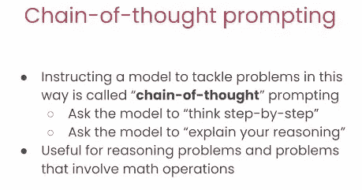

```
prompt = &quot;&quot;&quot;
15 of us want to go to a restaurant.
Two of them have cars
Each car can seat 5 people.
Two of us have motorcycles.
Each motorcycle can fit 2 people.

Can we all get to the restaurant by car or motorcycle?

Think step by step.
&quot;&quot;&quot;
response = llama(prompt)
print(response)
```

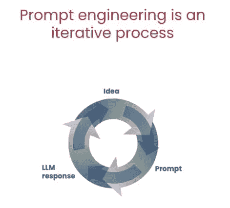

# **不同模型之间的对比**

通过之前的课程内容，我们知道Llama2里面有很多种不同的模型，包括预训练的Llama 2 7-70B以及经过指令微调的chat模型。

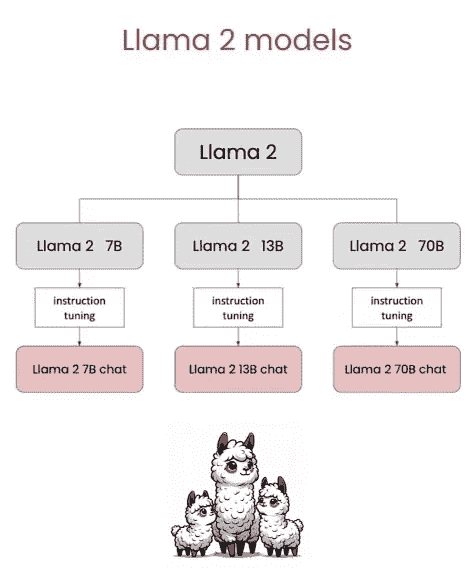

那对于不同尺寸的模型而言，其适合不同的任务。由于预训练模型并没有接受指令微调，不能很好的完成日常的对话任务，因此这里都是chat模型。由于模型大小会影响模型的能力以及消耗的资源，因此对于小模型而言，一般都是交给其一些简单的工作进行完成，比如说上面一样提取个语义什么的。那越大的模型能力越强，像是Llama 2 70B的能力应该是逼近GPT-3.5了，因此其能够有能力解决一些更复杂的问题。

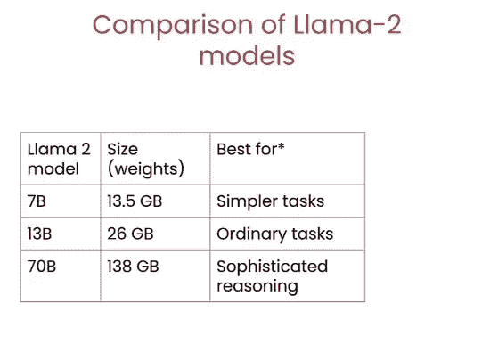

下面的能力评分就很能展现出问题来了，Llama 2 7B的模型比其70B的模型低了8分左右，这8分也展现出了模型能力之间的差异。

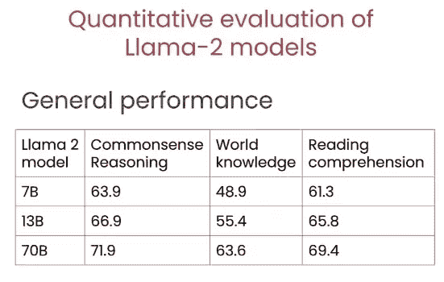

而对比上安全性而言，由于预训练模型并没有太多有毒信息的预防能力，因此成绩也比较差。

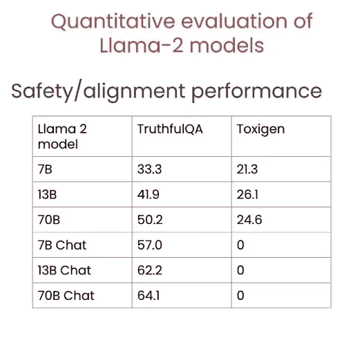

总之，从目前的经验上来看，同一类型越大的模型能力越强，但是相对应的推理的资源消耗也越高。小模型虽然能力不那么强，但是假如经过微调也能处理一下小任务。

# **Code Llama**

根据第一节课的内容我们知道，Code Llama模型分为以下几种。

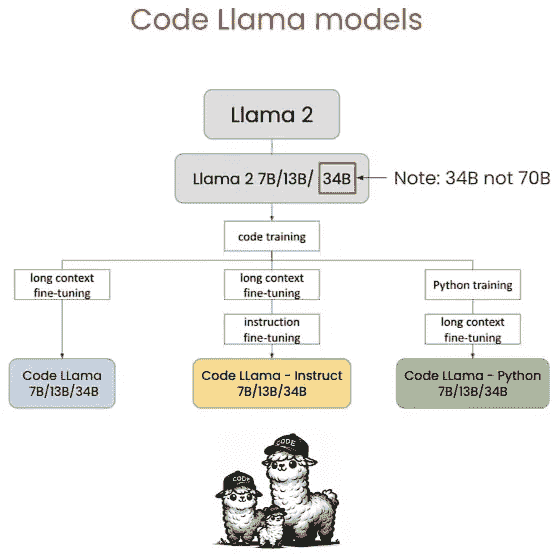

那所有的这些模型都能够在Together.AI中进行尝试并使用。

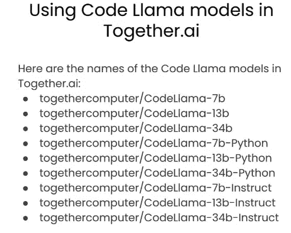

需要注意的是，对于Code Llama Instruct模型是需要加入tags的，但是对于Code Llama和Code Llama Python模型是不需要的。

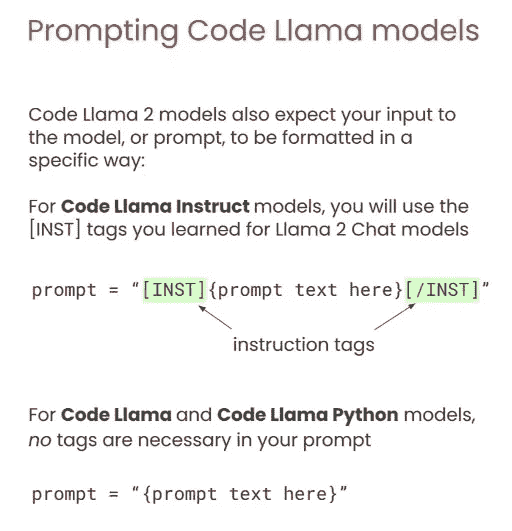

我们可以通过代码实战来测试一下Code Llama模型的能力。

# **Llama Guard**

Llama Guard是Meta推出的专门为了解决道德问题的模型。其通过安全分类的训练，从而识别出一些不安全的情况并进行拦截。

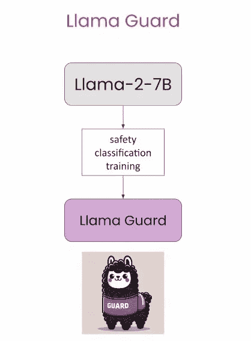

那在正常情况下，Guard模型其实是不会触发的，只会正常的输入和输出内容。

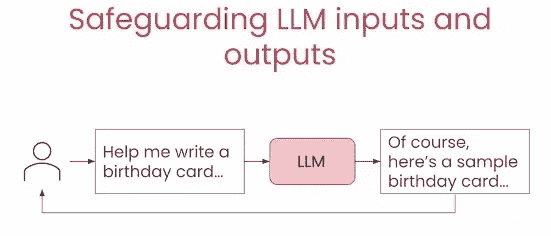

到那时假如safeguard检测到时有问题的话，那就会拒绝掉输出该部分内容，转为输出一些套话说这个问题我无法解决。

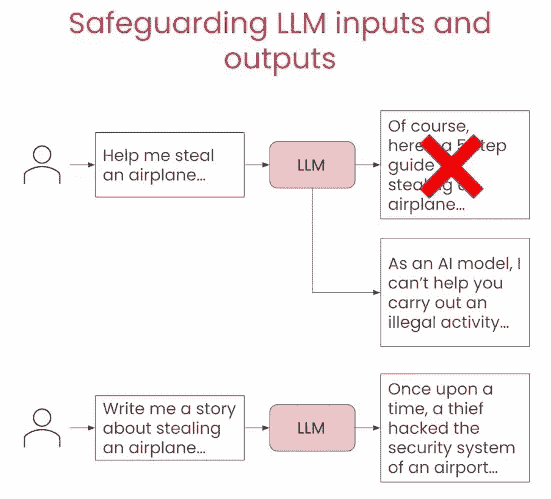

总的来说就是在模型的接受提示词后就进行一次审核，看是否符合道德的要求，假如出现暴力或者违法犯罪的事情，那么就在输出之前把它拦截下来。假如啥事没有，那就让其正常的输出

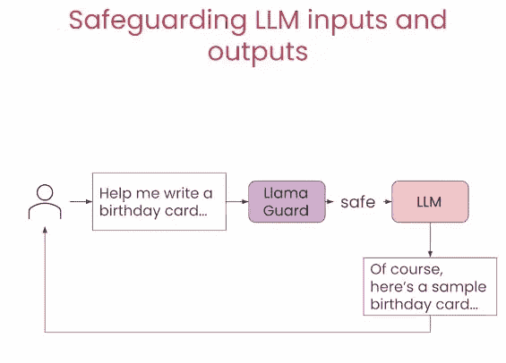

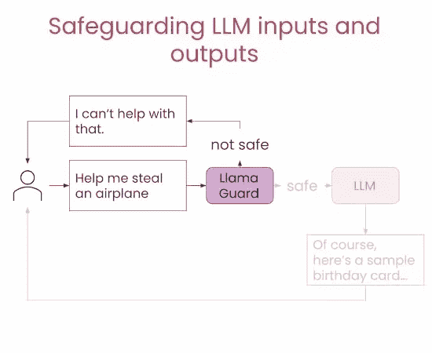

但是有些时候我们发现只检查提示词还不够，因为有些时候Guard模型可能出现误判让一些原本应该拦截的问题没有被拦截。因此我们还可以选择在输入输出都进行检查，从而减少出错的可能。

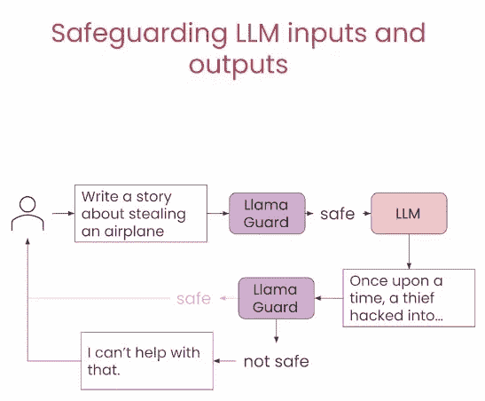

# 总结

以上就是该课程的全部内容了，这门课程主要是在前两门课程的延伸，通过一个开源的大模型Llama2向大家介绍一些大模型的调用以及相关模型的应用等。那从下节课开始，我们将会进入学习RAG相关的一些课程内容，这也是在short course里范围最广影响力最大的内容了，那我们下节课见！