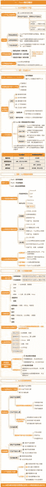
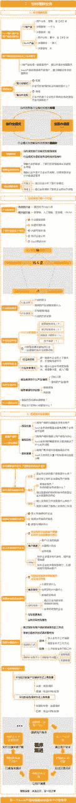
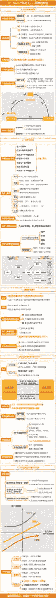
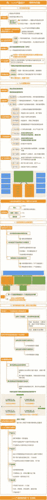

# SaaS产品经理知识地图

> 来源：[https://v11enp9ok1h.feishu.cn/docx/HgDXduXj9oy06WxO4P5cQSLVnff](https://v11enp9ok1h.feishu.cn/docx/HgDXduXj9oy06WxO4P5cQSLVnff)

# 一、SaaS模式概述

# 二、如何理解业务

# 三、SaaS产品定义—产品与价值

# 四、SaaS产品设计—架构与功能

