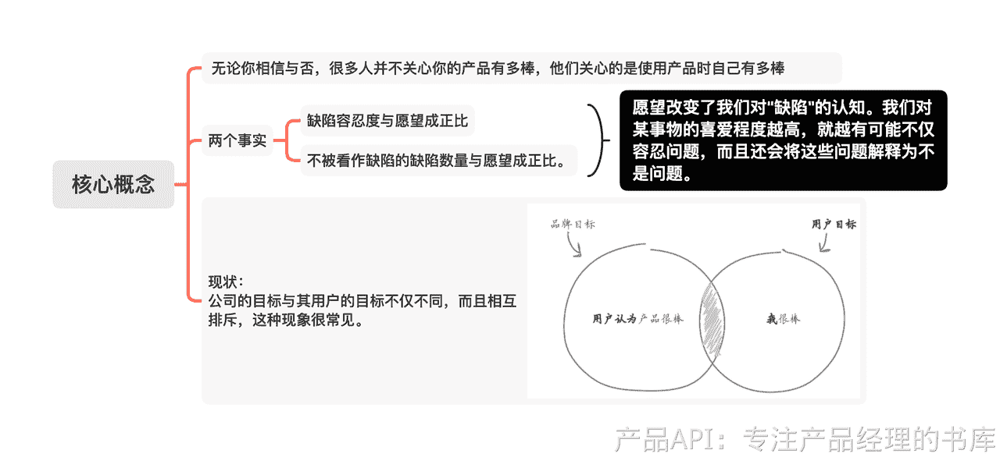
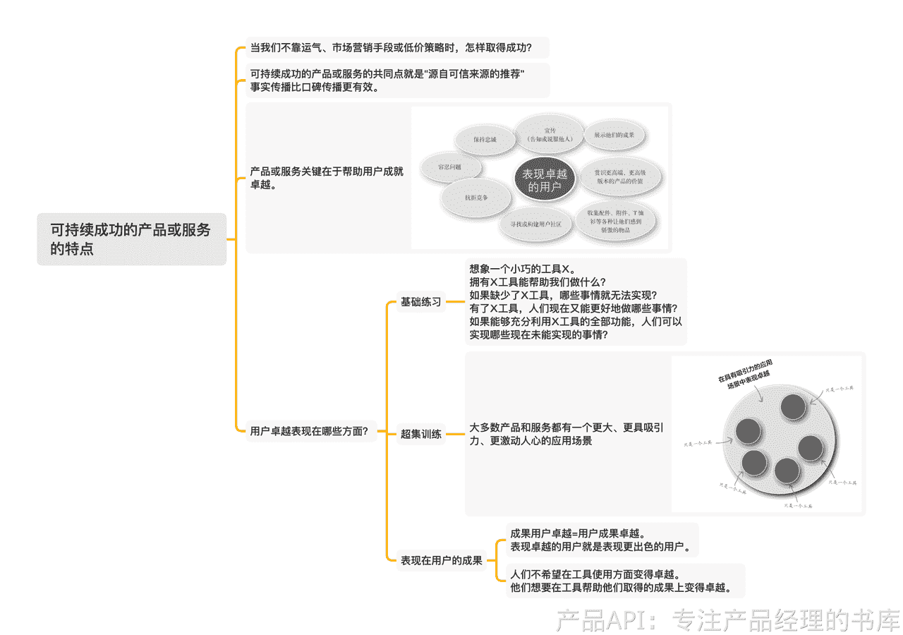
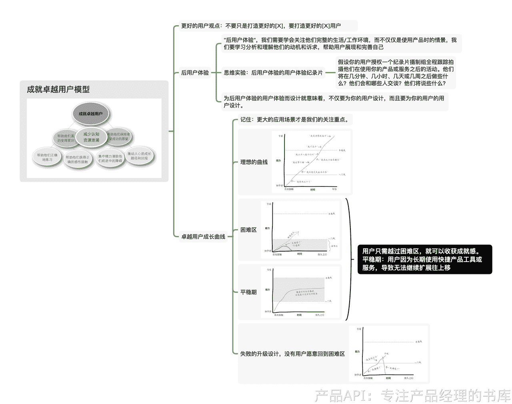
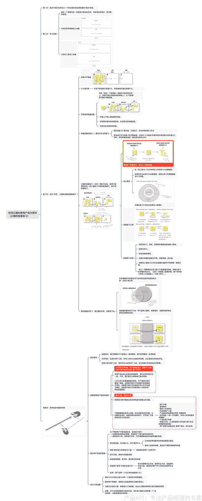
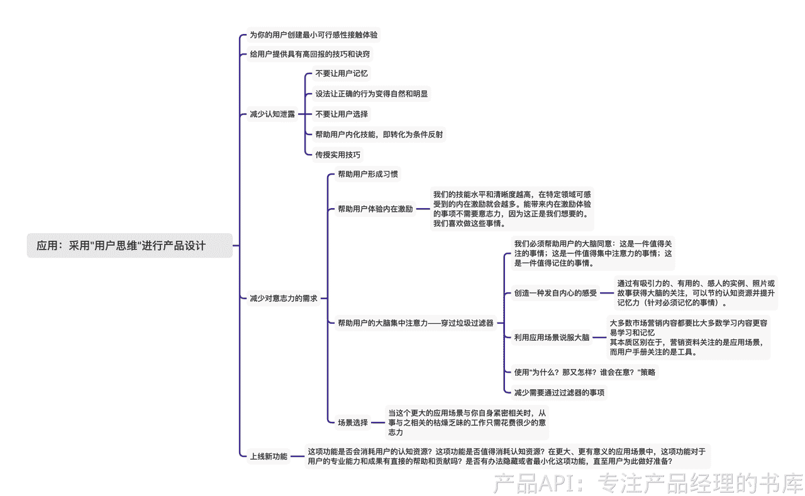

# 如何做产品需求分析

> 来源：[https://v11enp9ok1h.feishu.cn/docx/Jme2dfjcvoB9TTx89ktcX91Ynwe](https://v11enp9ok1h.feishu.cn/docx/Jme2dfjcvoB9TTx89ktcX91Ynwe)

# 用户思维

## 核心概念

## 可持续成功的产品或服务的特点

## 成就卓越用户模型

## 如何正确的帮用户成为更好

## 应用:用户思维的产品设计

