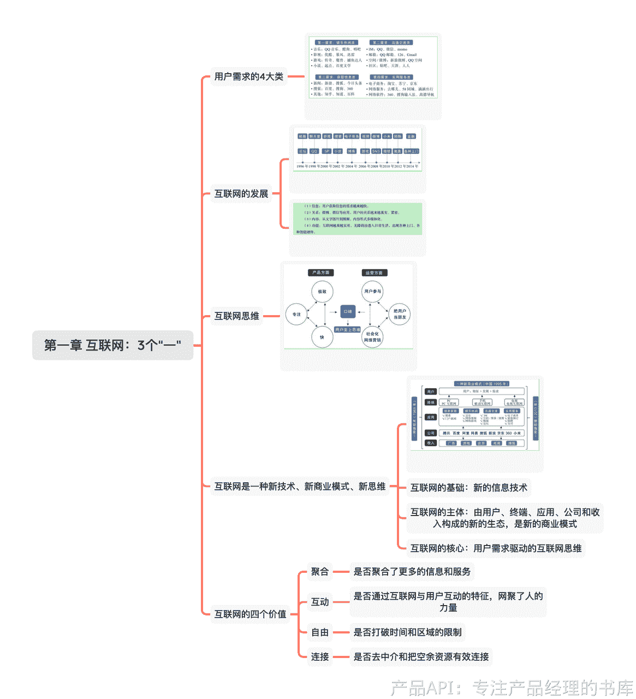
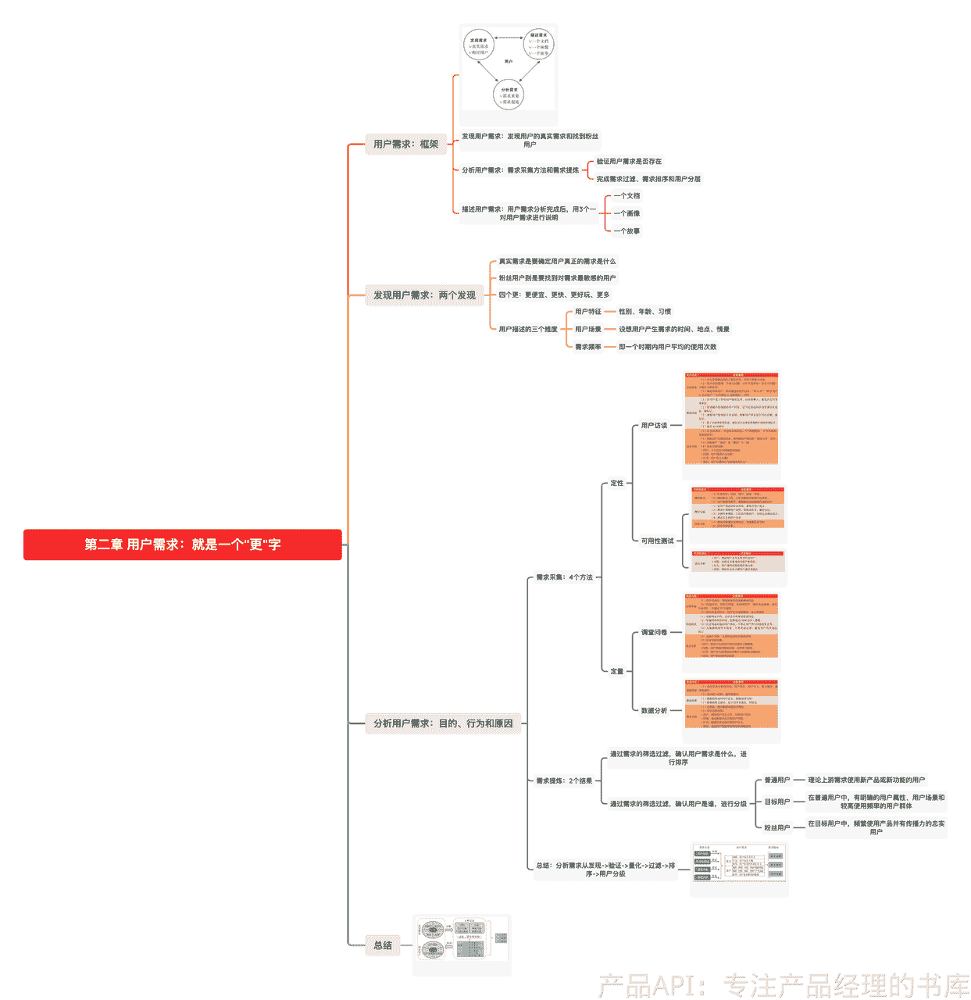
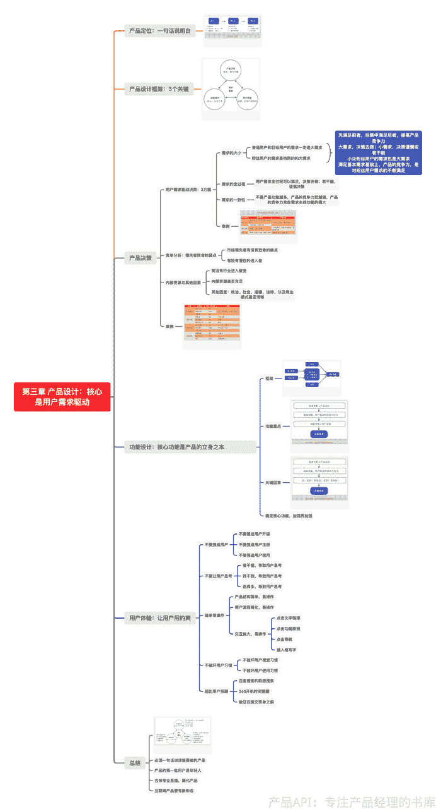
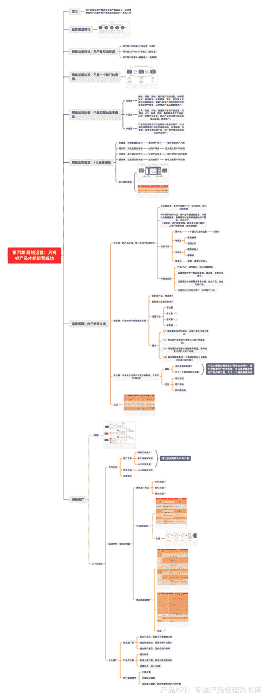
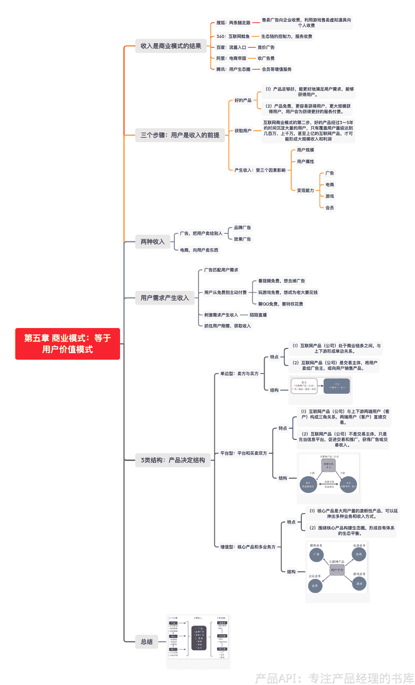

# 需求驱动的产品

> 来源：[https://v11enp9ok1h.feishu.cn/docx/Vuq1da6mvoy5BOx7LCMc6ISPnec](https://v11enp9ok1h.feishu.cn/docx/Vuq1da6mvoy5BOx7LCMc6ISPnec)

## 导图

## 第一章 互联网:3个“一”

## 第二章 用户需求:就是一个“更”字

## 第三章 产品设计:核心是用户需求驱动

## 第四章 网络运营:只有好产品才能运营成功

## 第五章 商业模式:等于用户价值模式

