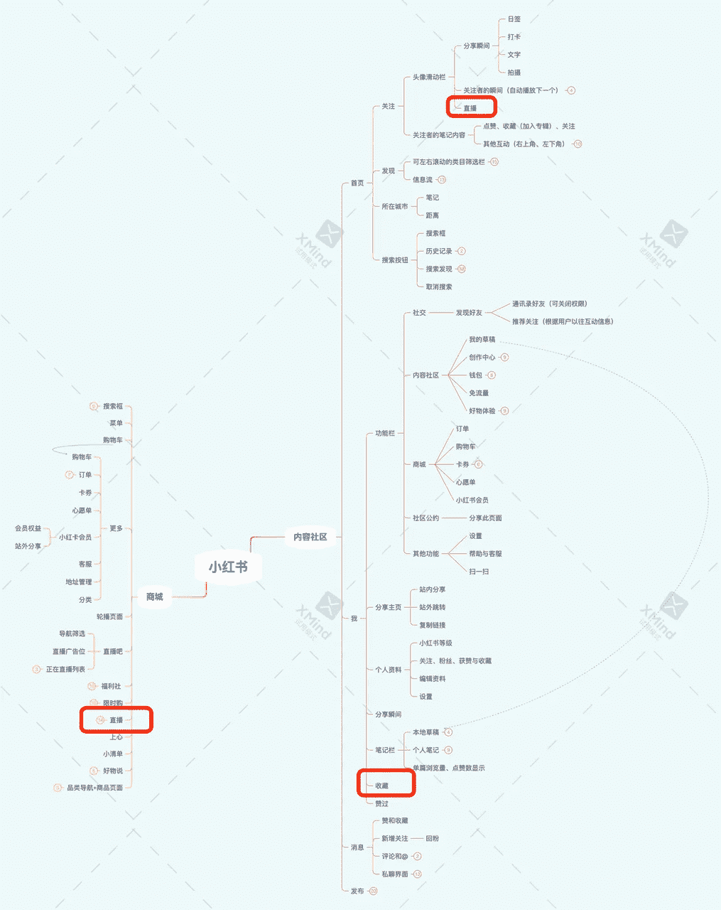
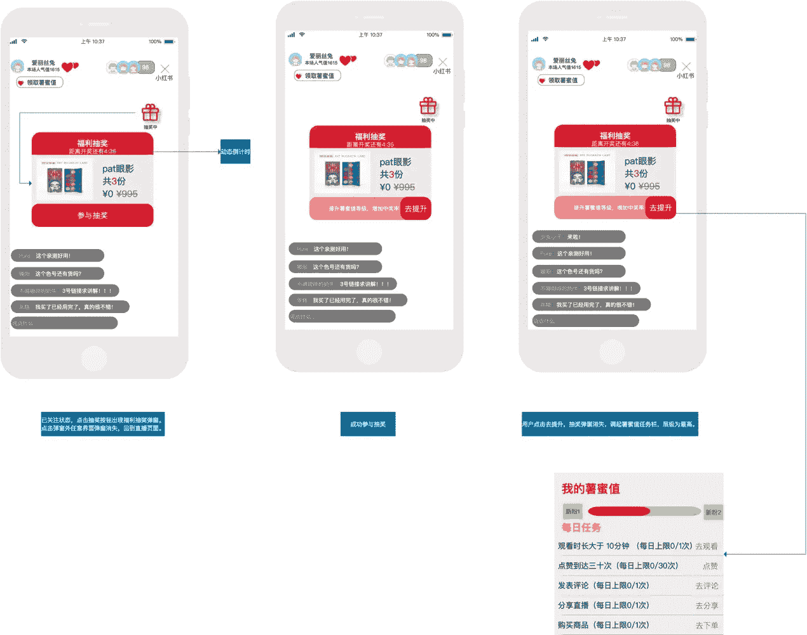
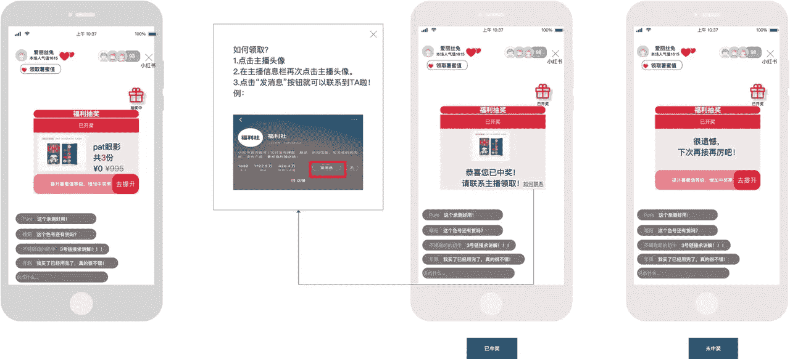
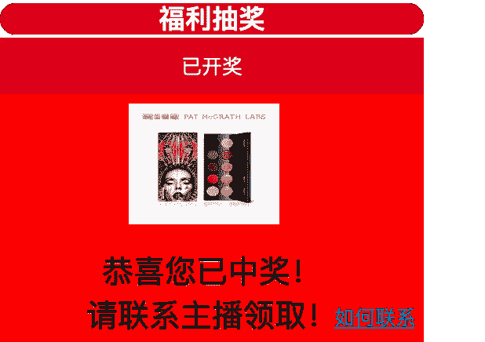
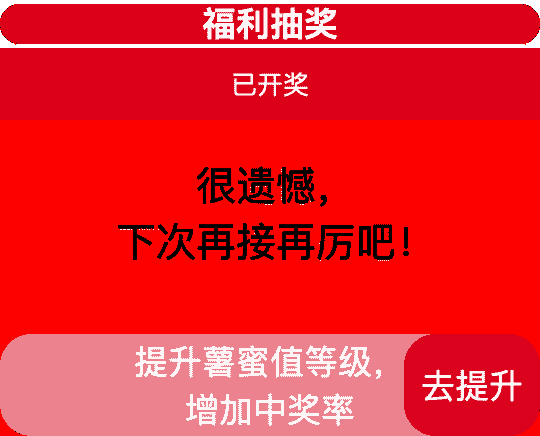
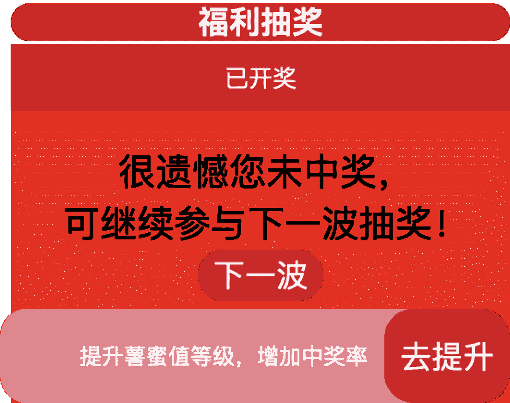
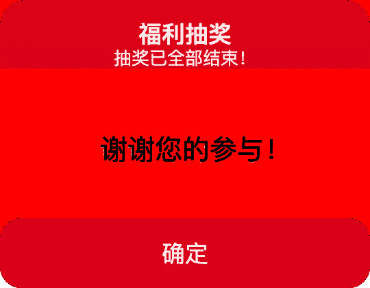
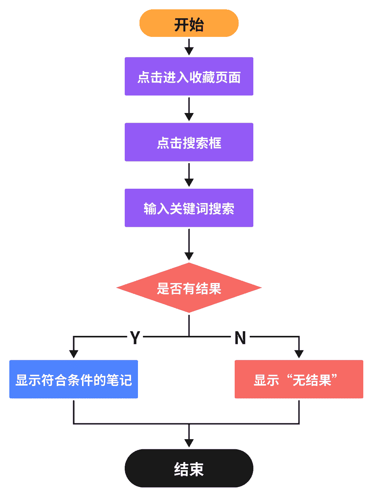
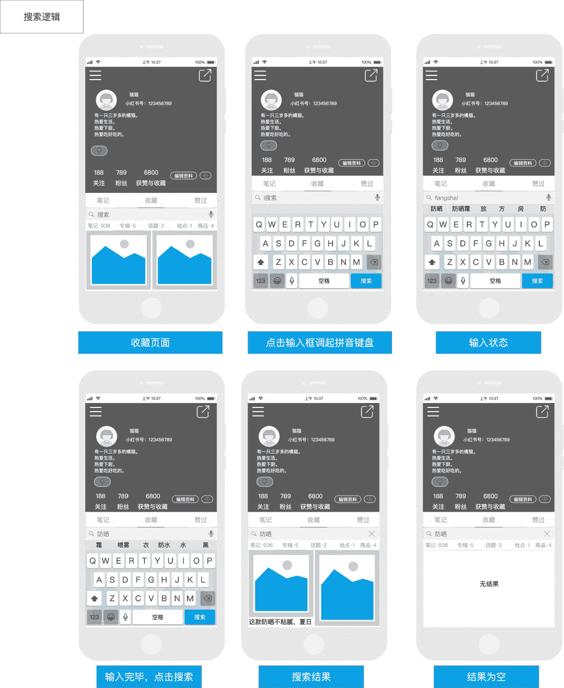
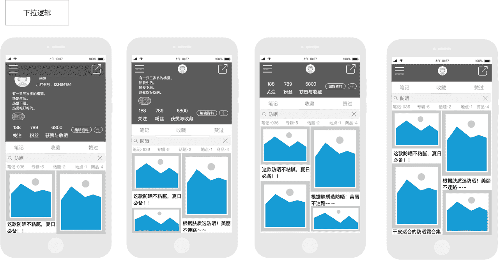

# PRD文档撰写（📕）

> 来源：[https://v11enp9ok1h.feishu.cn/docx/P8zUdcliaou0f1xPZOJcXsFpnqh](https://v11enp9ok1h.feishu.cn/docx/P8zUdcliaou0f1xPZOJcXsFpnqh)

# 💾PRD需求文档

## 一、 版本信息

> 版本号：V1.4

> 创建日期：2021/9/18

> 审核人：kisenn

## 二、 变更日志

多维表格（YpA4btT7paT7pJs3XqDco0cNnDb_tblaiHIWCE7CFEcY）

## 三、 文档说明

## 名词解释

| **术语 / 缩略词** | **说明** |
| --- | --- |
| **CMS** | XXX 系统的简称 |
|  |  |

## 四、 需求背景

### 产品 / 数据现状

#### 需求来源

> 🌟根据竞品分析报告与用户研究得出结论，📕在隐私设置、收藏夹管理及商城、直播方面需要更加细化的功能。通过前期用户调研得知，直播观看率较低，即使偶尔点击直播的用户也几乎都没有持续观看下去。

> 🌟因此本需求文档主要集中于直播互动优化，希望结合“薯蜜值”（普通用户与kol、koc的亲密值）互动及抽奖福利来增加📕直播的观看率与互动率，打造📕独有的直播环境，也为后期商业化提供铺垫。此外，由于前期用户调研显示，大多数用户使用📕的主要目的是搜集信息，因此希望通过笔记收藏搜索功能帮助用户更高效地使用收藏笔记功能，提升用户体验。

#### 运营目标

> 🌟发布3个月内，📕直播场均互动率40%以上的直播份额，从原先的0.87%（数据来源：千瓜数据）提升到5%以上，直播间累计人气值突破2亿。

|  | **主要信息** | **关键结论** | **截图或视频** |
| --- | --- | --- | --- |
| **竞品1** |  |  | &gt; 建议尽量把图片横向排布，精简文档篇幅 |
| **竞品2** |  |  |  |
|  |  |  |  |

## 五、 需求范围

> 可条理性地罗列需求范围或信息架构

多维表格（YpA4btT7paT7pJs3XqDco0cNnDb_tblKLmyuBzdCODZ8）

## 六、 功能详细说明

### 功能列表

| **功能模块** | **功能界面** | **主要功能点** | **功能特性描述** | **优先级** |
| --- | --- | --- | --- | --- |
| 直播互动 | 领取薯蜜值按钮 | 功能按钮 | 用户点击关注后，可领取薯蜜值并累计 | **P0** |
|  |  | 提醒关注弹窗 | 用户未点击关注时弹出关注提示 | **P0** |
|  | 薯蜜值互动任务弹窗 | 选择去观看 | 跳转至直播间 | **P0** |
|  |  | 选择去评论 | 拉起输入框，可输入评论并发送 | **P0** |
|  |  | 选择去分享 | 可分享至站内好友及🛰️、🧣等 | **P0** |
|  |  | 选择去购买 | 拉起购物链接清单 | **P0** |
|  | 抽奖 | 抽奖按钮 | 点击参与抽奖 | **P1** |
|  |  | 抽奖页面 | 获取抽奖信息及状态提示 | **P1** |
|  | 直播入口 | 直播加入推荐页信息流 | 可点击进入直播间 | **P2** |
| 笔记 | 收藏笔记搜索 | 搜索框 | 点击输入框 | **P0** |
|  |  | 拼音键盘 | 输入搜索关键词，点击搜索按钮进行搜索 | **P0** |
|  |  | 提交结果 | 进入搜索结果页面 | **P0** |
|  | 增加关注页面按时间线查看选项 | 新增按时间线由近至远查看按钮 | 进入时间线逻辑结果页面 | **P3** |

## 涉及模块

## 直播互动奖励

#### 直播间每日任务

##### 业务流程图

##### 交互原型图

##### 主业务逻辑

1.  **页面名称：**直播

1.  **页面入口：**

**薯蜜值：**

+   用户进入直播间后，未关注状态下，点击“领取薯蜜值”按钮，跳出“提醒关注”（左）弹窗，弹窗层级设置为最高。

+   用户点击确认，弹窗消失，回到直播页面。

1.  **入口a**: 用户点击关注主播后，进入已关注状态，此时“关注按钮”切换为“已关注”。此状态下，用户可点击“领取薯蜜值”，调起薯蜜值任务窗口。

1.  **入口b**: 用户已关注状态下点击“抽奖”按钮，在“福利抽奖”弹窗显示“提升薯蜜值等级，可增加中奖率”，点击提示右边“去提升”按钮后，福利抽奖弹窗消失，调起薯蜜值任务窗口。

1.  **页面功能：**

**薯蜜值：**

+   用户可参与互动领取更多“薯蜜值”。

+   完成后可领取相应“薯蜜值”。领取后，进度条更新“薯蜜值”。

+   薯蜜值达到一定条件，参与本场直播抽奖，中奖率更高，中奖率每一等级为前一等级的2倍。

+   薯蜜值为该用户与该主播的亲密度量化形式，采用多场直播持续累计的形式。

+   薯蜜值等级标准暂定为如下：

| **新粉1** | **新粉2** | **眼熟粉** | **真爱粉** |
| --- | --- | --- | --- |
| 0-199薯蜜值 | 200-499 | 500-999薯蜜值 | 1000-1999薯蜜值 |

1.  **逻辑内容及交互说明：**

直播间观看用户：

+   **任务未开始：**

1.  用户可点击每项任务右边去观看、点赞、去评论、去分享、去下单参与任务。

1.  4项任务每日上限未完成状态均显示0/1次。

+   **任务进行中：**

1.  4项任务每日上限未完成状态均显示0/1次。

1.  任务逻辑：

1.  任务1观看时长大于10分钟：点击右边“去观看”，显示直播页面。此时任务窗口隐藏。

1.  任务2发表评论：点击右边“点击右边“去评论”。输入文字完毕可点击发送。发送后可再次点击进入薯蜜值任务。显示直播页面并调起“评论输入框”，任务窗口隐藏。

1.  任务3分享直播：点击右边“去分享”，调起分享选项栏，层级在任务窗口之上。

1.  任务4购买商品：点击右边“去下单”。显示直播页面，并调起直播间商品链接清单，此时任务窗口随之隐藏。

+   **任务已完成：**

1.  任务栏已完成的任务每日上限显示1/1次。按钮切换为“已完成”。

1.  薯蜜值增长：观看时长大于10分钟、发表评论、分享直播，薯蜜值增加5分

1.  购买商品薯蜜值增加10分。增加分数实时更新至进度条。

1.  **异常事件说明**

**网络不佳情况：**

**场景A****：无数据缓存时**

当前在直播页面上一级页面时，网络不佳，直播页面设计点击屏幕/按钮来进行页面刷新，进行接口重调。

已加载直播间框架状态下，在直播页面以图像占位符/预设图的形式展示直播页面的框架。

**场景B**：直播间观看中途出现网络不佳情况时

点击去观看，跳转至直播页面但toast展示网络异常“网络开小差啦”；

点击去评论，跳转至评论输入框，点击发送toast展示网络异常“网络开小差啦”；

点击分享直播，调起分享选项栏，进入分享跳转toast展示网络异常“网络开小差啦”,复制链接分享显示正常。

点击右边“去下单”。显示直播页面，并调起直播间商品链接清单页面，按照图像占位符/预设图的形式展示。

网络异常提示下方增加“重新加载”按钮。

**场景C****：服务器异常情况下**

toast提示“服务器异常，请重试”。

### 抽奖

##### 业务流程图

##### 交互原型图

##### 主业务逻辑

1.  **页面名称：**直播间-抽奖。

1.  **页面入口：**

+   **唤起****：**用户点击页面右边“抽奖”按钮，弹出福利抽奖弹窗。

+   **返回****：**点击直播界面除按钮外的任意位置，抽奖弹窗消失，回到直播页面。

1.  **页面功能：**

+   “薯蜜值”达到一定条件的用户，参与本场直播抽奖，中奖率更高，中奖率每一等级为前一等级的2倍。

+   抽奖页面，剩余时间为实时更新。

1.  ** 逻辑内容及交互说明：**

+   该功能面向已关注该主播的用户。

A 当前有抽奖，且未开奖状态下：

+   抽奖按钮显示抽奖中。

+   用户在直播时间点击抽奖按钮，调起抽奖页面，页面上方显示倒计时，中部显示奖品信息，下方设“参与抽奖”按钮。

+   用户点击“参与抽奖”按钮，出现参与状态提示“参与成功，请等待开奖。“，并显示薯蜜值提升建议与”去提升“按钮。

+   用户点击“去提升“按钮，此时抽奖页面关闭，并调起薯蜜值任务栏。

B 已开奖状态下，且有下一波抽奖时：

+   抽奖按钮显示“已开奖”，直到调起新的抽奖页面。

+   用户点击抽奖按钮，调起抽奖页面，页面上方显示已开奖。

+   中奖用户第一次点击抽奖按钮，显示已中奖提示，增加“如何联系”主播按钮，点击此按钮跳转至教程页面，点击叉号可返回抽奖页面。第二次点击显示新的抽奖页面。

+   未中奖用户显示未中奖提示，并提示可参加下一波抽奖。增加“下一波”按钮，可点击跳转至新的抽奖页面。如未点击，则可回到直播后再次点击抽奖按钮调起新的抽奖页面。

C 已开奖状态下，且抽奖全部结束时：

+   抽奖按钮显示“已开奖”。

+   所有用户点击抽奖按钮显示是否中奖提示后，第二次点击，出现谢谢参与提示。

D 开奖后，用户弹窗显示分别如下：

| 已中奖用户 |  |
| --- | --- |
| 未中奖，且无下一波抽奖时 |  |
| 未中奖，但有下一波抽奖时 |  |
| 抽奖全部结束时，用户点击抽奖结果后 |  |

1.  **异常事件说明**

**网络不佳情况：**

**场景A****：无数据缓存时**

+   当前在直播页面上一级页面时，网络不佳，直播页面设计点击屏幕/按钮来进行页面刷新，进行接口重调。

+   已加载直播间框架状态下，在直播页面以图像占位符/预设图的形式展示直播页面的框架。

**场景B**：直播间观看中途出现网络不佳情况时

+   点击任何按钮均toast展示网络异常“网络开小差啦”；

+   网络异常提示下方增加“重新加载”按钮。

**场景C****：服务器异常情况下**

+   toast提示“服务器异常，请重试”。

## 笔记收藏搜索

#### 业务流程图

#### 业务流程图

#### 交互原型图

### 主业务逻辑

1.  **页面名称：收藏夹-关键字搜索**。

1.  **用户场景：**当用户收藏的笔记过多时，即便已经进行专辑分类，仍很难快速找到想要看的笔记。

** 页面入口：**

+   唤起：用户点击进入“我”页面的收藏页面。

+   返回：点击搜索框叉号，切换至“我”页面的其他子页面。

** 页面功能：**

+   用户可根据笔记标题及正文部分的关键字进行笔记搜索。

1.  **逻辑内容及交互说明：**

该功能面向所有📕用户。

+   用户可根据关键字（笔记标题和正文提取），搜索符合条件的笔记。点击搜索按钮，发起搜索，页面下方展示搜索结果。

+   若有符合条件的笔记则按照首图比例分别显示；若结果为空，则显示无结果。

1.  **下拉逻辑说明：**

+   用户下拉页面查看检索出的笔记，app顶栏随下拉动作覆盖同水平线的内容，直至完全覆盖住头像时，头像变为顶栏中央缩小版本，页面继续下拉覆盖相应内容，直至以“笔记”、“收藏”、“赞过”栏为顶边且固定，继续下拉。

+   下拉至没有更多笔记时，页面下方显示空白。

1.  **异常事件说明**

网络不佳情况**：**

**场景A****：无数据缓存时**

+   当前在收藏页面上一级页面时，网络不佳，收藏页面设计点击屏幕/按钮来进行页面刷新，进行接口重调。

**场景B**：收藏页面浏览中途出现网络不佳情况时

+   点击搜索btn，toast提示“网络开小差啦”。

+   网络异常提示下方增加“重新加载”按钮。

**场景C****：服务器异常情况下**

+   toast提示“服务器异常，请重试”。

| **序号** | **功能模块** | **界面** | **数据埋点** | **埋点说明** | **目标数据结果** | **结果说明** |
| --- | --- | --- | --- | --- | --- | --- |
| 1 | 直 | 直播间 | 直播累积观看人数 | 日观看人数、周观看人数、累计观看人数 | 直播间观看情况 |  |
|  |  |  | 最高同时在线人数 |  |  |  |
| 2 |  |  | 关注按钮点击数 | 日点击数、周点击数、累计点击数 | 直播间互动情况 | 分子：关注按钮点击数 |
| 3 |  | 每日任务 | 领取薯蜜值按钮点击数 | 日点击数、周点击数、累计点击数 | 直播间互动参与率及每日任务用户流失率 | 分子：参与每日任务的用户数 |
|  |  |  | 参与每日任务的用户数 | 日参与数、周参与数、累计参与数 |  |  |
| 4 |  | 抽奖 | 直播间含抽奖的直播场次数 | 日场次、周点场次、累计场次 | 直播间抽奖活动参与率 | 分子： |
|  |  |  | 含抽奖直播的抽奖活动次数 | 日抽奖次数、周抽奖次数、累计抽奖次数 |  |  |
|  |  |  | 参与一次或多次抽奖的用户数 | 日点击数、周点击数、累计点击数 |  |  |
|  |  |  | 参与抽奖总人次； | 日点击数、周点击数、累计点击数 |  |  |
| 5 | 笔记 | 我页面 | 我页面点击数 | 日点击数、周点击数、累计点击数 | 收藏夹查看率 | 分子：收藏按钮点击数 |
|  |  |  | 收藏按钮点击数 |  |  |  |
| 6 |  | 收藏夹 | 搜索框点击数； | 日点击数、周点击数、累计点击数 | 收藏夹搜索率 | 分子：输入内容并搜索次数 |
|  |  |  | 输入内容并搜索次数 |  |  |  |

## 运营支持需求

| **需求名称** | **运营支持需求** |
| --- | --- |
| 直播互动及奖励 | +   App导流页制作直播间薯蜜值互动及抽奖活动宣传kv，并向用户推送该功能亮点及上线信息 |
| 笔记收藏搜索 | +   发布一周后，开展用户调研，包括以下方面： |

## 八、 项目规划

> 输入 @ 把正文提及的项目管理文档附在此处

多维表格（YpA4btT7paT7pJs3XqDco0cNnDb_tblyIHLKYQZtUYQk）

# 附录

> 输入 @ 把正文提及的具体文档，或需求相关的其他说明文档附在此处以供查阅

> 数据分析报告

+   此处插入数据分析报告

> 用户调研报告

+   此处插入用户调研报告

> 设计分析报告

+   此处插入设计分析报告

<https://v11enp9ok1h.feishu.cn/sync/Ipw1d27gNsv3OAbo3N7cks4ZnJf>