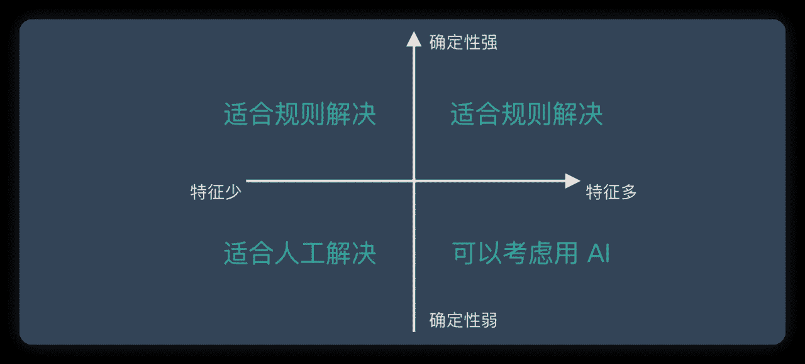
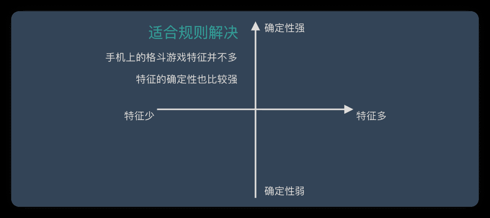
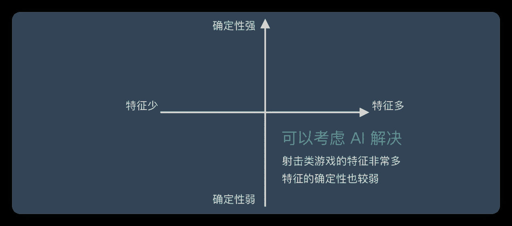

# 特征象限图｜什么样的场景可以用AI解决，什么样人工解决即可

> 来源：[https://v11enp9ok1h.feishu.cn/docx/J9bkdaETmoK5UOxE7btci9Ttn0b](https://v11enp9ok1h.feishu.cn/docx/J9bkdaETmoK5UOxE7btci9Ttn0b)

如果⼀句话来概括的话就是： 能够有效归纳出⼀些规则的问题，都不太需要 AI，⽽那些很难总结归纳出规则的问题可以 考虑使⽤ AI 来解决。 如果想要评估可以套⽤下⾯的特征象限来看看你的问题是否适合使⽤ AI技术：

**并⾮**所有问题都需要 AI 来解决，AI 的优势是可以处理海量的特征，不但可以处理表⾯的特征，还能找到背后隐藏的特征。但是很多情况下，没必要⽤⼤炮打蚊⼦。

当我们把特征数量和确定性画⼀个坐标，就能指导我们什么问题适合⽤ AI，什么问题不适合⽤：

+   特征少+确定性弱：适合⼈⼯解决

+   特征少+确定性强：适合规则解决

+   特征多+确定性强：适合规则解决

+   特征多+确定性弱：「可以考虑」 AI 解决

PS：这⾥其实还有很多其他因素：成本、⻛险、是否可测量...这⾥统统不考虑，不然太复杂了。

### 上⾯的象限太抽象了，下⾯举⼀个真实的案例来说明。、

游戏⾏业有⼀种东⻄叫「外挂」，简单说外挂就是作弊器，打破了游戏的公平，让⾃⼰在 游戏⾥更有优势。

⼏乎所有知名的游戏都有外挂，因为外挂很赚钱！所以游戏⼚商必须要做好跟外挂战⽃的 准备。

游戏⼚商都希望第⼀时间发现玩家使⽤外挂。

我有⼀个朋友负责⼀款知名的格⽃⼿游，他们也有很多外挂，⼀开始他们使⽤了⼀些固定 的规则来发现外挂。效果还不错，但是还是会有漏⽹之⻥。

于是他们尝试使⽤ AI 来抓外挂，做了很⻓时间后，发现效果并不⽐固定规则好多少。

同样是打击外挂，在⼀些复杂度⾼，灵活度⾼的游戏⾥（例如吃鸡、CS），规则就不好使 了，因为很难总结出来固定的规则。

这个时候 AI 就能⼤显身⼿了。CS：GO 和吃鸡都有⽐较成功的案例了： 《以彼之道还施彼身——⽤机器学习揪出外挂狗》 《⼈⼯智能在游戏⾥竟然有这些应⽤⽅式，来看看你知道⼏种？》

应⽤特征象限： ⼿机上的格⽃游戏，⾃由度并不⾼，玩家只能控制移动、攻击、技能、闪避，这4种核⼼ 操作。策略性并没有太强，所以⼤致上符合「花钱+花时间≈实⼒」的逻辑。

所以只需要把握⼀个原则：玩家是否做了远超⾃⼰实⼒的事情？

通过观察玩家的战⽃⼒，敌⼈难度，战⽃时间等⽅式就可以⽐较有效的判断玩家是否使⽤ 了外挂。对于这种⼈都能与有效判断的问题，不需要使⽤ AI，反⽽会把解决⽅案搞复杂。

对于CS：GO、吃鸡这种射击类游戏，场景⼗分复杂（地图⼤，有房间，有遮挡物...） 玩家的⾏为也很复杂（移动、判断敌⼈位置、找掩护、切换武器、瞄准、射击...）

在这种情况下，很难⽤明确的规则来判断玩家是否使⽤了外挂。你不能说反应快就算使⽤ 了透视外挂，有些⼈反应就是快；你也不能说爆头多了就⽤了锁头挂，有些⼈枪法就是 准。

所以想要发现这些外挂，就需要分析⼤量的数据，从中间找出「不那么明显的特征」，这 时候 AI 就有其特殊的价值了。

