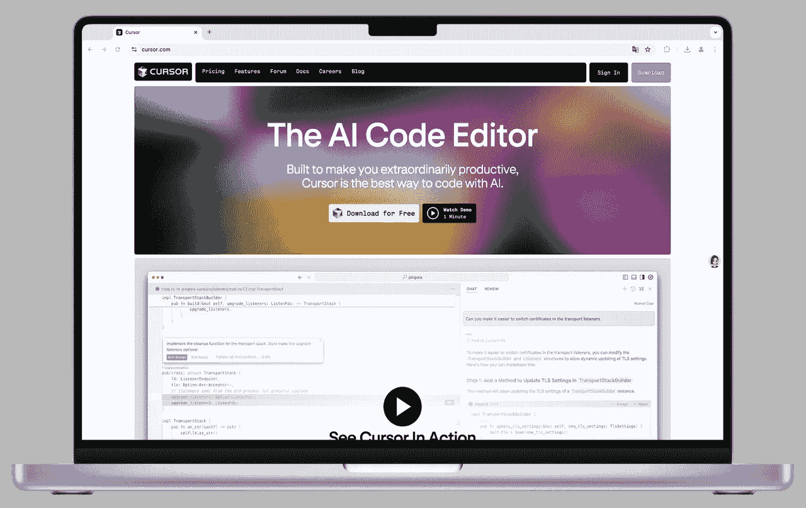
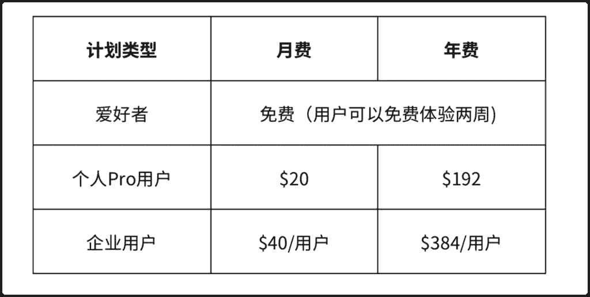
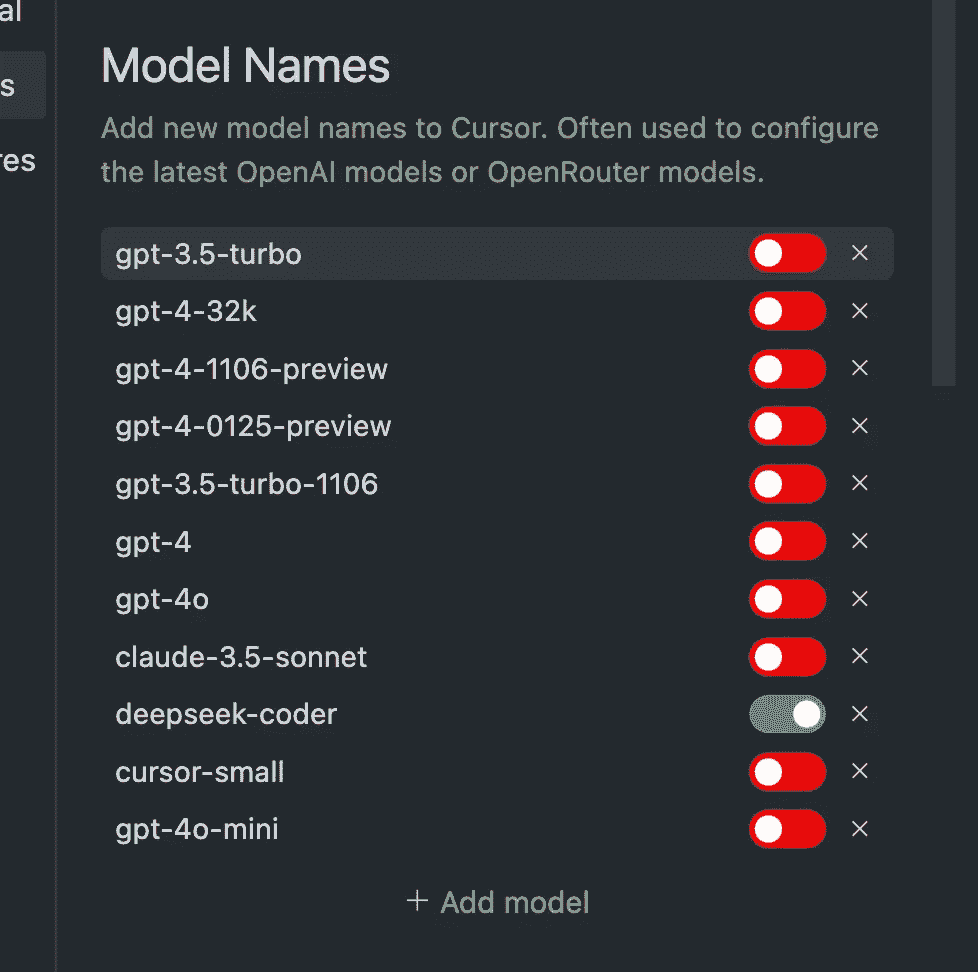
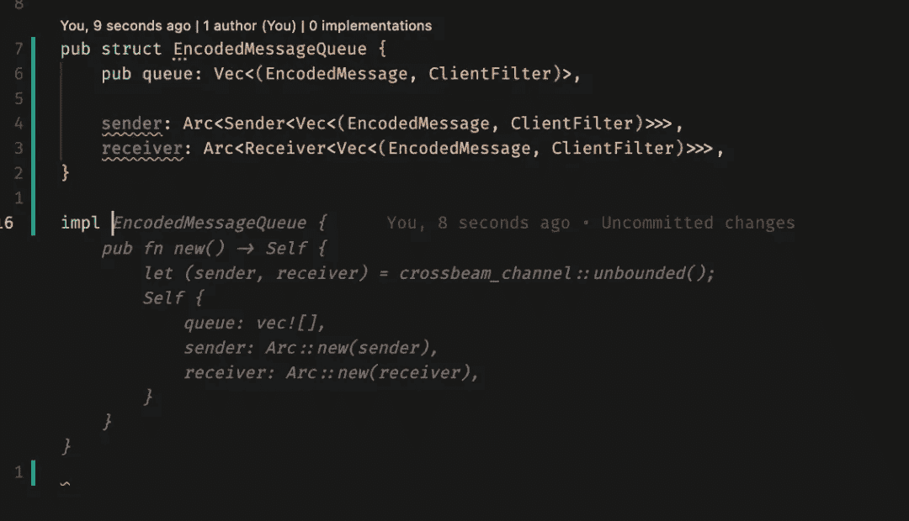
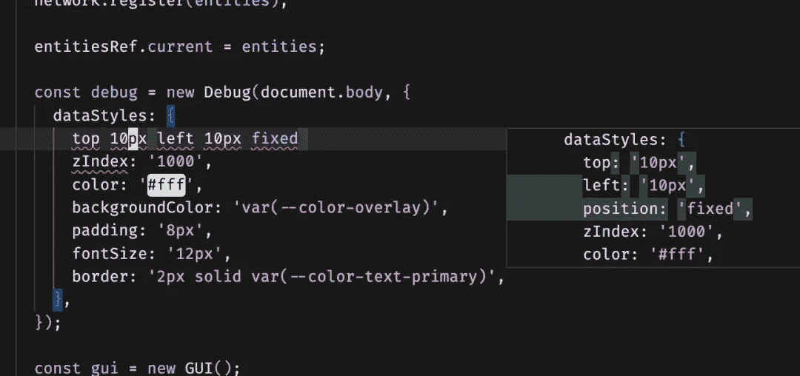
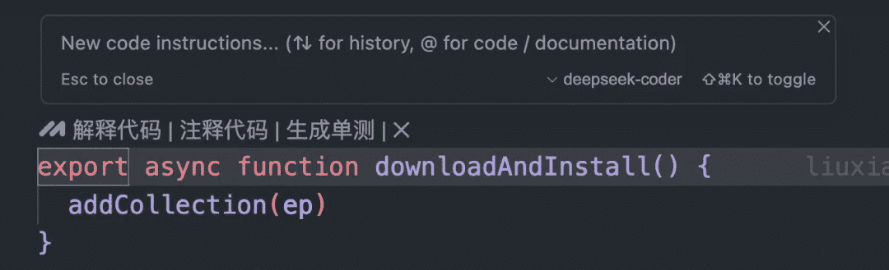
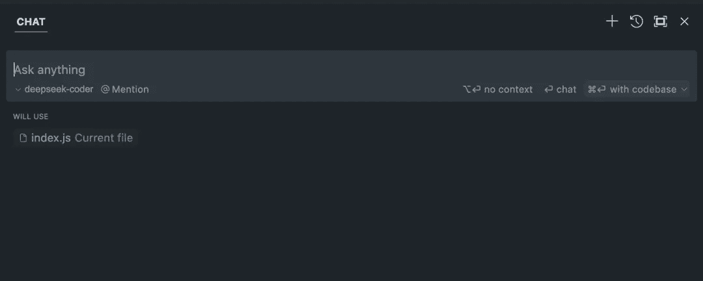
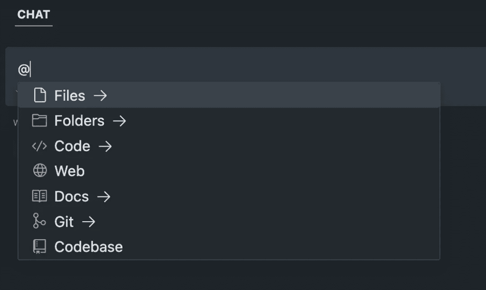

# Cursor

> 来源：[https://v11enp9ok1h.feishu.cn/docx/JCtOdl7uRoLllfxX0V4c2Ylrn8f](https://v11enp9ok1h.feishu.cn/docx/JCtOdl7uRoLllfxX0V4c2Ylrn8f)

**核心摘录｜导读：**

> 从技术的角度讲 Cursor 的成功就是一句话：在几乎一样的技术基础上，找到了更好的产品化的方式。

> Cursor 的 codeBase 是整个工程

## Cursor

公司名称：Anysphere

网站地址：[www.cursor.com](http://www.cursor.com/)

创始人：Michael Truell、Aman Sanger、Arvid Lunnemark 和 Sualeh Asif。

团队背景：团队成员具有丰富的 AI 和软件开发经验，致力于提升开发者的工作效率。

### Cursor是什么

Cursor 是一款真正意义上的 AI 编辑器。正如其官网所述：

> The AI Code Editor Built to make you extraordinarily productive, Cursor is the best way to code with AI.

**Cursor**.**so是一款基**于GPT的代码生成工具，集成开发环境（IDE），支持多种编程语言（如 Python、JavaScript、Java 等），可以帮助开发者快速生成代码，提高开发效率。GPT是一种自然语言处理技术，可以根据输入的文本生成相应的文本。Cursor.so利用GPT技术，将开发者的自然语言描述转化为代码，从而实现代码的快速生成。

### **Cursor产品时间线**

+   **自 2022 年成立以来：**Cursor 经历了快速的发展和迭代。从最初基于 Codemirror 构建，到后来迁移至 VSCodium（VS Code 的开源版本）的分支上，Cursor 不断优化其性能和用户体验。

+   **在 2023 年：**Cursor 进行了 3 次重大的版本更新和近 40 次的功能迭代。这些更新包括引入新的 AI 模型、优化用户界面、增强性能和安全性等方面。特别是在 3.0 版本中，Cursor 引入了性能更的 Claude 模型，大幅提升了响应速度和整体性能。

+   **2024年8 月 9 日：**Cursor 背**后的公司 Anysphere **宣布获得 6000 万美元的 A 轮融资，最新估值为 4 亿美元，投资方包括 a16z 和 Thrive。

### **Cursor**融资历程

+   种子轮融资：在 2023 年 7 月，Cursor 完成了 800 万美元的种子轮融资，估值为 565 万美元。该轮融资由 OpenAI Startup Fund 领投，参与者包括 BoxGroup、GitHub 前 CEO Nat Friedman 和 Dropbox 联合创始人 Arash Ferdowsi。

+   A 轮融资：在 2024 年 8 月，Cursor 完成了 6000 万美元的 A 轮融资，估值达到了 4 亿美元。该轮融资由 Andreessen Horowitz、Thrive Capital 和 OpenAI 等知名投资机构领投，参与者包括谷歌的 Jeff Dean、Meta 的 Noam Brown 等。

+   这两轮融资的成功，不仅为 Anysphere 带来了充足的发展资金以推动产品持续创新，也为其快速增长和市场拓展注入了动力，同时也彰显了投资方对 Cursor 技术和商业前景的高度认可。

> **历史发布版本简要概述：**

+   最初发布时，基于 AI 的代码生成、自动补全和错误检测等核心功能。

+   随后的版本中引入了多个 AI 模型供用户选择，并支持对 AI 进行个性化调整。

+   在 2.0 版本过渡到在 VSCodium 分叉基础上构建，进一步增强稳健性。

+   在 3.0 版本中引入性能更优的 Claude 模型，将响应速度提高约 2 倍。

+   最新版本增加了"光标位置预测"和"多行编辑"等新功能，进一步提升了开发效率

+   此外，4.0 版还优化了 AI 模型，提升了代码生成和错误检测的准确性。

## Cursor 产品核心优势｜为什么是现阶段是最好用的 AI 编程工具

1.  **自然语言编程**：通过 Chat 和 Composer，我们可以使用自然语言编程，大大简化了编码过程。

1.  **代码修改能力**: Cursor 可以理解整个工程的代码，同时修改多个文件，实现复杂的代码更改。相较于代码插入，实际的工程中，我们更需要的代码修改能力。

1.  **强大的上下文**：Cursor 可以阅读您的整个代码库。也可以精确地指定文件、符号、文件夹、联网查询等。

1.  **多模型支持**：Cursor 支持多种 AI 模型，使其在快速发展的 AI 领域保持竞争力。

1.  **可定制的 AI 行为** 通过 .cursorrules 文件，我们可以定制 Cursor 的行为。省去了重复书写提示词的麻烦

## Cursor的商业化定价信息表

## Cursor成功归因分析

1.  团队高认知——精准判断AI编程求的真实+趋势

虽然市场上已有强大的竞争者（如 GitHub Copilot 和 Visual Studio Code），但 Anysphere 团队相信，其专注于 “AI 原生”代码编辑器这一细分市场将为其带来优势。

在去年 10 月宣布 OpenAI 初创基金领投时，Anysphere 团队在采访中表示，微软是他们的主要竞争对手。 Anysphere 团队的观点，可以理解为：

+   **大公司不能快速做出彻底的改变，这就给了初创公司“颠覆式创新”可能机会，去集中一切资源开发引领行业变革的产品。An**ysphere 团队认为微软因为产品和客户的稳定性考虑，很可能无法快速做出彻底的改变，不能基于人工智能做出重大产品升级。

+   **开发者还没有体验到 AI 原生技术带来**的巨大变革，这是一个未被满足的市场需求。

+   **Anysphere 团队认为 AI 代码编辑的领域，这个领域的天花板很高，有非常**多的可能，值得长期投入。他们在博客中发表过 2023-2024 需要解决的问题。

+   **只要专注于持续的技术创新，可以开发出引领行业变革的** AI 代码编辑工具，满足开发者的需求。

“The ceiling in the AI coding space is so high — there’s so much to do — that it’s not possible to just clone the tech and then put great sales on top,” Truell said. “You need to constantly evolve the tech. There’s over 26 million developers around the world, and there’s a huge market for those that want a truly AI-native experience.” --- Techcrunch 2023-10-11

### 2. AI+编程｜真实需求+市场趋势

> 市场需求明确，全球预计有 2600 万开发者

> 根据统计数据，全球软件开发者的数量预计将在 2024 年达到约 2870 万。GitHub Copilot 现在有 130 多万付费用户，其发布时间为 2021 年 10 月，两年时间积累到这个用户规模，但也只有全球开发者数量的 5%。

> 这个比例意味着可能还有大量开发者尚未开始使用 AI 代码编辑工具。目前市场中尚未出现“市场领导者”，GitHub Copilot 虽然较早的进入了市场，获得了一定用户基础，也给创新者提供了产品经验。未来，随着更多开发者认识到 AI 代码编辑工具的价值，越来越多的企业和个人开发者寻求提高生产力和效率，这类工具可能有很大的增长空间。

> ✅**参考数据**（通过搜索获悉，2024 年软件市场的一组数据如下）

> 到 2024 年底，全球软件开发人员数量预计将达到 2870 万。这在 4 年内直线增长了 320 万。美国有近 430 万软件开发人员。

> 软件开发市场预计到 2027 年将达到 10.39 亿美元，2020 年至 2027 年复合年增长率为 22.54%。

> **绝对真实的需求⬆️**

3.AI 底层技术的快速发展解锁了更多场景

**在 GPT-4 甚至 GPT-4-Turbo 时代，**Cursor 想要的产品体验是做不出来的，因为底层模型太慢了。但是 2024 年上半年出现了 Sonnet 3.5 以及 Llama 3。虽然这两个模型在智力上并没有超越 GPT-4，但是性能更好了，并且 Llama 3 的出现第一次让应用侧有了一个智力正常的可以微调的模型。这两个点放在整个行业可能没啥，但是恰恰是解锁 Cursor 设想的产品体验的核心要素。这是 Product-Model-Fit。

**4.蓝海市场、竞争少**

核心：国外就两家、国内大厂有布局，但市场集中度不高

**在AI✖️编程工具市场占有率方面，目前还没有一家独大的局面。各家企业都在积极布局，试图在这个新兴市场中占据有利地位。**大型科技公司凭借其强大的技术实力和用户基础，在企业级市场占据优势。而专业开发工具公司和 AI 初创企业则在特定细分领域或创新应用上表现出色。

国外｜ GitHub Copilot

1.公司名称：GitHub， Inc。

2.网站地址：github.com/features/copilot

3.成立时间：GitHub 成立于 2008 年，GitHub Copilot 的发布时间为 2021 年 10 月。它最初在 2021 年 6 月 29 日宣布进入技术预览阶段，并于 2021 年 10 月正式发布，成为可供开发者使用的插件。Copilot 的推出标志着 AI 辅助编程工具的一个重要里程碑，旨在通过自动代码补全和生成来提升开发者的生产力。

4.估值：GitHub 的估值在 2021 年被微软收购时约为 75 亿美元，但具体的 Copilot 估值未单独披露。

5.收入：根据微软的财报，GitHub 的收入同比增长超过 40%，但具体的 Copilot 收入数据未在搜索结果中提供。

6.员工人数：GitHub 的员工人数在 2023 年约为 1,000 人，但具体的 Copilot 团队人数未单独披露。

7.现有客户信息：超过 50,000 家企业使用 GitHub Copilot，包括 Etsy、HelloFresh、Autodesk、戴尔科技和高盛等知名企业。

8.用户数量：在微软的财报电话会议上，截至 2023 年，纳德拉提到：“GitHub Copilot 现在有 130 多万付费用户，季度环比增长 30%。

**国外 VSCode**

1.公司名称：Microsoft Corporation

2.网站地址：code.visualstudio.com

3.成立时间：微软成立于 1975 年，Visual Studio Code 作为其产品之一于 2015 年 4 月 29 日首次发布。

4.估值：微软的整体市值在 2023 年超过 2 万亿美元，但 Visual Studio Code 的具体估值未单独披露。

5.收入：Visual Studio Code 作为微软的一部分，具体收入数据未单独提供，但微软的云计算和生产力部门（包括 Visual Studio）在 2023 财年收入同比增长了 40%。

6.员工人数：微软的员工人数在 2023 年约为 220,000 人，但具体负责 Visual Studio Code 的团队人数未单独披露。

7.现有客户信息：Visual Studio Code 被众多知名企业使用，包括 IBM、Cognizant Technology Solutions、Salesforce 等。

8.用户数量：根据 2023 年 Stack Overflow 开发者调查，Visual Studio Code 是最受欢迎的开发环境工具，73.71%的开发者表示使用它。

**国内**

**中国市场中 AI 编程助手**

在中国市场上，已经涌现出了一批致力于 AI 编程助手开发的企业。这些企业大致可以分为以下几类：

**1.一线互联网巨头：**

+   阿里巴巴：依托通义模型，推出通义灵码ai 代码助手

+   蚂蚁集团：开发了"CodeFuse"，一个基于大规模语言模型的智能编程助手。

+   华为：在其 DevCloud 平台中集成了 AI 编程辅助功能。

+   百度：继百度 comate 后，品牌升级为文心快码，专注于将大语言模型应用于软件开发领域，推出了多个针对不同编程语言的 AI 助手。

+   字节跳动：依托豆包模型家族，国内上线豆包MarsCode 编程助手，提供以智能代码补全为代表的 AI 功能。它支持主流的编程语言和 IDE，在开发过程中提供单行代码或整个函数的编写建议。

**2.开发工具的公司：**

+   JetBrains 中国：虽然是国际公司，但其在中国的本地化团队也在积极推进 AI 编程助手的研发和集成。

+   Coding：推出了基于 腾讯云 AI 代码助手，集成在其在线 IDE 中。

1.  **AI 初创公司：**

+   智谱 AI：开发了 ChatGLM 系列模型，并将其应用于代码生成和智能编程领域。

+   fitten code: Fitten Code是由非十大模型驱动的AI编程助手，它可以自动生成代码，调试Bug。

1.  找到了AI✖️编程工具绝对的PMF

<aside> 

1.  ”**你**可以很自然地不断在一个窗口内用自然语言描述你的需求，而不需要在多个窗口和文件里进行切换。——现有AI编程产品都需要切换窗口

1.  专注于自动补全之后的功能，比如查找和修复错误以及代码库问答。 </aside>

Cursor 的 codeBase 是整个工程

cursor 的逻辑是，先将工程内的所有代码进行索引和向量化（Embedding），再之后你的所有提问都是基于整个工程给你答案，它会将你的提问结合整个工程的代码一起提交给 LLM，默认有这些模型：

这很像基于 RAG 方法论的系统实现，只不过外挂的知识库是代码库而已。

基于这样技术逻辑可以解决的问题⬇️

**代码补全**

之前工具的代码补全虽然使用了 LLM，但仍然不那么精准，因为它只能把当前文件作为上下文，而 cursor,它的 codeBase 是基于整个工程的，**它的代码补全相当于是分析了你整个工程的代码基础之上给的建议，所以非常精准啊。**这也就是为什么有的朋友说，现在用 cursor 写程序一路 tab 下来就完事儿了，比自己写的还好。简直就是自动化编程。

**智能纠错**

这代码你就放心写吧，如果你写着写着写错了，cursor 会在你输入的时候自动纠正你的错误

它为啥能纠错，它怎么知道我写错了？对，还是 codeBase，你的整个工程它都了如指掌。

**聊天**

太基础的功能了，然而因为 codebase，它就有了无限可能。首先，你可以在当前文件中针对某一部分来提问，比如你要重构一个方法什么的

它会重构的比较好，因为它的 codebase 是整个工程。

你也可以单独打开一个聊天窗口

在这里提问可以仅针对当前文件、文件夹、图片、文档、网络或者整个 codebase

最重要就是这个 Codebase 这是可以发挥无限想像的地方。

由于篇幅的原因，我不会把所有的细节全部用图片或视频的形式放出来，因为太多了，但你看我的描述也一定能体会到 cursor 的强大，这里我举几个例子，这些例子我已经测试成功并且在工作中使用了，它很强，很实用：

1.  **我是项目主要的开发者，我现在想针对某个功能进行重构，注意不是一个类，一个文件，而是整个功能的重构。**我让 cursor 给出我具体的建议和修改的代码。它实现了，非常具体、清晰、详细、正确率高达 95 % 以上（claude 模型）

1.  **我有一个陈旧的项目，代码中几乎没有注释，也没有接口文档。**我现在想从代码中分析出一份 api 接口文档，要包括地址、请求类型、请求和响应字段，以及示例 json。它也实现了，就是我想要的内容，100% 正确

1.  **我有一个**小白同事，刚进项目组，对他要负责的功能模块完全不知道流程是什么，不巧的是整个项目也没有什么文档，需要他去看代码自己梳理。他让 cursor 帮他梳理出项目中有关 oauth2 认证、鉴权的完整流程。从第一个请求开始，到最后一个请求数据返回，包括所有相关的代码片段和执行路径。cursor 瞬间完成了，正确率 100%

1.  **我**有一个测试同事，想写关于某个重要模块的测试用例及测试报告，cursor 基于整个项目的 codebase 帮他一步一步实现了。

1.  **我有个前端同事上传了一张别人设计的不错的界面的图片，他让 cursor 帮他根据他 vue2 项目的情况自动生成页面代码,**cursor 瞬间完成了，和图片的相似度达到 85%

1.  **我有个大数据开发同事，他正在重构之前写的 SQL，**他把建表语句告诉 cursor 后，让他把一批 sql文件根据他的要求进行了重构，cursor 很快就完成了。

1.  **我有个运维同事，他之前把所有运维的工作全部代码化了。**在一个仓库里，现在基础设施有一些变动，他让 cursor 根据现有的运维脚本和代码进行重构，cursor 瞬间就完成了，正确率 90%

1.  **我还有个产品同事，现在不怎么用 Axure 画原型了，他说和 curs**or 交流一下基础上就能出前端代码，跟前端学了点儿基础知识，原型几分钟就搞定了。

1.  **我有个朋友，现在想将 .net 项目转成 java，他原先估计要组一个团队**至少 5 个后端一起干，现在他一个人正在一步一步地用 cursor 帮助他实现。

1.  我还有个朋友。。。。。

我想你应该知道我想说什么了，都是因为它最重要的原理，它的 codebase，它和其他产品不一样的逻辑。

## Cursor创始人

> 创始人直接决定产品成败，成功产品创始人都高认知

1.  **让 Human Developer 变成 Hu**man Super Developer。

1.  当人们想到 AI 编程，他们通常会想到 AI 驱动的自动补全功能。我们认为 GitHub Copilot 和其他一些工具在这方面做得非常好，所以我们专注于自动补全之后的功能，比如查找和修复错误以及代码库问答。

### Cursor成功的产品启示

> **创业/认知：**

1.  **创业公司永远是有机会的。**产品的竞争，一定程度上，和资源没有直接关系。重要的永远是你在产品上的理念是什么，你的创新是什么。如果你只是简单的和大公司拼功能完善度，那大公司毫无疑问可以碾压你。但如果你有技术创新的话，那就是另外一回事了。

1.  **正确的问题往往比解法更重要。**

1.  “AI 能拉低一个行业的下限的同时， 也在拉高这个行业的上限。Cursor 的出现，让我们看到了 AI 的未来，但是并不代表程序员这个行业就要消失了。——学会使用工具，AI只会淘汰懒的人

---

> **AI产品设计方法论：**

1.  **产品价值能够量化，利于实现用户付费。**在谈论产品价值时，能够量化的指标（如成本节约、时间节省、生产力提升等）使得产品价值更具说服力。

1.  AI产品要能形成商业闭环。——和妙鸭相机异曲同工

### Cursor详细使用教程｜产品实际体验

+   [Cursor 101｜Cursor入门指南：https:](https://cursor101.com/zh/article/getting-started)//cursor101.com/zh/article/getting-started

+   **Cursor 完全使用教程：**[https](https://mp.weixin.qq.com/s?src=11&timestamp=1727072146&ver=5523&signature=VxpueA0hXS5h9Ikykx-aL7K5f6UPVFEwSeoTCz6Gp0KPRgTaniWyu7VITCNBRb8l5GPfLic-DXuuDMJfeOfFfXeuYozSRlhNUXswhxgaGR2hjayqBuzS39J8SnepHTxe&new=1)://mp.weixin.qq.com/s?src=11&timestamp=1727072146&ver=5523&signature=VxpueA0hXS5h9Ikykx-aL7K5f6UPVFEwSeoTCz6Gp0KPRgTaniWyu7VITCNBRb8l5GPfLic-DXuuDMJfeOfFfXeuYozSRlhNUXswhxgaGR2hjayqBuzS39J8SnepHTxe&new=1

+   **Cursor让你的代码飞起来：** [https](https://mp.weixin.qq.com/s?src=11&timestamp=1727072339&ver=5523&signature=AcfEkvc1l8aeItCzK9E9d8VEWib*SFadi*s8eeKg9ckqeszm7gr3rpMuERTKk7ZEhaaSU0YCR7lhp*d3LfFFXDACjCLLP-OzLammHgRUC*krF2b-se*PQX*HcPLEkAZE&new=1)://mp.weixin.qq.com/s?src=11&timestamp=1727072339&ver=5523&signature=AcfEkvc1l8aeItCzK9E9d8VEWib*SFadi*s8eeKg9ckqeszm7gr3rpMuERTKk7ZEhaaSU0YCR7lhp*d3LfFFXDACjCLLP-OzLammHgRUC*krF2b-se*PQX*HcPLEkAZE&new=1