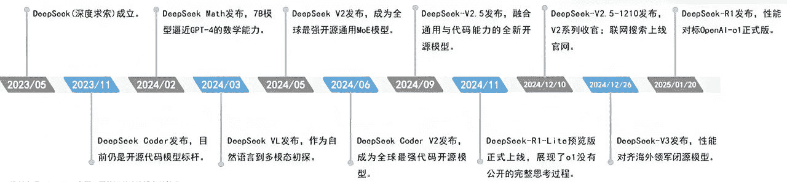
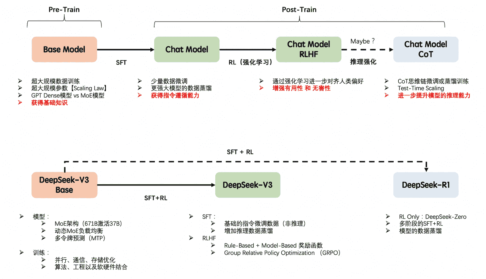
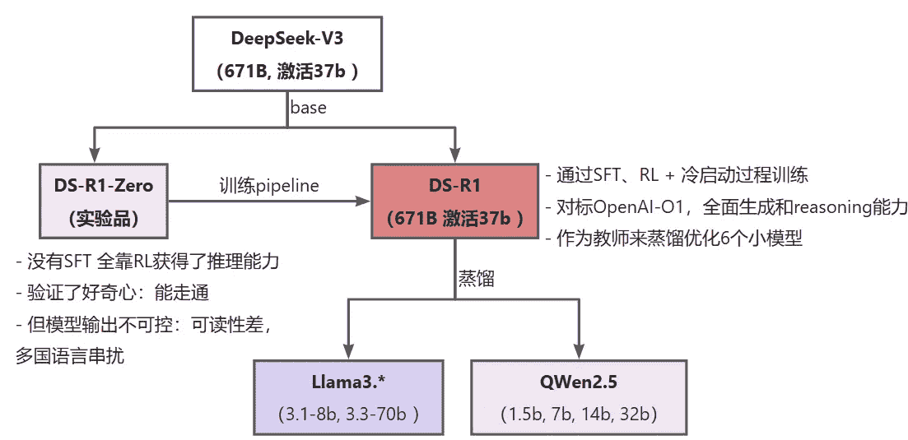
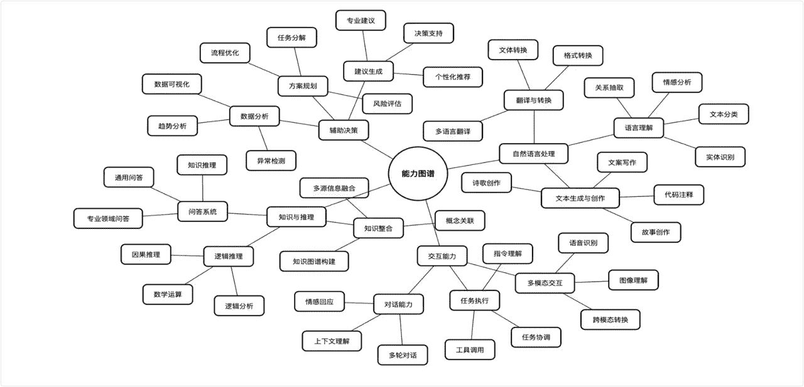
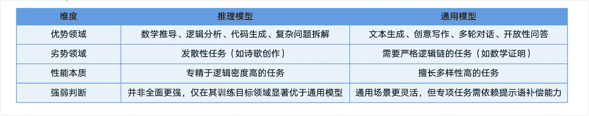
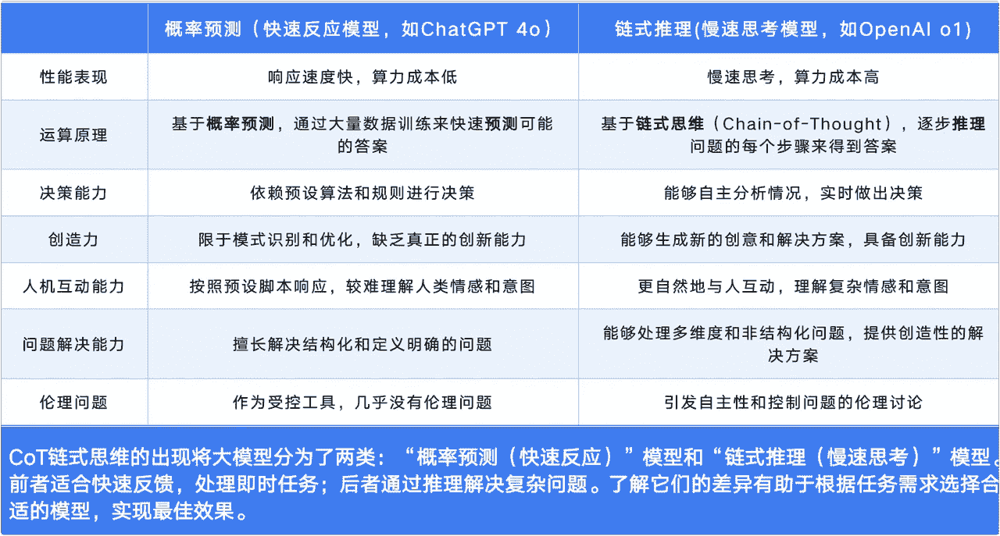
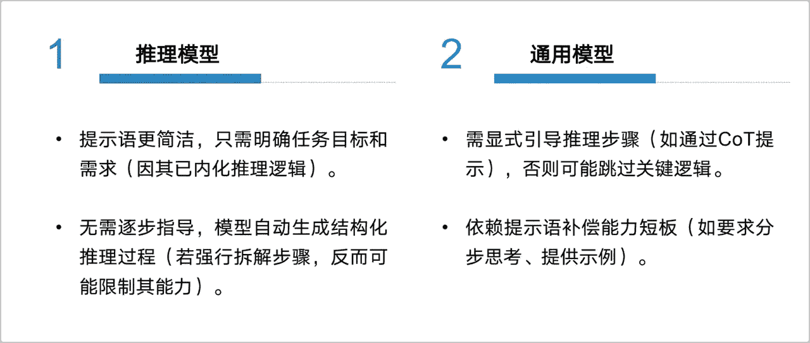
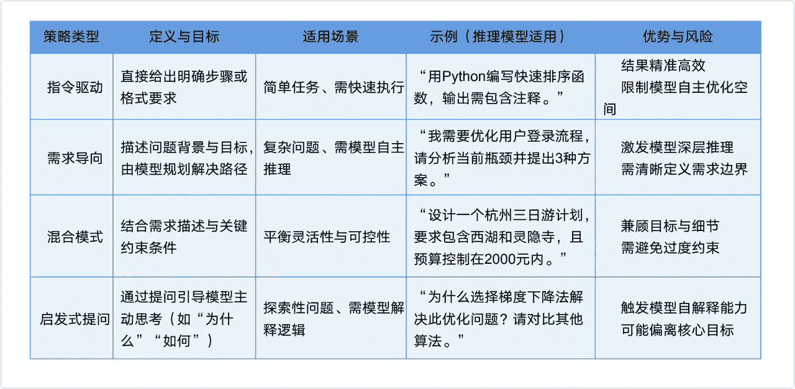
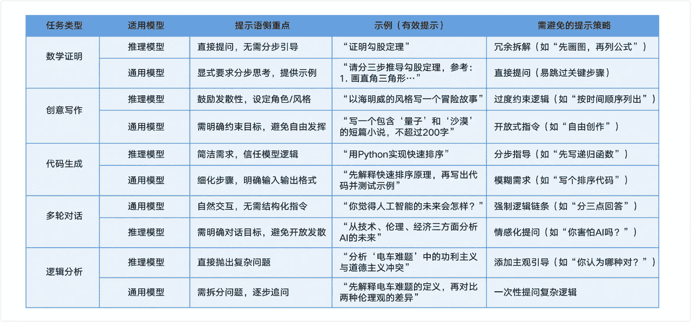

# Deepseek

> 来源：[https://v11enp9ok1h.feishu.cn/docx/WArzdE7afopXpJx4Lm8cEEZHnFc](https://v11enp9ok1h.feishu.cn/docx/WArzdE7afopXpJx4Lm8cEEZHnFc)

# DeepSeek是什么？

Dee**pSeek，全称杭**州深度求索人工智能基础技术研究有限公司，成立于2023年7月17日。由知名私募巨头幻方量化孕育而生，专注于开发先进的大语言模型（LLM）和相关技术。注册地址 ：浙江省杭州市拱墅区环城北路169号汇金国际大厦西1幢1201室。员工数约140人。

### Deepseek发布历程：

> 2024年1月5日，发布DeepSeek LLM。1月25日，发布DeepSeek-Coder。2月5日，发布DeepSeekMath。 3月11日，发布DeepSeek-VL。5月7日，发布DeepSeek-V2。6月17日，发布DeepSeek-Coder-V2。9月5日，推出 DeepSeek V2.5。12月13日，发布DeepSeek-VL2。12月26日，正式上线DeepSeek-V3首个版本并同步开源。2025年1月31日，英伟达宣布DeepSeek-R1模型登陆NVIDIANIM。同一时段内，亚马逊和微软也接入DeepSeek-R1模型。英伟达称，DeepSeek-R1是最先进的大语言模型。

# **DeepSeek技术**

如下图所示，经典的大模型训练包括预训练 和 后训练两个阶段，主流的后训练包括Chat Model、经过强化学习对齐的Chat-Model以及思维链强化的模型Chat Model CoT。

常用的ChatGPT或GPT4o 对应下面的Chat Model RLHF版本，OpenAI的o1系列模型对应Chat Model CoT部分。

对应到DeepSeek-V3，从预训练的DeepSeek-V3 Base模型指令微调+强化学习得到，并在此基础上，通过思维链推理训练增强，得到DeepSeek-R1。R1与DeepSeek-V3 的关系以及训练的方法概览：

关键亮点：

+   MoE架构，虽然参数规模大（671B），但是仅激活37B参数，训练和推理时的效率高；

+   验证直接从Base模型做强化学习解推理题（数学、代码等有确定答案的奖励函数）可行，DeepSeek-R1-Zero；模型自我演化，自我修正，通过思考解决特定问题。

+   多阶段的微调和强化训练，在DeepSeek-Base模型基础上，提升推理能力 兼顾可读性、可用行等。得到DeepSeek-R1；

+   通过R1的工作，蒸馏了一批“小模型”，同样具备了比较强的推理能力，提升了模型效果；

+   开源满血版 OpenAI o1！

## DeepSeek可以做什么

直接面向用户或者支持开发者,提供智能对话、文本生成、语义理解、计算推理、代码生成补全等应用场景,支持联网搜索与深度思考模式,同时支持文件上传,能够扫描读取各类文件及图片中的文字内容。

## 推理模型与非推理模型

### 推理模型与非推理模型的差别

推理大模型:推理大模型是指能够在传统的大语言模型基础上,强化推理、逻辑分析和决策能力的模型。它们通常具备额外的技术,比如强化学习、神经符号推理、元学习等,来增强其推理和问题解决能力。 例如: DeepSeek-R1, GPT-o3在逻辑推理、数学推理和实时问题解决方面表现突出。

非推理大模型:适用于大多数任务,非推理大模型一般侧重于语言生成、上下文理解和自然语言处理,而不强调深度推理能力。此类模型通常通过对大量文本数据的训练,掌握语言规律并能够生成合适的内容,但缺乏像推理模型那样复杂的推理和决策能力。 例如: GPT-3、GPT-4 (OpenAI) , BERT (Google) ,主要用于语言生成、语言理解、文本分类、翻译等任务。

### 概率预测模型与链式推理模型的核心差异

### 推理模型与非推理模型的提示词策略差异

### 推理模型的提示词

