# 不止 “对话框”：解锁AI产品5种界面布局设计

> 来源：[https://v11enp9ok1h.feishu.cn/docx/U2Dgd6NFlo4ld7xtn1nc3FsMnIe](https://v11enp9ok1h.feishu.cn/docx/U2Dgd6NFlo4ld7xtn1nc3FsMnIe)

从 **GPT** 的连续气泡到 **Notion **的隐形 Ask AI，从夸克悬浮球到网易云音乐的后台推荐，本文用 5 种 UI 范式——对话型、面板分隔型、插件型、内容插入型、隐藏型——拆解当下最热门的 AI 产品如何让用户“看得见思考、感知到温度”。

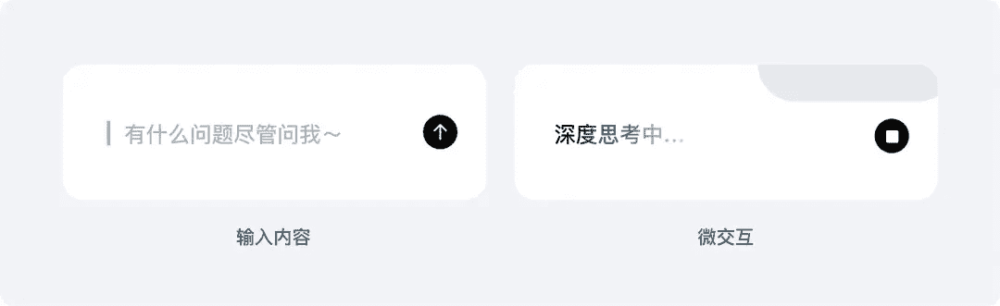

+   **输入框：**传达用户意图的接触点。

> 由于生成式AI的本质是“根据请求生成个性化结果”，因此输入内容是用户与AI交互的关键触发点，也是整个沟通的起点。

>

+   **微交互（视觉反馈）**：将不可见的过程转化为可感知的体验。

> 由于AI的实时运行状态和流程对用户不可见，因此需要通过微交互来传达“加载”的感觉。加载动画和输入动效并非简单的视觉装饰，而是提升AI服务沉浸感、维系信任的关键手段。

## 类型一：对话型UI布局

强调输入内容、聊天气泡和对话流程。最典型的对话式AI应用ChatGPT，就是一种专门为了能与AI对话而设计的产品，可在单个聊天窗口中提供连续对话。

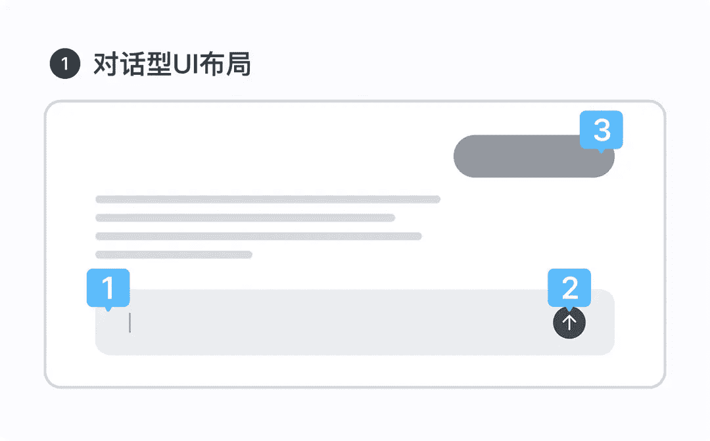

> ① 输入框

> ② 发送按钮

> ③ 聊天气泡（内容输入气泡、结果生成气泡）

>

> **主要特点：**对话型AI助手的语言风格会影响用户的使用感受，将语言风格调整得温暖、关怀，用户在交流时会感受到被理解和尊重，从而建立起深厚的情感连接。

> **适用领域**：客服中心、教育/学习、心理咨询、AI秘书等提升对话体验的服务。

---

## 类型二：面板分隔型UI布局

这是将内容区域和AI对话区域分隔成两块面板的界面类型，这种结构能够实时确认用户需求的反应过程。由于对话区域和操作区域在视觉上被很好地区分，AI很容易被当作“辅助工具”。

当前很多桌面端产品和网页产品都会内嵌类似的AI助手，用来辅助用户操作。嵌入AI助手面板后，页面会变得更拥挤，因此在小尺寸屏幕上使用会有局限性。

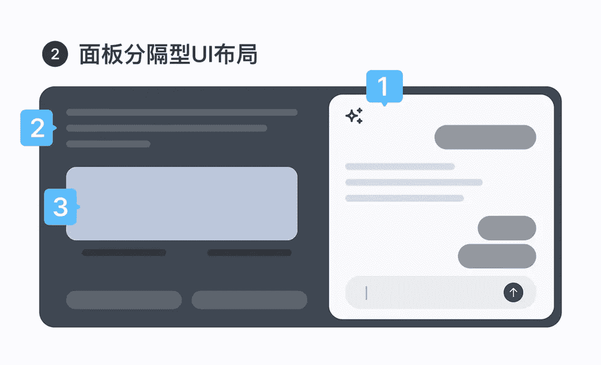

> ① AI对话区（输入框/操作按钮/聊天气泡等）

> ② 内容区

> ③ 实时生成反映用户需求的结果

>

> **主要特点：A**I功能作为单独区域在屏幕右侧或底部展示。当用户在内容区域同时进行多个操作时，AI面板区域的交互反馈需要格外重视，需要将AI的逐步回复设计做好。

> **适用领域：**文档编写、内容策划、图像及视频创作、电子邮件撰写等。

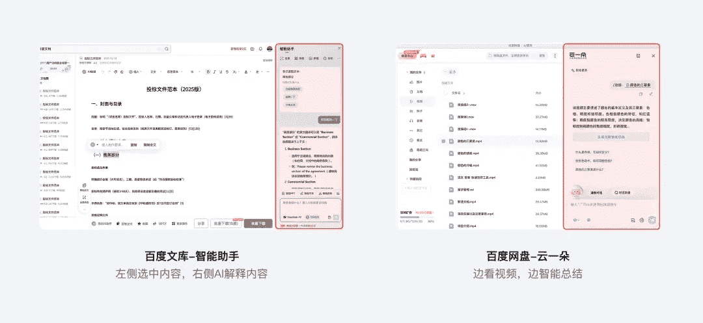

这种界面类型主要用在内容创作（主要任务）和AI功能（次要任务）并行工作的场景中，比如在文库中使用AI助手来辅助解释文档，在百度网盘中使用AI助手对视频进行智能总结。

---

## 类型三：插件型UI布局

插件型UI是指将AI作为插件或内置功能提供给用户，大致可分为由特定操作触发而展示的隐藏型和始终展示的浮动按钮型。

### A-隐藏式

隐藏式是指在用户触发时才会显示，如果用户没有直接调用AI或执行相关操作，AI就是隐藏的。当需要AI来协助完成某些特定任务时，通常会采用这种设计方法，这种的特点是页面比较干净，不会干扰用户的操作。

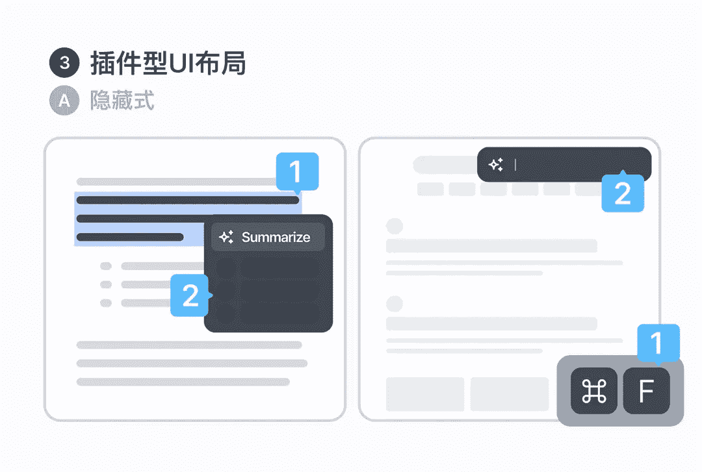

> ① 拖动、快捷键等触发。

> ② AI提供功能。

> **主要特点**：隐藏型的核心优势在于“自然的体验和量身定制的帮助”。但如果触发条件不明确或者没有提前了解，可能存在不会使用或者忽略AI的问题。因此当AI出现时，提供清晰的反馈非常重要。

> **适用领域**：本身具备基础功能的生产力工具、创意工具等，有了AI辅助能够满足特定的需求。

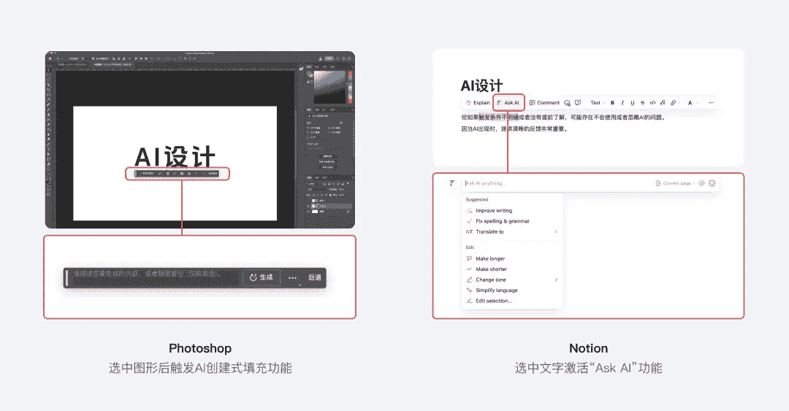

隐藏式AI助手不会过多地干扰用户的浏览或操作，只在“必要的情况下”出现。例如在PS中只有选中图形后才会出现AI填充功能，在Notion中选中内容后才会出现“Ask AI”功能，如果没有这些激活操作，这些AI功能在页面中是不可见的。

### B-悬浮按钮式

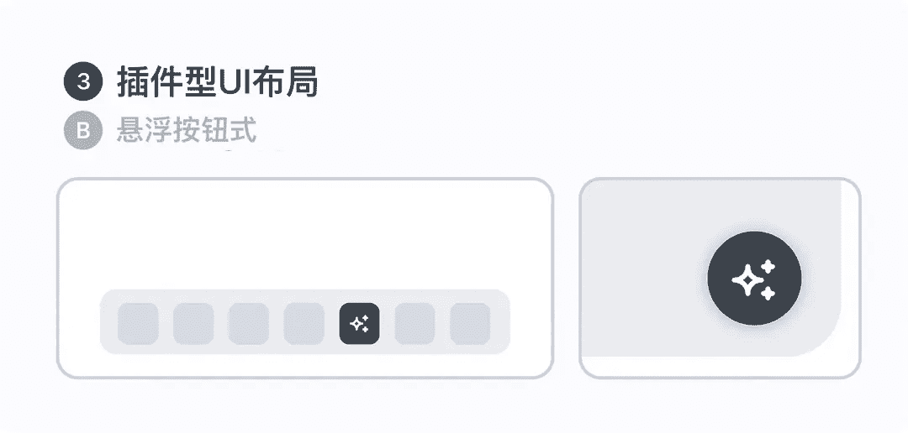

> 悬浮按钮式是指将AI助手设计成功能按钮的形式，始终在页面中保持可见，方便用户随意调用AI功能。

> **主要特点**：操作简单可以立刻执行任务，能在使用产品期间提供快速的协助。但太过明显的AI助手按钮可能让分散用户的注意力，从而忽略了页面上的其他功能，因此AI助手的颜色、样式、位置等都需要仔细考虑。

> **适用领域**：生产力工具、创意工具、浏览器等希望鼓励用户使用AI的场景中。

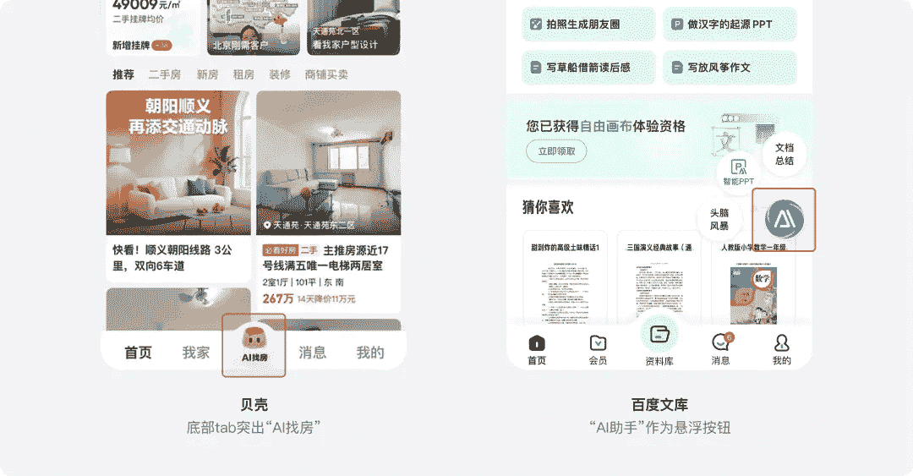

> 现在很多APP都在主推AI功能，一方面能让产品更加**智**能化，同时也能给用户带来更便捷的体验。例如贝壳APP在底部tab栏突出“AI找房”功能，百度文库也将“AI助手”做成了悬浮按钮的形式，都起到了鼓励用户参与使用的效果。

---

## 类型四：内容插入型UI布局

> 内容插入型是指将AI助手自然融入到界面内容里，通常用于内容总结或信息补充。现在很多搜索引擎都会在搜索结果中插入AI总结的结果，并将其放在搜索页面的第一条展示，AI总结的UI设计一般都会符合当前页面的设计风格，不会过于跳脱。

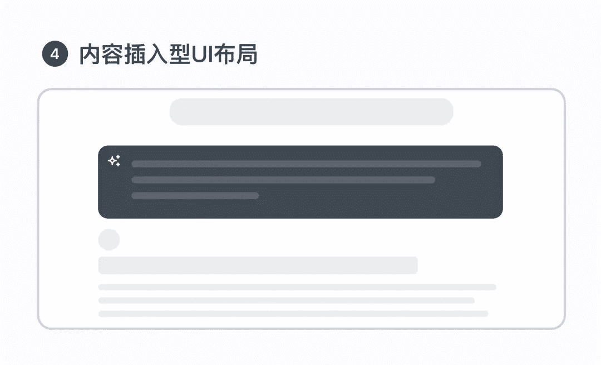

> **主要特点**：通过“无痕式”的内容呈现，能够最大限度地减少对使用体验感的干扰。

> 由于是实时展示的插入式内容，在UI/UX设计时不要过于复杂，并且要明确标注是AI生成，避免让用户产生混淆。

> **适用领域**：搜索门户、备忘录应用、评论总结等场景。

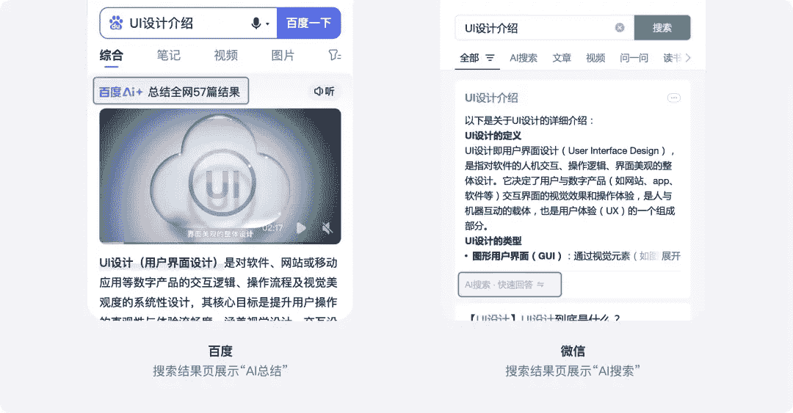

内容插入型的UI设计能在信息过载的情况下有效减少用户的认知负担，因为它在提供核心信息的同时降低了内容密度。例如在百度或者🛰️中搜索“UI设计”，第一条内容都是由AI总结了全网几十篇相关文章后得到的精炼回答，一定程度上帮我们节省了大量时间。

---

## 类型五：隐藏型UI布局

这类AI助手是指不在前端页面中显示而是集成在后端系统中，用户能在没有意识到AI正在运行的情况下自然而然地使用相关功能。

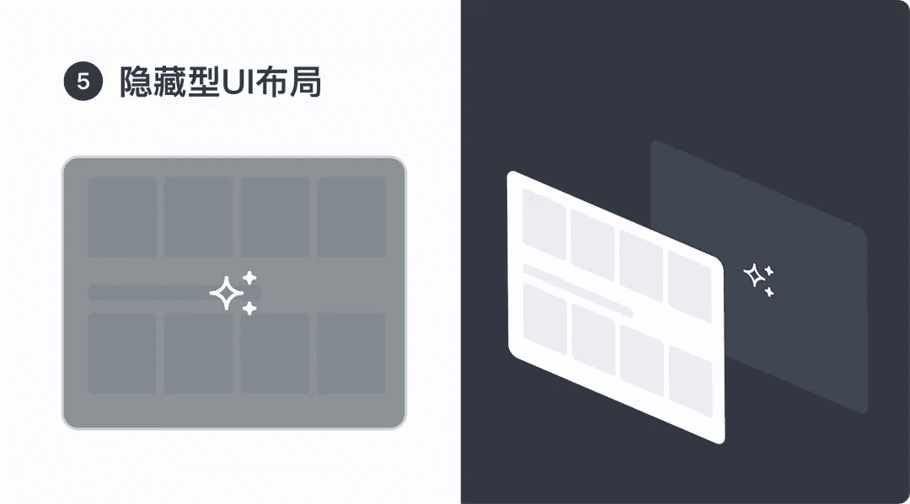

> **主要特点**：由于是一种完全隐藏的干预，因此看起来好像界面本身并不存在，很难知道结果如何，因此必须提供反馈调整/更正功能。

> **适用领域**：推荐系统、自动化设置、分类排序功能。

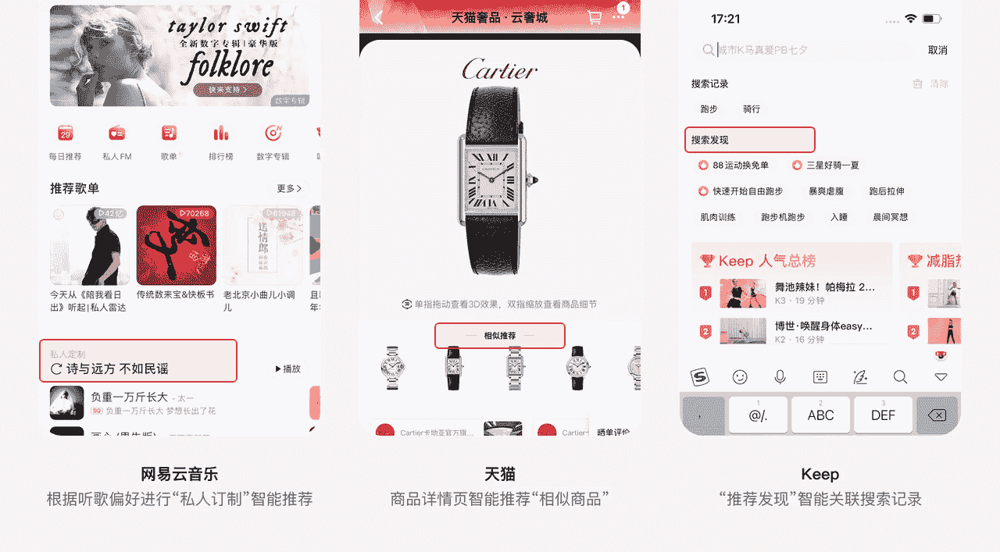

与自动推荐一样，这类AI助手在服务后台自动运行，不需要用户进行激活AI就能实现。

> **例如在网易云音乐**系统会根据你的听歌偏好，自动为你“私人定制”一些你可能喜欢的歌曲；

> **在天猫等电商App中**，会在商品详情和商品列表页智能化推荐一些“相似商品”；

> **在Keep的搜索发现模块**，会学习用户日常搜索的记录，推荐一些与搜索记录有关联且热门的选项。

## 最后

虽然上面介绍了多种类型的AI界面布局设计，但在用户流程的交互设计上有着共同的原则。

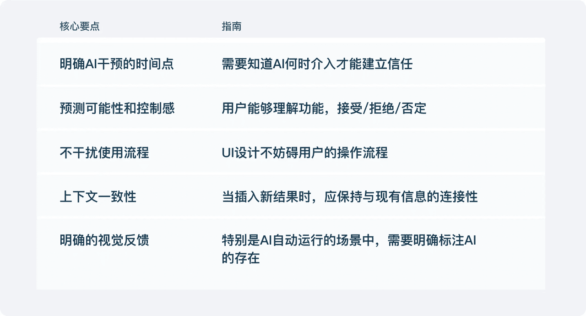