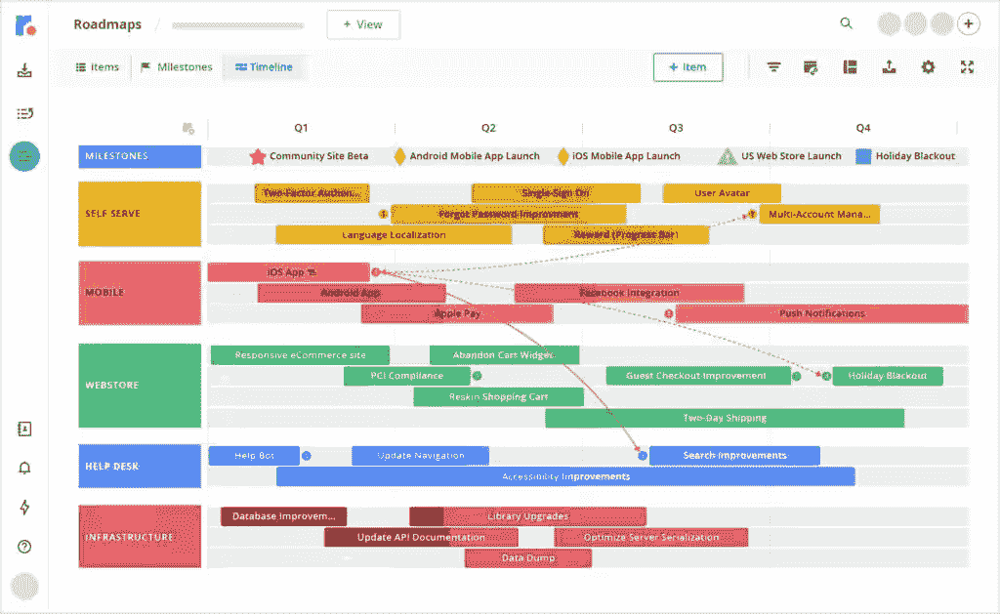
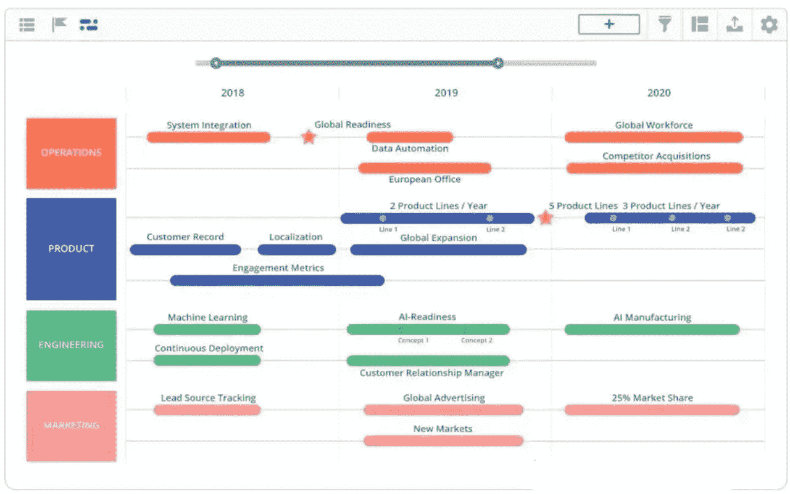
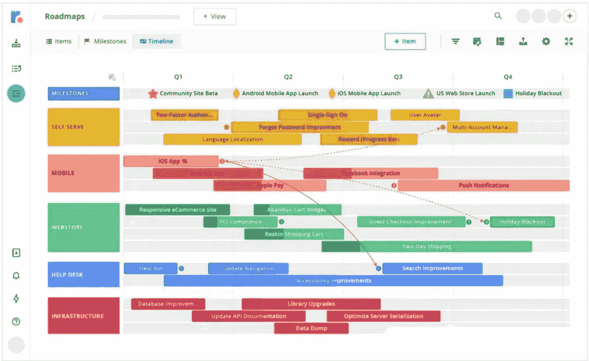
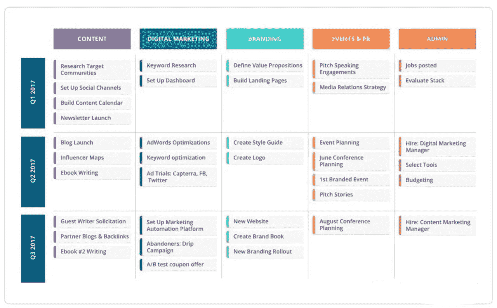
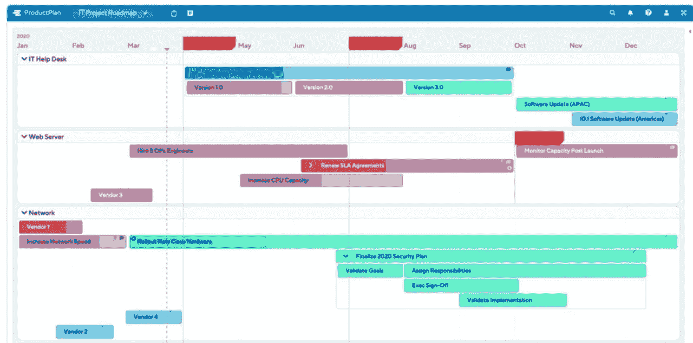
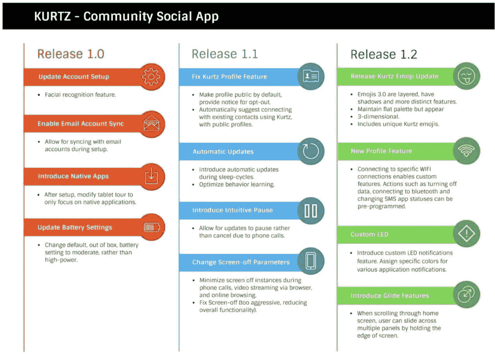
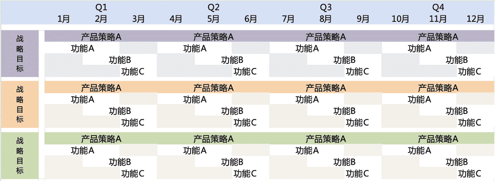
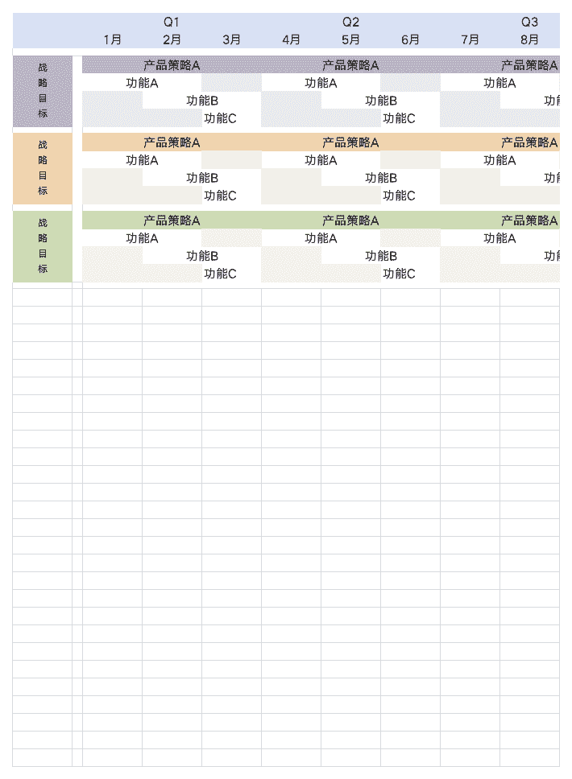

# RoadMap，产品路线图，每个产品经理都需要

> 来源：[https://v11enp9ok1h.feishu.cn/docx/DsTXdACW4oylV1xFhiscFFWwn0g](https://v11enp9ok1h.feishu.cn/docx/DsTXdACW4oylV1xFhiscFFWwn0g)

产品路线图其实推演产品达成目标的路径，具体描述了实现目标的每个步骤，明确了现在做什么，未来做什么。每个阶段的里程碑是什么。它是一个执行计划，照着做就能达到我们想要的产品目标。有时候我们也叫策略战略，规划好每一步才能随时调整适应现实的节奏。

**在日常工作里，产品未来规划汇报的时候，经常需要去绘制**产品路线图，用这张图给老板讲故事（画饼）

# 什么是产品路线图

产品路线图是描述产品开发不同阶段的书面或视觉指南。它展示了某些产品功能背后的策略，为什么这些功能很重要，以及它们将如何帮助公司实现其目标。

产品路线图不仅仅供产品团队使用。根据产品、产品特性、产品开发阶段甚至组织，利益相关者可以包括但不限于：执行、工程、支持、营销、设计、运营和销售团队。

# 产品路线图的类型

产品路线图的类型，要分场景来说。不同场景对应不同类型的图

### 产品战略规划图

产品负责人需要根据市场和公司定位制定产品规划，给产品发展指明方向。同时产品路线图可以作为信息同步的载体，向公司其他部门宣贯产品大方向，确保大家步调一致。

比如下图是3年的产品规划路线图

按照3年的产品路线图，产品经理可以逐步来达成目标。并且在此基础上，拆分细化到每个季度，让每个季度需要达成 的各项能力更清晰。

### 市场活动路线图

产品经理有时候需要配合市场活动来调整产品规划，这个时候绘制出市场活动路线图，就更更好的支持市场活动的落地执行。

### 项目路线图

产品经理有时候也要兼任项目经理，毕竟要对整个的项目结果负责。项目路线图其实和甘特图是类似的，会细化到需求、人、对应的时间。

### 版本发布路线图

产品经理对发版肯定都很熟悉了，面试也经常问你们多久发一次版，所以版本发布路线图，就是为这些场景存在的。

+   老板常常要问最近有发布什么需求，以及未来要做什么功能？

+   客户想要知道产品最后要更新什么功能。

+   上下游团队（运营、研发、UI、测试）方便根据产品发布分配人力

+   方便追溯产品的需求发布版本的内容和时间，作为例行的发布记录管理

每次有发布新的版本，产品经理就需要对发布路线图进行更新。这样对新老同事都能了解产品迭代记录。

# 产品路线图怎么画

第一步，明确愿景和战略目标：希望产品在未来是什么样的。然后，确定与愿景相关的战略目标，即实现愿景所需的具体目标。

第二步，收集决策信息，包括收集产品需求、用户反馈、老板需求、竞品信息。然后对这些信息进行筛选和提炼，根据用户价值和商业价值去排优先级。从而推导出完整有效的产品路线图。

路线图一定是和OKR密切相关的，从而推动产品不断的迭代。

产品路线图绘制工具：Excel、PPT都可以绘制。一些在线画板也挺好用，看自己习惯选择。

产品路线图可以帮助产品经理统一目标，协调上下游部门共同推进项目，有规划有战略执行才能有结果。

# 产品路线图模板

# 下载地址

[产品路线图模板.xlsx](https://internal-api-drive-stream.feishu.cn/space/api/box/stream/download/all/HMF2bZ3NRoXSc1xBBN2cPFEcnee)