# Figma如何做原型图

> 来源：[https://v11enp9ok1h.feishu.cn/docx/D5nHdpeEkolr8Mxylz6cu0Vanib](https://v11enp9ok1h.feishu.cn/docx/D5nHdpeEkolr8Mxylz6cu0Vanib)

## **一、Figma如何做原型图**

制作原型图是Figma的核心功能之一。在Figma中，原型图是通过将设计稿与交互功能结合来实现的。我们可以通过以下的这三个步骤来制作原型图：

### 1、搭建静态界面

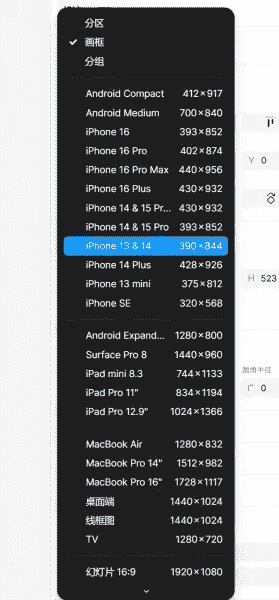

①要制作原型，需要解决的第一个问题是做多大尺寸的图像。这个要取决于最终设计稿要部署的机型。Figma中帮我们预设了一些常用机型的尺寸，我们可以直接在右侧【画框】类目中选择合适的机型，比如这里我们选的是iPhone13&14的预设机型，尺寸为390*844像素。选择后，画布中会出现一个矩形的画框。这就是我们接下来要做界面的空间范围。

图1：选择预设尺寸

②确定了尺寸后，我们可以开始制作界面的内容。标准的做法是利用工具栏中的矩形、圆形等基础工具逐步搭建界面。但为了提高效率，我们可以直接使用已有的设计资源进行搭建。在资源位置加载【UX工具库】，这是网上设计师做好的资源。

图2：加载界面资源

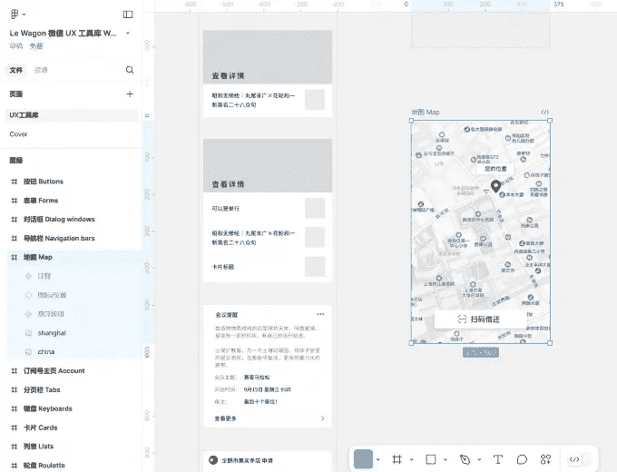

③我们选择其中的地图页，复制后直接拖拽到画框中，并拉伸地图图像填充满界面大小。

图3：绘制界面

④为了设置交互，我们需要准备第二个界面。点击画框工具，再创建一个iPhone13&14尺寸的画框，使用文字工具输入“扫码成功”。

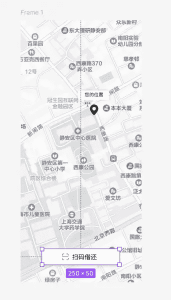

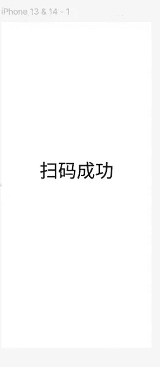

图4：第二个界面绘制

2、设置交互动作

接下来，我们要实现的是让界面动起来。我们还原这样一个场景，点击【扫码借还】按钮后显示扫码成功。我们要执行的设置是，在右侧原型类目中，点击“+”号添加交互，在弹出的窗格中选择让界面在轻触时导航到新建的框架（iPhone3&14-1）中。

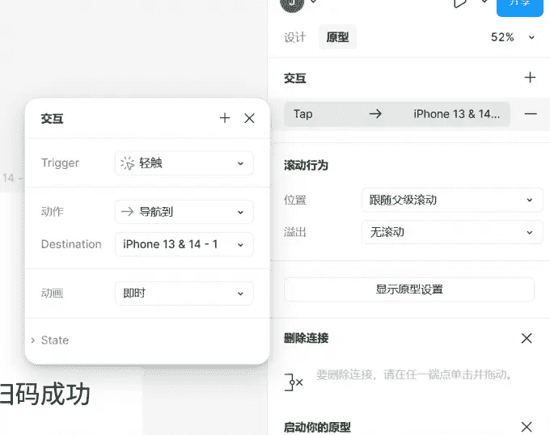

图5：交互动作设置

设置完成后，可以看到画布中两个界面中有一条蓝色的线连接了起来。

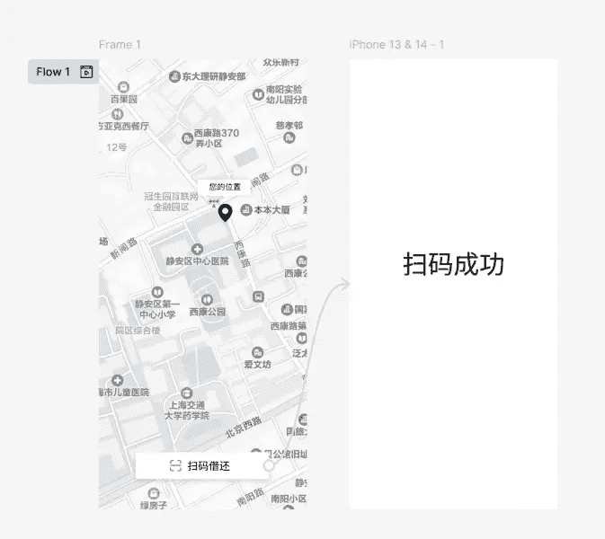

图6：设置后的显示

3、预览测试

点击上方的预览按钮，可以在新的页面中打开原型。可以看到原型被套上了苹果的样机，点击【扫码借还】按钮，页面实现了跳转，显示扫码成功。说明我们的原型制作成功了。

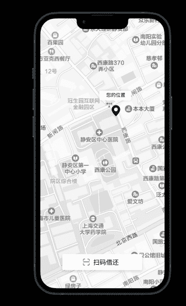

图7：预览效果

**二、Figma如何做钟表图案**

在Figma中，设计钟表图案可以通过绘制基本形状来实现。我们可以通过以下四个步骤来设计钟表图案：

1、创建钟表的外框：在工具栏找到椭圆工具，按住键盘的Shift键实现等比例缩放，我们就能绘制出一个正圆形作为钟表的外框。我们可以设置圆形的大小和颜色，让它看上去像一个钟表的外观。

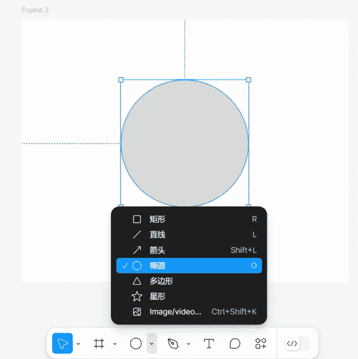

图8：钟表的外框

2、添加钟表的刻度：我们使用直线工具可以绘制刻度。画刻度最难的地方在于定角度。如果我们最开始就直接用短线画刻度的话，线太短太小不好操作。我们可以先画长线再变为短线。

①先画一条垂直的线，连接整个圆。复制一份，在右侧样式的位置，填写旋转角度为30度。以此类推，每次多旋转30度，最终填充为图9所示的样子。

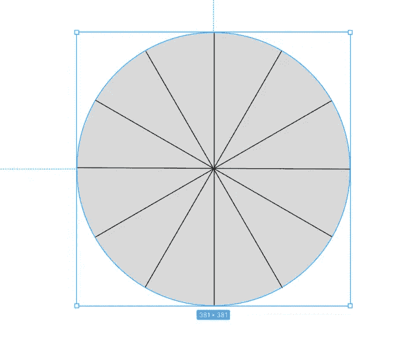

图9：填充线段

②在左侧的图层面板中，按住Shift键选中所有的线段后，统一在右侧样式面板中，找到布局，填写线的长度为20，可以批量将所有的线改为短线。

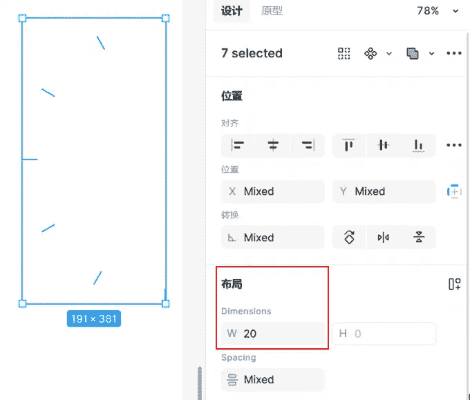

图10：线长度设置

③但这样我们只获得了6根线，我们只要统一复制这6根线后，鼠标右键找到水平翻转，就可以获得镜像的另外6根线了。

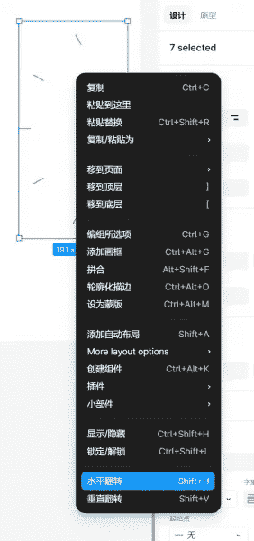

图11：水平翻转

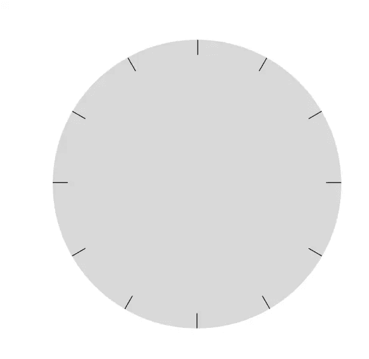

图12：绘制刻度后的钟表

3、添加时间标识：使用文字工具输入1到12的数字，作为时间的指示。

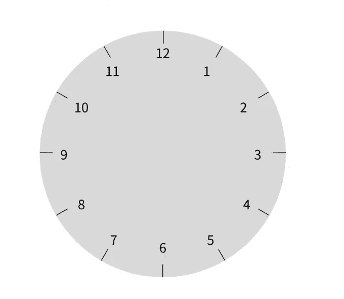

图13：绘制时间标识

4、制作指针：

①先在钟面的中央用椭圆工具绘制一个正圆，作为起始位置。

②再用箭头工具画出一长一短两条线表示分针和时针。时针的短线我们要调节线宽为4个像素，让它看起来更粗，符合我们日常对时针的认知。

③再用直线工具画一条长线表示秒针，秒针的线宽是这三条线中最细的，并且填充了红色。到这里，我们就绘制完成了一个钟表图案。

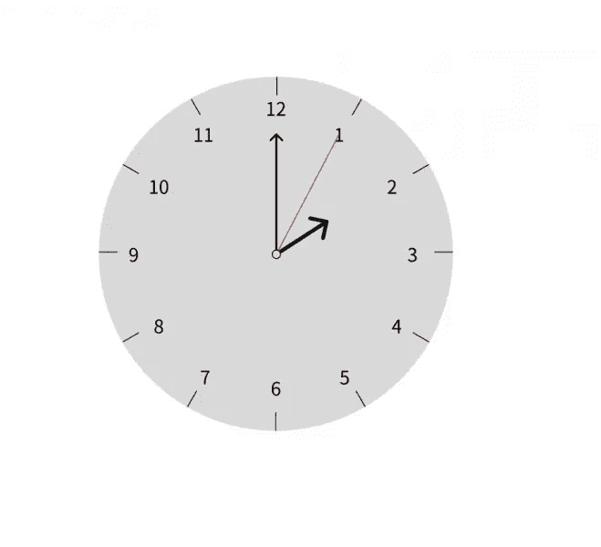

图14：制作指针

以上就是Figma如何做原型图，Figma如何做钟表图案的相关内容。原型图能够清晰呈现页面布局和交互逻辑，能发挥Figma这款软件最大的优势，帮我们在产品真正做出来之前做测试和优化。而通过绘制钟表图案，我们会对Figma的基础操作更加熟悉，以后画其他更复杂的图形时会更得心应手。