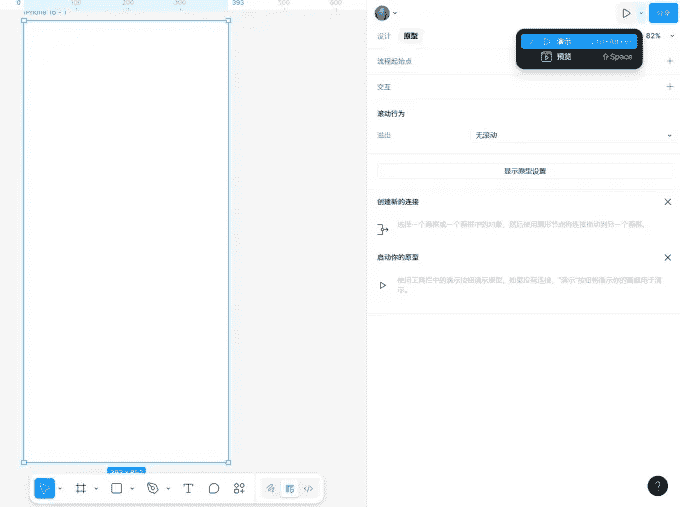
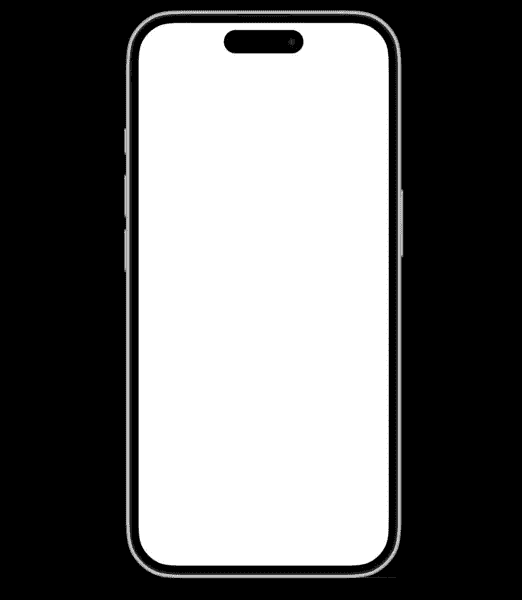
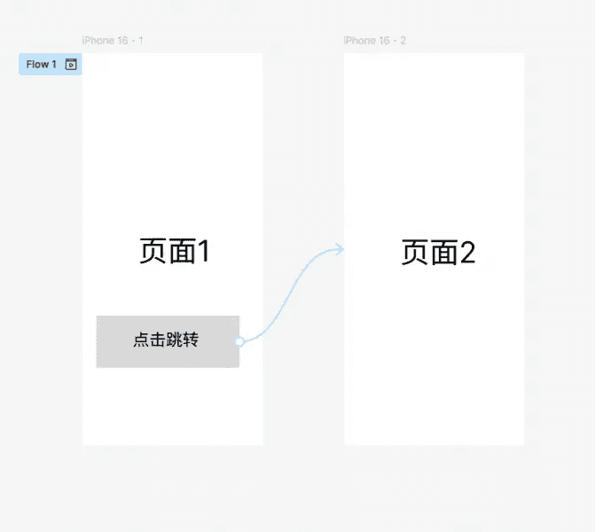
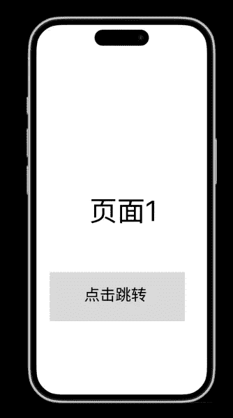
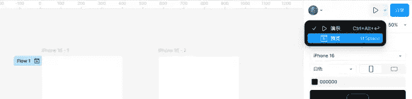
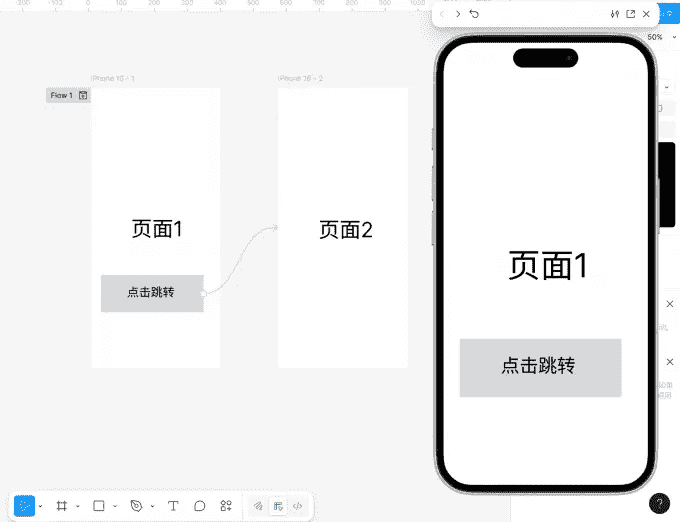
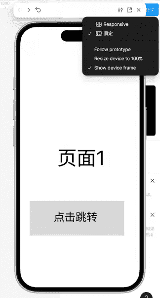
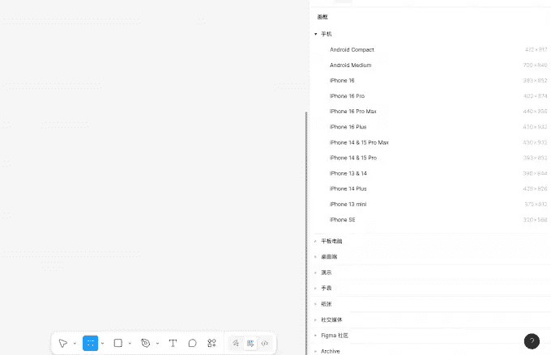
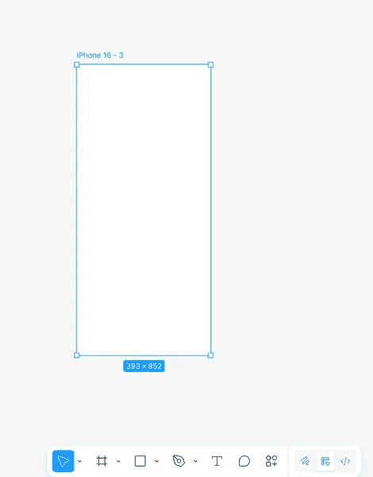

# Figma怎么预览效果 Figma预览显示手机模型

> 来源：[https://v11enp9ok1h.feishu.cn/docx/QGG4dtJnLoyt38x4z1ucryM1n1d](https://v11enp9ok1h.feishu.cn/docx/QGG4dtJnLoyt38x4z1ucryM1n1d)

## **一、Figma怎么预览效果**

Figma 支持包括静态展示、原型交互测试、修改同步预览等多种方式，帮助我们在不同设计节点灵活验证页面效果。以下介绍两种主要的预览操作方式。

1.  启动【演示】模式。点击界面右上角的播放图标，即可进入Figma的演示视图。这个操作会在新窗口中呈现当前的设计内容，适用于交互原型查看。

图1：点击演示

以图1为例，我们选用了Figma自带的iPhone 16模型框架，进入演示后，系统将自动加载该机型的边框效果，使预览更具真实感。

图2：演示模式

这一模式特别适合用来检查交互设计。例如在图3中，我们做了点击跳转按钮，点击后能从页面1跳转到页面2，但这种变化在编辑画布中看不出效果。

图3：跳转模拟

只有在演示模式中，我们点击按钮后，界面才能发生跳转反馈，就能看出来效果了。

图4：跳转成功

2、使用【预览】小窗。点击播放按钮右侧的下拉菜单，选择【预览】功能，即可启动悬浮小窗预览界面。这种方式在编辑和调整设计时尤其实用。

图5：点击预览

这个小窗可任意拖动，避免遮挡主画布。左侧提供返回键，能够返回到效果最开始的状态。

图6：预览小窗

右上角则可以调节边框是否显示、界面缩放比例等。整体交互方式简洁灵活，可以边做边看效果。

图7：窗口设置

二、如何在Figma中显示手机模型

在展示移动端UI项目时，将界面嵌入手机外观中展示，更符合使用场景，也有助于增强设计的说服力。Figma内置了展示设备外观的模拟功能，操作流程简洁，分为两个步骤：

1.  添加框架Frame。在画布中使用Frame工具创建新画布区域时，右侧属性栏会显示各类设备模型，包括主流的iOS和Android机型。

图8：添加预设框架

只需选择目标设备（例如iPhone 16），Figma会自动生成对应尺寸的画板。

图9：生成框架

2、开启设备边框预览。只要是用了预设的框架，完成设计后，通过点击播放按钮进入演示界面，Figma就会自动渲染所选设备的边框外观，不需要进行额外设置。

以上就是Figma怎么预览效果，Figma预览显示手机模型的相关内容。Figma的预览功能很好用，能帮我们快速检查设计方案的可行性。把设计稿放到手机模型里展示，效果更加真实，细节也看得更清楚。熟练掌握这些方法都能显著提升我们设计的质量。