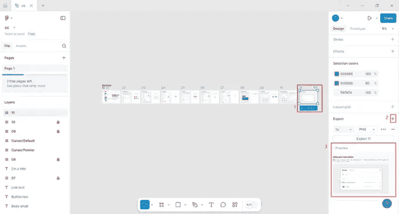
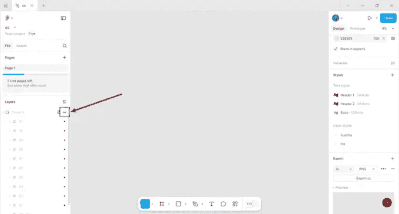
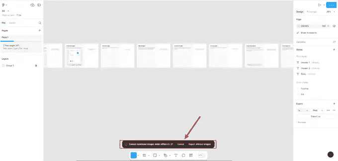
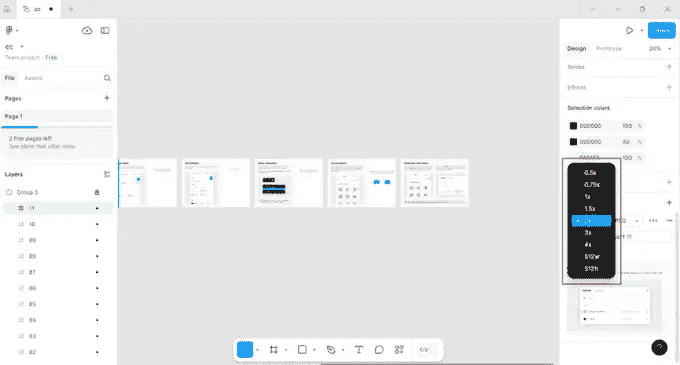

# Figma设计稿导出空白 Figma多画板批量导出失败

> 来源：[https://v11enp9ok1h.feishu.cn/docx/CDuWdmaKWoxWMXxHTfRcJlZfnxN](https://v11enp9ok1h.feishu.cn/docx/CDuWdmaKWoxWMXxHTfRcJlZfnxN)

## **一、Figma设计稿导出空白**

Figma支持导出为多种格式的文件，如PNG、JPEG、SVG等。如果发现Figma设计稿导出空白，可以尝试通过以下方法解决。

1、检查设计稿源文件是否正常。在制作设计稿时，可能会因网络问题或误操作导致设计稿缺失，最终导致导出的设计稿空白。因此在导出设计稿前，需确保源文件正常，再操作导出。

2、检查导出范围。Figma既可以导出整个设计稿，也可以导出选中页面或组件。如果导出时选择了错误的导出范围，可能导致导出的设计稿空白。要解决也简单，打开设计稿，选中正确的导出对象，点击侧边栏中Export右侧的加号，在Preview中预览导出效果，确认无误后再操作导出。

图1：检查导出范围

3、检查导出对象。在Figma中，如果设计稿内容默认隐藏，导出内容会变成空白。这时可以打开设计稿，点击左侧图层列表中的小眼睛图标，取消隐藏后再导出。

图2：取消隐藏导出对象

二、Figma多画板批量导出失败

为提升用户体验，Figma是支持多画板导出的，但实际使用时，会出现批量导出失败的情况。下面为大家介绍Figma多画板批量导出失败如何解决。

1、网络异常。Figma设计稿中经常会引用一些外部的图像资源，网络异常时，这些图片资源无法获取，会导致导出失败。因此导出前需检查网络，在网络正常连接且畅通的情况下导出。

图3：网络异常导出失报错

2、存储空间不足。导出前应先检查保存文件位置所属磁盘空间大小，确保存储空间充足。

3、保存路径有问题。执行导出操作后，需选择文件保存路径。如果所选文件夹命名中包含特殊符号，可能会导出失败。所以选择保存路径时，要规范文件夹名称，尽量使用英文命名，避免使用特殊符号。

4、导出操作不当。批量导出时，如果因为画板过多或多大，也会导致导出失败。导出时，如果设计稿包含内容过多，可以分批导出，同时选用合适的导出倍数，避免因系统内存占用过多而失败。

图4：设置导出倍数

本文为和大家分享了Figma设计稿导出空白，Figma多画板批量导出失败的相关内容。如果大家使用Figma导出时遇到了上述问题，可以参考上文思路，也欢迎大家一起交流探讨更多更好的解决方案。