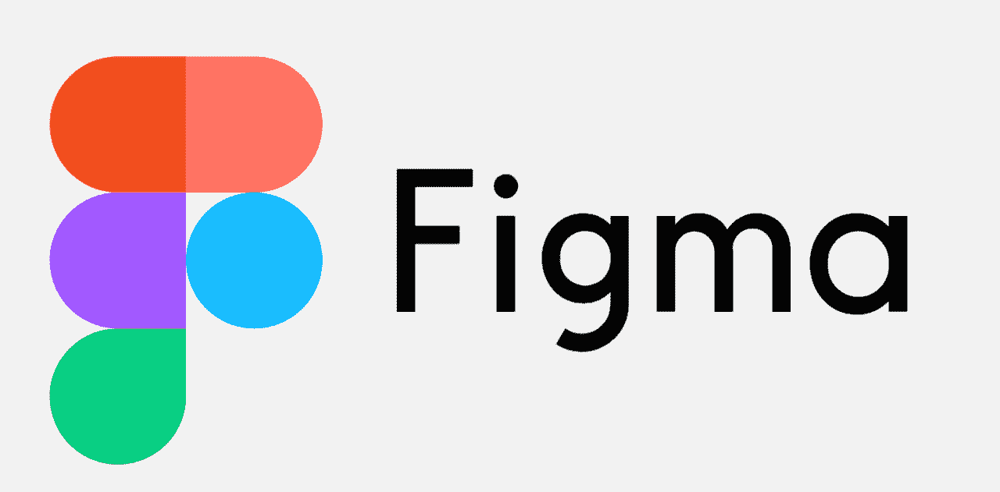
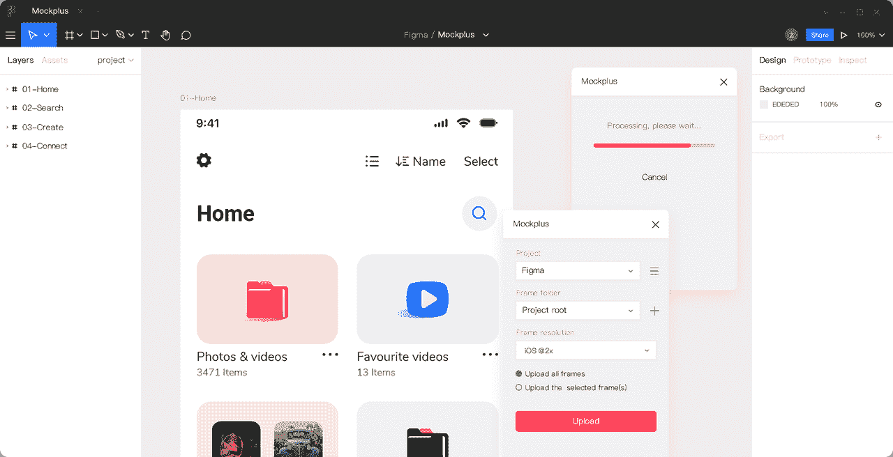

# Figma团队协作怎么设置 Figma多人同时编辑冲突怎么办

> 来源：[https://v11enp9ok1h.feishu.cn/docx/BEqgdzzYtoMRNFxUNLhc2DMcnCZ](https://v11enp9ok1h.feishu.cn/docx/BEqgdzzYtoMRNFxUNLhc2DMcnCZ)

为帮助设计团队更高效协作，这篇文章将围绕Figma团队协作怎么设置Figma多人同时编辑冲突怎么办这两个核心问题进行深入解读，并附上实用技巧。

---

一、Figma团队协作怎么设置

Figma作为一款基于浏览器运行的设计工具，本身就天然支持多人在线编辑。不过，如果希望真正实现高效、稳定、有权限边界的团队协作，前期的组织结构和项目权限配置必须做好。

1、创建团队与项目结构

打开Figma后，要新建团队的话，直接点左侧导航栏里的“New Team”就行。创建团队的人，通常是设计负责人或者项目经理，系统会自动把他们设为管理员，之后就能邀请其他成员加入了。

一个团队下面能建好几个“Project”，每个Project都用来存同一主题或者同一版本的设计文件，这样分类管理起来会方便很多。

2、邀请团队成员

点击“Invite People”，输入成员邮箱地址或分享可设置权限的邀请链接即可邀请成员。常见的成员角色有三种：

Admin：有管理项目、成员权限、账单的最高权限；

Editor：可编辑文件、创建项目；

Viewer：只能查看文件，不具备编辑权。

如果是企业版或专业版，还可通过“团队域名”限制加入成员身份，例如限定公司邮箱后缀自动加入。

3、设置项目权限与文件访问

每个Project都可以设置成员是否有编辑权限，以及是否允许外部协作者查看或评论。建议重要文件开启“Only people invited can access”，防止权限外泄。

4、启用协作评论功能

Figma的“Comment”模式允许团队成员在设计图任意位置添加评论，支持 成员，便于跨团队协作沟通。建议评审阶段统一使用“Comment”视图，避免误修改设计内容。

5、版本管理机制建立

虽然Figma自动保存版本，但建议团队定期使用“Save to version history”手动标记里程碑版本，并为重要节点添加说明（如“UI初稿1.0”、“已评审版本”），方便后期查阅或回滚。

6、使用团队库（Team Library）统一组件

在团队协作中，统一的组件库能极大地提升效率。通过Publish Library将组件/样式集中到一份“主控文件”中，其他文件可直接引用，不仅提升一致性，还降低重复劳动。

二、Figma多人同时编辑冲突怎么办

虽然Figma支持多人实时编辑，但在大型团队并行作业时，依然可能会遇到修改冲突、组件覆盖、信息丢失等问题。理解并预防这些冲突，是维持团队协作稳定的关键。

1、理解实时协作机制

Figma实时同步是以“光标位置+对象级同步”为基础的，也就是说每位用户在页面上进行的操作几乎实时同步到其他人浏览器中。如果你和他人正在编辑同一个图层，系统会根据最后一次操作者的改动更新为最终状态。

2、标记责任区域，明确分工

为避免互相覆盖和误操作，团队在协作前可以划分页面区域。例如使用“封面页”作为导航地图，在每个区域上方标注负责人信息（如“登录页-Lily”），通过视觉划分让每个人知道当前设计内容归属。

3、使用Comment和Observe功能沟通调整

多人同时在线时，若想查看他人工作内容，可点击其头像并点击“Observe”进行实时同步查看，避免误点导致覆盖。而对不确定修改，优先使用Comment而非直接动手改动，可以保留他人原始思路。

4、组件编辑避免直接拉取本地副本

当使用共享组件时，不要随意“Detach Instance”或手动修改主组件的结构，否则可能影响所有引用该组件的页面。修改主组件前应与团队协商好，必要时使用“Branching”功能进行并行测试。

5、文件整理与命名规范统一

多人协作中，若缺乏命名规则会导致层级混乱。例如图层命名统一使用“模块_功能_序号”方式，如“Header_Nav_01”，每次提交更新前检查是否有重命名、删除误操作，有利于代码对接与后期维护。

6、使用Figma的“Branch&Merge”功能（团队版）

对于需要多人开发同一页面但又怕覆盖修改的情况，可以开启“Branch”功能，设计师在分支版本中修改，完成后再提交合并，类似代码开发中的Git分支管理模式。这是处理多人并行设计的理想方式。

7、版本冲突解决方案

如果设计突然消失或组件混乱，可以通过“Show Version History”查看最近的编辑记录，一键恢复至指定时间的状态。多人协作中，善用历史版本是处理紧急问题的“后悔药”。

三、Figma协作管理扩展技巧与实践建议

除了基本设置与冲突应对外，以下几个实用的团队协作优化策略也值得参考，帮助设计项目更系统地推进：

1、建立协作规范文档

在团队项目开始阶段建立一份“协作规范文档”，包括文件结构、命名约定、组件使用指南、版本提交频率等内容，确保团队步调一致。

2、周期性进行组件审计

每月或每个版本迭代结束时对团队库组件进行一次审计，淘汰不再使用的样式、合并重复组件，保持组件库整洁高效。

3、利用插件提高效率

如“FigJam for planning”、“Content Reel”用于内容填充、“Design Lint”检测样式不一致等插件，能有效简化协作中重复性工作。

4、接入开发协同流程

使用Figma的Dev Mode或者插件如“Zeplin”、“Avocode”等，将设计文件与开发交付对接起来，减少沟通误差。

5、周会固定设计审阅机制

每周安排一次固定的设计审阅会议，由各设计师展示自己所负责区域，便于统一风格并及时发现协调问题。

** **

**　　总结**

无论是初创小组还是大型产品设计团队，只要合理设置团队结构、掌握多人编辑规范并熟练运用版本与组件机制，Figma就能真正发挥其“设计协作平台”的优势。Figma团队协作怎么设置Figma多人同时编辑冲突怎么办，不仅是操作技巧，更是团队工作方式的一部分。通过持续优化协作机制，设计效率和成果质量都将稳步提升。