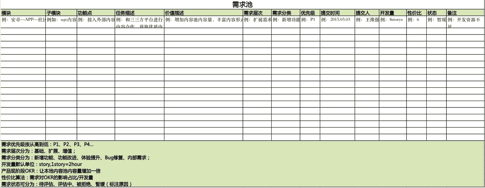
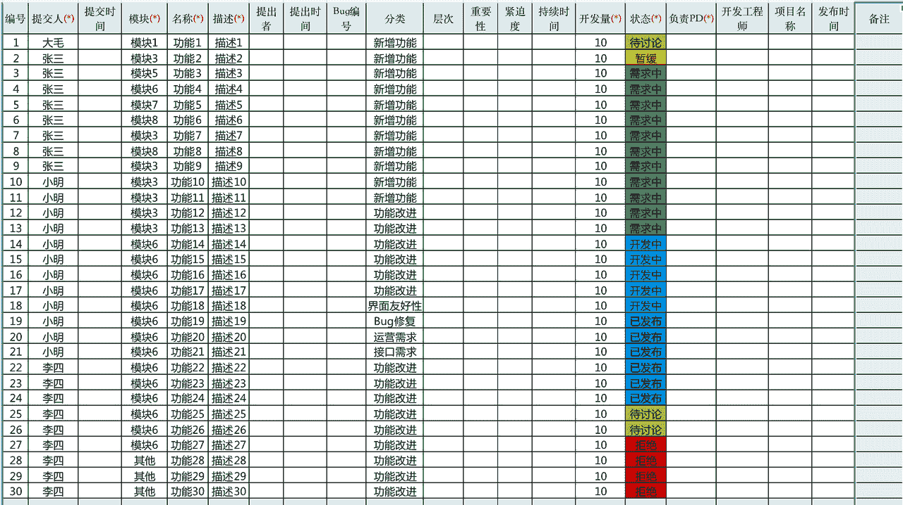
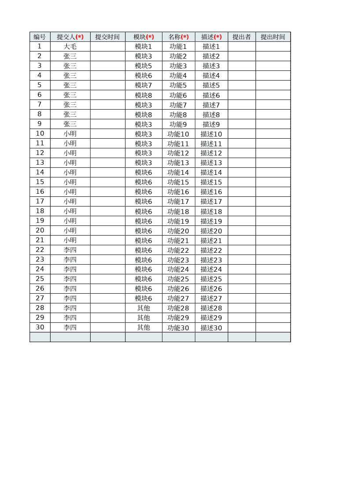
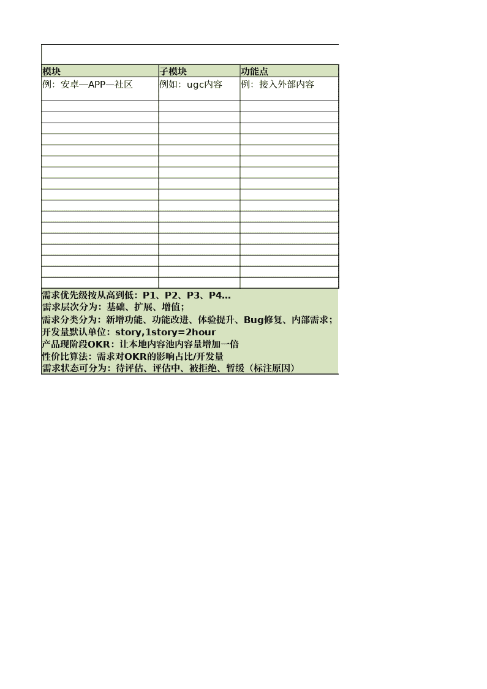

# 需求池管理模板

> 来源：[https://v11enp9ok1h.feishu.cn/docx/DxcodLKsGovCCXxmvzgcilCNnfb](https://v11enp9ok1h.feishu.cn/docx/DxcodLKsGovCCXxmvzgcilCNnfb)

# 需求池管理卡片

# 需求池管理模板

# 下载地址

[简易需求池管理模板 .xlsx](https://internal-api-drive-stream.feishu.cn/space/api/box/stream/download/all/MSuWb8IFvo0vSlx7CsNcvGEkntg)

[产品经理需求池管理卡片 .xlsx](https://internal-api-drive-stream.feishu.cn/space/api/box/stream/download/all/FigXbpATqofSZ6xHKSGcWC1jn2d)