# 拒绝统计陷阱：美团A/B测试方案框架

> 来源：[https://v11enp9ok1h.feishu.cn/docx/TtY1dVr4FoGMajxmLhSczsBIngY](https://v11enp9ok1h.feishu.cn/docx/TtY1dVr4FoGMajxmLhSczsBIngY)

本文以履约场景下的具体实践为背景，介绍如何提供一个可信赖的AB测试解决方案。

> **一方面从**实验方法的角度论述实验过程中容易被忽视的统计陷阱，给出具体的解决方案；一方面论述针对业务场景和对应约束制定实验方案提供给用户，而不只是功能和方法由用户自由选择，因为实验方法差之毫厘，结果可能是失之千里。

##

## 背景

虽然**AB测试（AB实验）**的统计基础已经有一个世纪的历史了，但大规模地构建一个正确可靠的A/B测试平台仍然是一个巨大的挑战。

+   不仅要在实验设计环节应对**溢出效应**和**小样本**的双重挑战，平衡好实验偏差与方差以确定合适的实验单元、分组方法和分析方法，给出合理的实验设计；

>

+   而且要在分析环节应对**方差计算**、**P值计算**、**多重比较**、**混淆因素**、**假阴性**（实际策略有效果，但是检测显示无效果）等多种统计陷阱。

因此，要获得高质量的结果**需要对实验和统计有专家级的理解**，这无疑增加了实验门槛，难以达成任何人进行实验都可得出可信结论的目标。

本文将从**实验方法**和**平台建设**的两个视角，分别介绍如何正**确地使用统计方法避免****统计陷阱，以及输出****什么样****的平台能力，从而确保任何人使****用**时都可得出可信结论。同时，也积累了如何进行更好的实验，以及如何利用实验来做出更好的决策。

## AB测试

**哪个线上选项会更好？**工**作中经常需要做出这样的**选**择。当想要在两个策略之**间做出决定时，理想的方案是面向同一拨用户，在两个平行时空，平行时空1体验原策略A，平行时空2体验新策略B，然后根据观测到的事实进行比较，以决定哪个策略胜出。

然而在现实世界中，不存在两个平行时空，针对同一用户，只能观察到其接受策略A或策略B的一种效果，即反事实结果是观测不到的。

因此，在现实世界中，通常**采用实验的方法做出决策****。它将用户分配到不同的组，**同一组内的用户在实验期间使用相同的策略，不同组的用户使用不同的策略。同时，日志系统根据实验系统为用户打标记，用于记录用户的行为，然后根据带有标记的日志计算度量差异，并进行统计分析以排除由于噪声导致的任何差异。

实验者通过这些指标去理解和分析不同的策略对用户起了什么样的作用，是否符合实验预先假设。

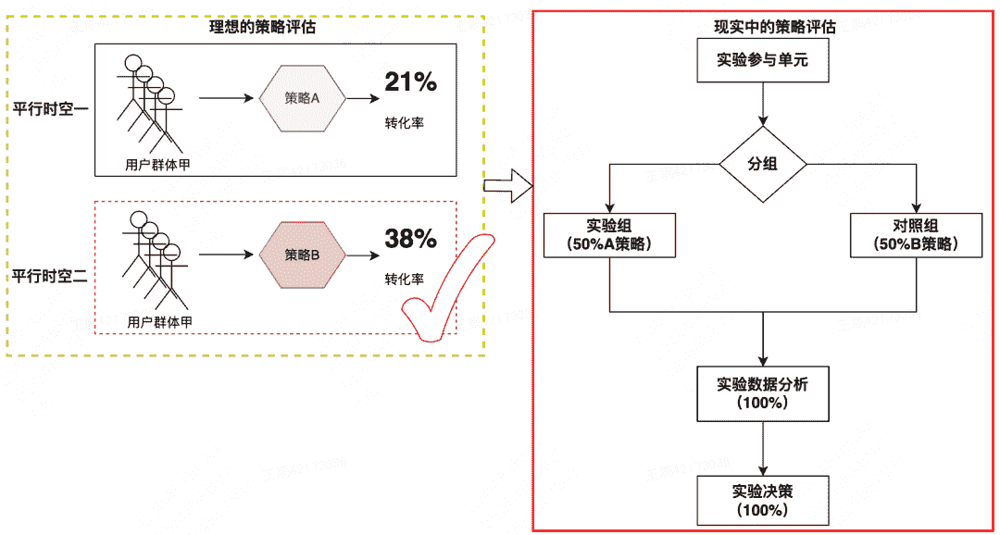

### AB测试概述

> 实证中由于不可能同时观测到同一群体在不同策略下的两种潜在结果**，无法决**定哪个策略胜出，需要构建一个反事实（Counterfactual）用来代表接受策略B的群体在接受A策略时的潜在结果。

>

> 具体来讲，构建一个与实验组群体特征均值无差异的对**照组，用其观**测结果代表实验组群体在施加A策略时的潜在结果，此时两种结果的均值差便是策略效应大小。由于是基于样本的观测数据得出的结论，需要通过显著性分析（Significance Test），以证明结论具有统计意义，这便是策略评估的完整路径。

>

> **根据能否**在实验前控制策略的分配，将实验分为AB实验和观察性研究（Observational Studies），在AB实验分支下，根据能否控制策略的随机分配，又将AB实验分为随机对照实验（Randomized Experiments）和准实验（Quasi Experiments）。不同的实验类型使用不同的分组方法，实验后选择与实验类型匹配的分析方法尤为重要，直接制约着能否统计意义上的科学结论。

**具体分类如下：**

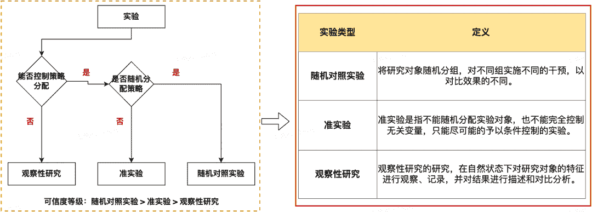

大部分实验场景可以在实验前控制对不同实验对象分配不同策略，然而在有些场景下，如：

> **①测试线上演唱会活动对短视频**平台的影响，需要给全部用户施加演唱会活动策略；

> **②在测试不同的营销邮件策略对用**户影响的场景中，无法控制哪些用户会最终接受策略。

> 要么不能控制策略分配，要么不能控制策略**在对应的人群**生效，只能采用观察性研究，即在自然状态下对研究对象的特征进行观察、记录，并对结果进行描述和分析。

**在****可以控制对实验对象施加策略****的场景，如：**

> ①测试不同的产品UI对用户的影响，进而决定使用哪种UI；

> ②快速验证首页商品列表图素材对转化率的影响。

> 这些典型的C端实验场景，不仅有海量用户且用户在实验组、对照组间的行为不会相互影响，可以通过随机分组的方式找到同质且独立的实验组和对照组，这类实验称之为随机对照实验，是业界衡量策略效应的黄金标准。

> 然而在美团履约业务场景中，如调度场景，要测试不同的调度策略对区域内用户体验的影响，策略施加单位是区域，由于区域数量少，同时区域之间各项指标（商家、运力、消费者）差异较大，采用随机分组难以得出同质的实验组、对照组，而且由于区域之间可以共享运力，施加不同策略的实验组、对照组区域之间相互影响，不满足实验单位独立的条件。

> 在这种场景下，不能对实验对象**进行随机分配，只能有**选择的进行实验组和对照组的分配，这种虽然能够控制策略分配但不能控制策略随机分配的实验，称之为准实验，常用的准实验方法如双重差分。

> **随机对照实验，**因为其能够保证**实验组**、**对照组**两组的特征均值相同，不会因为分组差异干扰对真实效应的衡量，是业界衡量策略效应的黄金标准。在不满足随机对照实验约束的业务场景下衡量策略效应，采用准实验的方法，通过改进分组方法消除实验组、对照组可观测特征的差异或使其保持恒定差异，分析环节采用适配准实验场景的分析方法。

> 如果由于场景约束，只能基于实验后得到的数据来进行实验的话，就只能采用适用于观察性研究的方法。准实验和观察性研究虽然不是衡量策略效应的金标准，但是如果使用得当，也可以得出相对科学可信的分析结论。

在学界，三种不同实验类型的可信度等级如下：

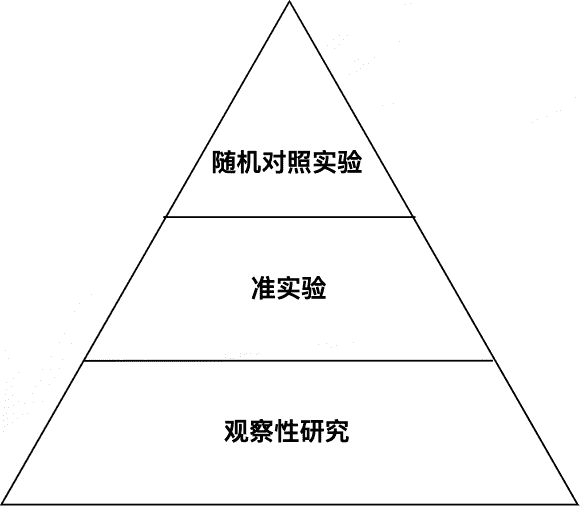

###  AB测试的关键问题

> 不管何种类型的**AB实验**，都符合分流->实验->数据分析->决策的基本流程，以及需要满足AB实验的3个基本要素。

> 分流是实验平台的**顶层设计**，它规范和约束了不同实验者如何在平台上独立运行各自实验而不相互影响，运行实验，看似简单，但是成功运行不同类型实验的前提是实验场景要满足其理论假设。

> AB实验主要是通过观**察抽样的样**本来推断总体的行为，属于预测型结论，数据分析涉及大量的统计学理论，稍有不慎，容易掉入统计陷阱。

> 上述流程，任一环节出错，都可能导致错误的结论，因此，AB实验统计一个数字容易，得到可靠可信的统计结论并不容易。

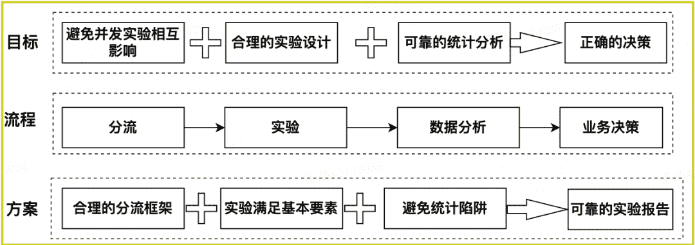

####  AB测试的分流框架

> 在**履约技术**平台，通过实验衡量真实的用户反应，以确定新产品功能的效果，如果无法同时运行多个并行实验，将会大大减慢迭代速度。

>

> 扩大同时运行实验的数量对于实现更快的迭代是必不可少的。

为了增加可以同时运行的实验数量，提高并行性**，并允许同时**运行多个互斥实验，业界出现了两种分流框架。

+   一种是像谷歌、微软、脸书这种单边业务形态的公司，采用层、域嵌套的分流框架；

+   另一种是像Uber、DoorDash这种多边业务形态的公司，采用基于约束的分流框架。

**具体如下图所示：**

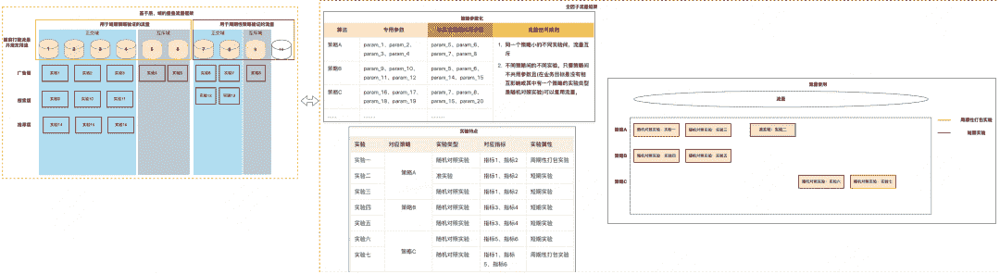

> **基于层、域嵌套的重叠分流框架：**该分流框架的特点是事先将流量随机打散做桶号标识并提前规划流量的用途，如上图所示，提前将全国流量划分为10等份并用1到10桶号来标识流量，1-6号桶的流量用于短期策略验证，7-10号桶用于长期性策略验证。

> 该分流框架的优点是不仅可以**实现流量复用，扩大实验并行度**，而且较容易避免具有潜在交互作用的实验可能给用户带来的糟糕体验。引入层的概念，将系统参数划分为多个层，约束让组合在一起可能产生较差用户体验的实验必须位于同一层，同一用户可进入不同层多个实验以实验流量复用，并防止其进入同一层多个实验，避免糟糕的用户体验。

> **基于冲突检测的分流框架：**该分流框架的特点是**由实验者制定约束**，平台根据实验者制定的约束，确保无法避免潜在交互影响的实验没有同时曝光给用户。如微软、Uber等公司，实验平台都集成了检测交互作用的自动化系统，以避免实验间潜在交互影响。

> 该分流框架的优点是**灵活且能最大限度的复用流量**，相较于重叠流量框架，不受提前划分的域的约束只能在特定域中进行实验，即使对应的域中此时并无其它实验。只要满足进行并行实验的条件，便可以任意圈定流量进行实验。

####  AB测试满足的基本要素

在运行AB实验时，要满足三个基本要素：

> ①施加不同策略的实验组、对照组可比较，即实验组、对照组的特征均值在实验前相同或在实验前具有固定差异，便于实验后计算哪些差异是由于策略不同导致的；

> ②策略之间没有干扰，即接受策略A的用户行为不会受接受策略B的用户行为影响；

> ③实验群体的数量要足够，避免实验结果假阴性，即由于样本量不足没有检测出来。

> **不满足要素一，**实验后难以确定实验组对照组的差异是由策略导致的还是由于分组导致的，难以准确衡量策略的真实效应；

> **不满足条件二，****可能会高估策略效应**。因为实验期间观察的增加仅仅是单量转移，实验组单量转移到了对照组。

> **不满足条件三，**难以确定策略无效果是真正的无效果还是由于样本量不足，没有检测到策略效果。

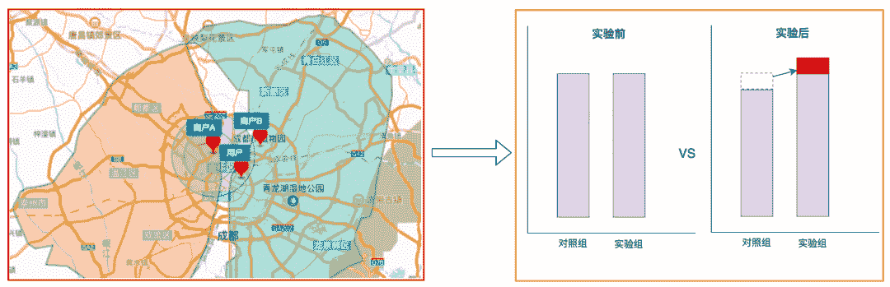

####  不可忽视的统计陷阱

> **AB实验主****要是通过**观察抽样的样本来推断总体的行为，属于预测型结论，涉及大量的统计学理论，稍有不慎，容易掉入统计陷阱，难以得出可靠的统计结论。

> **实验组和对照组之间的差异**是真实的还是噪音通过显著性检验来辅助判断，要得出结论涉及方差、检验方式和P值计算，这些环节充斥着统计陷阱，稍有不慎便会导致通过假设检验得到错误的结论。

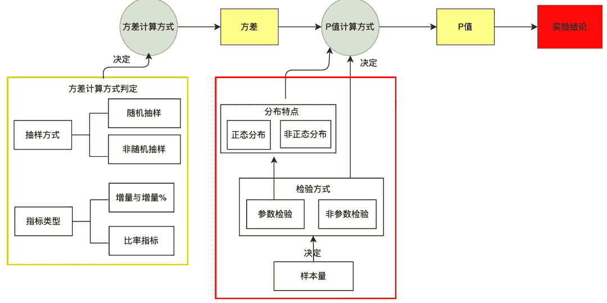

> **容易忽视的方差计算陷阱**：如果不能正确的估计方差，那么P值和置信区间都将是错的，这些错误会导致通过假设检验得到错误的结论。高估的方差会导致假阴性，而低估的方差会导致假阳性。下面是几个估计方差时的常见错误。

样本在实验组或对照组的分配机制影响着其方差的计算，避免用随机抽样(样本满足独立同分布)下的样本方差计算方法计算非随机抽样下的样本方差。

> 该陷阱主要出现在用随机对照实验下的方差计算方法计算准实验下的方差，导致方差计算错误。计算 的方差，按照方差性质，非随机抽样下，若 和 不独立：

在随机抽样下， 和 独立：

> **两者不相等。**如果按照独立的方法计算方差，将错误估计方差。**实际上，样本**的分配机制影响着其方差计算，在AB测试中，将流量划分为实验组和对照组并在实验组施加策略，然后计算实验组相对对照组的某个度量指标的绝对提升值或者相对提升率，并检验该差异是否存在统计上的显著性，进而判断实验策略是否真实有效。

> 假如**对于骑手****运****单**量指标Y可通过计算实验组与对照组的样本均值差 来估计实验效应，并构造两样本t-统计量 对原假设 ：实验组对照组无差别进行双边假设检验。为方便讨论，先不考虑Y随机性，仅考虑分组W随机性，并且假设实验组样本量 ，对照组样本量 固定。

样本在实验组 ，样本在对照组 ，令 ，与分配机制有关，若：

则：

若想保证 为真实效果 的无偏估计，实际上分配机制要保证如下公式成立：

实际中，如果分配机制w保证 相和性，在原假设下 ， 方差计算为：

从上述公式可以看出，方差计算与分配机制有关，如果忽略分配机制将导致错误的方差计算。

**评估相对提升或实验单元与分析单元不一致时，错误的**方差计算方式容易低估实际方差，导致假阳性。在计算指标的相对提升率，如下公式所示：

相对提升率的方差往往使用错误的公式（如下所示）来估计方差：

这是错误的，因为分母 本身也是一个随机变量。另外当分析单元比实验单元更细时，例如，骑手有单均时长指标，在骑手活动的实验中，实验单元为骑手而骑手单均时长指标（所有运单时长的平均值）的分析单元为运单，分析单元为比实验单元更细的方差时，分析单元样本间的独立性不再成立，因为运单1、2、3来自同一个骑手k的相关行为时，运单时长指标 应该是相关的。此时应重写样本均值为：

此时的方差应为：

> 其中 为第k个骑手的运单时长 之和， 为第k个骑手的运单量，K为骑手个数。另外对于比率型指标等更复杂的指标，正确的方差估计公式往往需要统计学中delta方法等推导得到。

> 容易忽视的检验方式导致的P值计算陷阱：统计学对于多大样本量即可认为中心极限定理成立并没有完全的定论，并非所有大样本场景下的样本分布都满足正态性假设，避免有偏样本采用默认正态分布下的检验方法。

> 若**样本仅稍微偏**离正态总体，大于30的样本量或许就足够了。实际抽取了一个样本量为13832的活动实验，其实验组、对照组差值的抽样分布呈现右偏，不符合正态分布。

**如下图所示：**

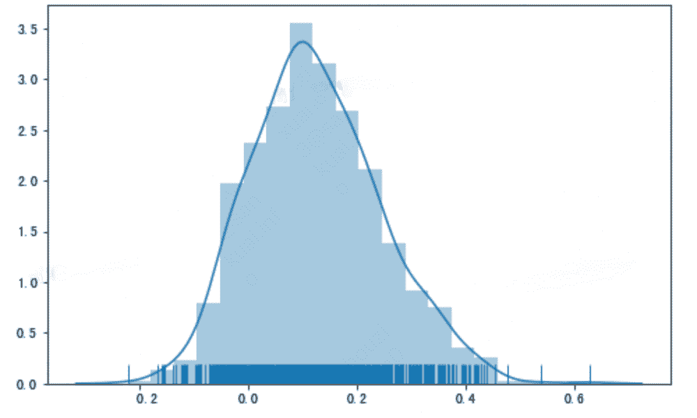

如果所有场景下默认采用正态分布情形下的检验方式计算P值，容易导致错误的P值计算。

### 基于一组核心抽象的平台建设难以适配所有业务场景

> 整个AB实验的过程涉及大量统计学知识，正确运用书本理论知识的前提是实际业务场景满足理论假设，实际情况是很多场景不满足理论假设。在这种情况下，获得高质量的结果需要对实验和统计有专家级的理解，以及大量的工作包括：实验设计、配置、指标加工、自定义分析等流水线工作，任一环节出错，将会导致大量的工作浪费。

> 通过核心抽象为实验者输出不同方法能力的平台建设思路，难以避免方法使用不当导致的实验置信问题，在此过程中任一设计的微小偏差，会导致无法比较的实验组、对照组，从而影响实验结果。

**如果把它们当成独**立的，所得的样本平均值的标准误差显然是不对的，其结果是造成对估计值的准确性过度自信，即估计值的标准误差估计过小。

> **事例二业务场景不满足理论约束：**双重差分是准实验中常用的分析模型，它的计算过程很简单，即实验组干预前后的均值的差减去对照组干预前后均值的差，根据业务场景，可以选择传统DID模型或固定效应的DID模型，但具体哪种模型合适，需要进一步看。

**如下是具体场景下的案例：**

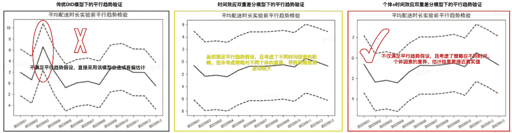

> 根据上图所示，在当前的业务场景下，并不满足传统DID模型的平行**趋势假设，如果贸然使用**，**会造成估计偏差，时间效应的双**重差分模型和个体+时间效应的双重差分模型，虽然都满**足**平行趋势假设，但从实际置信区间看，后者因为考虑了策略对不同个体的差异，波动较小。

##  在如何进行AB测试

###  多边业务模式下面临的AB测试难题

> 溢出效应和小样本是当前业务场景下实验面临的最大挑战，其次策略施加的公平性约束了实验分组也是我们不得不面对的挑战。

> 即时配送物流系统在多边市场中扮演着交易中间人的角色，它通过平台匹配用户、骑手、商家三方的需求，平台通过产品策略优化这一匹配过程，每一次匹配都会对同一时刻及后续一段时间内其它的匹配产生影响，具有较强的溢出效应。

> 该场景下严峻的小样本与地域间差异显著的问题导致统计功效低，从而很难有效地检测出策略小的提升效果。其也会导致随机分流下与响应变量相关的协变量在实验组、对照组的分布差距较大，放大业务上实验组对照组不同质问题的同时给实验结果带来质疑。

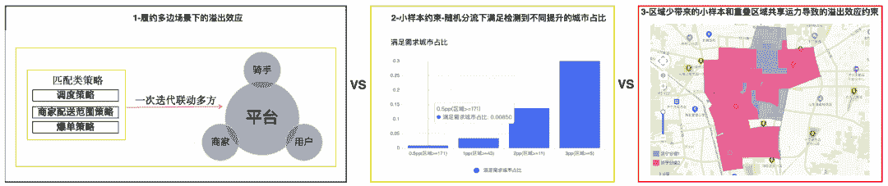

###  AB测试的组织和流程

> 随着履约业务的发展，越来越依赖于良好的策略驱动业务规模快速发展，以及效率、体验和成本的持续优化。

+   **A/B测试**提供了最科学的方法来评估策略变化的影响，并绘制出清晰的因果关系。通过A/B测试量化影响，最终辅助团队做出决策。将人员、流程和平台更紧密地结合在一起——这是成功实验生态系统的基本要素。

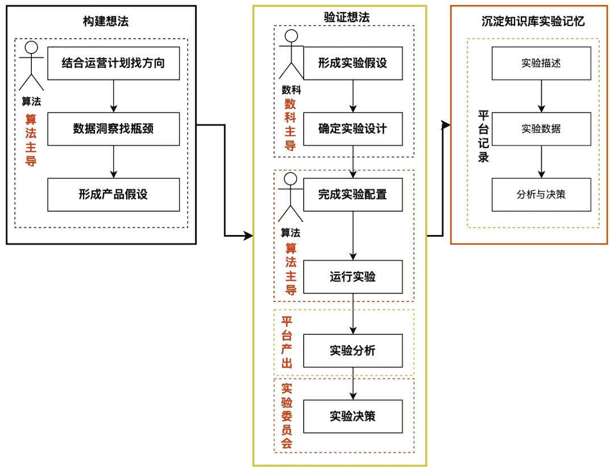

### AB测试

####  概述

> AB实验得以在工程中广泛应用和推广，与AB实验的并行性（多个实验可并行开展）和先验性（通过小流量预先获得效果评估）密不可分，分流框架直接决定了实验的并行度，与场景匹配的实验解决方案直接影响着实验先验结论的可信度。

>

> 为提高实验并行度并让我们同时运行多个互斥的实验，构建基于约束的分流量框架，以规范和约束不同实验如何共享和使用流**量。为确保**平台提供可靠的实验结果，平台针对实验设计直接输出解决方案而非能力，实验分析完全自动化，即基于实验设计和数据特点自适应选择与之匹配的方法。以达成不管是实验或统计领域的专家进行实验，还是无统计和实验知识的普通用户进行实验，任何人都能够相信实验的结果。

####  分流框架，以适配履约业务场景

> 基于约束的分流框架让实验者指定约束，平台冲突检测根据实验者指定的约束，进一步判断是否允许实验。

> 考虑到同一算法Key下不同实验因目标流量或迭代验证的功能不同，同一个算法Key下的不同实验与另一算法Key下的不同实验间是否冲突取决于其对应的测试功能或实验方法，引入场景来描述不同算法Key的功能描述和其对应的实验方法，并根据业务经验构造不同场景间的业务影响矩阵。

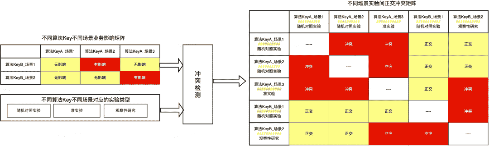

> 不**同场景下的联合实验，与其对应**算法Key下所有场景实验冲突，与其它算法Key场景实验，根据约束2进一步判定；为避免冲突实验间的流量重叠，提供了基于表达式定义流量范围的能力，通过检测表达式流量覆盖范围避免冲突实验间的流量重叠。

#### 实验设计，降低实验门槛，确保实验质量

> 受履约溢出效应、小样本和公平性因素制约，实验设计是降低溢出效应、提高实验功效、关注实验公平等多种目标进行方差和偏差平衡的过程。

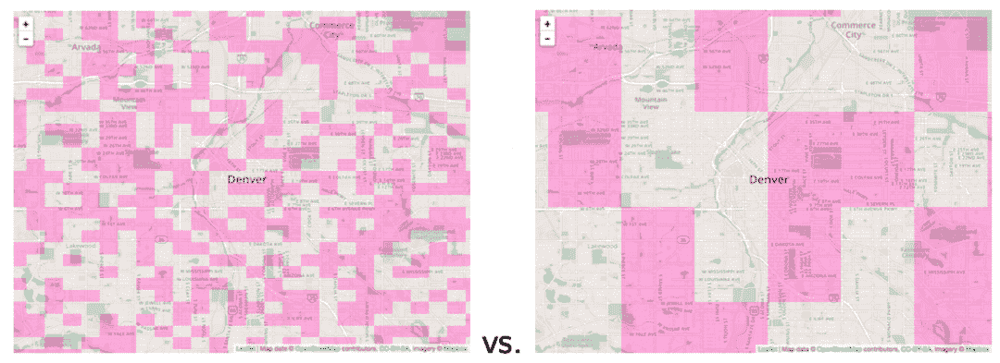

在有限**的样本下，如果只是进行简**单的随机分组，不仅会导致实验组对照组的一些指标在实验前存在偏差，而且会由于样本量不足导致无法检测出策略的微小提升，到底是通过控制影响指标差异的协变量和改进分组方式来达成偏差和方差的平衡，还是实验前允许偏差存在，通过实验后纠偏的方法进行补充，这些都需要在实验设计时基于算力，以及基于分组方式和分析方法组合方案得出的数据表现综合判断，来制定合理的实验方案。

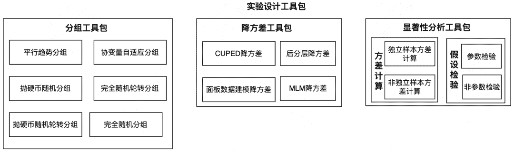

在场景管理模块：具体的实验类型、实验单位、分组方式、评估指标（包括：目标指标、护栏指标、驱动指标）、降方差方法，实验者进行实验配置时，根据平台为其提供样本量预估和“MDE”分析工具，完成流量圈选和实验周期确定，之后平台输出实验设计报告，输出分组结果、“MDE”分析和同质性检验报告，检验通过后，实验者可进一步配置实验组、对照组对应的策略参数，完成最终的实验配置，进而发布实验。

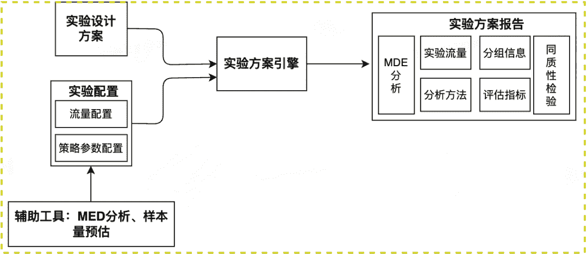

####  分析引擎，标准化实验分析

> 可靠的数据和科学的分析方法是得出可信分析的关键。

**分析流程大致包括如下过程：**

+   通过数据诊断，确保分析数据的可靠性；

+   基于分组方式、分析方法，进行实验效应估计，得出实验效应估计；

+   基于分组方式、数据类型、实验单元与分析单元的关系、分析方法，选择合适的方差计算方式进行降方差以提高实验灵敏度，避免假阴性；

+   基于分组方式、数据分布特点，选择合适的检验方式计算方差计算和P值，验证相关指标的统计显著性给出统计结论；

+   基于诊断和分析，输出实验报告。

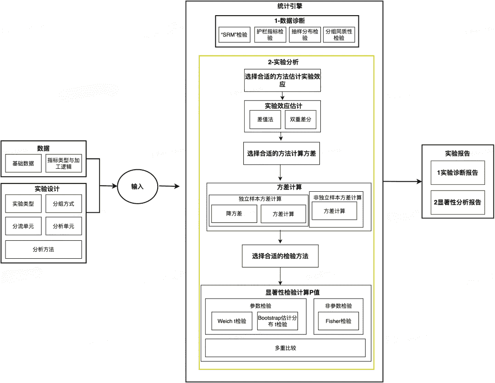

分析环节的实验分析，自**动选择与**数据和实验设计匹配的分析方法，避免统计陷阱。根据分组方式，提供了差值法和双重差分两种效应估计方法，方差计算和P值计算是统计陷阱集中发生的两个环节，分别提供了判别方差和P值计算方式的判别引擎。

## 小结

+   在履约算法和业务每年分别运行数以万计的实验，测试内容涵盖履约业务的各方面，美团已经积累了如何进行更好的实验以及如何利用实验来做出更好的决策的知识。

>

+   本文从实验通识的视角，介绍了履约在建设可信实验的实践，希望能对实验者有所帮助。由于履约的规模、影响力和多边业务模式的特色，履约的问题空间带来了独特挑战。溢出效应、小样本、策略公平性等综合因素制约着我们运行可信实验，美团在解决上述问题时，也沉淀了一系列实践，后续也会陆续推出相关实践文章。

>

+   基于不同的因素，如指标类型、样本量、样本分布特点等，可以应用不同的方法如线性模型、Delta方法、Bootstrap方法来计算P值和标准误差，并且在以城市、区域、站点为实验单位的实验中，可以自动选择不同的方法来调整标准误差，避免了由于数据聚类而导致的误报。这种灵活分析能力对策略的快速迭代非常重要。

>

+   基于此，美团构建了统一的分析引擎，标准化实验核心框架，如普通随机对照实验、随机轮转实验、协变量自适应实验、准实验和观察性研究，以及一些其它的在产业界和学术界前沿的实验评估技术：如样本量预估、降方差、MED分析、数据纠偏、轮转实验的携带效应估计等，以减少大家花在分析上的时间。