# 史蒂夫 · 乔布斯

> 来源：[https://v11enp9ok1h.feishu.cn/docx/Az3XdBTrfoJL7Sx8pR2cYfwEnyg](https://v11enp9ok1h.feishu.cn/docx/Az3XdBTrfoJL7Sx8pR2cYfwEnyg)

> 我们无比怀念乔老爷，是他缔造了今日的移动互联网，带给我们太多的启发。我们在此并没有试图还原他的一生，而是记录一些被时光遗忘的吉光片羽，去照亮我们前行的道路。

## 访谈：和那个即将 30 岁（1985）的 Steve Jobs 聊一下

by fonter

最近喜欢看老文章、老的书、发掘尘封的内容。不久前，介绍的 Alex Zhu 的 6 个半设计哲学就是一例。这样的东西很适合在午后、午夜读一读，读的状态就是那种恍惚之间，此人就在你面前给你传道授业解惑。

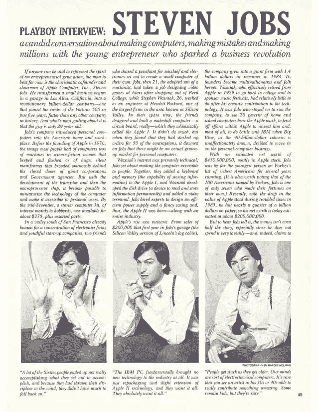

1985 年，Steve Jobs 30 岁的那一年，他接受美国《花花公子》杂志专访，2月他生日的前后刊出，再 3 个月后，他即被 John Sculley 解雇，离开他一手创办近 10 年的 Apple 公司。当年《花花公子》是派《纽约时报》记者 David Sheff 专访乔布斯，此人是一位俄罗斯犹太人后裔，他采访过 约翰 · 列侬、小野洋子、艾未未、史蒂夫 · 乔布斯、安塞尔 · 亚当斯、贝蒂 · 弗里丹、基思 · 哈林、杰克 · 尼克尔森等许多人，最近正在写小野洋子传记。其采访风格犀利直接。在文中的一段，Jobs 谈与 Apple 的关系，读完让人动容。

> **David Sheff**：在回想你的成功时，你有没有想过拍拍自己的头，问问自己发生了什么？
>
> **Steve Jobs**：我曾经想过一年卖出100万台电脑，但那只是一个想法。当它真的发生的时候，就是完全不同的事了。所以我就说，“我靠，这真的成真了!”但是很难解释的是，这并不是一夜之间的事情。明年是我的第十年。我一生中从来没有做过超过一年的事情。对我来说，创办苹果公司的六个月是很长的一段时间。这就是我的生活，自从我成为一个有自由意志的成年人以来。每一年都充满了问题、成功、学习经验和人类经验，以至于在苹果一年就是一生。所以这已经是十辈子的事了。
>
> **David Sheff**：你知道你这辈子想做什么吗？
>
> **Steve Jobs**：我偶尔会想到一句古老的印度谚语，For the first 30 years of your life, you make your habits. For the last 30 years of your life, your habits make you. 二月份我就要30岁了，这个想法在我的脑海里闪过。然后我不确定。我会永远与苹果相联系。我希望我的一生与苹果像线一样彼此织就，像壁毯一样。或许有些年我不在那里，但我总是会回来。那是可能尝试去做的。对我关键要记得我仍然是个学生。我仍然在新兵训练营里。如果有人能读到我的想法，应该记住这一点。别把它看得太严肃。如果你要生活得有创造力，作为艺术家，你不能向后看太多。你需要愿意去接受你所做过的事，成为的人，把这些抛开。说到底，我们是什么呢？大部分我们自认为的自我是喜欢的东西，不喜欢的东西，习惯和模式的集合。我们自我的核心是我们的价值观，做过的反映这些价值观的决定和采取的行动。这就是为什么接受采访，被看到很不容易：随着你成长和变化，外界越是试图按期理解强加一个形象给你，做一个艺术家就越难。这也就是为什么艺术家有很多时候要说，“再见，我要走了。我要疯了，我得离开这里。”然后他们离开并找地方隐居。或许晚点他们带着带点不同又出现了。

2010年，11月美国《花花公子》杂志再次刊登1985年这篇专访，特别推荐阅读。

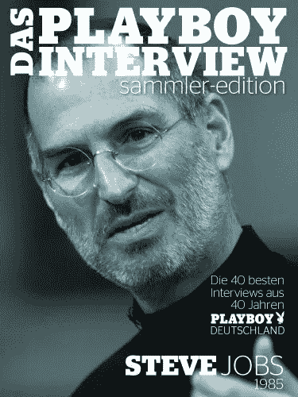

这是一篇特别长的文章，这里将 David Sheff 提的问题摘录如下，其他的请看原文。

+   **你因电脑革命，电脑普及带来的上亿美元的财富（一度价值近5亿美元），你的感觉是什么样？**
+   你和 Steve Wozniak 开始的这场电脑革命到底是什么？
+   你对电脑的定义是什么，它们是怎么工作的？
+   你相信电脑会改变我们的个人生活，但是你怎么能说服一个怀疑论者呢？
+   现在买电脑有什么具体的理由吗？为什么一个人要买一台电脑？
+   对一个家庭，买一台电脑又有什么用了？
+   **质疑：对家庭来说，花费3000美元买一台电脑，在本质上不是一种信仰行为吗？**
+   电脑真的很重要吗? 还是只是一个新鲜事物？
+   Mac 使用鼠标，对于习惯使用键盘的人来说，这是一个巨大的改变。为什么要使用鼠标？
+   开发 Macintosh 花了多长时间？
+   消费者怎么知道大肆宣传炒作背后是什么呢？
+   对 Macintosh 的批评指控
+   用高价吸引那些爱好者，然后转身降低价格以赶上其他市场？
+   对那些买了旧的 Apple 产品的人？
+   Mac 本身不会在几年内过时吗？
+   After Lisa and Apple III ，股票暴跌，业界猜测苹果可能无法生存。
+   苹果是否濒临破产？
+   业界去年有关苹果拥有它的言论背后是什么呢？
+   How much was lost on Apple III?
+   What went wrong about Lisa ?
+   这是不是反映了你的不安全感?
+   大多数的决定，无论好坏，都是你决定的吗？
+   Markkula and Scott 他们并不认为你有能力管理 Lisa？
+   你有没有觉得你正在失去苹果？
+   但是这是你创立的公司，你不会愤愤不平吗？
+   **即使你的孩子让你滚蛋？**
+   **疯子才能做出疯狂的伟大作品吗？**
+   有疯狂又伟大的想法的人和实现这些疯狂又伟大想法的人之间有什么区别？
+   你是说生产 PCjr 的人对这个产品没有那种自豪感？
+   为什么电脑行业的人这么年轻? 苹果员工的平均年龄是29岁。
+   **让我们来谈谈苹果公司，对于苹果公司的运作方式，你也有类似的使命感，是吗？**
+   **如果苹果真的是那种公司，那么为什么预计增长二十倍? 为什么不保持相对较小的规模？**
+   你能在击败 IBM 吗？
+   如何击败 IBM ？
+   在消费者的眼中， IBM 与稳定性和效率联系在一起，苹果是一个相对年轻和未经考验的公司，如何改变？
+   要让这个行业真正繁荣起来，为了让消费者受益，一个标准必须占上风，如何建立标准？
+   你之所以决定不与 IBM 兼容，是因为你不想屈服于 IBM 吗？
+   你如何对抗，Apple 在个人电脑销售份额连续下降的问题？
+   为什么IBM独裁，会是计算机黑暗时代，阻止了创新的发生？
+   你怎么能这么说一个变化如此之快的行业呢？现在是热门的新事物，但是两年后还会是吗？
+   让我们回到 Lisa 和 Mac 的前身，回到开头。你的父母对你对计算机的兴趣有多大影响力？
+   你是被领养的，是吗? 这对你的生活有多大影响？你找过你的亲生父母吗？
+   你找到你的亲生父母了吗？
+   在硅谷长大是什么感觉？
+   但是地理位置和你的兴趣有关，不是吗? 硅谷是怎么形成的？
+   ...
+   就像汽车工业是美国的产业，但却几乎输给了日本。你将如何保持电脑产业的优势？
+   我们来谈谈软件吧。在过去的几年中，你看到软件开发中的革命性变化是什么？
+   在教育软件方面有突破吗？
+   你强调了教育对你来说是高度优先的事实。你认为计算机是如何影响它的？
+   当你还在上大学的时候，你和你的同学认为怎样才是做出贡献的方式？政治？
+   难道商业和金钱的诱惑最终不是一个简单的选择吗？
+   不是每一代人都这么说吗？
+   您提到过投资教育，但在赤字飙升的时候不是问题吗？
+   你认为计算机会在这个过程中发挥作用吗？
+   你认为计算机和软件在不久的将来会走向何方？
+   你为苹果能保持领先而感到骄傲。你怎么看待那些老牌公司，它们必须追赶新兴公司，否则就会消亡？
+   在回想你的成功时，你有没有想过拍拍自己的头，问问自己发生了什么？
+   **你知道你这辈子想做什么吗？**
+   ...
+   让我们谈谈钱的问题。你23岁就成了百万富翁，拥有100万美元和拥有几亿美元的主要区别是什么？
+   钱对你来说到底意味着什么？
+   **凭借你的财富和过去的成就，你有能力追求梦想，这是很少有人能做到的。这种自由让你害怕吗？**
+   ...
+   如果我们还在上幼儿园，你开始想象计算机将会改变我们的生活，你看到了什么？

之所以把问题目录列出来，是想说真的值得去边看文章边和 Jobs 聊聊。

顺带推荐一本摄影集，李如一在 IT 公论里面推荐过的《Fearless Genius》，这是 30 岁后的乔布斯。

这从 1986 到 1988 年，Jobs 的 NeXT 的御用摄影师记录的 Jobs 和 NEXT。

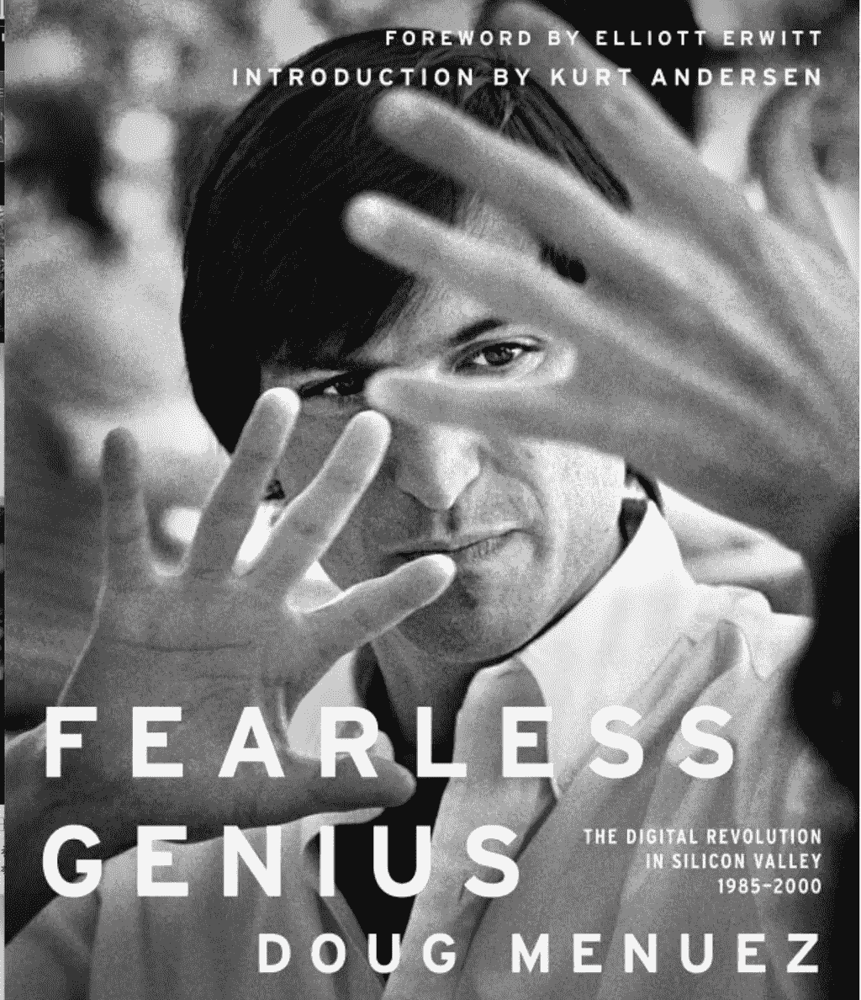

> 《Fearless Genius》一书最神奇的地方在于它能够存在。设想一下：妳是一间如日中天的科技公司员工。妳的日常工作需要长时间高度集中注意力。一天，办公室里突然出现了一个拿着相机的人。这已经令妳不解：一群程序员在普通办公室里对着屏幕打字有什么好拍的？更有甚者，这位老兄并不是拍一圈就走。他每天都来，每天都在妳身边转悠，而且专拍妳疲惫不堪时的怪相和开会时白板上的事项清单。「这个也能让他拍吗？」妳在心里嘀咕。能拍。因为史蒂夫·乔布斯说能拍。从 1986 到 1988 年，Doug Menuez 是 NeXT 的御用摄影师。在那之前，他曾在非洲用相机记录内战和旱灾导致的饥荒，在加州奥克兰拍摄毒贩间的枪战。和其她黄金年代的硬派摄影记者一样，他经年累月地观察人间惨剧，精神上承受了重大的压力与损耗，终于在 1980 年代中期决定转换题材。在记录了太多绝望之后，他想开始捕捉希望。彼时乔布斯刚刚被苹果董事会驱逐，带着几名心腹开始做 NeXT。Menuez 嗅到了时代的气息，于是一边向《Life》杂志报题，另一边则通过朋友辗转找到了 NeXT 的创意总监/联合创始人 Susan Kare。乔布斯正处在亟需证明自己的阶段，能在《Life》曝光求之不得，于是双方一拍即合。Menuez 获得了无禁区全天候跟拍 NeXT 的权利。故事并没有结束。1988 年 10 月，NeXT 发布前夕，乔布斯以「我觉得《Life》不酷了」为由毁约，禁止 Menuez 发布这批照片。Menuez 的沮丧可以想像，但乔布斯说这些工作不会白费，并鼓励 Menuez 去拍当时硅谷其它方兴未艾的科技公司。有了 NeXT 和乔布斯的背书，Menuez 犹如获得了硅谷的通行证，进出 Adobe、苹果、微软、Netscape、Autodesk 如入无人之境。他一拍就拍了十五年（1985–2000）。2004 年，斯坦福大学收藏了他的廿五万张底片，又过了十年，这批照片中的一部分才以精装摄影集《Fearless Genius》的形式面世。

> —— 李如一 IT 公论不鸟万书评：历史是实用主义的解毒剂（2015.07.24）

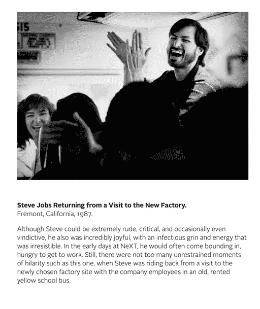

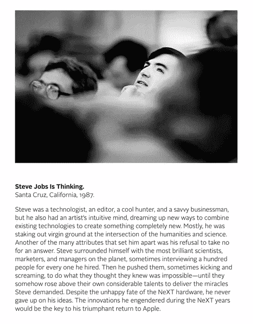

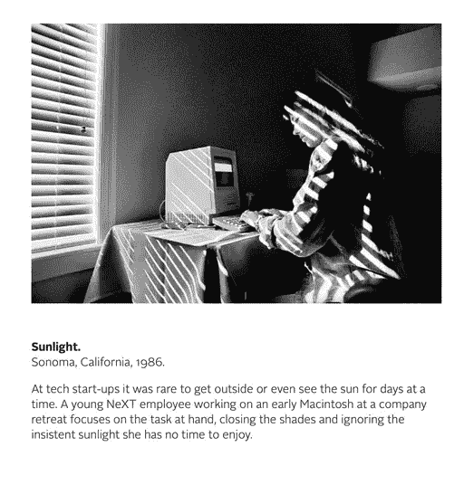

上面 3 张是我最喜欢的。

**推荐链接**

+   **原文：**Playboy Interview: Steve Jobs
+   **中译：**1985年《花花公子》采访乔布斯
+   [**1985年杂志原始拷贝**](https://archive.org/details/jobs-playboy/mode/2up)
+   《Fearless Genius》

## 羔羊：Steve Jobs 失意的十年 1985 - 1996（30岁-40岁）

by fonter

一直有个问题很困惑，Steve Jobs 被赶出 Apple 之后发生了什么？

+   NeXT：复仇之心驱动下的决策训练，提高每个决策的质量。
+   PIXAR：倾听协作者的热情并在不同意的情况下尊重这份热情。

之前看了 2 本书稍微解答了我的疑惑。

《无畏的天才》

《创新公司：皮克斯的启示》

最近一直很喜欢 Apple 的前设计师 Mike[ Mata](http://lobe.ai/)s 的设计作品，他在结束微软 lobe.ai 的事情之后加盟 Ive 的 LoveForm 设计咨询公司，并为 Steve Jobs 档案馆设计一套书籍《Make Something Wonderful》。Mike Matas 曾经为美国副总统 Gore 制作的交互书籍《Push Pop Press》革新了电子书行业的制作水准。本次重新操刀制作 Steve Jobs 的书籍。Steve Jobs 的妻子在书中的前言说到

> 「理解一个人最好的方法就是直接倾听。了解 Steve Jobs 最好的方法就是倾听他一生中所说的话和所写的东西。他的话为我们提供了一个了解他如何思考的窗口。他是一个优秀的思想家。曾经对一群学生说过这样一句话。Think of your life as a rainbow arcing across the horizon of this world. You appear, have a chance to blaze in the sky, then you disappear. 他对如何最好地利用我们短暂的时间做了大量的思考。他被成为人类弧线的一部分的想法所驱使，被他(或我们中的任何人)可能提升或加速人类进步的想法所激励。」

这本书的主题是用 Steve Jobs 自己的言语来描述，创造美好事物。按照这个规则，我在浏览完这本书之后，找到打动我的 Steve Jobs 自己的只言片语。选取了《Make Something Wonderful》中我关注的 Steve Jobs 的年代做了一些梳理和介绍。本周推荐给大家。

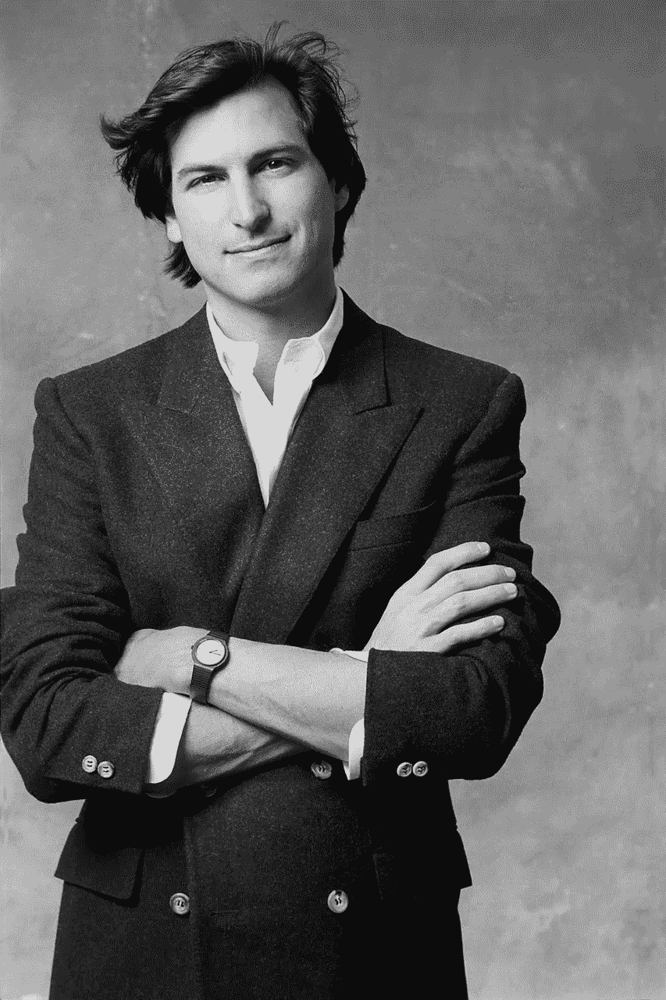

> **1985 - 1996**

要想得到你想要的东西，你必须得摔几次跟头。

Steve 离开苹果后的几年，是他职业生涯中最艰难的时期，也是最具影响力的时期。

带着 5 名 Macintosh 的员工创立 NeXT

大约在同一时间，向一家名为皮克斯的小公司投资了1000万美元。

此后 NeXT 推出不到六年，除了史蒂夫，整个创始团队都辞职了。

与此同时，皮克斯靠出售电脑和软件以及后来的动画广告勉强维持生存。

该公司还制作了获奖短片，吸引了 Steve。

这种将技术应用于精彩的故事叙述的做法体现了他最喜欢的事情之一: 在技术和人文艺术的交叉点上工作。

这些短片点燃了Steve的热情，让他不停地给皮克斯动画公司写支票，最终投资了大约 6000万美元。

Steve 学会了如何磨练一个公司的本质，即使过程是痛苦的。

在经历了近十年的困难之后，精简后的 NeXT 和皮克斯都转变成了不可思议的成功故事。

1995年底，皮克斯在《玩具总动员》首映的同一个月进行了首次公开募股。

一年后，需要操作系统软件的苹果公司以4.27亿美元收购了 NeXT。

“如果你仔细观察，大多数一夜成名都需要很长时间。”

+   **1985 年**
+   1985年6月：当 Macintosh 销售远低于预期时，苹果公司裁员20％，并宣布其历史上首次季度亏损。
+   1985年9月：在与 Sculley 的权力斗争中失败后，Steve Jobs 带着五名 Macintosh 团队成员离开苹果公司。
+   苹果公司 起诉了 Steve Jobs。

**1984年5月：Michael Moritz 对 Steve Jobs 采访**

我觉得我的审美品味和其他人没什么不同。

区别在于，我只是非常固执地想要把事情做得尽可能好。这是唯一的区别。

当你犯错误的时候，事情会变得更精细。我有机会犯很多错误。

当你犯错误的时候，你的审美会变得更好。

但真正重要的是: 如果你要做一件事，不需要花费更多的精力，就能做出真正伟大的东西。

只需要再多一点时间。

**1985年9月：权力斗争中失利后离开了苹果，接受了《Newsweek》的采访**

当你听到(苹果)董事会决定(起诉你)时，你有什么反应？

“I want to build things.”

在我最疯狂的想象中，我不可能想出这么疯狂的结局。

我曾经希望我的生活能像一幅有趣的挂毯一样，在那里我可以穿梭于苹果之间:

我会在那里呆上一段时间，也许我会离开去做一些其他的事情，

但是我会和苹果联系在一起，然后也许回来并且在那里呆很长一段时间，然后离开去做一些其他的事情。

但那样是行不通的。我度过了人生中最美好的十年。我对任何事都不后悔。

就我个人而言，**我想建造东西。我三十岁了。**我还没准备好成为行业专家。

今年夏天，我收到了三份教授的邀请，我告诉所有的大学，我认为我会是一个糟糕的教授。

我最擅长的就是找到一群有才华的人，和他们一起做事。

我尊重苹果的发展方向。

但对我个人来说，你知道，我想做东西。

如果那里没有地方让我制作东西，那么我会做我以前2次做过。

你知道吗，当苹果刚起步的时候，我是在车库里做的。

我是在比喻意义上的车库里做的东西。

+   **1986 年**
+   1986年1月：Alan Kay 为 Steve 介绍了Ed Catmull 和 Alvy Ray Smith后，他成为Pixar的大股东。
+   NeXT和苹果公司达成了有关 NeXT 的起诉的和解。
+   1986年8月：Steve 在图形行业会议上出席了Pixar的第一部动画短片Luxo Jr.的首映式。
+   Luxo Jr.展示了Pixar的软件，但是观众为叙事而起立鼓掌引起了史蒂夫的注意。

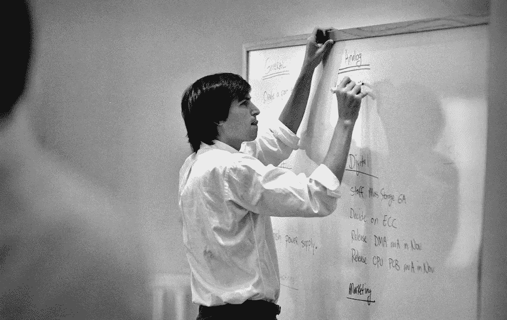

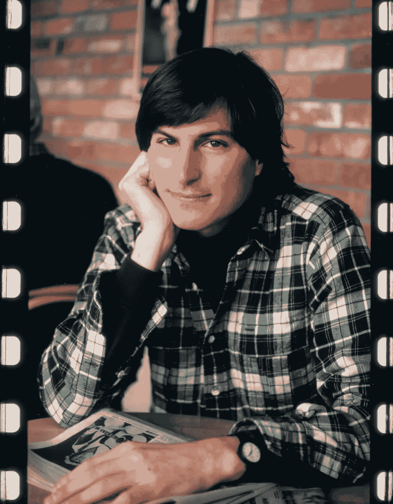

# 成为皮克斯大股东的前夜

Steve 回顾了最初吸引他加入皮克斯的工作和想法。

我一生中大部分时间都在研究图像。苹果 II 是第一个真正的你可以得到手的彩色电脑。

我们在苹果公司做过一些 3D 工作，我当然知道这个领域的情况。

但是 Ed Catmull 和他的团队所做的事情远远超过了我所见过的任何人所做的事情。

## 1986 年

NeXT 周四不开会。我们公司的宗旨是，少数优秀的人做出卓越的产品，如果他们不受以下因素的束缚：他们能把个人时间花在设计、营销或其他什么上，而不是管理他人来完成这些任务。为了坚持这一原则，我提出以下两个想法：

1. 我们需要时间来不间断地进行个人工作。会议（工作、面试等）正在侵蚀我们的个人时间，我们工程师的生产力正在下降。我建议我们把每个星期四留作没有任何会议的一天。星期四是我们的一天，我们锁上通往外部世界的门，安静地单独工作。
2. 在修改我们的员工人数要求（以及随后的预算）时，我鼓励你记住，有一条非常微妙的线，当增加员工人数时，这条线会让你成为一名经理，而不是贡献者/团队领导者。相信如果我们把自己变成经理，而不是”实干家”，我们的日程安排和产品的”伟大”都会受到影响。我们不要让这种事情发生！人数越少越好，即使这意味着做得更少。让我们稳健而谨慎地建立我们的公司。

让我们在明天的员工会议上讨论这两个想法。谢谢。

SJ (Steve Jobs) 1986 年 3 月 17 日

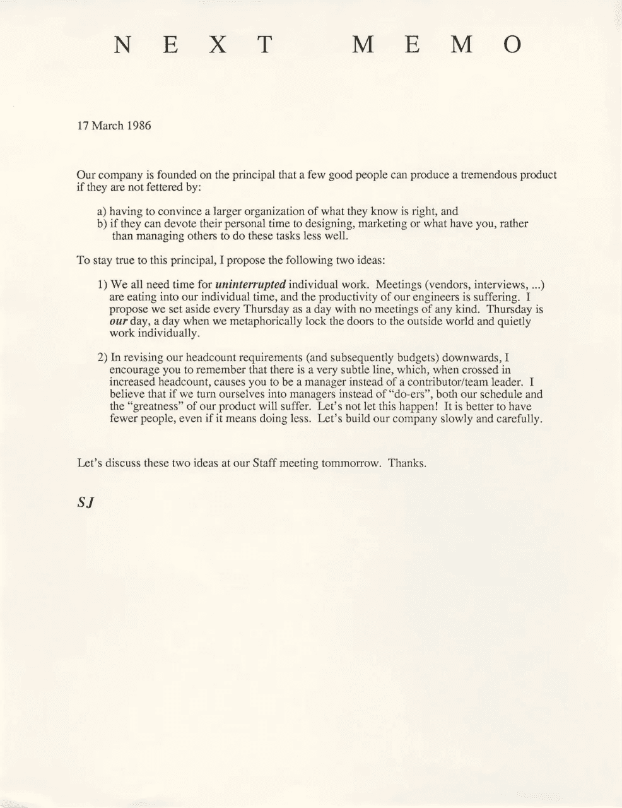

## 1987 年

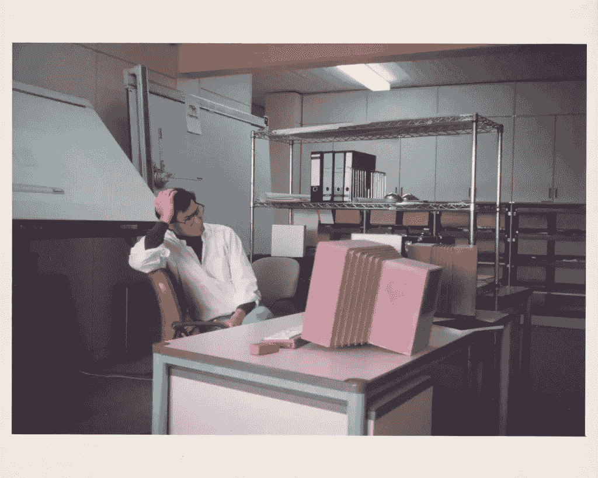

## 1988 年

- 1988年10月：Steve 在旧金山的戴维斯交响乐厅展示了 NeXT 计算机系统。
- 亮点是该机器在小提琴家的伴奏下演奏了巴赫的小提琴协奏曲五分钟。
- 销售不佳，但有其粉丝；
- Tim Berners-Lee 在 NeXT 计算机上编写了 World Wide Web 的代码。

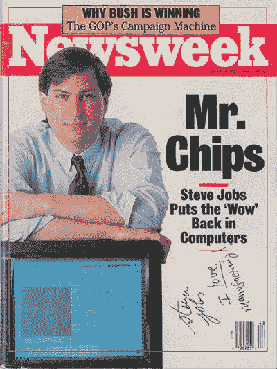

## 1989 年

- 1989年3月：Pixar 的电影 Tin Toy 获得奥斯卡最佳动画短片奖，这是电脑动画电影的首次。
- 1989年3月30日，晚上 8:08，全员邮件：A great day and a half
- Tin Toy 是第一个计算机生成的电影有史以来获奖，并与几个非常好的传统动画（非计算机动画）电影竞争！
- 计算机图形学产业刚刚达到了一个重要的里程碑，皮克斯引领了潮流！
- “Pixar led the way!”

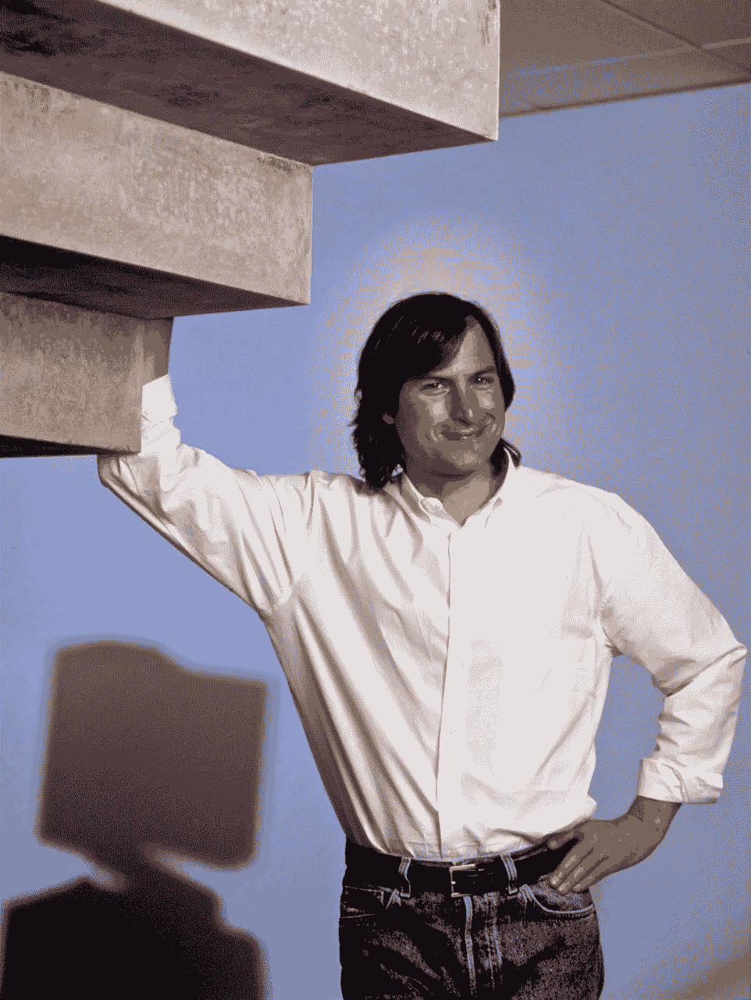

## 1991 年

- 1991年3月：Steve 在优胜美地举行的仪式上与劳伦·鲍威尔结婚。
- 1991年7月：面对沉重的财务压力，Pixar 与迪士尼签订了一项协议，这对于更大的公司来说更加有利。迪士尼为 Pixar 电影提供资金，拥有电影及其角色，获得大部分电影的利润，并禁止 Pixar 向其他工作室投资迪士尼拒绝的任何想法。
- 1991年9月：Reed Jobs 出生。

[Steve Jobs Interview - 7/22/1991 - On 10 Years of the Personal Computer](https://www.youtube.com/watch?v=OzZB5pZTslE)

1991年 8月 27日，在他的母校 Reed 学院迎接新生入学时，发表演讲。

与此同时，NeXT 的电脑销量并不好，皮克斯刚刚进行了一轮裁员。

“Character is built not in good times, but in bad times.”

性格或者说人格魅力是在逆境下被建构的。

我在这里有过一些经历，这些经历伴随了我的一生。

…

性格不是在好的时候建立的，而是在坏的时候；

不是在富裕的时候，而是在逆境的时候。

这所学校似乎成功地培养了逆境的精神，我认为确实塑造了一些性格。

所以我感谢你教会了我如何感到饥饿，以及如何在我的一生中保持饥饿。

自此之后，保持饥饿，保持愚蠢变成了 Steve 的邮件签名。

## 1993 年

- 1993年2月：Steve 结束了 NeXT 关于生产计算机的生产，全部专注于软件。
- 1993年10月：由于苹果每季度亏损数千万美元，CEO 约翰·斯卡利（John Sculley）在 1985 年将史蒂夫赶出苹果公司后辞职。在接下来的三年中，苹果公司将经历两位 CEO 的轮换，但未能恢复脚步。

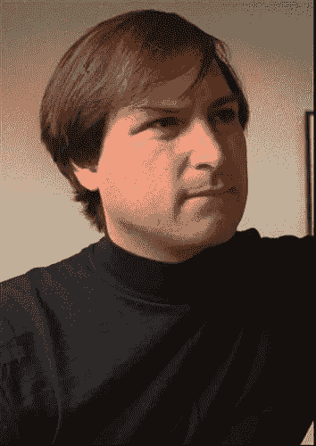

## 1995 年

- 1995年8月：Erin Jobs 出生。
- 1995年11月：世界上第一部完全由动画制作的电影《玩具总动员》在开幕周末赚得 2900 万美元。它成为当年票房最高的动画电影。
- 《Toy Story》开幕一周后，Pixar 成功举行了首次公开发行。这是几个月前做出的大胆赌注；如果玩具总动员失败，首次公开发行也将失败。

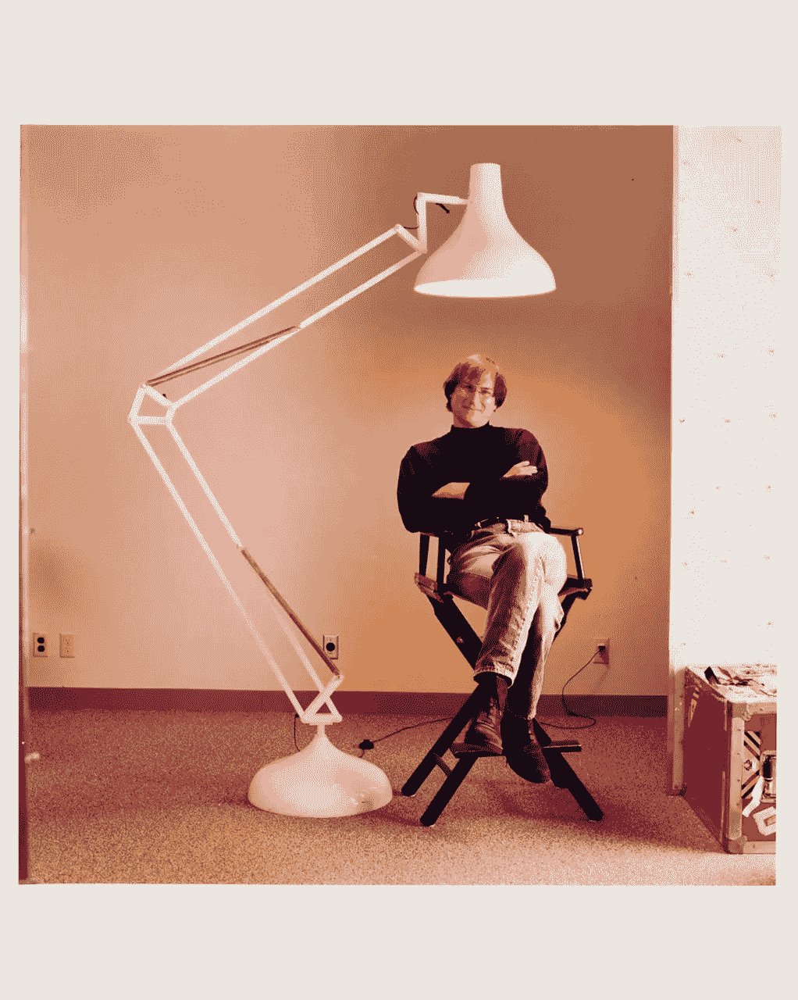

### Pixar IPO 前夕

1995年9月22日：Pixar-3D graphics

1995 年，Steve 和他的导师、Intel CEO Andy Grove 之间的邮件交流：

“I have changed my position 180 degrees.”

随着皮克斯成为图形领域的领导者，Steve 和他的导师、英特尔首席执行官 Andy Grove 讨论了英特尔可以如何向皮克斯学习。

一位英特尔工程师试图跟进时，Steve 误以为他很傲慢而拒绝了。

随后，Andy Grove 回了邮件控诉 Steve 的忘恩负义：“I have changed my position 180 degrees.”

Steve 放下成见。

我有很多缺点，但其中之一不是忘恩负义。而且，我同意你的观点，“从长远来看，这些事情是平衡的。”

因此，我已经 180 度改变了我的立场，我们将免费帮助 `[`工程师1`]` 使他的处理器更好的 3D 图形。

请叫 `[`工程师1`]` 打电话给我，我们将安排一个会议，让皮克斯技术人员帮助他。

谢谢你让我看得更清楚。

## 1996 年

- 1996年12月：苹果公司因需要新的操作系统而以 4.27 亿美元收购 NeXT。作为协议的一部分，Steve 作为苹果公司的特别顾问回归苹果公司，Gil Amelio 担任首席执行官。

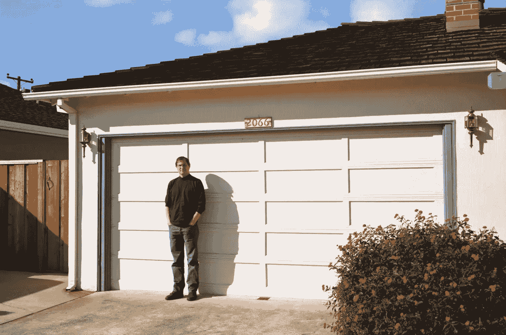

### 在他童年的家中，车库

1996 年，the Fresh Air 主播 Terry Gross 采访。

他们是在皮克斯公司发行《玩具总动员》并成功进行首次公开募股后不久发表言论的。

与此同时，NeXT 仍在苦苦挣扎。

你认为当你被苹果公司开除的时候，人们会把你一笔勾销吗？

那是一段非常痛苦的时光，但你只是勇往直前，努力从中吸取教训。

我一直教导自己的一件事就是不要害怕失败。

很多时候，当你遇到不顺心的事情时，人们的反应就是非常保护自己，因为他们再也不想摔倒了。

我认为这是一个很大的错误，因为在达到目标的过程中，你从来没有实现过自己想要的东西，除非你在达到目标的过程中摔了几次跤。

我一直试图不害怕失败，事实上，自从离开苹果以来，我已经失败了很多次。

很多公司——我知道这听起来很疯狂——但很多公司不这么做。

他们雇人告诉他们该怎么做。

我们雇人来告诉我们该怎么做。

我们觉得我们付给他们这么多钱，他们的工作就是想出该怎么做，然后告诉我们。

我们当时很年轻，而且大多数人还没有结婚，所以他们可以每天工作 15 个小时。

你工作，所以你可以支持你的生活。

在很多情况下，你的工作就是你的生活全部。

你觉得你已经改变了吗？那还是你的生活吗？

我觉得这仍然是我的生活，但不是我全部的生活。

虽然比例不大，但我还是不能…

我从来没有把我的工作和生活看成不同的东西。它们是一样的。

它曾经是我生命的 99%，现在可能是我生命的 50%。

### Email to NeXT Colleagues

From: Steve Jobs

To: `[`NeXT Colleagues`]`

**1996 年 4 月 2 日下午 4:17**

**Steve**

很可爱。

### 1996 年 6 月的 Palo Alto High School 毕业典礼演讲

**要成为一个有创造力的人，你需要“喂养”或“投资”自己，通过探索未知的道路，在你过去的经验领域之外。**

寻找你自己的新维度——特别是那些带有浪漫气息的维度。

但是我们没有办法预先知道这些道路中的哪一条将会通向任何地方。

在某种程度上，这就是它的美妙之处。

**一个人唯一能做的就是相信，你用心追随的一些东西确实会回来，使你的生活更加丰富多彩。**

一定会的。你会获得更加坚定的信任，相信你的直觉和本能。

…

**career，大多数梦想和直觉的敌人，也是人类有史以来发明的最危险、最令人窒息的概念之一。**

…

**旅程就是回报。**

人们认为当你到达彩虹的尽头并且得到一罐金子的时候，你就成功了。

但他们错了。奖赏就在跨越彩虹之中。

**但是如果你得到了一罐金子，你已经知道那不是奖励，你会去寻找另一道彩虹去跨越。**

…

**把你的生活想象成一道横跨地平线的彩虹。你出现了，有机会在天空中燃烧，然后你消失了。**

**Think of your life as a rainbow arcing across the horizon of this world.**

**You appear, have a chance to blaze in the sky, then you disappear.**

每个人的彩虹的两个终点是出生和死亡。我们都是孤独的。

**然而，你们这个年纪的大多数人都没怎么想过这些事情，更别说在别人身上看到了。**

你们中有多少人见证过另一个人类的诞生？

…

**对我来说，情况恰恰相反：**

知道自己的弧线会落下，让我想在天空中燃烧。

不是为了别人，而是为了我自己，为了我知道我要离开的路。

当你生活在天空的弧线上时，你想要尽可能少的遗憾。

**记住，后悔和错误是不同的。**

错误就是那些你曾经做过并希望能够重新来过的事情。

后悔往往是你没有做的事情，并希望你做了。

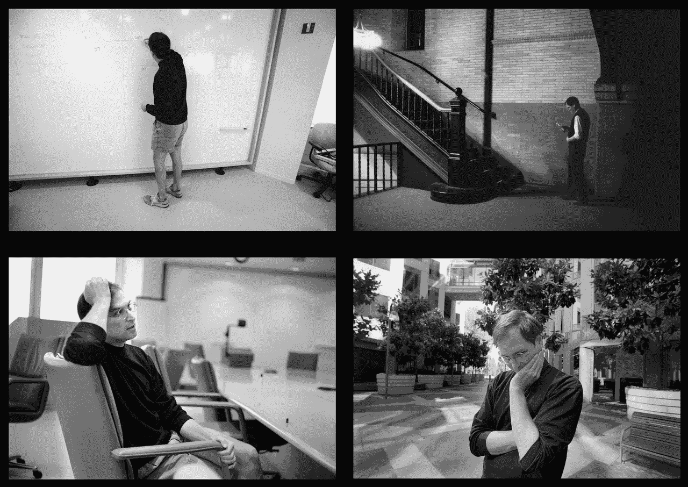

短暂的取得 Pixar 的成功之后，1997 年回归 Apple 之后的 Steve，所有一幕幕都在思考。

### 推荐

`book.stevejobsarchive.com`

《无畏的天才》

《创新公司：皮克斯的启示》

## 历史：大脑的自行车

by fonter

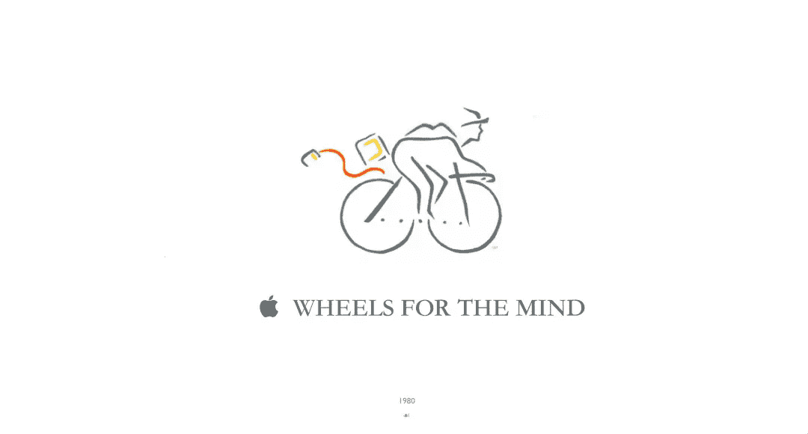

上图是 Alan Kay 入职 Apple 时候，Apple 在 1980s 的口号是「思想的轮子（Wheels for the Mind）」，用了毕加索喜欢的色调和线条勾勒的思想的自行车。不过乔布斯在 1990s 年代末重掌苹果之后，就已经放弃了「大脑的自行车」这一追求了。

> 每当你创造一个工具的时候，你既做了一个放大器又做了一个假肢。

特别是在过去的 400 年里，人类发明了「脑挂 brainlet」，就是各种对大脑的辅助装置，这些装置帮助我们，去以一种不一样的眼光去看待这个世界。它们通常是作为人体感官之辅助出现：比如望远镜、显微镜，以及各种思维上的辅助工具。

本期推荐的文章来自 Steven Sinofsky 的考据，Steven Sinofsky 在微软工作 15 年，负责过微软 Office 系统的开发，负责微软 Office 2007 / 2003 / XP，后来曾任微软视窗事业部总裁，在他任内，开发了 Windows 7、Windows 8。辞职后之后在哈佛商学院任教，也是 a16z 董事会成员，多家知名科技公司的顾问。

2019 年其在博客中考据了一下《Bicycle for the Mind》。

> When we invented the personal computer, we created a new kind of bicycle…a new man-machine partnership…a new generation of entrepreneurs.

Steve Jobs 1980

>

当我们发明个人电脑时，我们创造了一种新的自行车……一种新的人机合作关系……也造就新一代的企业家。在搜索这句话的过程中，我们发现了 1980 年史蒂夫·乔布斯的一篇引人入胜的演讲和一篇采访。

[视频1](https://www.youtube.com/watch?v=0lvMgMrNDlg)

`https://youtu.be/0lvMgMrNDlg?embeds_referring_euri=https%3A%2F%2Fwww.pmthinking.com%2F&source_ve_path=MTM5MTE3LDI4NjY0LDE2NDUwMw`

- 在这篇演讲中，乔布斯引用了发表于 1973 年 3 月的《科学美国人》中。
- Wilson 详细介绍自行车的历史的一篇文章，文章同时介绍不同动物运动效率的研究。

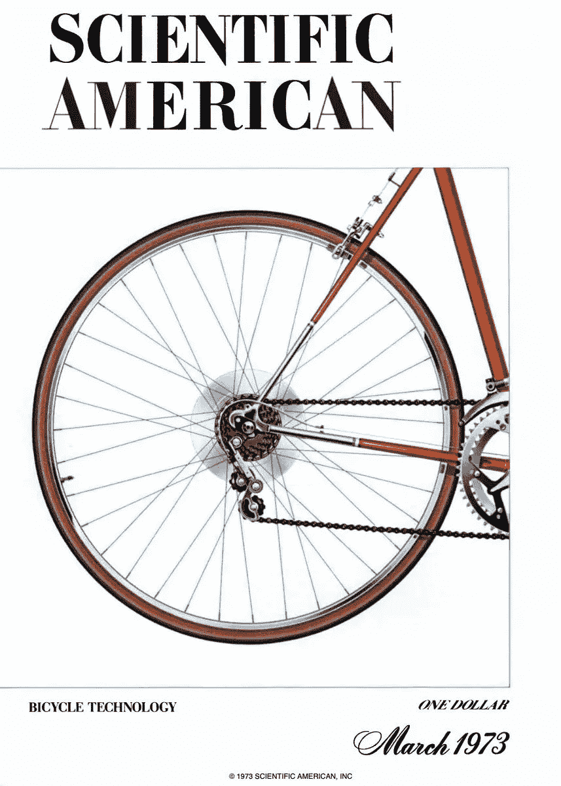

- 他在文章中写道，秃鹰是最有效率的，人类在使用自行车之前的效率排名一路下滑。
- 这张图表非常吸引人。你可以看到一个骑自行车的人是多么有效率。

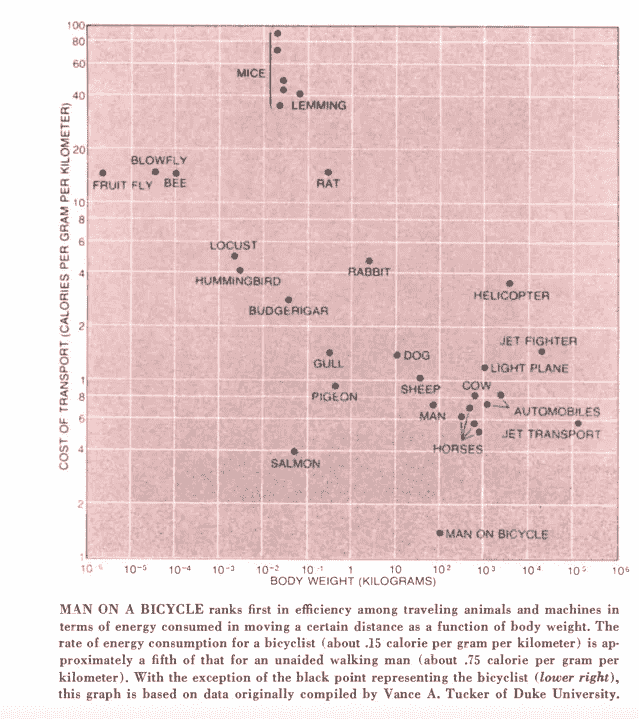

视频的其他部分介绍的观点，即便 40 年后的今天这些观点是多么令人着迷。

### 4 个相当深刻的观点

- 使电脑易于使用
- one PC per person beats a computer for 10 people
- 增加的电源供应是使 PC 更容易使用，而不是计算
- 硬件和软件之间没有缝隙

### 视频的一些细节

- 09:15
- 他谈到买电脑也是一个大问题。在它可以使用之前，你需要学习如何编程它。苹果想要解决这个问题。使计算机易于访问是一个核心价值。
- 我们整个公司的愿景基础建立在一个原则之上：当人和一台电脑相遇的时候，会发生特殊和有历史意义的事情。The personal in PC。
- 12:45
- 他说，很少有人会想到，“我们将开始消耗更多能量能源，用在帮助一对一的交互更顺畅，而不是进行数字运算、数据库管理和文字处理。
- PCs 当时相对于软件来说功能太弱，除了处理更大的电子表格、更多的记录或者用文字处理器处理更多的页面之外，没有人考虑做任何事情。尝试做易用性使得所有的事情都变得缓慢，这个时候在内存上有很大的折衷。
- 18:00
- 苹果公司还是一家硬件公司，但是现在已经超过了一半的软件工程师。
- 越来越多的软件被集成到硬件中——昨天的软件就是今天的硬件，所以我认为这两者正在合并，硬件和软件之间的界限将变得越来越精细。

### 随后

- 我猜史蒂夫喜欢这个类比。很快，苹果就开始在广告中使用它。1980 年 4 月的华尔街日报。
- 乔布斯喜欢这个类比，很快，苹果就开始在广告中使用它。1980 年 4 月的华尔街日报。一度将 Macintosh 项目代号在 Jef Raskin 休假期间修改为 Bicycle。

[视频2](https://www.youtube.com/watch?v=3H-Y-D3-j-M)

`https://youtu.be/3H-Y-D3-j-M?embeds_referring_euri=https%3A%2F%2Fwww.pmthinking.com%2F&source_ve_path=Mjg2NjQsMjg2NjQsMTY0NTAz`

- 1981 年 4 月 10 日，航天飞机因电脑问题而取消发射。因为电脑死锁。John R.Garman 论文“Bug Heard Round the World”详细说明了问题，彼时全世界各地都听到的 Bug 这个词语。
- 那天美国 ABC 的晚间新闻节目《Nightline》的主题讨论的就是影响发射的计算机问题，采访了乔布斯，这个视频中有很有趣的部分。
- 当时的背景：1980 年全年大约卖出了 725,000 台个人电脑，Apple 占 7.8 万台，1981 年有 140 万台个人电脑。计算机是生活的一部分，许多人相信计算机不会侵犯他们的隐私……生活、自由和对幸福的追求不可避免地与计算机联系在一起。
- 节目主持人 Ken Kashiwahara 报道“计算机在学校、工作和家庭中受到欢迎，但是没有提到侵犯隐私”，并且讨论了所有流行的家庭用途。
- 随后乔布斯补充道：“这是一辆 21 世纪的自行车。（This is a 21st century bicycle.）”对社会的影响将超过石化产品。
- 当被问及计算机的脆弱性/依赖性时，乔布斯说道，“计算机和推进器一样重要”，航天飞机只是证明了计算机的重要性。
- “计算机放大了人类的能力（**Computers amplified a human ability.**）。”——这是乔布斯在所有媒体中始终如一的主题。放大人类是以工具为中心的计算观点。

### 推荐

- 原文：“Bicycle for the Mind”
- [重新评价乔布斯](https://zhuanlan.zhihu.com/p/79909966)
- [Vol.20210912 | 花一下午，和那个即将 30 岁的 Steve Jobs 聊一下](https://pmthinking.com/post/841)

# 羔羊 2010年09月02日：来自 Steve Jobs 给自己写的邮件

by fonter

来自[乔布斯档案馆](https://stevejobsarchive.com/)的收集，Jobs 经常自言自语地给自己发邮件以捕捉他自己真正的想法。

本周推荐这封邮件以及乔布斯档案馆的其他内容。

> 2010 一套核心的理念激励着 Jobs 一生

> From: Steve Jobs, sjobs@apple.com  
> To: Steve Jobs, sjobs@apple.com  
> Date: Thursday, September 2, 2010 at 11:08PM

我吃的食物不是我生产的，我没有培育筛选过种子；

我穿的衣服不是我编织设计的；

我每天说的语言也不是我发明或者优化的；

我所使用的数学也不是我发现的；

保护我的法案不是我参与立法的，不是执法保护的；

感动我的音乐也不是我创作的；

当我感到要治疗的时候，很无助的要帮助自己活下去。

我每天工作的同事所使用的技术，晶体管和微处理器和面向对象编程也都不是我发明的。

我爱和欣赏人类这个物种，无论死去或者活着的人，我的生活和健康完全依赖于他们。

Sent from my iPad

## 2007 Apple 内部会议

在 iPhone 发布后不久的一次员工活动中，一名员工问道，公司将如何在发展过程中保持其文化和品牌的完整性。史蒂夫的回答是：通过制造伟大的产品。我相信人们表达对人类其他人的感激之情的一种方式是创造一些美妙的东西并将其展示出来。

[Apple-Town-Hall-Meeting_jvgchs.webm](https://internal-api-drive-stream.feishu.cn/space/api/box/stream/download/all/FUcPbJ6ohoEYmKxNh8ncd3ftnbe)

## 2005 年斯坦福大学演讲

从里德学院(Reed College)退学30多年后，史蒂夫站在斯坦福大学的讲台上。他花了几个月的时间来准备他的演讲稿，而且不同寻常的是，他是对着打印稿演讲的。史蒂夫发表演讲时，苹果正处于上升轨道，但他利用这个机会回顾了一段更痛苦的时期——1985年被苹果解雇后的那段时期——以及他从中学到的教训。

[Standford-Commencement-Connect-the-Dots_sepwi5.webm](https://internal-api-drive-stream.feishu.cn/space/api/box/stream/download/all/M7cKbhYJfoqcpSxDrrPc9Tzanif)

## 1997 年 Steve 为 Think Different 配音的版本

苹果公司在濒临破产的边缘时，它推出了 Think Different，一个重申其核心价值观的广告。这个具有里程碑意义的广告制作了两个版本：一个由史蒂夫配音，另一个由 Richard Dreyfuss 配音。史蒂夫选择了 Richard Dreyfuss 版本。

## 1995 年 Steve 的采访

当一位采访者暗示工程学和艺术是两个截然相反的概念时，史蒂夫不同意。

艺术家和最高级别的工程科学家之间的区别几乎非常小，他们都是朝着同一个目标只是路径不同。

[Smithsonian-Interview_fqw9lf.webm](https://internal-api-drive-stream.feishu.cn/space/api/box/stream/download/all/LeiQbm8kuoCDlHxNzDCcAvTmnfe)

## 1984年 Michael Moritz 的采访，其撰写了一本书《重返小王国: 乔布斯如何改变世界》

在与当时报道硅谷的记者莫里茨的一次谈话中，史蒂夫争辩说，他的审美观并不比其他任何人优越。他说，使他与众不同的是他在追求卓越的过程中顽固不化的意愿。

## 1983年 阿斯彭国际设计大会

在 Macintosh 上市前一年，史蒂夫与一群精英设计师进行了交谈，其中大多数人以前从未使用过电脑。在他展示了 Lisa 电脑之后，一位观众问他是什么促使苹果公司这么做的。

[International-Design-Conference-Aspen_j4tjrq.webm](https://internal-api-drive-stream.feishu.cn/space/api/box/stream/download/all/NCxwbgf9noFv1WxgOqCcdrI0ncc)
