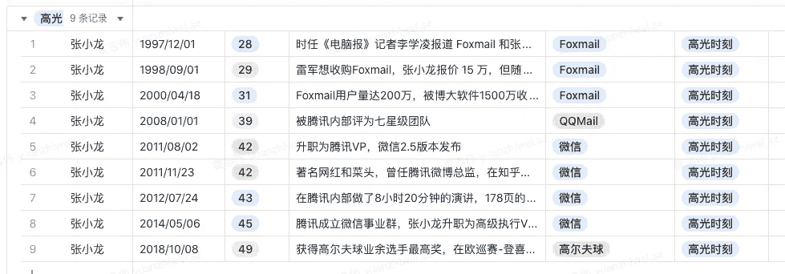
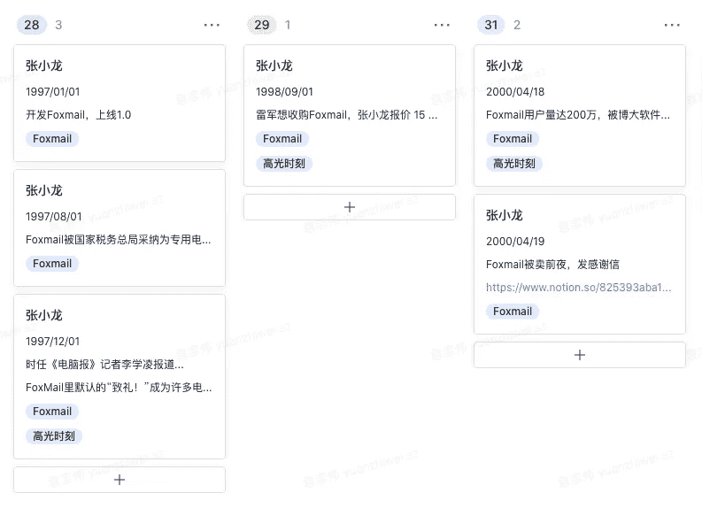
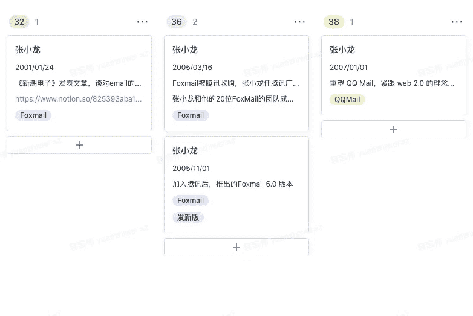
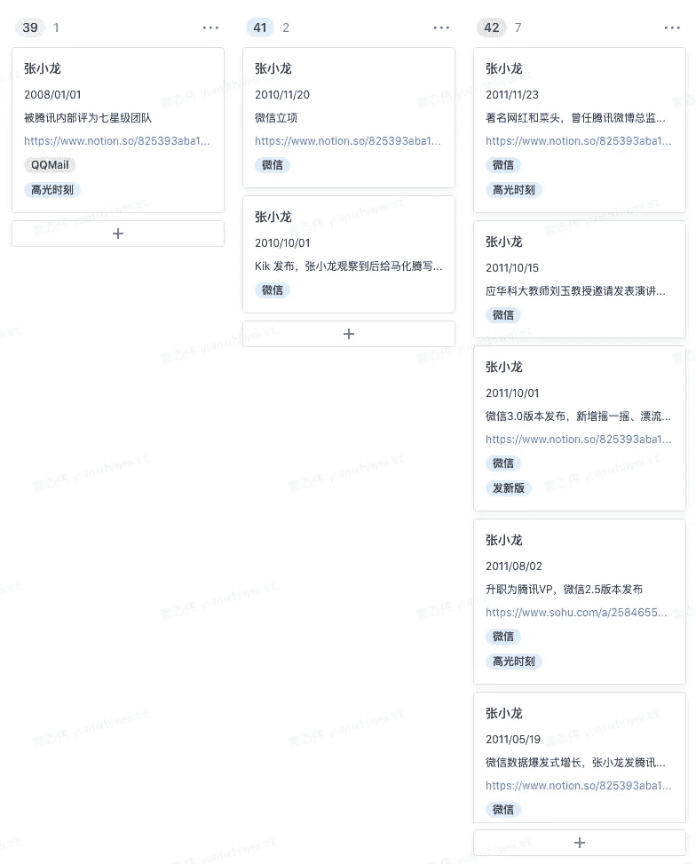
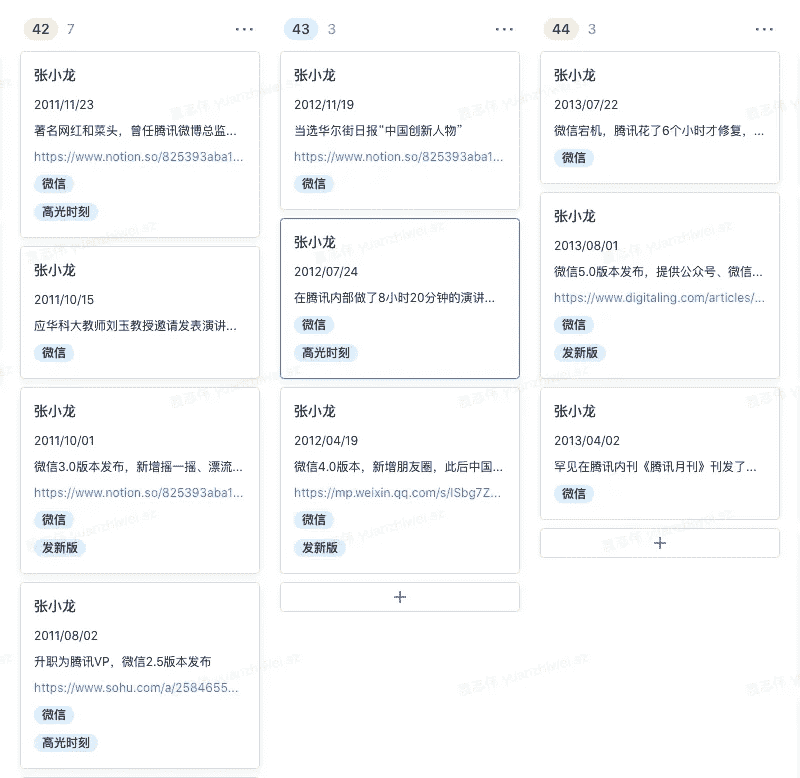
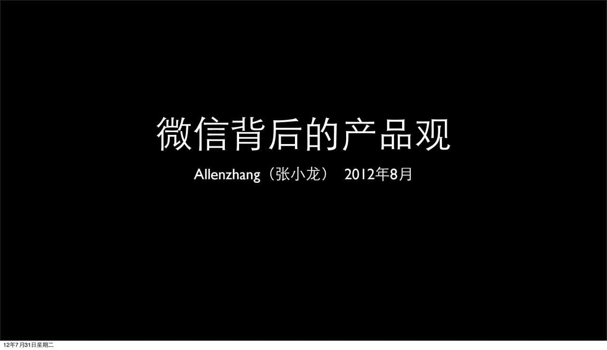

# 张小龙

> 来源：[https://v11enp9ok1h.feishu.cn/docx/CJ7zd9Rd2onuznxGujCcuzKOnhc](https://v11enp9ok1h.feishu.cn/docx/CJ7zd9Rd2onuznxGujCcuzKOnhc)

> 🗣️ 张小龙 （allenzhang） 作为互联网产品经理的「神」，大家应该都很熟悉了。

> 最近在读「🛰️背后的产品观」，这本书的缘起是张小龙在腾讯内部的8小时，我在腾讯时看过演讲，流传到网上的PPT内容也一直被我拿来学习，每年都会读一遍，自己做产品时也会对照思考在自己所在的领域下哪些适用哪些不适用。相比于8小时的演讲和网上流传的PPT版本，这本书做了一些增删，更为系统也更完整。最有价值的是🛰️几个经典功能从洞察到方案的全过程，那些在当时的时代背景和具体场景下的细节，更能让我感受为什么做产品以及怎么做产品。

> **几点感悟：**

> **保持创造，把手弄脏：**张小龙开始做🛰️的时候已经42了，超过了所谓的互联网35岁退休年龄。「当你停止创造，你的才能就不再重要，剩下的只有品味，品味会让你远离他人，变得狭隘。所以要创造。」好的产品经理应该每天都在把手弄脏，更何况真正品尝过创造快乐的人是很难割舍创造这件事的。

>

> **保持开放，不怕打脸：**「我所说的，都是错的」本身就是反教条的。如果我们从产品视角分析🛰️，会发现🛰️自成品类，通讯+社交+内容/商品/服务分发，除媒体之外几乎都在，兼具工具、渠道、平台、生态属性。而这些尝试，在🐧邮箱时就开始了，比如阅读空间和漂流瓶。

> **和自己的特质相处：**相比优点和缺点，我更喜欢特质这个词。特质是我们和真实世界碰撞后返回来的那部分，认识自己的特质，接纳它，跳出它，尝试换个视角来看，碰撞和特质很多时候并不是对立而是统一的。每一次破墙而出都意味着更丰富的成长历程，就像不善沟通的孩子更有意愿帮助别人沟通，因为他通过自己的孤独感同身受地理解大多数人内心深处的孤独。那些认识自己并且挣扎脱离困境的人更能理解他人。

> **保持朴素和真诚：**朴素来源于少用概念，多用直白明确的文字。概念本身是抽象的，尤其我这种学理科的，容易概念推演概念形成一个貌似逻辑严密的模型，因为逻辑的美感和形式的美感而沉浸其中，好像可以格物一切。但真正探究，就会发现每个人对概念的理解都不同，貌似逻辑严密的模型大家的理解千差万别，把这个模型落到真实的场景里也会各种不兼容，一地稀碎。接受不严密，不美，每天在具体的事实和问题中，多做描述，很多时候对问题朴素的描述本身就是在解决问题。真诚来源于愿意说why，愿意把观点背后的思考用事实和逻辑讲清楚。「求真」是同时对外和对内的。

> **平常心：**朴素意味着更接近本质，接近本质可以拥有一颗平常心。平常心很难有，尤其在对手做了动作的时候，🛰️成长过程中的很多决策是在和米聊竞争中做的，但龙哥完全没有动作变形。龙哥讲了两个办法，一是看高一些，尝试抓到影响战局的东西，二是努力比业界多三个月的认知。

> **在脑子里容纳两种视角，比如感性和理性：**龙哥的很多观点一开始都是来自直觉的吉光羽片，观点产生之后要经过理性的归纳、抽象、演绎，才能把背后的逻辑理清楚，才能指导决策和动作，而决策和动作在产品上要叠加感性的设计和表达来激发用户。其实很多事情都需要两种对立视角，而一流的智慧是知道什么时候该用什么。比如调研事实时要没有ego，而制定原则时要有明确自我。比如发现问题时要把自己变成傻瓜，然后想为什么这样，解决问题时要变成开发者，一秒钟傻瓜，一秒钟专业。

> **发现和理解规律，制定原则，让产品和团队演化：**对外的核心是找规律，对内的核心是定原则。原则会让你不同，而不是相同，相同只会带来竞争，但竞争并不会让你的产品脱颖而出，只会让你的产品走上独木桥，拥有自己的认知和价值观会才能让团队在不停变化的环境下演化。

> **每个人自己体会到的东西才是自己的：**张小龙说「没有见过光的人是没办法理解光的」，就像「悉达多」里说的「智慧只能感受而不能传递」。怎样成为一个好的产品经理？「事上磨」。

> </aside>

## 编年史

### 重要时刻

#### 1.高光时刻

#### 2.人生甘特图

[详情在此](https://bitable.feishu.cn/appvODlUES5mxgEYphmUEr9gHj4?table=tbl14g3VgI98JbTS&view=vewK5ZUfMf)

#### **3.重要年龄**

30岁前后

35岁，「互联网退休年龄」

40岁

”封神“前后

#### 文本版本

+   1969年，12月3日，生于湖南省邵阳市洞口县；

+   **1987年，考入华中科技大学电信系，当时叫华中工学院（18）。**不太喜欢上课，昼伏夜出，白天踩着拖鞋出门，晚上常与室友边守着酒精炉煮面，边打双升（一种扑克牌游戏，俗称拖拉机）；

+   1994年，毕业于华中科技大学电信系，获硕士学位，硕士时候被分到微波专业，但是不喜欢开始做软件开发；

+   1994年，同年到广州工作，从事软件开发（25）

+   1997年，1月Foxmail上线，8月Foxmail被国家税务总局采纳为专用电子邮件软件，12月时任《电脑报》记者李学凌报道 Foxmail 和张小龙（28）

+   1998年，9月，雷军想收购Foxmail，张小龙报价 15 万，但随后雷军遗忘此事

+   2000年，用户量达200万（31）

+   **2000年，4月18日，以1200万元的价格把Foxmai**l卖给博大公司，并任公司副总裁。（31）

+   **2005年，3月16日，腾讯收购Foxmail ，张小龙担任**广州研发部总经理，负责🐧邮箱。（36）

+   2006年，成立敏捷团队优化🐧邮箱（37）

+   2007年，🐧邮箱荣膺腾讯公司七星级产品（38）

+   2010年，9月，🐧漂流瓶正式上线

+   2010年，10月，Kiki发布，张小龙观察到后给马化腾写邮件，建议腾讯开发此类app，马同意由其团队开发

+   2010年，11月19日，🛰️正式立项（41）

+   2011年，1月21日，**🛰️1.0版本上线。**（42）打开应用，映入眼帘的是一幅深邃的画面：一个小人孤零零地站在庞大的蓝色星球外，眺望着远方的家园。张小龙希望用这幅画传递开发🛰️的用意：人很孤独，需要沟通。

+   2011年，5月10日，**🛰️2.0**，推出**语音对讲机**。

+   2011年，5月19日凌晨的🧣，“辛苦了很久，🛰️的同学们今晚享受到用户暴涨的喜悦了。mark一下。”

+   2011年，8月2日，🛰️2.5发布的前一天，被任命为腾讯副总裁。这位少年得志、大器晚成的技术天才，用6年时间爬到了腾讯高层。

+   2011年，8月3日，**🛰️2.5**，推出**附近的人**。

+   2011年，10月1日，**🛰️3.0**，推出摇一摇，漂流瓶。**“摇一摇”**成为核爆式的武器，日启动量很快超过1亿次。

+   2011年，12月20日，**🛰️3.5**，推出**二维码**功能。

+   2012年，4月19日，🛰️ 4.0，推出朋友圈、开放接口功能。

+   2012年，7月24日，张小龙在腾讯内部做了8小时20分钟的演讲，178页的PPT，17个分会场，超过1700人。但张小龙这次演讲的结语是：“我所说的，都是错的”。

+   2013年，🛰️ 5.0，推出**👸号、🛰️支付、游戏功能****，公众**号构建了商业流量的基础，支付切入阿里的核心，推出内置游戏“打飞机”，再次引爆全民参与。

+   2014年，1月26日，推出**🛰️红包**。🛰️红包是财付通的一个小团队开发了10多天加班赶出来的一款春节应景作品，初衷是增加一些新年气氛。腾讯财付通在🛰️推出公众账号“新年红包”，用户关注该账号后，可以在🛰️中向好友发送或领取红包。🛰️红包一经推出，就以病毒式的传播方式活跃在各个🛰️群中，并在除夕当夜全面爆发。据财付通官方提供给时代周报的数据显示：除夕当天到初八，超过800万用户参与了红包活动，超过4000万个红包被领取，平均每人抢了4-5个红包。红包活动最高峰是除夕夜，最高峰期间的1分钟有2.5万个红包被领取，平均每个红包在10元内。

+   2014年，5月6日，成立🛰️事业群，由张小龙担任🛰️事业群总裁（高级执行VP），向刘炽平汇报。（45）

+   2014年，9月30日，🛰️6.0，第一次尝试短视频内容。

+   **201**7年，1月9日，🛰️6.5，推出小程序。

### 产品观

#### **产品经理**

---

+   **产品**经理是站**在上**帝身**边的**人，产品**经理应该**像上帝一样建立一个系统，并制定规则，让群体在系统中自我演化。能自我演化才是最重要的。

+   🛰️背后的产品观：张小龙《腾讯大讲堂》特别讲座8个小时20分钟

+   张小龙曾和朋友分享感受，他觉得不是所有人都适合去做产品。**做产品是一个塑造东西的过程，每天按自己的意识去往前改一点、改一点、改一点。这需要这个人有天生的驱动力，这个驱动力就是你愿意去做一个东西，看起来很棒很完美。**但很多人没有这种意愿，或者没有享受做一个东西的乐趣。所以张小龙总说，如果他是个木匠，也会是一个很好的木匠，而且他会享受他做的事情。

+   马化腾和张小龙：踏不进同一条河流

#### **产品**

---

+   产品是有自己内在的**生命体**。产品是**进化****出来的而非规**划出来的，有自己DNA的产品才会进化。DNA是产品的价值观和认知。

+   🛰️背后的产品观：张小龙《腾讯大讲堂》特别讲座8个小时20分钟

#### **🛰️**

---

+   “是**消息系统**。它包括了人和信息，他们在系统里流转。”

+   ”🛰️成为**Push中心**，所有信息从🛰️推过来，**连接**所有用户与产生信息的第三方。”

+   张小龙专访系列（2）：不一样的产品思维

+   **“🛰️十年，如果非要用**两个词来描述🛰️，我想，一个是连接，一个是简单。

+   **连接是很美的。因为世界的运行就是靠万事万物的连接而进行的。**对产品来说，做连接，意味着做服务的底层设施，因为基于连接可以演变出来的结果是最丰富的。

+   **很多**的社交产品可能也做连接，但它止步于人，🛰️的连接范畴更大，👸号、小程序目标都是连接，连接人和内容、人和服务，包括🛰️支付也可以认为是一种货币的连接，视频号的目标也是连接。重心不是在做内容，而是在做底层的连接，这很重要。这也是为什么我们会提“去中心化“，因为连接和中心化是有些排斥的。

+   再说简单。

+   我用简单来作为美观，实用，合理，优雅的代名词。”

+   2021🛰️公开课PRO 🛰️十年的产品思考

#### **关于通信和社交**

---

+   **群体效应**是社交产品的核心，**通过对人内心欲望的洞察，建立虚拟社会**的规则，引发群体效应，群体再推动规则变化。

+   🛰️背后的产品观：张小龙《腾讯大讲堂》特别讲座8个小时20分钟

+   就**像在🛰️里，我们不会把你**所有的🐧好友导到你的🛰️通讯录，也不会把你的手机通讯录好友全部导到你的🛰️好友里来，这个也是同样的观点：我们不认为好友越多越好。

+   张小龙演讲全文：如何把产品做简单

+   在🛰️里面，你的好友是越少越好？还是越多越好？

+   张小**龙的结论是越少越好，因为有很多好友，人是会烦躁的，为什么人有很多好友会烦躁？因为在人类进化史上，人类还是原始人的时候就没有很多好友，人认识不了那么多人，处理不了那么复杂的人际关系。张小龙对于复杂关系、对于人性的意识和理解，很多都来自他自己，他觉得他处理不了复杂关系，**他觉得其他人本质也一样。很多思考是同理性带来的，只是多数人不会相信自己这种认知是是正确的。世界上并不存在普世性的方法来做产品。只是说不断挖掘人是什么，用户是什么，人性是什么，真不断问自己——越原始的人，他可能会怎么想？这是张小龙思考的起点，一个一个小体系最终构建成的产品体系。这不是天赋、不是幸运，而是专业性——对于产品和人的感受、领悟能力。但之前没有这样的先例，只能靠自己去想，把自己当作一个真实的用户。“我需要不需要那么多好友？”——从一个问题出发，找到一个答案——一个好的社交产品就应该是这样。

+   马化腾和张小龙：踏不进同一条河流

#### **用户**

---

+   用户是人。**做产品一要**了解用户，了解用户的想法和人性需求，二要了解群体的心理，了解群体效应。

+   1、人是环境的反应器，人的行为方式是环境“输入”的“输出”

+   case：电脑前发🧣和走路发🧣，朋友圈的拍照和Qzone的相册。

+   对于产品来说，要营造一个环境，然后由这个环境来决定用户来做什么样的反应，用户会被你营造的“环境”牵引，这是决定用户应该做什么的重要因素。

+   2、群体效应，找能引起用户连锁反应的驱动力。

+   case：“因为别人都在用”

+   做互联网产品，用户是群体不是个人，要学会让用户推动用户。

#### **需求**

---

+   **需求是属于感觉层面的东西，需求只来自你对用户的了解。对于一个新产品，通过传统方式去了解用户的需求，几乎是不可能的。**如果是做一个明确任务是可以的。

+   张小龙的方法是：

+   1、在用户讨论的地方（🧣上）感受用户的潮流，在用户讨论中发现灵感

+   潮流是指不同的用户群体的生活工作模式，空闲时间喜欢做什么，这些是全局性的感受。对于局限在办公室工作的产品经理来说，这或许是一个很好的了解用户的方式。

+   case：石头剪刀布

+   每天花一小时看普通用户在🧣上谈论他们是如何用你的产品的。在做邮箱时，每天花很多时间看产品论坛，现在用户的讨论转到🧣上，我们依然保持对用户讨论的关注。🧣上不如调研结果来的具体详细，更多的是感受潮流。

+   所以这里管人的同事们长期会坚持一个习惯，以前提过“1000、100、10”，每周要去看1000个帖子，100篇博客，做10个CE（用户调查）。

+   **观点：每个时代有每个时代的产品**

+   感知时间、空间与用户的变化，只有感知到，才能把握住不同时代的新事物。如果感知不到，就只能停留在满足过往所认知的用户需求的阶段。

+   case：🐧和🛰️

+   2、满足自己需求优先于满足用户需求

+   case：“已阅读”消息状态，语音提醒

+   **3、找到需求背后的心理诉求**

+   需求的本质往往可以归结为心理诉求

+   case：漂流瓶首先是想帮人解决倾诉和好奇的欲望，其次才是交友的欲望。如果为了交友而做漂流瓶，会把握不住本质。默认语音，为了方便随时随地倾诉和发泄情绪。

+   case：🐧邮箱里发现用户会自发、批量转发“幼稚”的邮件内容，做一个功能来满足这个意愿。

+   我们不是在做一个功能，而是要怎么满足用户的诉求。这也是🛰️最基本的产品思路。

+   观点：心理满足的驱动力远胜工具甚至省钱、“爽”胜过功能

+   爽是体验。体验比功能更易传播。

+   case：🛰️可以看附近的帅哥美女

#### **设计**

+   **产品设计**

+   1、先做产品结构之后才是功能细节

+   产品结构是骨骼，不可多变和复杂。创造从骨骼开始，而不是先造肌肉。

+   case：🛰️的tab只有4个

+   2、功能模块之间是有机联系的关系

+   case：聊天和朋友圈可以用来分发👸号、小程序、视频号、直播

+   PM要考虑怎么让新功能和原来的产品体系产生联系

+   **3、设计就是分类**

+   分类是人类大脑的识别模式，只有分类分得好，对用户才能显得亲切易懂，对产品才显得结构清晰

+   分类是化繁为简的方法之一

+   case：🛰️的Tab只有4个

+   PM每天都应思考如何让事情更有条理

+   **4、越简单的分类越易于被接受**

+   case：🛰️会升级，但结构和界面会保持简单。

+   5、**抽象**方能化繁为简

+   抽象是提取事物的共有特性，从而用简单模型覆盖多样性，抓共性处理，其他只是颗粒

+   case：做外部信息的接入和订阅的时候，🛰️给了高度抽象化的接口，只有一种账号体系

+   **6、找到需求背后的本质需求**

+   case：朋友圈要不要做分组？用户不会“做了分组才在朋友圈发照片”，而是想发朋友圈时屏蔽有限的几个人，一般集中在两类关系：父母和上级

+   7、面向场景做设计而非功能列表，面向场景才能取舍，面向未来场景做设计

+   功能脱离了场景是没有意义的

+   不堆砌功能，功能服务于场景和和整体体验

+   case：会话了新的语音取消自动播放

+   case：没有在线状态，手机永远在线，改变用户在PC聊天的习惯，在🛰️不会说再见

+   8、让功能存在无形之中（pony）

+   case：小程序扫描了二维码才出来。“群邮件、普通邮件如能打通，真正做到让功能存在于无形之中，不给用户多余的概念去理解”。

+   只有新手才将所有（新）功能罗列在显眼的地方

+   用户需要去学习和理解功能吗？能做到不需要才是PM的最高境界。

+   9、 **不过度设计**，宁愿损失功能也不损失体验，抛弃不人性的创新，如果解决方案非常复杂一定是问题问错了

+   对主干精雕细琢，对枝叶不做深

+   产品经理太喜欢表现自己的聪明才智，做了一个东西不被看见就感觉遗憾，甚至吃亏。

+   case：会话内容删除，不在界面左上角增加编辑按钮，因为会影响返回的体验，触发误操作。在这个场景下，保证体验比提供功能重要

+   case：视频通话里状态切换的问题

+   10、没有设计，只有解决问题

#### **商业化**

---

+   “商业化和好的用户体验我一直希望能做成不矛盾的，不是商业化了就要损害用户体验。这是有可能的，也是我们将来的目标。”

+   “为什么我要尝试公众平台，因为这个平台包含了一些潜在的商业潜力，当它行得通的时候，可能它既满足了商业化的需求，用户也觉得没有被骚扰到，甚至还可以付费来获得服务，那这就是很好的商业化。”

### 产品理念/价值观

#### **🛰️团队的理念**

---

+   1、做对用户有价值的事情

+   2、保持我们的价值观，因为它会体现在我们的产品和服务中

+   3、保持小团队，保持敏捷

+   4、学习和快速迭代比过去的经验更重要

+   5、系统思维

+   6、让用户带来用户，口碑赢得口碑

+   7、思辨胜于执行

+   **腾讯成立🛰️事业群：**🛰️因你而美

#### **🛰️价值观**

---

+   1、一切以用户价值为依归

+   2、让创造发挥价值

+   3、一个好的产品是用完即走的

+   3.1、再次解释用完即走

+   **任何一个工具都是帮助用户提高它的效率的，用最高效率的方法去完成它的任务，这是工具的目的，工具的使命。🛰️也是一个工具，所以🛰️的目的也是**帮助用户用最高效的方法去完成它的任务。什么是最高效的方法？就是用最短的时间去完成任务，也就是说一旦用户完成了它的任务，它就应该去做别的事情，而不是停留在产品里面，这就是用完即走的含义。

+   2017🛰️公开课PRO 全面阐述小程序

+   3.2、用完即走，走了还会回来

+   用完即走和用户再回来，其实并不矛盾，相反只有当一个用户在一个工具里用得很愉悦，用得很高效，他才会下一次回过头来使用这个工具。我们现在说的小程序也是这样的，小程序应该是帮助用户尽可能在短的时间里面完成一个任务，并且离开这个小程序，这样的话他才会有很好的体验，下一次他会继续回来用这样一个小程序。

+   2018🛰️公开课PRO 张小龙现场跳一跳，发布2018计划

+   4、让商业化存在于无形之中

+   2016🛰️公开课PRO 🛰️四大价值观

+   5、合理性才是最重要的因素

+   任何一个产品都不可能满足所有人的需求，我们必须要做很多的取舍，而我们希望更多遵从我们自己的产品理念来做这样的取舍。

+   2017🛰️公开课PRO 全面阐述小程序

#### **🛰️的原动力**

---

+   1、坚持做一个好的，与时俱进的工具

+   2、让创造者体现价值

### 世界观

#### **去中心化**

---

+   简单说我们是希望建造一个**森林**，而不是说我们要建造一个自己的宫殿出来。

+   我们希望整个森林是去培育它的一个环境，我们让所有的一些生物或者动植物能够在森林里面自由生长出来，而不是说我们自己去把它建造出来。

+   2014🛰️公开课PRO 关于公众平台方向和理念的八点思考

+   在一个“去中心化”的世界里，每个独立的个体都有自己**的思考，都有**自己的大脑，我们认为这样一种系统的健壮度，可能会远远超过只有一个大脑来驱动的系统。

+   🛰️平台一直想遵循这样一个原则，就是我们不应该去影响各个服务的存在，我们所做的应该是尽可能的让更有价值的服务自己能够浮现出来被用户找到，而不是我们去左右，这也是我们刚才说的去尊重用户的一个体现。所以之前的👸号，我们也是这样一个思路。

+   2018🛰️公开课PRO 张小龙现场跳一跳，发布2018计划

#### **动态的生态系统**

---

+   很多朋友会说，🛰️的平台规则似乎不太明朗，或者说我们的规则不太清淅。

+   以至于说，觉得这里面存在一些混乱，但我想跟大家说的是，我们并不认为一个规则100%很确定的系统就是一个好的系统。相反，我们认为一个动态的系统是一个更加能够获得动态稳定的系统。

+   所以，我们认为第三方跟我们一起来共同建造一个系统，而不是我们做好了一个完整的系统。

+   既然是一起来做，我们认为这个系统应该是一个动态自我完善的系统，而不是一个比较僵死的一个系统，甚至整个系统也是我们和第三方一起定义出来的。

+   2014🛰️公开课PRO 关于公众平台方向和理念的八点思考

#### **对于群体的观点**

---

+   1、一个人在组织里，组织的平均智商是低于个体智商的，个体的智商更高一些，群体会拉平这个智商。群体有趋同性。

+   2、群体是一个完整的生命。

+   3、群体的含义是很难预测的，因为没有人知道群体性从哪儿来。所以我们对这种群体的反映，做产品就是一个群体反映的引发器。对群体反映，我们应该去试验而不是去策划（规划）。

+   张小龙演讲全文：如何把产品做简单

### 成长观

#### 「相对内向的性格，是否适合做产品经理」话题

+   张小龙询问我，从小家教是否十分严格；我说，恩，是的，家里人从小把我管的很严，有些时候会比较内向和缺乏自信。（事实啊～校招阶段，所有面试环节中，我硬是让自己表现的成熟和平和，但当时内心实际上会**有那么**一点的小自卑，因为当时应届生能进腾讯基本上都是985、211这样子的名校，而我当时只是江西师范大学这样一个很没有名气的小本科生；甚至同台竞技应届生还有那么多研究生...）。然后张小龙开始回忆说，他曾经跟我一样，十分的不自信，但是在寻找成长的过程，他过去的那些种经历反而造就了他谦逊、冷静、不骄不躁的性格以及做事风格。然后，他继续跟我比划说他相信我过去这种处于劣势的性格会伴随着我的成长和自信，终有一天会跟压迫中的弹簧一样反跳的更高，从而成为优势。

### 组织观

#### **团队**

+   “**第一次工作留给我的观念就是：软件是一个团队的事情，而不是个人的事情。**可能很多优秀的开发人员很看重技术难题的解决，而我长期的观念中，**软件工程中最大的难题在于怎么“组织”，怎么组织好多少万行的代码，怎么组织好多人开发的代码。**从汇编到C、到C++到基于组件（component）的开发，其实目的只有一个，就是有效组织好庞大的代码。（即使在Foxmail中，虽然是我一个人写，但最多的功夫仍然在如何组织好几万行代码）。组织好的代码有种美感。”

+   2000年Foxmail被卖感想信

#### **保持小团队，保持敏捷**

+   “一定是保持小团队，如果是大团队我们可以把它拆分为几个再小的小团队，并且对每个小团队充分授权，让他们有很大的发挥空间，让他自己去滚动。因为越大的团队就越容易形成一个流程，一旦有了流程就把所有的人束缚住了，所以应该说把团队拆小并且少一点流程，把大家的主动性、积极性能够发挥出来。

+   互联网的很多东西不像工厂生**产，说我们的流程定的越好越不会出错，对于一个互联网**产品来说，我们自己都不知道两个月以后的版本会是什么样的，因为这两个月我们对这个领域的认知又会提升很多，所以我们不能抛开两个月的提升不考虑，现在就定下来，你不能假定我两个月不能有提升，这种变化才是要最受到重视的。这刚好跟流程相反，往往我们会发现一个大公司反应速度比不过一个创业型小公司，也是这个原因，可能就是因为人多了以至于流程化、僵化了。”

+   [专访张小龙：产品之上的世界观](https://www.notion.so/95f6d1bafc6c4be88a0e78b1a2c24e58?pvs=21)

+   希望我们在BG成立规模变大后，还能保持小团队心态，避免陷入官僚化和流程化里面。我们曾经禁止写PPT，认为那是形式化的体现。这有些武断，但目标是效率的最大化。我们还将继续限制招聘的人员数目，只招聘最优秀的人员加入团队。对一个优秀团队来说，人员也是少比多好。

+   **腾讯成立🛰️事业群：**🛰️因你而美

+   为什么我老是说特别怀念 150 人的小团队，因为当我们人数增多的时候，我们自己会制造出很多流程出来。我们自己会习惯自己这种效率，而对一个非常小的团队来说，他不需要开会、也不需要干嘛，大家坐在一起，扭头就可以说有一个问题我们解决它吧。

+   在这种敏捷方面，我们可能在离敏捷的方向越来越远，但是我们自己并不觉得。越来越远的后果是，我们自己都觉得我们做的事情没劲，因为你今天想到一个很兴奋的主意，过了一个星期你自己也会淡化它。**敏捷带来一个最好的心理感受是什么呢？我们今天可以想一些与众不同的点子，然后我们可以很快就看到效果，因为我们可以很快把它上线了，然后可以去验证，如果不对就下线，如果还有改进余地，下个星期再去改它。如果改了还不行，那继续下线，如果改了行，它一定很好……这是一个能够持续实现你的想法的过程。**但是如果说有一个很好的点子去尝试一下，然后大家讨论一下说好吧，那我们尝试一下。然后过了两个月还没有排上去，然后第三个月发布了，你可能对这个事情没有激情了，发布了你也不会看它了。

+   🛰️管理团队领导力大会：“警惕 KPI 和流程”

### 读书

#### **《失控》**

+   在广研，产品经理们人手一本《失控》，因为张小龙说过：不读《失控》的产品经理，知识结构是不完整的。

+   张小龙反复提及这本书启发了他的产品观：**不与用户产生互动的产品，是失败的产品。产品规则越简单，才越能让群体形成自发的互动。**产品上线后，就有了自己的生命，会自己与海量用户互动，最后会互动出什么结果，是产品设计者不能控制的。

#### **《科技想要什么》**

+   彭博《商业周刊/中文版》董璐采访完张小龙后，互加了🛰️，很久以后的一天，她突然收到张的一条信息：给你推荐一本书，《科技想要什么》，凯文•凯利的新作。他更欣赏互联网先知凯文·凯利（K.K.）在《技术想要什么》一书中写的：“没有一个人可以成就人的所有潜能，没有一项技术可以满足所有的承诺。这需要所有的生命、所有的心灵、所有的技术共同憧憬一个现实。这需要所有的Technium，包括我们自己，去探索可以给世界惊喜的发明……”

+   凯文·凯利向我们介绍了一种全新的科技观。他认为，作为整体，科技不是由线路和金属构成的一团乱麻，而是有生命力的自然形成的系统，它的起源完全可以回溯到生命的初始时期。

#### **本初的生活**

+   他对原始人的生活方式充满兴趣，花工夫研究了人类的起源，人类为什么会直立行走，他还曾在知乎上提问：原始人用什么来剪指甲？ 广研内部对摇一摇有个专门的称呼：撸一撸。这是人类最原始的姿势，最原始的，体验往往是最好的。

#### **《女人的起源》**

+   以男性为中心的生物学家，则用人类起源于丛林并进化为以狩猎为生的肉食动物的学说，来证明女性无论在体力和智力上，都处于从属的地位。对此，《女人的起源》在张小龙的演讲里，他曾经向听众推荐这本书，他说：“如果你们对女性的心理研究不透彻的话，你就损失了一半的用户。”

#### **《乔布斯传》**

+   终于将老乔传看完了。此书中的老乔是一个自恋狂，色彩偏执狂，形状偏执狂，玻璃偏执狂，暴躁偏执狂，迪伦偏执狂，披头偏执狂，反媚俗偏执狂，套头衫偏执狂，封闭偏执狂。所以我现在期待另一本书的问世，《iOS的设计哲学》。

#### **《自私的基因》**

+   想法如同基因，有生存价值的想法最终会取得传播的胜利。这是《自私的基因》里关于文化基因的观点。

#### **《黑天鹅》**

+   总结得太好了：人有天生的归纳能力来将复杂事物模型化。但这也导致人的认知误区，没有见过黑天鹅就认为天鹅都是白的。

#### **《心与物》**

+   薛定谔竟然写过《心与物》。

### 产品讲座：🛰️背后的产品观

[🛰️的产品观.allen.pdf](https://internal-api-drive-stream.feishu.cn/space/api/box/stream/download/all/MY6CbR1uzoxhbvxjUQycNB4Fngh)

### 音频资料：如何把产品做简单

[4.mp3](https://internal-api-drive-stream.feishu.cn/space/api/box/stream/download/all/TiZGb6Xh6onHdkxqZUFcqInQneb)

[3.mp3](https://internal-api-drive-stream.feishu.cn/space/api/box/stream/download/all/VcvkbF76HoY9M0xOpjSceHZvndb)

[5.mp3](https://internal-api-drive-stream.feishu.cn/space/api/box/stream/download/all/CZSkbx6zkoBulnx3ywmc20aEn1g)

[2.mp3](https://internal-api-drive-stream.feishu.cn/space/api/box/stream/download/all/CqtHbQzIWot0V0xEMDTcnnxin8C)

[1.mp3](https://internal-api-drive-stream.feishu.cn/space/api/box/stream/download/all/TvHxbDHqdoYJxgx3dN5cqD32nEe)

> 本期更新关于张小龙的考古，

> 张小龙 （Allen Zhang） 作为互联网产品经理的「神」 ，大家应该都很熟悉了，但在梳理完龙哥的公开信息之后，除了大家一直在说的用户、简单、工具之外，有很多细小的点是龙哥一直坚持的，而这种坚持在不断的位置上升中保持尤为艰难。  1.用历史的眼光看未来：Allen Zhang 跨越了三个周期（软件、PC互联网、移动互联网）； 2.不因年龄而影响判断：Allen Zhang 一直为每个人做需求，不会特别为一个人做需求； 3.团队，团队，还是团队：🛰️背后不是只有张小龙一个人； 4.不怕打脸：从关注理念和现实，通过，而非纠结预判，换句话说，不怕打脸；

包括

+   [张小龙](https://www.notion.so/70b49c5372b8434492b1dbb609d0654f?pvs=21)  databse 存档；

+   人生高光和封神时刻；

+   重要年龄时刻：30岁、35岁互联网界的退休时刻、媒体「封神」时刻；

+   人生甘特图；

以上，详细 [视图版本的张小龙编年史](https://bitable.feishu.cn/appvODlUES5mxgEYphmUEr9gHj4?table=tbl14g3VgI98JbTS&view=vewNad0zf5)[**点击查看详细视图：**](https://bitable.feishu.cn/appvODlUES5mxgEYphmUEr9gHj4?table=tbl14g3VgI98JbTS&view=vewNad0zf5)

### **分发**

---

从一种维度看到全球的企业的在做的一件事，就是将低成本、高效、多样、美好的（多快好省）东西卖给所有人，来赚取差价或者服务费，这是一种理解🛰️的维度。

### 视角

---

看待超大型 App 或者商业组织的时候，什么样的视角才可以能观察的深入和细致，而不是人云亦云粗浅的批判或赞美，我想到👸号「啃饼随想」里面提到的2个维度。

[维度1：看见的](https://mp.weixin.qq.com/s/zl5Hpi91dVSySsxpgrMWZA)+看不见，冰山之下和冰山之上的是一个动态平衡。🛰️是一个生态，有2个，一个是看得见的，一个是看不见的。 看得见：用👸号、小程序、🛰️支付、企业🛰️和🛰️广告构建起来的全能连接器。 看不见：借助朋友圈、聊天、转账和面对面支付自然生长起来的灰色信息分发器。  看得见的被设计的有秩序，遵循基本法则，去中心化，看似稳定却有难以捉摸和不确定。 看不见的没有被设计，可能很大是被忽略的部分，遵循流量逐利法则，看似不稳定却可预测确定。

维度2：类比到现实的不同概念之间，运用现实的常识反思虚拟的设计  🛰️是一个鱼塘 经过多年的发展，🛰️从一个小鱼塘逐渐发展成为一个庞大的渔业帝国，产业链基本成型： 基础产品负责挖坑和换水，开放和支付负责养鱼，搜索负责钓鱼，广告负责卖鱼。  🛰️是一个大脑 关系构成的网络就是它的回路，关系包括三种：通信录关系、关注关系和组织关系。 几种关系代表性的产品功能是朋友圈、订阅号和群。  🛰️是一个房子 有👸号、小程序、行业支付、面对面支付、广告等等房型，这些房型是有机组合的形成一个院子。 有了院子，就可以更好的指引用户走进房间，甚至是房间里准确的位置。