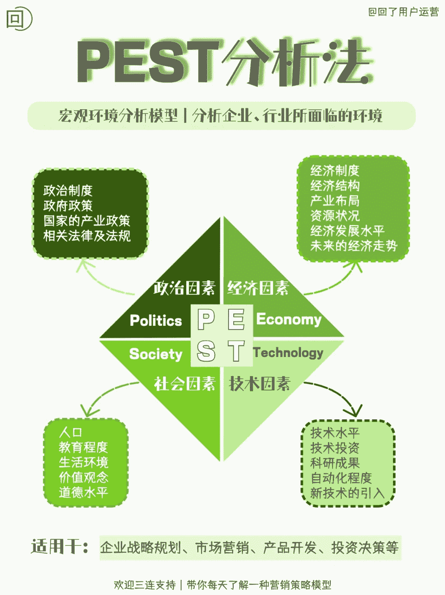

# PEST分析法

> 来源：[https://v11enp9ok1h.feishu.cn/docx/E2SSdfRwBoVnTuxFj4Jcz45PnLe](https://v11enp9ok1h.feishu.cn/docx/E2SSdfRwBoVnTuxFj4Jcz45PnLe)

## 概述

> **PEST分析法**是指对宏观环境的分析，**P是政治(politics)**，**E是经济(economy)**，**S是社会(society)**，T是技术(technology)，通过对这四个维度的分析，以采取正确决策。PEST分析法广泛应用于战略规划、投资决策、市场研究、风险评估等诸多场景。

## **PEST分析战略规划五大步骤**

####  🔹1**.列出关键宏观因素**

> 使用头脑风暴法、因果分析法、集体讨论法或关键事件法等方法，列出在环境变化分析过 程中确定的关键宏观因素。

####  🔹2**.确定权重**

> 根据各个因素对于企业的具体影响来确定权重，可以使用经验判断法、参照法、三维确定 法或价值因子分析法等方法来赋子名个因素权重，

#### **🔹3****.评分关键因素**

> 按照企业现行的战略对各个关键因素进行评分。确定企业战略模型，如生产制造战略、财 务投资战略、人力资源战略、市场营销战略、产品研发战略等。评分时应注意清楚了解目 前的战略、小组评估、过程公开和集体决策。

#### 🔹4**.计算加权分数**

> 用每个关键因素的权重乘以它的评分，得出每个因素的加权分数。在计算过程中，应注意 统计过程监督、数据纠偏和数据分析。

#### 🔹 5**.得出总加权分数**

> 将所有因素的加权分数相加，得到企业所处宏观环境的总加权分数。

> 在具体应用中，还需要注意以下几点

+   分析时要保持客观和全面，避免个人偏见和主观臆断；

+   要结合企业的实际情况和行业特点，灵活应用PEST分析法；

+   分析结果要具体、明确，能够为企业的战略规划和决策提供有力支持。

## PEST分析法的优缺点

#### 优点

PEST分析法作为一种常用的环境分析工具，具有以下几个优点：

1.  全面性：PEST分析法能够全面地考察宏观环境对组织或行业的影响。通过分析政治、经济、社会和技术四个方面的因素，可以获得全面的环境信息，帮助组织或行业了解外部环境的变化趋势和潜在机会与威胁。

1.  系统性：PEST分析法采用系统性的思维方式，将环境因素进行分类和整合，从而形成一个完整的环境分析框架。这种系统性的分析方法有助于组织或行业深入理解各个环境因素之间的相互关系和相互影响，从而更好地把握环境变化的整体趋势。

1.  灵活性：PEST分析法可以根据具体情况进行灵活应用。分析的深度和广度可以根据需要进行调整，可以选择性地关注某些特定的环境因素，也可以综合考虑多个环境因素之间的综合影响。这种灵活性使得PEST分析法适用于不同的行业和组织，可以根据实际需要进行定制化的分析。

1.  预警功能：PEST分析法可以帮助组织或行业及时发现和预测环境变化的趋势，从而及时调整战略和决策。通过对政治、经济、社会和技术等因素的分析，可以提前预判可能出现的机会和威胁，为组织或行业的发展提供有力的参考依据。

#### 缺点

PEST分析法虽然在分析外部环境的因素时非常有用，但也存在一些缺点。下面是PEST分析法的几个主要缺点：

1.  过于简化：PEST分析法将外部环境因素分为四个主要类别，即政治、经济、社会和技术。这种简化可能导致忽视了其他重要的因素，如法律、环境和文化等。因此，PEST分析法可能无法提供全面和准确的外部环境分析。

1.  缺乏深度和细节：PEST分析法主要关注宏观因素，而忽视了微观因素。它提供了一个整体的外部环境概览，但缺乏对每个因素的详细分析。这可能使得决策者无法获得足够的信息来制定具体的战略。

1.  变化性：外部环境因素是不断变化的，包括政治、经济、社会和技术因素。PEST分析法只提供了一个静态的分析框架，无法捕捉到这些因素的变化趋势和影响。因此，PEST分析法的结果可能很快过时，需要经常更新。

1.  缺乏定量分析：PEST分析法主要是一种定性分析方法，它提供了对外部环境因素的描述和评估，但没有提供定量数据。这使得难以进行具体的比较和量化分析，限制了其在决策过程中的应用。

##

## PEST分析法的实际案例分析

在这个案例中，我们将使用PEST分析法来分析某公司在进入新市场时面临的外部环境因素。关键词是：市场扩张、政治因素、经济因素、社会因素、技术因素。

1.  政治因素：政治稳定和政府政策对于公司进入新市场至关重要。在该案例中，公司计划进入一个政治稳定的国家，该国家对外国投资持开放态度，并且有一系列鼓励外商投资的政府政策。

1.  经济因素：经济状况对于公司的市场扩张计划至关重要。在该案例中，目标市场的经济增长稳定且持续，消费者购买力较高，有利于公司的产品销售和市场份额增加。

1.  社会因素：社会因素对于公司进入新市场的成功与否也有很大影响。在该案例中，目标市场的人口结构适合公司的产品，且消费者对公司产品有较高的认知度和接受度。

1.  技术因素：技术发展对于公司进入新市场也是一个重要的因素。在该案例中，目标市场的技术发展水平较高，消费者对于科技产品有较高的需求，这为公司的产品提供了良好的市场机会。

通过对这些因素进行PEST分析，公司可以更好地了解目标市场的外部环境，为市场扩张计划制定合适的策略和决策提供参考。