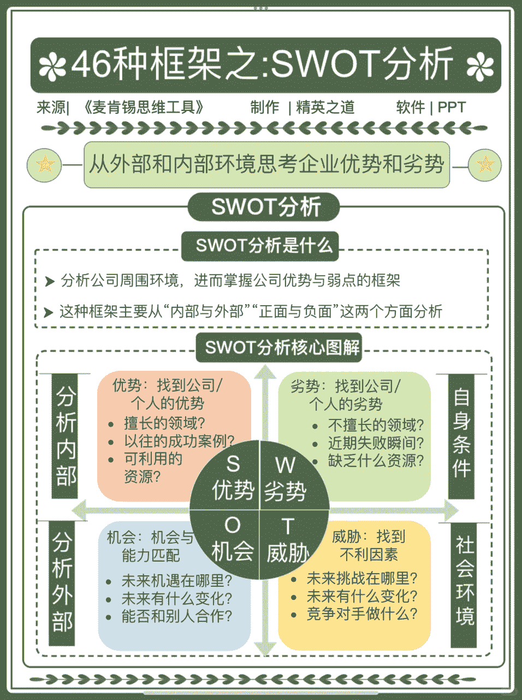
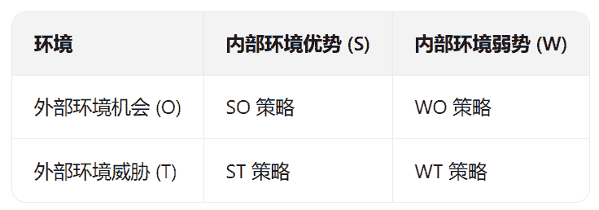
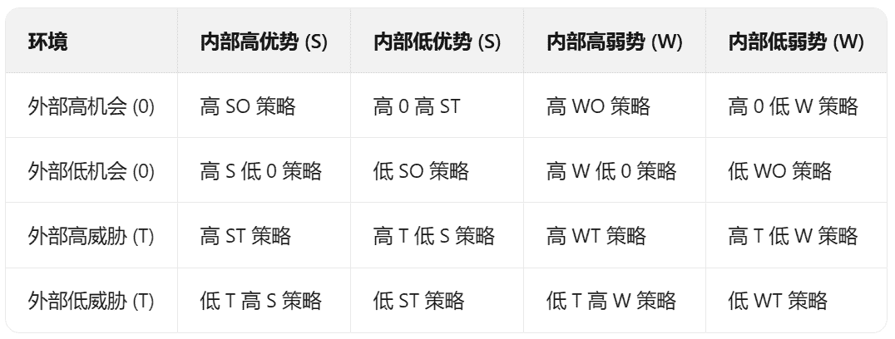
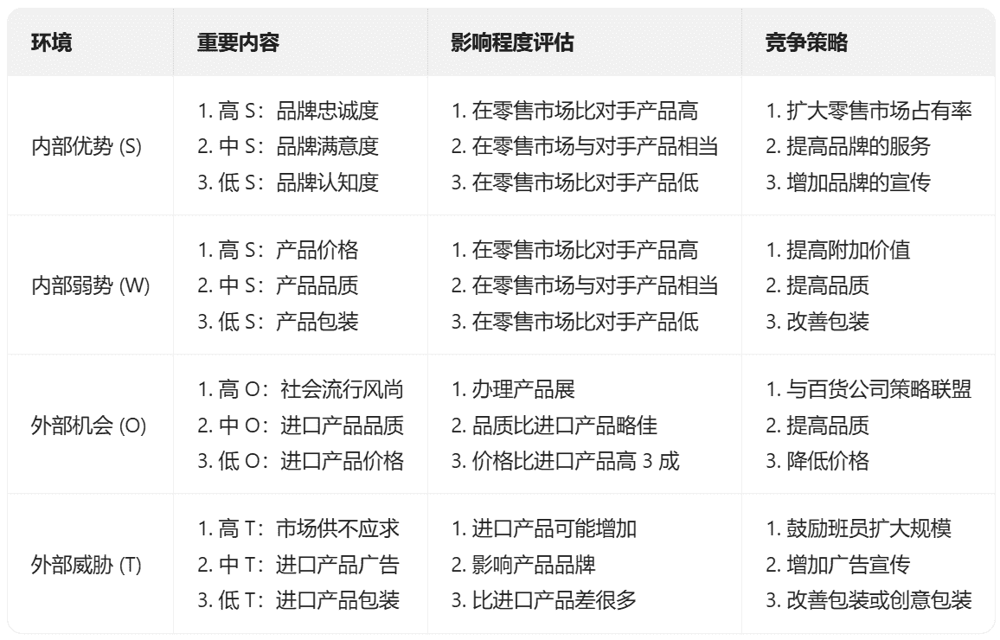

# SWOT分析法

> 来源：[https://v11enp9ok1h.feishu.cn/docx/DMhHdzPUMoDsSxxaj3rcEL1snIh](https://v11enp9ok1h.feishu.cn/docx/DMhHdzPUMoDsSxxaj3rcEL1snIh)

## 一、什么是SWOT分析

**优势（S）：**企业的核心竞争力，例如技术专利、成本优势、品牌口碑等。

**劣势（W）：**内部存在的短板，如资金不足、团队经验欠缺等。

**机会（O）：**外部环境中的有利因素，如政策支持、市场需求增长等。

**威胁（T）：**外部潜在风险，如竞争加剧、技术替代等。

## 二、SWOT矩阵类型

+   **单层次SWOT矩阵分析法**

> 单层次 SWOT 矩阵分析法是指一个简单的问题，用一种简单的想法来加以解决。亦即是针对某项特定问题，使用比对法，加以简单的诊断问题核心所在。

+   **双层次SWOT矩阵分析法**

> 多层次 SWOT 矩阵分析法使用于产业环境面的竞争分析，属于多种构面关系的评估方式，是 对某项特定产品作定位时，会同时进行差异化、顾客满意度、市场占有率等相关事项进行多类性 的竞争分析。

+   **复合SWOT矩阵分析法**

> 复合层次 SWOT 矩阵分析法类似于多层次 SWOT 矩阵分析法，但除评估项目外，并纳进问题内 容的要素、影响程度的评估以及拟定竞争策略的可行性方案，直接并迅速对竞争者进行竞争。如 产品对竞争对手产品进行市场竞争，其 SWOT 矩阵评估如表所示。

