# 基于COW框架的ChatBot实现步骤

> 来源：[https://v11enp9ok1h.feishu.cn/docx/KmhhdUXjKo3v0RxXP5lcDdFZnaf](https://v11enp9ok1h.feishu.cn/docx/KmhhdUXjKo3v0RxXP5lcDdFZnaf)

> COW是基于大模型搭建的Chat机器人框架，将多模型塞进自己的🛰️里实现方案。

> **本文带你实现：**

> 1、打造属于自己的ChatBot（文本对话、文件总结、链接访问、联网搜索、图片识别、AI画图等等）

> 2、常用开源插件的安装应用

>

> **正式开始前你需要知道：**

> **ChatBo**t相较于在各**大模型网页端使**用区别：本实现思路需要接入大模型API的方式实现（API单独付费）

>

> **风险与注意事项**：

> 1、🛰️端因为是**非常规**使用，会有封号危险，**不建议**主力🛰️号接入。

> 2、本文只探讨操作操作步骤，请依法合规使用

> - 大模型生成的内容注意甄别，确保所有操作均符合相关法律法规的要求。

> - **禁止将此操作用于任何非法目的。**

> - 处理敏感或个人隐私数据时注意脱敏，以防任何可能的滥用或泄露。

**多平台接入：**🛰️、企业🛰️、👸号、飞书、钉钉等。

**多模型选择：**GPT3.5/GPT4.0/Claude/文心一言/讯飞星火/通义千问/Gemini/GLM-4/LinkAI等等

**多消息类型支持：**能处理文本、语音和图片，以及基于自有知识库进行定制的企业智能客服功能。

**多部署方法**：本地运行、服务器运行、Docker的方式

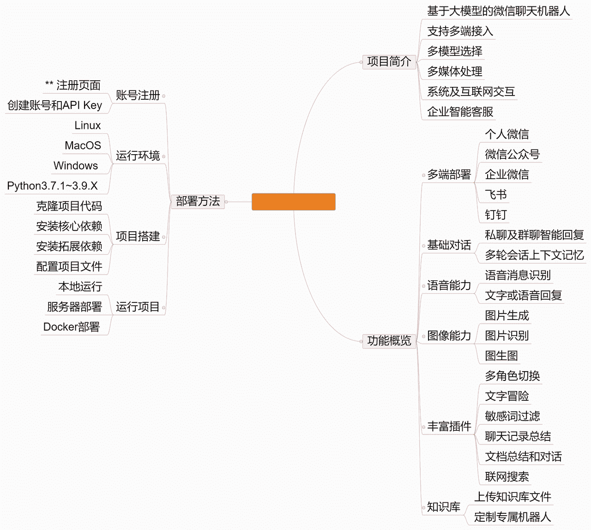

# 一、准备工作

## 1、服务器资源

有条件的，准备一台云服务器，没有条件的，也可以用自己的电脑实验（不推荐，没法保证稳定的网络条件和一直开机）。

注：云服务器**申请和环境**参考 [GPT平替方法](https://v11enp9ok1h.feishu.cn/wiki/BrcSwceI9iS0lekk2tdcvPSRnCb?from=from_copylink)

## 2、**API申请**

> 已提供接口的常见模型：GPT-3.5, GPT-4, 文心一言, 讯飞星火，通义千问，mimimax，moonshot（大模型支持情况请查看主项目更新部分），按自己的需求去对应官网申请API，并且各平台API调用计费是计算token费率定价不一样，收费标准大家自行留意，不做统一赘述。

### 2.1 ChatGPT

GPT的API调用稍麻烦，需要绑定支付方式

### 2.2 文心一言

前往百度[**千帆大模型官网**](https://console.bce.baidu.com/qianfan/)[提交申请](https://cloud.baidu.com/doc/WENXINWORKSHOP/index.html)开通API ，详细说明参考官方文档

### 2.3 讯飞星火

去[**讯飞开放平台申请**](https://xinghuo.xfyun.cn/)**，操作办法大同小异。**


### 2.4 通义千问

前往阿里云【[模型服务灵积](https://dashscope.console.aliyun.com/overview)】页面查看详情

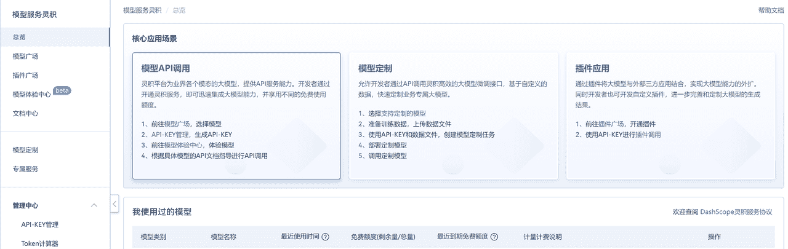

### **2.5 ****LinkAI平台推荐**

可**能很**[**多同学看到上**](https://link-ai.tech/home?share=tGVzLi)**面申请**繁琐的步骤，特别是对OpenAI的key申请，直接原地劝退，那推荐一个我一直使用国内目前做的比较好的一体化平台【 LinkAI 】 他们将目前市场主流的大模型集成在一起的企业级平台，使用他们的好处是：

> 1、不需要特殊的网络环境，有网就能直接使用，更方便

> 2、不用自己再繁琐注册申请各种大模型的API，省心调用

> 3、不用绑定各种支付方式，不被OpenAI的支付门槛劝退

> 4、平台提供丰富的使用场景，完全满足个人/企业级使用

> 5、资费与各大官方一致，甚至还便宜。

> 6、因为他们是企业级的Key，API响应更快，使用体验更优

> 7、**0代码搭建自己的APP，在应用市场发布赚外快，同时**你也可以将别人的App接入到自己的平台中


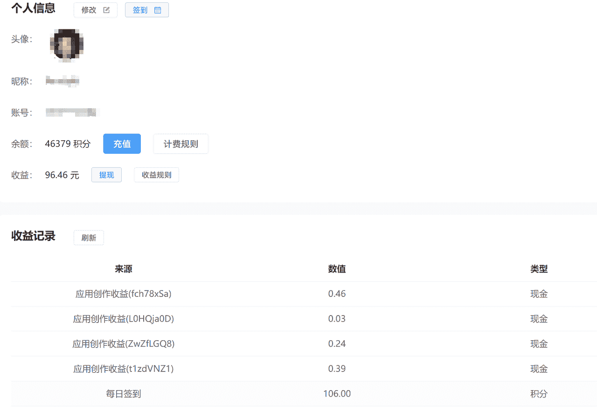

## 3、宝塔环境安装（熟悉Linux操作的小伙伴可跳过此步骤）

宝塔环境对Linux新手比较友好，如果你对Linux操作不熟练，建议安装宝塔，方便修改参数。（如果你的服务器是Windows环境，自行配置好需要需要的环境条件。）

**宝塔安装步骤：**

**Centos安装脚本**

```
yum install -y wget &amp;&amp; wget -O install.sh https://download.bt.cn/install/install_6.0.sh &amp;&amp; sh install.sh ed8484bec
```

Ubuntu/Deepin安装脚本

```
wget -O install.sh https://download.bt.cn/install/install-ubuntu_6.0.sh &amp;&amp; sudo bash install.sh ed8484bec
```

**Debian安装脚本**

```
wget -O install.sh https://download.bt.cn/install/install-ubuntu_6.0.sh &amp;&amp; bash install.sh ed8484bec
```

粘贴至终端执行，执行完成后会看到访问地址、宝塔登录账号/密码，表示安装成功。

**安装**完成后会生成一个随机的端口访问，去云服务器官方的安全选项，放开对应端口，浏览器输入 http://你的ip:端口号 即可访问宝塔管理端。

# 二、开源项目详细介绍

打造属于自己的专属机器人，用到的是GitHub的开源项目《chatgpt-on-wechat》

## 1、项目简介

chatgpt-on-wechat (cow) 项目是使用 ChatGPT 搭建的智能聊天机器人，在GPT3.5/4.0 API 及 itchat框架的基础上实现，支持个人🛰️、👸号、企业🛰️部署，能生成文本、语音和图片，访问操作系统和互联网。

## 2、最新版本支持的功能

最新版本支持的功能如下：

+    **多端部署：** 可接入 个人🛰️、🛰️👸号、企业🛰️应用

+    **基础对话：** 私聊及群聊的消息智能回复，支持多轮会话上下文记忆，支持 GPT-3, GPT-3.5, GPT-4, 文心一言模型

+    **语音识别：** 可识别语音消息，通过文字或语音回复，支持 azure, baidu, google, openai 等多种语音模型

+    **图片生成：** 支持图片生成 和 图生图（如照片修复），可选择 Dell-E, stable diffusion, replicate, Midjourney 模型

+    **丰富插件：** 支持个性化插件扩展，已实现多角色切换、文字冒险、敏感词过滤、聊天记录总结等插件

+    **Tool工具：** 与操作系统和互联网交互，支持最新信息搜索、数学计算、天气和资讯查询、网页总结，基于 chatgpt-tool-hub 实现

+    **知识库：** 通过上传知识库文件自定义专属机器人，可作为数字分身、领域知识库、智能客服使用，基于 LinkAI 实现

**项目地址 (Github)：** [https://github.com/zhayuj](https://github.com/zhayujie/chatgpt-on-wechat)ie/chatgpt-on-wechat

**项目地址 (Gitee)：** [https://gitee.com/zhayuj](https://gitee.com/zhayujie/chatgpt-on-wechat)ie/chatgpt-on-wechat

# 三、各平台部署方法汇总

## 支持的运行环境

支持 Linux、MacOS、Windows 系统（可在Linux服务器上长期运行)，同时需安装 Python。

> 建议Python版本在 3.7.1及以上，3.10及以上版本在 MacOS 可用。

> **注意：**Docker 或 Railway 部署无需安装python环境和下载源码，可直接查看Docker部署部分。

## 部署方式选择

> **服务器部署：**也就是拷贝一份仓库代码到服务器，提供了更高的定制性和控制力，但管理相对繁琐；

>

> **Docker部署：**容器封装所需条件，开箱即用，简化了部署流程和依赖管理，提高了可移植性和资源隔离，但需要Docker知识和可能增加资源开销。

| **特性** | **服务器部署** | **Docker部署** |
| --- | --- | --- |
| **部署复杂性** | 相对复杂，需要手动下载源码、安装依赖、配置环境。 | 较为简单，通过获取docker-compose.yml配置并启动容器即可。 |
| **依赖管理** | 手动管理，每次部署都需要确保环境依赖正确无误。 | Docker容器将依赖封装在内，避免了依赖冲突和环境不一致问题。 |
| **可移植性** | 依赖于宿主机的环境，不同环境间移植可能存在困难。 | 高，容器化封装使得应用在任何安装了Docker的机器上都能以相同方式运行。 |
| **资源隔离** | 依赖操作系统的资源隔离，可能受到其他进程的影响。 | 较好，Docker提供了较为严格的资源隔离，保证应用稳定运行。 |
| **安全性** | 需要手动设置和维护安全措施。 | 通过Docker自带的隔离机制，提供了一定级别的安全保障。 |
| **多账号支持** | 通过复制项目并分别启动实现，手动管理较为繁琐。 | 通过配置不同的服务实例并在docker-compose.yml中设置，可以更加方便地管理。 |
| **特殊操作支持** | 支持通过特定指令（如#reset）进行操作，需直接与后台程序交互。 | 同样支持，但可能需要通过Docker命令进行日志查看或其他容器内操作。 |
| **日志管理** | 通过tail -f nohup.out等命令查看日志，手动管理。 | 通过docker logs命令统一管理和查看容器日志，更加集中和简化。 |

选择哪种部署方式根据自己的需求和能力来。

## 3.1 服务器部署

### 3.1.1 克隆项目代码

```
cd /root
git clone https://github.com/zhayujie/chatgpt-on-wechat
cd chatgpt-on-wechat/
```

如果提示git命名不可用，执行

```
sudo apt-get update
sudo apt-get install git
```

### 3.1.2 安装依赖环境

```
pip install -r requirements.txt
pip install -r requirements-optional.txt
```

### 3.1.3 生成配置文件

```
  cp config-template.json config.json
```

#### 3.1.3.1 基础配置文件说明对照表

```
# config.json文件内容示例
{
  &quot;open_ai_api_key&quot;: &quot;YOUR API KEY&quot;,                          # 填入上面创建的 OpenAI API KEY
  &quot;model&quot;: &quot;gpt-3.5-turbo&quot;,                                   # 模型名称, 支持 gpt-3.5-turbo, gpt-3.5-turbo-16k, gpt-4, wenxin, xunfei
  &quot;proxy&quot;: &quot;&quot;,                                                # 代理客户端的ip和端口，国内环境开启代理的需要填写该项，如 &quot;127.0.0.1:7890&quot;
  &quot;single_chat_prefix&quot;: [&quot;bot&quot;, &quot;@bot&quot;],                      # 私聊时文本需要包含该前缀才能触发机器人回复
  &quot;single_chat_reply_prefix&quot;: &quot;[bot] &quot;,                       # 私聊时自动回复的前缀，用于区分真人
  &quot;group_chat_prefix&quot;: [&quot;@bot&quot;],                              # 群聊时包含该前缀则会触发机器人回复
  &quot;group_name_white_list&quot;: [&quot;ChatGPT测试群&quot;, &quot;ChatGPT测试群2&quot;], # 开启自动回复的群名称列表
  &quot;group_chat_in_one_session&quot;: [&quot;ChatGPT测试群&quot;],              # 支持会话上下文共享的群名称  
  &quot;image_create_prefix&quot;: [&quot;画&quot;, &quot;看&quot;, &quot;找&quot;],                   # 开启图片回复的前缀
  &quot;conversation_max_tokens&quot;: 1000,                            # 支持上下文记忆的最多字符数
  &quot;speech_recognition&quot;: false,                                # 是否开启语音识别
  &quot;group_speech_recognition&quot;: false,                          # 是否开启群组语音识别
  &quot;use_azure_chatgpt&quot;: false,                                 # 是否使用Azure ChatGPT service代替openai ChatGPT service. 当设置为true时需要设置 open_ai_api_base，如 https://xxx.openai.azure.com/
  &quot;azure_deployment_id&quot;: &quot;&quot;,                                  # 采用Azure ChatGPT时，模型部署名称
  &quot;azure_api_version&quot;: &quot;&quot;,                                    # 采用Azure ChatGPT时，API版本
  &quot;character_desc&quot;: &quot;你是ChatGPT, 一个由OpenAI训练的大型语言模型, 你旨在回答并解决人们的任何问题，并且可以使用多种语言与人交流。&quot;,  # 人格描述
  # 订阅消息，公众号和企业微信channel中请填写，当被订阅时会自动回复，可使用特殊占位符。目前支持的占位符有{trigger_prefix}，在程序中它会自动替换成bot的触发词。
  &quot;subscribe_msg&quot;: &quot;感谢您的关注！\n这里是ChatGPT，可以自由对话。\n支持语音对话。\n支持图片输出，画字开头的消息将按要求创作图片。\n支持角色扮演和文字冒险等丰富插件。\n输入{trigger_prefix}#help 查看详细指令。&quot;,
  &quot;use_linkai&quot;: false,                                        # 是否使用LinkAI接口，默认关闭，开启后可国内访问，使用知识库和MJ
  &quot;linkai_api_key&quot;: &quot;&quot;,                                       # LinkAI Api Key
  &quot;linkai_app_code&quot;: &quot;&quot;                                       # LinkAI 应用code
}
```

基础配置说明

```
**1.个人聊天****
个人聊天中**，需要以 &quot;bot&quot;或&quot;@bot&quot; 为开头的内容触发机器人，对应配置项 single_chat_pre[fix (如](https://github.com/evolay)**果不需要以前****缀触发可以填**写[ &quot;single_ch](https://platform.openai.com/docs/api-reference/chat)at_prefix&quot;: [&quot;&quot;])
机器人回复的[内容会以](https://github.com/zhayujie/chatgpt-on-wechat/issues/351) &quot;[bot] &quot; 作为前缀， 以区分真人，对应的配[置项为 ](https://beta.openai.com/docs/api-reference/completions)sin[gle_](https://beta.openai.com/docs/api-reference/completions)chat_[reply_pre](https://github.com/zhayujie/chatgpt-on-wechat/blob/master/config.py)fix (如果不需要前缀可以填写 &quot;single_chat_reply_[prefi](https://github.com/zhayujie/chatgpt-on-wechat/issues/43)**x&quot;: &quot;&quot;)

2.群组聊天**
[群组](https://link-ai.tech/platform/link-app/wechat)聊天中[**，群名称需配置在 **](https://github.com/zhayujie/chatgpt-on-wechat/blob/master/config.py)**grou**p_name_white_list  中才能开启群聊自动回复。如果想对所有群聊生效，可以直接填写 &quot;group_name_white_list&quot;: [&quot;ALL_GROUP&quot;]
默认只要被人 @ 就会触发机器人自动回复；另外群聊天中只要检测到以 &quot;@bot&quot; 开头的内容，同样会自动回复（方便自己触发），这对应配置项 group_chat_prefix
可选配置: group_name_keyword_white_list配置项支持模糊匹配群名称，group_chat_keyword配置项则支持模糊匹配群消息内容，用法与上述两个配置项相同。（Contributed by evolay)
group_chat_in_one_session：使群聊共享一个会话上下文，配置 [&quot;ALL_GROUP&quot;] 则作用于所有群聊

3.语音识别
添加 &quot;speech_recognition&quot;: true 将开启语音识别，默认使用openai的whisper模型识别为文字，同时以文字回复，该参数仅支持私聊 (注意由于语音消息无法匹配前缀，一旦开启将对所有语音自动回复，支持语音触发画图)；
添加 &quot;group_speech_recognition&quot;: true 将开启群组语音识别，默认使用openai的whisper模型识别为文字，同时以文字回复，参数仅支持群聊 (会匹配group_chat_prefix和group_chat_keyword, 支持语音触发画图)；
添加 &quot;voice_reply_voice&quot;: true 将开启语音回复语音（同时作用于私聊和群聊），但是需要配置对应语音合成平台的key，由于itchat协议的限制，只能发送语音mp3文件，若使用wechaty则回复的是微信语音。

4.其他配置
model: 模型名称，目前支持 gpt-3.5-turbo, text-davinci-003, gpt-4, gpt-4-32k, wenxin , claude , xunfei
temperature,frequency_penalty,presence_penalty: Chat API接口参数，详情参考OpenAI官方文档。
proxy：由于目前 openai 接口国内无法访问，需配置代理客户端的地址，详情参考 #351
对于图像生成，在满足个人或群组触发条件外，还需要额外的关键词前缀来触发，对应配置 image_create_prefix 
关于OpenAI对话及图片接口的参数配置（内容自由度、回复字数限制、图片大小等），可以参考 对话接口 和 图像接口 文档，在config.py中检查哪些参数在本项目中是可配置的。
conversation_max_tokens：表示能够记忆的上下文最大字数（一问一答为一组对话，如果累积的对话字数超出限制，就会优先移除最早的一组对话）
rate_limit_chatgpt，rate_limit_dalle：每分钟最高问答速率、画图速率，超速后排队按序处理。
clear_memory_commands: 对话内指令，主动清空前文记忆，字符串数组可自定义指令别名。
hot_reload: 程序退出后，暂存微信扫码状态，默认关闭。
character_desc 配置中保存着你对机器人说的一段话，他会记住这段话并作为他的设定，你可以为他定制任何人格 (关于会话上下文的更多内容参考该 issue)
subscribe_msg：订阅消息，公众号和企业微信channel中请填写，当被订阅时会自动回复， 可使用特殊占位符。目前支持的占位符有{trigger_prefix}，在程序中它会自动替换成bot的触发词。

5.LinkAI配置 (可选)
use_linkai: 是否使用LinkAI接口，开启后可国内访问，使用知识库和 Midjourney 绘画, 参考 文档
linkai_api_key: LinkAI Api Key，可在 控制台 创建
linkai_app_code: LinkAI 应用code，选填

本说明文档可能会未及时更新，当前所有可选的配置项均在该config.py中列出。
```

**建议所有人，详细阅读：项目主目录config.py文件**中的说明，你需要调整的参数都在那里有说明

```
# **config.json文件参数项及说明，**按需选择使用，不是所有项都要填！！！！！
{
    # openai api配置
    &quot;open_ai_api_key&quot;: &quot;&quot;,  # openai api key
    # openai apibase，当use_azure_chatgpt为true时，需要设置对应的api base
    &quot;open_ai_api_base&quot;: &quot;https://api.openai.com/v1&quot;,
    &quot;proxy&quot;: &quot;&quot;,  # openai使用的代理
    # chatgpt模型， 当use_azure_chatgpt为true时，其名称为Azure上model deployment名称
    &quot;model&quot;: &quot;gpt-3.5-turbo&quot;,  # 还支持 gpt-4, gpt-4-turbo, wenxin, xunfei, qwen
    &quot;use_azure_chatgpt&quot;: False,  # 是否使用azure的chatgpt
    &quot;azure_deployment_id&quot;: &quot;&quot;,  # azure 模型部署名称
    &quot;azure_api_version&quot;: &quot;&quot;,  # azure api版本
    # Bot触发配置
    &quot;single_chat_prefix&quot;: [&quot;bot&quot;, &quot;@bot&quot;],  # 私聊时文本需要包含该前缀才能触发机器人回复
    &quot;single_chat_reply_prefix&quot;: &quot;[bot] &quot;,  # 私聊时自动回复的前缀，用于区分真人
    &quot;single_chat_reply_suffix&quot;: &quot;&quot;,  # 私聊时自动回复的后缀，\n 可以换行
    &quot;group_chat_prefix&quot;: [&quot;@bot&quot;],  # 群聊时包含该前缀则会触发机器人回复
    &quot;group_chat_reply_prefix&quot;: &quot;&quot;,  # 群聊时自动回复的前缀
    &quot;group_chat_reply_suffix&quot;: &quot;&quot;,  # 群聊时自动回复的后缀，\n 可以换行
    &quot;group_chat_keyword&quot;: [],  # 群聊时包含该关键词则会触发机器人回复
    &quot;group_at_off&quot;: False,  # 是否关闭群聊时@bot的触发
    &quot;group_name_white_list&quot;: [&quot;ChatGPT测试群&quot;, &quot;ChatGPT测试群2&quot;],  # 开启自动回复的群名称列表
    &quot;group_name_keyword_white_list&quot;: [],  # 开启自动回复的群名称关键词列表
    &quot;group_chat_in_one_session&quot;: [&quot;ChatGPT测试群&quot;],  # 支持会话上下文共享的群名称
    &quot;nick_name_black_list&quot;: [],  # 用户昵称黑名单
    &quot;group_welcome_msg&quot;: &quot;&quot;,  # 配置新人进群固定欢迎语，不配置则使用随机风格欢迎 
    &quot;trigger_by_self&quot;: False,  # 是否允许机器人触发
    &quot;text_to_image&quot;: &quot;dall-e-2&quot;,  # 图片生成模型，可选 dall-e-2, dall-e-3
    &quot;image_proxy&quot;: True,  # 是否需要图片代理，国内访问LinkAI时需要
    &quot;image_create_prefix&quot;: [&quot;画&quot;, &quot;看&quot;, &quot;找&quot;],  # 开启图片回复的前缀
    &quot;concurrency_in_session&quot;: 1,  # 同一会话最多有多少条消息在处理中，大于1可能乱序
    &quot;image_create_size&quot;: &quot;256x256&quot;,  # 图片大小,可选有 256x256, 512x512, 1024x1024 (dall-e-3默认为1024x1024)
    &quot;group_chat_exit_group&quot;: False, 
    # chatgpt会话参数
    &quot;expires_in_seconds&quot;: 3600,  # 无操作会话的过期时间
    # 人格描述
    &quot;character_desc&quot;: &quot;你是ChatGPT, 一个由OpenAI训练的大型语言模型, 你旨在回答并解决人们的任何问题，并且可以使用多种语言与人交流。&quot;,
    &quot;conversation_max_tokens&quot;: 1000,  # 支持上下文记忆的最多字符数
    # chatgpt限流配置
    &quot;rate_limit_chatgpt&quot;: 20,  # chatgpt的调用频率限制
    &quot;rate_limit_dalle&quot;: 50,  # openai dalle的调用频率限制
    # chatgpt api参数 参考https://platform.openai.com/docs/api-reference/chat/create
    &quot;temperature&quot;: 0.9,
    &quot;top_p&quot;: 1,
    &quot;frequency_penalty&quot;: 0,
    &quot;presence_penalty&quot;: 0,
    &quot;request_timeout&quot;: 180,  # chatgpt请求超时时间，openai接口默认设置为600，对于难问题一般需要较长时间
    &quot;timeout&quot;: 120,  # chatgpt重试超时时间，在这个时间内，将会自动重试
    # Baidu 文心一言参数
    &quot;baidu_wenxin_model&quot;: &quot;eb-instant&quot;,  # 默认使用ERNIE-Bot-turbo模型
    &quot;baidu_wenxin_api_key&quot;: &quot;&quot;,  # Baidu api key
    &quot;baidu_wenxin_secret_key&quot;: &quot;&quot;,  # Baidu secret key
    # 讯飞星火API
    &quot;xunfei_app_id&quot;: &quot;&quot;,  # 讯飞应用ID
    &quot;xunfei_api_key&quot;: &quot;&quot;,  # 讯飞 API key
    &quot;xunfei_api_secret&quot;: &quot;&quot;,  # 讯飞 API secret
    # claude 配置
    &quot;claude_api_cookie&quot;: &quot;&quot;,
    &quot;claude_uuid&quot;: &quot;&quot;,
    # 通义千问API, 获取方式查看文档 https://help.aliyun.com/document_detail/2587494.html
    &quot;qwen_access_key_id&quot;: &quot;&quot;,
    &quot;qwen_access_key_secret&quot;: &quot;&quot;,
    &quot;qwen_agent_key&quot;: &quot;&quot;,
    &quot;qwen_app_id&quot;: &quot;&quot;,
    &quot;qwen_node_id&quot;: &quot;&quot;,  # 流程编排模型用到的id，如果没有用到qwen_node_id，请务必保持为空字符串
    # Google Gemini Api Key
    &quot;gemini_api_key&quot;: &quot;&quot;,
    # wework的通用配置
    &quot;wework_smart&quot;: True,  # 配置wework是否使用已登录的企业微信，False为多开
    # 语音设置
    &quot;speech_recognition&quot;: True,  # 是否开启语音识别
    &quot;group_speech_recognition&quot;: False,  # 是否开启群组语音识别
    &quot;voice_reply_voice&quot;: False,  # 是否使用语音回复语音，需要设置对应语音合成引擎的api key
    &quot;always_reply_voice&quot;: False,  # 是否一直使用语音回复
    &quot;voice_to_text&quot;: &quot;openai&quot;,  # 语音识别引擎，支持openai,baidu,google,azure
    &quot;text_to_voice&quot;: &quot;openai&quot;,  # 语音合成引擎，支持openai,baidu,google,pytts(offline),azure,elevenlabs
    &quot;text_to_voice_model&quot;: &quot;tts-1&quot;,
    &quot;tts_voice_id&quot;: &quot;alloy&quot;,
    # baidu 语音api配置， 使用百度语音识别和语音合成时需要
    &quot;baidu_app_id&quot;: &quot;&quot;,
    &quot;baidu_api_key&quot;: &quot;&quot;,
    &quot;baidu_secret_key&quot;: &quot;&quot;,
    # 1536普通话(支持简单的英文识别) 1737英语 1637粤语 1837四川话 1936普通话远场
    &quot;baidu_dev_pid&quot;: &quot;1536&quot;,
    # azure 语音api配置， 使用azure语音识别和语音合成时需要
    &quot;azure_voice_api_key&quot;: &quot;&quot;,
    &quot;azure_voice_region&quot;: &quot;japaneast&quot;,
    # elevenlabs 语音api配置
    &quot;xi_api_key&quot;: &quot;&quot;,    #获取ap的方法可以参考https://docs.elevenlabs.io/api-reference/quick-start/authentication
    &quot;xi_voice_id&quot;: &quot;&quot;,   #ElevenLabs提供了9种英式、美式等英语发音id，分别是“Adam/Antoni/Arnold/Bella/Domi/Elli/Josh/Rachel/Sam”
    # 服务时间限制，目前支持itchat
    &quot;chat_time_module&quot;: False,  # 是否开启服务时间限制
    &quot;chat_start_time&quot;: &quot;00:00&quot;,  # 服务开始时间
    &quot;chat_stop_time&quot;: &quot;24:00&quot;,  # 服务结束时间
    # 翻译api
    &quot;translate&quot;: &quot;baidu&quot;,  # 翻译api，支持baidu
    # baidu翻译api的配置
    &quot;baidu_translate_app_id&quot;: &quot;&quot;,  # 百度翻译api的appid
    &quot;baidu_translate_app_key&quot;: &quot;&quot;,  # 百度翻译api的秘钥
    # itchat的配置
    &quot;hot_reload&quot;: False,  # 是否开启热重载
    # wechaty的配置
    &quot;wechaty_puppet_service_token&quot;: &quot;&quot;,  # wechaty的token
    # wechatmp的配置
    &quot;wechatmp_token&quot;: &quot;&quot;,  # 微信公众平台的Token
    &quot;wechatmp_port&quot;: 8080,  # 微信公众平台的端口,需要端口转发到80或443
    &quot;wechatmp_app_id&quot;: &quot;&quot;,  # 微信公众平台的appID
    &quot;wechatmp_app_secret&quot;: &quot;&quot;,  # 微信公众平台的appsecret
    &quot;wechatmp_aes_key&quot;: &quot;&quot;,  # 微信公众平台的EncodingAESKey，加密模式需要
    # wechatcom的通用配置
    &quot;wechatcom_corp_id&quot;: &quot;&quot;,  # 企业微信公司的corpID
    # wechatcomapp的配置
    &quot;wechatcomapp_token&quot;: &quot;&quot;,  # 企业微信app的token
    &quot;wechatcomapp_port&quot;: 9898,  # 企业微信app的服务端口,不需要端口转发
    &quot;wechatcomapp_secret&quot;: &quot;&quot;,  # 企业微信app的secret
    &quot;wechatcomapp_agent_id&quot;: &quot;&quot;,  # 企业微信app的agent_id
    &quot;wechatcomapp_aes_key&quot;: &quot;&quot;,  # 企业微信app的aes_key

    # 飞书配置
    &quot;feishu_port&quot;: 80,  # 飞书bot监听端口
    &quot;feishu_app_id&quot;: &quot;&quot;,  # 飞书机器人应用APP Id
    &quot;feishu_app_secret&quot;: &quot;&quot;,  # 飞书机器人APP secret
    &quot;feishu_token&quot;: &quot;&quot;,  # 飞书 verification token
    &quot;feishu_bot_name&quot;: &quot;&quot;,  # 飞书机器人的名字
    
    # 钉钉配置
    &quot;dingtalk_client_id&quot;: &quot;&quot;,  # 钉钉机器人Client ID 
    &quot;dingtalk_client_secret&quot;: &quot;&quot;,  # 钉钉机器人Client Secret 
    
    # chatgpt指令自定义触发词
    &quot;clear_memory_commands&quot;: [&quot;#清除记忆&quot;],  # 重置会话指令，必须以#开头
    # channel配置
    &quot;channel_type&quot;: &quot;wx&quot;,  # 通道类型，支持：{wx,wxy,terminal,wechatmp,wechatmp_service,wechatcom_app}
    &quot;subscribe_msg&quot;: &quot;&quot;,  # 订阅消息, 支持: wechatmp, wechatmp_service, wechatcom_app
    &quot;debug&quot;: False,  # 是否开启debug模式，开启后会打印更多日志
    &quot;appdata_dir&quot;: &quot;&quot;,  # 数据目录
    # 插件配置
    &quot;plugin_trigger_prefix&quot;: &quot;$&quot;,  # 规范插件提供聊天相关指令的前缀，建议不要和管理员指令前缀&quot;#&quot;冲突
    # 是否使用全局插件配置
    &quot;use_global_plugin_config&quot;: False,
    &quot;max_media_send_count&quot;: 3,     # 单次最大发送媒体资源的个数
    &quot;media_send_interval&quot;: 1,  # 发送图片的事件间隔，单位秒
    # 智谱AI 平台配置
    &quot;zhipu_ai_api_key&quot;: &quot;&quot;,
    &quot;zhipu_ai_api_base&quot;: &quot;https://open.bigmodel.cn/api/paas/v4&quot;,
    # LinkAI平台配置
    &quot;use_linkai&quot;: False,
    &quot;linkai_api_key&quot;: &quot;&quot;,
    &quot;linkai_app_code&quot;: &quot;&quot;,
    &quot;linkai_api_base&quot;: &quot;https://api.link-ai.chat&quot;,  # linkAI服务地址，若国内无法访问或延迟较高可改为 https://api.link-ai.tech

}
```

#### 3.1.3.2 **我用的配置文件（🛰️的）示例**

```
{ 
  &quot;baidu_wenxin_model&quot;: &quot;ERNIE-Bot-4&quot;,
  &quot;baidu_wenxin_api_key&quot;:&quot;&quot;,
  &quot;baidu_wenxin_secret_key&quot;:&quot;&quot;,
  
  &quot;xunfei_app_id&quot;: &quot;&quot;,
  &quot;xunfei_api_key&quot;: &quot;&quot;,
  &quot;xunfei_api_secret&quot;: &quot;&quot;,

  &quot;open_ai_api_base&quot;:&quot;&quot;,
  &quot;open_ai_api_key&quot;: &quot;&quot;,
  &quot;model&quot;: &quot;gpt-4-1106-preview&quot;,
  &quot;text_to_image&quot;: &quot;dall-e-3&quot;,
  &quot;text_to_voice&quot;: &quot;openai&quot;,
  &quot;tts_voice_id&quot;: &quot;alloy&quot;,
  
  &quot;channel_type&quot;: &quot;wx&quot;,
  &quot;single_chat_prefix&quot;: [&quot;&quot;], 
  &quot;single_chat_reply_prefix&quot;: &quot;&quot;,  
  &quot;group_chat_prefix&quot;: [&quot;@bot&quot;], 
  &quot;group_name_white_list&quot;: [&quot;ALL_GROUP&quot;], 
  &quot;group_chat_in_one_session&quot;: [&quot;ALL_GROUP&quot;],
  &quot;group_at_off&quot;:false, 
  
  &quot;image_create_prefix&quot;: [&quot;画&quot;],
  &quot;image_create_size&quot;: &quot;512x1024&quot;,
 
  &quot;conversation_max_tokens&quot;: 16384, 
  &quot;speech_recognition&quot;: false, 
  &quot;group_speech_recognition&quot;: false, 
  &quot;use_azure_chatgpt&quot;: false, 
  
  &quot;temperature&quot;: 1,
  &quot;top_p&quot;: 1,
  &quot;frequency_penalty&quot;: 0,
  &quot;presence_penalty&quot;: 0,
  &quot;clear_memory_commands&quot;: [&quot;#清除记忆&quot;],
  &quot;debug&quot;: true,
 
  &quot;channel_type&quot;: &quot;&quot;,
  &quot;hot_reload&quot;: true,
  &quot;speech_recognition&quot;: true,
  &quot;group_speech_recognition&quot;: true,
  &quot;voice_reply_voice&quot;: true,
  &quot;always_reply_voice&quot;: false,
  &quot;voice_to_text&quot;: &quot;baidu&quot;,
  &quot;text_to_voice&quot;: &quot;openai&quot;, 
  &quot;baidu_app_id&quot;: &quot;&quot;,
  &quot;baidu_api_key&quot;: &quot;&quot;,
  &quot;baidu_secret_key&quot;: &quot;&quot;,
  &quot;baidu_dev_pid&quot;: &quot;&quot;,

  &quot;expires_in_seconds&quot;: 13600,
  &quot;character_desc&quot;: &quot;你作为智能助手，负责帮我处理各种事情。注意：不要胡编乱造，语言简洁严谨，输出格式友好便于阅读。&quot;,

  &quot;subscribe_msg&quot;: &quot;&quot;,
  
  &quot;use_linkai&quot;:false,
  &quot;linkai_api_key&quot;: &quot;&quot;,
  &quot;linkai_app_code&quot;: &quot;&quot;        
}
```

**其中：**"character_desc"参数后面的内容，其实就是prompt设定，大家根据自己的使用需求处理

#### 3.1.3.3 部分自带插件配置（必选项）

此步骤做一些配置，方便后面插件安装环节。(同样，如果终端操作有难度的同学可以在宝塔中编辑)

```
管理员密码设置
cd plugins/godcmd
cp config.json.template config.json
vim config.json
英文输入法状态下，输入i启动编辑，编辑以下内容：
比如示例，管理密码是“123456”，管理员是我的微信昵称“熊少”
{
  &quot;password&quot;: &quot;123456&quot;,
  &quot;admin_users&quot;: [&quot;熊少&quot;]
}
编辑完成后，同样是在英文输入法状态下，按“ESC”
输入 &#x27;:wq&#x27;
按回车保存，返回项目主目录：
cd ../..

你的项目目录/plugins/plugins.json里，将“Godcmd”参数调整为：

 &quot;Godcmd&quot;: {
            &quot;enabled&quot;: true,
            &quot;priority&quot;: 999
        }

```

**注意：至此之前，不管是对接哪个平台，前置**条件都一样，接下来区分不同端的细节调整。

### 3.1.4 🛰️Bot的配置

🛰️的配置相对较简单，只需要主项**目的config.json文**件看看是否有"channel_type"参数，参数值为："wx", 即： "channel_type": "wx"

完成以上所有配置部分后，可以准备启动步骤了：

#### **启动步骤**

使用nohup命令在后台运行程序：

```
touch nohup.out                                   # 首次运行需要新建日志文件  
nohup python3 app.py &amp; tail -f nohup.out          # 在后台运行程序并通过日志输出二维码
```

##### 我给大家弄好的一键启动脚本（可选部分）

新建一个启动文件，将下面 **4.1部分的启动脚本** 粘贴进去，给权限就行

一键启动脚本终端下操作示例：

```
touch start
vim start
按 Esc 键
:set paste
输入法英文状态下，输入i，开启编辑状态
复制以下启动脚本，ctrl+ shift + v 不同SSH连接工具可能不一样（我的是ctrl + shift + insert），有的SSH工具带的有粘贴功能，直接能右键粘贴。
粘贴完成后，再次按 Esc 返回普通模式。
输入 :set nopaste 禁用粘贴模式。
:wq 
保存退出后，给这个文件可执行权限： chmod -R 777 start
终端执行启动命令： ./start
这种方式启动的好处是所有操作日志可记录，有时候有问题了方便查找，另一个好处是退出连接后服务不会停止。
```

以上操作如果你觉得难度比较大，就推荐大家使用前文介绍的宝塔环境下操作。

##### 3.1.4.1 **这**是我整理好的一键启动脚本（好处是，重启的时候，执行该脚本能结束前一次的运行，不用再自己找进程杀掉，当然，会Linux的大神可无视以下内容。）

```
#!/bin/bash

# 1. 查找并输出 pid
echo &quot;Finding app.py&#x27;s pid...&quot;
pgrep -f app.py | xargs -I{} sh -c &#x27;echo -n &quot;Name: app.py, &quot;; echo -n &quot;ID: {}, &quot;; readlink -f /proc/{}/cwd; &#x27;
echo &quot;&quot;

# 2. 杀进程
read -p &quot;Do you want to kill the process by pid? (y/n)&quot; choice
if [ ${choice} == &quot;y&quot; ] || [ ${choice} == &quot;Y&quot; ]; then
    read -p &quot;Please input the pid you want to kill: &quot; pid
    kill ${pid}
    echo &quot;Process (pid: ${pid}) has been killed.&quot;
fi
echo &quot;&quot;

# 3. git pull
echo &quot;Git pull&quot;
git pull
echo &quot;&quot;

# 4. 10s 延迟
echo &quot;Waiting 10 seconds ...&quot;
sleep 10
echo &quot;&quot;

# 5. 启动 app.py
nohup python3 /root/chatgpt-on-wechat/app.py &amp;
echo &quot;&quot;
#sudo iptables -t nat -A PREROUTING -p tcp --dport 80 -j REDIRECT --to-port 8080

# 6. 查看日志
echo &quot;Reading nohup.out ...&quot;
tail -f nohup.out
```

##### 3.1.4.2 🛰️扫码登录

执行完启动脚本，等待30s左右，会看到终端有一个🛰️登录的二维码，🛰️扫码登录。

如果**你已经执行到此步**骤，那么恭喜你，你已经搞完了基本的文本对话能力，你的动手能力已经非常nice了。但如果你想使用更多辅助功能，比如使用总结文件能力，总结网页内容能力，此时需要安装各种插件。这部分配置查看插件配置管理部分

### 3.1.5 企业🛰️

> 在接[入企业🛰️之前，](https://docs.link-ai.tech/cow/multi-platform/wechat-com)建议先根据 3.1.1 - 3.1.3 中的内容了解程序运行和配置的基础流程，企业🛰️只能使用 docker部署 或 服务器Python部署 两种方式。详情也可查看LinkAI平台说明

#### 一、准备

目前企微的接入方式是通过 企业🛰️应用 的方式完成，只能企业内部人员使用，暂时无法在外部群中使用。需要的资源如下：

1.  一台服务器 (海外服务器，有国内代理接口的话可使用国内服务器)

1.  注册一个企业🛰️，个人也可以注册，只是无法认证

1.  如果是认证的企业🛰️，还需要一个对应主体备案的域名

#### 二、创建企业🛰️应用

首先在 [企业🛰️管理后台](https://work.weixin.qq.com/wework_admin/frame#profile)，点击 "我的企业" 菜单，在最下方可以看到 "企业ID"，保存这个id，后续需要填写在配置的 wechatcom_corp_id 字段中。

接下来，切换到 "应用管理" 菜单，点击创建应用:

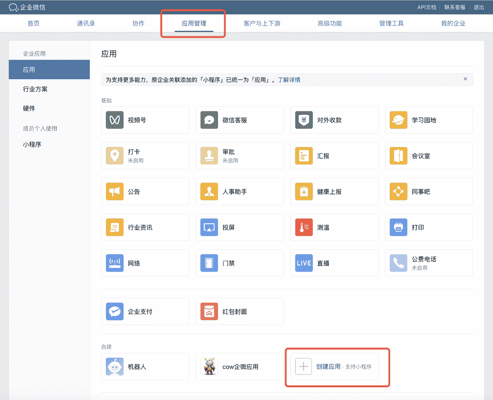

进入到应用创建页面，记录下页面上显示的 agentld 和 secret 信息：

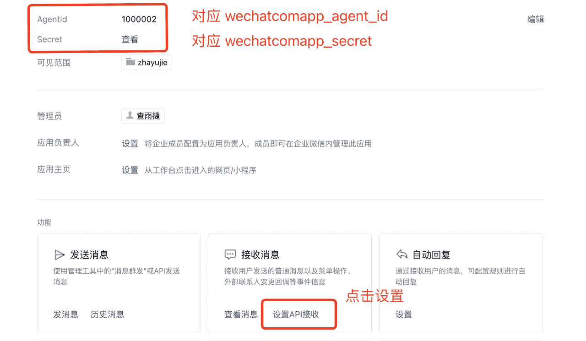

点击 "设置API接收" 配置应用接口：

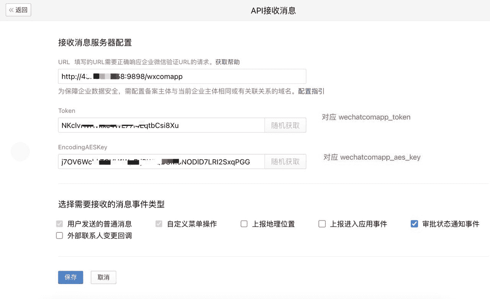

+   其中 url 的格式为 http://ip:port/wxcomapp，如果是认证企业则需要填写备案域名

+   随机获取 Token 和 EncodingAESKey 并保存下来，后续需要填写在配置文件中。

此时保存 API接收配置 是无法成功的，因为我们的python程序还没有启动起来，等项目运行后再回来保存。

#### 三、配置和运行程序

企业🛰️相比个人🛰️需要增加一些配置，打[开 co](https://docs.link-ai.tech/cow/quick-start/config)nfig.json 配置文件，除了 配置说明 中必填的配置外，还需要添加或修改以下配置。各配置项和企业🛰️后台各参数的对应关系已经在上述截图中说明。

```
{
  &quot;channel_type&quot;: &quot;wechatcom_app&quot;,   
  &quot;single_chat_prefix&quot;: [&quot;&quot;],   
  &quot;wechatcom_corp_id&quot;: &quot;&quot;,              
  &quot;wechatcomapp_token&quot;: &quot;&quot;,             
  &quot;wechatcomapp_secret&quot;: &quot;&quot;,           
  &quot;wechatcomapp_agent_id&quot;: &quot;&quot;,          
  &quot;wechatcomapp_aes_key&quot;: &quot;&quot;,
  &quot;wechatcomapp_port&quot;: 9898       
}
```

配置完成后，按 [快速开始](https://docs.link-ai.tech/cow/quick-start) 中选择的方式启动程序。当后台日志显示 http://0.0.0.0:9898/ 的时候就说明程序已经运行成功，监听9898端口了，此时需要将该端口对外开放，比如在云服务器的安全组中放开该端口。

程序启动后就可以回到 企业🛰️后台 保存 "消息服务器配置" 了，保存成功后还需要将服务器的ip添加到 "企业可信IP" 中，否则是无法收发消息的。

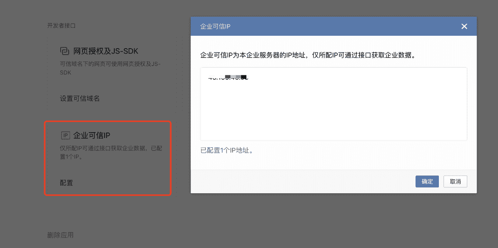

**注意**

如遇到企业🛰️后台url设置显示回调不通过或者配置失败，参考下面的解决方案：

1.  确保 服务器防火墙关闭 且 安全组放行监听的端口

1.  仔细检查token，secret key等参数配置是否一致，后台 url格式配置是否正确

1.  对于认证的企业🛰️需要配置与主体一致的备案域名

#### 四、运行效果

接下来就可以在企业🛰️中搜索我们刚刚创建的应用名称，直接和应用对话了。如果将项目复制多份，分别监听不同端口，还可以创建多个企微应用，效果如下：

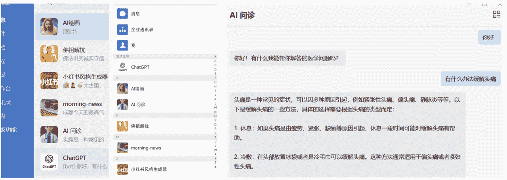

另外，如果想让外部个人🛰️用户使用，可以在 "我的企业 - 🛰️插件"，分享邀请关注二维码。个人🛰️扫码点击关注，验证手机号后就可以加入到该公司，并与上面创建的应用对话。

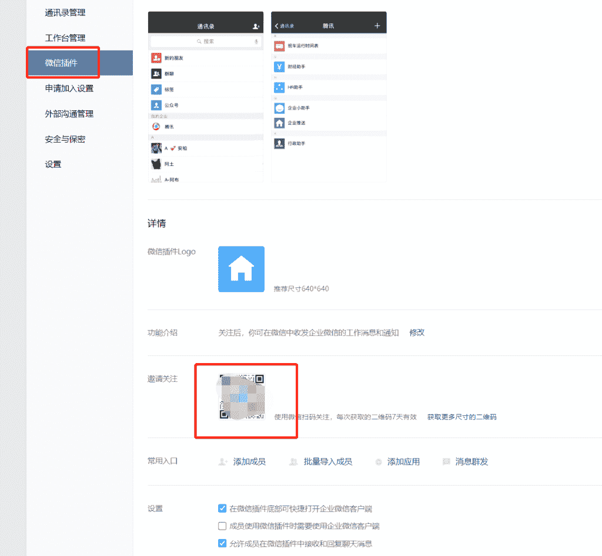

### 3.1.6 👸号

> 在接入👸号之前，，建议先根据 3.1.1 - 3.1.3 中的内容了解程序运行和配置的基础流程，本节更多介绍👸号接入特有的步骤。

#### 准备

首先需要前往 [🛰️公众平台](https://mp.weixin.qq.com/) 注册一个👸号，项目支持的👸号类型有两种，可根据你的需求进行选择：

接下来就是 **下载项目代码** 和 **安装依赖**，这两步在 [快速开始](https://docs.link-ai.tech/cow/quick-start) 中已经说明，可根据你的运行环境选择不同的操作步骤，但需要注意的两点是：

1.  👸号目前只支持 服务器 和 docker 环境部署，不支持railway 及 本地部署

1.  需要额外安装扩展依赖: pip3 install -r requirements-optional.txt

#### 一、订阅号

相比个人🛰️的接入，👸号部署的差别主要[体现在配](https://docs.link-ai.tech/cow/quick-start/config)置文件上，打开 config.json 配置文件，除了 配置说明 中必填的配置外，还需要添加以下配置：

```
{
  &quot;channel_type&quot;: &quot;wechatmp&quot;,    
  &quot;single_chat_prefix&quot;: [&quot;&quot;], 
  &quot;wechatmp_app_id&quot;: &quot;wx73f9******d1e48&quot;,     
  &quot;wechatmp_app_secret&quot;: &quot;weca******est&quot;,  
  &quot;wechatmp_aes_key&quot;: &quot;&quot;,
  &quot;wechatmp_token&quot;: &quot;tok**est&quot;,
  &quot;wechatmp_port&quot;: 80,
}
```

这些配置需要和 [🛰️👸号后台](https://mp.weixin.qq.com/advanced/advanced?action=dev&t=advanced/dev) 中的保持一致，进入页面后，在左侧菜单选择 "设置与开发 - 基本配置 - 服务器配置"，按下图进行配置:

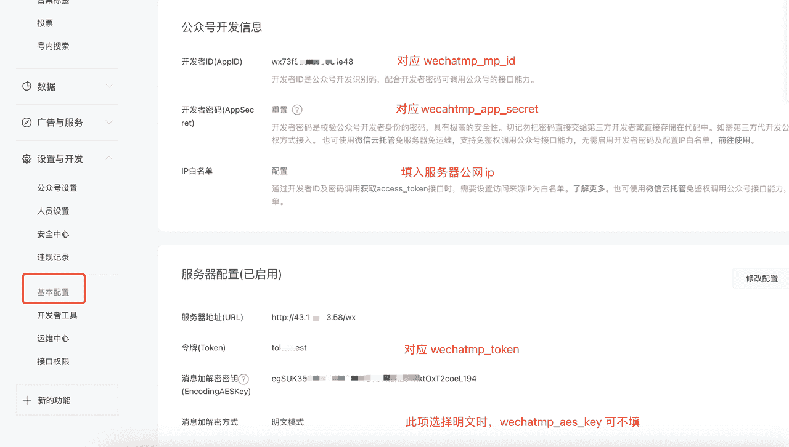

**配置的流程如下：**

1.  在公众平台启用开发者密码 (对应配置 wechatmp_app_secret)，并将服务器ip填入白名单中

1.  按上图填写 config.json 中与👸号相关的配置，要与👸号后台的配置一致

1.  启动程序，启动后会监听80端口 (若无权限监听，则在启动命令前加上sudo；若80端口已被占用，则关闭该占用进程)

1.  在👸号后台启用服务器配置并提交**，如果保存成功则表示已经**成功配置。注意 "服务器地址(URL)" 这一项需要配置为 http://{HOST}/wx 的格式，其中 {HOST} 可以是服务器的ip或域名。

随后关注👸号并发送消息即可看到以下效果:

可以看到，由于受订阅号限制，回复内容较短的情况下 (15s内)，可以立即完成回复，但耗时较长的回复则会先回复一句 "正在思考中"，后续需要用户输入任意文字主动获取答案，而服务号则可以通过客服接口解决这一问题。

其他问题

1.  语音识别：可利用🛰️自带的语音识别功能，提供语音输入能力。需要在👸号管理页面的 "设置与开发 -> 接口权限" 页面开启 "接收语音识别结果"

1.  语音回复：利用项目中的语音生成能力，推荐使用 azure 语音接口

1.  [关键词回复：可](https://github.com/zhayujie/chatgpt-on-wechat/tree/master/plugins/keyword)使用项目中的关键词插件 keyword

#### 二、服务号

服务号与上述订阅号的接入过程基本相同，略微差异如下：

1.  **在公众平**台申请企业服务号并完成🛰️认证，在接口权限中确认已获得了 客服接口 的权限

1.  在 config.json 中设置 "channel_type": "wechatmp_service"，其他配置与上述订阅号相同

1.  交互效果上，即使是较长耗时的回复，也可以主动推送给用户，而无需用户手动获取

### 3.1.7 飞书

> 通过自建应用接入AI相关能力到飞书应用中，默认已是飞书的企业用户，且具有企业管理权限。要求项目代码版本 1.5.2 及以上

#### 一、创建企业自建应用

##### 1.应用创建

进入[飞书开发平台](https://open.feishu.cn/app/) ，点击**创建企业自建应用**，填写必要信息后，点击**创建**

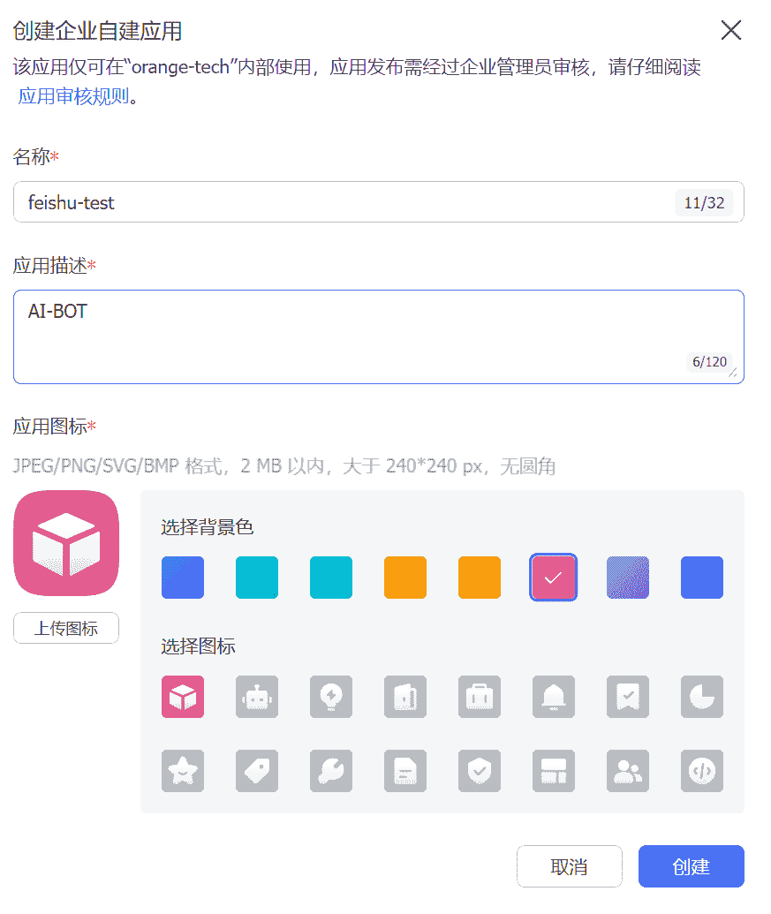

##### 2.添加机器人能力

在**添加应用能力**菜单中，为应用添加**机器人**能力

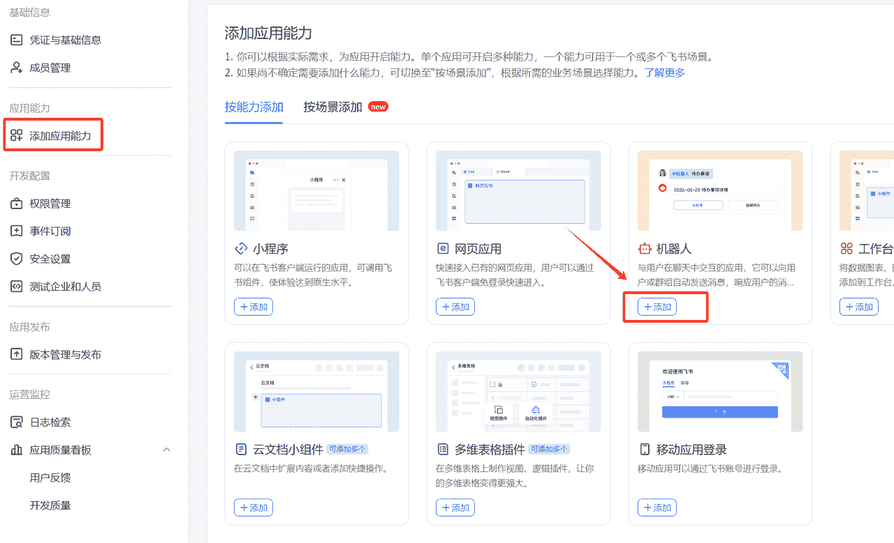

##### 3.配置应用权限

点击**权限管理****，复制下****面的权限**配置，然后**粘贴**到权限配置下方的输入框内，全选筛选出来的权限，点击批量开通，最后点击确认:

```
im:message,im:message.group_at_msg,im:message.group_at_msg:readonly,im:message.p2p_msg,im:message.p2p_msg:readonly,im:message:send_as_bot,im:resource
```

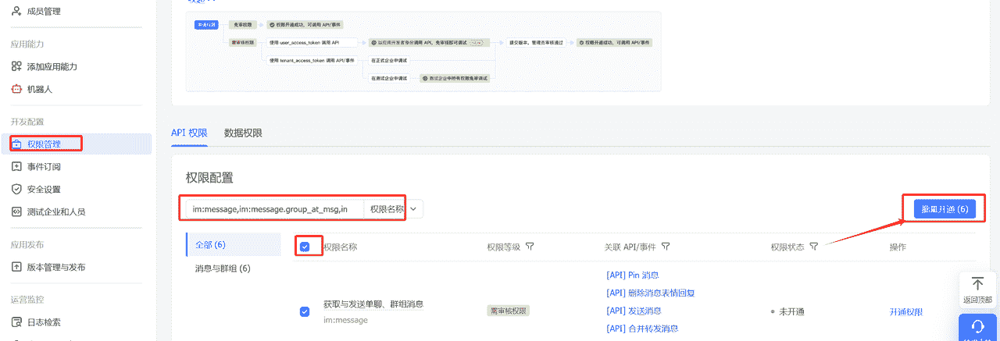

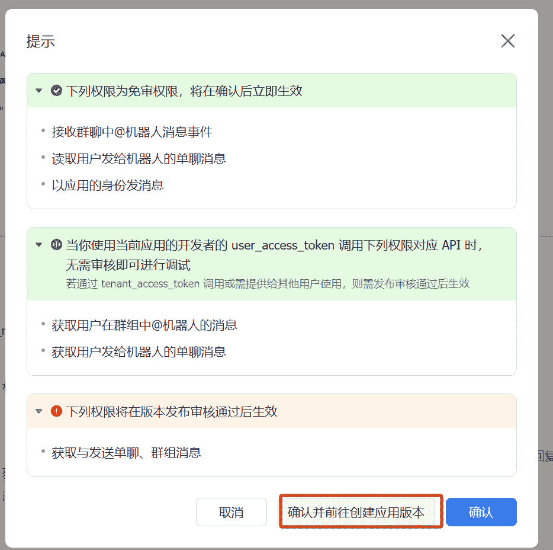

#### 二、项目配置

1.  在**凭证与基础信息**内获取feishu_app_id和feishu_app_secret

2、在**事件订阅**内获取feishu_token

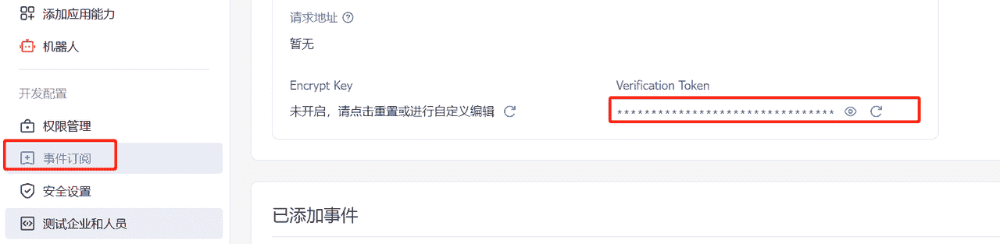

3、自定义使用的端口（记得防火墙放行），将以下配置加入项目根目录的config.json文件，并修改channel_type:"feishu"，其他参数说明参考项目即可，最后运行项目:

```
&quot;feishu_port&quot;: 80,
&quot;feishu_app_id&quot;: &quot;&quot;,
&quot;feishu_app_secret&quot;: &quot;&quot;,
&quot;feishu_token&quot;: &quot;&quot;,
&quot;feishu_bot_name&quot;: &quot;&quot;
```

> 配置说明

+   feishu_port: 飞书bot监听端口，默认为80

+   feishu_app_id: 飞书机器人应用APP Id

+   feishu_app_secret: 飞书机器人APP secret

+   feishu_token: 飞书 verification token

+   feishu_bot_name: 飞书机器人的名称，在第一步创建应用时设置

#### 三、配置事件订阅

1、点击**事件订阅**，在请求地址内填入http://ip:feishu_port，点击保存。

2、点击下方的**添加事件**，搜索“**接收消息**”，选择“**接收消息v2.0**”，确认添加。

3、需要点击版本**管理与发布**，点击**创建版本**，并申请**线上发布**，在飞书客户端查看审批消息，并审核通过。即可在飞书应用内和该机器人对话

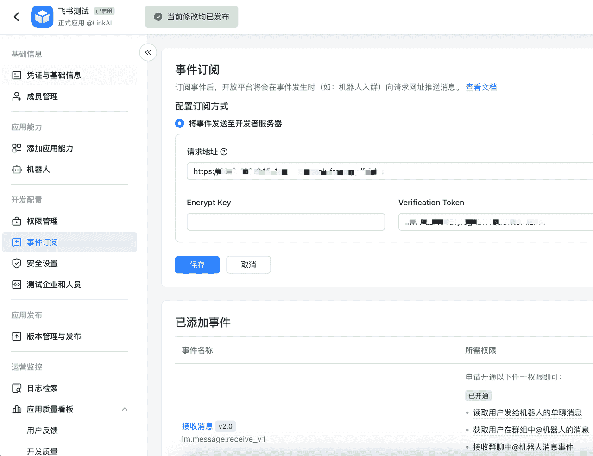

#### 四、使用

##### 1.文本对话

可以与机器人私聊，也可以直接拉入群中，支持LinkAI知识库：

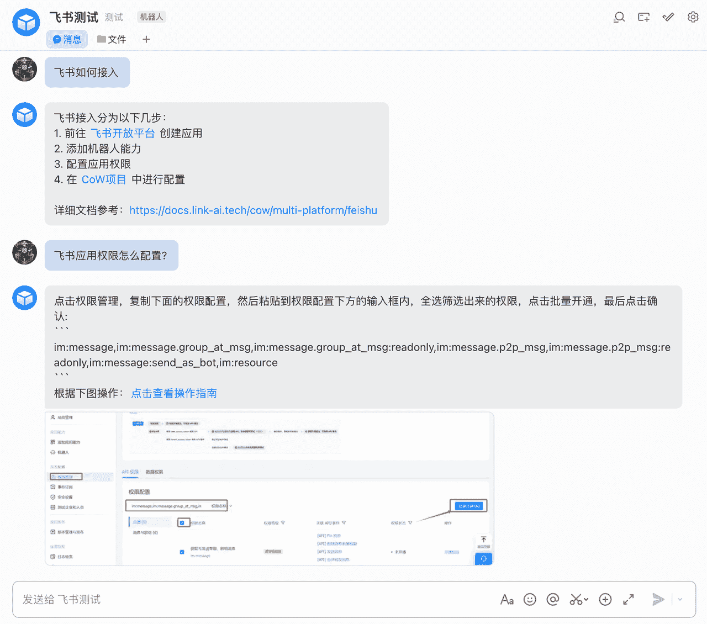

##### 2.绘画

同时支持 dall-e-3 和 midjourney


##### 3.文本总结

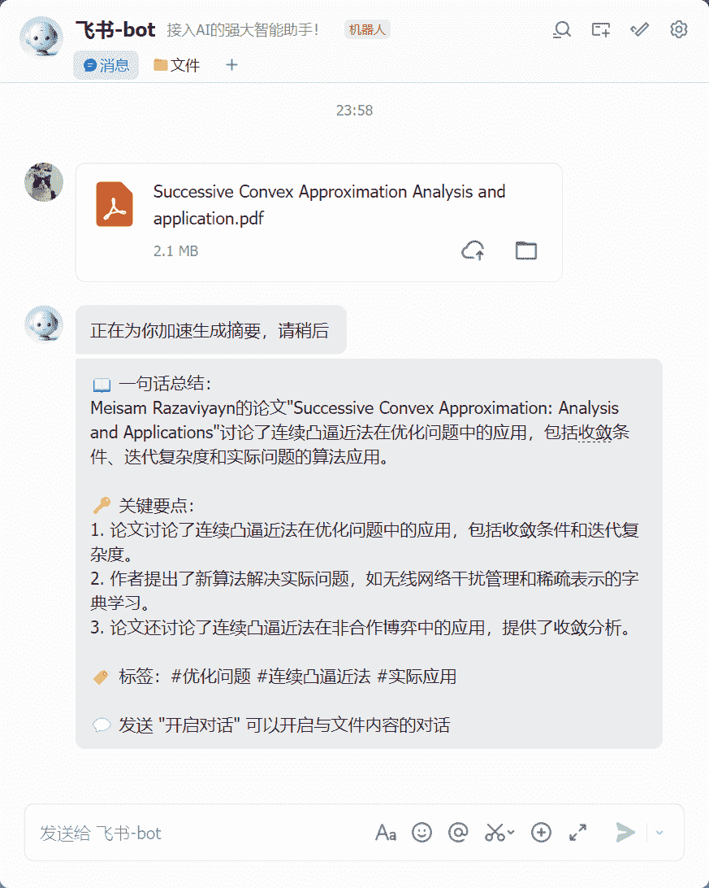

### 3.1.8 钉钉

> 通[过自建应用接入A](https://docs.link-ai.tech/cow/multi-platform/dingtalk)I相关能力到钉钉中，建议先根据 3.1.1 - 3.1.3 中的内容了解程序运行和配置的基础流程，也可查看 LinkAI平台 方案

#### 一、创建应用

1.  进入[钉钉开发者后台](https://open-dev.dingtalk.com/fe/app#/corp/app)，登录后，点击**创建应用**，填写应用相关信息。

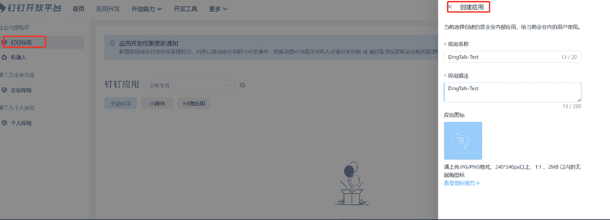

1.  **点击**添加应用能力，选择 "机器人" 能力，点击添加。

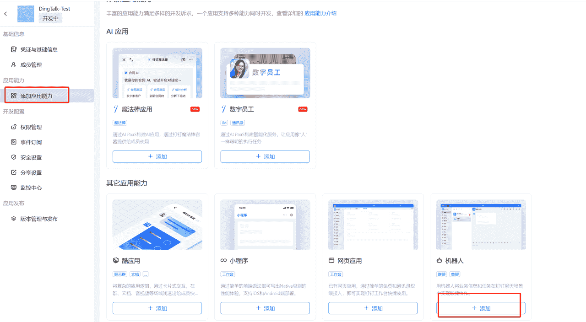

1.  配置机器人信息后点击**发布**。发布后，点击“**点击调试**”，会自动创建测试群聊，可在客户端查看:

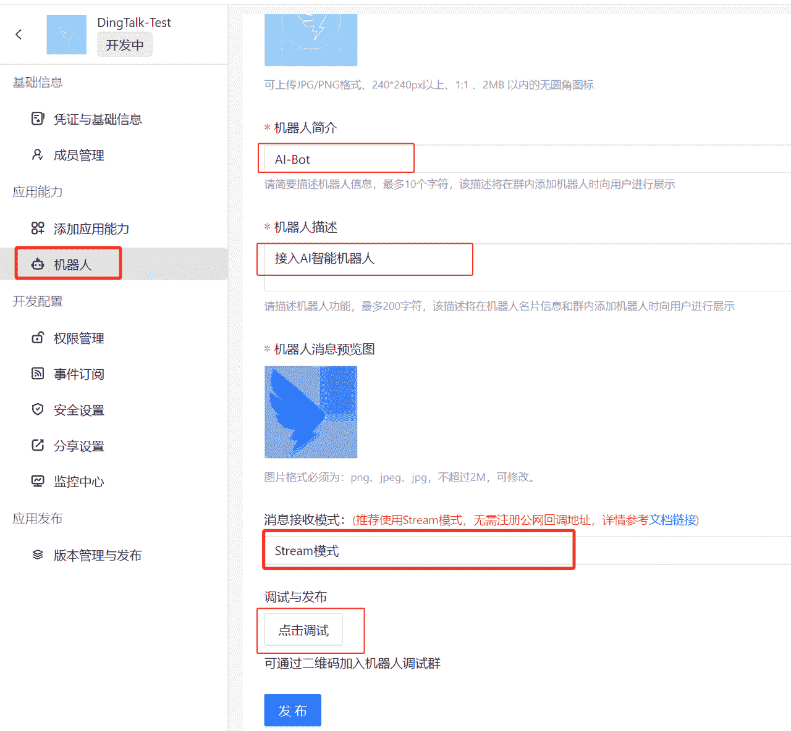

1.  点击**版本管理与发布**，创建新版本发布

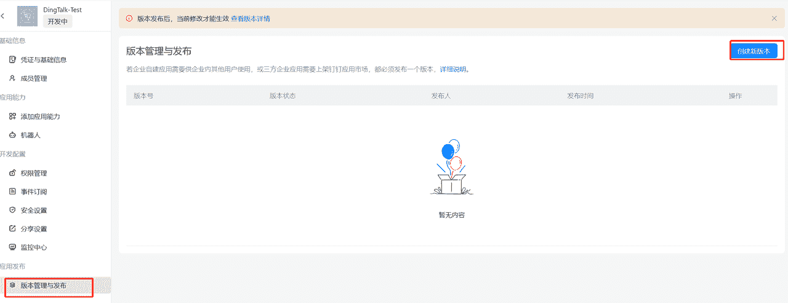

#### 二、项目配置

1.  点击**凭证与基础信息**，获取Client ID和Client Secret两个参数

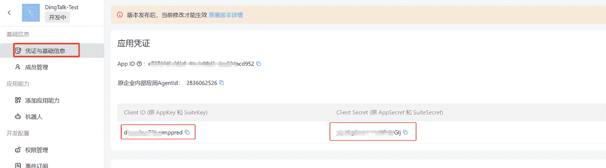

1.  参考项目[🛰️部署教程](https://docs.link-ai.tech/cow/quick-start)，将以下配置加入项目根目录的config.json文件，并设置 channel_type: "dingtalk"，其他参数说明参考项目即可，最后运行项目:

```
&quot;dingtalk_client_id&quot;: &quot;dingcl8awtpfl&quot;,
&quot;dingtalk_client_secret&quot;:&quot;lKOv97HbF3L4dqcBEQZ&quot;,
```

注意运行前需安装依赖:

```
pip3 install dingtalk_stream 
```

1.  点击**事件订阅**，点击**已完成接入，验证连接通道**， 会显示：**连接接入成功**

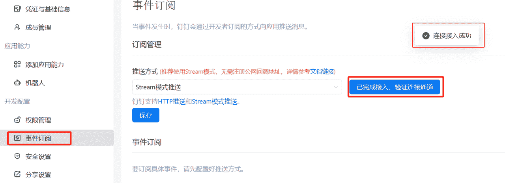

#### 三、使用

与机器人私聊或将机器人拉入企业群中均可开启对话：

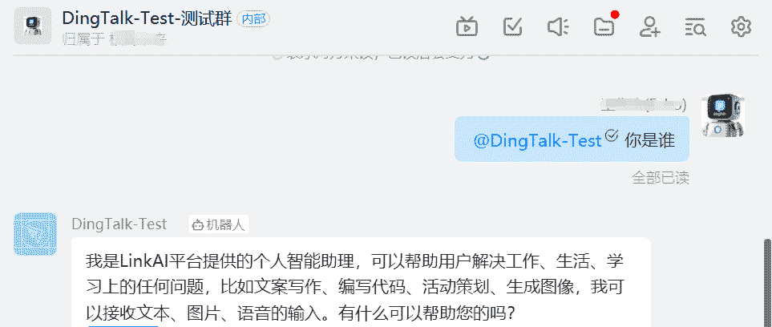

## 3.2 Docker部署

> Docker部署前提：安装好 docker 及 docker-compose，安装成功的表现是执行 docker -v 和 docker-compose versio[n (或 doc](https://docs.docker.com/engine/install/)ker compose version) 可以查看到版本号，可前往 docker官网 进行下载。

###  3.2.1 下载 docker-compose.yml 文件

```
wget https://open-1317903499.cos.ap-guangzhou.myqcloud.com/docker-compose.yml
```

下载完成后打开 docker-compose.yml 修改所需配置，如 OPEN_AI_API_KEY 和 GROUP_NAME_WHITE_LIST 等。

### 3.2.2 **启动容器**

在 docker-compose.yml 所在目录下执行以下命令启动容器：

```
sudo docker compose up -d
```

运行 sudo docker ps 能查看到 NAMES 为 chatgpt-on-wechat 的容器即表示运行成功。

注意：

+   如果 docker-compose 是 1.X 版本 则需要执行 sudo  docker-compose up -d 来启动容器

+   该命令会自动去 [docker hub](https://hub.docker.com/r/zhayujie/chatgpt-on-wechat) 拉取 latest 版本的镜像，latest 镜像会在每次项目 release 新的版本时生成

最后运行以下命令可查看容器运行日志，扫描日志中的二维码即可完成登录：

```
sudo docker logs -f chatgpt-on-wechat
```

### 3.2.3** 插件使用**

[如果需要在d](https://github.com/zhayujie/chatgpt-on-wechat/blob/master/plugins/config.json.template)ocker容器中修改插件配置，可通过挂载的方式完成，将 插件配置文件 重命名为 config.json，放置于 docker-compose.yml 相同目录下，并在 docker-compose.yml 中的 chatgpt-on-wechat 部分下添加 volumes 映射:

```
volumes:
./config.json:/app/plugins/config.json
```

## 3.3 **Railway部署**

> Railway 一键部署需要注册时间满半年的github账号，每月会提供5美金和最多500小时的免费额度。Railway部署仅适用于个人🛰️，暂不支持企业🛰️和👸号的部署，且插件配置不方便，适合快速体验。

首先进入 [Railway](https://railway.app/new/template/qApznZ)，使用github进行登录，点击 "Deploy Now" 按钮，授权你的 github 账号，然后进行配置：

其中有两个配置是必填的，其他的暂时都可以暂时先用默认值，[一个是 ](https://docs.link-ai.tech/cow/quick-start/config)open_ai_api_key， 这个正是我们上一步在官网注册的apiKey， group_name_white_list 则指定了哪些群聊需要开启自动回复，你可以配置为 ["ALL_GROUP"] 来开启所有群聊，其他配置参考 配置说明。

部署完成后，日志中会输出二维码，使用手机🛰️扫码登录，登录成功后你的账号就变成一个ChatGPT机器人了。

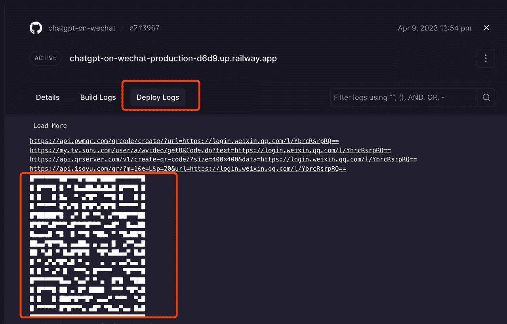

如果后续需要修改或添加配置，可在 Variables 中进行更新：

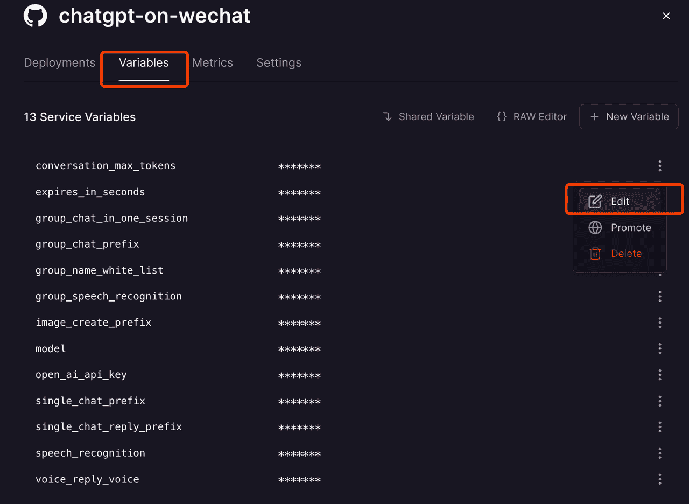

然后执行 "restart" 即可使配置生效:

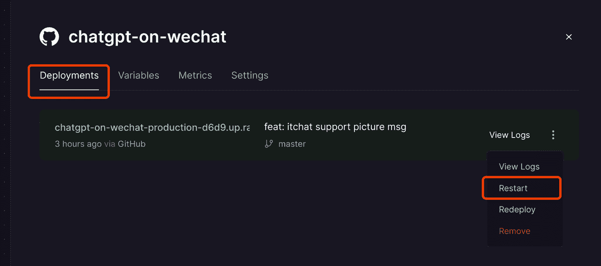

#### 使用

成功运行之后日志中会输出 "Start auto replying"，这表示你用于扫码登录的账号已经变身为机器人了，让你的好友给你发消息 或在群聊@你 都会触发自动回复，效果如下图：

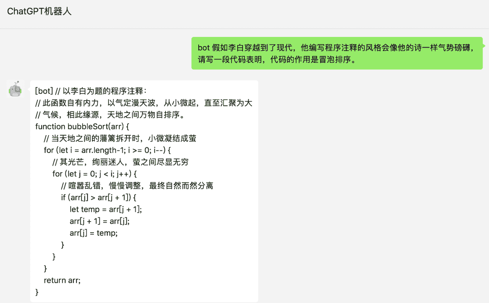

# 四、插件配置管理（可选项，按需配置）

吐**血给大家整理分**享一些我找到的一些开源插件，大家按需安装，注意有些插件使用需要独立申请Key，独立的插件环境安装，请仔细看插件README 说明。

**有研发能力的同学可以基于自己的需求场景开发个性化插件（不会写代码的**我泪目中···），插件框架可以参考自带的hello插件格式编写，届时也欢迎共享~

插件便捷安装：

给🛰️机器人单聊发送：#auth 你的管理密码（3.1.3.3 自带插件配置（必选项）步骤设置的）

如下提示表示已开启管理后台

```
[INFO]
认证成功
```

输入 #help 查看帮助

```
[INFO]
通用指令
#help : 回复此帮助
#help 插件名: 回复指定插件的详细帮助
#model : 查看和设置全局模型
#reset : 重置会话

可用插件
cclite:🤖 基于微信的多功能聊天机器人，提供新闻、天气、火车票信息、娱乐内容等实用服务。
Apilot:发送特定指令以获取早报、查询天气、星座运势、快递信息等！
linkai:用于集成 LinkAI 提供的知识库、Midjourney绘画、文档总结、联网搜索等能力。
sum4all:输入url/分享链接/搜索关键词，直接为你总结
GoogleSearch:🥰输入 &#x27;搜索 &lt;您需要搜索的内容&gt;&#x27;，我会帮您进行文本搜索
💌输入 &#x27;搜图 &lt;您需要搜索的图片描述&gt;&#x27;，我会帮您进行图像搜索
角色扮演:让机器人扮演不同的角色。
文字冒险:可以和机器人一起玩文字冒险游戏。

管理员指令：
#resume : 恢复服务
#stop : 暂停服务
#reconf : 重载配置(不包含插件配置)
#resetall : 重置所有会话
#scanp : 扫描插件目录是否有新插件
#plist : 打印当前插件列表
#setpri 插件名 优先级: 设置指定插件的优先级，越大越优先
#reloadp 插件名: 重载指定插件配置
#enablep 插件名: 启用指定插件
#disablep 插件名: 禁用指定插件
#installp 仓库地址或插件名: 安装指定插件
#uninstallp 插件名: 卸载指定插件
#updatep 插件名: 更新指定插件
#debug : 开启机器调试日志

```

插件便捷安装方法： #installp 项目的git地址，比如：

> #installp https://github.com/fatwang2/sum4all.git

### 4.1 **Apilot**

插件介绍：查看早报、查询天气、星座运势、快递信息等实用的小插件

git地址：https://github.com/6vision/Apilot.git

### 4.2 sum4all

插件介绍：

```
支持联网实时搜索
支持文章内容总结，个人微信支持链接卡片和url，企微支持url
支持文件内容总结，包括pdf、doc、markdown、txt、xls、csv、html、ppt
支持图片总结，包括png、jpeg、jpg
支持视频、播客内容总结，包括抖音、b站、小红书、YouTube等
支持多种内容总结服务，可自由组合
支持自定义prompt
```

git地址：https://github.com/fatwang2/sum4all.git

### 4.3 timetask

插件介绍：添加定时任务、取消定时任务、获取任务列表

git地址：https://github.com/haikerapples/timetask.git

### 4.4 googleSearch-On-Wechat

插件介绍：通过Google搜索或图像搜索来获取信息，并利用ChatGPT对结果进行总结，以获得更精准和详细的答案。同时，搜图功能让用户能够通过在网络上搜索图片来增加可玩性。

git地址：https://github.com/Yanyutin753/googleSearch-On-Wechat.git

### 4.5 Midjourney 画图

代理Discord，接入🛰️便捷使用，需要准备额外服务器资源，额外的配置，有此需求的私聊，不做统一展示。

用到的开源项目地址：

#### 4.5.1、Discord代理：midjourney-proxy

#### 4.5.2、项目插件：midjourney-proxy-on-wechat

### 4.6 LinkAI

#### 4.6.1 **插件说明**

基于 LinkAI 提供的知识库、Midjourney绘画、文档对话等能力对机器人的功能进行增强。平台地址: https://link-ai.tech/console

#### 4.6.2 **插件配置**

将 plugins/linkai 目录下的 config.json.template 配置模板复制为最终生效的 config.json。 (如果未配置则会默认使用config.json.template模板中配置，但功能默认关闭，需要可通过指令进行开启)。

以下是插件配置项说明：

```
{
    &quot;group_app_map&quot;: {               # 群聊 和 应用编码 的映射关系
        &quot;测试群名称1&quot;: &quot;default&quot;,      # 表示在名称为 &quot;测试群名称1&quot; 的群聊中将使用app_code 为 default 的应用
        &quot;测试群名称2&quot;: &quot;Kv2fXJcH&quot;
    },
    &quot;midjourney&quot;: {
        &quot;enabled&quot;: true,          # midjourney 绘画开关
        &quot;auto_translate&quot;: true,   # 是否自动将提示词翻译为英文
        &quot;img_proxy&quot;: true,        # 是否对生成的图片使用代理，如果你是国外服务器，将这一项设置为false会获得更快的生成速度
        &quot;max_tasks&quot;: 3,           # 支持同时提交的总任务个数
        &quot;max_tasks_per_user&quot;: 1,  # 支持单个用户同时提交的任务个数
        &quot;use_image_create_prefix&quot;: true   # 是否使用全局的绘画触发词，如果开启将同时支持由`config.json`中的 image_create_prefix 配置触发
    },
    &quot;summary&quot;: {
        &quot;enabled&quot;: true,              # 文档总结和对话功能开关
        &quot;group_enabled&quot;: true,        # 是否支持群聊开启
        &quot;max_file_size&quot;: 5000,        # 文件的大小限制，单位KB，默认为5M，超过该大小直接忽略
        &quot;type&quot;: [&quot;FILE&quot;, &quot;SHARING&quot;, &quot;IMAGE&quot;]  # 支持总结的类型，分别表示 文件、分享链接、图片，其中文件和链接默认打开，图片默认关闭
    }
}
```

根目录 config.json 中配置，API_KEY 在 [控制台](https://link-ai.tech/console/interface) 中创建并复制过来:

```
&quot;linkai_api_key&quot;: &quot;Link_xxxxxxxxx&quot;
```

> 注意：

+   配置项中 group_app_map 部分是用于映射群聊与LinkAI平台上的应用， midjourney 部分是 mj 画图的配置，summary 部分是文档总结及对话功能的配置。三部分的配置相互独立，可按需开启

+   实际 config.json 配置中应保证json格式，不应携带 '#' 及后面的注释

+   如果是docker部署，可通过映射 plugins/config.[js](https://github.com/zhayujie/chatgpt-on-wechat#3-%E6%8F%92%E4%BB%B6%E4%BD%BF%E7%94%A8)on 到容器中来完成插件配置，参考文档

#### 4.6.3 **插件使用**

> 使用插件中的知识库管理功能需要首先开启linkai对话，依赖全局 config.json 中的 use_linkai 和 linkai_api_key 配置；而midjourney绘画 和 summary文档总[结对话功](https://link-ai.tech/platform/link-app/wechat)能则只需填写 linkai_api_key 配置，use_linkai 无论是否关闭均可使用。具体可参考 详细文档。

完成配置后运行项目，会自动运行插件，输入 #help linkai 可查看插件功能。

##### 4.6.3.**1 知识库管理功能**

提供在不同群聊使用不同应用的功能。可以在上述 group_app_map 配置中固定映射关系，也可以通过指令在群中快速完成切换。

应用切换指令需要首先完成管理员 (godcmd) 插件的认证，然后按以下格式输入：

$linkai app {app_code}

例如输入 $linkai app Kv2fXJcH，即将当前群聊与 app_code为 Kv2fXJcH 的应用绑定。

另外，还可以通过 $linkai close 来一键关闭linkai对话，此时就会使用默认的openai接口；同理，发送 $linkai open 可以再次开启。

##### 4.6.3.2 Midjourney绘画功能

若未配置 plugins/linkai/config.json，默认会关闭画图功能，直接使用 $mj open 可基于默认配置直接使用mj画图。

指令格式：

```
 - 图片生成: $mj 描述词1, 描述词2..
 - 图片放大: $mju 图片ID 图片序号
 - 图片变换: $mjv 图片ID 图片序号
 - 重置: $mjr 图片ID
```

例如：

```
&quot;$mj a little cat, white --ar 9:16&quot;
&quot;$mju 1105592717188272288 2&quot;
&quot;$mjv 11055927171882 2&quot;
&quot;$mjr 11055927171882&quot;
```

> 注意事项：

1.  使用 $mj open 和 $mj close 指令可以快速打开和关闭绘图功能

1.  海外环境部署请将 img_proxy 设置为 false

1.  开启 use_image_create_prefix 配置后可直接复用全局画图触发词，以"画"开头便可以生成图片。

1.  提示词内容中包含敏感词或者参数格式错误可能导致绘画失败，生成失败不消耗积分

1.  若未收到图片可能有两种可能，一种是收到了图片但🛰️发送失败，可以在后台日志查看有没有获取到图片url，一般原因是受到了wx限制，可以稍后重试或更换账号尝试；另一种情况是图片提示词存在疑似违规，mj不会直接提示错误但会在画图后删掉原图导致程序无法获取，这种情况不消耗积分。

##### 4.6.**3.3 文档总结对话功能**

###### ① **配置**

该功能依赖 LinkAI的知识库及对话功能，需要在项目根目录的config.json中设置 linkai_api_key， 同时根据上述插件配置说明，在插件config.json添加 summary 部分的配置，设置 enabled 为 true。

如果不想创建 plugins/linkai/config.json 配置，可以直接通过 $linkai sum open 指令开启该功能。

###### ② **使用**

功能开启后，向机器人发送 **文件**、 **分享链接卡片**、**图片** 即可生成摘要，进一步可以与文件或链接的内容进行多轮对话。如果需要关闭某种类型的内容总结，设置 summary配置中的type字段即可。

###### ③ **限制**

1.  文件目前 支持 txt, docx, pdf, md, csv格式，文件大小由 max_file_size 限制，最大不超过15M，文件字数最多可支持百万字的文件。但不建议上传字数过多的文件，一是token消耗过大，二是摘要很难覆盖到全部内容，只能通过多轮对话来了解细节。

1.  分享链接 目前仅支持 👸号文章，后续会支持更多文章类型及视频链接等

1.  总结及对话的 费用与 LinkAI 3.5-4K 模型的计费方式相同，按文档内容的tokens进行计算

### 4.7 GPTs对接（需要第三方代理）

插件介绍：基于Cow框架,调用GPTs的插件

git地址：https://github.com/LargeCupPanda/Cow-GPTs.git

### 4.8 Coze

插件介绍：用于连接[cow](https://github.com/zhayujie/chatgpt-on-wechat)项目到[coze](https://www.coze.com/)服务，通过coze-discord-proxy，以免费获得ChatGPT-4.0和DALL·E 3的功能。

git地址：https://github.com/MasterKeee/coze.git

# QA

1、如果GitHub上项目代码更新了，怎么查看？我应该如何更新？

答：key关注 [LinkAI平台](https://docs.link-ai.tech/cow/version) 或者Github仓库更新进度

进入到你的项目目录，比如我的项目目录是chatgpt-on-wechat 终端输入

```
cd  chatgpt-on-wechat
git pull
./start 
```

2、如果机器人回答风格不是我想要的效果应该如何处理？

```
调整你项目主目录下config.json文件内，&quot;character_desc&quot;参数后面的prompt
```

3、插件安装后，未生效或未扫描到插件，如何处理？

```
查看插件说明文档（README），按照步骤**配**置插件参**数，一**般在插件目录中会**有一个 config-****t**em**p**lat**e**.json 文件，在同目录中，将其复制一个config.json 文件，使用管理员命令 
   #reloadp 插件名: 重载指定插件配置  
   重载看是否扫描到
   
如果还未生效，重启项目，看是否加载，同步检查日志是否有异常    
```