# GPT平替方法

> 来源：[https://v11enp9ok1h.feishu.cn/docx/Y0VhdWUTBobILux8iuxcQpgZn3c](https://v11enp9ok1h.feishu.cn/docx/Y0VhdWUTBobILux8iuxcQpgZn3c)

**今天给大家带来一个便捷使用**工具的办法，动手能力强的同学可以试试。

[是一个Git](https://github.com/gngpp/ninja)Hub上的一个开源项目：ninjia

核心功能是部署在**云服务器**上后，可以便捷的使用。接下来说下操作步骤：

> 前提条件：

> **       1、国际互**联的云服务器（腾讯云、阿里云、百度云都有），轻量云服务器就够个人用了，注意不要选择GPT不可使用区域

> **    **   2、服务器配置要求：1H1G的配置就可以，完全够自己用了。

> 3、服务器系统：Linux

> 4、**自己有GPT账号**

接下来详细讲解实现步骤，按照我的操作下来是可以正常使用的：

# 一、云服务器准备（有服务器的同学跳过此步骤）

## 1、服务器准备

大厂的腾讯云、阿里云、百度云都提供相关云服务，没有账号的需要注册账号，并实名认证。

1、腾讯云：https://cloud.tencent.com/

2、阿里云：https://www.aliyun.com/

以腾讯云举例

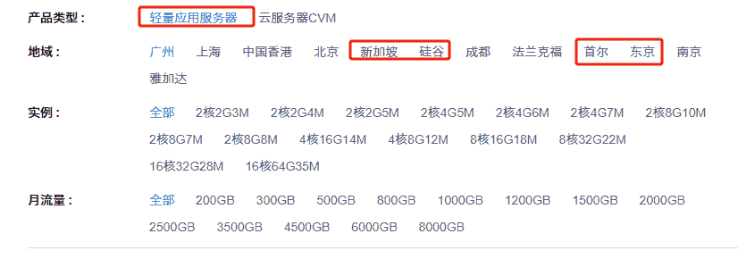

个人使用都选最档就行，阿里云国际有1H1G的配置，按需买。

**服务器建议选择Debian 12.*的版本，初始化的**时候，会让你设置密码，各家的操作大同小异

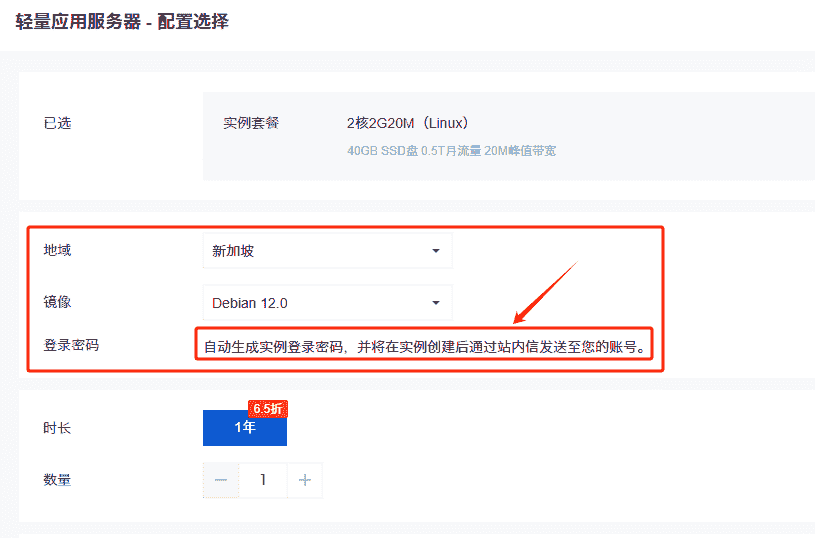

云服务器这一块不熟悉的可以联系我，帮你看。

## 2、云服务器系统连接工具

我个人使用的是 **SecureCRT ，你有其他的连接**工具可以的,你要是没有我这有个绿色版的：

链接: https://pan.baidu.com/s/17OF2SaI8E6QM0P8UwVE19w?pwd=wqeg 提取码: wqeg 复制这段内容后打开百度网盘手机App，操作更方便哦

--来自百度网盘超级会员v7的分享

# 二、GitHub项目下载

准备好所有连接工具后，准备GitHub项目下载了

以项目说明操作步骤看：

```
wget https://github.com/gngpp/ninja/releases/download/v0.8.1/ninja-0.8.1-x86_64-unknown-linux-musl.tar.gz
tar -xf ninja-0.8.1-x86_64-unknown-linux-musl.tar.gz
./ninja run
```

**按照顺序执行**，执行完成后，你会在当前目录看到一个ninjia目录，代表就成了。

三、项目启动

项目说明的 ninja --help命令与项目有点出入，按照如下方式启动，就没问题：

```
**ninja serve run**
```

执行会看到如下所示，表示已经启动成功了（默认端口7999）

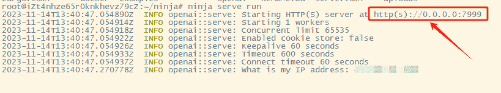

如果你想更改其他端口,比如我改成8000端口，启动命名是

```
ninja serve run --port 8000
```

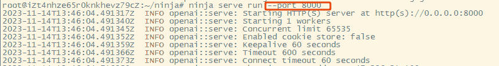

以上命令启动后，你会发现，当你退出连接工具后，网页也打不开了，进阶的启动脚本

```
#!/bin/bash

# 服务启动命令
START_CMD=&quot;ninja serve run&quot;
# PID 文件
PID_FILE=&quot;ninja_serve.pid&quot;

# 停止服务
stop_service() {
    if [ -f &quot;$PID_FILE&quot; ]; then
        echo &quot;Stopping existing service...&quot;
        kill $(cat &quot;$PID_FILE&quot;) 2&gt;/dev/null
        rm -f &quot;$PID_FILE&quot;
    fi
}

# 启动服务
start_service() {
    stop_service
    echo &quot;Starting service...&quot;
    nohup $START_CMD &gt; nohup.out 2&gt;&amp;1 &amp;
    echo $! &gt; &quot;$PID_FILE&quot;
    echo &quot;Service started with PID $(cat $PID_FILE)&quot;
}

# 执行启动服务
start_service
```

```
要使用这个脚本：

1. 将上述内容保存到一个文件中，比如 `start_ninja_service.sh`。

2. 给这个脚本执行权限：
   chmod +x start_ninja_service.sh

3. 运行脚本以启动服务：
   ./start_ninja_service.sh
   
--------------------------------------------------------------------------------------------
这个脚本在启动服务之前会检查 `ninja_serve.pid` 文件是否存在，如果存在，会尝试停止对应的进程。然后，脚本启动服务，并将新的服务进程的 PID 写入到 `ninja_serve.pid`。服务的日志会记录到 `nohup.out` 文件中。

请确保在运行此脚本之前理解其内容和可能的影响，特别是涉及到进程管理和文件操作的部分。如果你的服务启动和停止方式有所不同，请相应地调整脚本。
```

好了，相信大家一看脚本也不是我写的嘛，哈哈哈哈

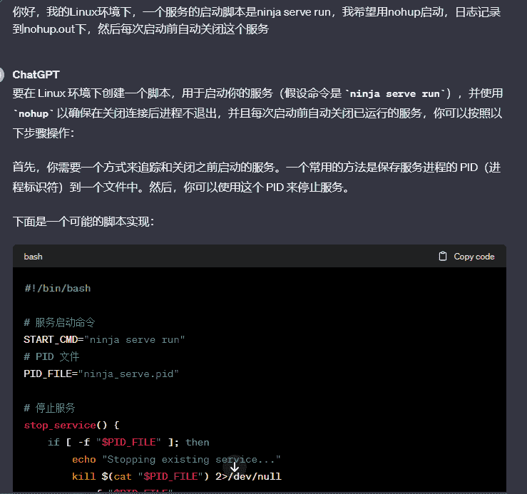

此时本地还不能访问，需要继续设置下

## 1、服务器防火墙设置

去你的云服务器管理后台，打开安全，各家服务器厂商管理后台大同小异，腾讯云举例

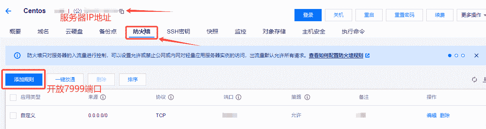

这里的开放端口，默认是7999，如果你设置了其他端口，这里就开放你自定义的端口。

2、端口开放后，本地访问地址：http://你的服务器ip:你的端口地址

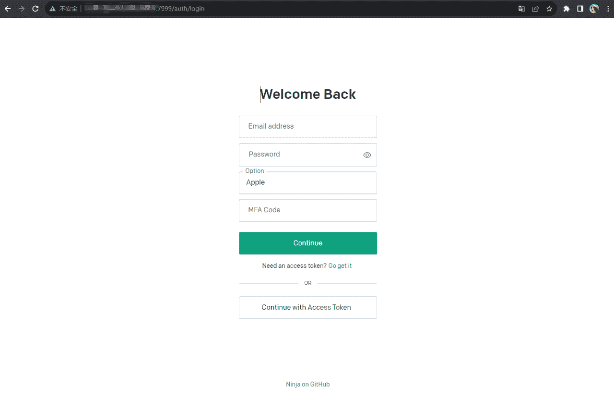

## 2、登录方式选择

登录方式选择，取决于的账号：

①第三方账号注册的：Gmail，outlook这些

②账号密码注册的GPT账号

### 2.1 对于第①种账号

选择用 ** Access Token** 方式登录，具体办法

你得先有连上官网的网络环境，Chat页面正常登录后，然后输入网址： https://chat.openai.com/api/auth/session

会看到如下内容：

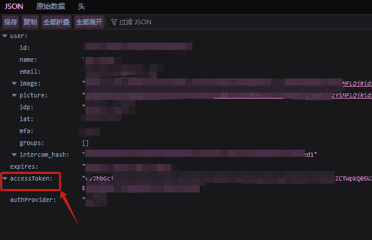

双击，然后复制accessToken，然后打开本地网页的 accessToken

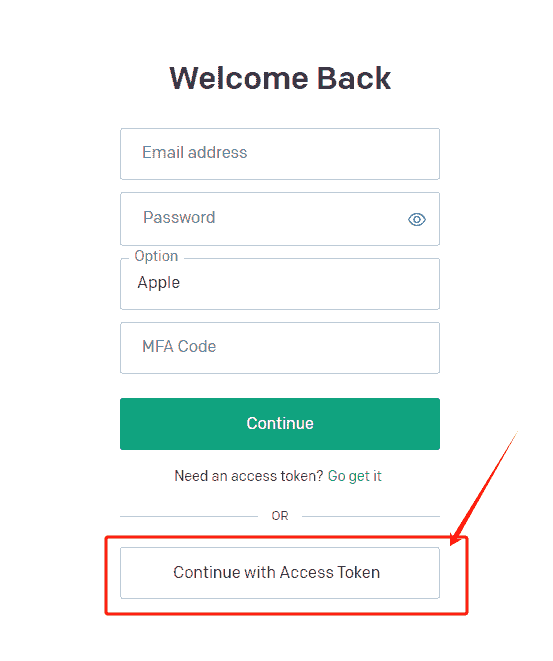

将复制的accessToken复制进去（注意不要双引号）

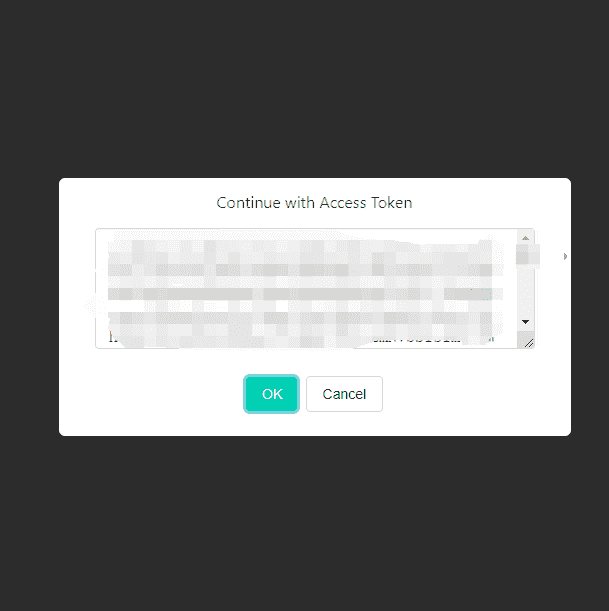

点击OK稍等几秒钟，然后你就会看到一模一样的界面啦

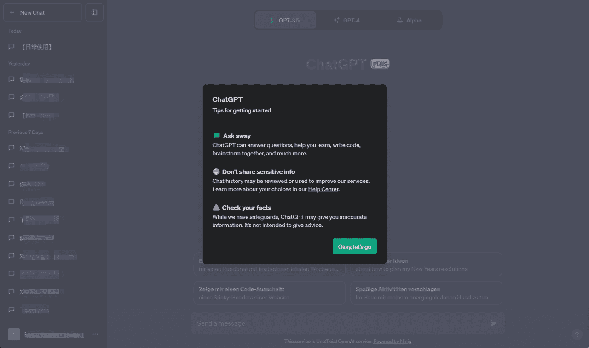

是不是很熟悉，嗯？ 就可以在本地愉快的开始玩耍了，所有内容与官服Chat保持一致~

### 2.2 对于第②种账号

因为你就是用账号密码注册的账号，所以在这里，直接用账号密码登录就行（因为我是用Gmail注册的， 所以这里没法演示，但根据原理，是可以的。）

对于其他风险，请看项目的详细说明。