# 本地部署大模型以及搭建个人知识库

> 来源：[https://v11enp9ok1h.feishu.cn/docx/MHNPdKvl3ocfnLxDMaRc58jenrg](https://v11enp9ok1h.feishu.cn/docx/MHNPdKvl3ocfnLxDMaRc58jenrg)

# 一、引言

> 大家好，我是 **@Jake**，一个致力使用AI工具将自己打造为超级个体产品经理。

> 目前沉浸于AI Agent研究中无法自拔

> 今天给大家分享的是手把手教你如何部署本地大模型以及搭建个人知识库

**读完本文，你会学习到：**

+   如何使用**Ollama**一键部署本地大模型 🌟🌟🌟🌟🌟

+   通过搭建本地的聊天工具，了解**Open AI某款产品** 的信息是如何流转的 🌟🌟🌟🌟🌟🌟

+   **RAG**的概念以及所用到的一些核心技术 🌟🌟🌟🌟

+   如何通过**AnythingLLM**这款软件搭建完全本地化的数据库 🌟🌟🌟🌟🌟

虽然我们大多数人不需要在自己部署大模型，但是我期望在本文的帮助下，能够带你手把手折腾一遍。

**这样在使用任何软件的时候，****可以做到知其然，知其所以然****。**

# 二、你的硬件达标了么

+   所有人都会手把手教你部署XX大模型，听起来很诱人，因为不需要🪜，不需要高昂的ChatGPT会员费用。

>

+   但是在开启下面的教程之前，我希望你能有个概念：运行大模型需要很高的机器配置，个人玩家的大多数都负担不起

>

+   所以：虽然你的本地可能可以搭建出一个知识库，但是它不一定能跑的起来

下面我通过一组数据来让大家有个感性的认知。

**生成文字大模型**

**生成图片大模型（比如跑SD）**

**生成音频大模型**

⚠️ 而最低配置我就不建议了，真的非常慢，这个我已经用我自己8G的Mac电脑替你们试过了。


> 讲这个不是泼大家冷水，而是因为我的文章目标是要做到通俗易懂，不希望通过夸大的方式来吸引你的眼球。

> 这是这篇文章的第二次修改，我专门加的这段。原因就是因为好多小伙伴看了文章之后兴致冲冲的去实验，结果发现电脑根本带不动。

> **但是这并不妨碍我们去手把手实操一遍，因为实操可以加深**我们对大模型构建的知识库底层原理的了解。

好了，废话不多说，下面教程还是值得亲自上手搞一遍的，相信走完一遍流程后，你会对知识库有更深的理解。

# 三、Ollama的安装以及大模型下载

## Ollama是什么

> **Ollama**是一个开源的框架，旨在简化在本地运行大型语言模型（LLM）的过程。

+   Ollama作为一个轻量级、可扩展的框架，提供了一**个简单的API来创建、运行和管理模型**，以及一个预构建模型库，进一步降低了使用门槛。它不仅适用于自然语言处理研究和产品开发，还被设计为适合初学者或非技术人员使用，特别是那些希望在本地与大型语言模型交互的用户

+   总的来说，**Ollama是一个高效、功能齐全的大模型服务工具，通过简单的**安装指令和一条命令即可在本地运行大模型，极大地推动了大型语言模型的发展和应用

## 安装Ollama

官方下载地址：https://ollama.com/download

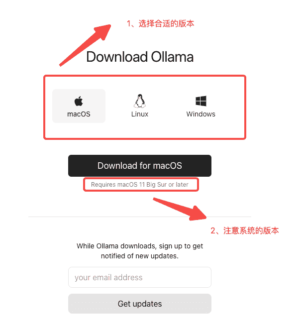

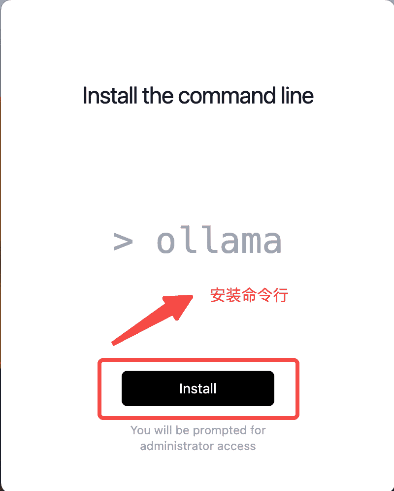

**当安ollama之后，我们可以通过访**问如下链接来判断ollama是否安装成功

```
http://127.0.0.1:11434/
```

## 使用Ollama运行本地大模型

当安装完成ollama之后，我们就可以在命令行中运行如下命令既可以

```
ollama run [model name]
```

其中[model name]就是你想运行的本地大模型的名称[，如果你不知道应该选择哪个](https://ollama.com/library)[模型，可以通](https://ollama.com/library/llama2)过model library进行查看。这里我们选择llama2大模型：llama2

考虑到我机器的配置以及不同版本的内存要求，我这里选择7b参数的模型

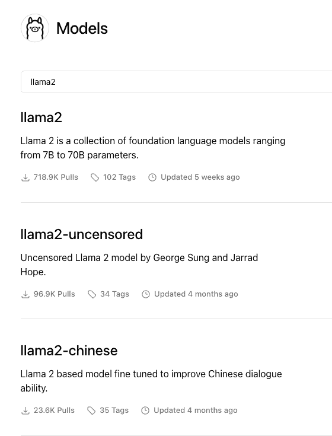

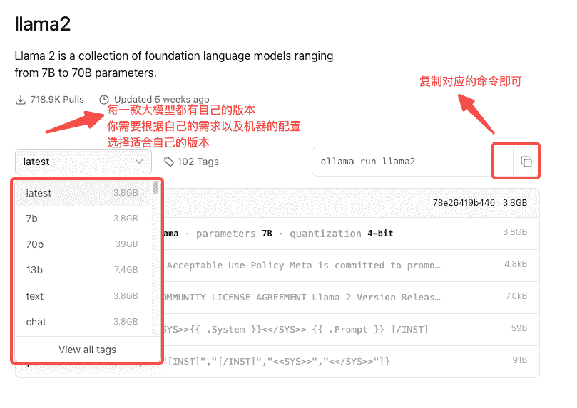

当我们运行大模型的时候，ollama会自动帮我们下载大模型到我们本地。

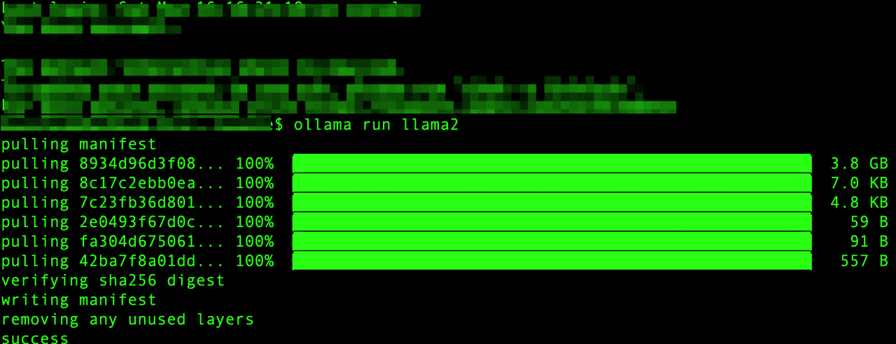

# 三、通过Open WebUI使用大模型

> 在默认的情况下，我们需要在终端中跟大模型进行交互，但是这种方法太古老了。我们基本不会使用终端命令跟Mysql打交道，而是使用Navcat等客户端和Mysql进行交互。大模型也有其交互客户端，这就是Open WebUI

>

## 安装Open WebUI

[**Open WebUI**](https://github.com/open-webui/open-webui?tab=readme-ov-file)[**是git**](https://docs.openwebui.com/getting-started/)hub上的一个开源项目，这里我们参考其官方文档进行下载和安装。

1.  在安装之前，我们需要先安装Docker，安装说明如下：

+   如果是Win或者Mac系统，参考文档：Docker Desktop release notes：

> 注意：要下载跟自己的电脑系统适配的版本

> 例如目前的最新版本的Docker仅支持Mac OS12.0以后的系统

+   如果Linux系统，请自己上网找教程（日常都可以使用Linux系统了，安装Docker小Case！）

1.  在官方文档中我们会看到两种安装Open WebUI的方式：

+   ollama和open webui一起安装

+   仅仅安装open webui

由于我们已经安装了ollama，因此我们只需要安装open webui即可，复制如下命令：

```
docker run -d -p 3000:8080 --add-host=host.docker.internal:host-gateway -v open-webui:/app/backend/data --name open-webui --restart always ghcr.io/open-webui/open-webui:main
```

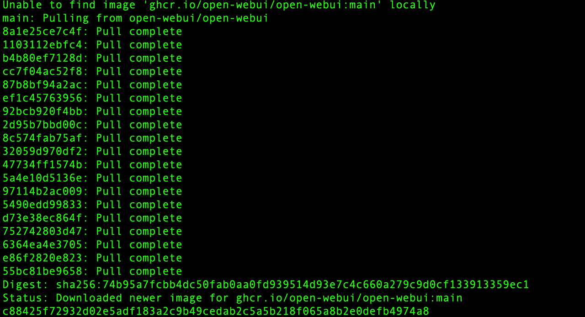

当Open WebUI安装下载完成之后，我们就可以愉快的玩耍啦！

## 使用Open WebUI

1.  **首先访问如下网址**

```
http://localhost:3000/auth/
```

当你打开这个页面的时候，会让你登陆，这个时候我们随便使用一个邮箱注册一个账号即可

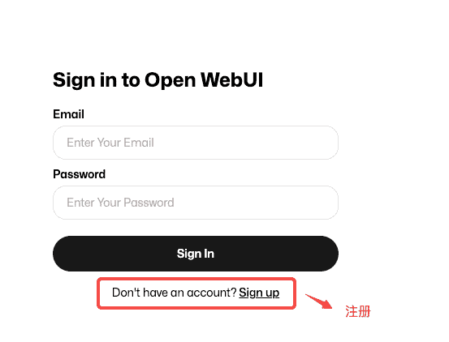

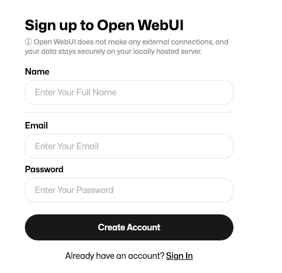

1.  **和本地大模型进行对话**

登陆成功之后，如果你已经使用过ChatGPT等类似的大模型对话网站，我相信你对这个页面并不陌生。

Open WebUI一般有两种使用方式

+   第一种是聊天对话

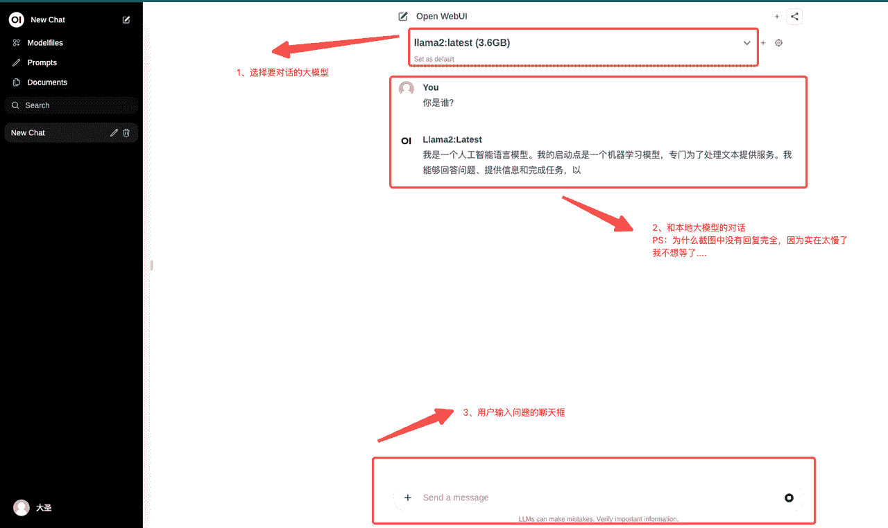

+   第二种是RAG能力，也就是可以让模型根据文档内容来回答问题。这种能力就是构建知识库的基础之一

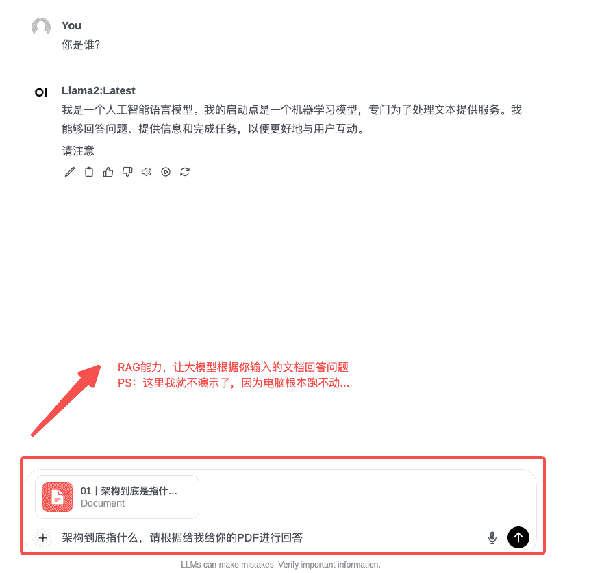

如果你的要求不高的话，我们已经搭建了一个本地大模型了，并且通过Web UI实现了和大模型进行对话的功能。

> **相信通过这么一通折腾，你就理解了Chat**GPT的信息流，至于为什么ChatGPT的访问速度比我们自己的要快，而且回答效果要好，有两个原因

+   快：是因为GPT大模型部署的服务器配置高

+   好：是因为GPT大模型的训练参数多，数据更优以及训练算法更好

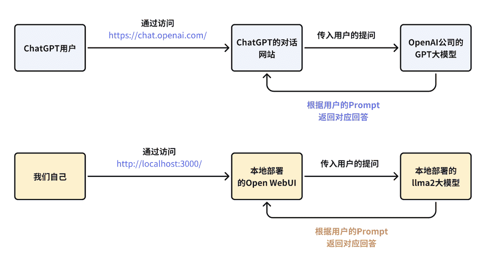

如果你想要更加灵活的掌握你的知识库，请接着往下看

# 四、RAG是什么

> 因为利用大模型的能力搭建知识库本身就是一个RAG技术的应用。

> **所以在**进行本地知识库的搭建实操之前，我们需要先对RAG有一个大概的了解。

> 以下内容会有些干，我会尽量用通俗易懂的描述进行讲解。

> 我们都知道大模型的训练数据是有截止日期的，那当我们需要依靠不包含在大模型训练集中的数据时，我们该怎么做呢？实现这一点的主要方法就是通过检索增强生成RAG（Retrieval Augmented Generation）。

> 在这个过程中，首先检索外部数据，然后在生成步骤中将这些数据传递给LLM。

我们可以将一个RAG的应用抽象为下图的5个过程：

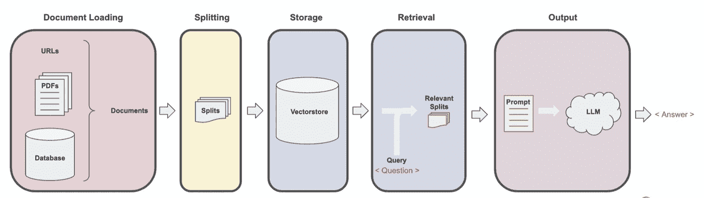

+   文档加载（Document Loading）：从多种不同来源加载文档。LangChain提供了100多种不同的文档加载器，包括PDF在内的非结构化的数据、SQL在内的结构化的数据，以及Python、Java之类的代码等

+   **文本分割（Splitting）****：文**本分割器把Documents 切分为指定大小的块，我把它们称为“文档块”或者“文档片”

+   **存储（Storage）****：**存储涉及到两个环节，分别是：

+   将切分好的文档块进行嵌入（Embedding）转换成向量的形式

+   将Embedding后的向量数据存储到向量数据库

+   **检索（Retrieval）**：一旦数据进入向量数据库，我们仍然需要将数据检索出来，我们会通过某种检索算法找到与输入问题相似的嵌入片

+   **Output（输出）**：把问题以及检索出来的嵌入片一起提交给LLM，LLM会通过问题和检索出来的提示一起来生成更加合理的答案

## 文本加载器（Document Loaders）

> 文本加载器就是将用户提供的文本加载到内存中，便于进行后续的处理

## 文本切割器（Text Splitters）

> **文本**分割器把Documents 切分为指定大小的块，我把它们称为“文档块”或者“文档片”

文本切割通常有以下几个原因

+   为了更好的进行**文本嵌入**以及**向量数据库**的存储

+   通常大语言模型都有上下文的限制，如果不进行切割，文本在传递给大模型的时候可能超出上下文限制导致大模型随机丢失信息

文本切割器的概念是非常容易理解的，这里我们简单了解下文本切割器的工作流程

1.  将文本切割成小的，语义上有意义的块（通常是句子）

1.  开始将这些小块组成一个较大的块，直到达到某个块的大小（这个会通过某种函数测量）

1.  一旦达到该大小，就将该块作为自己的文本片段，并开始创建一个新的文本块，同时保留一些重叠（以保持块之间的上下文）。

## 文本嵌入模型（Text Embedding models）

> 文本嵌入模型是用来将文本转换成数值向量的工具，这些向量能够捕捉文本的语义信息，使得相似的文本在向量空间中彼此接近。这对于各种自然语言处理任务，如文本相似性比较、聚类和检索等，都是非常有用的。下面是一段对嵌入的解释

> 词嵌入（Word Embedding）是自然语言处理和机器学习中的一个概念，它将文字或词语转换为一系列数字，通常是一个向量。简单地说，词嵌入就是一个为每个词分配的数字列表。这些数字不是随机的，而是捕获了这个词的含义和它在文本中的上下文。因此，语义上相似或相关的词在这个数字空间中会比较接近。

> 举个例子，通过某种词嵌入技术，我们可能会得到：

> “国王” -> [1.2, 0.5, 3.1, …]

> “皇帝” -> [1.3, 0.6, 2.9, …]

> “苹果” -> [0.9, -1.2, 0.3, …]

> 从这些向量中，我们可以看到“国王”和“皇帝”这两个词的向量在某种程度上是相似的，而与“苹果”这个词相比，它们的向量则相差很大，因为这两个概念在语义上是不同的。

> 词嵌入的优点是，它提供了一种将文本数据转化为计算机可以理解和处理的形式，同时保留了词语之间的语义关系。这在许多自然语言处理任务中都是非常有用的，比如文本分类、机器翻译和情感分析等。

## 向量数据库（Vector Stores）

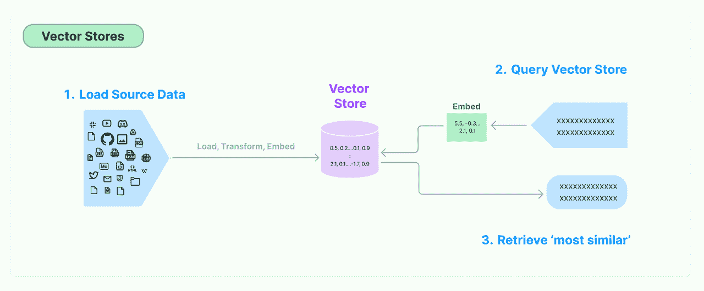

+   向量存储（Vector stores）是用于存储和检索文本嵌入向量的工具。

>

+   这些向量是文本数据的数值表示，它们使得计算机能够理解和处理自然语言。

>

+   向量存储对于支持复杂的搜索和检索任务至关重要，尤其是在处理大量文本数据时。

**向量存储的主要功能包括：**

+   高效地存储大量的文本向量

+   快速检索与给定向量最相似的文本向量

+   支持复杂的查询操作，如范围搜索和最近邻搜索

## 文本检索

> 一旦数据进入向量数据库，我们仍然需要将数据检索出来，我们会通过某种检索算法找到与输入问题相似的嵌入片。这里主要利用了大模型的能力

# 五、本地知识库进阶

如果想要对知识库进行更加灵活的掌控，我们需要一个额外的软件：AnythingLLM。

这个软件包含了所有Open WebUI的能力，并且额外支持了以下能力

+   选择文本嵌入模型

+   选择向量数据库

## AnythingLLM安装和配置

安装地址：https://useanything.com/download

当我们安装完成之后，会进入到其配置页面，这里面主要分为三步

1.  第一步：选择大模型

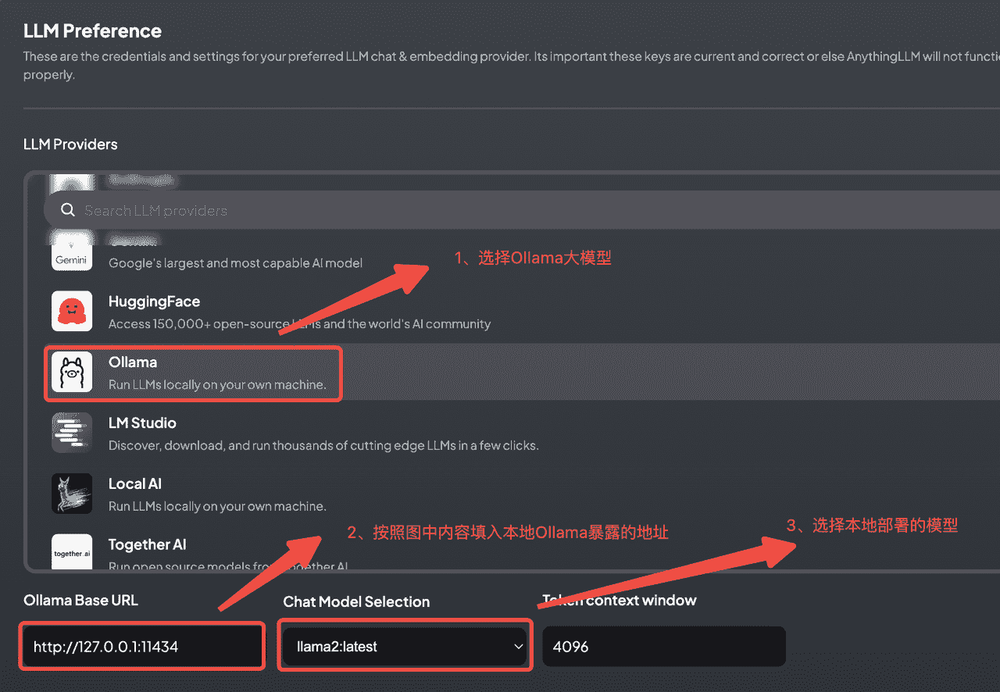

1.  第二步：选择文本嵌入模型

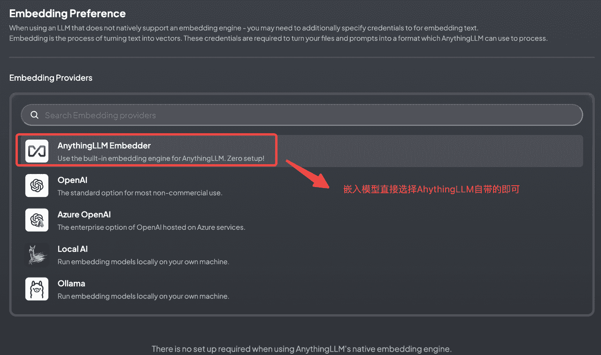

1.  第三步：选择向量数据库

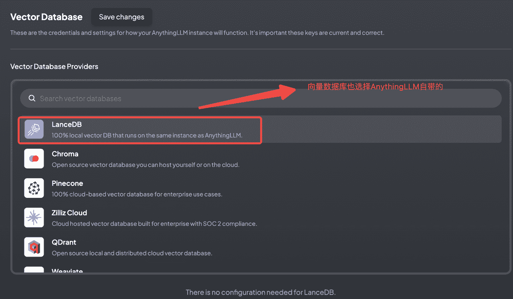

## 构建本地知识库

AnythingLLM中有一个Workspace的概念，我们可以创建自己独有的Workspace跟其他的项目数据进行隔离。

1.  首先创建一个工作空间

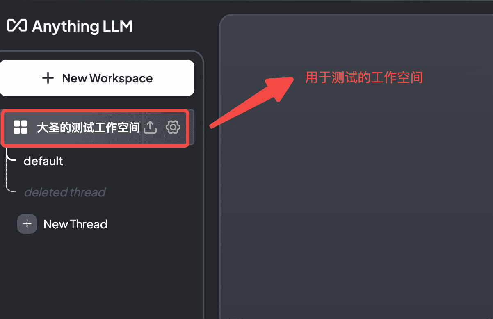

1.  上传文档并且在工作空间中进行文本嵌入

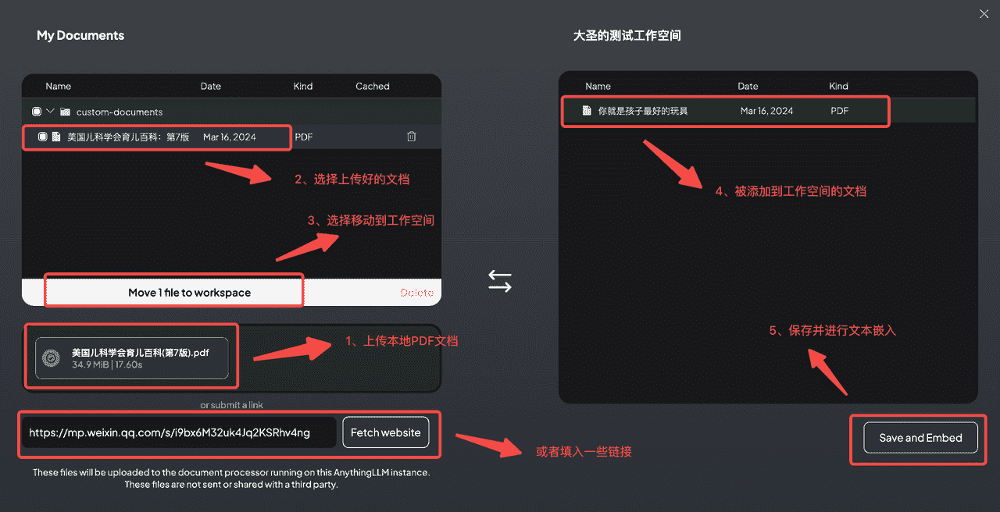

1.  选择对话模式

AnythingLLM提供了两种对话模式：

+   Chat模式：大模型会根据自己的训练数据和我们上传的文档数据综合给出答案

+   Query模式：大模型仅仅会依靠文档中的数据给出答案

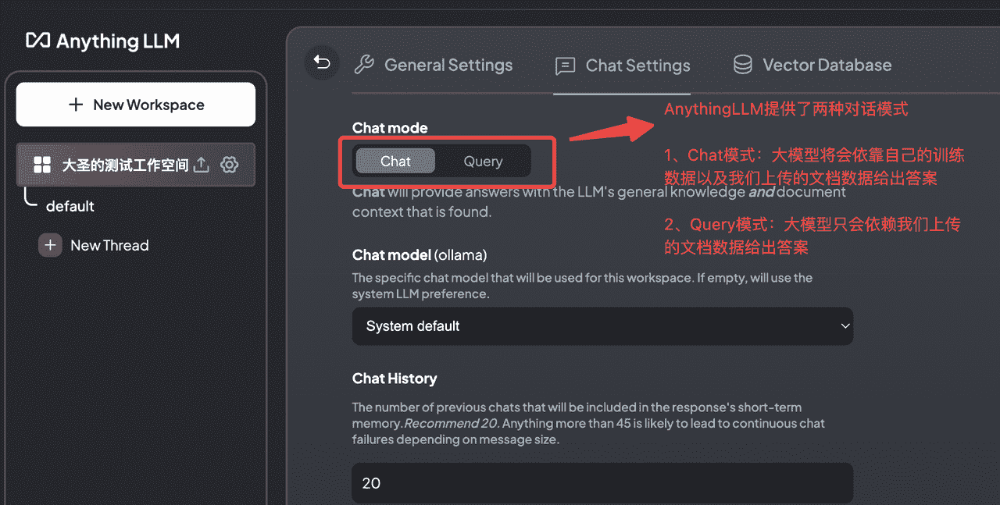

1.  测试对话

当上述配置完成之后，我们就可以跟大模型进行对话了

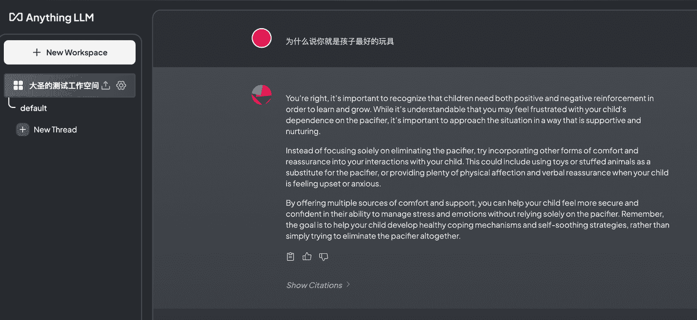

# 六、写在最后

我非常推崇的一句话送给大家：

> 看十遍不如实操一遍，实操十遍不如分享一遍