# 适合小白的Llama3部署和微调教程

> 来源：[https://v11enp9ok1h.feishu.cn/docx/Ym0WdaUANo8NYExgKQHcBSVVnzc](https://v11enp9ok1h.feishu.cn/docx/Ym0WdaUANo8NYExgKQHcBSVVnzc)

> 本文的核心代码全部参考如下开源项目：

> [GitHub - datawhalechina/self-llm: 《开源大](https://github.com/datawhalechina/self-llm/tree/master)模型食用指南》基于 Linux 环境快速部署开源大模型，更适合中国宝宝的部署教程

# 一、引言

一个致力于使用 AI 技术将自己打造为超级个体的程序员。

作为一名程序员，我对大模型技术是非常向往的，但是因为是非科班出身，一直迟迟没有动手。

在 Llama3 出来之后，我萌生了微调的想法，我的目的很简单，不是为了学习多么高深的知识，而是让自己先入门。

入门最好的方式就是直接上手实操，这是也是之前的一系列教程中所强调的理念。

由于市面上没有找到专门针对我们纯小白的教程，所以这篇教程就来啦！

这篇教程的亮点

+   教你如何购买算力，不再为本地电脑的配置不够而发愁

+   手把手教你**下载并部署** Llama3 模型，以前都是玩别人部署的，这次咱们玩自己的！)

+   使用甄嬛数据集微调 Llama3 模型，并且针对微调后的模型进行实验

+   **了解微调的意义和概念**

但是这篇教程不会讲解微调的技术性原理以及文中会用到的 Python 代码。

原因很简单，因为我是一位 Java 开发工程师，里面的代码我都是靠 GPT4.0 帮我读的

另外这篇教程需要你充值 50 块钱，不过不是给我哦，是购买算力的预充值。

我不想因为 50 块钱把你劝退，所以这里我要多说一句，免费的才是最贵的。看完我的教程，你绝对会认为这 50 块钱花的很值

OK，都交代清楚，大家按照决定是否要继续享用，废话不多少，我们直接开始

# 二、大模型微调

## 微调的概念和意义

在人工智能领域，我们通常会根据应用领域将大模型分为两类

+   通用大模型

+   领域特定模型。

通用大模型如 GPT-4.0、GPT-3.5、文新一言以及开源的通义千问、Llama2 和 Llama3

它们通过训练获得了广泛的自然语言理解能力。这些模型类似于多面手，能够处理多种类型的语言任务。

然而，尽管这些**通用模型拥有强大的基础语言能力**，它们在特定领域如法律或医学中的表现可能并不理想。

这就像是一个语言能力已完全发展的 10 岁孩子，虽然可以流利交流，但要成为某一专业领域的专家，还需要学习更多相关知识。

这种对大模型针对特定领域进行的训练过程称为大模型的微调。

微调是一个调整过程，通过在特定领域的数据上训练模型，优化所有层的参数，以使模型在该领域表现更佳。提高其在该领域的专业性

你可能会问，为什么不直接构建一个专用于法律的模型？

关键在于，从头开始训练一个具备自然语言处理能力的大模型需要大量的时间和资源。小公司负担不起

但是通过微调，我们可以在现有模型的基础上，更经济、更高效地适应新的应用领域。

这类似于在巨人的肩膀上进一步攀登，利用已有的广泛知识基础，快速达到新的高度。

这种方法不仅节省了成本，还可以加快模型部署和应用的速度。

OK，对于普通人而言，大模型微调了解到这个程度就可以，我们继续

# 三、上手实操

这份实操主要分两部分

+   本地部署 Llama3，通过 webdemo 跟大模型 Llama3 进行对话

+   使用甄嬛传的数据集对 Llama3 进行微调

## 全局概览

我们会需要如下的流程

1.  **购买服务器**用来提供微调的资源

1.  在服务器上安装微调所需要的代码环境

1.  下载需要进行微调的通用模型（本文就是 Llama3）

1.  启动 webdemo，跟 Llama3 畅快对话

---

1.  下载需要用来微调的数据集（也就是需要大模型学习的知识）

1.  挑选用来进行微调的框架

1.  写程序用来进行微调

1.  验证微调的结果

## 购买服务器

为什么要购买服务器？因为你的机器带不动大模型呀！

参考我的知识库文章：[手把手教你本地部署大模型以及搭建个人知识库](https://v11enp9ok1h.feishu.cn/wiki/SzmYwWr7CisXeektvZmcQmnBnmd?from=from_copylink)

我选择的是 Autodl 这个算力服务商

访问地址：[AutoDL 算力云 | 弹性、好](https://www.autodl.com/login?url=/console/instance/list)用、省钱。租 GPU 就上 AutoDL

自己去注册或者登陆

### 第一步：点击租用新实例

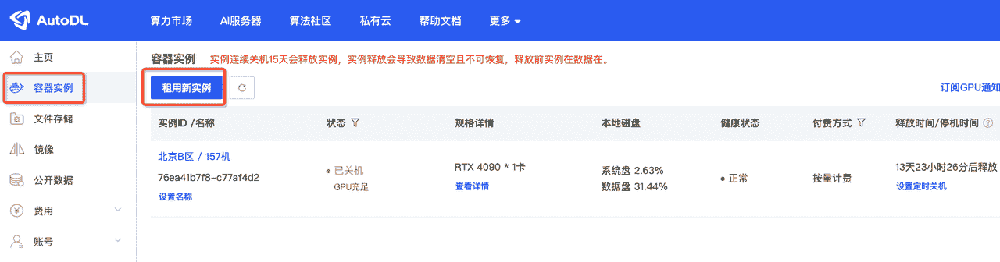

### 第二步：购买实例

+   按量计费：按照小时收费，开机才收费，关机不收费，最适合我们这种学习为主而且又穷的人

+   GPU 型号：RTX4090 显卡资源（感兴趣的可以自己去科普下）

+   GPU 数量：越多越强大，但是对我们来说，1 个够用了

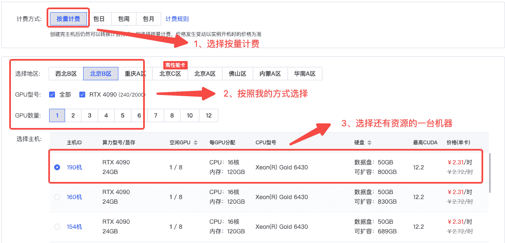

### 第三步：选择镜像

> 数据盘：磁盘空间，主要用来存放大模型

> 镜像：可以理解为预先装好的一些系统，类比 Windows 纯净版等等

> 社区镜像：一些社区的人预先定制好了一些系统，你选择了之后，一些基础的环境都帮你搭建好了

+   我们这里选择的是：datawhalechina/self-llm/self-llm-LLaMA3 / v1  这个镜像预先装了最基础的 Python 环境以及依赖

+   为什么不直接选择预先下载好 Llama3 的镜像？因为我想让你体验一次下载

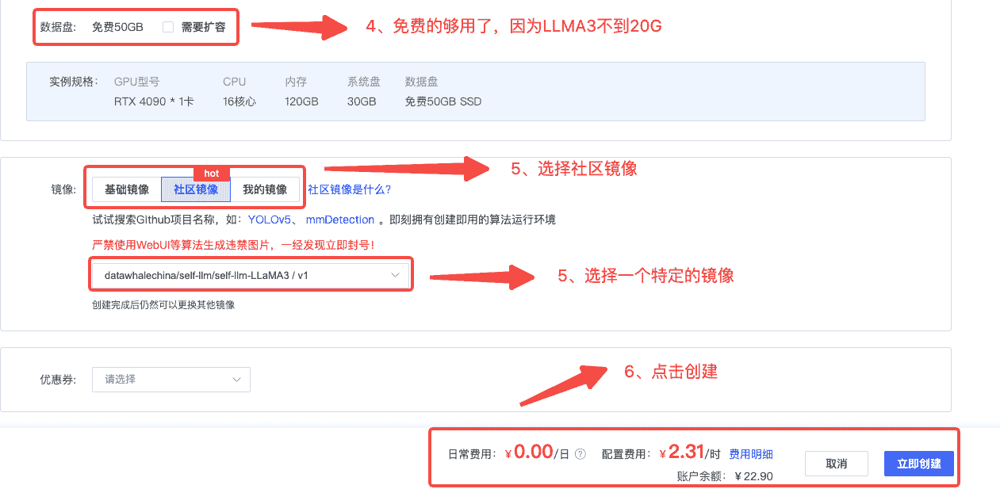

### 第四步：实例列表

+   这个创建好的实例是 Linux 系统，没有 Win 系统那样的界面，因此需要使用 JupyterLab 工具

+   如果不想使用了就关机（**注意关机不会释放你的磁盘，但是会释**放 GPU 的资源，下次开机可能没有资源）

+   没有资源咋办？使用克隆实例功能

+   每天三次足够使用了

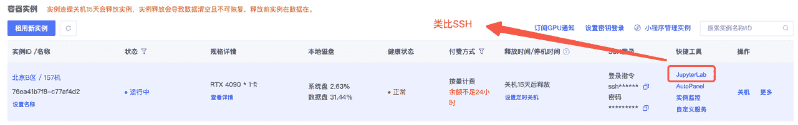

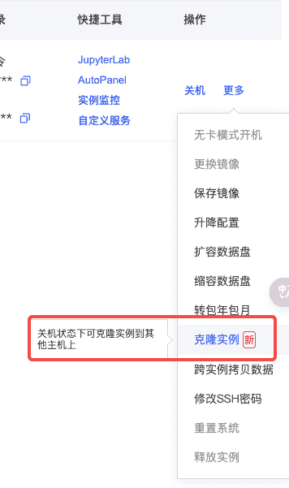

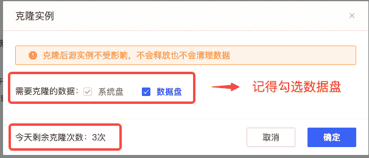

### 第五步：进入实例

+   点击 JupyterLab 按钮，进入机器页面

+   进入之后左侧是文件空间，右侧是 shell 界面（Linux 系统）

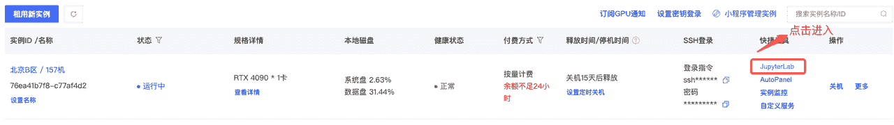

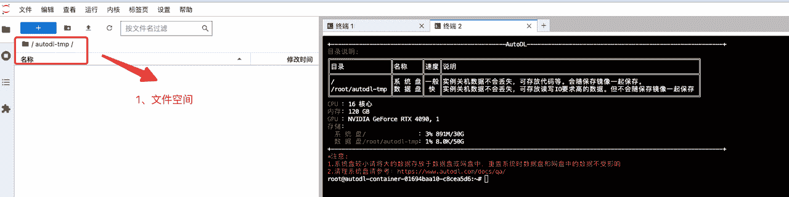

恭喜你，到这一步，你已经拥有了自己的可以本地运行大模型的服务器啦！

## 下载大模型

### 两个开源社区

在我们下载大模型之前，先来介绍两个重要的开源社区：

+   HuggingFace

+   ModelScope（魔搭社区）

HuggingFace 是一家成立于纽约的 AI 研究公司，以其开源项目 Transformers 库而闻名，该库聚焦于自然语言处理（NLP）和机器学习，并支持超过 100 种语言的模型。HuggingFace 强调社区协作，致力于使 AI 更加民主化，为研究人员和开发者提供强大的工具，以推动人工智能技术的进步和应用。

ModelScope（魔搭社区）是由中国的科技巨头阿里巴巴集团旗下的阿里云推出的一个开源平台。该平台专注于提供各种 AI 模型，包括但不限于自然语言处理、计算机视觉和音频处理。ModelScope 旨在简化 AI 模型的开发和部署过程，使技术更加透明和容易访问，特别是为中国的开发者和研究机构提供支持。

这两个平台可以简单理解为开源大模型的仓库。从这些平台，我们可以下载到各种开源的大模型。

他们的区别可以类比于 github 和 gitee 的区别：HuggingFace 是国际上的平台，而 ModelScope 则是国内的平台。

1.  创建下载大模型的 Python 脚本文件：download.py

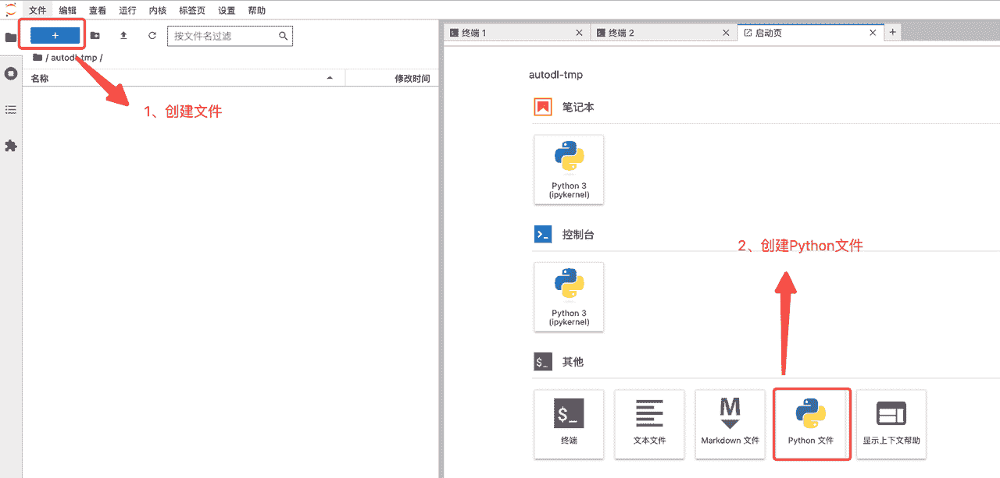

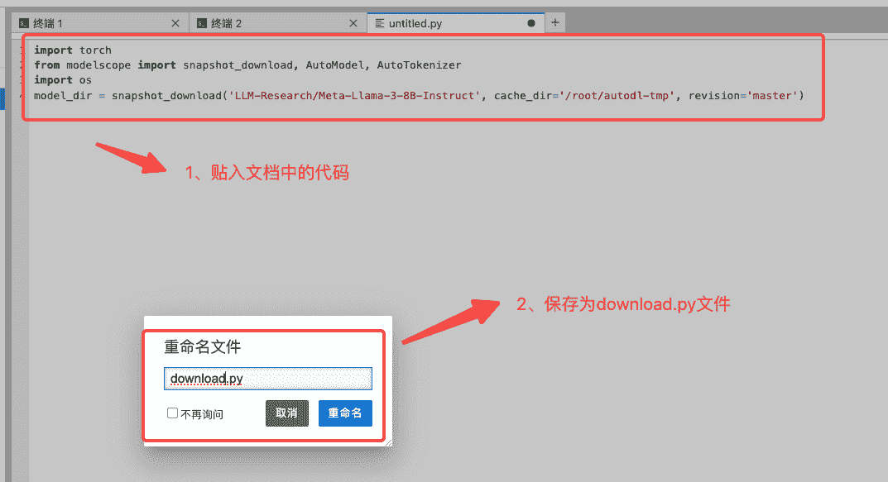

```
import torch
from modelscope import snapshot_download, AutoModel, AutoTokenizer
import os
model_dir = snapshot_download(&#x27;LLM-Research/Meta-Llama-3-8B-Instruct&#x27;, cache_dir=&#x27;/root/autodl-tmp&#x27;, revision=&#x27;master&#x27;)
```

1.  执行 Python 脚本，下载大模型

```
## 在命令行执行如下命令
## 1. 切换文件路径
cd /root/autodl-tmp/

## 下载大模型
python download.py
```

出现如下界面则代表模型开始下载中，预计下载 5 分钟

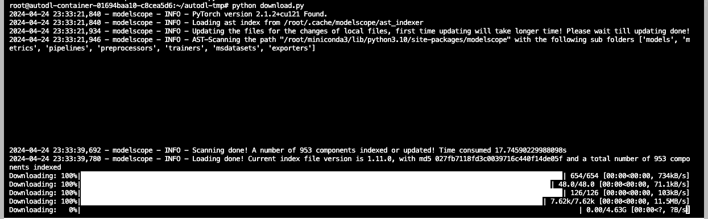

1.  **下载完成**

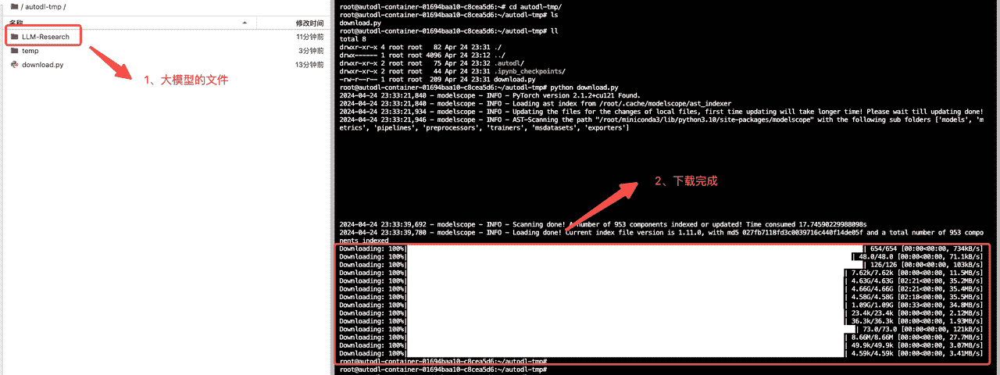

我相信到这一步，你一定更有成就感了，大模型也不再是那么遥不可及的技术了，就是一个十几 G 的文件嘛！

## 使用 Llama3 进行推理

我们下载大模型为了干嘛？当然是为了跟他对话！或者用更专业的话叫做使用 Llama3 进行推理

其实就跟你和 ChatGPT 或者 Kimi 对话一样。

这里有两种方式对话，可以使用 API，也可以部署一个简单的界面。

由于这里我们面向的是小白，所以 [API 我们就不写了，感兴趣的参考文档：self-llm/L](https://github.com/datawhalechina/self-llm/blob/master/models/Llama3_1/01-Llama3_1-8B-Instruct%20FastApi%20%E9%83%A8%E7%BD%B2%E8%B0%83%E7%94%A8.md)LaMA3/01-LLaMA3-8B-Instruct FastApi 部署调用

### 部署 webdemo 服务

老规矩，我给你代码，你照抄执行就可以了

1.  在/root/autodl-tmp路径下新建 chatBot.py 文件并在其中输入以下内容，粘贴代码后记得保存文件

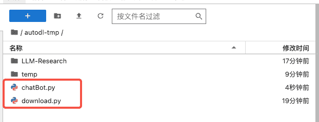

```
from transformers import AutoTokenizer, AutoModelForCausalLM
import torch
import streamlit as st

# 在侧边栏中创建一个标题和一个链接
with st.sidebar:
    st.markdown(&quot;## LLaMA3 LLM&quot;)
    &quot;[开源大模型食用指南 self-llm](https://github.com/datawhalechina/self-llm.git)&quot;

# 创建一个标题和一个副标题
st.title(&quot;💬 LLaMA3 Chatbot&quot;)
st.caption(&quot;🚀 A streamlit chatbot powered by Self-LLM&quot;)

# 定义模型路径
mode_name_or_path = &#x27;/root/autodl-tmp/LLM-Research/Meta-Llama-3-8B-Instruct&#x27;

# 定义一个函数，用于获取模型和tokenizer
@st.cache_resource
def get_model():
    # 从预训练的模型中获取tokenizer
    tokenizer = AutoTokenizer.from_pretrained(mode_name_or_path, trust_remote_code=True)
    tokenizer.pad_token = tokenizer.eos_token
    # 从预训练的模型中获取模型，并设置模型参数
    model = AutoModelForCausalLM.from_pretrained(mode_name_or_path, torch_dtype=torch.bfloat16).cuda()
  
    return tokenizer, model

def bulid_input(prompt, history=[]):
    system_format=&#x27;&lt;|begin_of_text|&gt;&lt;|start_header_id|&gt;system&lt;|end_header_id|&gt;\n\n{content}&lt;|eot_id|&gt;&#x27;
    user_format=&#x27;&lt;|start_header_id|&gt;user&lt;|end_header_id|&gt;\n\n{content}&lt;|eot_id|&gt;&#x27;
    assistant_format=&#x27;&lt;|start_header_id|&gt;assistant&lt;|end_header_id|&gt;\n\n{content}&lt;|eot_id|&gt;\n&#x27;
    history.append({&#x27;role&#x27;:&#x27;user&#x27;,&#x27;content&#x27;:prompt})
    prompt_str = &#x27;&#x27;
    # 拼接历史对话
    for item in history:
        if item[&#x27;role&#x27;]==&#x27;user&#x27;:
            prompt_str+=user_format.format(content=item[&#x27;content&#x27;])
        else:
            prompt_str+=assistant_format.format(content=item[&#x27;content&#x27;])
    return prompt_str + &#x27;&lt;|start_header_id|&gt;assistant&lt;|end_header_id|&gt;\n\n&#x27;

# 加载LLaMA3的model和tokenizer
tokenizer, model = get_model()

# 如果session_state中没有&quot;messages&quot;，则创建一个包含默认消息的列表
if &quot;messages&quot; not in st.session_state:
    st.session_state[&quot;messages&quot;] = []

# 遍历session_state中的所有消息，并显示在聊天界面上
for msg in st.session_state.messages:
    st.chat_message(msg[&quot;role&quot;]).write(msg[&quot;content&quot;])

# 如果用户在聊天输入框中输入了内容，则执行以下操作
if prompt := st.chat_input():
    
    # 在聊天界面上显示用户的输入
    st.chat_message(&quot;user&quot;).write(prompt)
    
    # 构建输入
    input_str = bulid_input(prompt=prompt, history=st.session_state[&quot;messages&quot;])
    input_ids = tokenizer.encode(input_str, add_special_tokens=False, return_tensors=&#x27;pt&#x27;).cuda()
    outputs = model.generate(
        input_ids=input_ids, max_new_tokens=512, do_sample=True,
        top_p=0.9, temperature=0.5, repetition_penalty=1.1, eos_token_id=tokenizer.eos_token_id
        )
    outputs = outputs.tolist()[0][len(input_ids[0]):]
    response = tokenizer.decode(outputs)
    response = response.strip().replace(&#x27;&lt;|eot_id|&gt;&#x27;, &quot;&quot;).replace(&#x27;&lt;|start_header_id|&gt;assistant&lt;|end_header_id|&gt;\n\n&#x27;, &#x27;&#x27;).strip()

    # 将模型的输出添加到session_state中的messages列表中
    # st.session_state.messages.append({&quot;role&quot;: &quot;user&quot;, &quot;content&quot;: prompt})
    st.session_state.messages.append({&quot;role&quot;: &quot;assistant&quot;, &quot;content&quot;: response})
    # 在聊天界面上显示模型的输出
    st.chat_message(&quot;assistant&quot;).write(response)
    print(st.session_state)
```

1.  启动 Webdemo 服务

**在终端中****运行以下命令****，启动 streamli**t 服务，并按照 autodl 的指示将端口映射到本地，然后在浏览器中打开链接 http://localhost:6006/ ，即可看到聊天界面。

```
streamlit run /root/autodl-tmp/chatBot.py --server.address 127.0.0.1 --server.port 6006
```

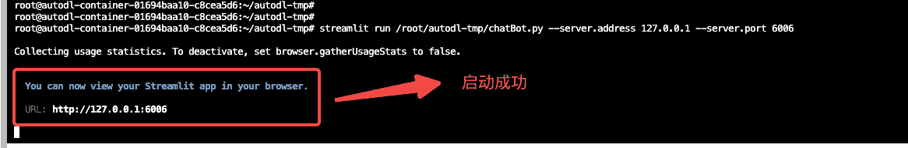

**OK，这我们**已经完成了 webdemo 的部署，接下来就是：如何访问页面

### 将服务对外暴露

在访问 Webdemo（就是对话页面）之前，我们需要了解这台机器是 Linux 机器，没有办法像 Windows 一样提供页面，所以我们需要将服务的端口暴露到公网，通过我们自己的电脑浏览器来访问这个页面。

但是呢，由于我们选择的是北京区的服务器，由于地区敏感性，不允许暴露公网地址，因此 AutoDL 提供了一个手段可以让我们通过本地电脑的 localhost 地址来访问这个页面

1.  使用自定义服务，根据自己的机器选择不同的方式

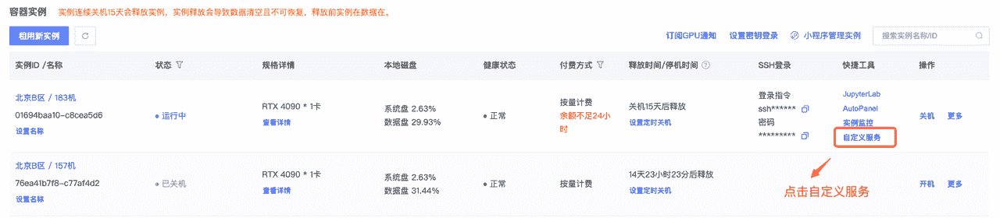

官方的教程已经很通俗易懂了，这里我就不再额外多此一举啦！

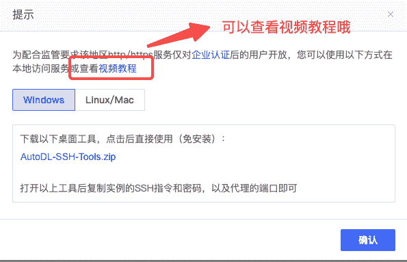

### 和 Llama3 进行对话！

直接访问：http://localhost:6006/

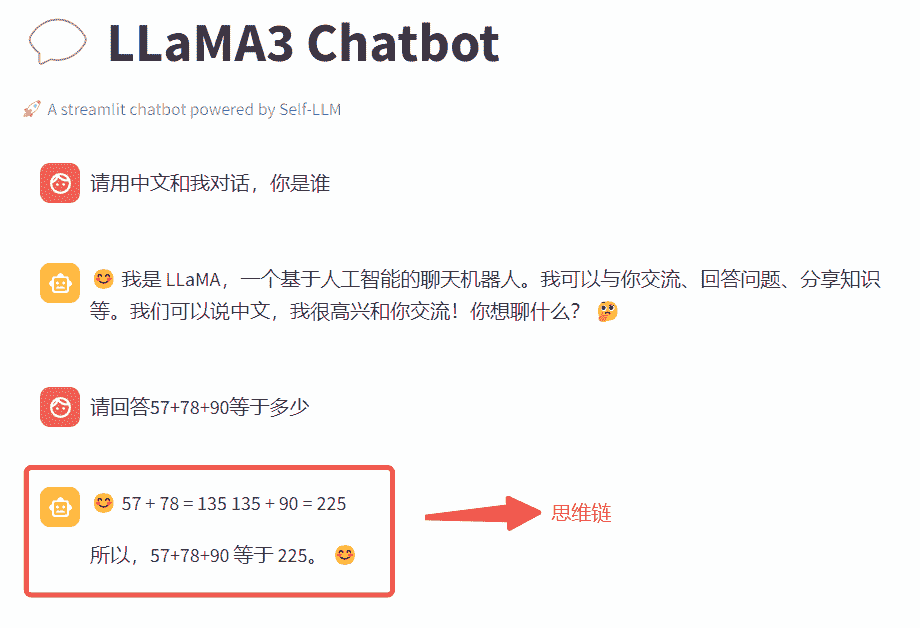

如果你跟到了这一步！那么恭喜你，你已经成功部署了 Llama3 这个大模型！

## 微调 Llama3

### 下载数据集

大模型微调的意义在于学习新的知识，因此我们需要使用一份叫做数据集的东西。

数据集就是用来让大模型重新学习的知识

[数据集的获取以及简单的原理可以参考文档：self-llm/LLaMA3/04-LLaMA](https://github.com/datawhalechina/self-llm/blob/master/LLaMA3/04-LLaMA3-8B-Instruct%20Lora%20%E5%BE%AE%E8%B0%83.md)3-8B-Instruct Lora 微调。md at master · datawhalechina/self-llm

数据集：json 下载地址：[https://github.com/datawhalechina/se](https://github.com/datawhalechina/self-llm/blob/master/dataset/huanhuan.json)lf-llm/blob/master/dataset/huanhuan.json


[huanhuan.json](https://internal-api-drive-stream.feishu.cn/space/api/box/stream/download/all/KRXgbhipYohxQ0xdb2OcLMZDnie)

### 进行微调

有了数据集，就可以使用代码进行微调了。

1.  首先我们把数据集上传到你的服务器

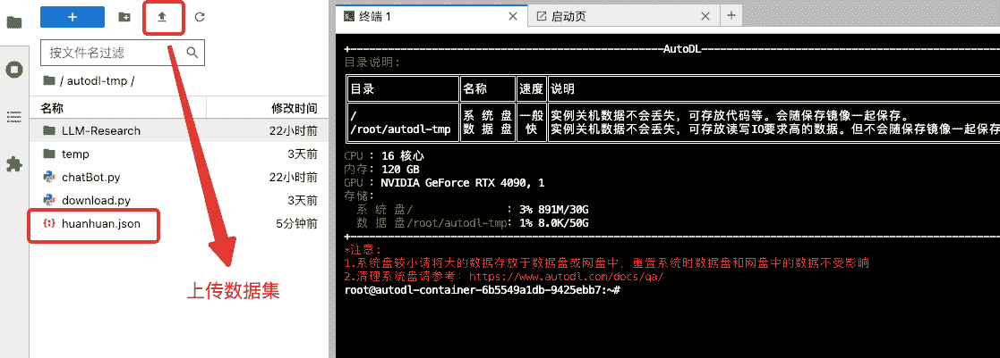

1.  编写微调代码

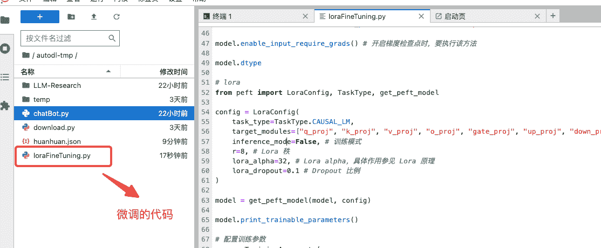

**代码如下：**

```
# 导入环境
from datasets import Dataset
import pandas as pd
from transformers import AutoTokenizer, AutoModelForCausalLM, DataCollatorForSeq2Seq, TrainingArguments, Trainer, GenerationConfig

# 将JSON文件转换为CSV文件
df = pd.read_json(&#x27;./huanhuan.json&#x27;)
ds = Dataset.from_pandas(df)

ds[:3]

# 处理数据集
tokenizer = AutoTokenizer.from_pretrained(&#x27;/root/autodl-tmp/LLM-Research/Meta-Llama-3-8B-Instruct&#x27;, use_fast=False, trust_remote_code=True)
tokenizer.pad_token = tokenizer.eos_token

tokenizer.pad_token, tokenizer.pad_token_id, tokenizer.eos_token_id

def process_func(example):
    MAX_LENGTH = 384
    input_ids, attention_mask, labels = [], [], []
    instruction = tokenizer(f&quot;user\\n\\n{example[&#x27;instruction&#x27;] + example[&#x27;input&#x27;]}assistant\\n\\n&quot;, add_special_tokens=False)
    response = tokenizer(f&quot;{example[&#x27;output&#x27;]}&quot;, add_special_tokens=False)
    input_ids = instruction[&quot;input_ids&quot;] + response[&quot;input_ids&quot;] + [tokenizer.pad_token_id]
    attention_mask = instruction[&quot;attention_mask&quot;] + response[&quot;attention_mask&quot;] + [1]
    labels = [-100] * len(instruction[&quot;input_ids&quot;]) + response[&quot;input_ids&quot;] + [tokenizer.pad_token_id]
    if len(input_ids) &gt; MAX_LENGTH:
        input_ids = input_ids[:MAX_LENGTH]
        attention_mask = attention_mask[:MAX_LENGTH]
        labels = labels[:MAX_LENGTH]
    return {
        &quot;input_ids&quot;: input_ids,
        &quot;attention_mask&quot;: attention_mask,
        &quot;labels&quot;: labels
    }

tokenized_id = ds.map(process_func, remove_columns=ds.column_names)

print(tokenizer.decode(tokenized_id[0][&#x27;input_ids&#x27;]))

tokenizer.decode(list(filter(lambda x: x != -100, tokenized_id[1][&quot;labels&quot;])))

# 创建模型
import torch

model = AutoModelForCausalLM.from_pretrained(&#x27;/root/autodl-tmp/LLM-Research/Meta-Llama-3-8B-Instruct&#x27;, device_map=&quot;auto&quot;, torch_dtype=torch.bfloat16)

model.enable_input_require_grads() # 开启梯度检查点时，要执行该方法

model.dtype

# lora
from peft import LoraConfig, TaskType, get_peft_model

config = LoraConfig(
    task_type=TaskType.CAUSAL_LM, 
    target_modules=[&quot;q_proj&quot;, &quot;k_proj&quot;, &quot;v_proj&quot;, &quot;o_proj&quot;, &quot;gate_proj&quot;, &quot;up_proj&quot;, &quot;down_proj&quot;],
    inference_mode=False, # 训练模式
    r=8, # Lora 秩
    lora_alpha=32, # Lora alpha，具体作用参见 Lora 原理
    lora_dropout=0.1 # Dropout 比例
)

model = get_peft_model(model, config)

model.print_trainable_parameters()

# 配置训练参数
args = TrainingArguments(
    output_dir=&quot;./output/llama3&quot;,
    per_device_train_batch_size=4,
    gradient_accumulation_steps=4,
    logging_steps=10,
    num_train_epochs=3,
    save_steps=100,
    learning_rate=1e-4,
    save_on_each_node=True,
    gradient_checkpointing=True
)

trainer = Trainer(
    model=model,
    args=args,
    train_dataset=tokenized_id,
    data_collator=DataCollatorForSeq2Seq(tokenizer=tokenizer, padding=True),
)

trainer.train()

# 保存 LoRA 和 tokenizer 结果
peft_model_id=&quot;./llama3_lora&quot;
trainer.model.save_pretrained(peft_model_id)
tokenizer.save_pretrained(peft_model_id)
```

1.  执行微调代码

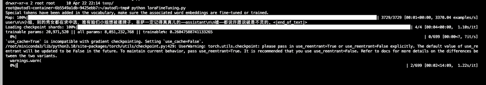

```
## 进入对应目录下
cd /root/autodl-tmp/

## 执行微调代码
python loraFineTuning.py
```

1.  微调完成

大概 15 分钟左右就可以微调完成

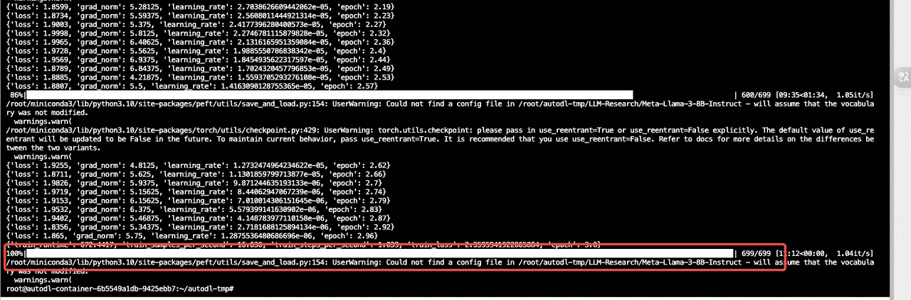

### 微调后的测试

在完成微调之后，我们需要对微调后的结果进行测试，在测试之前，我们需要先了解两个概念

+   **微调不会直接影响原有的大模型**，而是生成一些文件，让我们可以在原有大模型的基础上结合这些文件来实现微调后的能力。这些文件通常包括（这篇文章不做过多解释）：

+   模型权重文件

+   配置文件

+   训练元数据

+   优化器状态

+   微调后的文件是可以和原有大模型合并并输出新的大模型的

我们先通过不合并的方式进行微调结果的验证。

因为我们的数据集中有这么一个问答：

问：你是谁？

答：家父是大理寺少卿甄远道

因此当我们给微调后的模型指定一个角色时：“现在你要扮演皇帝身边的女人--甄嬛”，然后我们问模型：你是谁？如果模型的回答是：“家父是大理寺少卿甄远道”，那我们就认为模型微调有效果！

1.  测试代码

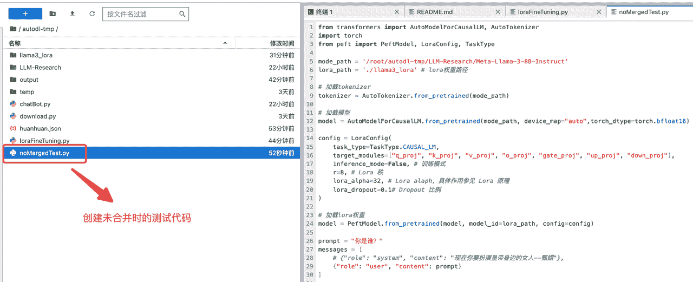

```
##切换到代码目录
cd /root/autodl-tmp/

## 执行测试命令
python noMergedTest.py
```

**结果如下，成功啦！**

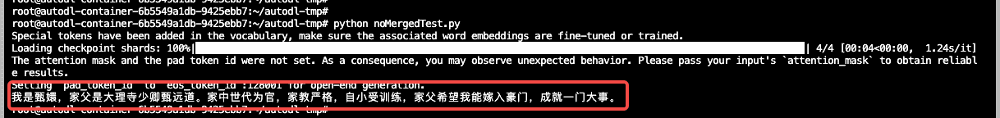

**代码如下：**

```
from transformers import AutoModelForCausalLM, AutoTokenizer
import torch
from peft import PeftModel, LoraConfig, TaskType

mode_path = &#x27;/root/autodl-tmp/LLM-Research/Meta-Llama-3-8B-Instruct&#x27;
lora_path = &#x27;./llama3_lora&#x27; # lora权重路径

# 加载tokenizer
tokenizer = AutoTokenizer.from_pretrained(mode_path)

# 加载模型
model = AutoModelForCausalLM.from_pretrained(mode_path, device_map=&quot;auto&quot;,torch_dtype=torch.bfloat16)

config = LoraConfig(
    task_type=TaskType.CAUSAL_LM,
    target_modules=[&quot;q_proj&quot;, &quot;k_proj&quot;, &quot;v_proj&quot;, &quot;o_proj&quot;, &quot;gate_proj&quot;, &quot;up_proj&quot;, &quot;down_proj&quot;],
    inference_mode=False, # 训练模式
    r=8, # Lora 秩
    lora_alpha=32, # Lora alaph，具体作用参见 Lora 原理
    lora_dropout=0.1# Dropout 比例
)

# 加载lora权重
model = PeftModel.from_pretrained(model, model_id=lora_path, config=config)

prompt = &quot;你是谁？&quot;
messages = [
    # {&quot;role&quot;: &quot;system&quot;, &quot;content&quot;: &quot;现在你要扮演皇帝身边的女人--甄嬛&quot;},
    {&quot;role&quot;: &quot;user&quot;, &quot;content&quot;: prompt}
]

text = tokenizer.apply_chat_template(messages, tokenize=False, add_generation_prompt=True)

model_inputs = tokenizer([text], return_tensors=&quot;pt&quot;).to(&#x27;cuda&#x27;)

generated_ids = model.generate(
    model_inputs.input_ids,
    max_new_tokens=512
)
generated_ids = [
    output_ids[len(input_ids):] for input_ids, output_ids in zip(model_inputs.input_ids, generated_ids)
]

response = tokenizer.batch_decode(generated_ids, skip_special_tokens=True)[0]

print(response)
```

### 将微调结果合并到模型

既然我们已经测试了，那我们就将微调的结果和原有大模型进行合并，然后输出新的模型，使用 webdemo 进行测试。

1.  合并代码

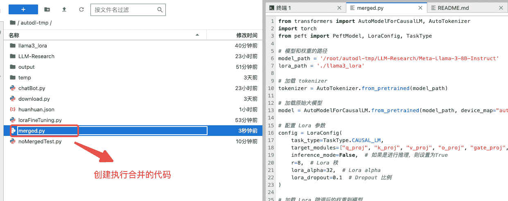

切换到对应的目录

```
##切换到代码目录
cd /root/autodl-tmp/

## 执行测试命令
python mergedTest.py
```

执行完成后会生成如下文件

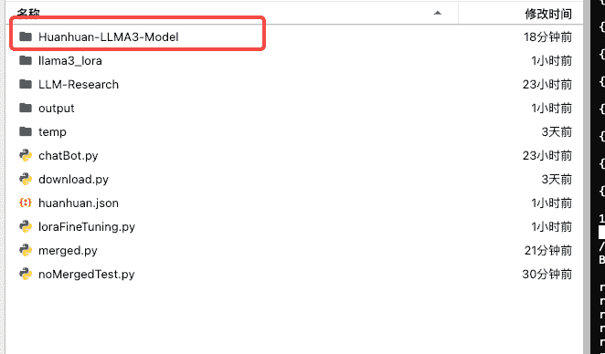

代码如下：

```
from transformers import AutoModelForCausalLM, AutoTokenizer
import torch
from peft import PeftModel, LoraConfig, TaskType

# 模型和权重的路径
model_path = &#x27;/root/autodl-tmp/LLM-Research/Meta-Llama-3-8B-Instruct&#x27;
lora_path = &#x27;./llama3_lora&#x27;

# 加载 tokenizer
tokenizer = AutoTokenizer.from_pretrained(model_path)

# 加载原始大模型
model = AutoModelForCausalLM.from_pretrained(model_path, device_map=&quot;auto&quot;, torch_dtype=torch.bfloat16)

# 配置 Lora 参数
config = LoraConfig(
    task_type=TaskType.CAUSAL_LM,
    target_modules=[&quot;q_proj&quot;, &quot;k_proj&quot;, &quot;v_proj&quot;, &quot;o_proj&quot;, &quot;gate_proj&quot;, &quot;up_proj&quot;, &quot;down_proj&quot;],
    inference_mode=False,  # 如果是进行推理，则设置为True
    r=8,  # Lora 秩
    lora_alpha=32,  # Lora alpha
    lora_dropout=0.1  # Dropout 比例
)

# 加载 Lora 微调后的权重到模型
model = PeftModel.from_pretrained(model, model_id=lora_path, config=config)

# 现在模型已经整合了微调后的权重，我们可以将其保存为一个新的模型
model.save_pretrained(&#x27;/root/autodl-tmp/Huanhuan-Llama3-Model&#x27;)

# 你也可以保存 tokenizer 如果需要
tokenizer.save_pretrained(&#x27;/root/autodl-tmp/Huanhuan-Llama3-Model&#x27;)

```

### 使用 webdemo 测试合并后的模型

OK，马上到最后一步啦，接下来我们就使用 webdemo 来测试一把新的模型

1.  创建 chatBotLora.py 文件，将下面的代码复制进去

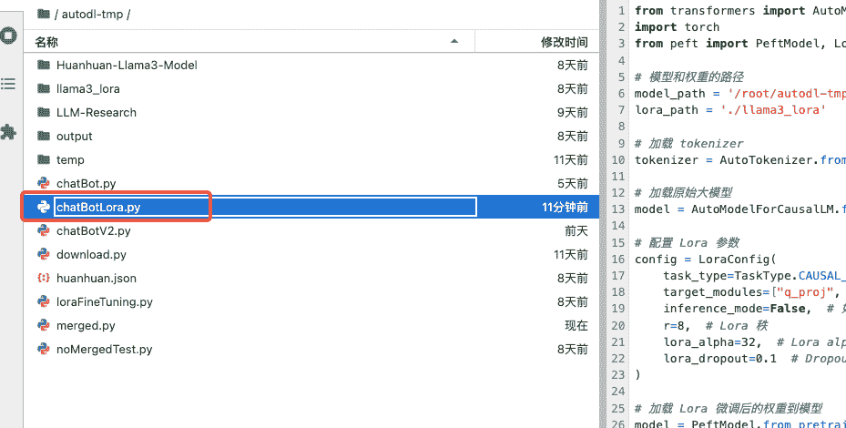

```
from transformers import AutoTokenizer, AutoModelForCausalLM
import torch
import streamlit as st

# 在侧边栏中创建一个标题和一个链接
with st.sidebar:
    st.markdown(&quot;## LLaMA3 LLM&quot;)
    &quot;[开源大模型食用指南 self-llm](https://github.com/datawhalechina/self-llm.git)&quot;

# 创建一个标题和一个副标题
st.title(&quot;💬 LLaMA3 Chatbot&quot;)
st.caption(&quot;🚀 A streamlit chatbot powered by Self-LLM&quot;)

# 定义模型路径
mode_name_or_path = &#x27;/root/autodl-tmp/Huanhuan-Llama3-Model&#x27;

# 定义一个函数，用于获取模型和tokenizer
@st.cache_resource
def get_model():
    # 从预训练的模型中获取tokenizer
    tokenizer = AutoTokenizer.from_pretrained(mode_name_or_path, trust_remote_code=True)
    tokenizer.pad_token = tokenizer.eos_token
    # 从预训练的模型中获取模型，并设置模型参数
    model = AutoModelForCausalLM.from_pretrained(mode_name_or_path, torch_dtype=torch.bfloat16).cuda()
  
    return tokenizer, model

def bulid_input(prompt, history=[]):
    system_format=&#x27;&lt;|begin_of_text|&gt;&lt;|start_header_id|&gt;system&lt;|end_header_id|&gt;\n\n{content}&lt;|eot_id|&gt;&#x27;
    user_format=&#x27;&lt;|start_header_id|&gt;user&lt;|end_header_id|&gt;\n\n{content}&lt;|eot_id|&gt;&#x27;
    assistant_format=&#x27;&lt;|start_header_id|&gt;assistant&lt;|end_header_id|&gt;\n\n{content}&lt;|eot_id|&gt;\n&#x27;
    history.append({&#x27;role&#x27;:&#x27;user&#x27;,&#x27;content&#x27;:prompt})
    prompt_str = &#x27;&#x27;
    # 拼接历史对话
    for item in history:
        if item[&#x27;role&#x27;]==&#x27;user&#x27;:
            prompt_str+=user_format.format(content=item[&#x27;content&#x27;])
        else:
            prompt_str+=assistant_format.format(content=item[&#x27;content&#x27;])
    return prompt_str + &#x27;&lt;|start_header_id|&gt;assistant&lt;|end_header_id|&gt;\n\n&#x27;

# 加载LLaMA3的model和tokenizer
tokenizer, model = get_model()

# 如果session_state中没有&quot;messages&quot;，则创建一个包含默认消息的列表
if &quot;messages&quot; not in st.session_state:
    st.session_state[&quot;messages&quot;] = []

# 遍历session_state中的所有消息，并显示在聊天界面上
for msg in st.session_state.messages:
    st.chat_message(msg[&quot;role&quot;]).write(msg[&quot;content&quot;])

# 如果用户在聊天输入框中输入了内容，则执行以下操作
if prompt := st.chat_input():
    
    # 在聊天界面上显示用户的输入
    st.chat_message(&quot;user&quot;).write(prompt)
    
    # 构建输入
    input_str = bulid_input(prompt=prompt, history=st.session_state[&quot;messages&quot;])
    input_ids = tokenizer.encode(input_str, add_special_tokens=False, return_tensors=&#x27;pt&#x27;).cuda()
    outputs = model.generate(
        input_ids=input_ids, max_new_tokens=512, do_sample=True,
        top_p=0.9, temperature=0.5, repetition_penalty=1.1, eos_token_id=tokenizer.eos_token_id
        )
    outputs = outputs.tolist()[0][len(input_ids[0]):]
    response = tokenizer.decode(outputs)
    print(&quot;原始输出:&quot;, response)  # 打印原始输出检查
    response = response.strip().replace(&#x27;&lt;|eot_id|&gt;&#x27;, &quot;&quot;).replace(&#x27;&lt;|start_header_id|&gt;assistant&lt;|end_header_id|&gt;\n\n&#x27;, &#x27;&#x27;).strip()
    response = response.replace(&#x27;&lt;|end_of_text|&gt;&#x27;, &#x27;&#x27;).strip()
    print(&quot;处理后输出:&quot;, response)  # 打印原始输出检查

    # 将模型的输出添加到session_state中的messages列表中
    # st.session_state.messages.append({&quot;role&quot;: &quot;user&quot;, &quot;content&quot;: prompt})
    st.session_state.messages.append({&quot;role&quot;: &quot;assistant&quot;, &quot;content&quot;: response})
    # 在聊天界面上显示模型的输出
    st.chat_message(&quot;assistant&quot;).write(response)
    print(st.session_state)
```

1.  执行代码，本地测试

```
streamlit run /root/autodl-tmp/chatBotLora.py --server.address 127.0.0.1 --server.port 6006
```

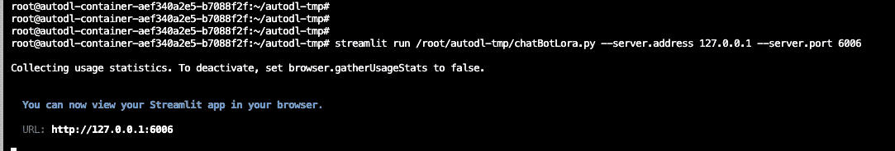

1.  开启自定义服务，验收成功啦！

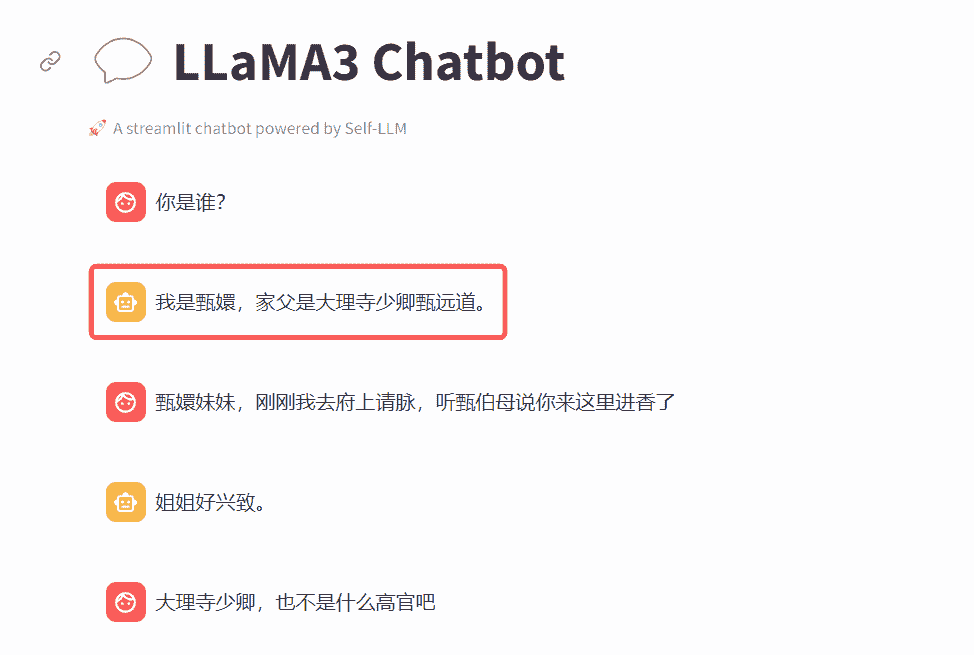

## 四、写在最后

这篇教程到这里就结束啦！如果你对大模型技术感兴趣，欢迎联系我一起探索，未知的才是最有趣的！

最后分享一句我很喜欢的话：看十遍不如实践一遍，实践十遍不如分享一遍

与诸君共勉！