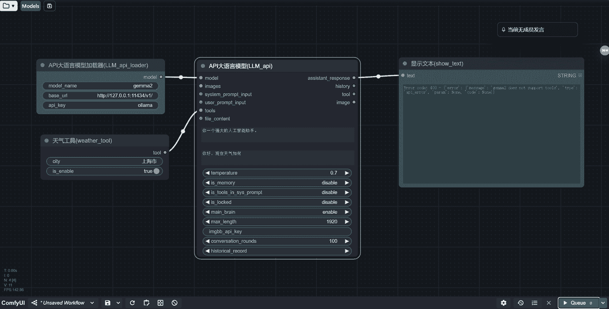
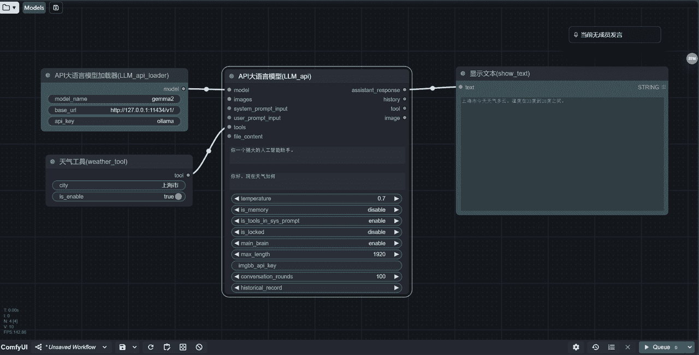
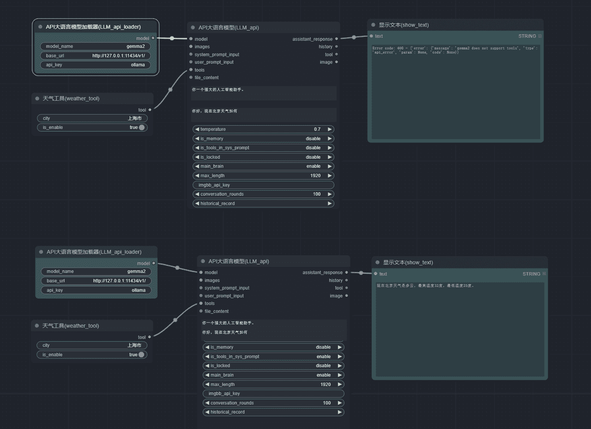

# 无需微调，仅用提示词工程就能让 LLM 获得 tool calling 的功能

> 来源：[https://v11enp9ok1h.feishu.cn/docx/D5khdBiCio4ePIx0KGBcZkIxnvb](https://v11enp9ok1h.feishu.cn/docx/D5khdBiCio4ePIx0KGBcZkIxnvb)

目前，绝大多数小型本地开源大语言模型以及部分商用大模型接口都不支持稳定的 tool calling 功能。而现有的解决方案是微调 LLM，这导致大量的时间和算力被浪费。本文提出一种仅使用提示词工程和一些精巧的代码设计，即可让 LLM 获得稳定的 tool calling 能力。本文使用多个不具备 tool calling 能力的 LLM 作为测试模型，在多个工具调用任务上进行实验，成功率为 100%。本文所有工作是基于 comfyui 开发，适合完全没有代码基础的小伙伴们复现并且按自己的想法修改我的工作。

# 效果展示

## 1、实验任务

本文以目前主流的小型开源模型 llama3-8b、gemma2-9b、qwen2-7b、mistral-7b 的 ollama 量化版本作为测试模型，将如下调用工具作为测试任务，并以不同的提问方式测试 10 次：

1.  查询不同时区的实时时间；

1.  查询不同地点的实时天气；

1.  谷歌搜索相关信息后回答最近发生的事情；

1.  使用 python 解释器计算数学问题；

1.  搜索本地文件信息回答问题；

1.  查询 arxiv 上的相关论文；

1.  搜索本地知识图谱回答问题。

## 2、实验设备及平台

测试使用的设备为 nvidia 的 GeForce RTX 4080，搭建智能体的平台为笔者 ailm 自己开发的开源项目：

该项目已经在 github 上开源。如果需要快速复现本文的成果可以下载该项目做测试。

## 3、实验结果

表格 1 为多个模型在多个 tool calling 任务下的使用本文提出的提示词工程后调用工具的成功次数。对于不使用提示词注入方法的模型，工具信息会以 tool 接口传入这些模型，但是由于这些模型不支持 tool calling 功能，所以不可能会调用这些 tool。

表格 1 使用提示词工程后调用工具的成功次数表

| 任务 | llama3-8b | gemma2-9b | qwen2-7b | mistral-7b |
| --- | --- | --- | --- | --- |
| 查询实时时间 | 10 | 10 | 10 | 10 |
| 查询实时天气 | 10 | 10 | 10 | 10 |
| 谷歌搜索 | 10 | 10 | 10 | 10 |
| python 解释器 | 1 | 10 | 10 | 2 |
| 搜索本地文件 | 10 | 10 | 10 | 8 |
| 查询 arxiv | 10 | 10 | 10 | 10 |
| 搜索知识图谱 | 10 | 10 | 1 | 1 |

表格 1 中，所有模型都能成功执行调用工具这一步，正确输出了能被正则表达式抓取的字典，但是受限于代码生成水平限制，在使用 python 解释器任务上，ollama 量化版本的 llama3-8b 和 mistral-7b 模型不能很好地输出正确的代码，导致无法稳定的完成计算任务。在搜索知识图谱任务上，所有模型都成功让工具返回了相关的知识，但是受限于逻辑理解能力限制，ollama 量化版本的 qwen2-7b 和 mistral-7b 模型不能稳定地理解知识图谱中多个关系边之间的逻辑关系。该实验结果证明，提示词工程可以让完全不具备 tool calling 能力的 LLM 获得 tool calling 能力，但是能否真正利用上工具返回的信息，从而解决用户的问题，还是受限于 LLM 自身的智能水平，在较大的模型（gemma2-9b）上，对工具返回的结果的利用能力明显更加的稳定。

下图为 gemma2-9b 调用天气工具时的输出结果：



当不使用提示词工程时，图中 is_tools_in_sys_prompt 属性为 disable，gemma2-9b 模型的接口直接拒绝了 tool 输入。



当使用提示词工程时，图中 is_tools_in_sys_prompt 属性为 enable，gemma2-9b 模型给出了正确的实时天气信息。

# 无代码开发

## 1、Comfyui 下载

如果你是一个 AI 绘图工作者，你一定对 Comfyui 并不陌生。如果你从来没有接触过 Comfyui，你需要先到 GitHub 上拉取 Comfyui 这个项目，或者你可以在 B 站下载整合包，例如：秋叶大佬的绘世整合包或者只剩一瓶辣椒酱的铁锅炖整合包。

## 2、Comfyui LLM party 下载

Comfyui LLM party 是一个以 Comfyui 作为前端的节点库，用于 LLM 智能体以及 LLM 工作流的无代码开发。功能类似于 coze、dify、flowise 等。但由于可以在 Comfyui 中直接使用，与 Comfyui 生态下的绝大部分节点都相辅相成，有着无缝接入 SD 图像流的特色。今天所介绍的麦洛薇，就是用这套节点库开发完成的。项目地址如下：

使用以下方法之一安装：

+   **方法一：**

1.  在[ comfyui 管理器](https://github.com/ltdrdata/ComfyUI-Manager)中搜索comfyui_LLM_party，一键安装

1.  重启 comfyui

+   **方法二：**

1.  导航到 ComfyUI 根文件夹中下的custom_nodes子文件夹

1.  使用克隆此存储库。git clone https://github.com/heshengtao/comfyui_LLM_party.git

## 3、工作流搭建

打开[ Comfyui](https://github.com/heshengtao/comfyui_LLM_party/blob/main/workflow/%E6%8F%90%E7%A4%BA%E8%AF%8D%E5%B7%A5%E7%A8%8B%E8%8E%B7%E5%BE%97%E5%B7%A5%E5%85%B7%E8%B0%83%E7%94%A8%E5%AF%B9%E6%AF%94%E5%AE%9E%E9%AA%8C.json) 界面后，右键点击界面，即可找到 Comfyui LLM party 的目录，你既可以如下图一样，学习如何手动连接这些节点，从而实现一个最简单的 AI 女友工作流，也可以直接将工具调用对比实验工作流文件拖拽到 Comfyui 界面中一键复刻我的提示词工程实验。



## 4、启动 ollama

从 ollama 的 github 仓库找到对应版本并下载：

启动 ollama 后，在 cmd 中输入ollama run gemma2将自动下载gemma2模型到本地并启动。将 ollama 的默认base URL=http://127.0.0.1:11434/v1/以及api_key=ollama填入 LLM 加载器节点即可调用 ollama 中的模型进行实验。

## 5、常见报错及解决方案

1.  如果 ollama 连接不上，很可能是代理服务器的问题，请将你的127.0.0.1:11434添加到不使用代理服务器的列表中。

# 实现原理

本文采用的提示词工程主要有两部分代码组成：提示词注入和工具结果回传。提示词注入用于将工具信息以及使用工具的提示词添加到系统提示中。工具结果回传则是解析 tool calling 的输出，并将工具返回的内容再次嵌入 LLM。

## 1、提示词注入阶段

```
if tools is not None:
    tools_dis = json.loads(tools)
    for tool_dis in tools_dis:
        tools_list.append(tool_dis[&quot;function&quot;])
    tools_instructions = &quot;&quot;
    tools_instruction_list = []
    for tool in tools_list:
        tools_instruction_list.append(tool[&quot;name&quot;])
        tools_instructions += (
            str(tool[&quot;name&quot;])
            + &quot;:&quot;
            + &quot;Call this tool to interact with the &quot;
            + str(tool[&quot;name&quot;])
            + &quot; API. What is the &quot;
            + str(tool[&quot;name&quot;])
            + &quot; API useful for? &quot;
            + str(tool[&quot;description&quot;])
            + &quot;. Parameters:&quot;
            + str(tool[&quot;parameters&quot;])
            + &quot;Required parameters:&quot;
            + str(tool[&quot;parameters&quot;][&quot;required&quot;])
            + &quot;\n&quot;
        )
TOOL_EAXMPLE = &quot;You will receive a JSON string containing a list of callable tools. Please parse this JSON string and return a JSON object containing the tool name and tool parameters. Here is an example of the tool list:\n\n{\&quot;tools\&quot;: [{\&quot;name\&quot;: \&quot;plus_one\&quot;, \&quot;description\&quot;: \&quot;Add one to a number\&quot;, \&quot;parameters\&quot;: {\&quot;type\&quot;: \&quot;object\&quot;,\&quot;properties\&quot;: {\&quot;number\&quot;: {\&quot;type\&quot;: \&quot;string\&quot;,\&quot;description\&quot;: \&quot;The number that needs to be changed, for example: 1\&quot;,\&quot;default\&quot;: \&quot;1\&quot;,}},\&quot;required\&quot;: [\&quot;number\&quot;]}},{\&quot;name\&quot;: \&quot;minus_one\&quot;, \&quot;description\&quot;: \&quot;Minus one to a number\&quot;, \&quot;parameters\&quot;: {\&quot;type\&quot;: \&quot;object\&quot;,\&quot;properties\&quot;: {\&quot;number\&quot;: {\&quot;type\&quot;: \&quot;string\&quot;,\&quot;description\&quot;: \&quot;The number that needs to be changed, for example: 1\&quot;,\&quot;default\&quot;: \&quot;1\&quot;,}},\&quot;required\&quot;: [\&quot;number\&quot;]}}]}\n\nBased on this tool list, generate a JSON object to call a tool. For example, if you need to add one to number 77, return:\n\n{\&quot;tool\&quot;: \&quot;plus_one\&quot;, \&quot;parameters\&quot;: {\&quot;number\&quot;: \&quot;77\&quot;}}\n\nPlease note that the above is just an example and does not mean that the plus_one and minus_one tools are currently available.&quot;
 
REUTRN_FORMAT=&quot;{\&quot;tool\&quot;: \&quot;tool name\&quot;, \&quot;parameters\&quot;: {\&quot;parameter name\&quot;: \&quot;parameter value\&quot;}}&quot;
 
INSTRUCTION = f&quot;&quot;&quot;
{TOOL_EAXMPLE}
Answer the following questions as best you can. You have access to the following APIs:
{tools_instructions}
        
Use the following format:
```tool_json
{REUTRN_FORMAT}
``` 
 
Please choose the appropriate tool according to the user&#x27;s question. If you don&#x27;t need to call it, please reply directly to the user&#x27;s question. When the user communicates with you in a language other than English, you need to communicate with the user in the same language.
 
When you have enough information from the tool results, respond directly to the user with a text message without having to call the tool again.
&quot;&quot;&quot;
system_prompt=INSTRUCTION
```

INSTRUCTION为最后注入到系统提示中的字符串，他又包含了TOOL_EAXMPLE、tools_instructions、REUTRN_FORMAT三个部分。TOOL_EAXMPLE用于提示 LLM 如何理解 tool 以及如何使用 tool。在编写TOOL_EAXMPLE时，请注意用一些无关紧要的工具作为示例，例如本文使用的将数字加一和数字减一的工具，从而避免 LLM 混淆真正可以使用的工具与示例工具。tools_instructions是由目前通用的工具字典转换成 LLM 可读的工具列表。实际使用 LLM 时，可以通过输入不同的工具来动态调整tools_instructions，让 LLM 得知目前可用的工具有哪些以及如何使用。REUTRN_FORMAT定义了调用 API 的格式。

## 2、工具结果回传阶段

利用正则表达式抓取输出中的"tool"和"parameters"参数。对于 interpreter 工具，使用了另一种正则表达式来提取 LLM 输出的代码，提高 LLM 使用 interpreter 工具的成功率。本文使用代码如下：

```
history.append({
    &quot;role&quot;: &quot;user&quot;,
    &quot;content&quot;: user_prompt.strip()
})
response= model.create_chat_completion(
    messages = history,
    max_tokens=max_length,
    temperature=temperature,
)
response_content=response[&#x27;choices&#x27;][0][&#x27;message&#x27;][&#x27;content&#x27;]
pattern = r&#x27;\{\s*&quot;tool&quot;:\s*&quot;(.*?)&quot;,\s*&quot;parameters&quot;:\s*\{(.*?)\}\s*\}&#x27;             
while re.search(pattern, response_content, re.DOTALL)!=None:
    match=re.search(pattern, response_content, re.DOTALL)
    tool = match.group(1)
    parameters = match.group(2)
json_str = &#x27;{&quot;tool&quot;: &quot;&#x27; + tool + &#x27;&quot;, &quot;parameters&quot;: {&#x27; + parameters + &#x27;}}&#x27;
parameters = json.loads(&#x27;{&#x27; +parameters+ &#x27;}&#x27;)
    results = dispatch_tool(tool, parameters)
    print(results)
    history.append({&quot;role&quot;:&quot;assistant&quot;, &quot;content&quot;: json_str})
    history.append({&quot;role&quot;: &quot;observation&quot;, &quot;content&quot;: results})
    response= model.create_chat_completion(
        messages = history,
        max_tokens=max_length,
        temperature=temperature,
    )
response_content = response.choices[0].message.content
pattern = r&quot;```python\n(.*?)\n```&quot;
while re.search(pattern, response, re.DOTALL) !=None:
    matches = re.search(pattern, response, re.DOTALL)
code = matches.group(1)    
results = interpreter(code)
print(results)
json_str = &#x27;{&quot;tool&quot;: &quot;interpreter&quot;, &quot;parameters&quot;: &#x27;+code+&#x27;}&#x27;
    history.append({&quot;role&quot;:&quot;assistant&quot;, &quot;content&quot;: json_str})
    history.append({&quot;role&quot;: &quot;observation&quot;, &quot;content&quot;: results})
    response= model.create_chat_completion(
        messages = history,
        max_tokens=max_length,
        temperature=temperature,
    )
    response_content = response.choices[0].message.content
```

通过识别 LLM 返回的调用工具的字典，提取出对应的值，再传入相应的工具函数，最后将工具返回的结果以observation的角色返回给 LLM。对于一些不接受observation、tool、function角色的 LLM 接口，可以改为回传给 user 角色，例如：

```
history.append(
    {
        &quot;role&quot;: &quot;user&quot;, 
        &quot;content&quot;: &quot;Call&quot; + tool + &quot;The result returned by the tool is:&quot; + results + &quot;. Please continue to answer my previous question based on the result returned by the tool.&quot;
    }
)
```

通过以上提示词工程，可以避免微调，让完全没有 tool calling 能力的 LLM 获得稳定的 tool calling 能力。

# 写到最后

1.  如果你使用 comfyui LLM party 时出现[技术指导](https://v11enp9ok1h.feishu.cn/docx/AHohdfhx9opKQPx8P80c9taBnEg?from=from_copylink)误，或你有一些新的想法，欢迎加入社群：

1.  github 项目地址：

1.  视频教程：