# 大模型训练与推理

> 来源：[https://v11enp9ok1h.feishu.cn/docx/KX3pdkLxcoKzbQxvuofc12S0nXc](https://v11enp9ok1h.feishu.cn/docx/KX3pdkLxcoKzbQxvuofc12S0nXc)

## 从原理到代码理解语言模型训练和推理

> 要理解大语言模型（LLM），首先要理解它的本质，无论预训练、微调还是在推理阶段，核心都是 next token prediction，也就是以自回归的方式从左到右逐步生成文本。

### 什么是token？

> token 是指文本中的一个词或者子词，给定一句文本，送入语言模型前首先要做的是对原始文本进行 `tokenize`，也就是把一个文本序列拆分为离散的 token 序列

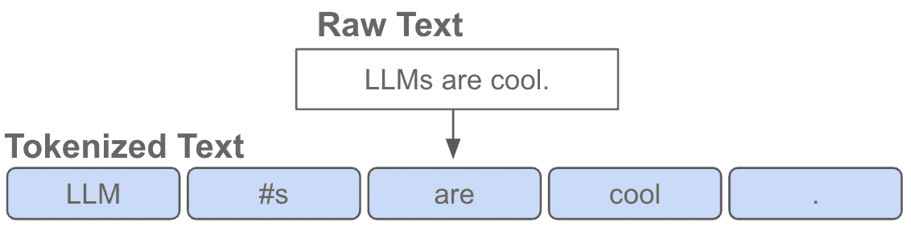

+ 其中，`tokenize` 是在无标签的语料上训练得到的一个 token 数量固定且唯一的分词器，这里的 token 数量就是大家常说的词表，也就是语言模型知道的所有 tokens。

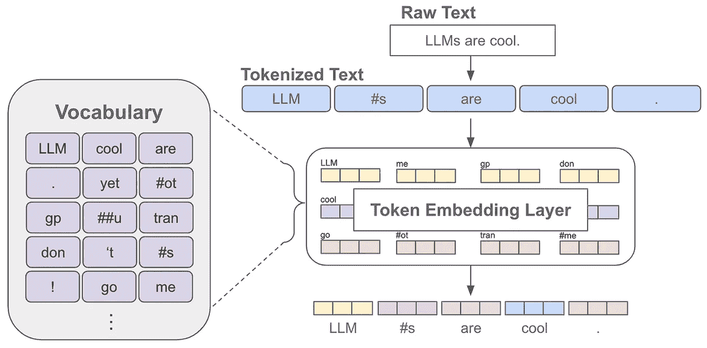

> 我们知道文本序列是有顺序的，而常见的语言模型都是基于注意力机制的 `transformer` 结构，无法自动考虑文本的前后顺序，因此需要手动加上位置编码，也就是每个位置有一个位置 `embedding`，然后和对应位置的 token `embedding` 进行相加

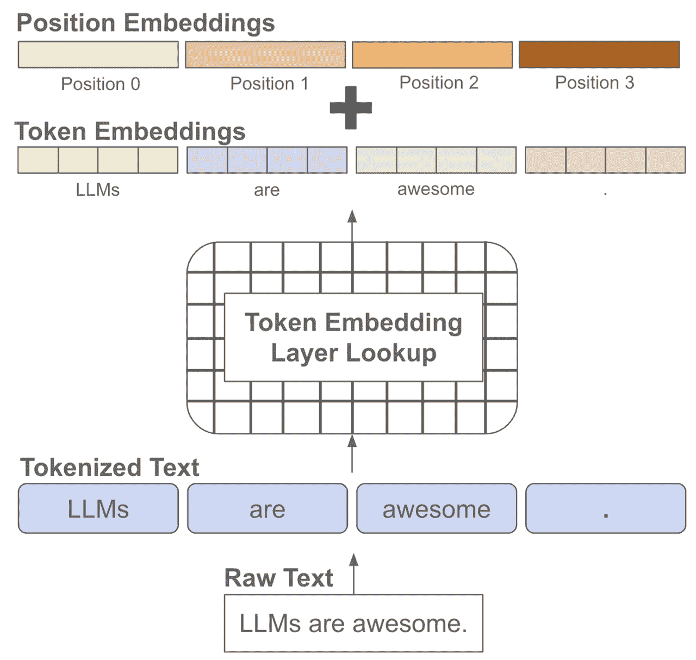

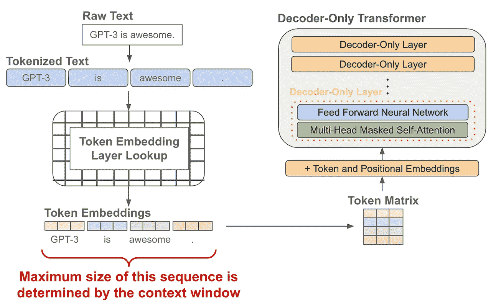

> 在模型训练或推理阶段大家经常会听到上下文长度这个词，它指的是模型训练时接收的 token 训练的最大长度，如果在训练阶段只学习了一个较短长度的位置 `embedding`，那模型在推理阶段就不能够适用于较长文本（因为它没见过长文本的位置编码）

### 语言模型的预训练

> 当我们有了 `token embedding` 和位置 `embedding` 后，将它们送入一个 `decoder-only` 的 `transformer` 模型，它会在每个 token 的位置输出一个对应的 `embedding`（可以理解为就像是做了个特征加工）

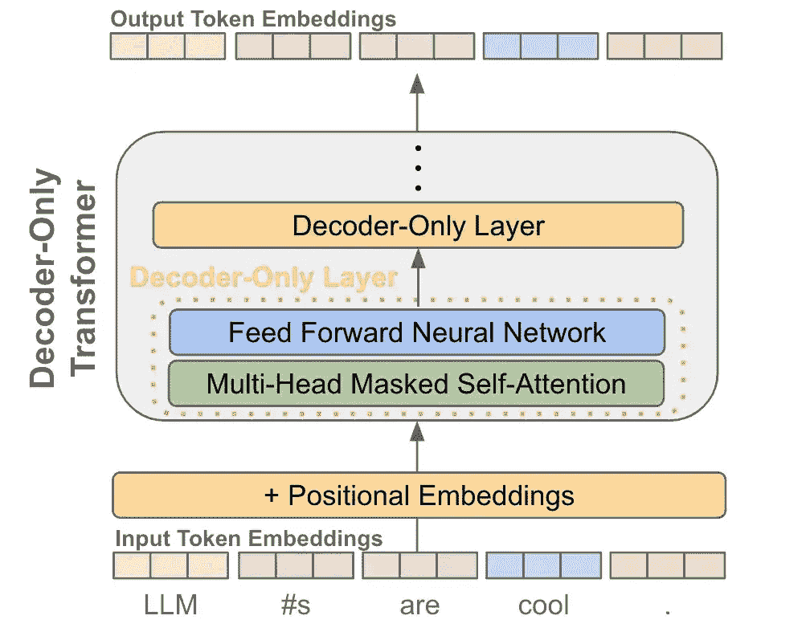

有了每个 token 的一个输出 `embedding` 后，我们就可以拿它来做 next token prediction 了，其实就是当作一个分类问题来看待：

+ 首先我们把输出 `embedding` 送入一个线性层，输出的维度是词表的大小，就是让预测这个 token 的下一个 token 属于词表的“哪一类”

+ 为了将输出概率归一化，需要再进行一个 `softmax` 变换

+ 训练时就是最大化这个概率使得它能够预测真实的下一个 token

+ 推理时就是从这个概率分布中采样下一个 token

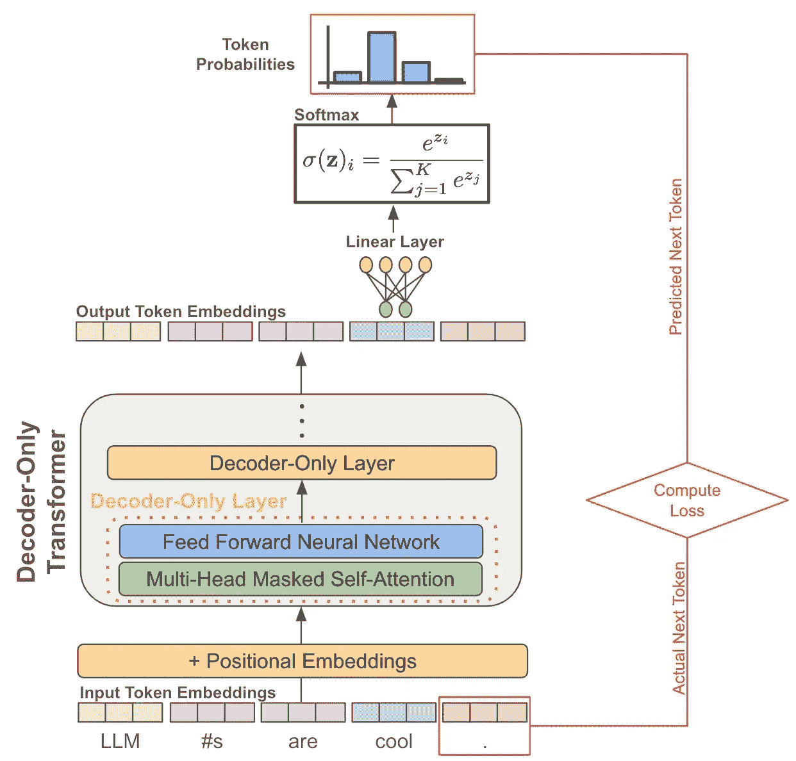

训练阶段：因为有 `causal` 自注意力的存在，我们可以一次性对一整个句子每个 token 进行下一个 token 的预测，并计算所有位置 token 的 `loss`，因此只需要一 `forward`

推理阶段：以自回归的方式进行预测

+ 每次预测下一个 token

+ 将预测的 token 拼接到当前已经生成的句子上

+ 再基于拼接后的句子进行预测下一个 token

+ 不断重复直到结束

+ 其中，在预测下一个 token 时，每次我们都有一个概率分布用于采样，根据不同场景选择采样策略会略有不同，不然有贪婪策略、核采样、`Top-k` 采样等，另外经常会看到 `Temperature` 这个概念，它是用来控制生成的随机性的，温度系数越小越稳定。

### 代码实现

> 下面代码来自项目 `https://github.com/karpathy/nanoGPT/tree/master`，同样是一个很好的项目，推荐初学者可以看看。

对于各种基于 `Transformer` 的模型，它们都是由很多个 `Block` 堆起来的，每个 `Block` 主要有两个部分组成：

+ `Multi-headed Causal Self-Attention`

+ `Feed-forward Neural Network`

结构的示意图如下：

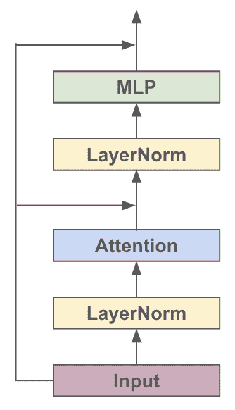

看图搭一下单个 `Block`

```
class Block(nn.Module):

    def __init__(self, config):
        super().__init__()
        self.ln_1 = LayerNorm(config.n_embd, bias=config.bias)
        self.attn = CausalSelfAttention(config)
        self.ln_2 = LayerNorm(config.n_embd, bias=config.bias)
        self.mlp = MLP(config)

    def forward(self, x):
        x = x + self.attn(self.ln_1(x))
        x = x + self.mlp(self.ln_2(x))
        return x
```

然后看下一整个 `GPT` 的结构

```
class GPT(nn.Module):

    def __init__(self, config):
        super().__init__()
        assert config.vocab_size is not None
        assert config.block_size is not None
        self.config = config

        self.transformer = nn.ModuleDict(dict(
            wte = nn.Embedding(config.vocab_size, config.n_embd),
            wpe = nn.Embedding(config.block_size, config.n_embd),
            drop = nn.Dropout(config.dropout),
            h = nn.ModuleList([Block(config) for _ in range(config.n_layer)]),
            ln_f = LayerNorm(config.n_embd, bias=config.bias),
        ))
        self.lm_head = nn.Linear(config.n_embd, config.vocab_size, bias=False)
        # with weight tying when using torch.compile() some warnings get generated:
        # "UserWarning: functional_call was passed multiple values for tied weights.
        # This behavior is deprecated and will be an error in future versions"
        # not 100% sure what this is, so far seems to be harmless. TODO investigate
        self.transformer.wte.weight = self.lm_head.weight # https://paperswithcode.com/method/weight-tying

        # init all weights
        self.apply(self._init_weights)
        # apply special scaled init to the residual projections, per GPT-2 paper
        for pn, p in self.named_parameters():
            if pn.endswith('c_proj.weight'):
                torch.nn.init.normal_(p, mean=0.0, std=0.02/math.sqrt(2 * config.n_layer))
```

+ 主要就是两个 `embedding` 层（token、位置）、多个 `block`、一些额外的 `dropout` 和 `LayerNorm` 层，以及最后用来预测下一个 token 的线性层。说破了就是这么简单。

+ 这边还用到了 `weight tying` 的技巧，就是最后一层用来分类的线性层的权重和 `token embedding` 层的权重共享。

接下来重点来关注一下训练和推理的 `forward` 是如何进行的，这能帮助大家更好的理解原理。

首先需要构建 `token embedding` 和位置 `embedding`，把它们叠加起来后过一个 `dropout`，然后就可以送入 `transformer` 的 `block` 中了。

```
pos = torch.arange(0, t, dtype=torch.long, device=device) # shape (t)

        # forward the GPT model itself
        tok_emb = self.transformer.wte(idx) # token embeddings of shape (b, t, n_embd)
        pos_emb = self.transformer.wpe(pos) # position embeddings of shape (t, n_embd)
        x = self.transformer.drop(tok_emb + pos_emb)
        for block in self.transformer.h:
            x = block(x)
        x = self.transformer.ln_f(x)
```

> 需要注意的是经过 `transformer` block 后出来的 tensor 的维度跟之前是一样的。拿到每个 token 位置对应的输出 `embedding` 后，就可以通过最后的先行层进行分类，然后用交叉熵损失来进行优化。

再看一下完整的过程，其中只需要将输入左移一个位置就可以作为 `target` 了

```
def forward(self, idx, targets=None):
        device = idx.device
        b, t = idx.size()
        assert t <= self.config.block_size, f"Cannot forward sequence of length {t}, block size is only {self.config.block_size}"
        pos = torch.arange(0, t, dtype=torch.long, device=device) # shape (t)

        # forward the GPT model itself
        tok_emb = self.transformer.wte(idx) # token embeddings of shape (b, t, n_embd)
        pos_emb = self.transformer.wpe(pos) # position embeddings of shape (t, n_embd)
        x = self.transformer.drop(tok_emb + pos_emb)
        for block in self.transformer.h:
            x = block(x)
        x = self.transformer.ln_f(x)

        if targets is not None:
            # if we are given some desired targets also calculate the loss
```

接下来看推理阶段：

+ 根据当前输入序列进行一次前向传播

+ 利用温度系数对输出概率分布进行调整

+ 通过 `softmax` 进行归一化

+ 从概率分布进行采样下一个 token

+ 拼接到当前句子并再进入下一轮循环

```
@torch.no_grad()
    def generate(self, idx, max_new_tokens, temperature=1.0, top_k=None):
        """
        Take a conditioning sequence of indices idx (LongTensor of shape (b,t)) and complete
        the sequence max_new_tokens times, feeding the predictions back into the model each time.
        Most likely you'll want to make sure to be in model.eval() mode of operation for this.
        """
        for _ in range(max_new_tokens):
            # if the sequence context is growing too long we must crop it at block_size
            idx_cond = idx if idx.size(1) <= self.config.block_size else idx[:, -self.config.block_size:]
            # forward the model to get the logits for the index in the sequence
            logits, _ = self(idx_cond)
            # pluck the logits at the final step and scale by desired temperature
            logits = logits[:, -1, :] / temperature
            # optionally crop the logits to only the top k options
            if top_k is not None:
                v, _ = torch.topk(logits, min(top_k, logits.size(-1)))
                logits[logits < v[:, [-1]]] = -float('Inf')
            # apply softmax to convert logits to (normalized) probabilities
            probs = F.softmax(logits, dim=-1)
            # sample from the distribution
            idx_next = torch.multinomial(probs, num_samples=1)
            # append sampled index to the running sequence and continue
            idx = torch.cat((idx, idx_next), dim=1)

        return idx
```

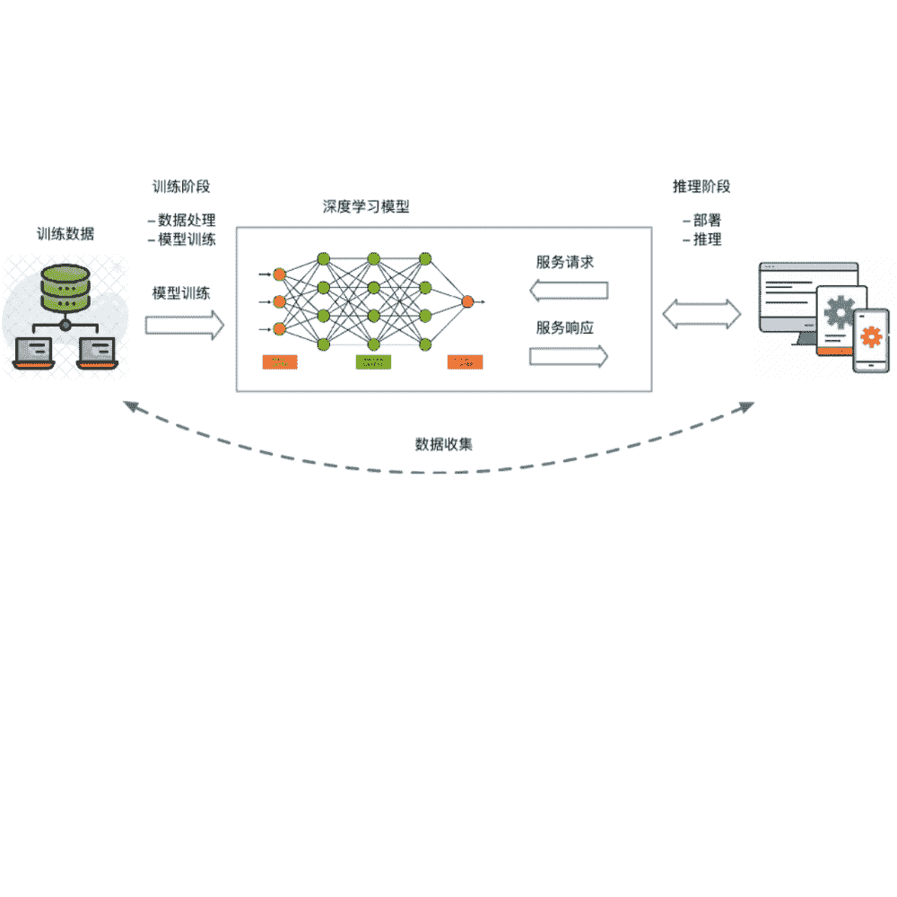

> 而模型推理部署/服务化是抽象的算法模型触达具体的实际业务的最后一公里。因此，模型部署是实际AI应用落地非常重要的环节，工程师辛苦训练出来的模型到落地部署应用有大量的工作，包括模型提取、模型压缩、模型加速以及模型服化等等。

### 模型推理部署/服务化方式

常见的模型部署方式有以下几种：

+ 服务器端部署：模型推理服务部署在服务器上，从而进行高性能完成推理任务；

+ 边缘设备端部署：模型部署在手机或者其他端侧设备，利用端侧算力完成推理任务；

+ 云端部署：模型部署在云端提供线上服务，用户可以使用客户端发送数据和请求，云端响应请求，完成推理任务并返回推理结果；

+ Web 端部署：模型部署在网页端，网页端完成推理任务；

### 如何选择模型推理服务化工具


# 模型服务化工具与 Triton 推理框架

常见的模型服务化工具如下图所示，主要分为三大类：

+   第一类：通过`WEB`框架封装`AI`模型提供服务，如：`Sanic`、`Flask`、`Tornado`等。

+   第二类：使用深度学习框架自带的`Serving`封装。如：`TensorFlow Serving`、`TorchServe`、`MindSpore Serving`等。

+   第三类：支持多种框架的统一推理服务化工具。如：`Triton Inference Server`、`BentoML`等。

从下图可知。开源模型服务框架的选择非常广泛。为了缩小范围，可以从以下几个因素进行考虑：

+   **对机器学习库的支持**：任何模型都将使用 `TensorFlow`、`PyTorch` 或 `scikit-learn` 等 `ML` 库进行训练。但是一些服务化工具支持多个 `ML` 库，而另一些服务化工具可能仅支持 `TensorFlow`。

+   **模型是如何打包的**：一个典型的模型由原始模型资产和一堆代码依赖组成。比如：通过将模型 + 依赖项打包到 `Docker` 容器中来进行工作。`Docker` 是将软件打包、分发和部署到现代基础设施的行业标准方式。

+   **模型运行的地方**：一些服务框架只是为您提供了一个 `Docker` 容器，您可以在任何支持 `Docker` 的地方运行该容器。而一些服务框架则建立在 `Kubernetes` 之上，通过 `Kubernetes` 进行自动化部署、扩展和管理容器。

## Triton 简介

> `Triton` 是 `Nvidia` 发布的一个高性能推理服务框架，可以帮助开发人员高效轻松地在云端、数据中心或者边缘设备部署高性能推理服务。

> `Triton Server` 可以提供 `HTTP/gRPC` 等多种服务协议。同时支持多种推理引擎后端，如：`TensorFlow`、`TensorRT`、`PyTorch`、`ONNXRuntime` 等。`Server` 采用 `C++` 实现，并采用 `C++ API`调用推理计算引擎，保障了请求处理的性能表现。

> 在推理计算方面，`Triton` 支持多模型并发，动态`batch`等功能，能够提高`GPU`的使用率，改善推理服务的性能。`Triton`不仅支持单模型部署，也支持多模型集成（`ensemble`），可以很好的支持多模型联合推理的场景，构建起视频、图片、语音、文本整个推理服务过程，大大降低多个模型服务的开发和维护成本。

## Triton的优势

与其他一些模型服务化工具相比，`Triton`具备如下的优势：

+   **支持多种框架**：`Triton` 支持几乎所有主流的训练和推理框架，例如：`TensorFlow`、`NVIDIA TensorRT`、`PyTorch`、`Python`、`ONNX`、`XGBoost`、`scikit-learn RandomForest`、`OpenVINO`、自定义 `C++` 等。

+   **高性能模型推理**：`Triton`支持所有基于 `NVIDIA GPU`、`x86`、`Arm CPU` 和 `AWS Inferentia` 的推理。 它提供动态`batching`、并发执行、最佳模型配置、模型集成（`ensemble`）和流式音频/视频输入，以最大限度地提高吞吐量和利用率。

+   专为 `DevOps` 和 `MLOps` 而设计：`Triton` 可以与 `Kubernetes` 集成以进行模型服务编排和扩展，支持导出用于监控的 `Prometheus` 指标，支持实时模型更新，并可用于所有主流的公有云 `AI` 和 `Kubernetes` 平台。 它还被集成到了许多 `MLOps` 软件解决方案中。

+   **支持模型集成**：由于大多数模型推理需要为单个查询执行具有预处理和后处理的多个模型；因此，`Triton` 支持模型集成和流水线。 `Triton` 可以在 `CPU` 或 `GPU` 上执行集成（`ensemble`）的各个部分，并可以在集成（`ensemble`）中使用多个框架。

+   具备企业级的安全性及 `API` 稳定性：用于生产环境推理的 `NVIDIA Triton`，通过企业级的安全性和 `API` 稳定性加速企业走向 `AI` 的前沿，同时降低开源软件的潜在风险。

## 主要功能

+   `Triton`的主要功能有支持大模型推理、具备高吞吐量和高可扩展性、支持使用模型分析器优化模型配置等等。

### 高吞吐量且高可扩展性

#### 高吞吐量

`Triton`可在单个 `GPU` 或 `CPU` 上并行的指定相同或不同框架下的多个模型。在多 `GPU` 的情况下，`Triton` 会自动为基于每个 `GPU` 的每个模型创建一个实例，以提高利用率。

它还可在严格的延迟限制条件下实时优化推理服务，通过支持批量推理来更大限度地提高 `GPU` 和 `CPU` 利用率，并内置对音频和视频流输入的支持。对于需要使用多个模型来执行端到端推理（例如：对话式 `AI`）的场景，`Triton` 支持多模型集成。

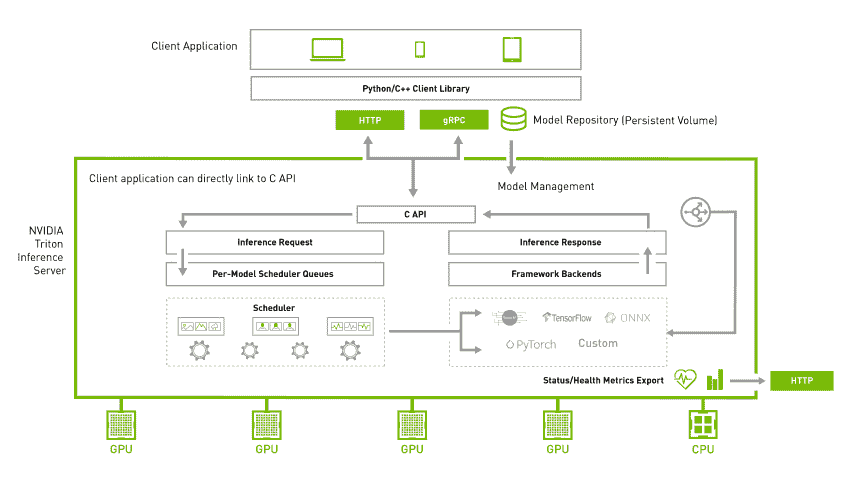

除此之外，模型可在生产环境中实时更新，无需重启 `Triton` 或应用。`Triton` 支持对单个 `GPU` 显存无法容纳的超大模型进行多 `GPU` 以及多节点推理。

#### 高可扩展性

作为一个 `Docker` 容器，`Triton`可以与 `Kubernetes` 轻松集成，用于编排、`metrics` 和 `autoscaling` 等。`Triton` 还与 `Kubeflow` 和 `KServe` 集成以实现端到端的 `AI` 工作流，并导出 `Prometheus` 指标以监控 `GPU` 利用率、延迟、内存使用和推理吞吐量。 它支持标准的 `HTTP/gRPC` 接口来连接负载均衡器（`load balancer`）等其他应用程序，并且可以轻松扩展到任意数量的服务器，来为任意模型处理日益增长的推理负载。

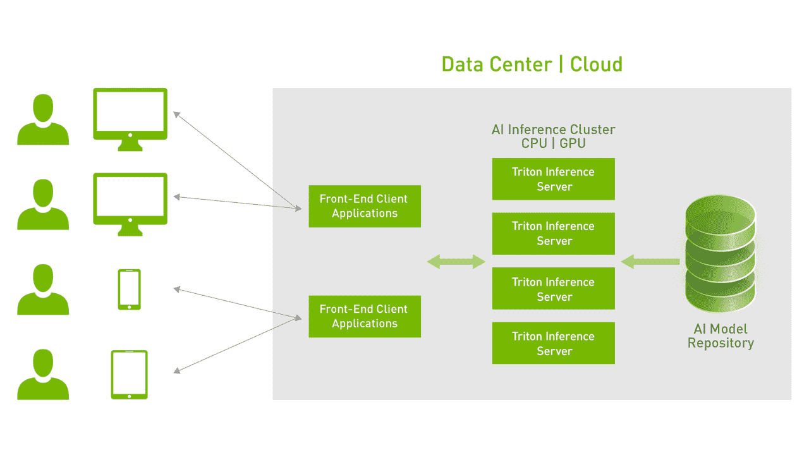

+   `Triton`可以服务数十个、甚至上百个模型。 模型可以根据需求变化加载到推理服务中或从推理服务中卸载，以适应 `GPU` 或 `CPU` 的内存。 同时，支持具有 `GPU` 和 `CPU` 的异构集群以实现跨平台推理，并可以动态扩展到任何 `CPU` 或 `GPU` 以处理峰值负载。

## 支持具有管理服务的模型编排

```
`Triton` 具有模型编排功能，可实现高效的多模型推理。 此功能作为生产服务运行，可以按需加载模型并在不使用时卸载模型。 它通过在单个 `GPU` 服务器上放置尽可能多的模型来有效地分配 `GPU` 资源，并有助于对来自不同框架的模型进行分组以实现高效的内存使用。
```

## 支持使用模型分析器优化模型配置

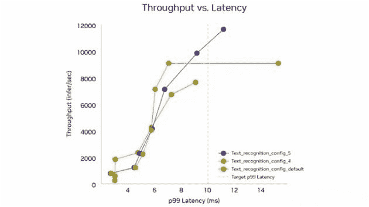

`Triton`的模型分析器是一个可自动评估 `Triton` 推理服务中的模型部署配置的工具，例如：目标处理器上的批量大小、精度和并发执行的实例。 它有助于选择最佳配置以满足应用程序服务质量（`QoS`）限制（延迟、吞吐量和内存要求），并将找到最佳配置所需的时间从数周缩短到数小时。该工具还支持模型集成和多模型分析。

## 支持Forest Inference Library (FIL)后端进行基于树的模型推理

`Triton` 中新的 `Forest Inference Library` (`FIL`) 后端支持在 `CPU` 和 `GPU` 上对基于树的模型进行高性能推理，并具有可解释性（`SHAP` 值）。 它支持来自 `XGBoost`、`LightGBM`、`scikit-learn RandomForest`、`RAPIDS cuML RandomForest` 和其他 `Treelite` 格式的模型。

## Triton 架构解析

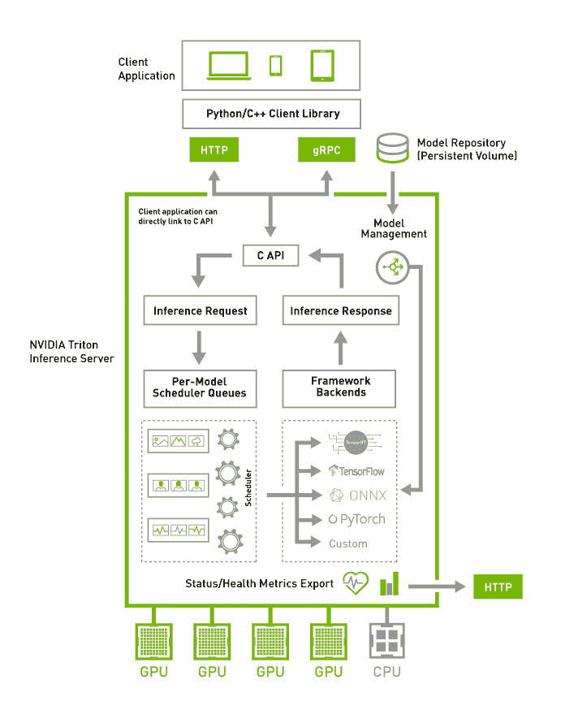

### 模型并行执行推理的逻辑

下图显示了具有两个模型（模型 0 和模型 1）并行执行推理的流程。 假设 `Triton` 当前没有处理任何请求，当两个请求同时到达时 `Triton` 服务，每个模型一个请求，`Triton` 立即将它们都调度到 `GPU` 上，`GPU` 的硬件调度程序开始并行处理这两个计算。

+   在系统的 `CPU` 上执行的模型由 `Triton` 进行类似地处理，除了 `CPU` 线程执行每个模型的调度由系统的操作系统处理之外。

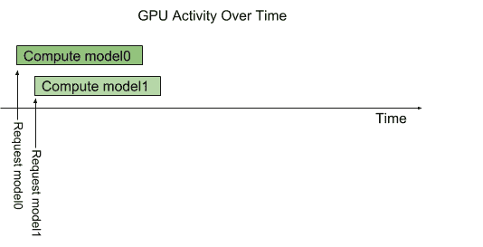

+   默认情况下，如果对同一模型的多个请求到达同一模型 时间，`Triton` 将通过仅调度一个 `at` 来序列化他们的执行 `GPU` 上的时间，如下图所示。

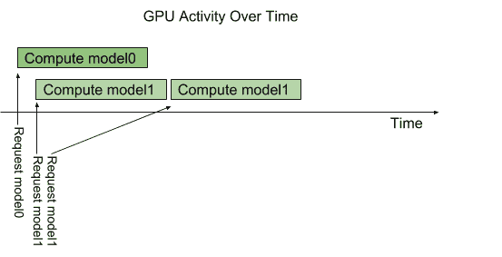

`Triton`提供了一个名为 `instance-group` 的模型配置选项，它允许每个模型指定该模型的并行执行数。每个这样启用的并行执行都称为一个实例。 默认情况下，`Triton` 会在系统中每个可用的 `GPU` 上为每个模型提供一个实例。 通过使用模型配置中的 `instance_group` 字段，可以更改模型的执行的实例数。 下图显示了当 `model1` 配置为允许三个实例的模型执行。 如下图所示，前三个 `model1` 服务的推理请求立即并行执行。 第四个 `model1` 服务的推理请求必须等到前三个执行中的一个执行完成才能开始。

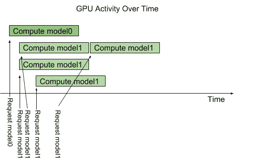

## 模型类型及调度器

> 针对不同的场景，`Triton`定义了三种模型类型：无状态（`stateless`）、有状态（`stateful`）和集成（`ensemble`）模型，同时，`Triton`提供了调度器来支持这些模型类型。

### 模型类型

`Triton`中三种模型类型如下

```
`无状态模型`（`Stateless` models）：简单来说就是应对不同推理请求没有相互依赖的情况。平常遇到的大部分模型都属于这一类模型，比如：文本分类、实体抽取、目标检测等。
`有状态模型`（`Stateful` Models）：当前的模型输出依赖上一刻的模型的状态（比如：中间状态或输出）。对于推理服务来说，就是不同推理请求之间有状态依赖，比如：顺序依赖。
`集成模型`（`Ensemble` model）：表示一个或多个模型组成的工作流(有向无环图)。最常见的使用场景就是：数据预处理->模型推理->数据后处理。通过集成模型可以避免传输中间`tensor`的开销，并且可以最小化请求次数。比如：`bert`实现的文本分类任务，需要在前置处理中对输入文本做`Tokenizer`，`Tokenizer`输出结果作为模型属性输入。

如下所示，`preprocess`表示前置处理模型；`bert_onnx`表示文本分类模型；`ensemble_bert_classification`表示集成模型。
```

```
├── `bert_onnx`
├── `ensemble_bert_classification`
└── `preprocess`
```

### 调度器

`Triton`提供了如下几种调度策略：

+   `Default Scheduler`：默认调度策略，可以理解为推理框架内部的模型实例负载，将推理请求按比例分配到不同的模型实例执行推理。

+   `Dynamic Batcher`：在应对高吞吐的场景，将一定时间内的请求聚合成一个批次（`batch`）。该调度器用于调度无状态的模型。
