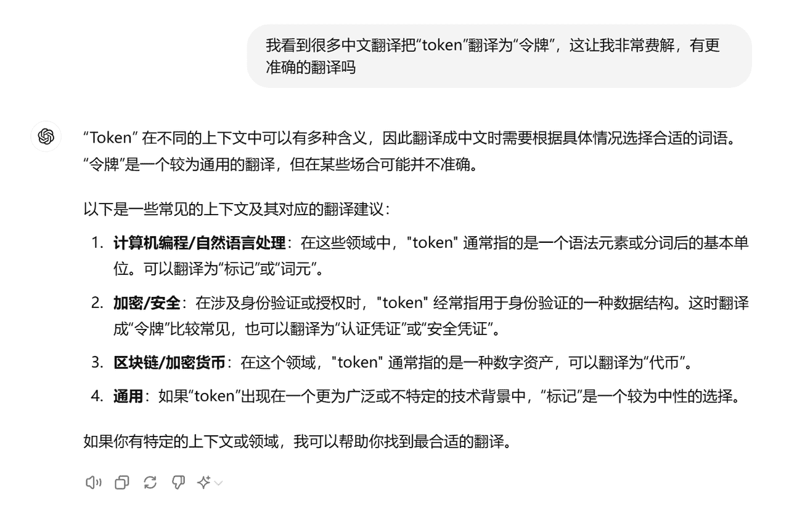

# 关于 Token AI产品经理需了解

> 来源：[https://v11enp9ok1h.feishu.cn/docx/DUWxdokLpohP4ZxPsDDcE58Gnre](https://v11enp9ok1h.feishu.cn/docx/DUWxdokLpohP4ZxPsDDcE58Gnre)

本文大概 4200 字，阅读时间 10 分钟，会讲以下几个点

一、什么是 token

二、现在我们使用的大模型 token 有哪些限制

三、怎么看我使用了多少 token

四、token 限制对 prompt 编写有什么影响

五、基于上述原理有哪些 tips

---

## 一、什么是 token

在大语言模型领域，Token 通常用来表示文本数据中的一个单元。在不同的语境下，一个 token 可能代表一个字-个词，或者是一个句子。在英文中，一个 token 通常是一个词或者是标点符号。在一些汉语处理系统中，一个token 可能是一个字，也可能是一个词。Token 是处理和理解文本数据的基本单元。

在深度学习的语言模型中，如 Transformer，输入的文本首先被切分成一系列的 tokens。这些 tokens 被转换成向量，然后被输入到神经网络中进行处理。因此，在这种情况下，token 可以被理解为语言模型接收和处理的最小的信息单元。在训练过程中，每个 token 会关联一个预测，这个预测可以是下一个 token 的预测，也可以是该token 的属性预测，如词性、情感等。

训练 token 的数量会影响模型的性能和准确性。更多的训练 token 通常意味着更多的训练数据，这可能会提升模型的准确性和泛化能力。然而，处理更多的 token 也会增加计算的复杂性和计算资源的需求。

基于上述解释，很多同学把 token 理解为中文语义里的“字节”，对于这种理解，只能说从类比关系上有一定的相似度，因为"字节"是计算机存储和处理数据的基本单元，而"token" 则是语言模型处理文本信息的基本单元。但这种理解不够准确的地方在于:

"Token" 在语言模型中的作用比"字节"在计算机中的作用更加复杂和多元。在大语言模型中，"token"不仅代表文本数据中的一个单位，而且每个"token"都可能携带了丰富的语义信息。比如，在处理一句话时，"token"可能表示一个字，一个词，甚至一个短语，这些都可以被认为是语言的基本单元。同时，每个"token"在模型中都有一个对应的向量表示，这个向量包含了该"token"的语义信息、句法信息等。

所以，尽管"token"和"字节"都是基本的处理单位，但是"token"在大语言模型中的含义和作用要比"字节"在计算机中的含义和作用更加丰富和复杂。

另外，如果现在正在浏览这篇帖子的你曾经“机翻“过一些文档的话，你会经常看到“token“被自动翻译工具翻译为“令牌”，我不知道你是否对于这一翻译感到过疑惑，我感到过，所以我问了:

## 二、为什么会有 token

这部分内容引用了知乎作者 卡卡罗特 的专栏文章:ChatGPT 实用指南(一)-知乎(zhihu.com)内容过于学术所以只做了节选，特别感兴趣的同学也可以点进去查阅完整文章，写的是非常好的。