# 大语言模型的关键技术

> 来源：[https://v11enp9ok1h.feishu.cn/docx/Hmx3dL8FpoEQ2sxUmifcDNm2njf](https://v11enp9ok1h.feishu.cn/docx/Hmx3dL8FpoEQ2sxUmifcDNm2njf)

<https://v11enp9ok1h.feishu.cn/sync/PaIIdslbxsIJUIbkTfPcsMCFnph>

# 大语言模型的关键技术

+   语言大模型技术主要包括：**模型预训练**、**适配微调**、**提示学习**、**知识增强**和**工具学习**等。

**模型预训练**

**适配微调**

**提示学习**

**知识增强**

**工具学习**

## **预训练**

**高效预训练策略**。其主要思路是采用不同的策略以更低成本实现 对语言大模型的预训练。

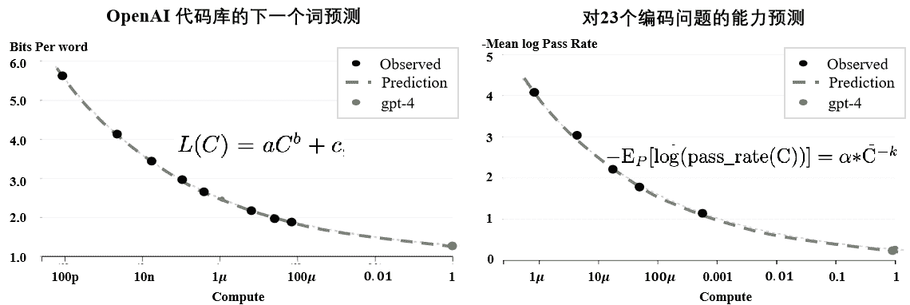

1.  一种是在预训练中**设计高效的优化任务目标**，使得可以使得模型能够利用每个样本更多的监督信息，从而实现模型训练的加速。

1.  第二种是**热启动策略**，在训练开始时线性地提高学习率，以解决在预训练中单纯增加批处理大小可能会导致优化困难问题。

1.  第三种是**渐进式训练策略**，不同于传统的训练范式使用相同的超参数同时优化模型每一层，该方法认为不同的层可以共享相似的自注意力模式，首先训练浅层模型，然后复制构建深层模型。

1.  第四种是**知识继承方法**，即在模型训练中同时学习文本和已经预训练语言大模型中的知识，以加速模型训练。在中文语言大模型 CPM-2中，采用知识继承技术经测试可以使大模型在预训练前期提速 37.5%。

1.  第五种是**可预测扩展策略**（Predictable Scaling），旨在大模型训练初期，利用大模型和小模型的同源性关系，通过拟合系列较小模型的性能曲线预测大模型性能，指导大模型训练优化。OpenAI 在 GPT-4 训练中，使用 1000 倍至 10000 倍较少计算资源训练的小模型可靠地预测GPT-4 某些性能，大幅降低了模型训练成本

**BERT 之后的 Transformer 架构在提高**自然语言处理效率方面有两个重要优化方向：

### （1）**统一的序列建模**，

旨在将多种自然语言处理任务（如分类、信息抽取、翻译、对话等）整合到一个统一的框架，然后在同一模型中执行多个任务，以实现更高效的自然语言处理。

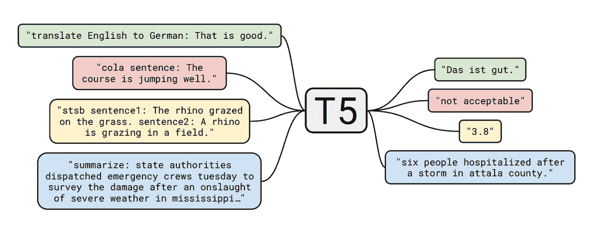

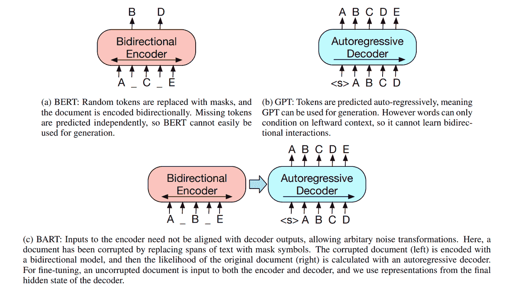

1.  一是**转化为序列生成的统一任务**，如 T5和 BART等将多种自然语言任务统一转化文本到文本的生成任务；

1.  二是**转化为语言大模型预训练任务**，通过语言提示在输入文本中插入人类设计或者自动生成的上下文，实现对不同任务的处理。

### （2）**计算高效的模型架构**。

+   从 **Transformer** 模型架构本身在处理训练复杂度、编解码效率、训练稳定性、显存利用等方面进行优化。

比如，**Transformer** 其并行处理机制是以低效推理为代价**的，解码时每个步骤的复**杂度为 O(N)，Transformerr 模型也是显存密集型模型，输入序列越长、占用的内存越多。

为此，微软设计了一种新的 **Transformer** 架构** RetNet**，其采用线性化注意力+尺度保持（Retention ）机制，在基本保持模型性能的基础上同时实现模型训练速度、推断速度和内存节约的大幅提升。

**针对自注意力显存消耗大**，斯坦**福大学在 Transfor**mer中引入FashAttention，给出了一种具有 IO 感知，且兼具快速、内存高效的注意力算法，已经被各种主流大模型采用以扩展对超长文本输入的支持。

最近，模块化大模型架构引起广泛关注，其利用大模型的神经激活稀疏性**，对稠密模型进行模块化划分，不同任务只经过部分模块计 算实现训练和推理加速 ， 典型工 作 **包 括 Google 的 Switch Transformers 和 Pathways架构、清华大学的 MoEfication 架构 、FastMoE 架构等。

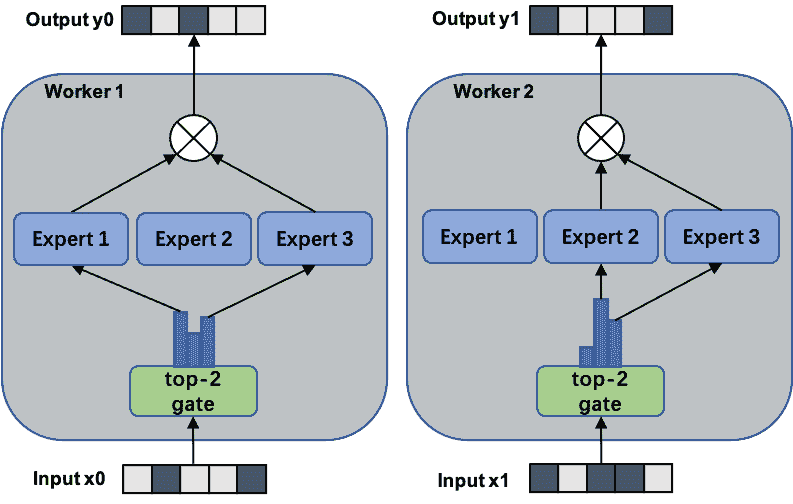

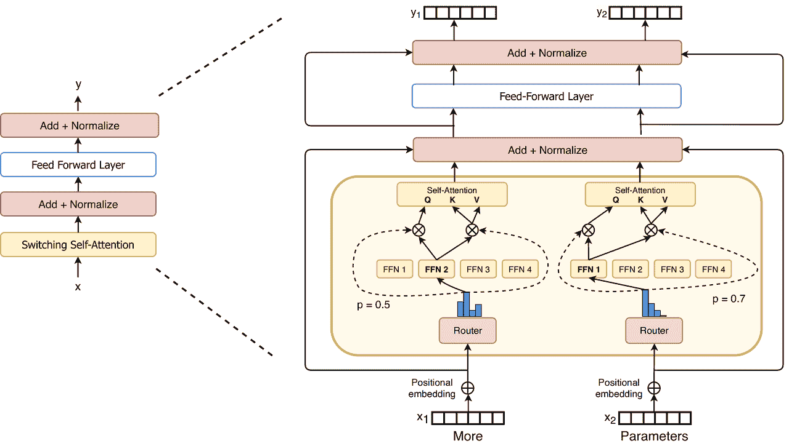

## **语言大模型的适配微调**

> 语言大模型由于在大规模通用领域数据预训练通常缺乏对特定任务或领域的知识，**因此需要适配微调。微调可以帮助**模型更好地适应特定需求，如对敏感数据（如医疗记录）的处理，同时不暴露原始数据。此外，微调可以提高部署效率、减少计算资源需求。指令微调和参数高效学习是适配微调的关键技术。

> [**指令微调 **](https://arxiv.org/pdf/2203.02155)(Instruction Tuning)，是一种可以帮助语言大模型实现人类语言指令遵循的能力，在零样本设置中泛化到未见任务上的学习方法。

> 指令微调学习形式与多任务提示微调**相似，但与提示微调让提示适应语言大模型并且让下游任****务对齐预****训****练任务不同，**其**是让语言**大模型对齐理解人类指令并按照指令要求完成任务，即在给定指令提示的情况下给出特定的回应，其中提示可以选择性包含一条解释任务的指令。指令微调研究涉及指令理解、指令数据获取和指令对齐等内容。

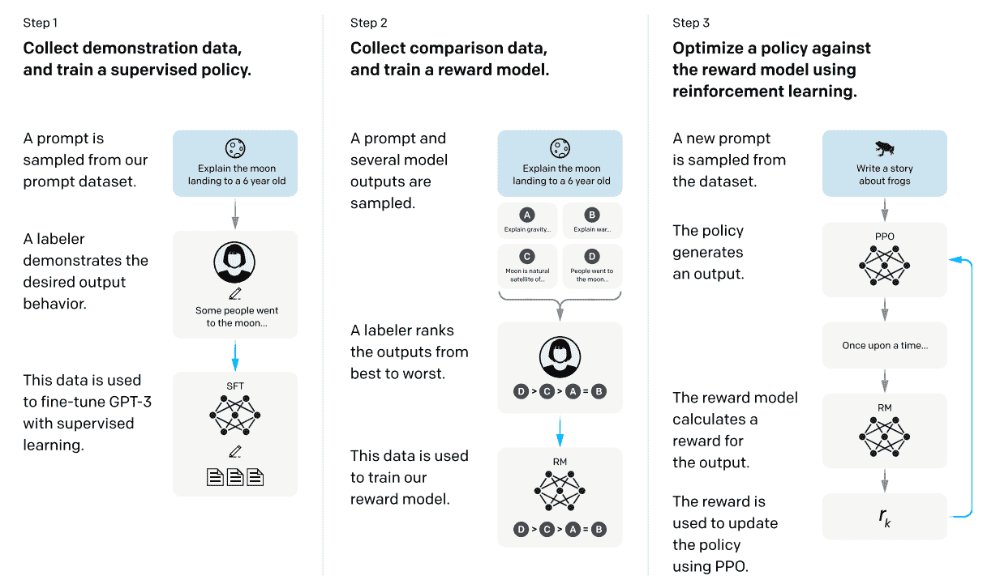

> **（1）****指令理解**，**指语言大模型准确理解**人类语言指令的能力，是语言大模型执行指令完**成任务的**前**提。为了增强对指令的理****解，许多工作采用**多任务提示方式对基于指令描述的大量任务集上对语言大模型进行微调，如 FLAN、InstructGPT等，这些模型在未见的任务上显示出优越的零样本性能。

> **（2）****指令数据获取****, 指如何构建**包含多样性的任务指令数据。指令数据构建常见有三种方式：

1.  基于公开人工标注数据**构建，**代表指令**数据集包括 1**616 种不同任务的 Super-Natural Instruction、2000 种不同 NLP任务的 OPT-IML。

1.  借助语言大模型的自动生成构建，如Unnatural Instructions，通过种子指令作为提示让语言大模型生成新的指令描述和问题，然后再输入到模型让其输出回答。

1.  **基于人工标注方法**，如 ChatGPT 在人工标注指令的基础上通过 GPT-3、InstructGPT 等在线平台收集用户真实指令数据。

> **（3）****指令对齐**, 语言大模型在多种自然语言处理任务上都展现了卓越的性能。然而，它们有时可能会出现不预期的行为，如创造虚假信息、追求错误目标或产生有偏见的内容。

+   其**根本原因在于，语言大模型在预训****练时仅通过语言模型建模，未涉及****人类的价值观或偏好。为**了解决这一问**题，研究者提出了“指令****对齐”，使语言**大模型的输出**更符合人类的预期。但这****种对齐与原始预训练有所不同，更注重于有用性、诚**实性和无害性。此外，指令对齐可能会降低语言大模型的某些通用能力，这被称为“Alignment Tax”。为实现模型输出与对人类价值的对齐，InstructGPT 提出了一种基于人类反馈的微调方法，利用了强化学习技术，将人类反馈纳入模型微调过程。实际上， ChatGPT也采用了与 InstructGPT相似的技术，以确保产生高质量且无害的输出。指令对齐的广泛应用，适配微调从纯数据学习的传统微调范式开始逐步向人类学习范式的转变。

### 参数高效微调（Parameter-Efficient Tuning）

> 早期以 **BERT** 为代表的微调方法，是在大模型基座上增加一个任务适配层，然后进行全参微调，但是这种方法存在两方面的问题：

1.  一是**任务“鸿沟”问题**，预训练和微调之间的任务形式不一致，这种差别会显著影响知识迁移的效能。

1.  二是**高计算成本**，语言大模型的参数规模不断增长，导致模型全参微调也需要大量计算资源。解决以上问题的有效途径是参数高效学习，即通过仅微调少量参数实现大模型在下游任务上获得全参微调效果。

+   目前许多参数高效微调方法被提出，这些方法大致可分为 3 类

> **（1）添加式方法**：**旨**在原模型基础上引入额外的模块或参数，并仅微调该引入部分的参数。如适配器（Adapter）方法，旨将小规模的神经模块（适配器）注入到预训练模型中，并只调整这些适配器以进行模型自适应。在实际应用中，适配器模块通常分别插入在多头自注意和前馈网络子层之后，成为最广泛使用方式；

> **（2）指定式方法**：旨在原模型指定模型中部分参数为可训练参数，并固定模型其他参数。这类方法简单也十分有效，如仅通过优化模型内的偏置项并固定其他参数，模型仍然可以再现 95%以上的模型全参微调性能；

> **（3）重参数化方法****：**将原模**型或部分****模**型参数重参数化到低维度参数空间中，仅仅优化低维空间中的近似参数，显著降低模型的计算量和内存消耗。如LoRA ，将模型自注意力模块的变化权重参数分解为两个低秩矩阵相乘，即

### **Prefix-Tuning: **

**Prefix-Tuning 固定 PLM 的所有****参**数，只更新优化特定任务的 prefix。因此，在生产部署时，只需要存储一个大型 PLM 的副本和一个学习到的特定任务的 prefix, 每个下游任务只产生非常小的额外的计算和存储开销。

Full VS Emb-only

+   embedding-only表示只有在embedding层添加前缀token，而full 表示每一层都添加前缀token；

+   实验表明：**prefix-tuning****> ****embedding-only****> **discrete prompting

**Prifix VS Infix**

+   prefix-tuning表示可训练参数放在开头，infix-tuning表示可训练**token**放在中间位置

+   结果表明：**prefix-tuning****>****infix-tuning**

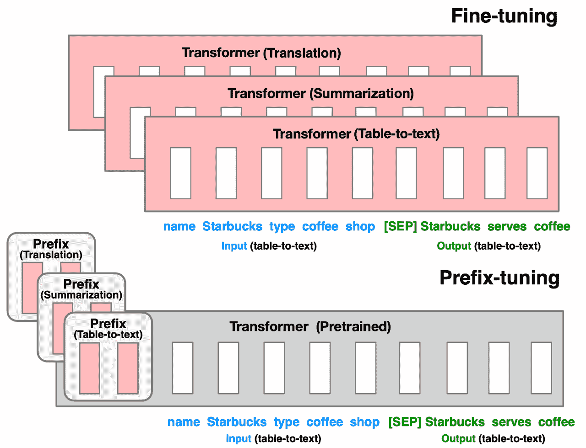

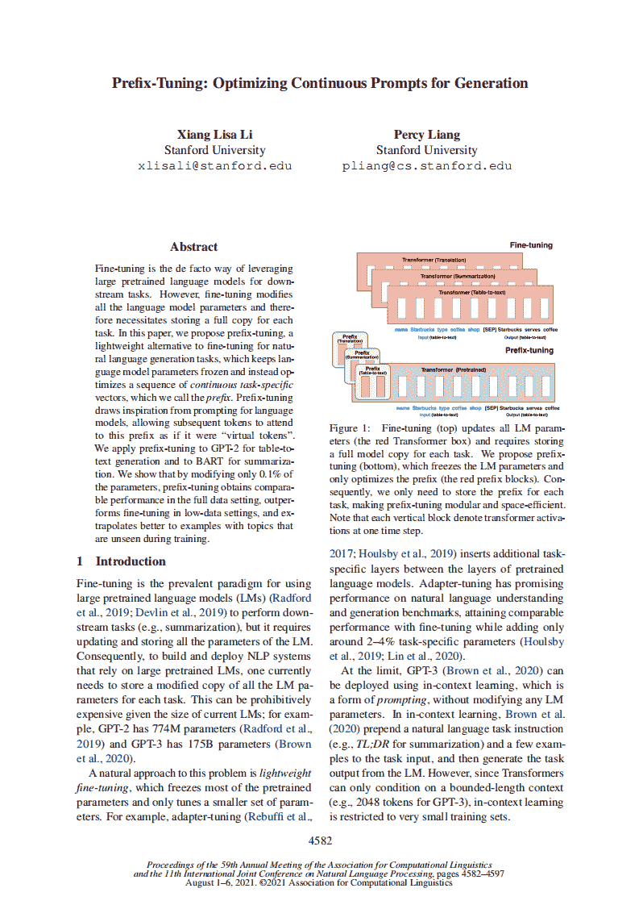

[Prefix-Tuning Optimizing Continuous Prompts for Generation.pdf](https://internal-api-drive-stream.feishu.cn/space/api/box/stream/download/all/FGOFbzW7ToDBRIxyGrLcAlUNndd)

### Prompt-Tuning

prompt-tuning可以认为是prefix-tuning的简化版。**固定整个预训练模型参数，只允许将每个下游任务的额外s****se 个可更新的 toke****ns (不****同于pref****ix-tuning, 这里的toke**ns是真实的文本) 前置到输入文本中，也没有使用额外的编码层或任务特定的输出层。

> **一**系列对比实验，都在说明：随着预训练模型参数的增加，一切的问题都不是问题，最简单的设置也能达到极好的效果。

+   **Prompt长度影响**：模型参数达到一定量级时，Prompt长度为1也能达到不错的效果，Prompt长度为20就能达到极好效果。

+   **Prompt初始化方式影响**：Random Uniform方式明显弱于其他两种，但是当模型参数达到一定量级，这种差异也不复存在。

+   **预训练的方式**：LM Adaptation的方式效果好，但是当模型达到一定规模，差异又几乎没有了。

+   **微调步数影响**：模型参数较小时，步数越多，效果越好。同样随着模型参数达到一定规模，zero shot也能取得不错效果。

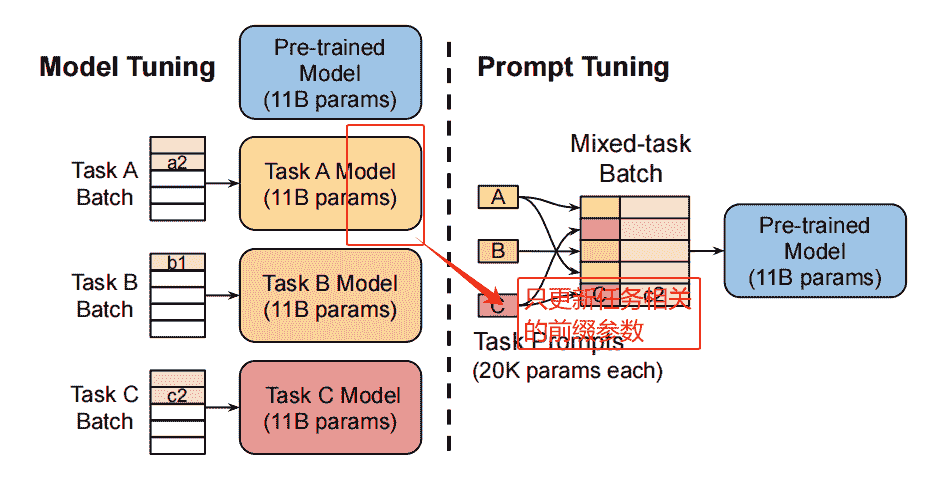

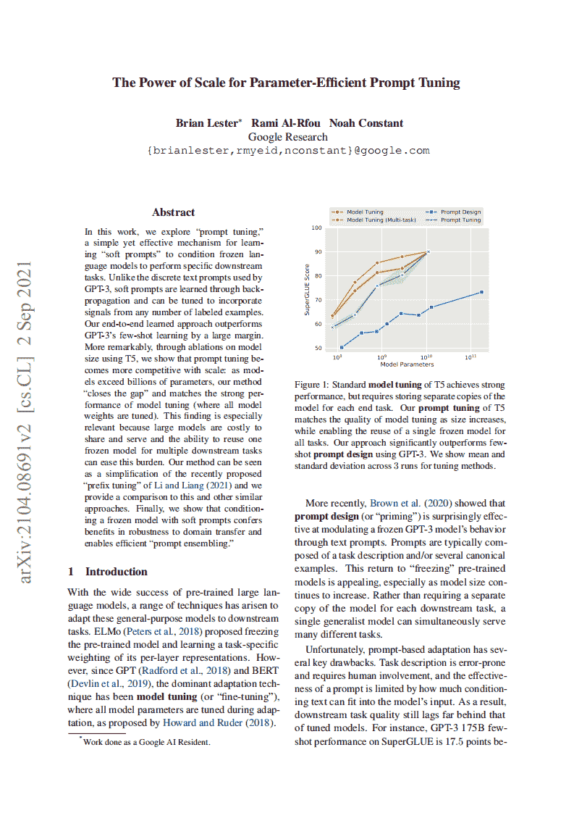

[The Power of Scale for Parameter-Efficient Prompt Tuning.pdf](https://internal-api-drive-stream.feishu.cn/space/api/box/stream/download/all/DHtPbLjTqozyDVxcNv6cvenmnxh)

### P-tuning-**V1版本**

> **P-Tuning**的**方法思路与Prefix-Tuning很相近，P-Tuning利用少量连续的embedding参数作为prompt使GPT更**好的应用于NLU任务，而Prefix-Tuning是针对NLG任务设计；同时，P-Tuning只在embedding层增加参数(使用MLP+LSTM初始化),而Prefix-Tuning在每一层都添加可训练参数(使用MLP初始化)。

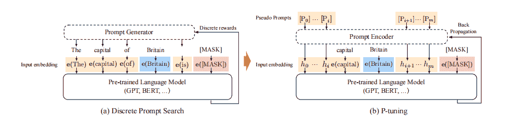

**P-Tuning**提出将Prompt转换为可以学习的Embedding层，只是考虑到直接对Embedding参数进行优化会存在这样两个挑战：

+   **Discretenes**:对输入正常语料的**Embedding**层已经经过预训练，而如果直接对输入的prompt embedding进行随机初始化训练，容易陷入局部最优。

+   **Association**:没法捕捉到prompt embeddi**ng之间的相关关**系。作者**提出使用ML**P+LSTM的方式对prompt进行初始化处理

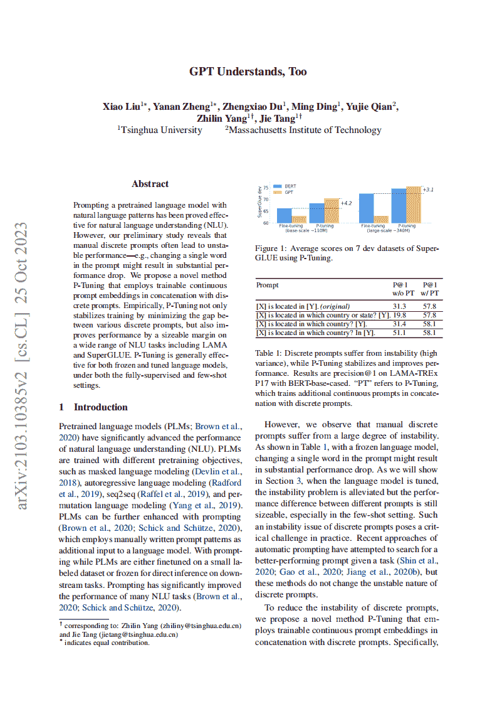

[GPT Understands, Too.pdf](https://internal-api-drive-stream.feishu.cn/space/api/box/stream/download/all/HNH6bWPjPo90DXxrKZZcUMqwnqc)

### P-tuning-**V2版本**

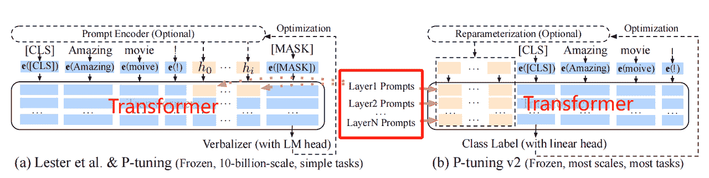

> **V2**的思路和**prefix-tuning**相似，**在模型的每一层都应用连续的 ****prompts ****并对**** prompts** 参数进行更新优化。同时该方法是**针对 NLU 任务优化和适配**的。

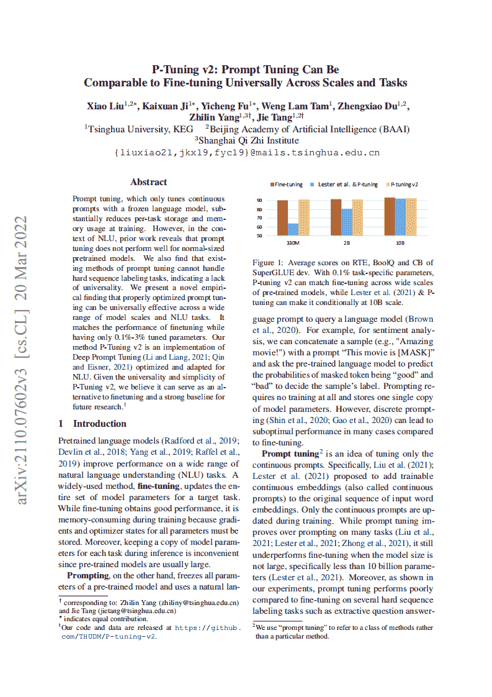

[P-Tuning v2 Prompt Tuning Can Be.pdf](https://internal-api-drive-stream.feishu.cn/space/api/box/stream/download/all/MJmKb4JuGoeYU8xN8mMc4P8Fnwh)

### LoRA

+   **Adapter Tuning** 在 PLM 基础上添加**适配器层会引入额外的计算**，带来推理延迟问题

+   **Prefix Tuning** 难以优化，其性能随可训练参数规模非单调变化，更根本的是，为前缀保留部分序列长度必然会减少用于处理上下游任务的序列长度

> **LoRA**** ****论文提出了一种计算和存**储高效的低秩(Low-Rank)表示方法，具体地Transformer 等神经网络包含许多执行矩阵乘法的密集层，这些权重矩阵通常具有满秩

+   对于预训练模型的权重矩阵  通过低秩分解(Low-Rank Decomposition) 来表示约束其更新。

+   其中 B\in R^{d\times r},A\in R^{r\times k},r\ll\min(d,k)

+   训练开始，用随机高斯分布初始化 A, 用 0 矩阵初始化 B, 保证训练开始旁路矩阵依然是 0 矩阵

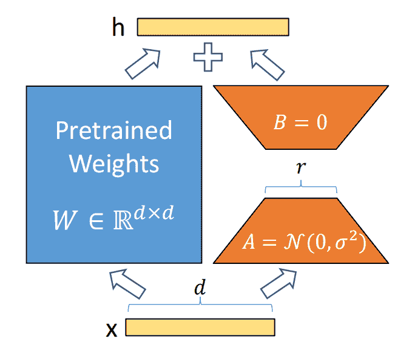

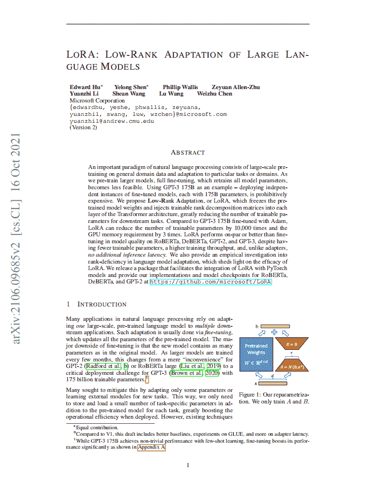

[LORA LOW-RANK ADAPTATION OF LARGE.pdf](https://internal-api-drive-stream.feishu.cn/space/api/box/stream/download/all/WF5Sb3WNYoC936xd03hcinq7nDn)

### QLoRA

可以认为是**LoRA的升级版本**，体现在：

+   NormalFloat4 (NF4): 一种论文新提出的数据类型，对于正态分布权重而言信息理论上是最优的新数据类型；可以简单认为是 尽可能减少优化过程中数据精度损失的作用；

+   双重量化 (Double Quantization) : 通过量化常数来减少平均内存占用；

+   **分**页优化器 (Paged Optimizers) : 用于管理内存峰值。

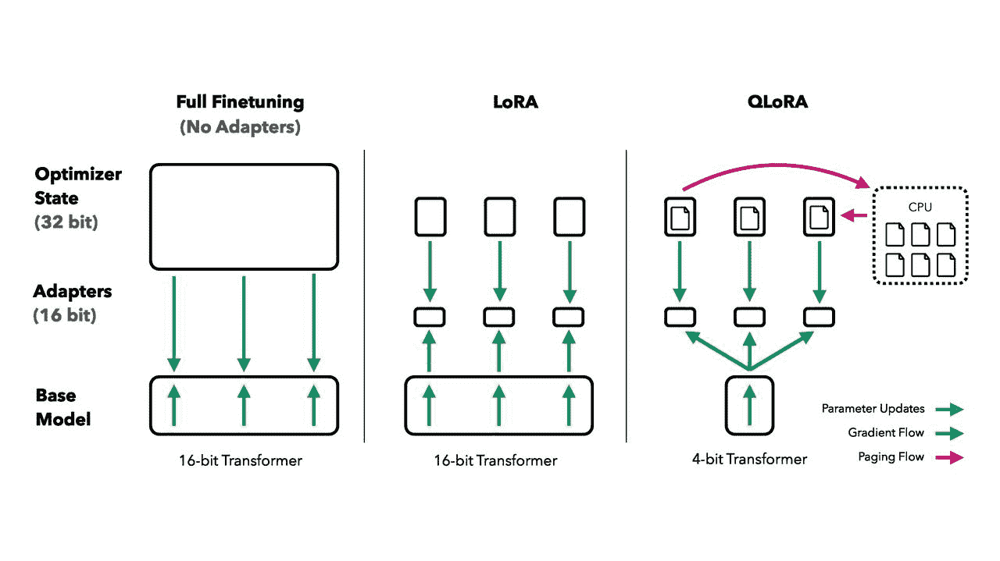

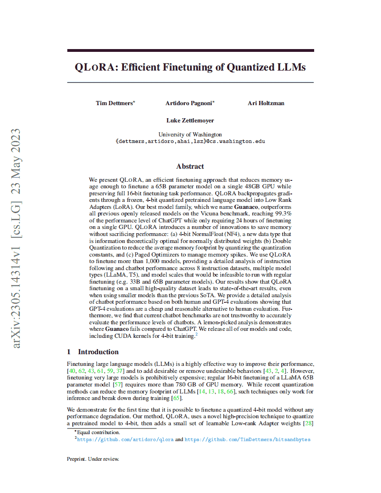

[QLORA Efficient Finetuning of Quantized LLMs.pdf](https://internal-api-drive-stream.feishu.cn/space/api/box/stream/download/all/EAQNbVjeho1teixQtgocbqsanvh)

## **语言大模型的提示学习**

> 指令提示（Ins**t**ruction Prompt），也称为提示学习。指令提示核心思想是避免强制语言大模型适应下游任务，而是通过提供“提示（Prompt）”来给数据嵌入额外的上下文以重新组织下游任务，使之看起来更像是在语言大模型预训练过程中解决的问题。指令提示有三种形式：

1.  **少样本提示**，是指在一个自然语言提示后面附加一些示例数据，作为语言大模型的输入。其可以提高语言大模型在不同领域和任务上的适应性和稳定性。少样本提示也存在一些挑战，例如如何确定合适的示例数量、如何选择示例等。

1.  **零样本提示**，是指不使用任何示例数据，只依靠一个精心设计的提示来激活语言大模型中与目标任务相关的知识和能力。零样本提示关键问题包括如何设计合适的提示、如何选择最优的提示等。

1.  上下文**学习（I**n-contextLearning, ICL），也称**情境学习，是指将一个自然语言问题作为**语言大模型的输入，并将其答案作为输出。情境学习可以看作是一种特殊形式的少样本提示，在问题中隐含地包含了目标任务和格式信息。情境学习可以简化问题表示和答案生成，并且可以灵活地处理多种类型和复杂度的问题。其挑战在于，如何确保问题质量、如何评估答案正确性等

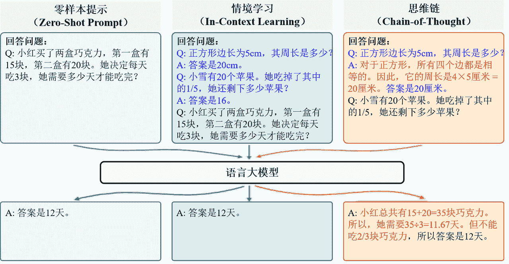

> 思维链（Chain-of-Thought，CoT）。推理的过程通常涉及多个推论步骤，通过多步推理允许产生可验证的输出，可以提高黑盒模型的可解释性。

> 思维链是一种提示技术，已被广泛用于激发语言大模型的多步推理能力，被鼓励语言大模型生成解决问题的中间推理链，类似于人类使用深思熟虑的过程来执行复杂的任务。在思维链提示中，中间自然语言推理步骤的例子取代了少样本提示中的〈输入，输出〉对，形成了〈输入，思维链，输出〉三元组结构。思维链被认为是语言大模型的“涌现能力”，通常只有模型参数规模增大到一定程度后，才具有采用思维链能力。激活语言大模型的思维链能力方法，在提示中给出逐步的推理演示作为推理的条件，每个演示都包含一个问题和一个通向最终答案的推理链

## ** 语言大模型的知识增强 **

+   知识运用和推理能力是衡量语言大模型智能水平的重要因素。

+   美国 Allen AI 研究大模型的问答能力，发现 GPT在处理具有预设立场（false premise）的简单性常识性问题时，如类似“太阳有几只眼睛？”，GPT仍然会给出“太阳两只眼睛”的荒谬回复。

> 有效的解决方法是**在深度学**习**模型基础**上**融入各类**型**相关**外部知识。根据大模型知识融合部位不同，知识融合方法从模型输入、神经架构、模型参数、输出等不同层面，大致分为以下 4 类，如图所示：

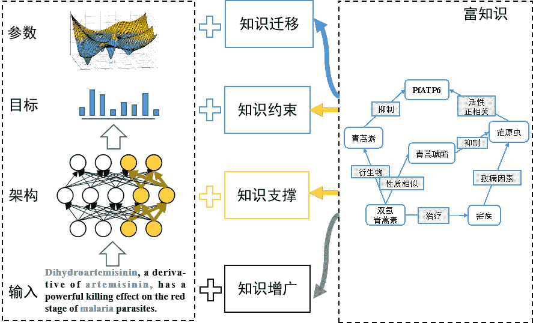

+   **知识增广**：从输入端增强模型，有两种主流的方法：一种方式是直接把知识加到输入，另一方法是设计特定模块来融合原输入和相关的知识化的输入表示。

+   **知识支撑**：关注于对带有知识的模型本身的处理流程进行优化。一种方式是在模型的底部引入知识指导层来处理特征，以便能得到更丰富的特征信息。例如，使用专门的知识记忆模块来从大模型底部注 入丰富的记忆特征。另一方面，知识也可以作为专家在模型顶层构建后处理模块，以计算得到更准确和有效的输出。

+   **知识约束**：利用知识构建额外的预测目标和约束函数，来增强模型的原始目标函数。例如，远程监督学习利用知识图谱启发式标注语料作为新的目标，并广泛用于实体识别、关系抽取等系列 NLP 任务。或者利用知识构建额外的预测目标，在原始语言建模之外构建了相应额外的预训练目标。

+   **知识迁移****：**模型知识作为重要的知识来源，也可以直接用于下游任务，例如初始化模型参数。迁移学习和自监督学习都是知识迁移的重要研究方向。目前，知识迁移技术已被广泛应用于自然语言处理，以 BERT 为首的各种预训练模型是现在知识迁移的主要方法。