# Transformer 全链路拆解

> 来源：[https://v11enp9ok1h.feishu.cn/docx/TjAWdHtCYose6oxItbscihjdngh](https://v11enp9ok1h.feishu.cn/docx/TjAWdHtCYose6oxItbscihjdngh)

## 序列到序列模型

> 序列到序列模型输入和输出都是一个序列，输入与输出序列长度之间的关系有两种情况。第一种情况下，输入跟输出的长度一样；第二种情况下，机器决定输出的长度。序列到序列模型有广泛的应用，通过这些应用可以更好地了解序列到序列模型。

### 语音识别、机器翻译与语音翻译

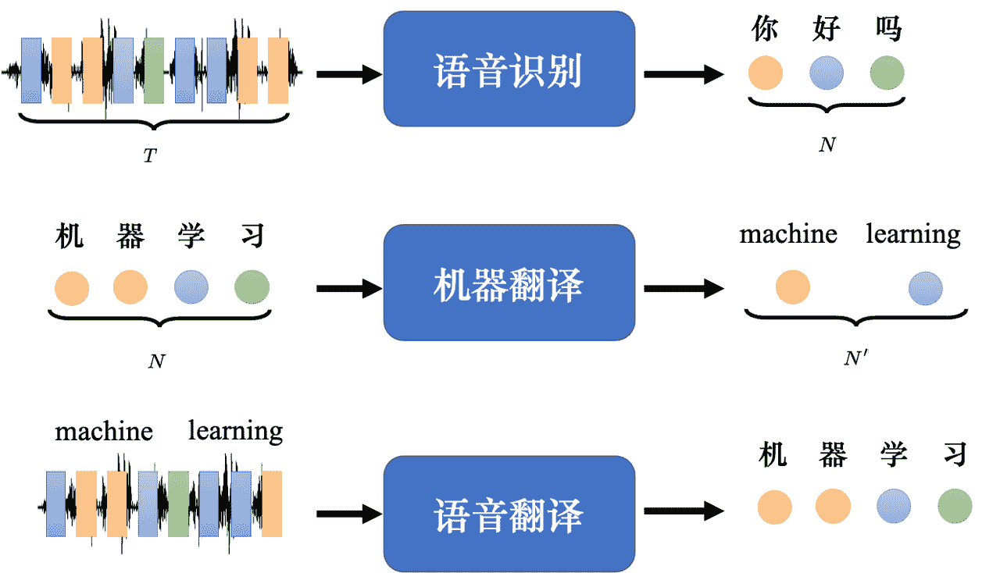

> + 语音识别：输入是声音信号，输出是语音识别的结果，即输入的这段声音信号所对应的文字。我们用圆圈来代表文字，比如每个圆圈代表中文里面的一个方块字。输入跟输出的长度有一些关系，但没有绝对的关系，输入的声音信号的长度是`T`，并无法根据`T`得到输出的长度`N`。其实可以由机器自己决定输出的长度，由机器去听这段声音信号的内容，决定输出的语音识别结果。

> + 机器翻译：机器输入一个语言的句子，输出另外一个语言的句子。输入句子的长度是`N`，输出句子的长度是`N′`。输入“机器学习”四个字，输出是两个英语的词汇：“machine learning”，但是并不是所有中文跟英语的关系都是输出就是输入的二分之一。`N` 跟`N′` 之间的关系由机器决定。

> + 语音翻译：我们对机器说一句话，比如“machinelearning”，机器直接把听到的英语的声音信号翻译成中文。

> **Q:** 既然把语音识别系统跟机器翻译系统接起来就能达到语音翻译的效果，那么为什么要做语音翻译？

> **A:** 世界上很多语言是没有文字的，无法做语音识别。因此需要对这些语言做语音翻译，直接把它翻译成文字。

+ 以闽南语的语音识别为例，闽南语的文字不是很普及，一般人不一定能看懂。因此我们想做语音的翻译，对机器讲一句闽南语，它直接输出的是同样意思的白话文的句子，这样一般人就可以看懂。我们可以训练一个神经网络，该神经网络输入某一种语言的声音信号，输出是另外一种语言的文字，需要学到闽南语的声音信号跟白话文文字的对应关系。

+ 语音识别：YouTube上面有很多的乡土剧，乡土剧是闽南语语音、白话文字幕，所以只要下载它的闽南语语音和白话文字幕，这样就有闽南语声音信号跟白话文之间的对应关系，就可以训练一个模型来做闽南语的。直接训练一个模型，输入是声音信号，输出直接是白话文的文字，这样训练能够做一个闽南语语音识别系统。

### 聊天机器人

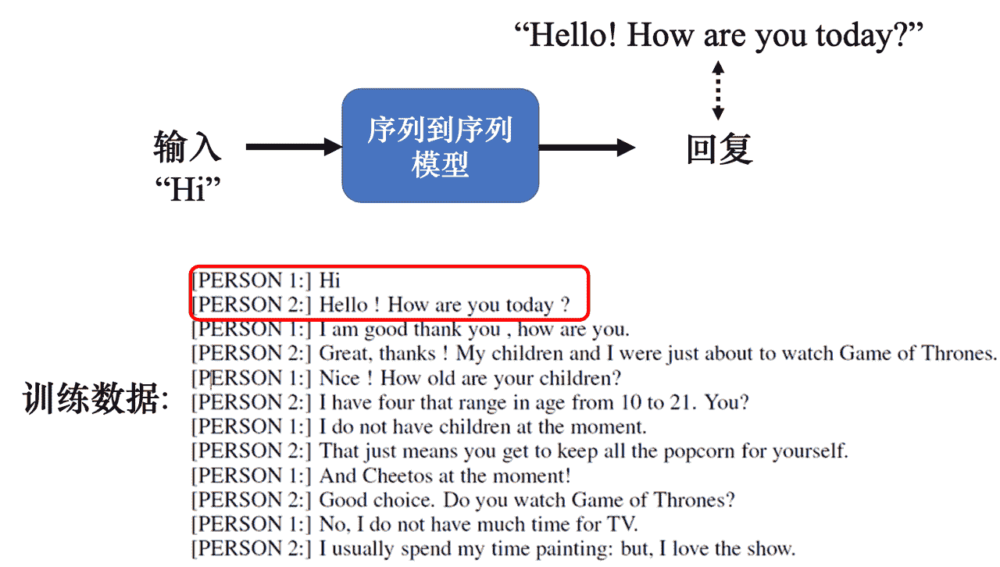

> 除了语音以外，文本也很广泛的使用了序列到序列模型。比如用序列到序列模型可用来训练一个聊天机器人。聊天机器人就是我们对它说一句话，它要给出一个回应。因为聊天机器人的输入输出都是文字，文字是一个向量序列，所以可用序列到序列的模型来做一个聊天机器人。我们可以收集大量人的对话（比如电视剧、电影的台词等等）

> 如图所示，假设在对话里面有出现，一个人说：“Hi”，另外一个人说：“Hello!Howareyoutoday?”。我们可以教机器，看到输入是“Hi”，输出就要“Hello!Howareyoutoday?”越接近越好。

### 语音合成

> 输入文字、输出声音信号就是语音合成（Text-To-Speech，TTS）。现在还没有真的做端到端（end-to-end）的模型，以闽南语的语音合成为例，其使用的模型还是分成两阶，首先模型会先把白话文的文字转成闽南语的拼音，再把闽南语的拼音转成声音信号。从闽南语的拼音转成声音信号这一段是通过序列到序列模型`echotron`实现的。

### 问答任务

比如下面是一些例子。

+ 翻译：机器读的文章是一个英语句子，问题是这个句子的德文翻译是什么？输出的答案就是德文。

+ 自动做摘要：给机器读一篇长的文章，让它把长的文章的重点找出来，即给机器一段文字，问题是这段文字的摘要是什么。

+ 情感分析：机器要自动判断一个句子是正面的还是负面的。如果把情感分析看成是问答的问题，问题是给定句子是正面还是负面的，希望机器给出答案。

### 句法分析

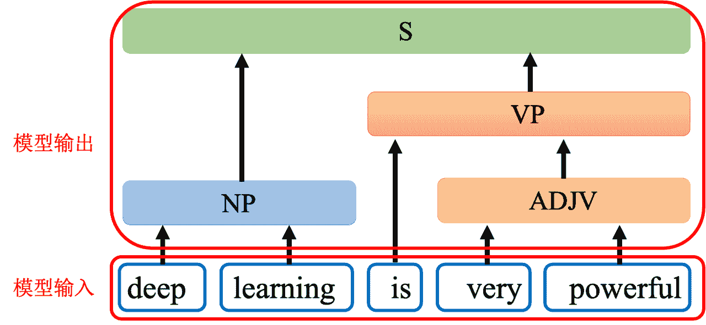

+ 如图所示，给机器一段文字：比如“deeplearningisverypowerful”，机器要产生一个句法的分析树，即句法树。通过句法树告诉我们deep加learning合起来是一个名词短语，very加powerful合起来是一个形容词短语，形容词短语加is以后会变成一个动词短语，动词短语加名词短语合起来是一个句子。

+ 在句法分析的任务中，输入是一段文字，输出是一个树状的结构，而一个树状的结构可以看成一个序列，该序列代表了这个树的结构，如图所示。把树的结构转成一个序列以后，我们就可以用序列到序列模型来做句法分析

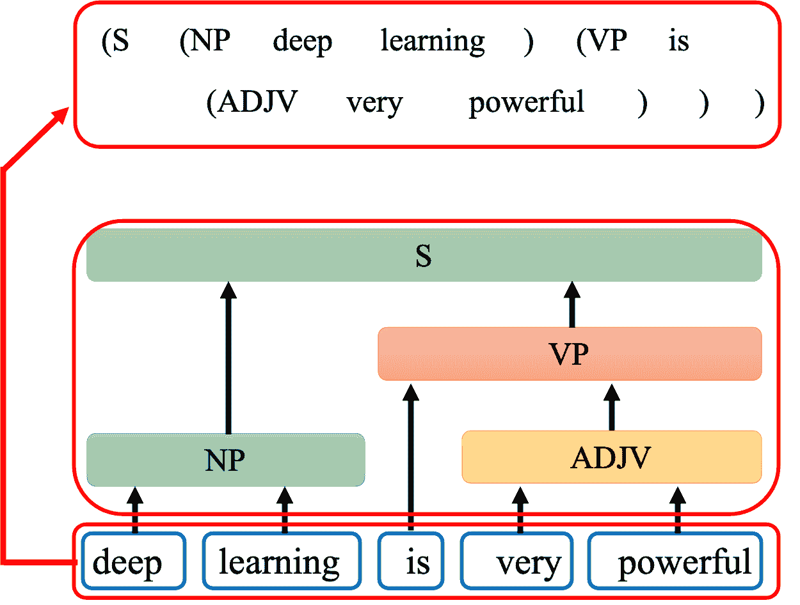

### 多标签分类

多类的分类跟多标签的分类是不一样的。如图所示，在做文章分类的时候，同一篇文章可能属于多个类，文章1属于类1和类3，文章3属于类3、9、17。

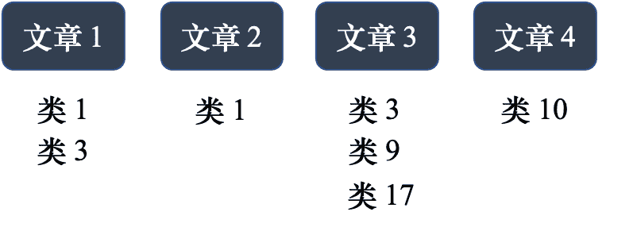

多标签分类问题不能直接把它当作一个多分类问题的问题来解

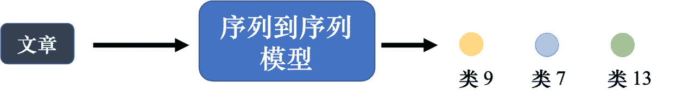

> 如图所示，输入一篇文章，输出就是类别，机器决定输出类别的数量。这种看起来跟序列到序列模型无关的问题也可以用序列到序列模型解，比如目标检测问题也可以用序列到序列模型来做

## Transformer结构

一般的序列到序列模型会分成编码器和解码器，如图所示。编码器负责处理输入的序列，再把处理好的结果“丢”给解码器，由解码器决定要输出的序列。

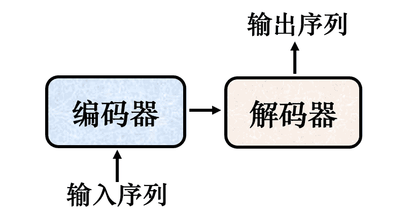

序列到序列典型的模型就是Transformer，其有一个编码器架构和一个解码器架构，如图所示。

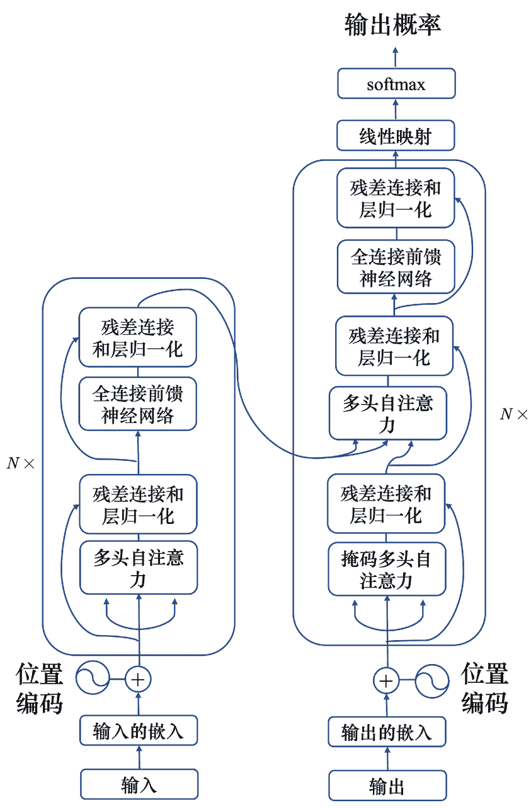

### Transformer 编码器

接下来介绍下Transformer的编码器。如图所示，编码器输入一排向量，输出另外一排向量。自注意力、循环神经网络、卷积神经网络都能输入一排向量，输出一排向量。Transformer 的编码器使用的是自注意力，输入一排向量，输出另外一个同样长度的向量。

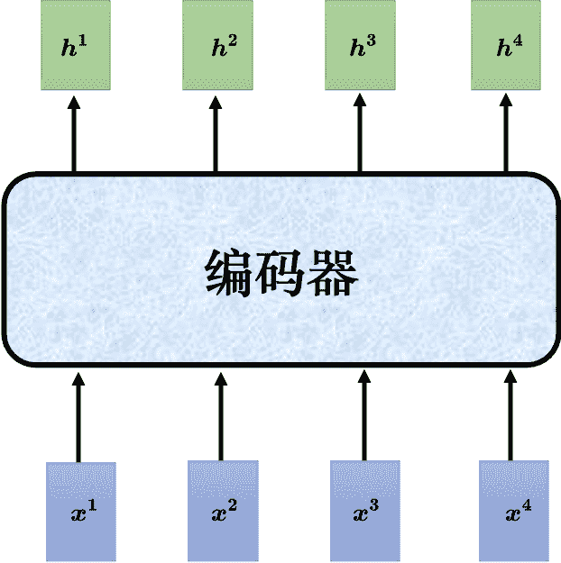

如图所示，编码器里面会分成很多的块（`block`），每一个块都是输入一排向量，输出一排向量。输入一排向量到第一个块，第一个块输出另外一排向量，以此类推，最后一个块会输出最终的向量序列。

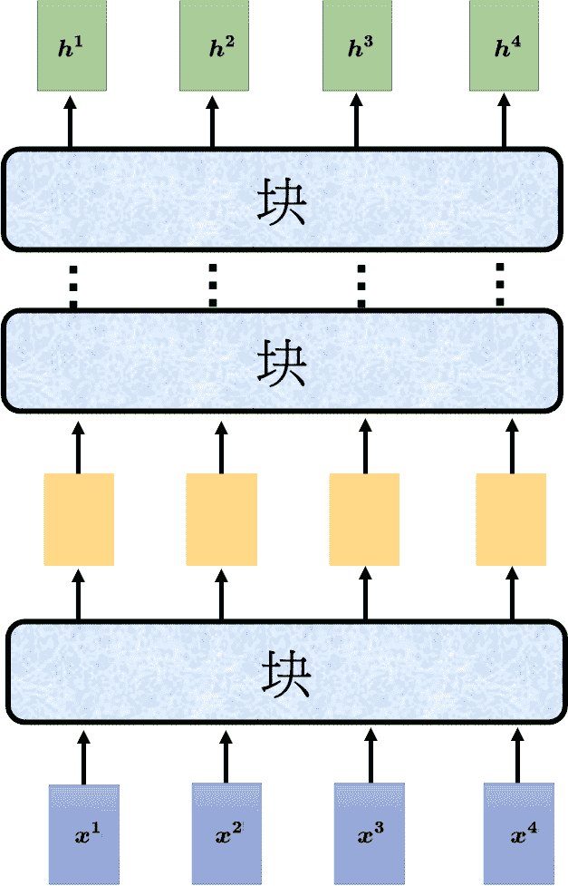

Transformer的编码器的每个块并不是神经网络的一层，每个块的结构如图所示，在每个块里面，输入一排向量后做自注意力，考虑整个序列的信息，输出另外一排向量。接下来这排向量会“丢”到全连接网络里面，输出另外一排向量，这一排向量就是块的输出，事实上在原来的Transformer里面做的事情是更复杂的。

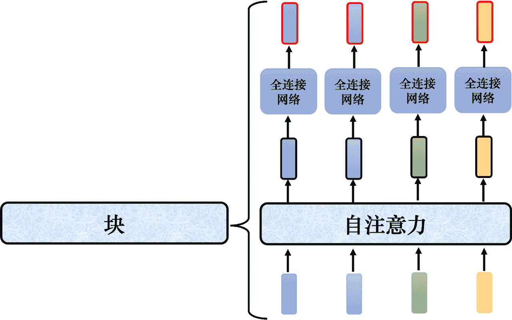

Transformer里面加入了残差连接（`residual connection`）的设计，如图所示，最左边的向量输入到自注意力层后得到向量，输出向量加上其输入向量得到新的输出。得到残差的结果以后，再做层归一化层

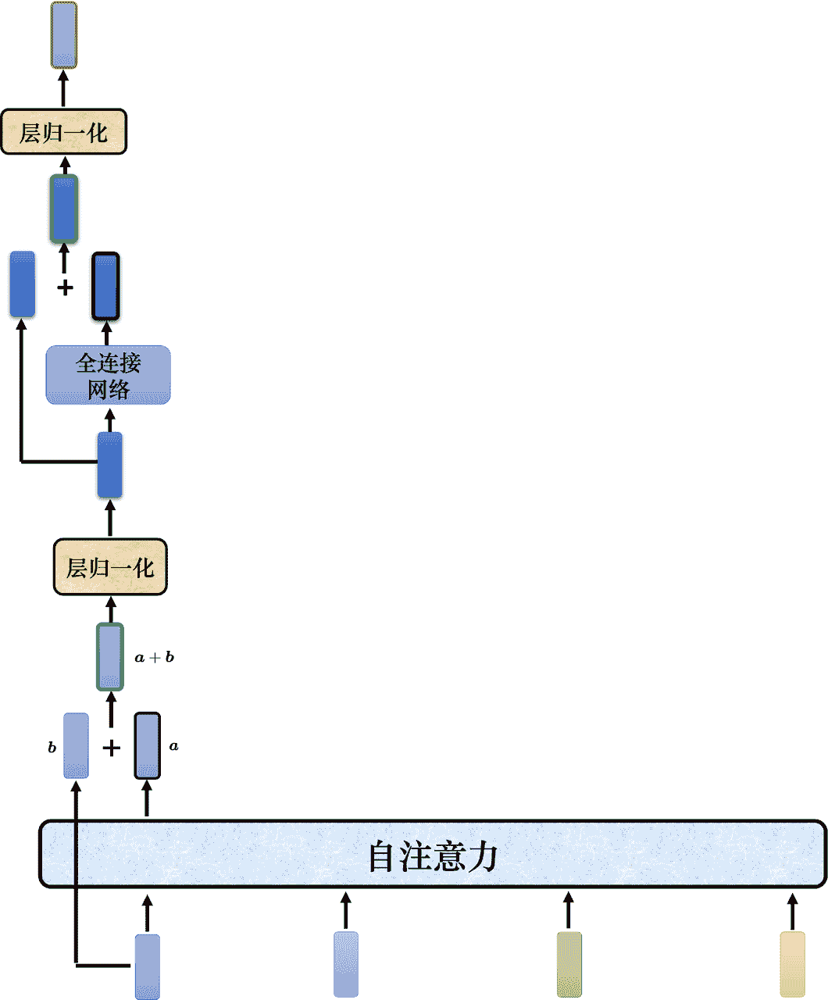

> 批量归一化是对不同样本不同特征的同一个维度去计算均值跟标准差，但层归一化是对同一个特征、同一个样本里面不同的维度去计算均值跟标准差，接着做个归一化。输入向量里面每一个维度减掉均值，再除以标准差以后得到就是层归一化的输出，如式所示。

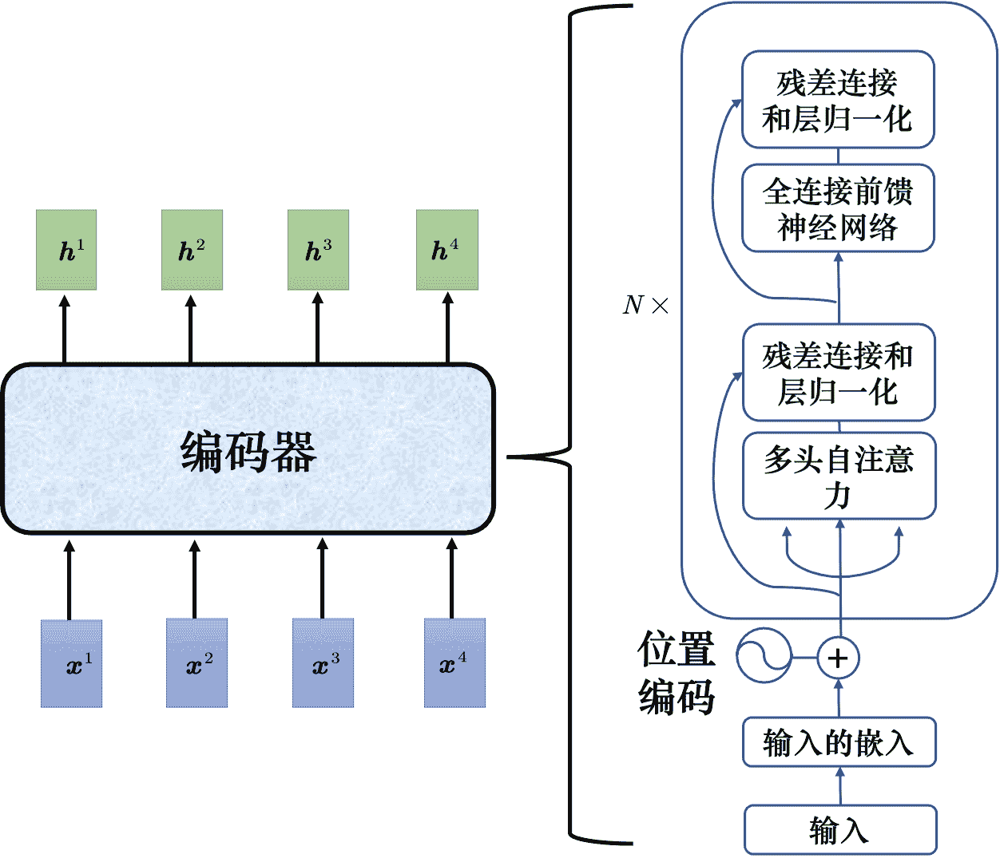

> 如图：给出了Transformer的编码器结构，其中表示重复次。首先，在输入的地方需要加上位置编码。如果只用自注意力，没有未知的信息，所以需要加上位置信息。多头自注意力就是自注意力的块。经过自注意力后，还要加上残差连接和层归一化。接下来还要经过全连接的前馈神经网络，接着再做一次残差连接和层归一化，这才是一个块的输出，这个块会重复次。

### Transformer解码器

#### 自回归解码器

以语音识别为例，输入一段声音，输出一串文字。

> 如图所示：把一段声音（“机器学习”）输入给编码器，输出会变成一排向量。接下来解码器产生语音识别的结果，解码器把编码器的输出先“读”进去。要让解码器产生输出，首先要先给它一个代表开始的特殊符号`<BOS>`，即 `BeginOfSequence`，这是一个特殊的词元（`token`）。在词表（`vocabulary`）里面，在本来解码器可能产生的文字里面多加一个特殊的符号。在机器学习里面，假设要处理自然语言处理的问题，每一个词元都可以用一个独热的向量来表示。独热向量其中一维是1，其他都是0，所以`<BOS>`也是用独热向量来表示，其中一维是1，其他是0。

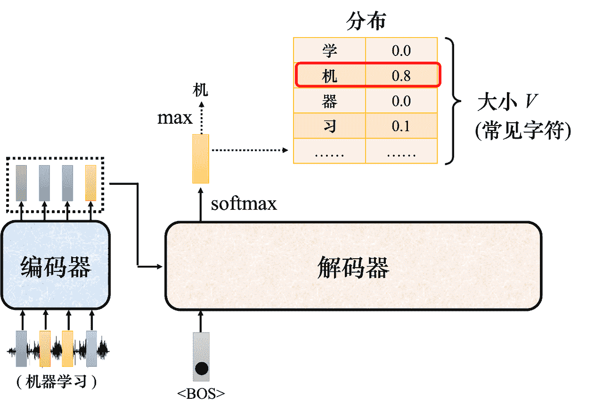

> 接下来解码器会“吐”出一个向量，该向量的长度跟词表的大小是一样的。在产生这个向量之前，跟做分类一样，通常会先进行一个`softmax`操作。这个向量里面的分数是一个分布，该向量里面的值全部加起来，总和是 。这个向量会给每一个中文字一个分，分数最高的中文字就是最终的输出。“机”的分数最高，所以“机”就当做是解码器的第一个输出。

> **Q:** 解码器输出的单位是什么?

> **A:** 假设做的是中文的语音识别，解码器输出的是中文。词表的大小可能就是中文的方块字的数量。常用的中文的方块字大概两三千个，一般人可能认得的四、五千个，更多都是罕见字。比如我们觉得解码器能够输出常见的3000个方块字就好了，就把它列在词表中。不同的语言，输出的单位不见不会不一样，这取决于对语言的理解。比如英语，选择输出英语的字母。但字母作为单位可能太小了，有人可能会选择输出英语的词汇，英语的词汇是用空白作为间隔的。但如果都用词汇当作输出又太多了，有一些方法可以把英语的字首、字根切出来，拿字首、字根当作单位。中文通常用中文的方块字来当作单位，这个向量的长度就跟机器可以输出的方块字的数量是一样多的。每一个中文的字都会对应到一个数值。

> 如图所示：接下来把“机”当成解码器新的输入。根据两个输入：特殊符号`<BOS>`和“机”，解码器输出一个蓝色的向量。蓝色的向量里面会给出每一个中文字的分数，假设“器”的分数最高，“器”就是输出。解码器接下来会拿“器”当作输入，其看到了`<BOS>`、“机”、“器”，可能就输出“学”。解码器看到`<BOS>`、“机”、“器”、“学”，它会输出一个向量。这个向量里面“习”的分数最高的，所以它就输出“习”。这个过程就反复地持续下去。

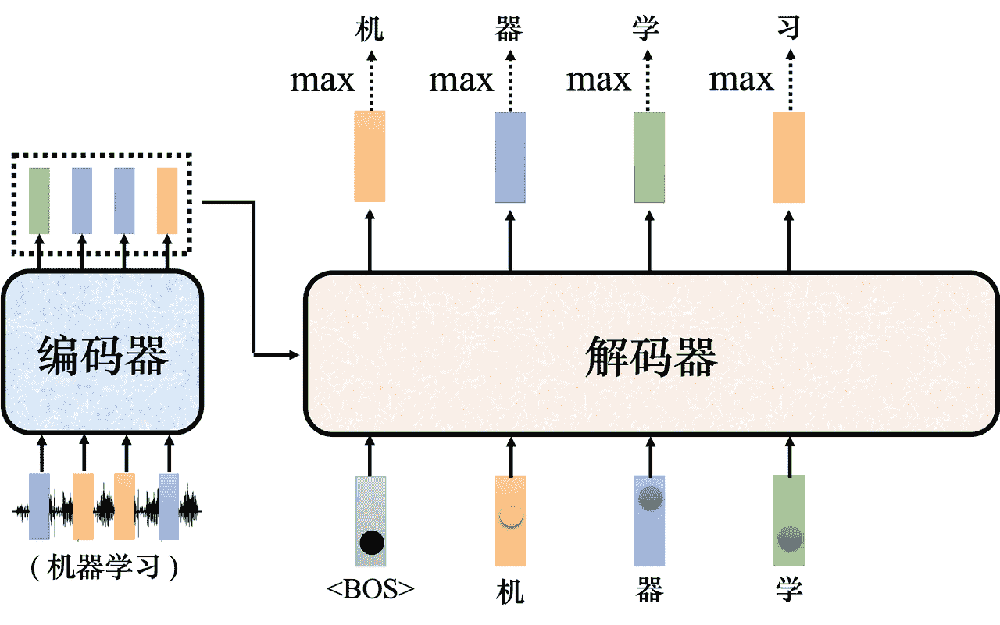

> 解码器的输入是它在前一个时间点的输出，其会把自己的输出当做接下来的输入，因此当解码器在产生一个句子的时候，它有可能看到错误的东西。

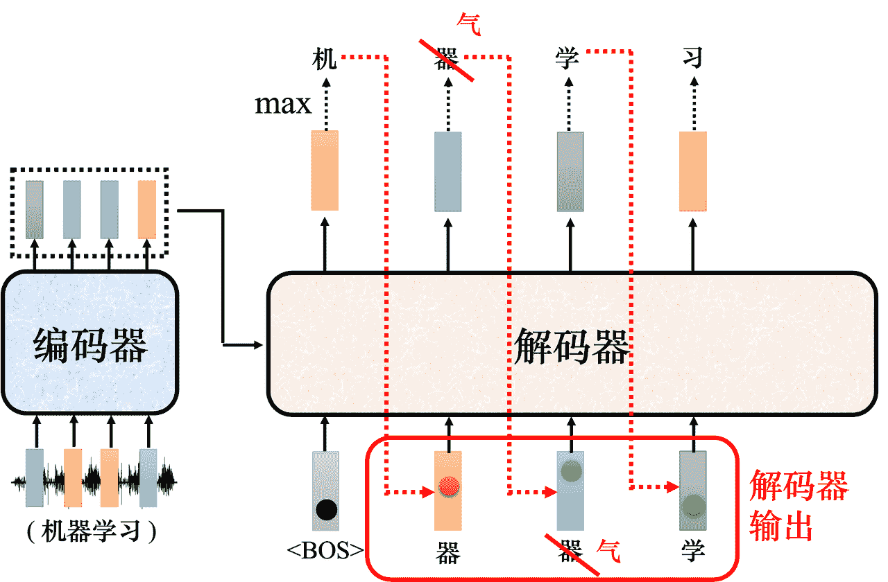

> 如图所示：如果解码器有语音识别的错误，它把机器的“器”识别错成天气的“气”，接下来解码器会根据错误的识别结果产生它想要产生的期待是正确的输出，这会造成误差传播（`errorpropagation`）的问题，一步错导致步步错，接下来可能无法再产生正确的词汇。

Transformer里面的解码器内部的结构。

> 如图所示：类似于编码器，解码器也有多头注意力、残差连接和层归一化、前馈神经网络。解码器最后再做一个`softmax`，使其输出变成一个概率。此外，解码器使用了掩蔽自注意力（`masked self-attention`），掩蔽自注意力可以通过一个掩码（`mask`）来阻止每个位置选择其后面的输入信息。

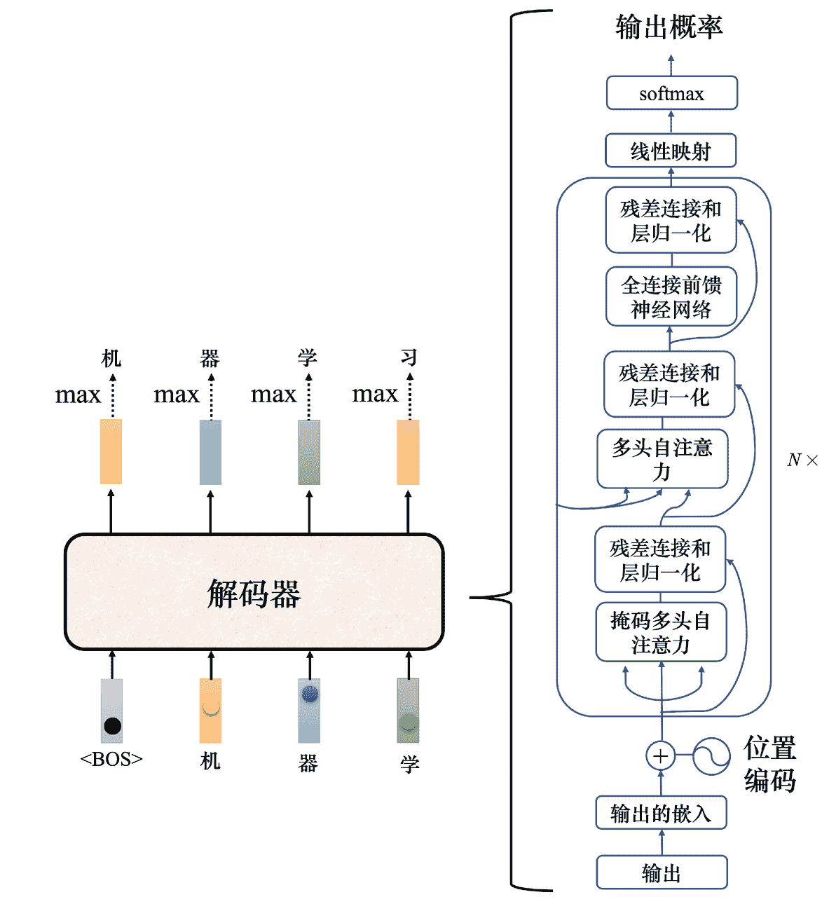

> 如图所示，原来的自注意力输入一排向量，输出另外一排向量，这一排中每个向量都要看过完整的输入以后才做决定。根据  到  有的信息去输出  。掩蔽自注意力的不同点是不能再看右边的部分

> 如图所示：产生  的时候，只能考虑  的信息，不能再考虑  、  、  。产生  的时候，只能考虑  、  的信息，不能再考虑 、  的信息。产生  的时候，不能考虑  的信息。产生  的时候，可以用整个输入序列的信息。

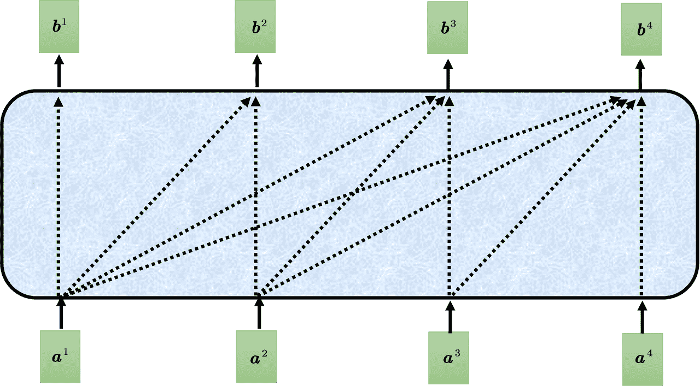

> 一般自注意力产生  的过程如图所示。掩蔽自注意力的计算过程如图所示，我们只拿  和   、  计算注意力，最后只计算  跟  的加权和。不管  右边的地方，只考虑  、  、`q1`、`q2`、  以及  。输出  的时候，只考虑了  和  ，没有考虑到   和  。

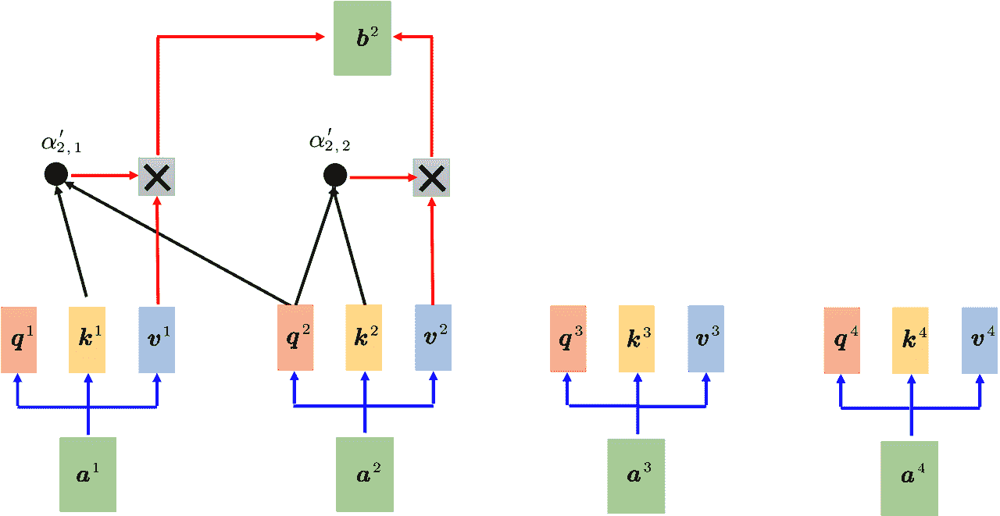

> **Q:** 为什么需要在注意力中加掩码?

> **A:** 一开始解码器的输出是一个一个产生的，所以是先有  再有  ，再有  ，再有  。这跟原来的自注意力不一样，原来的自注意力  跟  是一次整个输进去模型里面的。编码器是一次把  跟  都整个都读进去。但是对解码器而言，先有  才有   ，才有  才有  。所以实际上当我们有  ，要计算  的时候，没有  跟  的，所以无法考虑    。解码器的输出是一个一个产生的，所以只能考虑其左边的东西，没有办法考虑其右边的东西。

> 了解码器的运作方式，但这还有一个非常关键的问题：实际应用中输入跟输出长度的关系是非常复杂的，我们无法从输入序列的长度知道输出序列的长度，因此解码器必须决定输出的序列的长度。给定一个输入序列，机器可以自己学到输出序列的长度。但在目前的解码器运作的机制里面，机器不知道什么时候应该停下来

> 如图所示，机器产生完“习”以后，还可以继续重复一模一样的过程，把“习”当做输入，解码器可能就会输出“惯”，接下来就一直持续下去，永远都不会停下来。

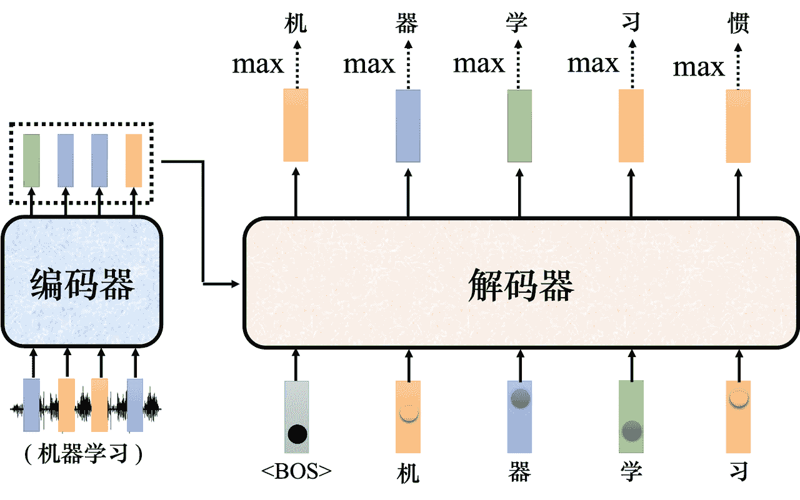

> 如图所示，要让解码器停止运作，需要特别准备一个特别的符号`EOS`。产生完“习”以后，再把“习”当作解码器的输入以后，解码器就要能够输出`<EOS>`，解码器看到编码器输出的嵌入、`<EOS>`、“机”、“器”、“学”、“习”以后，其产生出来的向量里面的概率必须是最大的，于是输出`<EOS>`，整个解码器产生序列的过程就结束了。

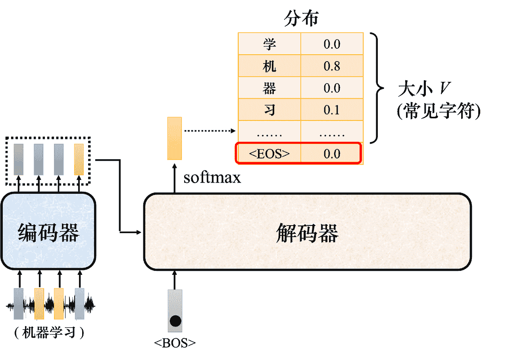

> 一般自注意力产生  的过程如图所示。掩蔽自注意力的计算过程如图所示，我们只拿  和   、  计算注意力，最后只计算  跟  的加权和。不管  右边的地方，只考虑  、  、`q1`、`q2`、  以及  。输出  的时候，只考虑了  和  ，没有考虑到   和  。

### 编码器 —— 解码器 注意力

> 编码器和解码器通过编码器-解码器注意力（`encoder-decoder attention`）传递信息，编码器—解码器注意力是连接编码器跟解码器之间的桥梁。如图所示，解码器中编码器-解码器注意力的键和值来自编码器的输出，查询来自解码器中前一个层的输出。

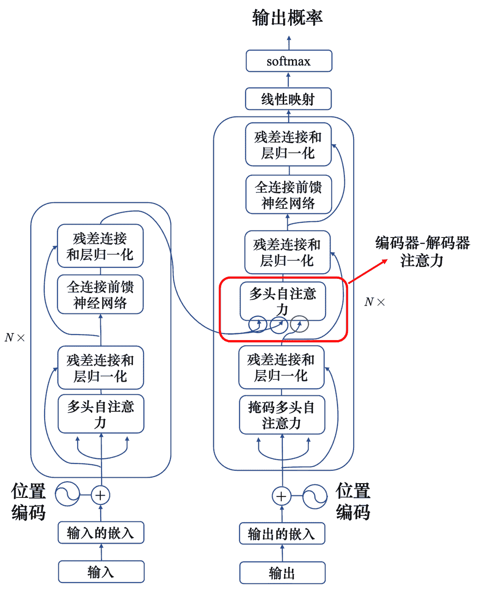

> 接下来介绍下编码器-解码器注意力实际的运作过程。如图所示，编码器输入一排向量，输出一排向量、  、  。接下来解码器会先“吃”`<BOS>`，经过掩蔽自注意力得到一个向量。接下来把这个向量乘上一个矩阵，做一个变换（`transform`），得到一个查询  ， 、 、   也都产生键：  、 、  。把   跟   、 、   去计算注意力的分数，得到   接下来做 `softmax`，得到   。接下来通过式 可得加权和   。

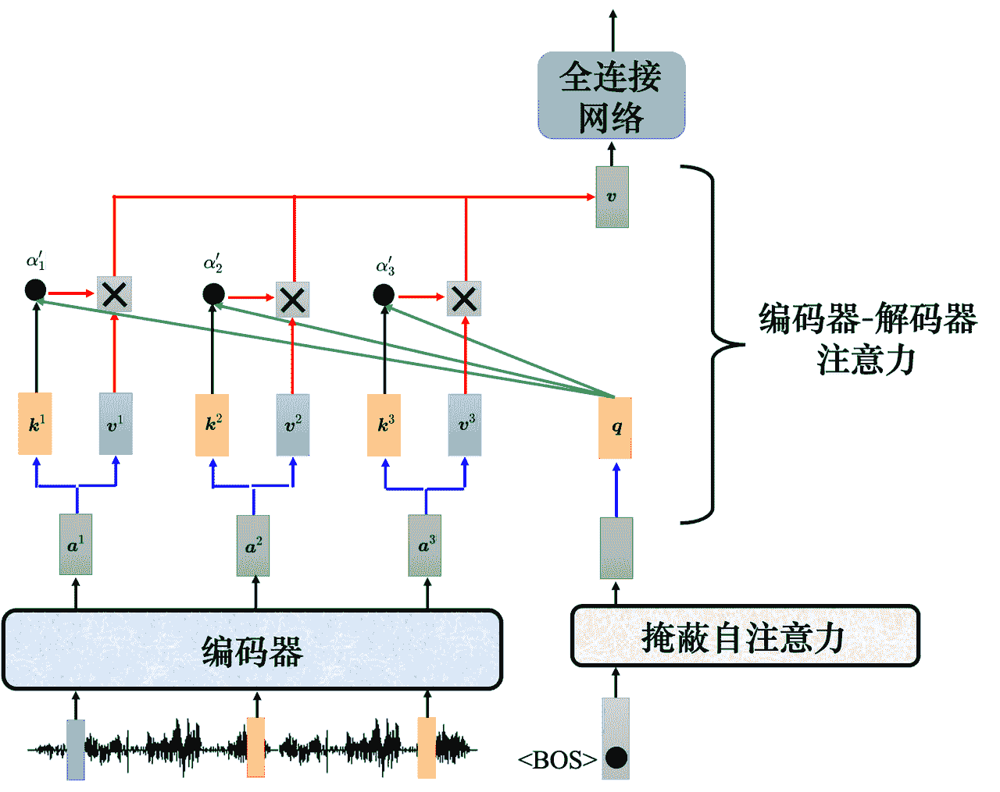

> 接下来会“丢”给全连接网络，这个步骤  来自于解码器，  跟  来自于编码器，该步骤就叫做编码器-解码器注意力，所以解码器就是凭借着产生一个   ，去编码器这边抽取信息出来，当做接下来的解码器的全连接网络的输入。

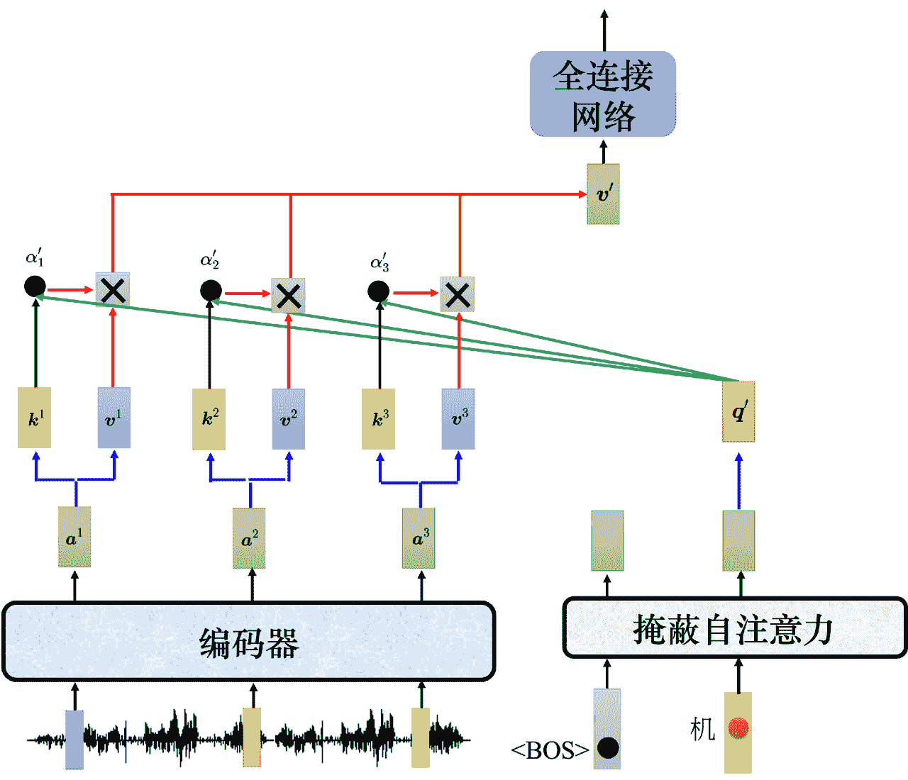

# Transformer 模型架构

如图所示，假设产生“机”，输入`<BOS>`、“机”，产生一个向量。这个向量一样乘上一个线性变换得到一个查询。会跟 、 、 计算注意力的分数。接着用注意力分数跟 、 、 做加权和，加起来得到，最后交给全连接网络处理

## Transformer 的训练过程

如图所示，`Transformer` 应该要学到听到“机器学习”的声音信号，它的输出就是“机器学习”这四个中文字。把 `<EOS>` 丢给编码器的时候，其第一个输出应该要跟“机”越接近越好。而解码器的输出是一个概率的分布，这个概率分布跟“机”的独热向量越接近越好。因此我们会去计算标准答案（Ground Truth）跟分布之间的交叉熵，希望该交叉熵的值越小越好。

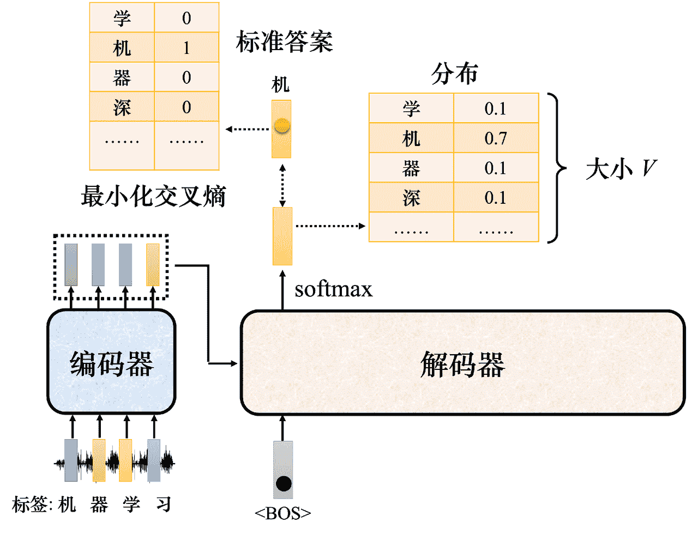

如图所示，实际训练的时候，输出应该是“机器学习”。解码器第一次的输出、第二次的输出、第三次的输出、第四次输出应该分别就是“机”、“器”、“学”、“习”这四个中文字的独热向量，输出跟这四个字的独热向量越接近越好。在训练的时候，每一个输出跟其对应的正确答案都有一个交叉熵。

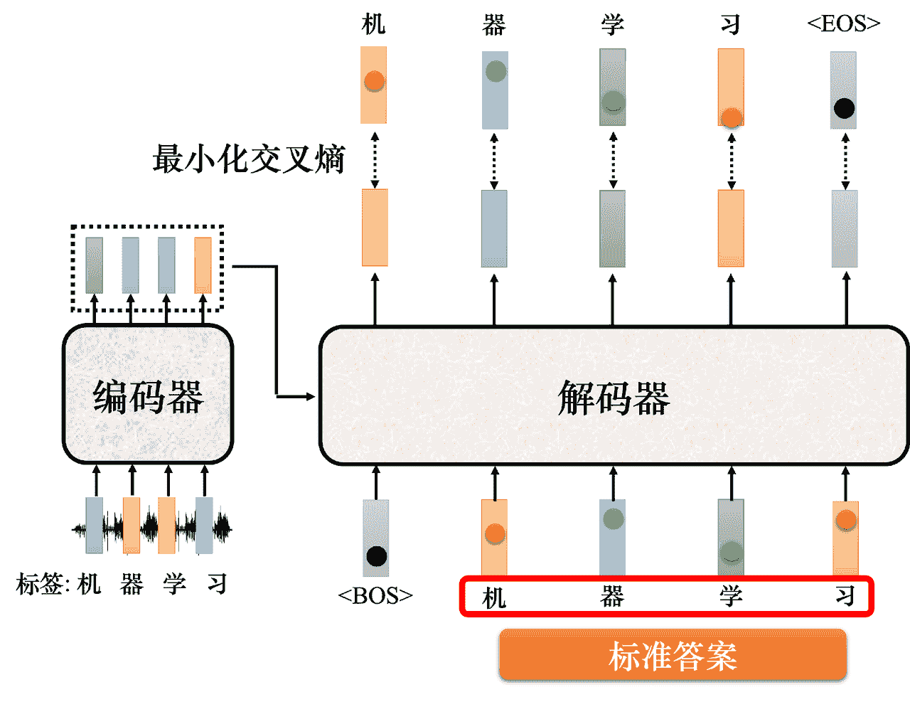

图中做了四次分类问题，希望这些分类的问题交叉熵总和越小越好。训练的时候，解码器输出的不是只有“机器学习”这四个中文字，还要输出`<EOS>`。所以解码器的最终第五个位置输出的向量跟`<EOS>`的独热向量的交叉熵越小越好。我们把标准答案给解码器，希望解码器的输出跟正确答案越接近越好。在训练的时候，告诉解码器在已经有`<EOS>`、“机”的情况下，要输出“器”，有`<EOS>`、“机”、“器”的情况下输出“学”，有`<EOS>`、“机”、“器”、“学”的情况下输出“习”，有`<EOS>`、“机”、“器”、“学”、“习”的情况下，输出`<EOS>`。在解码器训练的时候，在输入的时候给它正确的答案，这称为教师强制（teacher forcing）。

`https://v11enp9ok1h.feishu.cn/sync/PaIIdslbxsIJUIbkTfPcsMCFnph`
