# 实战:  从0开始搭建Transformer

> 来源：[https://v11enp9ok1h.feishu.cn/docx/AHoIdoGmFoabHFxZkoWcexMXnxg](https://v11enp9ok1h.feishu.cn/docx/AHoIdoGmFoabHFxZkoWcexMXnxg)

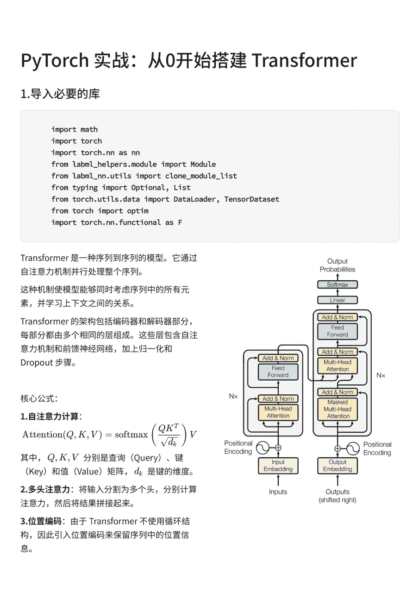

## **自注意力机制**

> 自注意力机制核心就是计算句子在编码过程中每个位置上的注意力权重，然后再以权重和的方式来计算整个句子的隐含向量表示

>

## **attention 核心？**

>

> **self-attention ****核心公式：**

>

>

> 首先将**query**与**key**的转置做点积，然后将结果**除以sqrt(dk)** , 再进行**softmax**计算，最后将结果与**value**做矩阵乘法得到**output**， dk表示词向量维度，

> 除以**sqrt(dk)**是为了防止**QKT**过大导致**softmax**计算溢出，其次可以将**QKT**结果满足均值为0，方差1的分布。

>

> **QKT****计算相当于**计算Q和V中每个向量的点积，本质上是余弦相似度，可以表示两个向量在方向上的相似度，结果越大越相似。

## **Q、K、V是什么？**

q，k，v分别代表**query**，**key**，**value**对应为查询，键，值

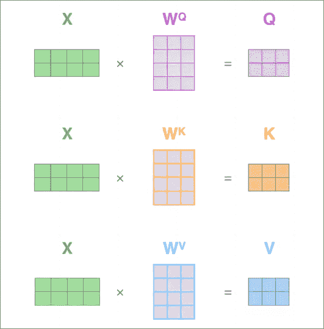

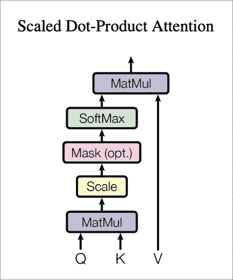

Q，K，V都是对X进行乘以矩阵W后的线性变换

### **实现**

```
# self-attention 实现
import numpy as np
from math import sqrt
import torch
from torch import nn


class Self_Attention(nn.Module):
    # input : batch_size * seq_len * input_dim
    # q : batch_size * input_dim * dim_k
    # k : batch_size * input_dim * dim_k
    # v : batch_size * input_dim * dim_v
    def __init__(self, input_dim, dim_k, dim_v):
        super(Self_Attention, self).__init__()
        self.q = nn.Linear(input_dim, dim_k)
        self.k = nn.Linear(input_dim, dim_k)
        self.v = nn.Linear(input_dim, dim_v)
        self._norm_fact = 1 / sqrt(dim_k)

    def forward(self, x):
        Q = self.q(x)  # Q: batch_size * seq_len * dim_k
        K = self.k(x)  # K: batch_size * seq_len * dim_k
        V = self.v(x)  # V: batch_size * seq_len * dim_v

        # Q * K.T() # batch_size * seq_len * seq_len
        atten = nn.Softmax(
            dim=-1)(torch.bmm(Q, K.permute(0, 2, 1))) * self._norm_fact

        # Q * K.T() * V # batch_size * seq_len * dim_v
        output = torch.bmm(atten, V)

        return output


X = torch.randn(4, 3, 2)
print(X)
self_atten = Self_Attention(2, 4, 5)  # input_dim:2, k_dim:4, v_dim:5
res = self_atten(X)
print(res.shape)  # [4,3,5]

```

## **多头注意力机制**

不同于只使用一个注意力池化，我们可以将输入x拆分为h份，然**后独立**计算h组不同的线性投**影来得**到**各自的QK**V，然后将变换后的h组QKV并行计算注意力，最后将h个注意力池化拼接起来并通过另一个可以学习的线性投影进行变换以产生输出，这种设计叫做多头注意力

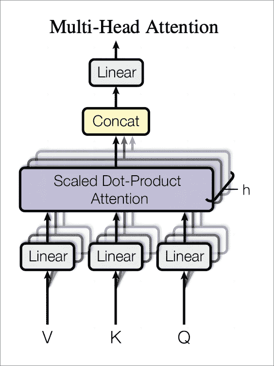

在多头注意力机制中，每个头都可能会关注输入的不同部分，可以表示比简单加权平均值更加复杂的函数。

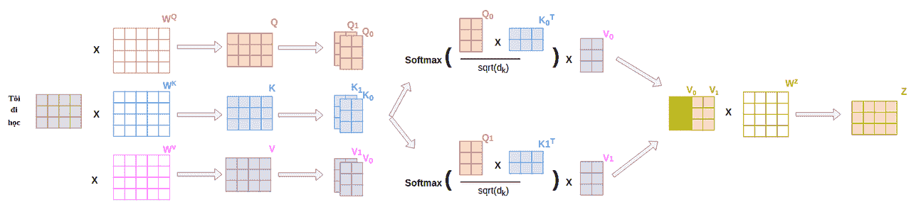

### 实现

```
#%%
# Muti-head Attention 机制的实现
from math import sqrt
import torch
import torch.nn as nn


class Self_Attention_Muti_Head(nn.Module):
    # input : batch_size * seq_len * input_dim
    # q : batch_size * input_dim * dim_k
    # k : batch_size * input_dim * dim_k
    # v : batch_size * input_dim * dim_v
    def __init__(self,input_dim,dim_k,dim_v,nums_head):
        super(Self_Attention_Muti_Head,self).__init__()
        assert dim_k % nums_head == 0
        assert dim_v % nums_head == 0
        self.q = nn.Linear(input_dim,dim_k)
        self.k = nn.Linear(input_dim,dim_k)
        self.v = nn.Linear(input_dim,dim_v)
        
        self.nums_head = nums_head
        self.dim_k = dim_k
        self.dim_v = dim_v
        self._norm_fact = 1 / sqrt(dim_k)
        
    
    def forward(self,x):
        Q = self.q(x).reshape(-1,x.shape[0],x.shape[1],self.dim_k // self.nums_head) 
        K = self.k(x).reshape(-1,x.shape[0],x.shape[1],self.dim_k // self.nums_head) 
        V = self.v(x).reshape(-1,x.shape[0],x.shape[1],self.dim_v // self.nums_head)
        print(x.shape)
        print(Q.size())

        atten = nn.Softmax(dim=-1)(torch.matmul(Q,K.permute(0,1,3,2))) # Q * K.T() # batch_size * seq_len * seq_len
        
        output = torch.matmul(atten,V).reshape(x.shape[0],x.shape[1],-1) # Q * K.T() * V # batch_size * seq_len * dim_v
        
        return output
    
x=torch.rand(1,3,4)
print(x)
# %%
atten=Self_Attention_Muti_Head(4,4,4,2)
y=atten(x)
print(y.shape)

# %%

```

## **视觉注意力机制**

attention机制本质是利用相关特征图学习权重分布，再用学出来的权重施加在原特征图之上最后进行加权求和。

**计算机视**觉**上的注**意**力机制**主要分为三种： 空间域、通道域、混合域

1.  **空间域**：将图片中的空间域信息做对应的空间变换，从而将关键信息提取出来，对空间进行掩码的生成并进行打分，代表是Spatial attention module

1.  **通道域**： 类似于每个通道上的信号都增加一个权重，来代表该通道与关键信息的相关度的话，这个权重越大，则代表相关度越高。 对通道生成掩码mask进行打分，代表是senet，channel attention module

1.  **混合域**：空间域的注意力是忽略了通道域中的信息，将每个通道的图片特征同等处理，这种做法会将空间域变换方法局限在原始特征提取阶段。

## **扩展**

### **通道域注意力 （SENet)**

全局**池化**，提取通道权重，然后对特征图进行改变，得到加强后的特征图。

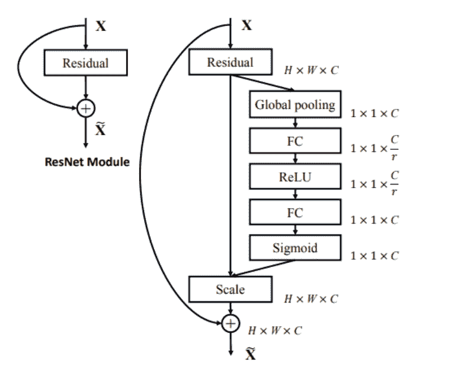

### 实现

```
class SELayer(nn.Module):
    def __init__(self, channel, reduction=16):
        super(SELayer, self).__init__()
        self.avg_pool = nn.AdaptiveAvgPool2d(1)
        self.fc = nn.Sequential(
            nn.Linear(channel, channel // reduction, bias=False),
            nn.ReLU(inplace=True),
            nn.Linear(channel // reduction, channel, bias=False),
            nn.Sigmoid()
        )
    def forward(self, x):
        b, c, _, _ = x.size()
        y = self.avg_pool(x).view(b, c) #对应Squeeze操作
        y = self.fc(y).view(b, c, 1, 1) #对应Excitation操作
        return x * y.expand_as(x)
```

### **门控注意力机制 （GCT, Gated Cha**nnel Transformation)

G**CT是一种简单有效的通道间**建模关系体系结构，能够显著提高卷积网络在视觉任务的泛化能力。论文经过研究发现将门控机制放在Conv层前面训练出来的效果最好。

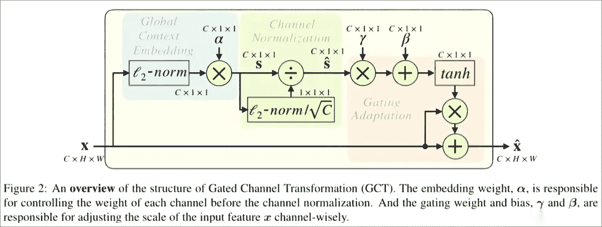

论文引入了**alpha**，**beta**，**gama****来对通道信**息进行评价，三个均为可训练**参数，a**l**pha有****助于嵌**入输出的自适应性，beta和gama用于控制激活门限，三个参数决定了GCT在每个通道上的表现。

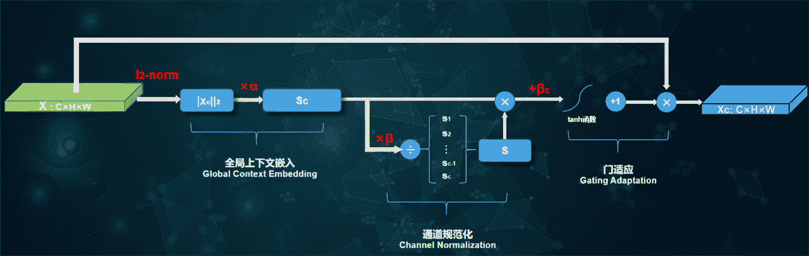

GCT 的三个部分：

#### Global Context Embedding

作者首先设计了一种全局上下文**嵌入模块**，用于每个通道的全局上下文信息汇聚。

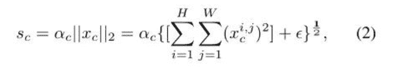

#### Channel Normalization

**对第一步计算的**L2进行规范化来构建神经元竞争关系，作者使用跨通道的特征规范化，公式如下：

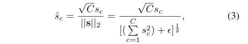

尺度因子

**用于对sc规范**化**，来避**免尺度过小，相比SEBlock，GCT具有更少的计算量。

#### Gating Adaptation

**作者在**上面步骤的基础上，加入**了门限机制，GCT**可以有助于促进神经元的协同or 竞争关系。

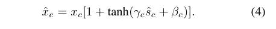

### **实现**

```
class GCT(nn.Module):

    def __init__(self, num_channels, epsilon=1e-5, mode=&#x27;l2&#x27;, after_relu=False):
        super(GCT, self).__init__()

        self.alpha = nn.Parameter(torch.ones(1, num_channels, 1, 1))
        self.gamma = nn.Parameter(torch.zeros(1, num_channels, 1, 1))
        self.beta = nn.Parameter(torch.zeros(1, num_channels, 1, 1))
        self.epsilon = epsilon
        self.mode = mode
        self.after_relu = after_relu

    def forward(self, x):

        if self.mode == &#x27;l2&#x27;:
            embedding = (x.pow(2).sum((2, 3), keepdim=True) +
                         self.epsilon).pow(0.5) * self.alpha
            norm = self.gamma / \
                (embedding.pow(2).mean(dim=1, keepdim=True) + self.epsilon).pow(0.5)

        elif self.mode == &#x27;l1&#x27;:
            if not self.after_relu:
                _x = torch.abs(x)
            else:
                _x = x
            embedding = _x.sum((2, 3), keepdim=True) * self.alpha
            norm = self.gamma / \
                (torch.abs(embedding).mean(dim=1, keepdim=True) + self.epsilon)

        gate = 1. + torch.tanh(embedding * norm + self.beta)

        return x * gate

```

> **GCT建议添加在Conv层前，一般可以先冻结原来的**模型，来训练GCT，然后解冻再进行微调。