# 一站式解读多模态全类型

> 来源：[https://v11enp9ok1h.feishu.cn/docx/AJ7fdhRTvo4gUJxpf6Pc87wPngf](https://v11enp9ok1h.feishu.cn/docx/AJ7fdhRTvo4gUJxpf6Pc87wPngf)

<https://v11enp9ok1h.feishu.cn/sync/PaIIdslbxsIJUIbkTfPcsMCFnph>

## 多模态是实现通用人工智能的必经之路

按照处理的数据类型数量划分，AI模型可以划分为两类：

1.  **单模态：**只处理1种类型数据，如文本等；

1.  **多模态：**处理2种及以上数据，可类比人脑同时对文本、声音、图像等不同类型信息进行处理。

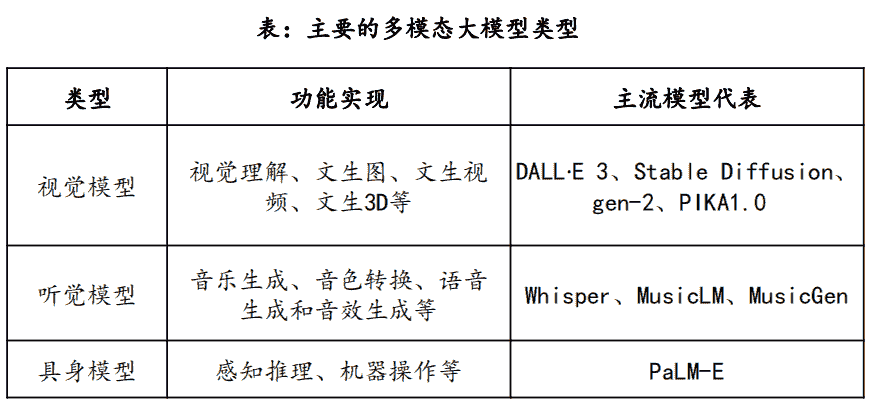

多模态是实现通用人工智能的必经之路。相比单模态，多模态大模型在输入输出端的优势明显

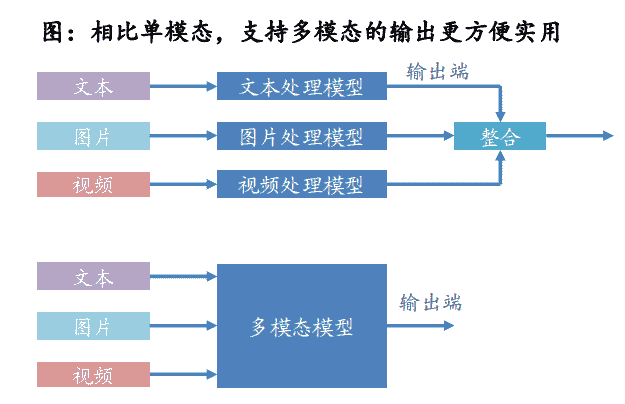

**输入端：**

1.  **提升模型能力：**高质量语言数据存量有限，且不同模态包含的信息具有互补性，多元的训练数据类型有助于提升通用大模型能力；

1.  **提高用户体验：**推理侧更低的使用门槛和更少的信息损耗。

**输出端：更实用。**

1.  可直接生成综合结果，省去多个模型的使用和后期整合；

1.  更符合真实世界生产生活需要，从而实现更大商业价值。

>

## **多模态大模型框架概览 **

+   **数据：**文本、视觉、声音、触觉、气味等。

+   **算法：**通过多模态统一建模，增强模型的跨模态语义对齐能力，打通各模态之间的关系，执行标准化的任务。

+   **应用：**办公、电商、娱乐、教育等领域

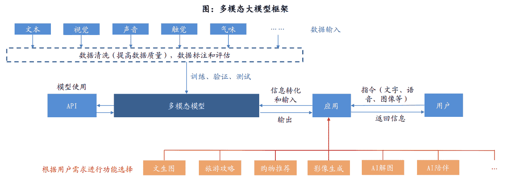

## **多模态大模型算法面临的技术挑战**

> 相**比单**模**态，**多**模态**大**模型**算**法和**工**程难**度更大，在表征、对齐、推理、生成、迁移、量化等环节均面临更多难点。

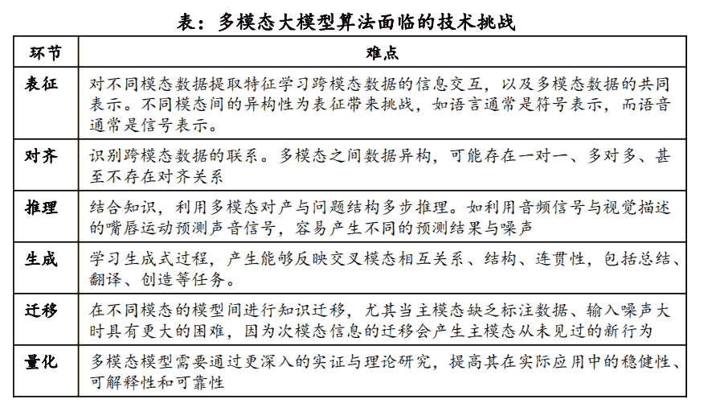

> **预训练为多模态主流训练方式。****由于高质量的多模态标注**数据较少，基于Transformer结构的多模态预训练模型逐渐成为主流，通过海量无标注 数据进行预训练，再使用少量有标注数据进行微调。原生多模态大模型是未来发展趋势，即设计时原生支持多模态，具有处理不同形式数据的能力，但各环节难度会更高。23年12月谷歌GEMINI即为原生多模态，一开始就在不同模态上进行预训练，利用额外的多模态数据进行微调以提升有 效性，行业技术取得进一步突破。

这一波大语言模型发展给多模态带来新突破：

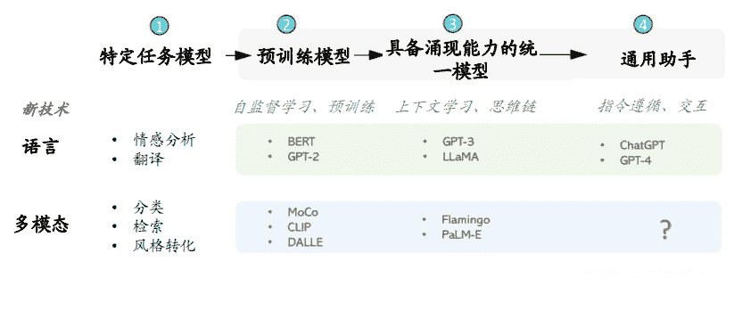

1.  大语言模型LLM可充当大脑，处理各种模态信息，将其它模态信息对齐到LLM的语义空间。

1.  大语言模型在训练方式上给多模态模型提供前进方向参考，如自监督、预训练、上下文学习、指令遵循等。

## **视觉基础模型框架**

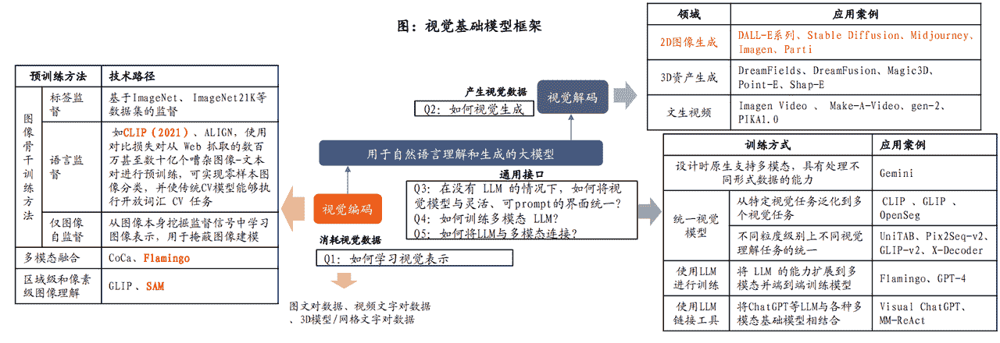

大型高质量数据集是模型突破重要基础

现阶段多模态数据大多需要先用文本标注而非直接用于训练，相比文本数据集，图文对、视频文字对等数据集获取和标注工作量更大，大型高质量数据集的出现将为领域内算法突破奠定基础。

2D图像生成引领视觉模型前进方向

由于2D图像生成在数据、算法、算力等方面是视觉模型中要求相对较低的领域，因此更容易实现技术突破，更早出现爆款应用（如 Midjourney、dalle3），其也为3D资产生成、视频生成等领域提供技术参考。但考虑到后两个方向算法未完全收敛，尚未进入“大炼模型”阶段，距离真正的技术和应用爆发 拐点还需要一定时间。

## 视觉理解：CLIP模型提供重要泛化能力

**视觉理解模型可分为：**

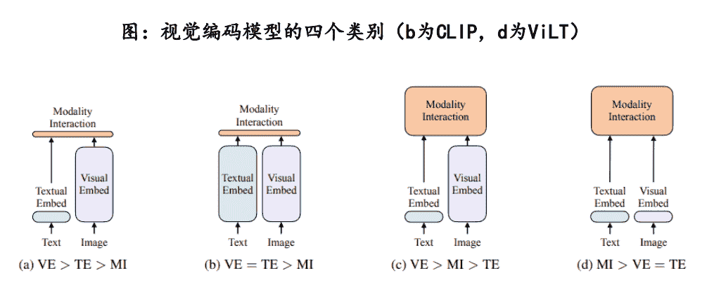

1.  **双塔模型****：****浅层语义交互。****对文本和**图像**分别编码后再输入多模态编码器**，如CLIP。优点是适合检索任务，可检索大量文本与图像，缺点是不足以处理复杂分类任务。

1.  **单塔模型****：****深层语义交互。****先将文本**特征和图像特征连接后统一输入到多模态编码器，如 ViLT，优点是可以充分将多模态信息融合，更擅长分类任务以及需要强交互的多模态理解任务，但不适合检索。

1.  **混合模型**。

### 重要模型1——CLIP（2021年发布）

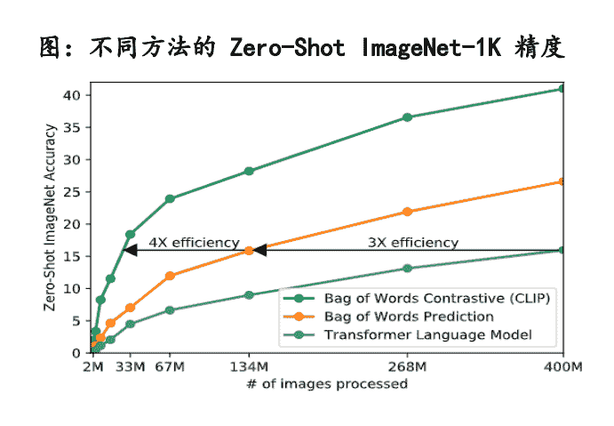

第一个可通过零样本和少样本学习推广到多个图像分类任务的模型。传统的视觉数据集创建成本很高，且任务泛化性差。OPEN AI创建了一个包含4亿图文对数据集，并借助大规模自然语言监督训练CLIP 模型，将不同模式、文本和图像的数据映射到共享 向量空间，实现了可以用自然语言指示进行大量的分类基准，即 “Zero-Shot”能力（将ImageNet上的zero-shot分类精度从11.5%提升到76.2%）。CLIP可识别图像、生成图像、回答与图像相关的问题，搜索与文字描述相符的图像，且其结构松散耦合，在保证学到多模态表征的基础上可随意拆分，从而将Encoder模块很好用到其他模型或者任务上，如Flamingo和LLaVa使用CLIP作为图像编码器， DALL-E用CLIP筛选生成的图像。

## 视觉理解：Flamingo推动预训练+微调 转向 预训练+prompt

**重**要模型2——Flamingo（2022年发布），在广泛的开放式多模态任务中建立了少样本学习新SOTA。

> **DeepMind**发布的**Flamingo架构**中包括一个**预训练语言模型****（DeepMind的Chin****chil**la）+预训练Vision Encoder（DeepMind NFNet-F6，采用CLIP对比损失在图像文本对数据集上预训练的）+Perceiver Resampler模块实现最终输出固定长度特征。

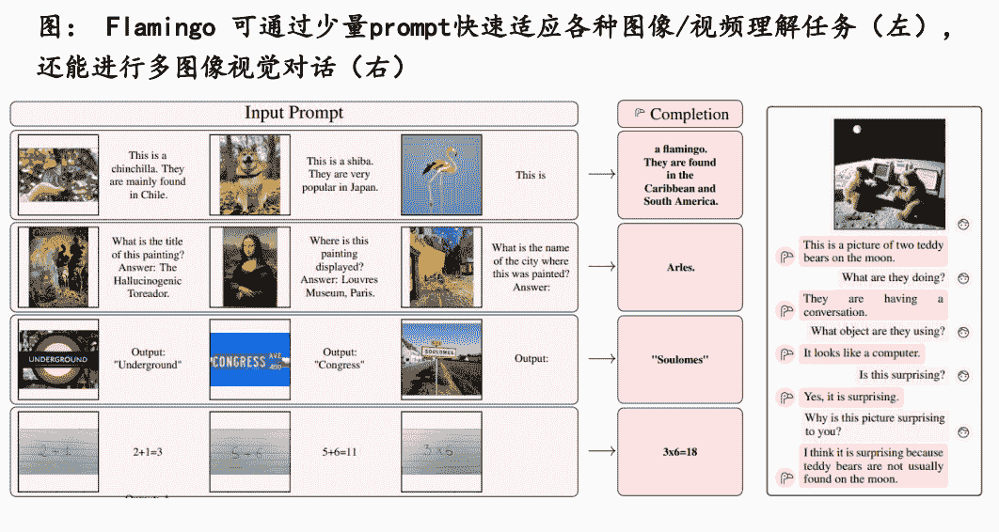

> **Flamingo****可**在**多种开放式视觉和****语言任务中实现快****速学习**（文本描述补全、VQA / TextVQA、OCR、数学计算、文本描述、物体计数、语言文本混合理解、人物常识等等），不需要微调，同时在大部分多模态任务上能实现和 GPT-3 一样的 In-context few-shot推理能力。在众多基准测试中，Flamingo的表现优于在数千倍于特定任务数据的基础上进行微调的模型。行业内推测OPEN AI最新发布的多模态模型GPT4-V是一个类似 Flamingo的架构

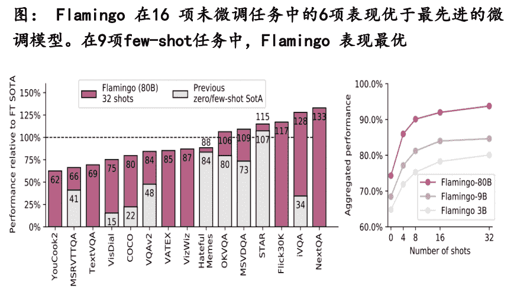

##  视觉理解：SAM，用prompt分割一切

**重要模型3——SAM（2023年发布），第一个致**力于图像分割的基础模型，零样本分割一切。

图像分割是计算机视觉的核心任务之一，是指识别目标、并沿目标边缘进行区域分割的技术，此前方法大致分为：

1.  **交互式分割**，允许分割任何类别的对象，但需要专家通过迭代细化掩码指导该方法。

1.  **自动分割**， 允许分割提前定义的特定对象类别，但需要大量手动注释对象训练。SAM 模型的可提示界面允许用户以灵活方式使用，只需为模型设计正确的提示prompt就可完成范围广泛的分割任务。

> **META**受到语言模型中**prompt**的启发，训练了基于**prompt**的视觉 **Transformer****（ViT）模型**，视觉模型是在一个包含来自1100 万张图像的超过 10 亿个**掩码的**视觉数据集 **SA-1B **上训练的。SAM 可以为任何prompt（点击、boxes文本等）返回有效的分割掩码，完成范围广泛的分割任务。

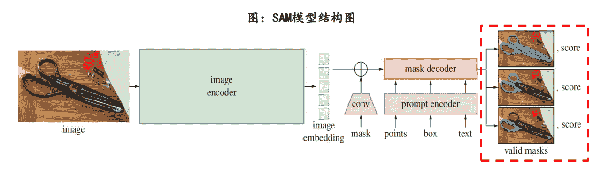

> **Meta**** 预计，与专****门为一**组固定任务**训练**的**系统**相比，基**于 p**romp**t工程等技**术的可组合系统设计将支持更广泛的应用，SAM 可成为 AR、VR、内容创建、科学领域和更通用 AI 系统的强大组件，如 SAM 可 以通过 AR 眼镜识别日常物品，为用户提供提示。但由于SAM 中的 ViT-H 图像编码器参数较大，实际使用的计算和内存成本还较高。

**SAM**可通过单击或交互地选择点来分割对象以包括或排除对象，可通过使用多边形工具绘制边界框或分割区域创建分割，它会捕捉到对象。

当**在识别**要分割的对象时遇到不确定性时，SAM 能生成多个有效掩码。

**SAM**** 能为图像中存在的所**有**对象自**动识别和生成蒙版。 在预计算图像嵌入后，SAM 可立即为任何提示提供分割掩码，从而实现与模型的实时交互。

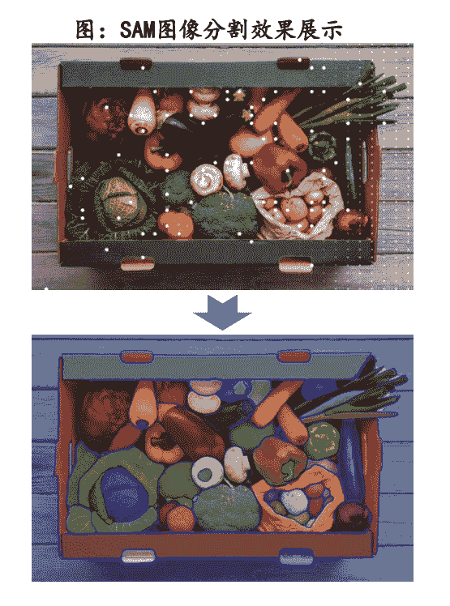

## 视频生成：W.A.L.T新框架或带来技术突破口

> **12月12日，李****飞飞及其学生团**队**与**谷歌合作，推出AI视频生成模型W.A.L.T（窗口注意力潜在Transformer Window Attention Latent Transformer），可以以每秒8帧的速度生成512 x 896分辨率的视频，支持文生视频、图生视频、和3D相机拍摄视频等方式。

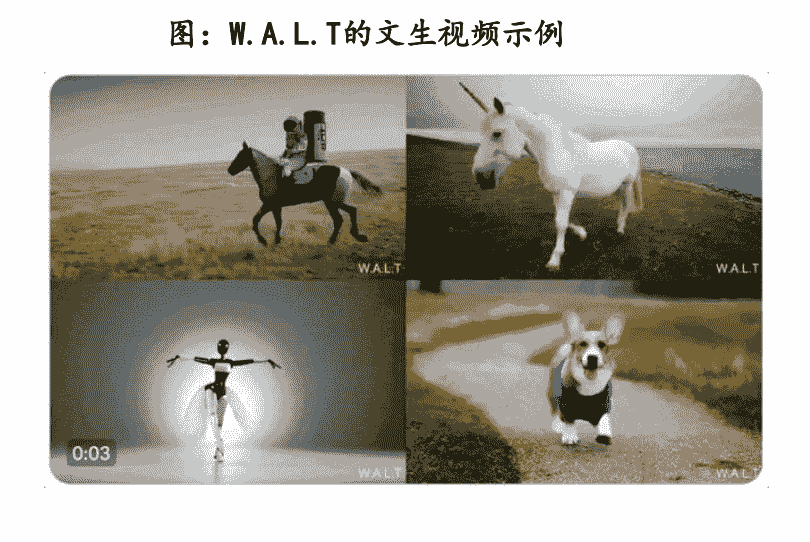

**W.A.L.T将Transformer 与扩散**算法结合，同时改善计算成本和数据集问题。

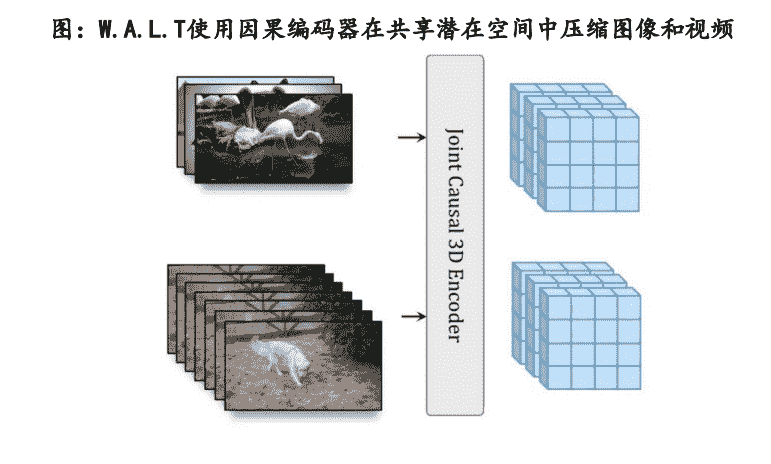

> **Transformer****在处理视频等高**维**数据时成本过高，W.A.L.T将Transforme**r架构与潜在扩散模型（Latent Diffusion Models，LDM）结合，在一个共享潜在空间中压缩图像和视频，一方面降低Transformer的计算要求，提高训练效率；另一方面能同时在图像和视频数据集上进行训练（W.A.L.T使用来自公共互联网和内部来源约970M文本-图像对，和约89M文本-视频对的数据集），有望为视频生成模型训练增加可用数据集。

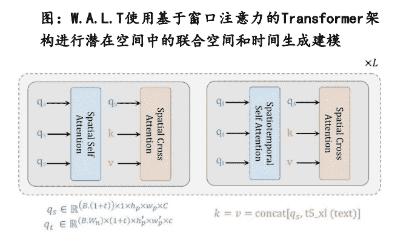

团队基于W.A.L.T训练了三个模型的级联（Cascade），用于文本到视频的生成任务，包括一个基本的潜在视频扩散模型、两个视频超分辨率扩散模型，实现了无需使用无分类器指导的情况下，在视频生成基准UCF-101和Kinetics-600、图像生成基准ImageNet测试上SOTA

##  语音合成：基于语言模型的TTS框架

**语音生成TTS领域算法亦开始受益于GPT和扩散模型**等技术，在泛化性、生成质量上取得突破。

> TTS主流方法包括基于统计参数的语音合成、波形拼接语音合成、混合方法及端到端神经网络语音合成，其中基于参数的语音合成包含：

#### **隐马尔可夫 模型（HMM）**

#### **深度学习网络（DNN）**

> 过去TTS系统存在泛化能力差、生成音频机器感过重等问题，进入23年以来，行业开始出现类似自然语言领域的GPT和视觉领域的扩散模型等技术的尝试，并取得了较好的表现。

1.  1月微软发布的VALL-E是第一个基于语言模型的TTS框架，利用海量的、多样化的、多speaker的语音数据（训练数据数百倍于以往TTS系统），实现zero-shot最优表现。只需提供三秒的音频样本即可模拟输入人声，并根据输入文本合成出对应的音频，而且还 可以保持说话者的情感基调；

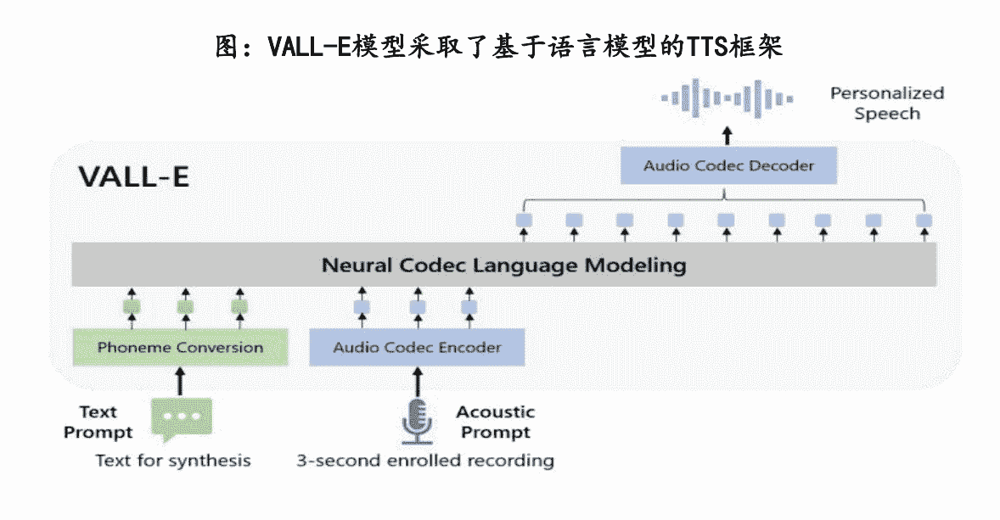

1.  5月微软发布NaturalSpeech2，利用扩散模型实现了 zero-shot 的语音合成，并改善了VALL-E丢音多音等问题。

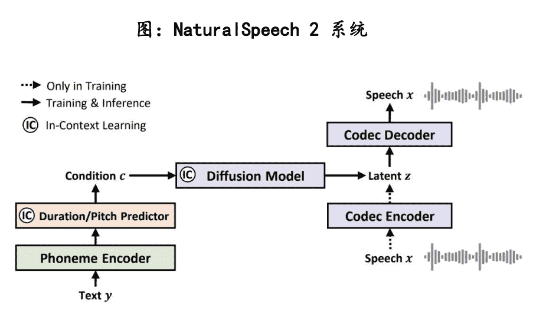