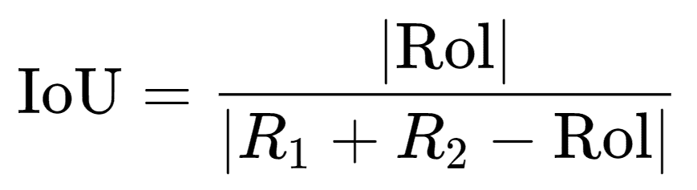
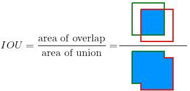
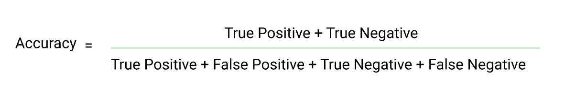
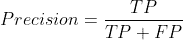
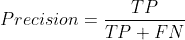
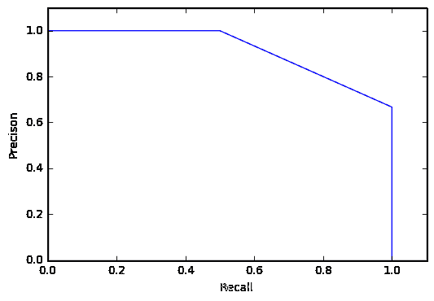
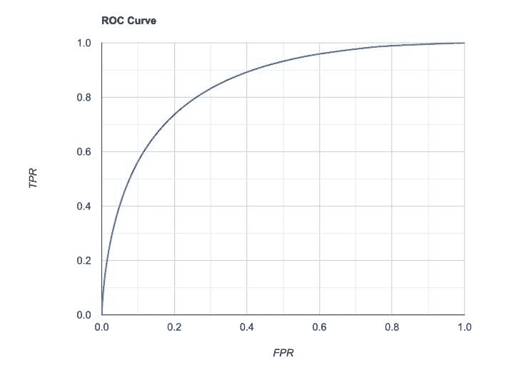
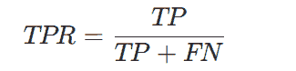
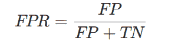

# 目标检测模型评估指标

> 来源：[https://v11enp9ok1h.feishu.cn/docx/YHKydq4seoC4Ozx47zgceFZHnJh](https://v11enp9ok1h.feishu.cn/docx/YHKydq4seoC4Ozx47zgceFZHnJh)

<https://v11enp9ok1h.feishu.cn/sync/PaIIdslbxsIJUIbkTfPcsMCFnph>

# **模型评估指标详解**

目标检测的任务是找出图像中所有感兴趣的目标并用矩形框确定**它们的位置、大小和类别。 ****在目标**检**测领域**需要衡量每个检测算法的好坏，因此定义了很多指标。各个算法经过检测后得到每个物体的检测框和置信度，然后根据该值来计算指标值，从而来评估各个算法的优劣。每个指标各不相同，下面详细阐述每个指标的概念和计算方法。

## **IoU（交并比）**

**交并比（I**ntersectio**n over Union**） 是一种评估指标，用于衡量目标检测器在特定数据集上的准确性。任何提供预测边界框作为输出的算法都可以使用 IoU 进行评估。



+   R1：真实的边界框矩形的范围；

+   R2：预测出来的矩形的范围；

+   Rol：R1和R2重合的范围。

它的计算可以简单的用下图表示：



一个物体它会有一个**真值框**，英文称为**ground truth**，也就是我们实际为它标注的真实矩形框(一**般情况下**该矩形框是物体的最小外接矩形框，手工标注)。在评价一个算法的时候首先用该算法对图片进行检测，得到该物体的预测框，这个预测框是算法生成的，我们接下来就需要计算这个预测框和真值框之间的loU指标。计算原理就是首先计算两个框的并集区域面积，再计算两个框的交集区域面积，然后交集除以并集就是对应的loU值。loU值越大说明预测框和真值框越吻合，如果完全吻合，此时loU值为1。

#### **实现：**

```
import numpy as np
 
# get IoU overlap ratio
def iou(a, b):
        # get area of a
    area_a = (a[2] - a[0]) * (a[3] - a[1])
        # get area of b
    area_b = (b[2] - b[0]) * (b[3] - b[1])
 
        # get left top x of IoU
    iou_x1 = np.maximum(a[0], b[0])
        # get left top y of IoU
    iou_y1 = np.maximum(a[1], b[1])
        # get right bottom of IoU
    iou_x2 = np.minimum(a[2], b[2])
        # get right bottom of IoU
    iou_y2 = np.minimum(a[3], b[3])
 
        # get width of IoU
    iou_w = iou_x2 - iou_x1
        # get height of IoU
    iou_h = iou_y2 - iou_y1
 
        # get area of IoU
    area_iou = iou_w * iou_h
        # get overlap ratio between IoU and all area
    iou = area_iou / (area_a + area_b - area_iou)
 
    return iou
 
# [x1, y1, x2, y2]
a = np.array((50, 50, 150, 150), dtype=np.float32)
 
b = np.array((60, 60, 170, 160), dtype=np.float32)
 
print(iou(a, b))

&#x27;&#x27;&#x27;
0.627907
&#x27;&#x27;&#x27;
```

## **TP、FP、FN、TN**

其中，字**母**T和F分别表示被检索到和没有被检索到，P和N分别表示正样本（ground truths）和负样本。我们需要从一个班级中的人中寻找所有女生,如果把这个任务当成一个分类器的话,那么女生就是我们需要的,而男生不是,所以我们称女生为"正样本",而男生为"负样本"，那么可以用如下矩阵来描述TP、TN、FP、FN。

|  | **相关(Relevant),正类** | 无关(NonRelevant),负类 |
| --- | --- | --- |
| **被检索到(Retrieved)** | **true positives**(**TP** 正类判定为正类,正确的判定&quot;这位是女生&quot;) | **false positives**(**FP** 负类判定为正类,&quot;存伪&quot;,分明是男生却判断为女生) |
| 未被检索到(NotRetrieved) | **false negatives**(**FN** 正类判定为负类,&quot;去真&quot;,分明是女生,却判断为男生) | **true negatives**(**TN** 负类判定为负类,一个男生被判断为男生) |

+   True Positive (TP)：正确的检测，IOU ≥ threshold的检测框数量（同一Ground Truth只计算一次）；

+   False Positive (FP)：错误的检测，IOU < threshold的检测框或是检测到同一个GT的多余检测框的数量；

+   False Negative (FN)：遗漏的正样本；

+   **T**rue Negative (TN)：负样本，并且没有检测出来。

## **Accuracy（准确率）,Precis**ion（查准率）和Recall（查全率）

1**.准确率（Accu**racy）。顾名思义，就是所有的预测正确（正类负类）的占总的比重。例子中就是正确检索到是女生和正确检索到是男生在所有检索结果中的占比。



Precision和Recall是针对所有图片中的某一类来说的。

+   Precision (也叫精度)：即正确预测为正的占全部预测为正的比例。具体解释为：预测结果中，有多少是真的正(找出来的对的比例)



+   **Recall (也叫召回率)：**即正确预测为正的占全部实际为正的比例。具体可以解释为：所有正样本中，你究竟预测对了多少(找出来了几个)



## **AP、mAP**

在讲解**AP****之前，首先我们继续**深**入探讨前面****提**到的pr**ec****ision和recal**l的概念。在计算precision和recall时一般先计算TP、FP和FN，但是计算这三个值时我们需要先计算每个检测框和真值**框的lo**U，再根据设定的阈值threshold来计算这三个值。这里很明显，阈值的选择会直接影响TP、FP和FN的结果，进而影响precision和recall的结果。也就是说precision和recall会随着阈值threshold的不同而不同。如果我们将阈值从0开始，逐步递增到1，很明显会产生一组precision和recall值，并且precision和recal这两组值是一一对应的，此时，我们以precision为纵坐标，以recall为横坐标进行画图，就会得到一个如下图所示的曲线，这个曲线就是精度召回率曲线，简写为PR曲线：



既然pre**cision和recall的值会随着阈值的不同而不同，那么怎么判断不同算法检**测效果的优劣呢？有了上述PR曲线图就比较容易定性一个算法的好坏了。我们的最终检测目的是什么？我们本质上希望算法不仅检测精度高，同时召回率也高，这在曲线上反映出来的效果就是这个曲线尽可能的往右上角拉伸，即固定recall值时，precision越大越好(对应往上拉伸)。同理固定precision时，recall越大越好(对应往右拉伸)。因此我们希望我们的曲线尽可能的拉向右上角。那么怎么在数值上体现这种特性呢？原理很简单，只要曲线下方的面积越大越好。因此我们可以在同一张图中绘制两种算法的PR曲线，然后计算对应曲线下方的面积，面积越大说明该曲线对应的检测算法效果较好。

AP (Average Precision)：是对所有图片内的某—类来说的，也指PR曲线下方区域的面积。

m**AP (Mean Avera****ge **Precision)：我们只检测了1类我们就得到了1根PR曲线，如果检测多类，那么每一类我们均可以得到—根PR曲线，也就是每类都会有1个AP值，对所有类的AP值取平均值即为AMP

## **ROC、AUC**

**ROC（Receiver Opera**ting Chara**cte**ristic）曲线是一种用于表示分类模型性能的图形工具。它通过将真阳性率（True Positive Rate，TPR）和假阳性率（False Positive Rate，FPR）作为横纵坐标来描绘分类器在不同阈值下的性能。



+   真阳性率（True Positive Rate，TPR）通常也被称为敏感性（Sensitivity）或召回率（Recall）。它是指分类器正确识别正例的能力。真阳性率可以理解为所有阳性群体中被检测出来的比率(1-漏诊率)，因此TPR越接近1越好。它的计算公式如下：



其中，TP（True Positive）表示正确识别的正例数量，FN（False Negative）表示错误地将正例识别为负例的数量。

+   假阳性率（False Positive Rate，FPR）是指在所有实际为负例的样本中，模型错误地预测为正例的样本比例。假阳性率可以理解为所有阴性群体中被检测出来阳性的比率(误诊率)，因此FPR越接近0越好。它的计算公式如下：



其中，FP（False Positive）表示错误地将负例识别为正例的数量，TN（True Negative）表示正确识别的负例数量。

**FPR的值等于1-特异性。**

+   特异性（Specificity）是指在所有实际为负例的样本中，模型正确地预测为负例的样本比例，其衡量的是模型对负例样本的判断能力。假如一个模型的特异性很高，则该模型在预测负例时的准确率很高，也就是说，该模型较少将负例预测为正例，从而使得假阳性率较低。因此，假阳性率和特异性都是用来衡量模型在负例样本上的性能，它们之间是负相关的，即假阳性率越低，特异性越高，反之亦然。

+   AUC是ROC曲线下的面积，用于衡量分类器性能。AUC值越接近1，表示分类器性能越好；反之，AUC值越接近0，表示分类器性能越差。在实际应用中，我们常常通过计算AUC值来评估分类器的性能。

+   理论上，完美的分类器的AUC值为1，而随机分类器的AUC值为0.5。这是因为完美的分类器将所有的正例和负例完全正确地分类，而随机分类器将正例和负例的分类结果随机分布在ROC曲线上。

+   综上，ROC曲线和AUC值是用于评估二分类模型性能的两个重要指标。通过ROC曲线，我们可以直观地了解分类器在不同阈值下的性能；而通过AUC值，我们可以对分类器的整体性能进行量化评估。

## 综合评价指标（F1-Measure）

**F-Measure是一种统计量**，又称F-Score,也是精确率（Presicion）和**召回率（Recall）的**加权调和平均，常用于评价分类模型的好坏。

F-Measure数学公式为：


其中β是权重因子，P是**精确率(Precision)**，R是**召回率(Recall)**。

当β= 1时，F值变为最常见的F1-Measure了，代表精确率和召回率的权重一样，是最常见的一种评价指标，因此，F1的数学公式为：

