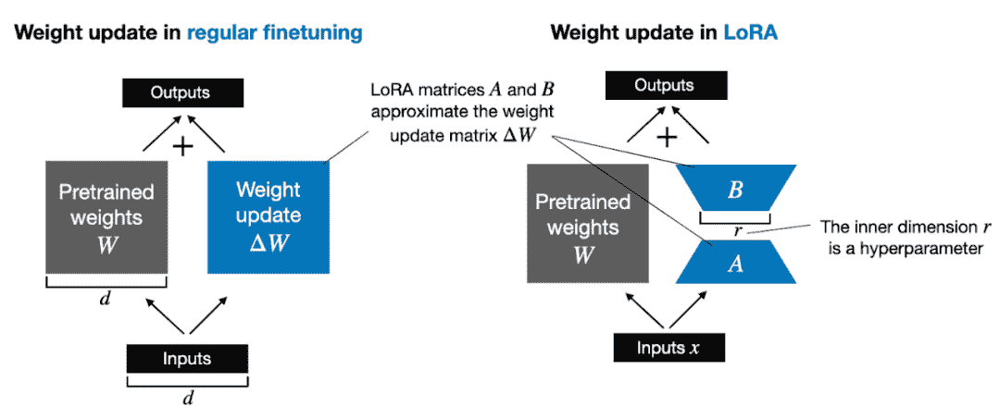
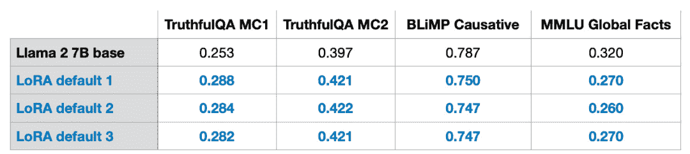
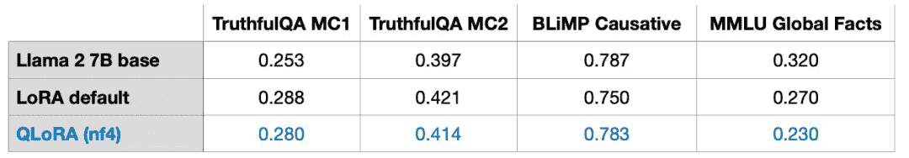
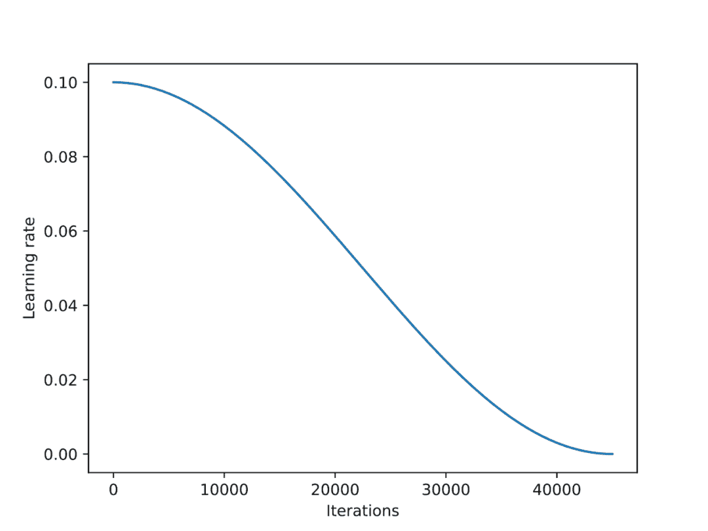
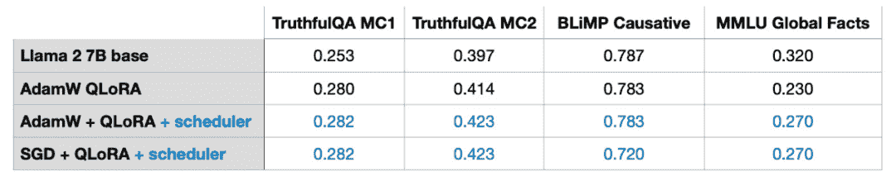
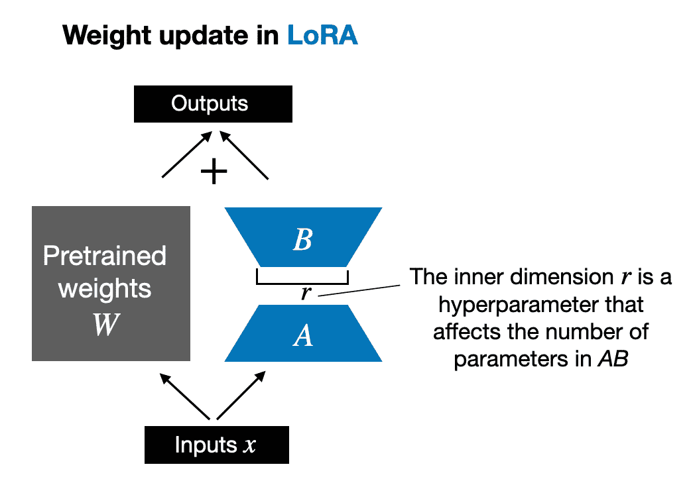
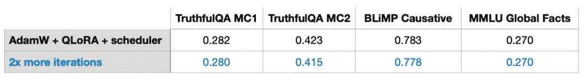
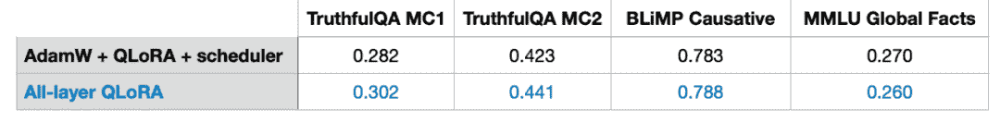
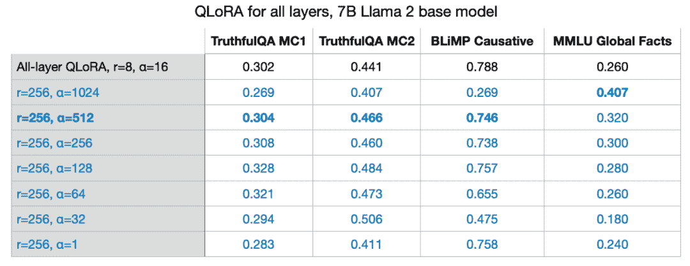
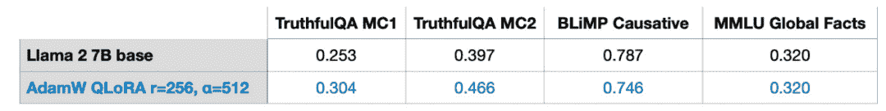

# LoRA相关技术及要点

> 来源：https://v11enp9ok1h.feishu.cn/docx/NOAGd9y8HoI2luxlZsscGcFHnkg

## 1.1 LoRA 简介

由于 GPU 内存的限制，在训练过程中更新模型权重成本高昂。

例如，假设我们有一个 7B 参数的语言模型，用一个 `W` 权重矩阵表示。在反向传播期间，模型需要学习一个 `ΔW` 矩阵，旨在更新原始权重，让损失函数值最小。

权重更新如下：`W_updated = W + ΔW`。

如果权重矩阵 `W` 包含 7B 个参数，则权重更新矩阵 `ΔW` 也包含 7B 个参数，计算矩阵 `ΔW` 非常耗费计算和内存。

由 Edward Hu 等人提出的 LoRA 将权重变化的部分 `ΔW` 分解为低秩表示。确切地说，它不需要显示计算 `ΔW`。相反，LoRA 在训练期间学习 `ΔW` 的分解表示，如下图所示，这就是 LoRA 节省计算资源的奥秘。



如上所示，`ΔW` 的分解意味着我们需要用两个较小的 LoRA 矩阵 `A` 和 `B` 来表示较大的矩阵 `ΔW`。如果 `A` 的行数与 `ΔW` 相同，`B` 的列数与 `ΔW` 相同，我们可以将以上的分解记为 `ΔW = AB`。（`AB` 是矩阵 `A` 和 `B` 之间的矩阵乘法结果。）

这种方法节省了多少内存呢？还需要取决于秩 `r`，秩 `r` 是一个超参数。例如，如果 `ΔW` 有 10,000 行和 20,000 列，则需存储 200,000,000 个参数。如果我们选择 `r=8` 的 `A` 和 `B`，则 `A` 有 10,000 行和 8 列，`B` 有 8 行和 20,000 列，即 10,000×8 + 8×20,000 = 240,000 个参数，比 200,000,000 个参数少约 830 倍。

当然，`A` 和 `B` 无法捕捉到 `ΔW` 涵盖的所有信息，但这是 LoRA 的设计所决定的。在使用 LoRA 时，我们假设模型 `W` 是一个具有全秩的大矩阵，以收集预训练数据集中的所有知识。当我们微调 LLM 时，不需要更新所有权重，只需要更新比 `ΔW` 更少的权重来捕捉核心信息，低秩更新就是这么通过 `AB` 矩阵实现的。

## 1.2 LoRA 的一致性

虽然 LLM，或者说在 GPU 上被训练的模型的随机性不可避免，但是采用 LoRA 进行多次实验，LLM 最终的基准结果在不同测试集中都表现出了惊人的一致性。对于进行其他比较研究，这是一个很好的基础。



请注意，这些结果是在默认设置下，使用较小的值 `r=8` 获得的。实验细节可以在我的另一篇文章中找到。

## 1.3 QLoRA 计算 - 内存权衡

QLoRA 是由 Tim Dettmers 等人提出的量化 LoRA 的缩写。QLoRA 是一种在微调过程中进一步减少内存占用的技术。在反向传播过程中，QLoRA 将预训练的权重量化为 4-bit，并使用分页优化器来处理内存峰值。

我发现使用 LoRA 时可以节省 33% 的 GPU 内存。然而，由于 QLoRA 中预训练模型权重的额外量化和去量化，训练时间增加了 39%。

默认 LoRA 具有 16 bit 浮点精度：

+   训练时长：1.85 小时
+   内存占用：21.33GB

具有 4 位正常浮点数的 QLoRA

+   训练时长为：2.79h
+   内存占用为：14.18GB

此外，我发现模型的性能几乎不受影响，这说明 QLoRA 可以作为 LoRA 训练的替代方案，更进一步解决常见 GPU 内存瓶颈问题。



## 1.4 学习率调度器

学习率调度器会在整个训练过程中降低学习率，从而优化模型的收敛程度，避免 `loss` 值过大。

余弦退火（Cosine annealing）是一种遵循余弦曲线调整学习率的调度器。它以较高的学习率作为起点，然后平滑下降，以类似余弦的模式逐渐接近 0。一种常见的余弦退火变体是半周期变体，在训练过程中只完成半个余弦周期，如下图所示。



在实验中，我在 LoRA 微调脚本中添加了一个余弦退火调度器，它显著地提高了 `SGD` 的性能。但是它对 `Adam` 和 `AdamW` 优化器的增益较小，添加之后几乎没有什么变化。



在下一节中，将讨论 `SGD` 相对于 `Adam` 的潜在优势。

### 1.4.1 Adam vs SGD

`Adam` 和 `AdamW` 优化器在深度学习中很受欢迎。如果我们正在训练一个 7B 参数的模型，那使用 `Adam` 就能够在训练的过程中跟踪额外的 14B 参数，相当于在其他条件不变的情况下，模型的参数量翻了一番。

`SGD` 不能在训练过程中跟踪附加的参数，所以相比于 `Adam`，`SGD` 在峰值内存方面有什么优势呢？

在我的实验中，使用 `AdamW` 和 LoRA（默认设置 `r=8`）训练一个 7B 参数的 Llama 2 模型需要 14.18 GB 的 GPU 内存。用 `SGD` 训练同一模型需要 14.15 GB 的 GPU 内存。相比于 `AdamW`，`SGD` 只节省了 0.03 GB 的内存，作用微乎其微。

+   为什么只节省了这么一点内存呢？这是因为使用 LoRA 时，LoRA 已经大大降低了模型的参数量。例如，如果 `r=8`，在 7B 的 Llama 2 模型的所有 6,738,415,616 个参数，只有 4,194,304 个可训练的 LoRA 参数。
+   只看数字，4,194,304 个参数可能还是很多，但是其实这么多参数仅占用 4,194,304 × 2 × 16 位 = 134.22 兆位 = 16.78 兆字节。（我们观察到了存在 0.03 Gb = 30 Mb 的差异，这是由于在存储和复制优化器状态时，存在额外的开销。）2 代表 `Adam` 存储的额外参数的数量，而 16 位指的是模型权重的默认精度。



如果我们把 LoRA 矩阵的 `r` 从 8 拓展到 256，那么 `SGD` 相比 `AdamW` 的优势就会显现：

+   使用 `AdamW` 将占用内存 17.86 GB
+   使用 `SGD` 将占用 14.46 GB

因此，当矩阵规模扩大时，`SGD` 节省出的内存将发挥重要作用。由于 `SGD` 不需要存储额外的优化器参数，因此在处理大模型时，`SGD` 相比 `Adam` 等其他优化器可以节省更多的内存。这对于内存有限的训练任务来说是非常重要的优势。

## 1.5 迭代训练

在传统的深度学习中，我们经常对训练集进行多次迭代，每次迭代称为一个 `epoch`。例如，在训练卷积神经网络时，通常会运行数百个 `epoch`。那么，多轮迭代训练对于指令微调也有效果吗？

答案是否定的，当我将数据量为 50k 的 Alpaca 示例指令微调数据集的迭代次数增加一倍，模型的性能下降了。



因此，我得出的结论是，多轮迭代可能不利于指令微调。我在 1k 的示例 LIMA 指令微调集中也观察到了同样的状况。模型性能的下降可能是由过拟合造成的，具体原因仍需进一步探索。

## 1.6 在更多层中使用 LoRA

下表显示了 LoRA 仅对选定矩阵（即每个 Transformer 中的 `Key` 和 `Value` 矩阵）起效的实验。此外，我们还可以在查询权重矩阵、投影层、多头注意力模块之间的其他线性层以及输出层启用 LoRA。



如果我们在这些附加层上加入 LoRA，那么对于 7B 的 Llama 2 模型，可训练参数的数量将从 4,194,304 增加到 20,277,248，增加五倍。在更多层应用 LoRA，能够显著提高模型性能，但也对内存空间的需求量更高。

此外，我只对：

+   仅启用查询和权重矩阵的 `LoRA`
+   启用所有层的 `LoRA`

这两种设置进行了探索，在更多层的组合中使用 LoRA 会产生何种效果，值得深入研究。如果能知道在投影层使用 LoRA 对训练结果是否有益，那么我们就可以更好地优化模型，并提高其性能。

## 1.7 平衡 LoRA 超参数：R 和 Alpha

正如提出 LoRA 的论文中所述，LoRA 引入了一个额外的扩展系数。这个系数用于在前向传播过程中将 LoRA 权重应用于预训练之中。扩展涉及之前讨论过的秩参数 `r`，以及另一个超参数 `α`（`alpha`），其应用如下：

```
scaling = alpha / r
weight += (lora_B @ lora_A) * scaling
```

正如上图中的公式所示，LoRA 权重的值越大，影响就越大。

在之前的实验中，我采用的参数是 `r=8`，`alpha=16`，这导致了 2 倍的扩展。在用 LoRA 为大模型减重时，将 `alpha` 设置为 `r` 的两倍是一种常见的经验法则。但我很好奇这条规则对于较大的 `r` 值是否仍然适用。



我还尝试了 `r=32`、`r=64`、`r=128` and `r=512`，但为了清晰起见省略了此过程，不过 `r=256` 时，的确效果最佳。事实上，选择 `alpha=2r` 确实提供了最优结果。

## 1.8 在单个 GPU 上训练 7B 参数模型

LoRA 允许我们在单个 GPU 上微调 7B 参数规模的大语言模型。在这个特定情况下，采用最佳设置过的 QLoRA（`r=256`，`alpha=512`），使用 `AdamW` 优化器处理 17.86 GB（50k 训练样例）的数据在 A100 上大约需要 3 个小时（此处为 Alpaca 数据集）。



在本文的其余部分中，我将回答你可能遇到的其他问题。

# 2.LoRA相关的10 个问题

## Q1: 数据集有多重要？

> 数据集至关重要。

+   我使用的是包含 50k 训练示例的 Alpaca 数据集。我选择 Alpaca 是因为它非常流行。由于本文篇幅已经很长，所以在更多数据集上的测试结果本文暂不讨论。
+   Alpaca 是一个合成数据集，按照如今的标准，它可以已经有点落伍了。数据质量非常关键。例如，在六月份，我在一篇文章中讨论了 LIMA 数据集，这是一个仅由一千个示例组成的精选数据集。
+   正如提出 LIMA 的论文的标题所说：对于对齐来说，少即是多，虽然 LIMA 的数据量少于 Alpaca，但根据 LIMA 微调出的 65B Llama 模型优于 Alpaca 的结果。采用同样的配置（`r=256`，`alpha=512`），在 LIMA 上，我获得了与数据量级是其 50 倍大的 Alpaca 类似的模型表现。

## Q2: LoRA 是否适用于域自适应？

> 对于这个问题，我目前还没有一个明确的答案。

+   根据经验，知识通常是从预训练数据集中提取的。通常情况下，语言模型通常会从预训练数据集中吸收知识，而指令微调的作用主要是帮助 LLM 更好地遵循指令。
+   既然算力紧张是限制大语言模型训练的关键因素，LoRA 也可以被用于在特定领域的专用数据集，进一步预训练现有的预训练 LLM。
+   另外，值得注意的是，我的实验中包括两个算术基准测试。在这两个基准测试中，使用 LoRA 进行微调的模型表现明显比预训练的基础模型差。我推测这是由于 Alpaca 数据集没有缺少相应的算术示例，导致模型「忘记了」算术知识。我们还需要进一步的研究来确定模型是「忘记」了算术知识，还是它对相应指令停止了响应。然而，在这里可以得出一条结论：「在微调 LLM 时，让数据集包含我们所关心的每个任务的示例是一个好主意。」

## Q3: 如何确定最佳 r 值？

> 对于这个问题，目前我还没有比较好的解决方法。

+   最佳 `r` 值的确定，需要根据每个 LLM 和每个数据集的具体情况，具体问题具体分析。我推测 `r` 值过大将导致过拟合，而 `r` 值过小，模型可能无法捕捉数据集中多样化的任务。我怀疑数据集中的任务类型越多，所需 `r` 值就越大。例如，如果我仅需要模型执行基本的两位数算术运算，那么一个很小的 `r` 值可能就已经满足需要了。然而，这只是我的假设，需要进一步的研究来验证。

## Q4: LoRA 是否需要为所有层启用？

> 我只对（1）仅启用查询和权重矩阵的 `LoRA`，（2）启用所有层的 `LoRA`，这两种设置进行了探索。

+   在更多层的组合中使用 LoRA 会产生何种效果，值得深入研究。如果能知道在投影层使用 LoRA 对训练结果是否有益，那么我们就可以更好地优化模型，并提高其性能。
+   如果我们考虑各种设置（`lora_query`、`lora_key`、`lora_value`、`lora_projection`、`lora_mlp`、`lora_head`），就有 64 种组合可供探索。

## Q5: 如何避免过拟合？

> 一般来说，较大的 `r` 更可能导致过拟合，因为 `r` 决定着可训练参数的数量。

+   如果模型存在过拟合问题，首先要考虑降低 `r` 值或增加数据集大小。此外，可以尝试增加 `AdamW` 或 `SGD` 优化器的权重衰减率，或者增加 LoRA 层的 `dropout` 值。
+   我在实验中没有探索过 LoRA 的 `dropout` 参数（我使用了 0.05 的固定 `dropout` 率），LoRA 的 `dropout` 参数也是一个有研究价值的问题。

## Q6: 还有其他优化器作为选择吗？

> 今年五月发布的 `Sophia` 值得尝试

+   `Sophia` 是一种用于语言模型预训练的可拓展的随机二阶优化器。根据以下这篇论文：《Sophia: A Scalable Stochastic Second-order Optimizer for Language Model Pre-training》，与 `Adam` 相比，`Sophia` 的速度快两倍，还能获得更优的性能。简而言之，`Sophia` 和 `Adam` 一样，都通过梯度曲率而不是梯度方差来实现归一化。

## Q7: 还有影响内存使用的其他因素吗？

> 除了精度和量化设置、模型大小、batch size 和可训练 LoRA 参数数量之外，数据集也会影响内存使用。

+   Llama 2 的块大小为 4048 个 token，这代表着 Llama 可以一次处理包含 4048 个 token 的序列。如果对后来的 token 加上掩码，训练序列就将变短，可以节省大量的内存。例如 Alpaca 数据集相对较小，最长的序列长度为 1304 个 token。
+   当我尝试使用最长序列长度达 2048 个 token 的其他数据集时，内存使用量会从 17.86 GB 飙升至 26.96 GB。

## Q8：与全微调、RLHF 相比，LoRA 有哪些优势？

+   我没有进行 RLHF 实验，但我尝试了全微调。全微调至少需要 2 个 GPU，每个 GPU 占用 36.66 GB，花费了 3.5 个小时才完成微调。然而，基线测试结果不好，可能是过拟合或次超优参数导致的。

## Q9：LoRA 的权重可以组合吗？

> 答案是肯定的。

+   在训练期间，我们将 LoRA 权重和预训练权重分开，并在每次前向传播时加入。
+   假设在现实世界中，存在一个具有多组 LoRA 权重的应用程序，每组权重对应着一个应用的用户，那么单独储存这些权重，用来节省磁盘空间是很有意义的。同时，在训练后也可以合并预训练权重与 LoRA 权重，以创建一个单一模型。这样，我们就不必在每次前向传递中应用 LoRA 权重。

```
weight += (lora_B @ lora_A) * scaling
```

+   我们可以采用如上所示的方法更新权重，并保存合并的权重。
+   同样，我们可以继续添加很多个 LoRA 权重集：

```
weight += (lora_B_set1 @ lora_A_set1) * scaling_set1
weight += (lora_B_set2 @ lora_A_set2) * scaling_set2
weight += (lora_B_set3 @ lora_A_set3) * scaling_set3
...
```

+   我还没有做实验来评估这种方法，但通过 Lit-GPT 中提供的 `scripts/merge_lora.py` 脚本已经可以实现。

## Q10：逐层最优秩自适应表现如何？

> 为了简单起见
>
> 在深度神经网络中我们通常将为每层设置相同的学习率。学习率是我们需要优化的超参数，更进一步，我们可以为每一层选择不同的学习率（在 `PyTorch` 中，这不是非常复杂的事）。

> 然而在实践中很少这样做，因为这种方法增加了额外的成本，并且在深度神经网络中还有很多其他参数可调。类似于为不同层选择不同的学习率，我们也可以为不同层选择不同的 LoRA `r` 值。我还没有动手尝试，但有一篇详细介绍这种方法的文献：《LLM Optimization: Layer-wise Optimal Rank Adaptation (LORA)》。理论上，这种方法听起来很有希望，为优化超参数提供了大量的拓展空间。
