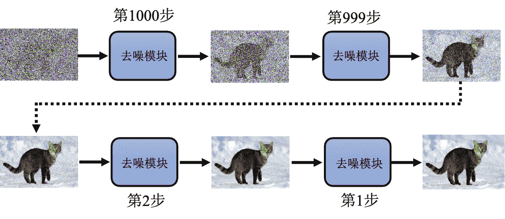
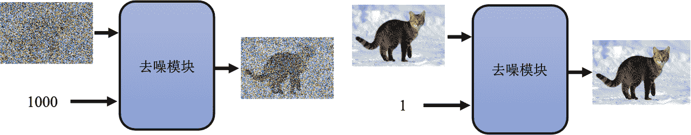
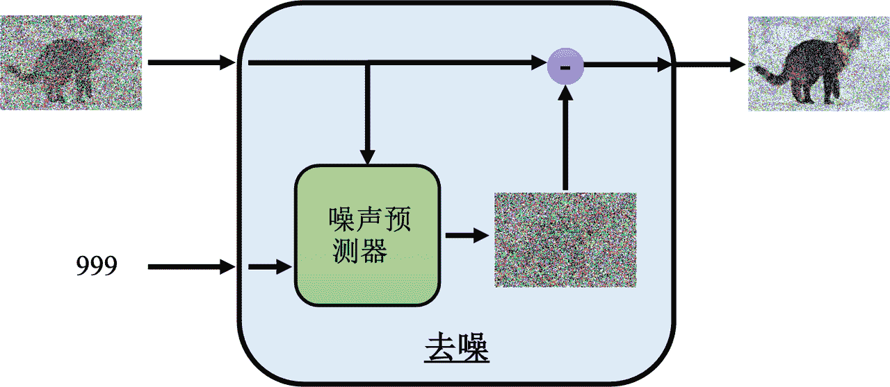
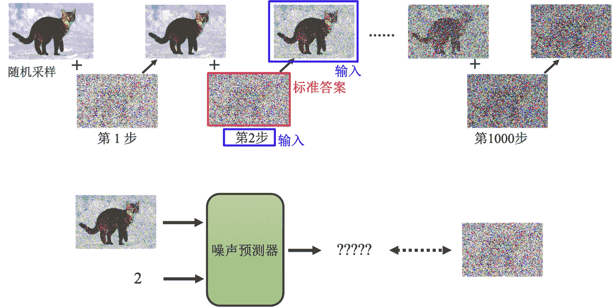
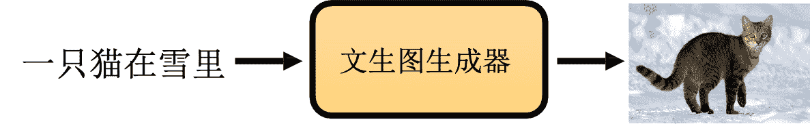
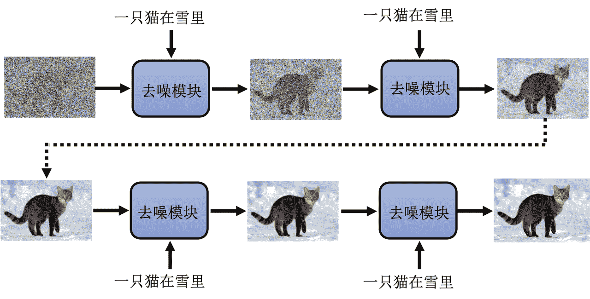
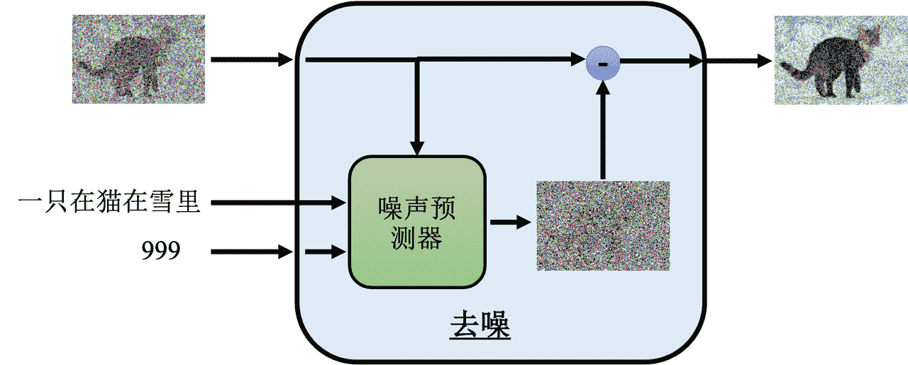
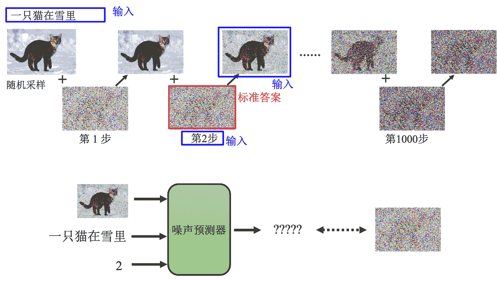

# 扩散模型（diffusion model）

> 来源：[https://v11enp9ok1h.feishu.cn/docx/I0fPdZI7YoYNBixpBXrcUV2rn5u](https://v11enp9ok1h.feishu.cn/docx/I0fPdZI7YoYNBixpBXrcUV2rn5u)
>
> <https://v11enp9ok1h.feishu.cn/sync/PaIIdslbxsIJUIbkTfPcsMCFnph>

是一种运用了物理热力学扩散思想的生成模型。扩散模型有很多不同的变形，本章主要介绍最知名的去噪扩散概率模型（`Denoising Diffusion Probabilistic Model`，`DDPM`）。如今比较成功的用扩散模型做图像生成的系统，比如 `DALL-E`、谷歌的 `Imagen`、`Stable Diffusion` 基本上都是用类似的方法来作为其扩散模型。

+ 接下来介绍下扩散模型的运作方法。看它是怎么生成一张图片的。如图所示，在生成图片的第一步，要去采样一个全是噪声的图片，就是从高斯分布里面采样出一个向量。

+ 这个向量里面有的数字，这个向量的维度跟要生成的图片大小是一模一样的。假设要生成一张 `256×256` 的图片，从正态分布采样出来的向量的维度就要是 `256×256`，就把采样到的 `256×256` 的向量排成一张图片。

+ 接下来就有一个去噪的模块，去噪的网络。输入一张全是噪声的图，输出它就会把噪声滤掉一点，就可能看到有一个猫的形状，再做去噪，猫的形状就逐渐出来。

+ 去噪越做越多，期待最终就看到一张清晰的图片，去噪的次数是事先定好的。通常会给每一个去噪的步骤一个编号，产生最终图片的那个编号比较小。一开始从完全都是噪声的输入开始，做去噪的编号比较大，所以这边就从 `1999` 一直排到 `2`，排到 `1`，这个从噪声到图片的步骤称为逆过程（`reverse process`）。

在概念上，其实就像是米开朗基罗说的：“塑像就在石头里，我只是把不需要的部分去掉”，扩散模型做的事情是相同的。

## 去噪的模型

+ 这边是把同一个去噪的模型反复进行使用，但是因为在这边每一个状况，输入的图片差异非常大，在这个状况输入的东西就是一个纯噪声。在这个状况输入的东西噪声非常小，它已经非常接近完整的图。

+ 所以如果是同一个模型，它可能不一定能真的做得很好。所以这个去噪的模型，除了“吃”要被去噪的那张图片以外，还会多“吃”一个输入，该输入代表现在噪声严重的程度。

> 如图所示：`1000` 代表刚开始去噪的时候，这个时候噪声的严重程度很大。`1` 代表说现在去噪的步骤快结束了，这个是最后一步去噪的步骤。

+ 显然噪声很小，这个去噪的模型希望它可以根据我们现在输入在第几个步骤的信息做出不同的回应。这个是去噪的模型，所以确实只有用一个去噪的模型。但是这个去噪的模型会“吃”一个额外的数字，告诉它说现在是在去噪的哪一个步骤。

## 去噪模型的内部工作原理

如图所示，在去噪的模组里面有一个噪声预测器（`noise predictor`），其会预测图片里面的噪声。这个噪声预测器就“吃”这个要被去噪的图片，跟“吃”一个噪声现在严重的程度，也就是我们现在进行到去噪的第几个步骤的代号，就输出一张噪声的图。它就是预测说在这张图片里面噪声应该长什么样子，再把它输出的噪声去剪掉这个要被去噪的图片，就产生去噪以后的结果，所以这边去噪的模型并不是输入一张有噪声的图片。

> 为什么不直接使用一个端到端的模型，输入是要被去噪的图片，输出就直接是去噪的结果呢？

> 可以这么做。不过如今多数的论文还是选择使用一个噪声的预测器，因为产生一张图片跟产生噪声的难度是不一样的。

+ 如果去噪的模型可以产生一只带噪声的猫，它几乎就可以说它已经会画一只猫了。因此要产生一个带噪声的猫跟产生一张图片里面的噪声的难度是不一样的，所以直接使用一个噪声预测器可能是比较简单的，使用一个端到端的模型要直接产生去噪的结果是比较困难的。

## 训练噪声预测器

> 创造方法如图所示，从数据集里面拿一张图片出来，随机从高斯分布里面采样一组噪声出来加上去，产生有点噪声的图像，能再采样一次再得到更噪声的图片，以此类推，最后整张图片就看不出来原来是什么东西。加噪音的过程称为前向过程，也称为扩散过程。

+ 做完这个扩散过程以后，就有噪声预测器的训练数据了。对噪声预测器，其训练数据就是这一张加完噪声的图片跟现在是第几次加噪声，是网络的输入，而加入的这个噪声就是网络应该要预测的输出，就是网络输出的标准答案。

> 噪声预测器看到这张图，看到第二个步骤，输入 `2` 这个数字，要输出是什么，标准答案就是一个长这个样子的噪声。接下来就跟训练一般的网络一样训练下去就结束了。但是我们要的不只是生图而已。刚才只是从一个噪声里面生出图，还没有考虑文字。如果要训练一个图像生成的模型，他是“吃”文字产生图片

> 如图所示：其实还是需要图片跟文字成对的数据。`ImageNet` 中每一张图片有一个类别的标记，还不是那个图片的描述，不是像“一只在猫在雪里”这样图片的描述，它只是每一张图有一个标记，它有 100 万张图片。

> `Midjourney`、`Stable Diffusion` 或 `DALL-E` 的数据往往来自于 `LAION`，`LAION` 有 58.5 亿张的图片，所以难怪今天这些模型可以产生这么好的结果

+ `LAION` 有一个搜索的 `Demo` 的平台，里面内容很全面，比如猫的图片，它不是只有猫的图片跟英文文字的对应，还有跟中文、英文的对应。所以图像生成模型不是只看得懂英文、中文它大多数都看得懂，是因为它的训练数据里面也有中文跟其他的语言，里面有很多名人的照片，随便一找就一大堆。

+ 因此 `Midjourney` 能画得出很多名人，是因为他就是知道名人的模样。

> 如图所示，把文字加到去噪的模组就结束了。所以去噪的模组不是只看输入的图片做去噪，它是根据输入的图片加上一段文字的描述去把噪声拿掉，所以在每一个步骤去噪的模组都会有一个额外的输入。

+ 这个额外的输入就是，要它根据这段文字的描述产生什么样的图片。这个去噪模块里面的噪声预测器要怎么改呢？直接把这段文字给噪声预测器就结束了，要让噪声预测器多一个额外的输入也就是这段文字，如图所示，就结束了。

## 训练部分的修改

> 如图所示，每一张图片都有一段文字，所以先把这张图片做完扩散过程以后，在训练的时候，不只要给噪声预测器加入噪声后的图片，还有现在步骤的 `ID`，多给一个就是文字的输入。噪声预测器会根据这 3 样东西产生适当的噪声，产生要去消掉的噪声，产生这个标准答案

