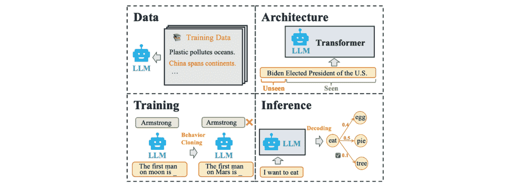
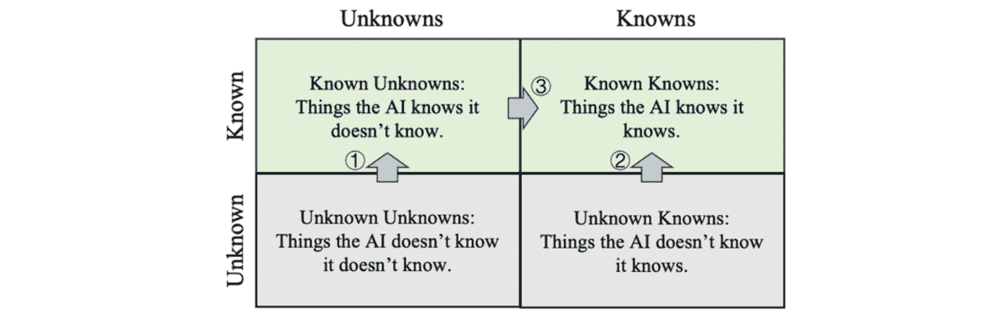

# 为什么大模型会「说胡话」？如何解决大模型的「幻觉」问题？

> 来源：[https://v11enp9ok1h.feishu.cn/docx/ADb2dgQ3toASJBxsw4icpyZCnce](https://v11enp9ok1h.feishu.cn/docx/ADb2dgQ3toASJBxsw4icpyZCnce)

本文从知识边界的视角出发，可以理论上解决大模型事实知识相关的大部分幻觉问题。首先明确幻觉在不同场景的定义，然后引入知识边界的视角，最后介绍几篇最新相关的研究工作。

## 幻觉的定义及原因

幻觉（hallucination）问题是大模型一直以来的研究焦点，不同研究针对幻觉的定义也不尽相同，比如在知识问答（knowledge-grounded question answering），开放生成（open-ended generation），决策制定（decision making）等任务场景下，模型幻觉分别对应指代生成了与事实知识不符（non-factual）的回答，无意义（non-sensical）的创作，以及不可靠（unreliable）的预测。因此要消除模型幻觉，首先要根据任务场景明确幻觉定义，然后再去寻找对应的原因，本文所探讨的均为知识密集型（knowledge-intensive）任务场景，模型幻觉也就是错误的事实知识（incorrect factual knowledge）。

在明确了幻觉的定义后，我们再去对应找其产生原因。此前工作将这一类幻觉产生大致归结于以下四个方面，分别来自于预训练数据（pretraining data），模型结构（model architecture），训练方法（training strategy），以及解码策略（decoding strategy）[1]。如下图所示，预训练数据如果清洗过滤不到位，本身可能包含错误的知识；模型结构由于本身输入长度的限制，因为存在视野盲区也会产生幻觉；而模型训练采用最大似然概率方法，只关注输出概率最大的token而学习不到真实语义，这就更像是一种针对训练数据的行为模式克隆（behavior cloning），对于一些不知道的问题，也会编造一个答案，这一点使用过大模型的用户都深有体会；最后则是解码策略的选择，有时为了生成多样性，会采用采样解码策略，输出一些低概率的token，也会导致幻觉。

## 幻觉解决方案——知识边界视角

虽然产生原因很多，但相对其他任务而言，知识问答由于有明确基线答案（grounding label），我们可以从模型自身出发，将一个事实知识划归为知道（known）以及不知道（unknown）两种状态 [2][3]，分别对应下图纵坐标的绿色和灰色区域，这是针对模型本身能力而言，是否掌握了一个事实知识；横坐标则代表在输出时，模型选择表达知道（knows，即输出答案）还是不知道（unknow，即拒答）。模型幻觉大部分都发生在，对一个不知道的问题，也要编造出错误答案。因此第一步得让模型知道自己知道还是不知道一个特定事实知识，从灰色区域转移到绿色区域（如下图 ① 和 ②）。能准确表达知道还是不知道，模型的诚实性（honesty）就已经得到很大提升了，而后可以继续使用检索增强（RAG）等方法，通过步骤 ③ 进一步辅助模型回答。

上图可以简单粗略的表示知识边界，然而事实上，如同人类一样，对于很多知识，我们都处于一个不确定的状态，而非只有知道或不知道两种状态，这也就增加了确定知识边界的复杂性，由此也就引发出两个具有挑战性的问题：

1.  如何正确的**感知（Perception）**出知识边界；（例：给定一个问题，如法国的首都是哪？要求模型给出对这个问题的置信度。）

1.  **对于一些知识边界较模糊的知识**，如何准确表达（Expression）。（例：假如对上述问题回答为巴黎的置信度是 40%，在这种情况下应该拒答还是给出回复？）

知识边[**界的感知也等同于计算模型对一个事**](https://zhuanlan.zhihu.com/p/696065154)实知识的置信度或不确定性，大致可分为 ① 通过获取token输出概率；② 用基于prompt的方法诱导模型表达不确定性；③ 通过多次采样计算一致性，以及 ④ 基于训练的方法让模型学习表达不确定性的能力等方法，可参考这篇文章 可信大模型 Reliable LLM（一）：生成大模型的置信度估计与评测以及下面 github 链接。

[github.com/AmourWa](https://link.zhihu.com/?target=https%3A//github.com/AmourWaltz/Reliable-LLM.git)ltz/Reliable-LLM.git

另外，随着 LLAMA-3.1 的出现，开源模型成为主流，研究者们可以直接获取模型内部隐层状态，而这些隐藏状态往往包含更丰富的表征信息，充分利用这些信息可以得到更准确的知识边界表达，很多工作致力于此项研究。此处先按下不表，在下一篇文章将重点介绍。

## 准确表达事实知识，减少模型幻觉

本文聚焦于第二个问题，对于模糊的知识边界，如何让大模型准确的表达出事实知识。目前主流方法均采用基于强化学习的对齐（alignment）方法，本文将介绍几篇近期的相关工作，然后总结并谈谈我的看法。

### Learning to Trust Your Feelings: Leveraging Self-awareness in LLMs for Hallucination Mitigation

这篇工作[4]针对模型知道一个事实知识却无法正确表达的问题，主要做了三个方面的工作：

+    探测大模型能否分辨出内部知识，分别通过外部一致性检测以及内部隐层状态线性探针方法，得到模型对知识的置信度，即知识边界（意思相同，但文中未提及知识边界相关表述），发现模型对内部知识分辨准确率可以超过85%；在隐层探针方法设置了大量实验，如下图所示，在三个大模型的注意力，MLP，以及隐层状态分别探测，发现在中间层准确率会大幅提升，并且在隐层状态（hidden states）上的探测准确率最高。