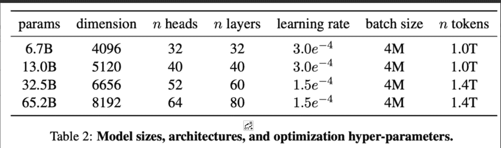
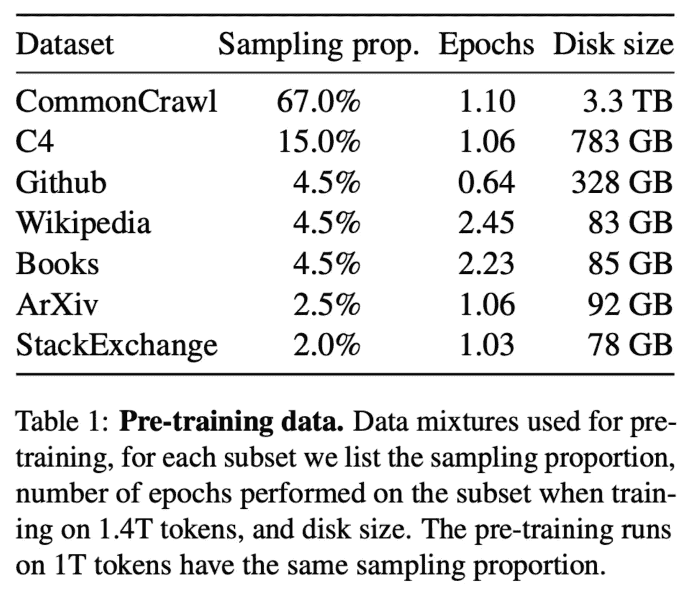
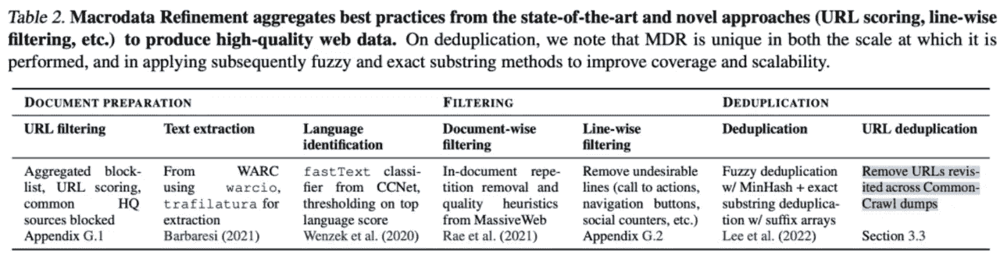

# 从零训练一个多模态LLM:预训练+指令微调+对齐+融合多模态+链接外部系统

> 来源：[https://v11enp9ok1h.feishu.cn/docx/QPo7dqR7CoXlpvx3GnYcx4WSnTf](https://v11enp9ok1h.feishu.cn/docx/QPo7dqR7CoXlpvx3GnYcx4WSnTf)

本文梳理一个完整的多模态LLM的训练流程、包括：

模型结构选择

数据预处理

模型预训练

指令微调

对齐

融合多模态

链接外部系统

## 一、准备阶段

### 模型结构

目前主要有三种模型架构，基于Transforme(解码器，基于GeneradLanguage Model，以及混合专家模型。这一步可以直接选择开源的的基座模型，例如基于Teansfomer解码器架构的LaMA模型族，模型结构及一些重要参数如下图。

假设选择LaMA-658,Tokenizer选择LaMA的基于BPE算法构造的tokenizer,，如果想要扩展词表，可以在目标语言上训练好词表后和LaMA的词表merge在一起。

## 二、预训练数据

### 数据源

根据Chinchila的scaling law，要达到最优的计算利用率，65B模型对应的训练t0ken数量应该达到1.4T，当前用于训练LM的数据来源很多，但其中的高质量数据有限，该数据是提升模型性能的关键，另外，有文章指出，代码数据有助于提升模型的推理能力。因此，需要混合多种数据来源的数据，并合理分配每周数据的占比。如下图，可以参考LaMA的数据源和比例，其中Disksize表示可用的数据总量，Sampling prop表示在总训练token中的占比，epochs表示采样的次数。

###  数据处理

想要提升模型的性能，除了利用已有的开源数据集，例如The Pie，C4，OSCAR等，还可以自己构建教据集，在论文RefinedWeb 中提到，从网页教据中创建的数据集地可以达到和精心收集的数相集同等的效果，Wikipedia，Books;，GitHub，ArXiv，以及StackExchange等高质量数据的处理方法可以参考论文Thepie，下面介绍从Common Crawl构建数据集的方法，CC是一个海量的、非结构化的、多语言的网页数据集，拥有超过8年的网络爬虫数据集，包括原始网页数据(WARC)、元数据(WAT)和文本提取(WNET)。每个月都会发布包括一个 20~30T8 未压维纯文本的快照包含了随机搜索和采样的 URL 所获得的网页，不同月份发布的数据之间只有非常少量的数据重合，8年以来所有爬下来的数据总和是PB级别的。如下图，数据处理流程包含文档准备，过滤以及去重三个步骤，做法参考RefinedWeb论文。

#### 文档准备

包括数据读取、过滤url、提取文本和语言识别;

**数据读取**

文本数据既可以从WET文件也可以从WARC文件中读取。直接使用WET文件可以省略从HTML文件中提取文本的工作，但是包含一些不相关信息。因此可以从WARC文件中读取文本。

**过滤URL**

在正式处理文本数据之前，首先要对URL执行第一次过滤，是色情、暴力、与赌博有关的网站等)。基于两个规则进行过滤:(1)一个包含460万个域名的屏蔽列表，过滤的目标是欺诈和成人网站(主要(2)URL评分，基于收集到的特定单词列表，并按严重程度进行权衡。同时，可以按照需要过滤掉包含在高文本数据集中的数据来源，例如Wikipedia和arXiv等。

**提取文本**

目的是提取HTML页面中的主要内容，忽略菜单、页眉、页脚和广告等。可以采用trafilatura,结合正则表达式进行文本提取iuslex等库库，最终将新行限制为连续的两行，并删除所有URL链接

**语言识别**

语言识别可以在去重之前也可以在去重之后进行。但当文档数量比较少的时候，先识别会导致部分语言分类错误。可以采用fastTex语言分类器进行语言分类，该分类器是在Wkipedia、Tatoeba和SETimes上面训练的，使用n-grams来作为特征，并采用层级sotmax，支持176 种语言的分类，最后输出一个0~1的分数。删除最高语言分数低于设定阈值的文档。通过改变阈值，可以调整保留的文档比例。

#### 过滤

从网页提取的文档质量低下，过滤的目的是移除重复段落，无关内容，非自然语言等等，提高文本质量。包括文档级别和行级过滤,

**包含重复的文档移除**

可以在去重阶段进行，但在早期进行代价更低，也更容易。一般采用启发式方法，制定一系列规则删除任何具有过多行、段落或n-gram重复的文档，做法可以参考论文BLOOM。

**文档过滤**

主要的目的是保留人类写给人类的自然语言文档，移除机器生成的垃圾邮件，主要由关键字列表、样板文本或持殊字符序列组成。这样的文档不适合语言建模，采用质量过滤启发式算法，做法可以参考论文BLOOM。重点是根据文档长度、符号与单词的比率和其他标准方面去除异常值，以确保文档是由真正的自然语言构成。

**行级过滤**

通过trafilatura库提取的文本避免了大部分无关的内容，但仍然有遗漏。通过一个线性校正过滤器继续过滤和正文无关的内容(例如点赞数，导航按钮等)。

**去重**

过滤之后，数据质量得到了提高，但很多文档是重复的。可以通过模糊文档匹配和精确序列删除对文档进行去重。

**模糊去重**

可以采用SimHash，MinHash算法洲除相似的文档:对于每个文档，计算其与其他文档的近似相似性，并删除高重叠的文档对。通过更改哈希算法的参数，可以调整去重的比例

**URL去重**

进一步删除跨CC转储重复访问的URL。

## 二、模型预训练

基于Transformer解码器架构的LM的预训练的方法是让模型做 Next Token predicion任务。基于GLM的LM的预训练方法是让模型做自回归空白填充任务。LM由于规模大，权重维度高，参数量以及数据量多，因此会带来训练不稳定，难以收敏，耗时长，计算资源庞大等问题，下面从模型结构和训练技巧方面介绍一些提升模型的训练速度以及提高训练稳定性的方法

### 结构改进

采用Pre-normaization，例如RMSNomn，在残差连接前对参数归一化，有一部分参数直接与后面的参数相加，可以防止梯度爆炸或消失。用SWGLU 激活普代 ReLU，提高模型性能。相较于常规的络对位置编码，相对位置编码在长序列上件能更好，例如ROPEALB编码方法，常规的自注意力查询需要大量的计算和存储资源，通过采用 Mul Querv Anenion和 fash Atenton 可以减少计算，提升训练速度。

### 训练技巧

具体方法可以参考之前的模型训练篇:大规模语言模型(LLN5)预训练-大模型加速，首先可以采用混合精度减少计算量，即模型权重以及梯度使用f0at16表示，优化器使用foat32表示参数;同时进行通信和计算，提高训练效率。

如下图，当LLM由于规模庞大，无法在单张GPU上运行或者单卡的利用率低时，需要采取并行策略加速训练，首选张量并行，其次是进一步结合流水线并行。在计算资源丰富的情况下，进一步结合ZeRO数据并行实现3D并行，多张GPU并行训练，参考论文Megatron-Turing和BLOOM。