# 深入浅出讲解【LSTM】（结构、原理）

> 来源：[https://v11enp9ok1h.feishu.cn/docx/OM6Gd0QNdoEY3mxqWGzc1cfEnmd](https://v11enp9ok1h.feishu.cn/docx/OM6Gd0QNdoEY3mxqWGzc1cfEnmd)

## LSTM的背景介绍

长短时记忆神经网络（Long Short-term Memory Networks，简称LSTM）是特殊的RNN，尤其适合顺序序列数据的处理，LSTM 由 Hochreiter & Schmidhuber (1997) 提出，并在近期被 Alex Graves 进行了改良和推广，LSTM明确旨在避免长期依赖性问题，成功地解决了原始循环神经网络的缺陷，成为当前最流行的RNN，在语音识别、图片描述、自然语言处理等许多领域中成功应用。

## LSTM的结构和原理

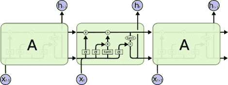

上图中使用的各个元素的图标的含义如下图所示：

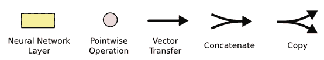

LSTM实现了三个门计算，即遗忘门、输入门和输出门

## LSTM的训练过程

LSTM的参数训练算法，依然是反向传播算法。主要有如下三个步骤：

+ 第一步：前向计算每个神经元的输出值。对于LSTM而言，依据前面介绍的算法，分别进行计算。

+ 第二步：确定优化目标函数。在训练早期，输出值和预期值会不一致，于是计算每个神经元的误差项值，构造出损失函数。

+ 第三步：根据损失函数的梯度指引，更新网络权值参数。与传统RNN类似，LSTM误差项的反向传播包括两个层面：一个是空间上层面的，将误差项向网络的上一层传播。另一个是时间层面上的，沿时间反向传播，即从当前t时刻开始，计算每个时刻的误差。

## 二、原理

### 前向传播

#### 输入门、遗忘门、输出门

| 输入门 |  |

| --- | --- |

| 遗忘门 |  |

| 输出门 |  |

他们都在后面起到一个比例调节的作用

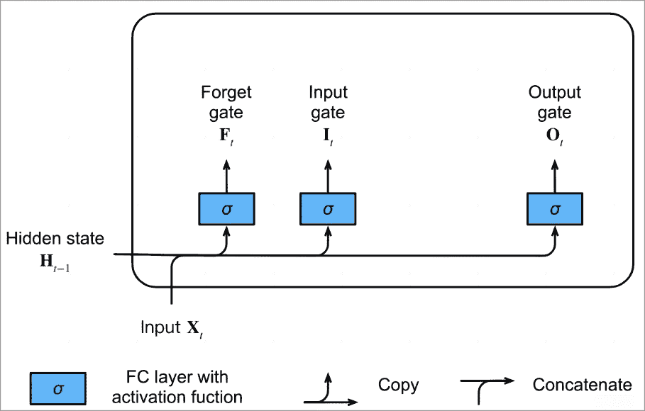

> 其中，`*` 为激活函数（`sigmoid`函数），故取值范围为：[0,1]

> `n`为样本数，`d`为输入的特征数，`h`为隐藏大小。

#### 候选记忆细胞

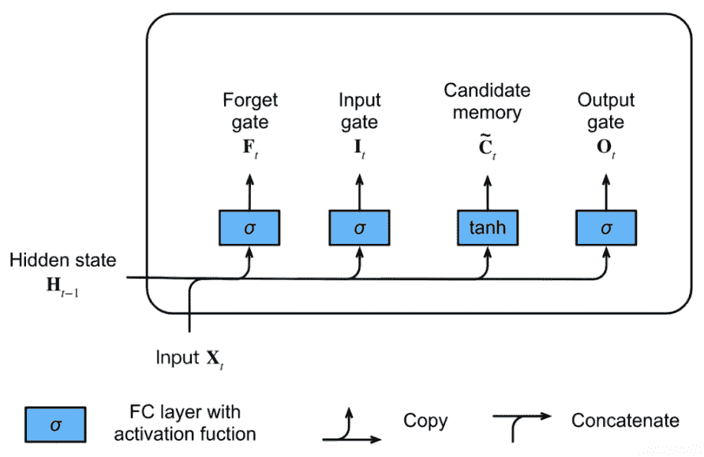

#### 记忆细胞

当前时间步记忆细胞的计算组合了上一时间步记忆细胞和当前时间步候选记忆细胞的信息。

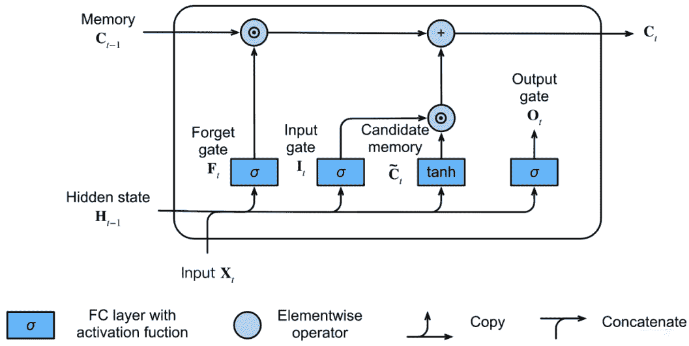

+ 遗忘门 控制上一时间步的记忆细胞 中的信息是否传递到当前时间步的记忆细胞，而输出门 则控制当前时间步的输入 通过候选记忆细胞的 如何流入当前时间步的记忆细胞。

+ 如果遗忘门一直近似为1且输入门一直近似为0，则说明：过去的记忆细胞将一直通过时间保存并传递到当前时间步，而当前输入 则被屏蔽掉。

+ 这个设计可以应对循环神经网络中的梯度衰减问题（可以有选择地对前面的信息进行保留，不至于直接出现指数项），并更好地捕捉时间序列中时间步距离较大的依赖关系(存在 中)。

#### 隐藏状态

+ 我们通过输出门来控制从记忆细胞到隐藏状态  的信息流动。

+ 当输出门 近似为1时，记忆细胞信息将传递到隐藏状态供输出层使用；近似为0时，记忆细胞信息只自己保留。

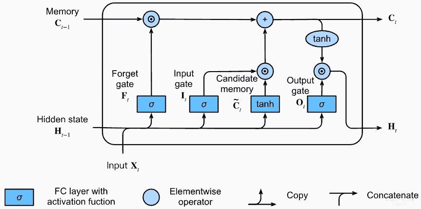

### 反向传播

#### 输出层参数

Note：这里的  指的是上一次（即t+1时间步）计算得到的

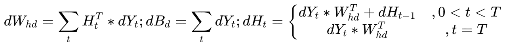

#### 过渡

对于链式法则涉及到记忆细胞的，我们设为

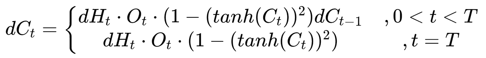

Note：同样的，这里的的  指的是上一次（即t+1时间步）计算得到的的

+ 对于链式法则涉及到候选记忆细胞的，设为

+ 对于链式法则涉及到输出门的，我们设为

+ 对于链式法则涉及到遗忘门的，我们设为

+ 对于链式法则涉及到输入门的，我们设为

#### 候选记忆细胞的参数

#### 输出门的参数

#### 遗忘门的参数

#### 输入门的参数

#### 上一隐藏状态and记忆细胞

## 三、什么是LSTM、LSTM要解决什么问题、从0开始搭建LSTM

LSTM -> Long Short-Term Memory

> 是一种基于RNN变化的神经网络（使得神经网络具有对很久前的信息仍有记忆效果），现广泛应用于自然语言处理（NLP），时间序列预测和构建一些高层次的模型。

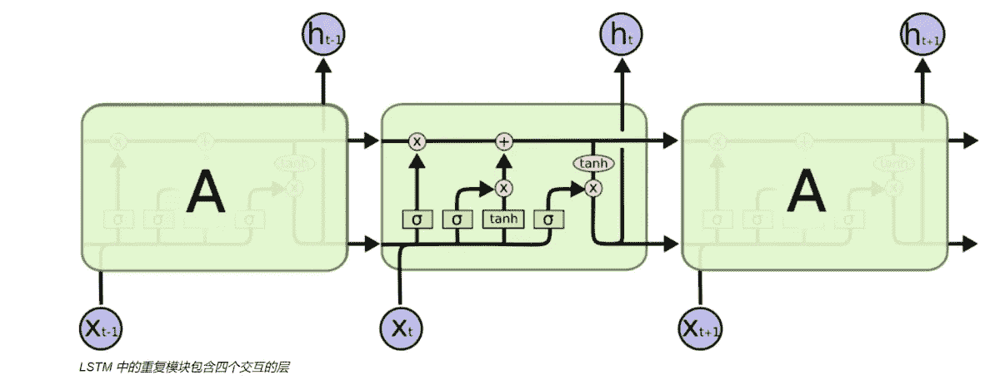

### 代码示例

```
# 创建模型
model = tf.keras.Sequential([
    tf.keras.layers.TextVectorization(max_tokens=10000, output_mode='int', output_sequence_length=500),
    tf.keras.layers.Embedding(10000, 64),
    tf.keras.layers.Bidirectional(tf.keras.layers.LSTM(64)),
    tf.keras.layers.Dense(64, activation='relu'),
    tf.keras.layers.Dense(1)
])
```

### 应用场景：

1. 自然语言处理：在自然语言处理（NLP）领域，LSTM被广泛用于语言模型、文本生成、机器翻译、情感分析等任务。例如，一个语言模型可能需要记住文本中的上下文信息，以预测下一个词；在情感分析中，模型可能需要理解文本的整体语义，以判断其情感倾向。

2. 时间序列预测：在金融、气象等领域，LSTM可以用于预测未来的股票价格、气温等，因为这些预测往往需要理解数据的时间动态性。

3. 语音识别和生成：在语音识别和生成的任务中，LSTM可以用于理解和生成语音信号的时间序列。

4. 手写识别：在手写识别任务中，LSTM可以用于理解笔画的时间序列，从而识别出手写文字。好的，这里是一个使用LSTM进行文本分类的示例，我将详细解释每个步骤

### 优点：

1. 处理长序列数据：LSTM的主要优点是能够有效地处理长序列数据。在传统的RNN中，由于梯度消失的问题，网络往往难以捕捉序列中的长期依赖关系。而LSTM通过引入门控机制和细胞状态，能够在较长的时间跨度上保持信息，从而捕捉到长期依赖关系。

2. 遗忘机制：LSTM的遗忘门可以选择性地忘记细胞状态中的某些信息，这使得模型能够更好地适应数据中的时间动态性。

### 缺点：

1. 计算复杂性高：由于LSTM的结构比传统的RNN更复杂，因此在计算和存储需求上都更高。

2. 长期依赖问题仍存在：虽然LSTM在一定程度上解决了梯度消失问题，但在实际应用中，处理非常长的序列时，长期依赖问题仍然可能出现。

这个模型包含五层：

1. `TextVectorization` 层：这一层将文本转换为整数序列。`max_tokens` 参数表示词汇表的大小，`output_mode` 参数表示输出模式，`output_sequence_length` 参数表示输出序列的长度。

2. `Embedding` 层：这一层将整数序列转换为密集向量。第一个参数表示词汇表的大小，第二个参数表示嵌入向量的维度。

3. `Bidirectional` 层：这一层将 `LSTM` 应用于输入序列的正向和反向。这可以帮助 `LSTM` 学习长距离依赖。

4. `Dense` 层：这是一个全连接层，它将前一层的输出转换为一个 64 维的向量。`activation` 参数表示激活函数。

5. `Dense` 层：这是一个全连接层，它将前一层的输出转换为一个 1 维的向量。这一层的输出表示评论的情感。

### 我们先透过LSTM的模型内部，去挖掘LSTM学习长期依赖信息的秘密：

首先，我们要清楚的认识到，LSTM最上面有一层细胞层`C(t)`，是信息的载体，用于记录数据的变化：

+ 遗忘门

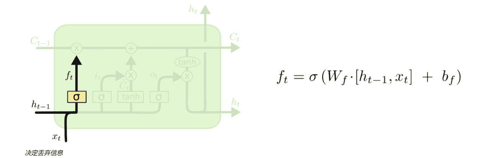

> 遗忘门是`LSTM`模型的第一步，它接收于上一个神经元传入的信息`h(t-1)`和新传入的信息`x(t)`，通过`sigmoid`函数对所有信息进行处理，得到`f(t)`传入细胞状态`C(t)`，`f(t)`位于0-1，越接近0  -> 遗忘，越接近1 -> 记得

+ 输入门

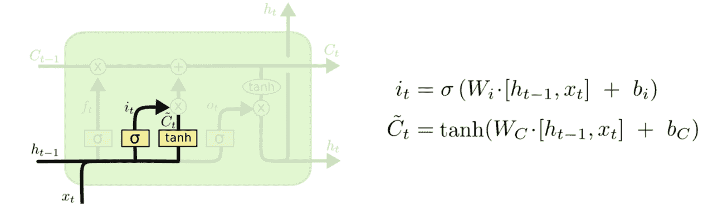

> 输入门是`LSTM`的第二步，它把`h(t)`和`x(t)`分别用`sigmoid`和`tanh`函数进行运算，确定我们需要更新的数据。

> `sigmoid`的用处：决定什么值要更新（筛选）

+ 更新门

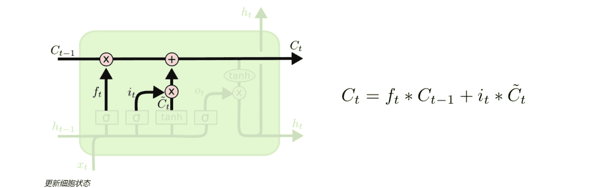

> 更新门是`LSTM`的第三步，它通过矩阵相乘和矩阵相加，把需要遗忘的数据和需要更新的数据传入细胞`C(t)`，进行细胞状态的更新

+ 输出门

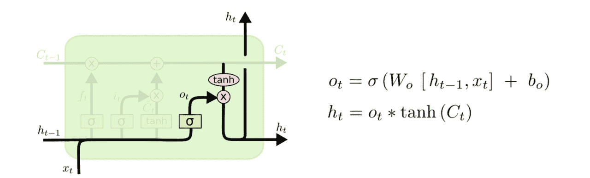

> 最后是输出门，通过对细胞状态`C(t)`使用`tanh`函数更新出新的信息`h(t)`，输出到下一个`LSTM`神经元中。

> `sigmoid`的用处：确定细胞状态`C(t)`哪些部分输出出去（筛选）

### 从零实现LSTM:

#### 前期准备

```
import numpy as np

def sigmoid(x):
    x_ravel = x.ravel()  # 将numpy数组展平
    length = len(x_ravel)
    y = []
    for index in range(length):
        if x_ravel[index] >= 0:
            y.append(1.0 / (1 + np.exp(-x_ravel[index])))
        else:
            y.append(np.exp(x_ravel[index]) / (np.exp(x_ravel[index]) + 1))
    return np.array(y).reshape(x.shape)

def tanh(x):
    result = (np.exp(x)-np.exp(-x))/(np.exp(x)+np.exp(-x))
    return result
```

#### （2）初始化参数

```
class LSTM(object):
    def __init__(self, input_size, hidden_size):
        self.input_size = input_size
        self.hidden_size = hidden_size
        #输入门
        self.Wxi = np.random.randn(input_size, hidden_size)
        self.Whi = np.random.randn(hidden_size, hidden_size)
        self.B_i  = np.zeros((1, hidden_size))
        #遗忘门
        self.Wxf = np.random.randn(input_size, hidden_size)
        self.Whf = np.random.randn(hidden_size, hidden_size)
        self.B_f = np.zeros((1, hidden_size))
        #输出门
        self.Wxo = np.random.randn(input_size, hidden_size)
        self.Who = np.random.randn(hidden_size, hidden_size)
        self.B_o = np.zeros((1, hidden_size))
        #候选记忆细胞
        self.Wxc = np.random.randn(input_size, hidden_size)
```

#### 前向传播

```
    def forward(self,X,Ht_1,Ct_1): #前向传播
        #存储
        self.it_stack = {} #输入门存储
        self.ft_stack = {} #遗忘门存储
        self.ot_stack = {} #输出门存储
        self.cc_stack = {} #候选记忆细胞存储
        self.c_stack = {} #记忆细胞存储
        self.X_stack = {} #X存储
        self.Ht_stack = {} #隐藏状态存储
        self.Y_stack = {} #输出存储

        self.Ht_stack[-1] = Ht_1
        self.c_stack[-1] = Ct_1
        self.T = X.shape[0]

        for t in range(self.T):
            self.X_stack[t] = X[t].reshape(-1,1).T
            #输入门
            net_i = np.matmul(self.X_stack[t], self.Wxi) + np.matmul(self.Ht_stack[t-1], self.Whi) + self.B_i
            it = sigmoid(net_i)
            self.it_stack[t] = it
            #遗忘门
            net_f = np.matmul(self.X_stack[t], self.Wxf) + np.matmul(self.Ht_stack[t-1], self.Whf) + self.B_f
            ft = sigmoid(net_f)
            self.ft_stack[t] = ft
            #输出门
            net_o = np.matmul(self.X_stack[t], self.Wxo) + np.matmul(self.Ht_stack[t-1], self.Who) + self.B_o
            ot = sigmoid(net_o)
            self.ot_stack[t] = ot
            #候选记忆细胞
            net_cc = np.matmul(self.X_stack[t], self.Wxc) + np.matmul(self.Ht_stack[t-1], self.Whc) + self.B_c
            cct = tanh(net_cc)
            self.cc_stack[t] = cct
            #记忆细胞
            Ct = ft*self.c_stack[t-1]+it*cct
            self.c_stack[t] = Ct
            #隐藏状态
            Ht = ot*tanh(Ct)
            self.Ht_stack[t] = Ht
```

#### （4）反向传播


```python
    def backward(self,target,lr):
        #初始化
        dH_1, dnet_ct_1 = np.zeros([1,self.hidden_size]), np.zeros([1,self.hidden_size])
 
        dWxi, dWhi, dBi = np.zeros_like(self.Wxi), np.zeros_like(self.Whi), np.zeros_like(self.B_i)
        dWxf, dWhf, dBf = np.zeros_like(self.Wxf), np.zeros_like(self.Whf), np.zeros_like(self.B_f)
        dWxo, dWho, dBo = np.zeros_like(self.Wxo), np.zeros_like(self.Who), np.zeros_like(self.B_o)
        dWxc, dWhc, dBc = np.zeros_like(self.Wxc), np.zeros_like(self.Whc), np.zeros_like(self.B_c)
        dWhd,dBd = np.zeros_like(self.W_hd),np.zeros_like(self.B_d)
 
        self.loss = 0
 
        for t in reversed(range(self.T)): #反过来开始，越往前面分支越多       
            dY = self.Y_stack[t] - target[t].reshape(-1,1).T
            self.loss += -np.sum(np.log(self.Y_stack[t]) * target[t].reshape(-1,1).T)
            #对输出的参数
            dWhd += np.matmul(self.Ht_stack[t].T,dY)
            dBd += dY
 
            dH = np.matmul(dY, self.W_hd.T) + dH_1 #dH更新
 
            #对有关输入门，遗忘门，输出门，候选记忆细胞中参数的求导的共同点
            temp = tanh(self.c_stack[t])
            dnet_ct = dH * self.ot_stack[t] * (1-temp*temp) + dnet_ct_1 #记忆细胞
            dnet_cct = dnet_ct * self.it_stack[t] * (1 - self.cc_stack[t]*self.cc_stack[t]) #候选记忆细胞
            dnet_o = dH * temp * self.ot_stack[t] * (1 - self.ot_stack[t]) #输出门
            dnet_f = dnet_ct * self.c_stack[t-1] * self.ft_stack[t] * (1 - self.ft_stack[t]) #遗忘门
            dnet_i = dnet_ct * self.cc_stack[t] * self.it_stack[t] * (1 - self.it_stack[t]) #输入门
 
            #候选记忆细胞中参数
            dWxc += np.matmul(self.X_stack[t].T, dnet_cct)
```

## （5）预测

```python
    def pre(self,input_onehot,h_prev,c_prev,next_len,vocab): #input_onehot为输入的一个词的onehot编码，next_len为需要生成的单词长度，vocab是"索引-词"的词典
        xs, hs, cs = {}, {}, {} #字典形式存储
        hs[-1] = np.copy(h_prev) #隐藏状态赋予
        cs[-1] = np.copy(c_prev)
        xs[0] = input_onehot
        pre_vocab = []
        for t in range(next_len):
            #输入门
            net_i = np.matmul(xs[t], self.Wxi) + np.matmul(hs[t-1], self.Whi) + self.B_i
            it = sigmoid(net_i)
            #遗忘门
            net_f = np.matmul(xs[t], self.Wxf) + np.matmul(hs[t-1], self.Whf) + self.B_f
            ft = sigmoid(net_f)
            #输出门
            net_o = np.matmul(xs[t], self.Wxo) + np.matmul(hs[t-1], self.Who) + self.B_o
            ot = sigmoid(net_o)
            #候选记忆细胞
            net_cc = np.matmul(xs[t], self.Wxc) + np.matmul(hs[t-1], self.Whc) + self.B_c
            cct = tanh(net_cc)
            #记忆细胞
            Ct = ft*cs[t-1]+it*cct
            cs[t] = Ct
            #隐藏状态
            Ht = ot*tanh(Ct)
            hs[t] = Ht
            #输出
            Ot = np.matmul(Ht, self.W_hd) + self.B_d
            Yt = np.exp(Ot) / np.sum(np.exp(Ot)) #softmax
            pre_vocab.append(vocab[np.argmax(Yt)])
 
            xs[t+1] = np.zeros((1, self.input_size)) # init
            xs[t+1][0,np.argmax(Yt)] = 1
        return pre_vocab
```

## 2、调用我们实现的LSTM进行训练与预测

```python
from lstm_model import LSTM
import numpy as np
import math
 
class Dataset(object):
    def __init__(self,txt_data, sequence_length):
        self.txt_len = len(txt_data) #文本长度
        vocab = list(set(txt_data)) #所有字符合集
        self.n_vocab = len(vocab) #字典长度
        self.sequence_length = sequence_length
        self.vocab_to_index = dict((c, i) for i, c in enumerate(vocab)) #词-索引字典
        self.index_to_vocab = dict((i, c) for i, c in enumerate(vocab)) #索引-词字典
        self.txt_index = [self.vocab_to_index[i] for i in txt_data] #输入文本的索引表示
 
    def one_hot(self,input):
        onehot_encoded = []
        for i in input:
            letter = [0 for _ in range(self.n_vocab)] 
            letter[i] = 1
            onehot_encoded.append(letter)
        onehot_encoded = np.array(onehot_encoded)
        return onehot_encoded
    
    def __getitem__(self, index):
        return (
            self.txt_index[index:index+self.sequence_length],
            self.txt_index[index+1:index+self.sequence_length+1]
        )
 
#输入的有规律的序列数据
#txt_data = "abc abc abc abc abc abc abc abc abc abc abc abc abc abc abc abc abc abc abc abc abc abc abc abc abc abc abc"
txt_data = "abcdefghijklmnopqrstuvwxyz abcdefghijklmnopqrstuvwxyz abcdefghijklmnopqrstuvwxyz abcdefghijklmnopqrstuvwxyz abcdefghijklmnopqrstuvwxyz abcdefghijklmnopqrstuvwxyz abcdefghijklmnopqrstuvwxyz "
 
#config
max_epoch = 5000
sequence_length = 28
```

### LSTM内部主要有三个阶段：

1.  **忘记阶段:**这个阶段主要是对上一个节点传进来的输入进行选择性忘记。简单来说就是会 “忘记不重要的，记住重要的”。

具体来说是通过计算得到的 `f`（表示forget）来作为忘记门控，来控制上一个状态的哪些需要留哪些需要忘。

1.  **选择记忆阶段:**这个阶段将这个阶段的输入有选择性地进行“记忆”。主要是会对输入 进行选择记忆。哪些重要则着重记录下来，哪些不重要，则少记一些。当前的输入内容由前面计算得到的表示。而选择的门控信号则是由 `i`（代表information）来进行控制。

>

> 将上面两步得到的结果相加，即可得到传输给下一个状态的   。

>

1.  **输出阶段:**这个阶段将决定哪些将会被当成当前状态的输出。主要是通过    来进行控制的。并且还对上一阶段得到的    进行了放缩（通过一个`tanh`激活函数进行变化）。

+   **与普通`RNN`类似，输出  **** **** 往往最终也是通过  **** **** 变化得到。**

### 为什么LSTM可以解决长期依赖问题呢？

+   **`LSTM`可以解决长期依赖问题**，因为它有一个单元状态，可以在任意时间间隔记住值，并且有三个门，可以调节信息进入和离开单元状态的流量。这样，`LSTM`可以保留与当前输入相关的历史信息，并且避免了梯度消失或爆炸的问题。

>

+   梯度消失或爆炸是指在反向传播过程中，梯度随着时间步的增加而变得非常小或非常大，导致网络难以学习到长期依赖的信息。这是由于标准的`RNN`使用相同的权重矩阵来更新隐藏状态和输出，在多个时间步连乘后，会造成梯度指数级衰减或增长。

>

+   `LSTM`通过引入遗忘门、输入门和输出门来解决这个问题。遗忘门可以决定从前一个单元状态丢弃哪些信息，输入门可以决定将哪些新信息存储在当前单元状态中，输出门可以控制当前单元状态中哪些信息输出。这些门都使用`sigmoid`函数作为激活函数，它们的导数都在(0, 1)之间，因此不会导致梯度消失或爆炸。
