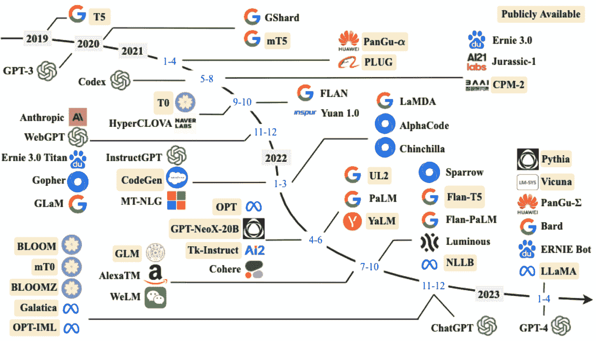
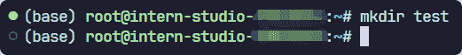
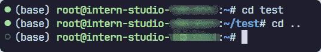
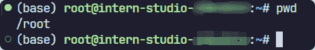
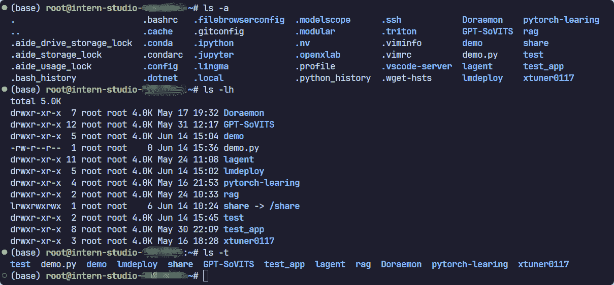
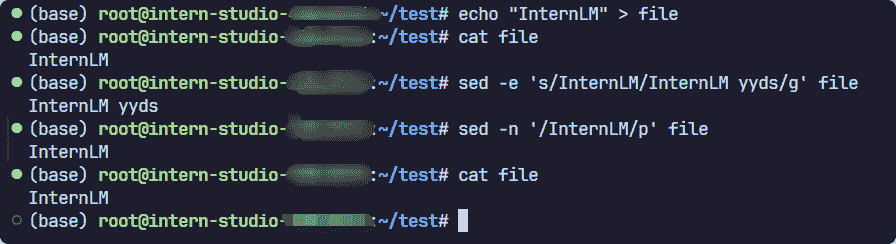
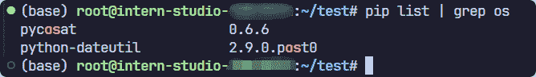
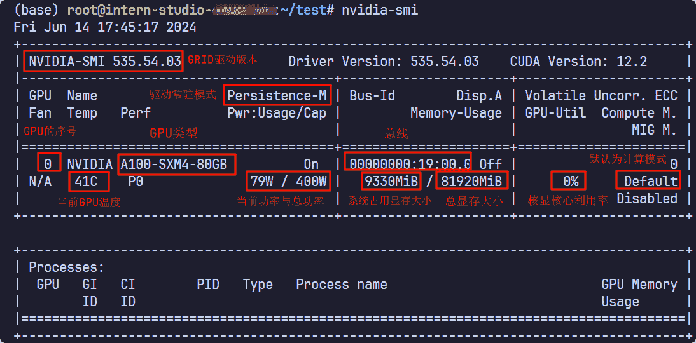
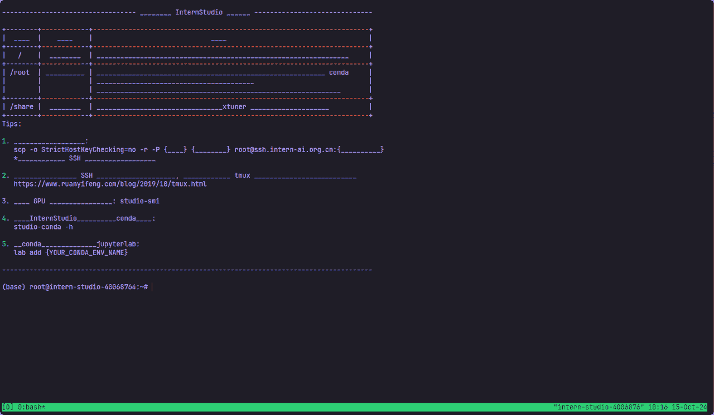

# Linux 基础与命令行操作

> 来源：[https://v11enp9ok1h.feishu.cn/docx/WbpMdt90qoqP5gxnsCBcN9Zunjf](https://v11enp9ok1h.feishu.cn/docx/WbpMdt90qoqP5gxnsCBcN9Zunjf)

## 一、大语言模型与 Linux 的联系



Linux 作为一种稳定、强大的操作系统，为大语言模型的开发、部署和资源管理提供了重要的支持。同时，大语言模型的发展也推动了 Linux 系统的不断进步和创新。

在大语言模型的开发过程中，Linux 常常作为重要的开发环境操作系统。许多开发团队选择 Linux 是因为它具有高度的稳定性和可靠性。Linux 系统可以长时间运行而不出现故障，这对于需要进行大规模数据处理和长时间训练的大语言模型来说至关重要。例如，在训练大语言模型时，可能需要连续运行数周甚至数月的时间，如果操作系统不稳定，可能会导致训练中断，浪费大量的时间和计算资源。

同时，Linux 提供了强大的命令行工具和脚本语言，方便开发人员进行系统管理和任务自动化。开发人员可以使用 Shell 脚本编写自动化任务，如数据预处理、模型训练启动和监控等。这些工具和脚本可以提高开发效率，减少人工操作的错误。

大语言模型通常需要在强大的服务器上进行部署，以满足高并发的请求和大规模的计算需求。而 Linux 是服务器领域广泛使用的操作系统。Linux 服务器具有良好的性能和可扩展性，可以轻松应对大量的用户请求。

大语言模型的训练和推理过程需要大量的计算资源，包括 CPU、GPU、内存和存储等。Linux 系统提供了强大的资源管理功能，可以有效地分配和管理这些资源。

开发人员可以使用 Linux 的进程管理工具来监控和控制大语言模型的训练进程，确保它们不会占用过多的系统资源，影响其他任务的运行。同时，Linux 还支持虚拟化技术，如 Docker 和 Kubernetes，可以将大语言模型部署在容器中，实现资源的隔离和高效利用。

Linux 和大语言模型都是开源领域的重要代表，它们都受益于庞大的开源社区的支持。Linux 拥有丰富的开源软件和工具，可以为大语言模型的开发和部署提供便利。

例如，开发人员可以使用开源的深度学习框架，如 TensorFlow 和 PyTorch，在 Linux 系统上进行大语言模型的训练和优化。同时，开源社区也为 Linux 系统提供了不断的更新和改进，使其更加适应大语言模型等新兴技术的需求。

作为大语言模型入门的基础，我们首先学会 Linux 的一些基础操作，这样在后面进行大语言模型部署与微调的时候才能得心应手。

## 二、大语言模型入门资源选择

大语言模型入门通常需要一定的硬件和软件资源支持。

### 硬件资源方面

+ 消费级显卡推荐英伟达 GeForce 系列的 30 系列（如 3060、3070、3080、3090，显存至少 8GB 以上）和 40 系列（4060、4070、4080、4090，显存至少 8GB 显存以上）。对于更大的模型，至少需要 16GB RAM 和 100GB 以上的硬盘空间用于存储数据集和模型参数。

+ 数据中心（服务器显卡）可选择 Tesla T4（16GB 显存）、L-Series（L40、L40S）、Tesla v100（32GB 显存）、A-Series（A10、A16、A30、A40、A100、A800）、H-Series（H100、H800）等。

### 软件资源方面

+ **编程语言**：`Python` 是接触人工智能必须了解的编程语言，建议使用较新版本如 `python3.10+`（https://www.python.org/downloads/）。

+ **Python 工具包**：`Numpy` 是矩阵计算必备，是后续一切计算的核心，数据科学领域核心工具包；`Pandas` 数据处理必备，用于读数据、处理数据、分析数据；`Matplotlib` 可视化必备，功能十分强大，没有画不出来的图，分析展示就靠它了。

+ **深度学习框架**：`Caffe` 框架主要用于图像处理、计算机视觉和自然语言处理等领域；`TensorFlow2` 由谷歌出品，主要关注于简化 API、易用性提升以及对 `Keras` 和 `eager execution` 模式的支持；`Keras` 框架是基于 `TensorFlow` 的深度学习库，支持多种后端框架，如 `TensorFlow`、`PyTorch` 和 `Jax`；`PyTorch` 是由 Facebook 的人工智能研究团队开发的开源深度学习框架，提供了一个简单、灵活、高效的工具，用于构建和部署深度学习模型，支持多种平台和硬件，具有灵活的设计和高效的性能。

### 云服务器资源方面

+ **免费云服务器资源**：百度飞桨（https://aistudio.baidu.com/）提供部分有限制条件的免费算力资源；魔塔社区 `PAI-DSW`（https://modelscope.cn/）送几十个小时算力分钟数；阿里云机器学习 `PAI-DSW`（https://pai.console.aliyun.com/）新户提供 3 个月，5000 元额度的算力资源；启智算力平台（https://openi.pcl.ac.cn/）是积分制，通过积分换算力；超算互联网（https://www.scnet.cn/）提供免费算力资源能长达 12 个月，但每次运行只能 2 个小时且模型资源较少。

+ **收费云服务器资源**：阿里云（https://www.aliyun.com/）、腾讯云（https://cloud.tencent.com/）、华为云（https://activity.huaweicloud.com/）等主流云厂商以及模型训练细分领域厂商如 `autodl`（https://www.autodl.com/）、`openbayes`（贝式计算，https://openbayes.com/）、`cephalon`（端脑，https://cephalon.cloud/）、`gpumall`（智算云，https://gpumall.com/login）、`suanyun`（晨羽智云，https://www.suanyun.cn/）等。

## 三、Linux 基础命令行操作

如果你已经有一台服务器了，就可以进行接下来 Linux 基础命令的学习了。

### 通过图形界面操作

1. 应用程序菜单：在大多数 Linux 桌面环境中，可以通过点击应用程序菜单，然后在 “系统工具” 或 “附件” 等类别中找到 “终端” 程序并点击打开。

1. 快捷方式：有些桌面环境支持设置终端的快捷方式，例如在桌面上创建终端的快捷图标，或者通过特定的快捷键组合（如 `Ctrl + Alt + T`）直接打开终端。

### 常用快捷键

1. `Ctrl + Alt + T`：这是许多 Linux 发行版中默认的打开终端的快捷键组合。按下这三个键可以快速启动终端应用程序。

1. `Tab` 键：在终端中输入命令时，按下 `Tab` 键可以自动补全命令或文件名。如果有多个可能的选项，连续按两次 `Tab` 键可以显示所有可能的选项。

1. `Ctrl + C`：用于中断正在运行的命令。如果某个命令在执行过程中出现问题或者陷入无限循环，可以使用这个快捷键来停止它。

1. `Ctrl + D`：表示输入结束，通常用于退出当前的终端会话或者关闭文件描述符。在某些情况下，也可以用于退出某些命令的交互模式。

1. `Ctrl + Z`：将当前正在运行的命令暂停，并放入后台。可以使用 `fg` 命令将其恢复到前台继续运行。

1. 向上/向下箭头：在终端历史记录中向上或向下滚动，以查找之前执行过的命令。按下回车键可以重新执行选中的命令。

1. `Ctrl + L`：清屏，将终端屏幕上的内容清空，使屏幕看起来更加整洁。

1. `Ctrl + Shift + C` 和 `Ctrl + Shift + V`：在终端中复制和粘贴文本。有些终端也支持使用鼠标选中文本进行复制，然后在需要粘贴的地方点击鼠标中键进行粘贴。

### 文件管理

> 在 Linux 中，常见的文件管理操作包括：

+ **创建文件**：可以使用 `touch` 命令创建空文件。

+ **创建目录**：使用 `mkdir` 命令。

+ **目录切换**：使用 `cd` 命令。

+ **显示所在目录**：使用 `pwd` 命令。

+ **查看文件内容**：如使用 `cat` 直接显示文件全部内容，`more` 和 `less` 可以分页查看。

+ **编辑文件**：如 `vi` 或 `vim` 等编辑器。

+ **复制文件**：用 `cp` 命令。

+ **创建文件链接**：用 `ln` 命令。

+ **移动文件**：通过 `mv` 命令。

+ **删除文件**：使用 `rm` 命令。

+ **删除目录**：`rmdir`（只能删除空目录）或 `rm -r`（可删除非空目录）。

+ **查找文件**：可以用 `find` 命令。

+ **查看文件或目录的详细信息**：使用 `ls` 命令，如使用 `ls -l` 查看目录下文件的详细信息。

+ **处理文件**：进行复杂的文件操作，可以使用 `sed` 命令。

这里介绍几种我们在课程中会使用到的命令：

#### `touch`

我们可以使用 `touch` 快速的创建文件，这样我们不用手动点击进行创建了。例如我们要创建一个 `demo.py` 文件：


#### `mkdir`

同样的使用方法，如果要创建一个名为 `test` 的目录：



#### `cd`

这个命令会是使用最多的一个命令，在使用之前需要为没有计算机基础的同学讲一下目录结构，画一张图让大家理解：

我们现在使用的是 `root` 目录，也是 `root` 用户的家目录 `~`，Linux 操作系统中 `/` 表示根目录，根目录下有许多系统所需的目录和文件，刚才我们创建的目录就存在于 `root` 目录下，其中 `.` 表示的是当前目录，`..` 表示的上级目录。如果我现在要进入到 `test` 目录，然后回到 `root` 目录，我们可以这样操作：



#### `pwd`

我们可以使用 `pwd` 命令查看当前所在的目录：这样可以方便我们确定我们当前所在哪个目录下面。



#### `cat`

`cat` 命令可以查看文件里面的内容，更多的使用命令可以使用 `--help` 命令查看：

+ `-a`，`--show-all` 等价于 `-vET`

+ `-b`，`--number-non空白数非空输出行`，覆盖 `-n`

+ `-e`，等价于 `-vE`

+ `-E`，`--show-结束显示$` 在每一行的末尾

+ `-n`，`--number` 编号所有输出行

+ `-s`，`--crick-空白抑制重复的空输出行`

+ `-t` 等价于 `-vT`

+ `-t`，`--show-tabs` 将制表符显示为 `^I`

+ `-v`，`--show` 非打印使用 `^` 和 `M-` 表示法，`LFD` 和 `TAB` 除外

#### `cp` 和 `ln`

`cp` 命令在后面课程中会经常用到，它是用来将一个文件或者目录复制到另一个目录下的操作，常用的使用有：

+ 复制文件：`cp` 源文件 目标文件

+ 复制目录：`cp -r` 源目录 目标目录

但是如果我们是要使用模型的话，这种操作会占用大量的磁盘空间，所以我们一般使用 `ln` 命令，这个就和 `windows` 的快捷方式一样。Linux 中链接分为两种：硬链接（hard link）与软链接（symbolic link），硬链接的意思是一个档案可以有多个名称，而软链接的方式则是产生一个特殊的档案，该档案的内容是指向另一个档案的位置。硬链接是存在同一个文件系统中，而软链接却可以跨越不同的文件系统。

所以我们一般使用软链接，它的常用的使用方法如下：

`ln [参数][源文件或目录][目标文件或目录]`

参数如下：

+ `-s`：创建软链接（符号链接）也是最常用的；

+ `-f`：强制执行，覆盖已存在的目标文件；

+ `-i`：交互模式，文件存在则提示用户是否覆盖；

+ `-n`：把符号链接视为一般目录；

+ `-v`：显示详细的处理过程。

#### `mv` 和 `rm`

`mv` 命令和 `rm` 命令的使用方式很相似，但是 `mv` 是用来移动文件或者目录的，同时还可以进行重命名。`rm` 命令则是用来删除文件或者目录的。

常用的使用方法如下：

+ **`mv` 命令**：

常用参数：

+ `-i`：交互模式，覆盖前询问。

+ `-f`：强制覆盖。

+ `-u`：只在源文件比目标文件新时才进行移动。

使用示例：

+ `mv file1.txt dir1/`：将文件 `file1.txt` 移动到目录 `dir1` 中。

+ `mv file1.txt file2.txt`：将文件 `file1.txt` 重命名为 `file2.txt`。

+ **`rm` 命令**：

常用参数：

+ `-i`：交互模式，删除前询问。

+ `-f`：强制删除，忽略不存在的文件，不提示确认。

+ `-r`：递归删除目录及其内容。

使用示例：

+ `rm file.txt`：删除文件 `file.txt`。

+ `rm -r dir1/`：递归删除目录 `dir1` 及其所有内容。

删除目录的命令也可以使用 `rmdir`。

#### `find`

`find` 命令是 Linux 系统中一个强大的文件搜索工具，它可以在指定的目录及其子目录中查找符合条件的文件或目录，并执行相应的操作。

以下是 `find` 命令的一些常见用法：

1. **按文件名查找**：使用 `-name` 选项按照文件名查找文件。例如，`find /path/to/directory -name "file.txt"` 将在指定目录及其子目录中查找名为 `file.txt` 的文件。

1. **按文件类型查找**：使用 `-type` 选项按照文件类型查找文件。例如，`find /path/to/directory -type f` 将查找指定目录及其子目录中的所有普通文件。

1. **按文件大小查找**：使用 `-size` 选项按照文件大小查找文件。例如，`find /path/to/directory -size +100M` 将查找指定目录及其子目录中大于 100MB 的文件。

1. **按修改时间查找**：使用 `-mtime`、`-atime` 或 `-ctime` 选项按照文件的修改时间、访问时间或状态更改时间查找文件。例如，`find /path/to/directory -mtime -7` 将查找指定目录及其子目录中在 7 天内修改过的文件。

1. **按文件权限查找**：使用 `-perm` 选项按照文件权限查找文件。例如，`find /path/to/directory -perm 755` 将查找指定目录及其子目录中权限为 755 的文件。

1. **按用户或组查找**：使用 `-user` 或 `-group` 选项按照文件的所有者或所属组查找文件。例如，`find /path/to/directory -user username` 将查找指定目录及其子目录中属于用户 `username` 的文件。

1. **执行操作**：使用 `-exec` 选项可以对找到的文件执行相应的操作。例如，`find /path/to/directory -name "*.txt" -exec rm {} \;` 将删除找到的所有以 `.txt` 结尾的文件。

#### `ls`

`ls` 命令可以用来列出目录的内容以及详细信息。

常用参数及使用方法如下：

+ `-a`：显示所有文件和目录，包括隐藏文件（以 `.` 开头的文件或目录）。

+ `-l`：以长格式显示详细信息，包括文件权限、所有者、大小、修改时间等。

+ `-h`：与 `-l` 结合使用，以人类可读的方式显示文件大小（如 K、M、G 等）。

+ `-R`：递归列出子目录的内容。

+ `-t`：按文件修改时间排序显示。



#### `sed`

`sed` 命令是一种流编辑器，主要用于文本处理，在处理复杂的文件操作时经常用到，在后续的课程中会使用到，`sed` 命令常用参数及使用示例如下：

+ **参数说明：**

+ `-e<script>` 或 `--expression=<script>`：直接在命令行中指定脚本进行文本处理。

+ `-f<script文件>` 或 `--file=<script文件>`：从指定的脚本文件中读取脚本进行文本处理。

+ `-n` 或 `--quiet` 或 `--silent`：仅打印经过脚本处理后的输出结果，不打印未匹配的行。

+ **动作说明：**

+ `a`：在当前行的下一行添加指定的文本字符串。

+ `c`：用指定的文本字符串替换指定范围内的行。

+ `d`：删除指定的行。

+ `i`：在当前行的上一行添加指定的文本字符串。

+ `p`：打印经过选择的行。通常与 `-n` 参数一起使用，只打印匹配的行。

+ `s`：使用正则表达式进行文本替换。例如，`s/old/new/g` 将所有 `"InternLM"` 替换为 `"InternLM yyds"`。

+ **示例：**



在示例中使用了 `echo` 命令，这和 `python` 中的 `print` 一样，用来打印内容，这里使用管道符 `>` 将 `InternLM` 打印到 `file` 文件中，常用的管道符还有 `<` 和 `|`，比如我们可以使用 `grep` 命令来查看 `python` 中安装的包含 `os` 字段的包：



`grep` 是一个强大的文本搜索工具。常用参数如下：

+ `-i`：忽略大小写进行搜索。

+ `-v`：反转匹配，即显示不匹配的行。

+ `-n`：显示行号。

+ `-c`：统计匹配的行数。

### 文本编辑器 `vim` 使用

当我们需要编辑文件的时候可以使用 `vi` 或者 `vim` 命令，当你进入文件编辑以后，有三种模式：

进入编辑模式可以使用 `i`，`vim` 的方便之处就是可以在终端进行简单的文件修改。

1. **命令模式：**

+ 当打开 Vim 时，首先进入的就是命令模式。在这个模式下，可以使用各种命令来操作文本，但不能直接编辑文本内容。

+ 常用命令有：


## 命令模式

+   `h`、`j`、`k`、`l`分别代表向左、下、上、右移动光标。

+   `w`和`b`用于按单词向前和向后移动光标。

+   `G`跳到文件末尾，`gg`跳到文件开头。

+   `d`配合移动命令可以删除文本，例如`dw`删除一个单词，`dd`删除一行。

+   `y`配合移动命令可以复制文本，例如`yw`复制一个单词，`yy`复制一行。

+   `p`用于粘贴复制或删除的内容。

+   `u`撤销上一步操作，`Ctrl + r`重做撤销的操作。

## 插入模式

+   在命令模式下按下`i`、`a`、`o`等键可以进入插入模式。在插入模式下，可以像在普通文本编辑器中一样输入文本。

+   `i`在光标前插入，`a`在光标后插入，`o`在当前行下方插入新行并进入插入模式。

## 末行模式

+   在命令模式下按下`:`键可以进入底行模式。在底行模式下，可以输入各种命令来执行保存、退出、查找、替换等操作。

+   `:w`保存文件，`:wq`保存并退出，`:q!`不保存强制退出。

+   `:/pattern`查找指定的模式，按下`n`可以继续查找下一个匹配项。

+   `:%s/old/new/g`将文件中的所有旧字符串替换为新字符串。

## Vim 的高级功能

### 分屏操作

+   `:sp`或`:vsp`可以水平或垂直分屏打开另一个文件。可以使用`Ctrl + w`加上方向键在不同的窗口之间切换。

### 宏录制

+   在命令模式下按下`q`加上一个字母开始录制宏，进行一系列操作后，按下`q`结束录制。然后可以使用`@`加上录制宏时使用的字母来重复执行这些操作。

### 插件扩展

+   `Vim` 支持通过安装插件来扩展功能。可以根据自己的需求安装各种插件，如语法高亮、代码补全、文件管理等插件。

## 进程管理

`进程管理`命令是进行系统监控和进程管理时的重要工具，常用的进程管理命令有以下几种：

+   `ps`：查看正在运行的进程

+   `top`：动态显示正在运行的进程

+   `pstree`：树状查看正在运行的进程

+   `pgrep`：用于查找进程

+   `nice`：更改进程的优先级

+   `jobs`：显示进程的相关信息

+   `bg` 和 `fg`：将进程调入后台

+   `kill`：杀死进程

在开发机中还有一条特殊的命令`nvidia-smi`，它是 NVIDIA 系统管理接口（NVIDIA System Management Interface）的命令行工具，用于监控和管理 NVIDIA GPU 设备。它提供了一种快速查看 GPU 状态、使用情况、温度、内存使用情况、电源使用情况以及运行在 GPU 上的进程等信息的方法。

下面是关于各个命令使用示例：

+   `ps`：列出当前系统中的进程。使用不同的选项可以显示不同的进程信息，例如：

```
ps aux  # 显示系统所有进程的详细信息
```

+   `top`：动态显示系统中进程的状态。它会实时更新进程列表，显示CPU和内存使用率最高的进程。

```
top  # 启动top命令，动态显示进程信息
```

+   `pstree`：以树状图的形式显示当前运行的进程及其父子关系。

```
pstree  # 显示进程树
```

+   `pgrep`：查找匹配条件的进程。可以根据进程名、用户等条件查找进程。

```
pgrep -u username  # 查找特定用户的所有进程
```

+   `nice`：更改进程的优先级。`nice` 值越低，进程优先级越高。

```
nice -n 10 long-running-command  # 以较低优先级运行一个长时间运行的命令
```

+   `jobs`：显示当前终端会话中的作业列表，包括后台运行的进程。

```
jobs  # 列出当前会话的后台作业
```

+   `bg` 和 `fg`：`bg` 将挂起的进程放到后台运行，`fg` 将后台进程调回前台运行。

```
bg  # 将最近一个挂起的作业放到后台运行
fg  # 将后台作业调到前台运行
```

+   `kill`：发送信号到指定的进程，通常用于杀死进程。

```
kill PID  # 杀死指定的进程ID
```

注意，`kill` 命令默认发送 `SIGTERM` 信号，如果进程没有响应，可以使用`-9`使用`SIGKILL` 信号强制杀死进程：

```
kill -9 PID  # 强制杀死进程    
```

> `SIGTERM`（Signal Termination）信号是Unix和类Unix操作系统中用于请求进程终止的标准信号。当系统或用户想要优雅地关闭一个进程时，通常会发送这个信号。与`SIGKILL`信号不同，`SIGTERM`信号可以被进程捕获并处理，从而允许进程在退出前进行清理工作。（来源于网络）

以下是 `nvidia-smi` 命令的一些基本命令用法：

+   显示 GPU 状态的摘要信息：

```
nvidia-smi
```

+   显示详细的 GPU 状态信息：

```
nvidia-smi -l 1
```

这个命令会每1秒更新一次状态信息。

+   显示 GPU 的帮助信息：

```
nvidia-smi -h
```

+   列出所有 GPU 并显示它们的 PID 和进程名称：

```
nvidia-smi pmon
```

+   强制结束指定的 GPU 进程：

```
nvidia-smi --id=0 --ex_pid=12345
```

这会强制结束 GPU ID 为 0 上的 PID 为 12345 的进程。

+   设置 GPU 性能模式：

```
nvidia-smi -pm 1
nvidia-smi -i 0 -pm 1
```

第一个命令会为所有 GPU 设置为性能模式，第二个命令只针对 ID 为 0 的 GPU。

+   重启 GPU：

```
nvidia-smi --id=0 -r
```

这会重启 ID 为 0 的 GPU。

下面通过一张图片对GPU信息进行介绍：



## 网络相关命令

在 Linux 中，有许多与网络相关的命令，以下是一些常见的：

### 查看网络配置

+   `ifconfig`：显示网络接口的配置信息，包括 IP 地址、子网掩码、广播地址等。在一些较新的 Linux 发行版中，可能已被`ip`命令替代。

+   例如：`ifconfig eth0`显示名为 `eth0` 的网络接口的详细信息。

+   `ip addr`：显示更详细的网络接口地址信息。

+   可以查看接口的 IP 地址、MAC 地址、状态等。

### 网络连通性测试

+   `ping`：用于测试网络连接的可达性。

+   例如：`ping www.example.com`向指定的域名或 IP 地址发送 ICMP 数据包，以测试网络连接是否正常

+   `traceroute`：跟踪数据包从本地到目标主机所经过的路由。

+   可以帮助确定网络中的故障点或延迟较大的节点。

### 网络服务管理

+   `netstat`：显示网络连接、路由表、接口统计等信息。

+   例如：`netstat -an`以数字形式显示所有的网络连接和监听端口。

+   `ss`：类似于`netstat`，但功能更强大且性能更好。

+   可以查看 TCP、UDP 连接状态，监听端口等信息。

### 域名解析

+   `nslookup`：用于查询域名系统（DNS）信息。

+   可以查询域名对应的 IP 地址，或者反向查询 IP 地址对应的域名。

+   `dig`：也是一个强大的 DNS 查询工具。

+   可以提供更详细的 DNS 解析信息，包括查询过程中的各个阶段。

### 文件传输

+   `scp`：用于在不同的主机之间安全地复制文件。

+   例如：`scp file.txt user@remotehost:/home/user`将本地文件 `file.txt` 复制到远程主机的`/home/user` 目录下。

+   `sftp`：安全文件传输协议的客户端工具。

+   可以像使用 FTP 客户端一样在本地和远程主机之间上传和下载文件，但使用的是 SSH 进行加密传输。

## 软件安装与运行方法

Linux 操作系统常用的有 `Ubuntu` 和 `CentOS`，两种不同的 Linux 操作系统有不同的软件安装方式。

### Ubuntu

#### 软件安装

+   使用 `APT`（Advanced Packaging Tool）进行软件包管理。

+   例如，安装软件包 `package_name` 可以使用以下命令：

+   `sudo apt update`：更新软件包列表。

+   `sudo apt install package_name`：安装指定软件包。

+   也可以通过图形化的软件中心进行软件的安装和卸载。

#### 软件运行

+   安装完成后，可以在应用程序菜单中找到相应的软件并启动它。

+   对于命令行工具，可以在终端中直接输入软件的名称来运行。例如，如果安装了 `git`，可以在终端中输入 `git` 来启动 Git 命令行工具。

### CentOS

#### 软件安装

+   使用 `YUM`（Yellowdog Updater, Modified）进行软件包管理。

+   例如，安装软件包 `package_name` 可以使用以下命令：

+   `sudo yum update`：更新软件包列表。

+   `sudo yum install package_name`：安装指定软件包。

+   对于一些特殊的软件，可能需要从源代码编译安装。这通常需要下载源代码，解压后进入源代码目录，执行`./configure`、`make`和`make install`等命令。

#### 软件运行

+   与 Ubuntu 类似，安装完成后，可以在应用程序菜单（如果有图形界面）中找到相应的软件并启动它。

+   对于命令行工具，可以在终端中直接输入软件的名称来运行。

## 工具使用

这里介绍一个工具`TMUX`，`TMUX` 是一个终端多路复用器。它可以在多个终端之间轻松切换，分离它们（这不会杀死终端，它们继续在后台运行）和将它们重新连接到其他终端中。它采用 BSD 授权。它使用 C/S 模型构建，主要包含 `server`、`session`、`window`、`panel` 等几个模块，形成树状关系。其功能类似 GNU Screen，但比 screen 更出色。

`tmux` 允许在单个窗口中同时访问多个会话，还可以让新窗口 “接入” 已经存在的会话，并且支持每个会话有多个连接窗口，可实现多人实时共享会话，同时还支持窗口任意的垂直和水平拆分。

使用 `tmux` 最直观的好处就是，通过一个终端登录远程主机并运行 `tmux` 后，在其中可以开启多个控制台而无需再 “浪费” 多余的终端来连接这台远程主机。它还能在终端关闭后，使该 shell 里面运行的任务进程继续运行，网络断开重连后，可以重新登录之前的工作界面。

### 安装

`Tmux`需要自己手动安装，不同的操作系统有不同的安装方法：

```
# Ubuntu 或 Debian
$ sudo apt-get install tmux

# CentOS 或 Fedora
$ sudo yum install tmux

# Mac
$ brew install tmux
```

### 启动与退出

安装完成后，键入`tmux`命令，就进入了 Tmux 窗口。

```
tmux
```

上面命令会启动 Tmux 窗口，底部有一个状态栏。状态栏的左侧是窗口信息（编号和名称），右侧是系统信息。



按下`Ctrl+d`或者显式输入`exit`命令，就可以退出 Tmux 窗口。

```
exit
```

### 前缀键

`Tmux` 窗口有大量的快捷键。所有快捷键都要通过前缀键唤起。默认的前缀键是`Ctrl+b`，即先按下`Ctrl+b`，快捷键才会生效。

举例来说，帮助命令的快捷键是`Ctrl+b ?`。它的用法是，在 Tmux 窗口中，先按下`Ctrl+b`，再按下`?`，就会显示帮助信息。

然后，按下 `ESC` 键或`q`键，就可以退出帮助。

### 会话管理

#### 新建会话

第一个启动的 Tmux 窗口，编号是0，第二个窗口的编号是1，以此类推。这些窗口对应的会话，就是 0 号会话、1 号会话。

使用编号区分会话，不太直观，更好的方法是为会话起名。

```
tmux new -s <session-name>
```

上面命令新建一个指定名称的会话。

#### 分离会话

在 Tmux 窗口中，按下`Ctrl+b d`或者输入`tmux detach`命令，就会将当前会话与窗口分离。

```
tmux detach
```

上面命令执行后，就会退出当前 Tmux 窗口，但是会话和里面的进程仍然在后台运行。

`tmux ls`命令可以查看当前所有的 Tmux 会话。

```
tmux ls
tmux list-session
```

#### 接入会话

`tmux attach`命令用于重新接入某个已存在的会话。

```
# 使用会话编号
tmux attach -t 0 
# 使用会话名称
tmux attach -t <session-name>
```

#### 杀死会话

`tmux kill-session`命令用于杀死某个会话。

```
# 使用会话编号
tmux kill-session -t 0
# 使用会话名称
tmux kill-session -t <session-name>
```

#### 切换会话

`tmux switch`命令用于切换会话。

```
# 使用会话编号
tmux switch -t 0
# 使用会话名称
tmux switch -t <session-name>
```

#### 重命名会话

`tmux rename-session`命令用于重命名会话。

```
tmux rename-session -t 0 <new-name>
```

上面命令将0号会话重命名。

#### 会话快捷键

下面是一些会话相关的快捷键。

+   `Ctrl+b d`：分离当前会话。

+   `Ctrl+b s`：列出所有会话。

+   `Ctrl+b $`：重命名当前会话。

### 窗格快捷键

下面是一些窗格操作的快捷键。

+   `Ctrl+b %`：划分左右两个窗格。

+   `Ctrl+b "`：划分上下两个窗格。

+   `Ctrl+b <arrow key>`：光标切换到其他窗格。`<arrow key>`是指向要切换到的窗格的方向键，比如切换到下方窗格，就按方向键`↓`。

+   `Ctrl+b ;`：光标切换到上一个窗格。

+   `Ctrl+b o`：光标切换到下一个窗格。

+   `Ctrl+b {`：当前窗格与上一个窗格交换位置。

+   `Ctrl+b }`：当前窗格与下一个窗格交换位置。

+   `Ctrl+b Ctrl+o`：所有窗格向前移动一个位置，第一个窗格变成最后一个窗格。

+   `Ctrl+b Alt+o`：所有窗格向后移动一个位置，最后一个窗格变成第一个窗格。

+   `Ctrl+b x`：关闭当前窗格。

+   `Ctrl+b !`：将当前窗格拆分为一个独立窗口。

+   `Ctrl+b z`：当前窗格全屏显示，再使用一次会变回原来大小。

+   `Ctrl+b Ctrl+<arrow key>`：按箭头方向调整窗格大小。

+   `Ctrl+b q`：显示窗格编号。

### 窗口快捷键

下面是一些窗口操作的快捷键。

+   `Ctrl+b c`：创建一个新窗口，状态栏会显示多个窗口的信息。

+   `Ctrl+b p`：切换到上一个窗口（按照状态栏上的顺序）。

+   `Ctrl+b n`：切换到下一个窗口。

+   `Ctrl+b <number>`：切换到指定编号的窗口，其中的`<number>`是状态栏上的窗口编号。

+   `Ctrl+b w`：从列表中选择窗口。

+   `Ctrl+b ,`：窗口重命名。
