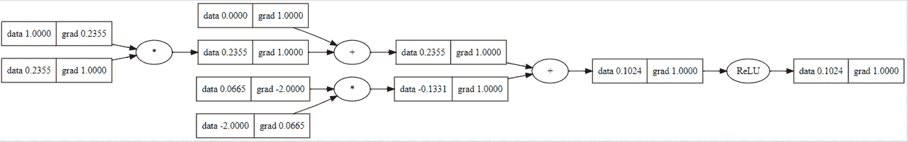
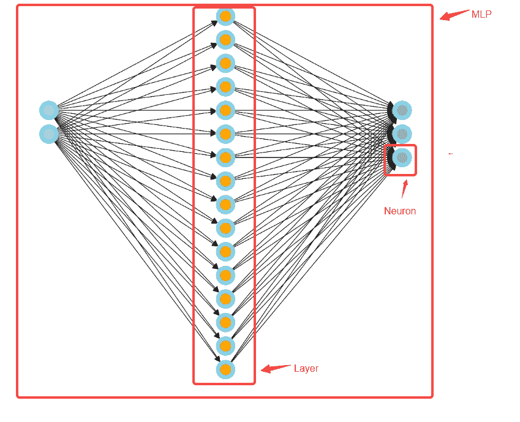
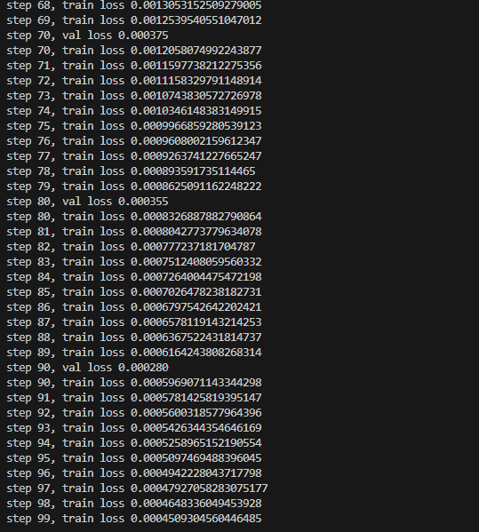
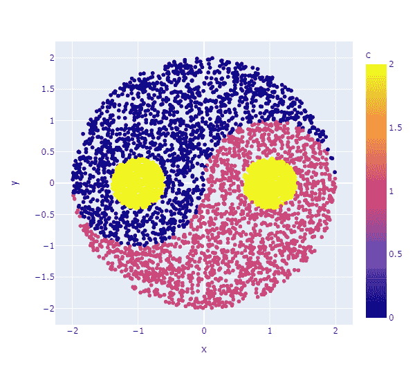
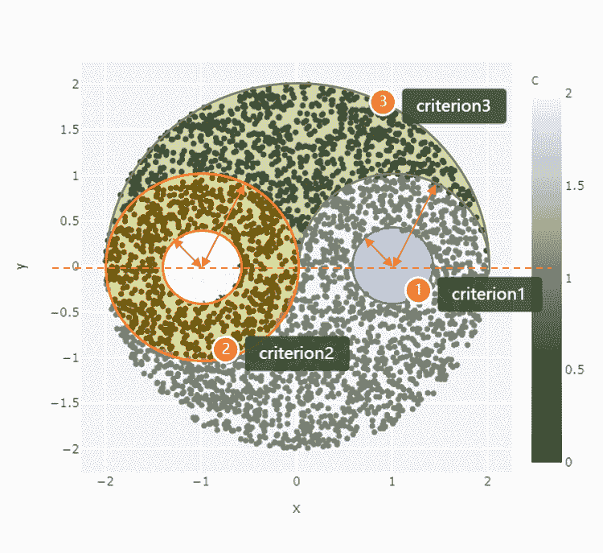

# 101N0201 Micrograd Python 核心代码解

> 来源：[https://v11enp9ok1h.feishu.cn/docx/RScudYrMuomDInxy8XncY1r3nEb](https://v11enp9ok1h.feishu.cn/docx/RScudYrMuomDInxy8XncY1r3nEb)

代码仓库地址：https://github.com/EurekaLabsAI/micrograd

今天将和大家一起学习 LLM101n 课程中 Micrograd 部分。micrograd 是Andrej Karpathy 构建的一个轻量级的自动微分引擎，他通过手动实现梯度计算和反向传播来训练简单的神经网络。该项目的主要目标是帮助理解自动微分和神经网络训练的基本原理。

> 阅读 Tips：阅读本文需要准备一些高数微积分知识。

# 引言

micrograd 项目展示了如何从头开始构建一个简单的自动求导引擎，并使用它来训练一个简单的神经网络。这不仅是对深度学习基础的一个很好的介绍，也是对自动求导机制的深入理解。micrograd 的代码是神经网络训练的核心 - 它使我们能够计算如何更新神经网络的参数，以使其在某些任务上表现更好，例如自回归语言模型中的下一个标记预测。所有现代深度学习库（例如 PyTorch、TensorFlow、JAX 等）都使用完全相同的算法，只是这些库更加优化且功能丰富。下面让我开始一步步开始对代码解读。

# 代码目录结构树：

```
micrograd  
|-- README.md  
|-- micrograd.py
|-- micrograd_pytorch.py  
|-- utils.py
```

+   **micrograd.py**

自动微分引擎的核心代码，本文重点解读对象

+   **utils.py**

工具封装：自定义的随机数生成接口RNG类 和 随机数生成方法 gen_data() gen_data_yinyang()

> 注：**utils.py**的早期版本使用 gen_data() 函数生成一个极其简单的同心圆数据集，后改[用 ](https://aicarrier.feishu.cn/wiki/SYmTw7et8iBce2kYxovcDeeUnFe#TJrwd7wk8o7VTgxBExZc08Rlndf)gen_data_yinyang() 生成一个阴阳图数据集，详细的代码解读见附录

+   micrograd_pytorch.py

与micrograd.py的功能相同，但它使用了PyTorch的自动微分引擎。这主要是为了验证和确认代码的正确性，同时也展示了PyTorch实现相同多层感知器（MLP）的一些相似性和差异性。这块代码比较简单，不作过多解读。

# micrograd.py 代码解读

我们可以将其逻辑结构概括如下：

+   Value 类：用于存储值及其梯度。

+   Module 类：定义了神经网络模块的基本接口。

+   Neuron 类：实现单个神经元。

+   Layer 类：实现神经网络层。

+   MLP 类：实现多层感知机。

+   cross_entropy 函数：定义交叉熵损失函数。

+   eval_split 函数：评估数据集的损失。

## Value 类

Value 类是整个自动求导引擎的核心。它存储一个标量值及其梯度，并定义了基本的数学运算。

### 构造函数

```
class Value:
    &quot;&quot;&quot; stores a single scalar value and its gradient &quot;&quot;&quot;

    def __init__(self, data, _children=(), _op=&#x27;&#x27;):
        self.data = data               # 存储数值
        self.grad = 0                  # 存储梯度
        # internal variables used for autograd graph construction
        self._backward = lambda: None  # 反向传播函数
        self._prev = set(_children)    # 前驱节点集合
        self._op = _op                 # 操作类型，用于调试和可视化
```

> Value类的目的是在自动微分系统中表示计算图中的一个节点。每个节点包含数据、梯度、前驱节点和操作类型。通过这些信息，可以构建计算图，并在需要时进行自动微分和反向传播。

### 数学运算

#### **__add__**：**加法**

```
    def __add__(self, other):
            #重载 `+` 运算符，实现两个 `Value` 对象或一个 `Value` 对象和一个标量值的加法。
        other = other if isinstance(other, Value) else Value(other)
        #创建一个新的 `Value` 对象 `out`，其值为两个输入值的和。
        out = Value(self.data + other.data, (self, other), &#x27;+&#x27;)
        #定义 `_backward` 函数，用于反向传播，更新输入值的梯度。
        def _backward():
            self.grad += out.grad
            other.grad += out.grad
        out._backward = _backward
        #返回新的 `Value` 对象 `out`。
        return out
```

> **加法梯度计算：**

> 在微积分中，加法的梯度是一个简单的线性操作。对于两个标量a 和 b，它们的和 (c = a + b) 的梯度可以表示为：

>

> 这意味着，当我们对 c求导时，c相对于 a和 b的变化率都是1。无论 a或 b变化多少，c的变化等于 a和 b的变化之和。因此，在计算 c的梯度时，我们需要将 a和 b的梯度都加到 c的梯度上。

> **链式法则**

> 在微积分中，链式法则告诉我们，如果 f(x) 和 g(x) 是两个函数，那么 (h(x) = f(g(x))) 的梯度可以表示为：

>

> 在上述代码中，out 是 a + b 的结果，self 和 other 是 a 和 b。out.grad 是 out 的梯度，self.grad 和 other.grad 是 a 和 b 的梯度。因此，

> self.grad += out.grad

> other.grad += out.grad

> 是根据加法梯度和链式法则计算 a 和 b 的梯度。

#### **__mul__**：**乘法**

```
def __mul__(self, other):
        other = other if isinstance(other, Value) else Value(other)
        out = Value(self.data * other.data, (self, other), &#x27;*&#x27;)

        def _backward():
            self.grad += other.data * out.grad
            other.grad += self.data * out.grad
        out._backward = _backward

        return out
```

> **乘法的梯度**

> 在微积分中，乘法的梯度是一个基本的二元操作。对于两个标量 a和 b，它们的积  c=a×b 的梯度可以表示为：

> 当我们计算 c的梯度时，a和 b的变化会影响 c，并且影响的大小分别是 b和 a。

> 因此，根据链式法则当我们计算 c的梯度时，我们需要将 b乘以c的梯度加到 a的梯度上，反之亦然。

> 所以：self.grad += other.data * out.grad

> other.grad += self.data * out.grad

####  __**pow__ 幂运算**

```
def __pow__(self, other):
    assert isinstance(other, (int, float)), &quot;only supporting int/float powers for now&quot;
    out = Value(self.data**other, (self,), f&#x27;**{other}&#x27;)

    def _backward():
        self.grad += (other * self.data**(other-1)) * out.grad
    out._backward = _backward

    return out

```

> 幂运算的梯度规则基于以下公式：

> 对于一个标量 a和一个指数 b，它们的幂    的梯度为：

>

> 当我们计算 c的梯度时，a的变化会影响 c，并且影响的大小是

> 所以  self.grad += (other * self.data**(other-1)) * out.grad

#### **relu**：实现ReLU激活函数

```
    def relu(self):
        out = Value(0 if self.data &lt; 0 else self.data, (self,), &#x27;ReLU&#x27;)

        def _backward():
            self.grad += (out.data &gt; 0) * out.grad
        out._backward = _backward

        return out
```

> 这段代码定义了一个名为 relu 的方法，用于实现ReLU（Rectified Linear Unit）激活函数。ReLU是一种常用的神经网络激活函数，其公式为： ，即对于输入 ( x )，如果 ( x ) 大于0，则输出 ( x )；如果 ( x ) 小于等于0，则输出0。

> relu 方法通常用于神经网络的前向传播和反向传播过程中。在前向传播中，它将输入数据通过ReLU函数进行激活，得到新的输出值。在反向传播中，它根据ReLU函数的特性，正确地计算并传递梯度。

> **梯度计算：**

1.  在反向传播过程中，梯度是通过将 out.data > 0 与 out.grad 相乘，然后加到 self.grad 上来累积的。这意味着 self.grad 应该初始化为0，否则累积的梯度会不正确。

1.  **链式法则**：ReLU函数的反向传播需要遵循链式法则，即如果 out 是多个节点的输出，那么每个依赖 out 的节点都需要调用 out._backward() 来计算其梯度。

>

#### **tanh**：实现tanh正切激活函数

```
def tanh(self):
        out = Value(math.tanh(self.data), (self,), &#x27;tanh&#x27;)

        def _backward():
            self.grad += (1 - out.data**2) * out.grad
        out._backward = _backward

        return out
```

> tanh 方法，用于计算一个张量（tensor）的 tanh 激活函数值，并返回一个新的张量，同时支持自动求导。

> 这个方法主要用于深度学习中的神经网络计算。在神经网络中，激活函数（如 tanh）用于引入非线性，帮助模型更好地拟合数据。通过自动求导，可以方便地计算梯度，用于参数更新。

> **梯度计算：**

> tanh 函数的梯度是 。这个公式可以用来计算 tanh 函数在任意点 ( x ) 的导数。

> 根据链式法则，self.grad += (1 - out.data**2) * out.grad

#### **exp**：实现指数函数

```
    def exp(self):
        out = Value(math.exp(self.data), (self,), &#x27;exp&#x27;)

        def _backward():
            self.grad += math.exp(self.data) * out.grad
        out._backward = _backward

        return out
```

> exp 方法，用于计算一个数值的指数函数值: ，并返回一个新的 Value 对象。这个方法通常用于自动微分系统中，用于计算梯度。

> **梯度计算：**

> exp 函数的梯度是：

> 在反向传播过程中，我们需要计算指数函数相对于其输入的梯度，并将其存储到 self.grad 中:

> self.grad += math.exp(self.data) * out.grad

#### log：实现自然对数

```
    def log(self):
        # (this is the natural log)
        out = Value(math.log(self.data), (self,), &#x27;log&#x27;)

        def _backward():
            self.grad += (1/self.data) * out.grad
        out._backward = _backward

        return out
```

> log 方法，用于计算一个数值的自然对数（即以 e 为底的对数） 。通常用于自动微分系统中，特别是在实现神经网络或其他需要计算梯度的算法时。通过定义 log 方法，可以方便地计算一个数值的自然对数，并自动计算其梯度，这对于反向传播算法至关重要。

> **梯度计算：**

> log 函数的梯度是：

> 在反向传播过程中，利用自然对数函数的导数公式，将梯度正确传递回前一个节点。

> self.grad += (1/self.data) * out.grad

#### 重载运算符

Value 类重载了一些常见的运算符，包括加法、减法、乘法、除法以及取负操作。这些运算符的重载使得我们可以使用自然的数学表达式来操作 Value 对象，从而使代码更加简洁和易读。

```
def __neg__(self):  # -self
    # 返回self乘以-1的结果，实现取负操作
    return self * -1

def __radd__(self, other):  # other + self
    # 返回self加上other的结果，实现反向加法
    return self + other

def __sub__(self, other):  # self - other
    # 返回self减去other的结果，实现减法
    return self + (-other)

def __rsub__(self, other):  # other - self
    # 返回other减去self的结果，实现反向减法
    return other + (-self)

def __rmul__(self, other):  # other * self
    # 返回self乘以other的结果，实现反向乘法
    return self * other

def __truediv__(self, other):  # self / other
    # 返回self除以other的结果，实现除法
    return self * other**-1

def __rtruediv__(self, other):  # other / self
    # 返回other除以self的结果，实现反向除法
    return other * self**-1

```

> 比如：a = Value(5) + 1  ， b = Value(4) * 3

> 有了上面的重载运算符，也可以写出  a = 1 + Value(5)   和 b = 3  * Value(4)

以上便是Value类封装的常用的数学运算操作，通过这些数学运算，我们可以很容易实现多节点的前向传递，通过自动微分计算梯度，并进行反向传播。通过graphviz 可视化库，还可以很直观的将节点之间的关联关系展示出来：



### backward

```
def backward(self):
    # 拓扑排序所有计算图中的子节点
    topo = []  # 用于存储拓扑排序结果的列表
    visited = set()  # 用于记录已访问节点的集合

    def build_topo(v):
        # 如果节点v没有被访问过
        if v not in visited:
            visited.add(v)  # 标记节点v为已访问
            for child in v._prev:  # 遍历节点v的所有前驱节点
                build_topo(child)  # 递归调用build_topo函数
            topo.append(v)  # 将节点v添加到拓扑排序结果中

    build_topo(self)  # 从当前节点开始构建拓扑排序

    # 按拓扑排序的反向顺序进行反向传播
    for v in reversed(topo):
        v._backward()  # 调用每个节点的_backward方法，进行梯度计算和传播

```

backward 方法，用于对图中的所有节点进行拓扑排序。拓扑排序是一种线性排序，它适用于有向无环图（DAG），能够保证在反向传播中，严格按照计算图中的依赖顺序计算每个节点的梯度，并且确保在计算每个节点的梯度时，其所有依赖节点（前驱节点）已经计算完毕。

## MLP 类

MLP 类实现多层感知机，包含多个层（Layer），每个层包含多个节点（Neuron）。MLP、Layer、Neuron都继承了Module类，并重载了他的parameters方法，代码注释如下：

```
class Module:
    def zero_grad(self):
        for p in self.parameters():
            p.grad = 0

    def parameters(self):
        return []

class Neuron(Module):
    def __init__(self, nin, nonlin=True):
        # 初始化神经元，nin是输入的数量，nonlin表示是否使用非线性激活函数
        self.w = [Value(random.uniform(-1, 1) * nin**-0.5) for _ in range(nin)]  # 初始化权重
        self.b = Value(0)  # 初始化偏置
        self.nonlin = nonlin  # 是否使用非线性激活函数

    def __call__(self, x):
        # 计算神经元的输出，x是输入
        act = sum((wi * xi for wi, xi in zip(self.w, x)), self.b)  # 线性组合加上偏置
        return act.tanh() if self.nonlin else act  # 使用tanh激活函数或线性激活

    def parameters(self):
        # 返回神经元的所有参数（权重和偏置）
        return self.w + [self.b]

    def __repr__(self):
        # 返回神经元的字符串表示，方便打印
        return f&quot;{&#x27;TanH&#x27; if self.nonlin else &#x27;Linear&#x27;}Neuron({len(self.w)})&quot;

class Layer(Module):
    def __init__(self, nin, nout, **kwargs):
        # 初始化层，nin是输入的数量，nout是输出神经元的数量
        self.neurons = [Neuron(nin, **kwargs) for _ in range(nout)]  # 创建nout个神经元

    def __call__(self, x):
        # 计算层的输出，x是输入
        out = [n(x) for n in self.neurons]  # 对每个神经元计算输出
        return out[0] if len(out) == 1 else out  # 如果只有一个神经元，返回单个输出，否则返回输出列表

    def parameters(self):
        # 返回层的所有参数
        return [p for n in self.neurons for p in n.parameters()]

    def __repr__(self):
        # 返回层的字符串表示，方便打印
        return f&quot;Layer of [{&#x27;, &#x27;.join(str(n) for n in self.neurons)}]&quot;

class MLP(Module):
    def __init__(self, nin, nouts):
        # 初始化多层感知机，nin是输入的数量，nouts是每层神经元数量的列表
        sz = [nin] + nouts  # 构建每层的大小
        self.layers = [Layer(sz[i], sz[i + 1], nonlin=i != len(nouts) - 1) for i in range(len(nouts))]  # 创建每层

    def __call__(self, x):
        # 计算多层感知机的输出，x是输入
        for layer in self.layers:
            x = layer(x)  # 输入经过每一层
        return x

    def parameters(self):
        # 返回多层感知机的所有参数
        return [p for layer in self.layers for p in layer.parameters()]

    def __repr__(self):
        # 返回多层感知机的字符串表示，方便打印
        return f&quot;MLP of [{&#x27;, &#x27;.join(str(layer) for layer in self.layers)}]&quot;

```

1.  Module：Module 是一个基类，它定义了一些方法，如 zero_grad 和 parameters，这些方法在 Layer, Neuron, 和 MLP 类中被重写或使用。Module 类本身并不直接参与神经网络的计算，而是作为其他类的基类。

1.  Neuron：Neuron 类表示神经网络中的一个神经元。每个神经元包含一组权重（w）和一个偏置（b）。Neuron 类的 __call__ 方法定义了神经元如何接收输入并计算输出。如果 nonlin 参数为 True，则神经元使用 tanh 激活函数，否则使用线性函数。

1.  Layer：Layer 类表示神经网络中的一层。每一层包含多个神经元。Layer 类的 __call__  方法定义了如何将输入传递给每一层的神经元，并返回所有神经元的输出。Layer 类的 parameters 方法返回该层中所有神经元的参数。

1.  MLP：MLP 类表示一个多层感知器（Multi-Layer Perceptron）。它由多个 Layer 类组成，每个 Layer 类代表神经网络中的一层。MLP 类的 __call__  方法定义了如何将输入传递给每一层的神经元，并返回最后一层的输出。MLP 类的 parameters 方法返回该网络中所有层的参数。

如果按照代码中示例，建立一个model = MLP(2, [16, 3])  的多层感知机, 其神经网络图如下：



## 损失函数

eval_split 函数用于计算给定数据集的损失，帮助监控模型在训练过程中的表现。

```
def eval_split(model, split):
    # 评估一个数据集的损失
    loss = Value(0)  # 初始化损失为0
    for x, y in split:
        # 对于数据集中的每个样本，计算模型的输出
        logits = model([Value(x[0]), Value(x[1])])
        # 计算交叉熵损失，并累加到总损失中
        loss += cross_entropy(logits, y)
    # 归一化损失，即将总损失除以样本数
    loss = loss * (1.0 / len(split))
    return loss.data  # 返回损失的数值部分

```

cross_entropy 使用NLL计算交叉熵损失

```
# -----------------------------------------------------------------------------
# 损失函数：负对数似然（NLL）损失
# 当目标是one-hot向量时，NLL损失等于交叉熵损失

def cross_entropy(logits, target):
    # 为了数值稳定性，减去最大值（避免溢出）
    max_val = max(val.data for val in logits)
    logits = [val - max_val for val in logits]
    
    # 1) 计算每个元素的e^x
    ex = [x.exp() for x in logits]
    
    # 2) 计算上述值的和
    denom = sum(ex)
    
    # 3) 用总和归一化，得到概率
    probs = [x / denom for x in ex]
    
    # 4) 取目标位置的概率并取对数
    logp = (probs[target]).log()
    
    # 5) 负对数似然损失（取负号使得损失值越低越好）
    nll = -logp
    return nll

```

> NLL 损失源于最大似然估计（MLE），它是统计学中的一个重要方法。通过最大化似然函数来估计模型参数，使得数据的生成概率最大化。这种理论背景使得 NLL 损失具有坚实的统计学基础。在大样本情况下，NLL 损失的最小化将导致估计的模型参数趋于真实参数，从而使模型更接近真实数据生成分布。

> NLL 损失不仅适用于二分类问题，也适用于多分类问题。在多分类情况下，它计算了目标类别的对数概率，并通过负号转化为损失。

# 训练实验

## 训练过程

作者在以上轻量级的自动微分引擎构建完成后，还写了一个练手实验，引导我们如何使用micrograd，训练一个小模型，并通过多次迭代更新模型参数。这个实验中使用 Adam 优化器进行参数更新。代码注释如下：

```
# 开始训练！
random = RNG(42)
# 生成一个包含100个2维数据点且分为3个类别的随机数据集
train_split, val_split, test_split = gen_data_yinyang(random, n=100)

# 初始化模型：2维输入，16个神经元，3个输出（logits）
model = MLP(2, [16, 3])

# 使用Adam优化算法
learning_rate = 1e-1  # 学习率
beta1 = 0.9  # Adam中的一阶矩估计的衰减率
beta2 = 0.95  # Adam中的二阶矩估计的衰减率
weight_decay = 1e-4  # 权重衰减（L2正则化）

# 初始化Adam的动量和二阶矩估计
for p in model.parameters():
    p.m = 0.0  # 一阶矩估计
    p.v = 0.0  # 二阶矩估计

# 训练循环
for step in range(100):
    
    # 每隔几步评估一次验证集
    if step % 10 == 0:
        val_loss = eval_split(model, val_split)  # 评估验证集损失
        print(f&quot;step {step}, val loss {val_loss:.6f}&quot;)

    # 前向传播（获取所有训练数据点的logits）
    loss = Value(0)  # 初始化损失为0
    for x, y in train_split:
        logits = model([Value(x[0]), Value(x[1])])  # 计算模型输出
        loss += cross_entropy(logits, y)  # 累加交叉熵损失
    loss = loss * (1.0 / len(train_split))  # 归一化损失

    # 反向传播（计算梯度）
    loss.backward()
    
    # 使用AdamW进行参数更新
    for p in model.parameters():
        p.m = beta1 * p.m + (1 - beta1) * p.grad  # 更新一阶矩估计
        p.v = beta2 * p.v + (1 - beta2) * p.grad**2  # 更新二阶矩估计
        m_hat = p.m / (1 - beta1**(step + 1))  # 一阶矩的偏差修正
        v_hat = p.v / (1 - beta2**(step + 1))  # 二阶矩的偏差修正
        p.data -= learning_rate * (m_hat / (v_hat**0.5 + 1e-8) + weight_decay * p.data)  # 更新参数
    model.zero_grad()  # 清除梯度，准备下一步的计算

    # 打印训练损失
    print(f&quot;step {step}, train loss {loss.data}&quot;)

```

## 运行结果

代码生成了一个随机数据集，并训练了一个简单的 MLP 模型。训练过程中，每 10 步评估一次验证集的损失，并在每步结束时打印训练损失。



# 结语

自动微分引擎（micrograd）项目是一个非常好的学习资源，展示了如何从头开始构建自动求导引擎和神经网络。通过阅读和理解这段代码，可以深入理解深度学习的基础原理和实现细节。

# 附录：解读 utils.py

本部分主要解读 utils.py 封装的两个小工具

## RNG 类：用于生成随机数。

```
# class that mimics the random interface in Python, fully deterministic,
# and in a way that we also control fully, and can also use in C, etc.
class RNG:

    def __init__(self, seed):
        self.state = seed
        
    def random_u32(self):
        # xorshift rng: https://en.wikipedia.org/wiki/Xorshift#xorshift.2A
        # doing &amp; 0xFFFFFFFFFFFFFFFF is the same as cast to uint64 in C
        # doing &amp; 0xFFFFFFFF is the same as cast to uint32 in C
        self.state ^= (self.state &gt;&gt; 12) &amp; 0xFFFFFFFFFFFFFFFF
        self.state ^= (self.state &lt;&lt; 25) &amp; 0xFFFFFFFFFFFFFFFF
        self.state ^= (self.state &gt;&gt; 27) &amp; 0xFFFFFFFFFFFFFFFF
        return ((self.state * 0x2545F4914F6CDD1D) &gt;&gt; 32) &amp; 0xFFFFFFFF

    def random(self):
        # random float32 in [0, 1)
        return (self.random_u32() &gt;&gt; 8) / 16777216.0

    def uniform(self, a=0.0, b=1.0):
        # random float32 in [a, b)
        return a + (b-a) * self.random()
```

> 这段代码定义了一个名为 RNG 的类，它模拟了 Python 的随机数生成接口，但它是完全确定性的（如果使用相同的种子初始化），并且我们可以完全控制它，方便我们重复调试。

+   random_u32 方法生成的随机数是 32 位无符号整数。

+   random 方法生成的随机数是浮点数，范围在 [0, 1)。

+   uniform 方法生成的随机数是浮点数，范围在 [a, b)。

## gen_data_yinyang 函数：生成阴阳图数据集。





```
def gen_data_yinyang(random: RNG, n=1000, r_small=0.1, r_big=0.5):
    # r_small 是小圆的半径，默认为0.1
    # r_big 是大圆的半径，默认为0.5
    pts = []

    # 计算点到右侧圆心的距离，右侧圆心的坐标是 (1.5 * r_big, r_big)
    def dist_to_right_dot(x, y):
        return ((x - 1.5 * r_big)**2 + (y - r_big)**2) ** 0.5

    # 计算点到左侧圆心的距离，左侧圆心的坐标是 (0.5 * r_big, r_big)
    def dist_to_left_dot(x, y):
        return ((x - 0.5 * r_big)**2 + (y - r_big)**2) ** 0.5

    # 根据点的位置判断其类别
    def which_class(x, y):
        d_right = dist_to_right_dot(x, y)
        d_left = dist_to_left_dot(x, y)
        # 判断点在右侧小圆内
        criterion1 = d_right &lt;= r_small
        # 判断点在左侧小圆外且在左侧大圆内
        criterion2 = d_left &gt; r_small and d_left &lt;= 0.5 * r_big
        # 判断点在大圆上方且在右侧大圆外
        criterion3 = y &gt; r_big and d_right &gt; 0.5 * r_big
        is_yin = criterion1 or criterion2 or criterion3
        is_circles = d_right &lt; r_small or d_left &lt; r_small

        if is_circles:
            return 2
        return 0 if is_yin else 1

    # 生成一个样本点
    def get_sample(goal_class=None):
        while True:
            # 在 [0, 2*r_big] 的区间内随机生成数据点
            x = random.uniform(0, 2 * r_big)
            y = random.uniform(0, 2 * r_big)
            if ((x - r_big)**2 + (y - r_big)**2) ** 0.5 &gt; r_big:
                continue
            # 对数据点的类别进行判断
            c = which_class(x, y)
            # 对数据点的 x,y 坐标缩放至范围 [-2, 2]
            if goal_class is None or c == goal_class:
                scaled_x = (x / r_big - 1) * 2
                scaled_y = (y / r_big - 1) * 2
                return [scaled_x, scaled_y, c]

    # 生成n个样本点
    for i in range(n):
        goal_class = i % 3
        x, y, c = get_sample(goal_class)
        pts.append([[x, y], c])

    # 划分训练集、验证集和测试集
    tr = pts[:int(0.8 * n)]
    val = pts[int(0.8 * n):int(0.9 * n)]
    te = pts[int(0.9 * n):]
    return tr, val, te
```

```
&quot;&quot;&quot;对 gen_data_yinyang() 的数据生成结果进行可视化&quot;&quot;&quot;
pts = gen_data_yinyang(n=5000)

%pip install plotly
%pip install nbformat&gt;=4.2.0

import plotly.express as px
import pandas as pd

df = pd.DataFrame(pts, columns=[&#x27;pt&#x27;, &#x27;c&#x27;])
df[&#x27;x&#x27;] = df[&#x27;pt&#x27;].apply(lambda x: x[0])
df[&#x27;y&#x27;] = df[&#x27;pt&#x27;].apply(lambda x: x[1])
fig = px.scatter(df, x=&#x27;x&#x27;, y=&#x27;y&#x27;, color=&#x27;c&#x27;)
fig.update_layout(
    width=600,
    height=550 
)
fig.show()
```

## gen_data函数（已弃用）：生成随机数据集。

```
def gen_data(random: RNG, n=100):
    # 初始化一个空列表来存储数据点
    pts = []
    for _ in range(n):
        # 在范围[-2.0, 2.0]内生成随机的x和y坐标
        x = random.uniform(-2.0, 2.0)
        y = random.uniform(-2.0, 2.0)
        # 生成同心圆的数据标签
        # label = 0 if x**2 + y**2 &lt; 1 else 1 if x**2 + y**2 &lt; 2 else 2
        # 生成非常简单的数据集
        label = 0 if x &lt; 0 else 1 if y &lt; 0 else 2
        # 将坐标和标签作为一个元组添加到数据点列表中
        pts.append(([x, y], label))
    
    # 创建训练/验证/测试数据集，按80%、10%、10%比例划分
    tr = pts[:int(0.8*n)]
    val = pts[int(0.8*n):int(0.9*n)]
    te = pts[int(0.9*n):]
    
    # 返回训练集、验证集和测试集
    return tr, val, te
```

+   该函数主要用于生成一个简单的二维数据集，用于机器学习模型的训练、验证和测试。通过调整标签生成逻辑，可以生成不同类型的数据集，如同心圆数据集或简单的一维数据集。

通过以上解读，读者可以更好地理解微梯度项目的实现细节和工作原理。