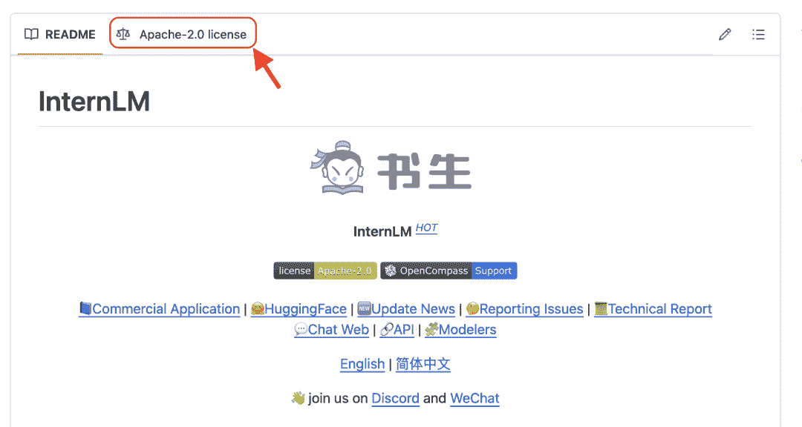
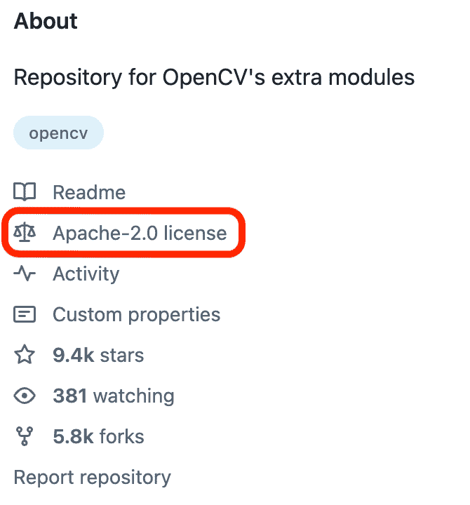
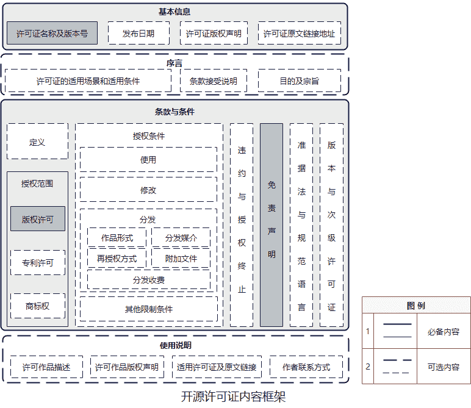
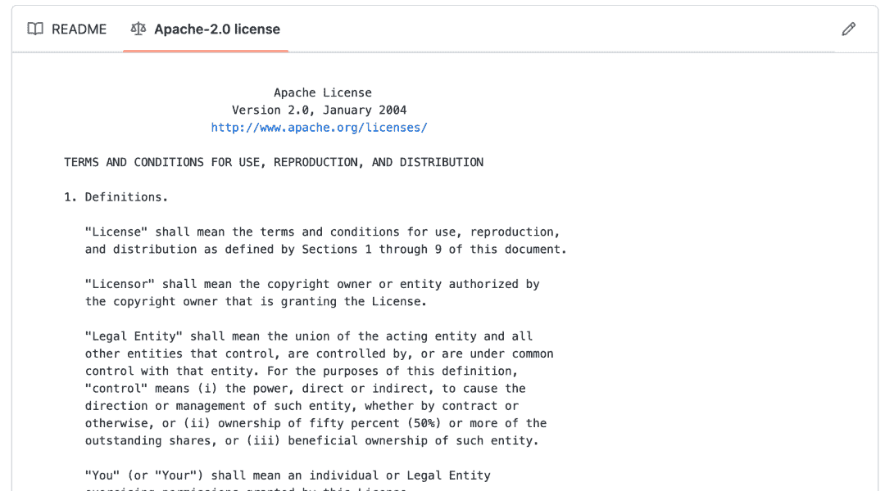
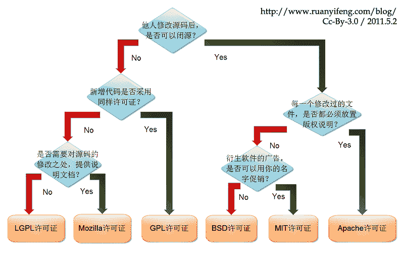
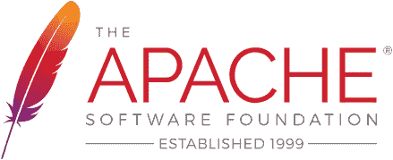
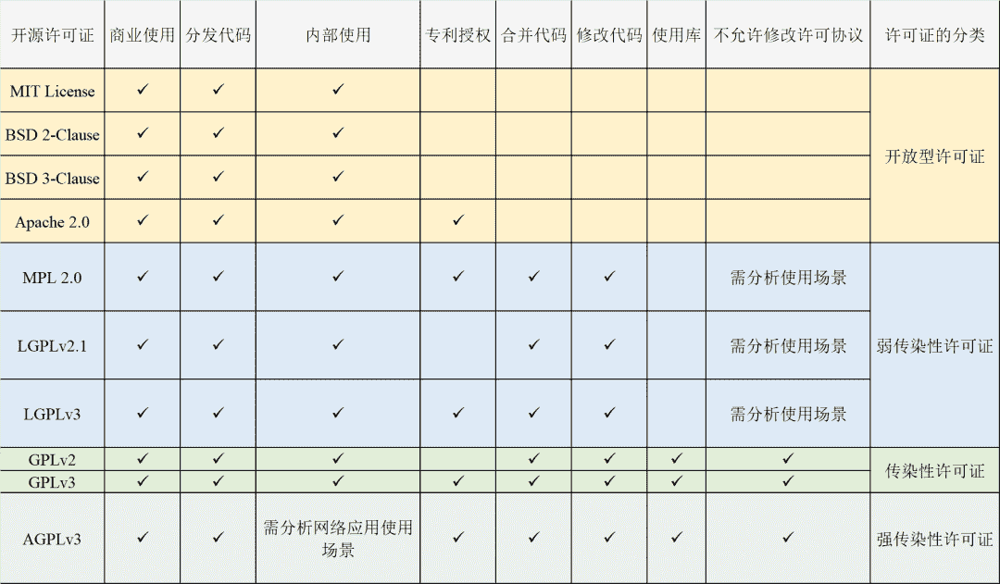
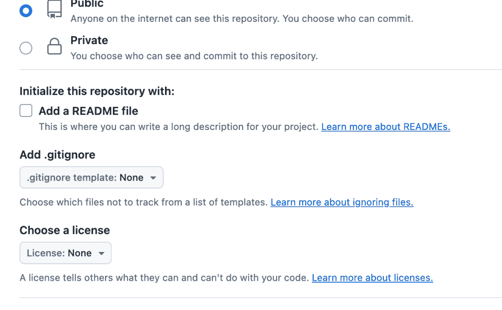
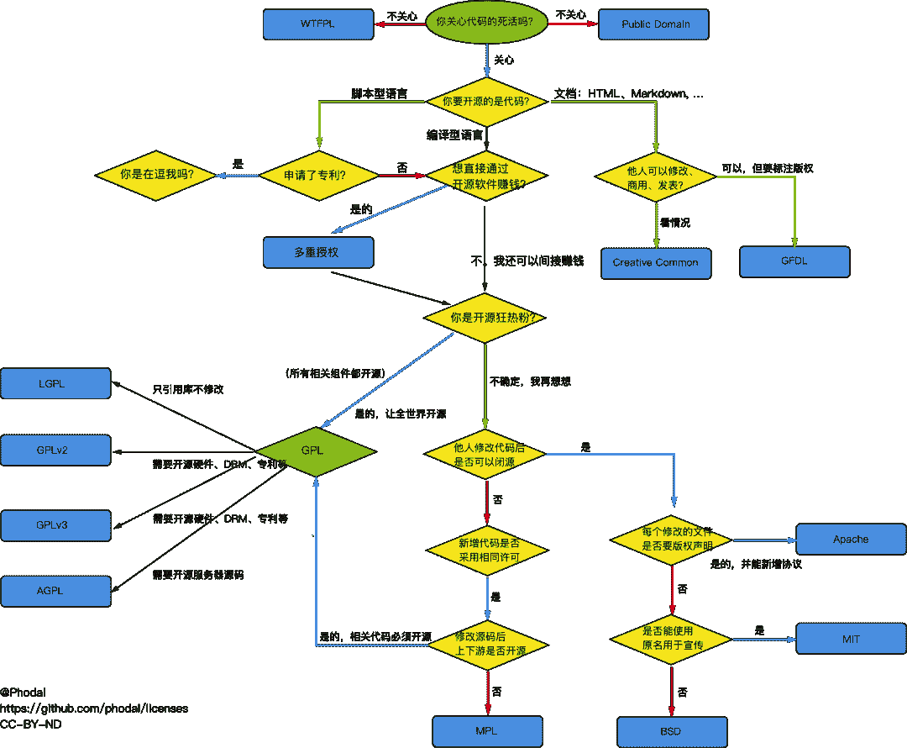
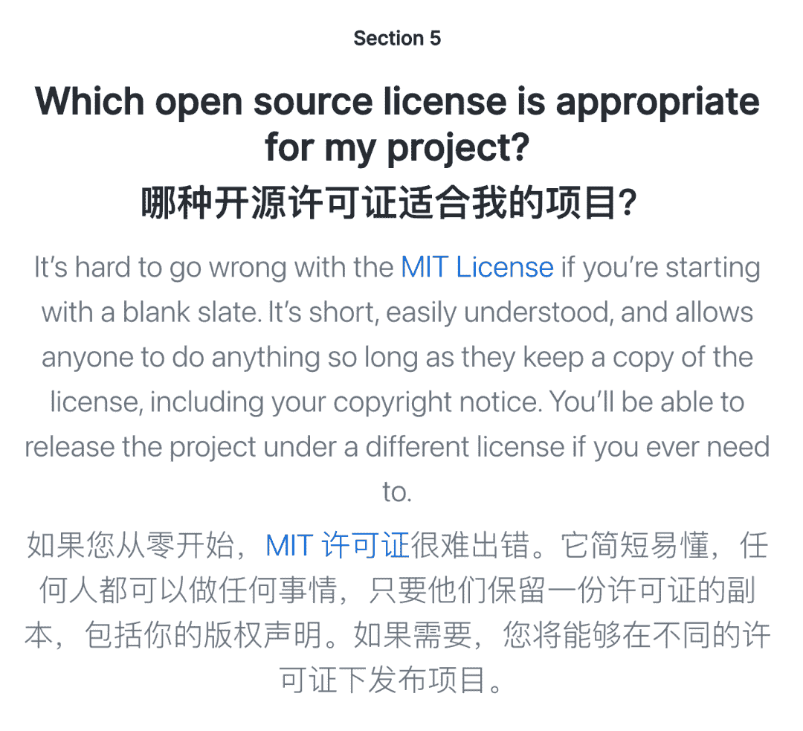

# 一文掌握开源协议！

> 来源：[https://v11enp9ok1h.feishu.cn/docx/WLH0dZWRao4GNtx0iWtcWHOcnhb](https://v11enp9ok1h.feishu.cn/docx/WLH0dZWRao4GNtx0iWtcWHOcnhb)

不知道各位优秀的程序员在 Github 上“汲取”灵感时，是否曾注意到仓库页面中标注的开源许可？最近，一支知名团队因错误使用开源代码而公开致歉的事件在技术圈引发了热议，也让人们开始重新审视“免费代码”的开源世界——原本看似便利的资源，似乎暗藏着潜在的风险。

来源：https://github.com/opencv/opencv

为了帮助大家在工作和学习中更加安心地使用开源软件，我们特意系统梳理了开源许可的相关内容，让大家在汲取开源社区智慧的同时，也能规范使用、避免误用。

此外，文末还将附上一份开源许可参考指南，助力大家更全面地理解和应用开源许可，为技术探索之路保驾护航。

# 开源许可

来源：https://kaiyuanshe.github.io/oss-book/Open-Source-License.html

开源许可（Open Source License） 是一种法律协议，用于规定用户如何使用、修改和分发开源软件。它保障了软件的自由可用性，同时明确了开发者和使用者的权利与义务。常见的开源许可包括 MIT、Apache、BSD、Mozilla、GPL等，每种协议对代码的使用方式和再分发要求都有不同的限制和规定。

当前流行的开源许可按照对代码使用和分发的限制程度可以大致分为两大类：宽松自由软件许可（Permissive free software licence） 和 著作权许可（Copyleft license）。

其中宽松自由软件许可是一种限制最少的开源协议。它允许用户自由使用、修改和分发软件，即使派生作品不完全遵守原作品的限制条件，也没有问题。这种协议为用户提供了更大的灵活性。而著作权许可则要求在一定范围内自由使用、修改和分发，但必须遵守原作品的限制条款。

来源：https://github.com

最典型的场景便是当使用基于开源源码后的软件，是否可以闭源？遵从宽松自由软件许可的开源软件允许基于资深更改的代码和软件采用其他许可协议，而遵守著佐权许可的软件要求使用或修改后的软件或代码不得使用其他许可，只能继承被使用代码的许可。所以使用著作权许可的软件和衍生软件只能一直保持开源。

# 常见开源许可

在流行的开源许可中，根据对代码使用和分发限制的宽松程度，从严格到宽松的排序为：GPL > Apache > BSD > MIT。以下是对每种开源许可的简要介绍及其特点：

## GPL（GNU General Public License）

来源

GPL 是开源界最常用的许可协议之一，其核心理念是确保代码的自由使用和分享，同时要求所有衍生作品也必须开源。

**特点**

1.  自由复制：软件可以无限制复制。

1.  自由分发：可以在任何平台上发布或共享。

1.  盈利使用：允许收费分发，但需附带 GNU GPL 协议告知用户。

1.  自由修改：可以自由修改或引用代码，但衍生作品必须采用 GPL 协议。

**注意事项**

+   分发时必须附带源代码和二进制文件。

+   代码中需包含许可声明及协议文本。

Linux 系统广泛采用 GPL 协议，目前最新版本为 GPLv3。

### LGPL（Lesser General Public Licence）

来源：https://www.gnu.org/licenses/lgpl-3.0.en.html

LGPL 是专为类库设计的开源许可协议，相较 GPL 更加灵活，允许商业软件通过链接使用 LGPL 类库，而无需开源商业软件的代码。

**特点**

+   商业软件可以链接 LGPL 类库并分发。

+   如果修改了 LGPL 类库的代码，修改部分及衍生部分必须开源。

**适用场景**

适合以类库形式提供的开源代码，但不建议用于需要二次开发的商业项目。

最新版本为 LGPLv3。

## Apache（Apache License）

来源：https://www.apache.org/licenses/

Apache 由 Apache 软件基金会发布，鼓励代码共享，同时保护原作者的著作权，适合商业用途。

**特点**

1.  修改声明：若修改代码，需在文件中注明变更内容。

1.  版权保护：衍生作品需保留原协议及版权声明。

1.  自由分发：可以用于开源或商业项目，并满足以下条件：

1.  提供协议文本及版权声明。

1.  产品中包含 Notice 文件时，需在其中保留协议声明。

**优势**

+   永久性：一经授权，无法撤销。

+   全球性：授权适用于全球范围。

+   无费用：不需支付任何费用。

最新版本为 Apache-2.0。

## BSD（Berkeley Software Distribution）

来源：https://en.wikipedia.org/wiki/Berkeley_Software_Distribution#cite_note-1

BSD 协议以极大的自由度著称，允许用户自由使用、修改和分发代码。

**特点**

1.  版权声明：需保留原始版权声明及协议文本。

1.  分发方式：

1.  含源代码：需附带协议文本。

1.  二进制文件：需在文档中注明版权信息。

1.  禁止背书：不能以原作者名义为衍生产品背书（在新版中已删除）。

**应用场景**

适合希望保留代码版权但允许商业化的场景。

常见版本为 BSD-2-Clause 和 BSD-3-Clause。

## MIT License

MIT 协议是最宽松的开源许可之一，适合对代码使用几乎没有限制的场景。

**核心条款**

1.  允许任何人自由使用、修改、分发、合并或销售代码。

1.  唯一要求：保留版权声明及许可信息。

**优势**

+   可自由用于个人项目或商业用途。

+   没有额外限制，是最简洁易用的协议之一。

## 更多信息

每种开源许可都有多个版本，其具体要求和应用场景可能有所不同。建议查看以下资源以获取更详细的内容：

来源 https://kaiyuanshe.github.io/oss-book/Open-Source-License.html

# 选择开源许可

来源：https://github.com/

相信有在 Github 上创建自己仓库的同学一定对 “Choose a license” 不陌生。不知道大家都是如何进行选择的？

在了解了开源许可是什么和几种常用的开源许可后，下面推荐两个方法：

## 简单方法

来源 https://choosealicense.com/

这是 Choose A License 官方提供的方法，也是 Github 推荐的。总结起来很简单：

1.  有开源社区则默认继承社区已有的许可。

1.  什么都无所为就选择 MIT，只保留自己的署名权。

1.  对开源有强烈坚持或是后续想要商业收费的直接选 GPL。

## 复杂方法

来源：https://phodal.github.io/licenses/

如果你想拥有一个完整严密的开源协议决策链，也可以参考 Github 上 phodal 大神分享的这个流程图，配合上面讲的内容，变身开源协议专家~

除此之外，通过这个网站开源许可一览表（英文） 也可以快速了解自己选定的协议的许可范围和协议全文。附录中也准备了许可范围和释义的中文版本。

# Q&A

## 开源 = 免费使用？

**开源 ≠ 免费使用**：

+   **开源**指的是软件的源代码公开，任何人都可以查看、使用、修改或分发，但必须遵守相应的开源许可协议。

+   **免费使用**则是指软件可以不付费使用，与是否公开源代码无关。

开源软件可能附带限制，例如：

+   必须公开修改后的代码（如 GPL）。

+   必须保留原作者版权声明（如 MIT、Apache）。

+   不得用于某些特定用途（部分特殊许可证）。

开源软件提供的是“有条件的自由”，而不是“完全免费、无约束”的使用。

## 非商业 vs. 商业？

在开源许可中，**商业（Commercial）**通常指任何涉及盈利的活动，无论是直接销售软件、提供相关服务，还是通过间接方式获利（例如广告或订阅）。

这意味着：

+   商业使用可以包括使用开源软件开发产品、部署在商业环境中，或提供基于软件的收费服务。

+   一些许可协议（如 Apache、MIT、BSD）允许商业用途，而其他协议（如 GPL）对衍生作品的分发有更严格的限制，可能要求继续开源。

简单来说，商业的定义关注的是软件如何在盈利场景中使用，而不是软件本身是否收费。

非商业使用（Non-Commercial Use） 指非盈利性使用，通常指个人或非盈利组织在没有经济利益的情况下使用软件，如：

+   个人在家庭或学习环境中使用软件。

+   教育机构或非营利组织使用软件提供免费服务。

> 对于有着长远商业考虑的个人和公司，强烈建议在涉及使用开源技术的产品时仔细研究开源协议或咨询行业专家和律师，明确自己的行为是否属于商业行为！

# 结语

开源社区的发展不仅为开发者提供了强大的支持，加速了优秀技术的传播，也为众多优秀开发者搭建了展示才华和交流思想的平台。我们常说，要站在巨人的肩膀上。而对于计算机和软件行业而言，开源正是由无数从业者与爱好者共同筑起的巨人之肩。既然我们得以借助这些成果，更应尊重开源社区的，为这些“巨人”留名。这不仅体现对他人劳动的尊重，也彰显了自身对技术进步的认同和价值观。毕竟，避免重复造轮子、提高效率，正是推动技术不断进步的真正意义所在，不是吗？

来源：Open Source Guide（英文）

最后的最后，如果实在不知道该用哪个，就用 MIT License，it's hard to get wrong with the MIT License。

> 超小声，也可以试试这个 **别来烦我许可（WTFPL）** 哈~

# 附录：常见许可范围

商业用途 (Commercial use)

已授予许可的内容及其衍生作品可用于商业目的。

分发 (Distribution)

已授予许可的内容可以进行分发。

修改 (Modification)

已授予许可的内容可以被修改。

专利使用 (Patent use)

+   本许可明确授予贡献者的专利权。

+   本许可明确声明不授予对贡献者专利的任何权利。

私用 (Private use)

授予已授予许可的内容可以在私下使用和修改。

公开源码 (Disclose source)

当分发已授予许可的内容时，必须提供源码。

**许可和版权声明 (License a**nd copyright notice)

必须随已授予许可的内容附带一份许可和版权声明。

**源**码的许可和版权声明 (License and copyright notice for source)

已授予许可的内容以源码形式分发时，必须包含许可和版权声明；但二进制文件不要求。

**网络使用即为分发 (Network **use is distribution)

通过网络与许可材料交互的用户有权获得源码的副本。

相同许可 (Same license)

对已授予许可的内容的修改在分发时必须使用相同的许可。在某些情况下，可以使用类似或相关的许可。

相同许可（文件）(Same license - file)

现有文件的修改在分发时必须使用相同的许可。在某些情况下，可以使用类似或相关的许可。

相同许可（库）(Same license - library)

修改的已授予许可的内容在分发时必须使用相同的许可。在某些情况下，可以使用类似或相关的许可，或该条件不适用于将已授予许可的内容作为库使用的作品。

变更说明 (State changes)

对已授予许可的内容所做的修改必须记录。

责任限制 (Liability)

本许可包含责任限制条款。

商标使用 (Trademark use)

本许可明确声明不授予商标权，即使没有此声明，许可通常也不隐含授予商标权。

**无担保 (Warranty)**

本许可明确声明不提供任何担保。

# 参考资料

[[1] 开源许可一览表（英文）:](https://link.zhihu.com/?target=https%3A//choosealicense.com/appendix/) https://choosealicense.com/appendix/

[2] Choose A License（英文）: https://choosealicense.com/

[[3] Open Source Guide（英文）: https://opensource.g](https://link.zhihu.com/?target=https%3A//opensource.guide/legal/%23which-open-source-license-is-appropriate-for-my-project)uide/legal/#which-open-source-license-is-appropriate-for-my-project

[[4]](https://link.zhihu.com/?target=https%3A//docs.github.com/en/repositories/managing-your-repositorys-settings-and-features/customizing-your-repository/licensing-a-repository) Github 开源许可介绍（英文）: https://docs.github.com/en/repositories/managing-your-repositorys-settings-and-features/customizing-your-repository/licensing-a-repository

[5] 开源社（中文）——非常全面的中文开源电子书: https://kaiyuanshe.github.io/oss-book/Open-Source-License.html

# 往期 · 推荐

[简单聊聊评判模型评测](https://link.zhihu.com/?target=http%3A//mp.weixin.qq.com/s%3F__biz%3DMzg2NzU4MDgzMA%3D%3D%26mid%3D2247527590%26idx%3D1%26sn%3Dca223518873c255c8b11dc48e33be1e6%26chksm%3Dcebb4257f9cccb41eebb1beeb4da565d24cb9ec8d9673226ce6cf3e2804fb188bf2cc6edf8cf%26scene%3D21%23wechat_redirect)

「学术趋势」EMNLP 24 知识图谱 Top15 被引盘点

「学术趋势」EMNLP 24 多模态 TOP15 被引论文盘点

「学术趋势」EMNLP 24 复杂推理 Top15 被引盘点

> 番外：我们期待与读者共同探讨如何在 AI 的辅助下，更好地发挥人类的潜力，以及如何培养和维持那些 AI 难以取代的核心技能。通过深入分析和实践，我们可以更清晰地认识到 AI 的辅助作用，并在 AI 时代下找到人类的独特价值和发展空间。“机智流”👸号后台聊天框回复“cc”，加入机智流大模型交流群！