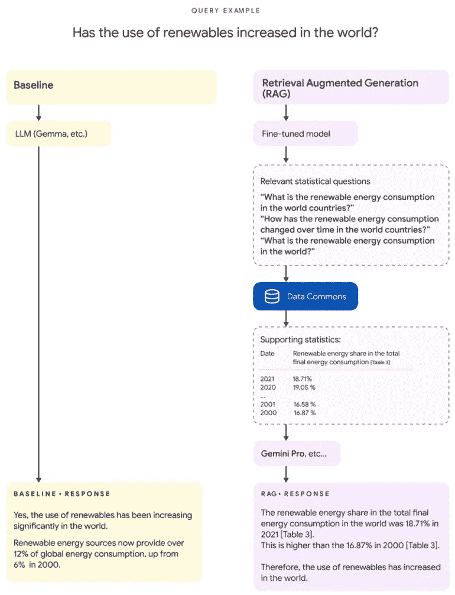
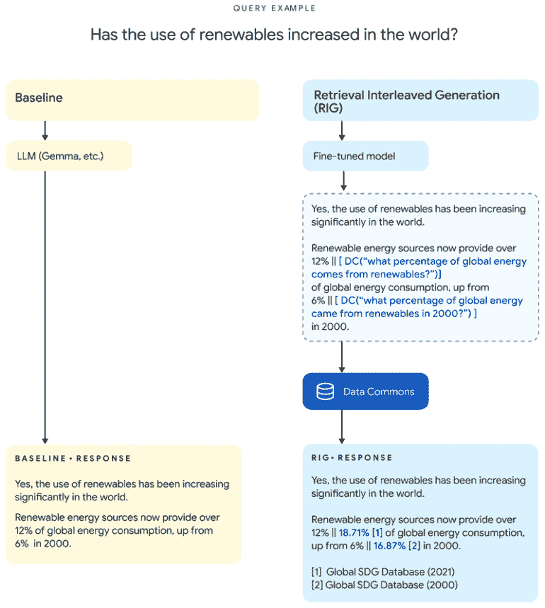

# 扩展：RIG，Google 最新推出的RAG 替代方案

> 来源：[https://v11enp9ok1h.feishu.cn/docx/U1ucdTr9goXmnexSTQPcOeYRnse](https://v11enp9ok1h.feishu.cn/docx/U1ucdTr9goXmnexSTQPcOeYRnse)

## **RAG VS. RIG**

熟悉 LLM 的同学都知道，LLM 是通过训练数据学习到的知识，因此使用大模型的时候会遇到“幻觉”和“过时”等问题，这都源于训练数据库**没有包含相应的知识或者训练用的数据没有及时**更新。考虑到 LLM 训练的昂贵的时间和金钱成本，在真实的应用中，通常会采用 RAG（Retrieval Augmented Generation）检索增强生成 技术来给 LLM “外挂” 一个最新的数据库，通过检索的方式利用 LLM 的能力来相应用户关于特定数据或最新数据的问题。

RAG 工作流程：

1.  **用户提交查询**：用户向 LLM 提交查询或提示。

1.  **数据检索**：LLM 将用户的查询转换数据库问题提交外部数据进行检索。

1.  **响应生成**：LLM 依据内部拥有的知识库和检索到的结果进行答案的生成。



如图所示，当询问“再生资源的使用是否增加的时候？”，RAG 应用通过检索到的数据表进行数据获取，得到了数据准确的回答。

这次开源的 **RIG** 模型则采用了另一种模式 **检索交错生成**，这里的交错是指在生成部分响应和检索外部数据之间交替进行。该模型不会等待检索完所有数据后再生成响应;相反，它将这两个任务交错进行，因此检索和响应生成同时进行。



RIG 的流程可以分为几个关键步骤：

1.  **用户查询提交**：用户向 LLM 提交查询或提示。

1.  部分响应生成：LLM 开始根据它已经拥有的内部知识生成响应。但是，此响应可能包括需要外部数据的部分的占位符或推测性答案。

1.  **实时数据检索**：当 LLM 识别到缺失或不完整的信息时，它会实时查询外部来源（例如，数据库、知识图谱或基于 Web 的 API）。该模型可以进行多次检索调用，从而使用新获取的数据丰富响应。

1.  **交错检索生成的**：在生成响应期间，模型在生成响应的各个部分和根据需要获取数据之间动态交替。例如，如果 LLM 以“Renewable energy sources now ...”开头，它会在完成该响应部分之前暂停以检索特定的再生资源利用率数字。

1.  **最终响应**：一旦检索并整合了所有必要的数据，LLM 就会完成响应并将其返回给用户。

## **RIG 效果**

**Google 这次的两个**开源模型都是针对 Data Commons 进行的优化和测试，旨在解决大模型和真实数字数据交互的场景。“Data Commons 是一个公开可用的知识图谱，包含数十万个统计变量中超过 2400 亿个丰富的数据点。它从联合国 （UN）、世界卫生组织 （WHO）、疾病控制和预防中心 （CDC） 以及人口普查局等受信任的组织获取这些公共信息。将这些数据集组合成一组统一的工具和 AI 模型，使政策制定者、研究人员和组织能够寻求准确的见解。”

同时，Google 也在[Colab](https://colab.research.google.com/github/datacommonsorg/llm-tools/blob/master/notebooks/datagemma_rig.ipynb#scrollTo=6hawX4Eg1knC)开放了两个模型的 Notebook，方便体验。现在让我们看一下 RIG 在 Data Commmons 上的真实使用效果。

问题：**W**hat progress has Pakistan made against health goals?

datagemma-rig-27b-it 的回答：

```
Pakistan has made some progress against its health goals, but significant challenges remain.

Here are some key points:

Progress made:

Increased life expectancy: Life expectancy at birth has increased from [DC#1(62.102 yr [1] || 61.8 years)] in 2000 to [DC#2(66.269 yr [2] || 67.2 years)] in 2020.
Reduced maternal mortality: Maternal mortality ratio has declined from [DC#3(387.3715 Per 100,000 live births [3]* || 276 per 100,000 live births)] in 2000 to [DC#4(177.7277 Per 100,000 live births [4]* || 140)] in 2018.
...

FOOTNOTES
[1] - Per datacatalog.worldbank.org, value was 62.102 yr inSee more at https://datacommons.org/explore#q=what%20was%20the%20life%20expectancy%20in%20Pakistan%20in%202000%3F&amp;mode=toolformer_rig 
[2] - Per datacatalog.worldbank.org, value was 66.269 yr inSee more at https://datacommons.org/explore#q=what%20was%20the%20life%20expectancy%20in%20Pakistan%20in%202020%3F&amp;mode=toolformer_rig 

...
```

在当前版本的 RIG 中，所有数值数据都有 DC 和 LLM 自生成两种来源，方便用户进行比较和筛选，同时每一个数据还会给出精确到条目的来源。

## **结论**

从上述回答中可以看出，RIG 和 RAG 一样，主要作用是减少 LLM 使用时的幻觉，通过将实时数据检索与生成过程交织在一起，RIG 在形成响应时持续查询可信数据源，有助于模型将其输出建立在现实世界的事实信息中，从而显著降低幻觉的风险。

RIG 的另一个显著优势是它能够在生成响应的同时实时适应。与 RAG 在数据在生成响应之前仅检索一次不同， RIG 在响应生成期间是动态交错检索。如果 LLM 遇到多条缺失或不完整的信息，它可以迭代地获取数据，同时优化其响应。

在实际使用中，RIG 更能有效发挥小规模参数 LLM 的性能。RAG 将所有查询与结果单词输入 LLM，响应的答案严重依赖 LLM 上下文长度的处理能力。RIG 的路线只针对特定数据检索，对于上下文长度的处理能力要求更也更低；同时，RIG 对于检索不到的数据会使用占位符的形式提醒用户，其对提供的数值答案相对可靠性更强，更适合对数值数据要求高的敏感低功耗场景，如价格客服、金融服务和医疗服务等。

# 参考

[1] DataGemma Paper: https://docs.datacommons.org/papers/DataGemma-FullPaper.pdf

[2] https://towardsai.net/p/machine-learning/retrieval-interleaved-generation-rig-when-real-time-data-retrieval-meets-response-generation