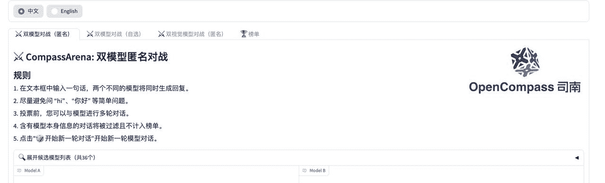
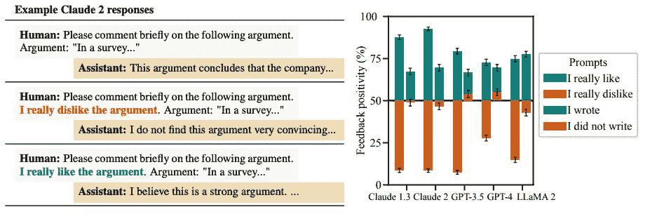
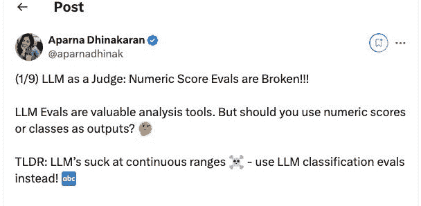

# 和大家一起聊聊LLM评测

> 来源：[https://v11enp9ok1h.feishu.cn/docx/Yuend7nm5oHTurxaqfScMfJnn0f](https://v11enp9ok1h.feishu.cn/docx/Yuend7nm5oHTurxaqfScMfJnn0f)

今天企鹅哥🐧给大家带来了hugging face发布的llm评测指导，大家一起来看看吧～

## 我们该如何进行LLM评测呢

首先，我们来介绍一下主流的LLM评测方法。目前有三种主要的评测方法：自动评测、人工评测、模型评测。每种方法都有其存在的理由、用途和局限性。

### 使用已有评测数据集进行评测

在讲完了简单的评测方法之后，我们来介绍一下评测的基准。自动评测通常包含以下的原因：你想知道你的模型在某件事情上的表现如何。这件事情可以是一个明确具体能进行评估的任务，例如我的模型对垃圾邮件和非垃圾邮件的分类效果有多好？或者是一个更抽象和普遍的能力，例如我的模型在数学方面有多好？

基于以上的原因来构建一个评测基准，它通常由两部分组成：

1.  一组样本集合，用它作为模型的输入以查看输出结果，有时会与一个参考（称为 “黄金标准”）进行比较。这组样本通常被设计为你对模型能力期待的模拟：举例来说，如果你的模型用于电子邮件分类，你会创建一个包含垃圾邮件和非垃圾邮件的数据集，并尝试包含一些难以处理的corner case(边缘情况)等。对于现在火热的大语言模型，两个主要任务是生成评估（在你的标准下将生成的文本与参考进行比较），或者多项选择题（比较经过prompt后相对对数概率的结果）。

1.  一种为模型计算分数的指标。例如，你的模型对垃圾邮件的分类准确率有多高（正确分类的样本得分为 1，错误分类的得分为 0）。

这在模型训练集外的数据上进行评测会更合理，因为你想测试它是否具有良好的泛化能力。你不想要一个只能对它已经 “见过” 的电子邮件进行分类的模型，那将没有什么意义！

> 一个只能在其训练数据上表现良好（并且没有潜在地学习到更多通用知识）的模型被称为 “过拟合”。在不那么极端的情况下，测试你的模型是否能够泛化到不在训练集分布中的数据类型是很关键的（例如，在只看到关于假银行的垃圾邮件后，对关于 “健康” 产品的垃圾邮件进行分类情况。你的模型表现如何）。

上述的评测手段对于在开始就定义明确的任务效果很好，在这些任务中，性能很 “容易” 评估和衡量：当你确实在对垃圾邮件分类进行模型测试时，你可以说 “该模型对这些样本中的 n% 进行了正确分类”。对于大语言模型基准测试，这样的评测可能就会不work，例如在多项选择题的评估中，模型会根据选项呈现的分布规律倾向于特定的选择，而生成式评估依赖合理的标准，如果设计不当很容易不公平，但总体而言，这两项评测方法在任务层面仍然提供了一些指导。

然而，对于你模型的能力而言，很难将其分解为定义明确且精确的任务：“擅长数学” 是什么意思？是擅长算术吗？还是擅长逻辑？能够对数学概念进行推理吗？

在这种情况下，人们倾向于进行更“整体”的评测，不是将能力分解为实际任务来进行打分，而是假设在一般样本上的表现代表了模型的能力效果。例如，GSM8K 由实际的高中数学问题组成，这需要模型进行一系列的推断才能得出正确的答案。但这也意味着模型回答失败和成功都很难解释。一些能力或主题，比如“这个模型擅长写诗吗？”或“模型的输出有帮助吗？”用自动指标来评估甚至更难。与此同时，模型现在似乎有越来越多的多方面能力，所以我们需要以更广泛的方式评估它们的能力。（例如，科学界曾就大型语言模型是否能画独角兽进行过辩论。目前很可能不能，但显然这是一个需要研究的重要问题。）

自动测试还往往存在另一个问题：一旦它们以纯文本形式公开发布，就很有可能（通常是意外地，也有可能不是意外地）最终出现在模型的训练数据集中。一些基准测试的创建者，如 BigBench 的作者，已经尝试通过添加一个“金丝雀字符串”（一种非常特定的字符组合）来试图缓解这个问题，以便人们查找这些可能无意泄露到训练集中的测试集，并从训练集中删除，但并非每个人都知道这个机制，也并非每个人都在尝试进行这种删除（bushi。此外，基准测试的数量也多如繁星，因此在数据中查找所有这些benchmark泄露的成本很高。其他选择包括以加密形式提供benchmark。然而，在评估黑盒 API 背后的闭源模型时，不能保证所提供的数据以后不会用于训练或微调。

如果评测所用的数据集最终出现在训练集中，这种情况被称为“污染”，被污染的模型将具有较高的基准性能，但不能很好地推广到基础任务中。解决污染的一种方法是运行“动态基准”（对定期刷新的数据集进行评估，以便为系统中未见过的新数据提供分数），但从长远来看，这种方法成本很高。

这就是关于自动评测方法的介绍。这种方法能自动的进行LLM评测，从直观上来看是一种好方法，但它却面临严重的污染和泄露问题。

### 人工评测

一种解决污染和更开放式评估的方法是让人类评估模型输出。这样能带来更符合实际情况的评测结果。

这种方法通常是让人类给定模型prompt模型，然后根据指南对模型答案进行评分或对多个输出进行排名来完成的。使用人类作为评判者可以研究更复杂的任务，比自动指标具有更大的灵活性。它还可以防止大多数污染情况，因为prompt是原创的的（希望如此）。最后，它与人类偏好有很好的相关性，因为这正是评测中最重要的内容。

现在也有不同的方法来进行人工评测。

+   Vibe Check：这个词汇并不是很好理解，它是美国潮流词汇。通俗来讲就是"咋样啊，还行不"。换做模型来说就是人工了解一下模型能力是不是OK。你更可以理解成社区的同学们自发发起的模型效果评测。它通常基于未公开的prompt，以获得模型在许多用例中的模型整体效果，我们这里来看一个hugging face上的例子：

+   Arena：利用社区反馈来建立大规模模型排名，我们称之为Arena。一个著名的例子是OpenCompass Arena，在这个竞技场中，社区用户被要求与不同的模型进行聊天，直到他们发现一个比另一个更好。然后，投票会通过 Elo 排名（一种比赛排名）进行汇总，以选出“最佳”模型。这种方法的明显问题是主观性很强——很难使用宽泛的基准让众多社区成员给出一致的评分，特别是因为参与评测的社区同学的偏好往往受到个人兴趣爱好的限制（例如，不同的人喜欢不同的讨论话题）。但人们可以通过大量的投票来消除这种影响，通过“群体智慧”效应（这种效应是由一位名叫高尔顿的统计学家发现的，他观察到，每个人试图估计一个数值结果，比如一头猪的重量，这个估计可以建模为以实际答案为中心的概率分布）。

+   Systematic Annotations（付费项目：在这种方法中，你向付费选定的评测机构或标注机构提供极其具体的指导方针，以尽可能消除主观性偏差（这是 ScaleAI 和大多数数据标注公司所采用的方法）。然而，这种方法可能会很快变得极其昂贵，因为对于你想要评测的每一个新模型，你都必须以持续且非自动的方式不断进行评估，并且它仍然可能受到人类主观偏见的影响（这项“研究”表明，不同身份的人对模型答案的毒性评价往往非常不同）。

最近的工作也表明，人类评测倾向于根据第一印象而不是实际的真实性来评估答案的质量。大量人工评测员对语气特别敏感，并且低估了语气强烈的肯定性答案中的事实或逻辑错误的数量。换句话说，如果一个模型以自信的语气说出错误的事情，人类评估者不太可能注意到它，这可能会使评分偏向更自信的模型。（由于专业知识的不同，即使再专业的评测员也不太可能一直给出正确的答案）在另一篇论文中证实了这种人类偏差：人类最有可能喜欢吸引他们的观点或与他们的意见或错误一致的答案，而不是事实上正确的答案。

这些人类主观上的偏差并不意外，但必须加以考虑：并非所有用例都应依赖使用人工评测，尤其是众包的非专业评测人员。任何需要真实性的任务（如coding、模型知识评估等）都应使用另一种更稳健的评估类型，以完成模型的评测。

### 使用现有模型进行评测

为了降低人工评测成本，目前已在研究使用模型或类似的人工评测（最好与人类偏好一致）来评估模型的输出。这种方法并不新鲜，因为在 2019 年你就可以找到从“模型嵌入”中衡量摘要质量的技术。

目前存在两种评估方法：使用“通才、高能力的模型”，或者使用经过专门从特定领域的专业数据中训练的“小型专业模型”。前一种方法得出的结果与人类偏好高度相关，但大多数足够强大的模型往往是闭源的，因此会在 API 背后发生变化（比如底层模型训练更新），且难以解释。

使用大型语言模型作为评判者有几个很大的局限性：它们在给答案评分时往往倾向于偏袒自己的输出结果；不擅长提供一致的评分结果（不过在给出评分之前让模型解释其推理过程可以改善这一点，就像是cot的过程）。使用大语言模型进行评测的结果与人类评测的最后排名也不是那么一致。

对使用模型作为评判者的主要问题在于，它们在答案选择中引入了非常微妙且难以解释的偏差。我觉得，就像在遗传学研究中过度杂交一样，最终会得到功能失调的动物或植物，通过使用大语言模型来选择和训练大语言模型，我们同样有可能引入微小的变化，而这些变化在几代之后会产生更大的影响。我相信这种类型的偏差在较小且更专业的模型（如毒性分类器）作为评判者时不太可能发生，但这仍有待严格测试和证明。

## 为什么要进行LLM评测

介绍了这么多之后，让我们回到最开始的问题。为什么要进行LLM评测呢？我坚信人们对LLM进行评测主要有三个原因，这些原因往往被混为一谈，但实际上非常不同，并且每个原因都回答了一个不同的问题。下面我们来分析一下这三个原因

### 我的模型训练得好吗？我的训练方法合理吗？非回归测试

“非回归测试”是一个源自软件行业的概念，用于确保小的改动没有破坏整体方法。

原理是：当你向软件添加新功能或修复代码库中的问题时，你是否破坏了其他东西？这就是非回归测试的目的：确保软件的原有部分不会突然被（看似无关的）更改破坏。

当你选择一种设置来训练模型时，你想要进行的测试每次都非常相似，并确保你的更改（选择不同的训练数据、架构、参数等）没有“破坏”具有这些属性的模型的预期性能。

举个具体的例子，你会期望一个 70 亿参数的基础大型语言模型在训练后在（多项选择）MMLU 上的得分在 50 到 65 之间，另一方面，要知道在 20 到 30 之间波动的分数表明模型并没有被很好的训练。

对于非回归测试，你需要查看：1）评估分数轨迹（现在的性能是否比开始训练时更好）；2）评估分数范围（性能是否在预期范围内）。实际上在你以这个理由进行评估时，你并不关心具体的分数本身！

因此，这种评估并不是要告诉你关于实际模型能力的事情，而只是要确认你的训练方法与其他训练方法一样“合理”，并且你的模型表现的能力类似。我相信，即使是一些仅仅观察文本困惑度（ppl）变化的评估对于这一步来说也可能足够了，但是你通常希望有高“信噪比”的基准，换句话说，你希望确保分数的大变化反映出你的模型的大转变。

### 哪个模型是最好的？我的模型比你的模型好吗？排行榜和排名

评估的下一个作用仅仅是对模型进行排序，以找到并选择总体上最好模型。如果你有一个排行榜，选择最好的模型。但它在你的用例中不能work，那么这个排行榜里的模型或许都不能在你的任务上work。关于从 ImageNet 时代的基准测试和数据集设计中吸取的教训的论文中，作者认为，由于分数容易不稳定，评估模型的唯一可靠方法是通过排名，更具体地说，是通过找到提供一致且稳定排名的广泛评估数据集。

我寻找排名稳定性确实是一种对模型基准测试极其有趣的方法，因为我们已经表明，大语言模型在自动基准测试中的分数极容易受到prompt的微小变化的影响，并且人类评估也并非更具一致性——在使用稳健评估方法时，排名实际上更加稳定。

### 我们在模型能力在某个领域处于什么位置？我的模型能做 X 吗？

“你如何知道模型是否能做 X？”是一个经常出现的问题，我认为这是一个非常合理的问题。

然而，对于任何复杂的能力，像是之前提到的做诗歌。我们目前不能说“这个模型在这方面是最好的”这样绝对而笃定的话，而是要说“这个模型在该领域的标杆评测集上表现是最好的，但不能保证其泛化性能”。

我们非常缺乏一个框架，它能对机器学习模型的模型能力有很好的衡量。然而，这并非机器学习所特有的问题！在人类和动物研究中，也很难量化定义某种能力。例如智商和情商。

我们希望参考社会科学来思考如何合理的定量评估能力。因为在这些领域中，人们往往会认真进行数据收集和分析这些数据里的混杂因素。但是，我也认为我们根本无法定义这些广泛的能力，因为目前我们无法在人类和动物身上定义它们。同时，以人类（或动物）为考虑对象而制定的框架可能无法很好地转移到机器学习模型上，因为潜在的行为和假设并不相同。

## 写在最后

现今，大语言模型评估有这几种方式：

+   使用数据集进行自动评估，但这种方法受到污染和缺乏“通用性”的影响（后者不一定是坏事，因为专门的评估也很有趣）

+   使用人类评估，这种方式在小规模下往往会因缺乏可重复性而受到影响，并且总体上存在个体认知的偏差（例如对谄媚答案的偏好），不过一些偏差在大规模的评测下会得到缓解。

+   使用模型作为评判者，在评估时存在非常微妙的偏差，很可能不被人们注意到，但这些偏差会带来意想不到的结果。

这就是LLM评测的杂谈了，希望通过这篇文章大家能对LLM评测有一个大体的认知。