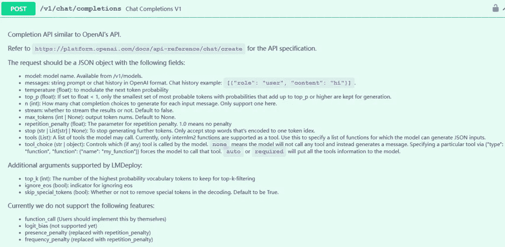
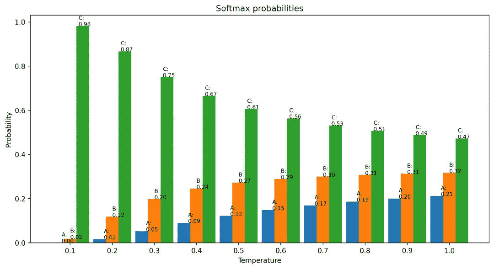

# temperature，topk傻傻分不清？一文带你读懂LLM推理超参

> 来源：[https://v11enp9ok1h.feishu.cn/docx/YiBWdjGUkoPxjPx9AuhcTTvznAg](https://v11enp9ok1h.feishu.cn/docx/YiBWdjGUkoPxjPx9AuhcTTvznAg)

> 作者：樊奇，上海交通大学硕士研究生

> 全文约 2400 字，预计阅读时间 6 分钟

**在使用 LLM 进行推**理的时候，我们经常会看到一些推理超参数，比如 temperature 和 repetition penalty 等等。一般来讲，temperature 对应着 LLM 的输出随机性，而 repetition penalty 则会在一定程度上阻止 LLM 陷入无限循环的困境。但是这些推理超参数发挥作用的原理究竟是什么呢？

因此，我们将从 tr**a**[ns](https://github.com/huggingface/transformers/blob/v4.43.1/src/transformers/generation/logits_process.py)**f**ormers 4.43.1 版本的源码出发，为大家解读 temperature、top-p、repetition penalty 和 top-k 的原理及作用，希望对大家有所帮助。所有的代码均可以在 transformers/src/transformers/generation/logits_process.py at v4.43.1 · huggingface/transformers 中找到。

下图是一张来自 LMDeploy API Server 的截图，里面展示了 LLM 的一些推理超参数**。OpenAI 的推理接口同样支持 te**mperature、top-p 和 repetition penalty 参数，而 LMDeploy 的 API Server 接口还额外支持 top-k 参数。



# **Temperature**

我们首先来看 TemperatureLogitsWarper 类，位于第 236 行。在经过删改（主要删去了说明文档，以及数值合法性检验部分）后，主要逻辑如下所示。

```
class TemperatureLogitsWarper(LogitsWarper):

    def init(self, temperature: float):
        self.temperature = temperature

    def call(self, input_ids: torch.LongTensor, scores: torch.FloatTensor) -&gt; torch.FloatTensor:
        scores_processed = scores / self.temperature
        return scores_processed
```

可**以看到，temperatu**re 参数是用于缩放 LLM 下一个 token 的 score 的参数，从而增大 LLM 输出的随机性。由于 LLM 预测下一个 token 的过程本质上是一个分类任务，score 即为分类头在经过 softmax 前的输出。让我们回到 softmax 函数，在加入 temperature 参数后的 softmax 函数是  。接下来，我们看一个例子：

假设应用 temperature 前的三个 token 的 score 分别为 A：0.1，B：0.5，C：0.9，temperature 的影响如下图所示。



不难看到，随着 temperature 的变大，ABC 三个 token 之间的概率分布差距逐渐变得越来越小。此时，选择到 token A 的概率变大了，LLM 输出的随机性也就增加了。

# **Top-P**

接下来是位于第 411 行的 TopPLogitsWarper 类，同样删去了说明文档和数值合法性检查

```
class TopPLogitsWarper(LogitsWarper):

    def init(self, top_p: float, filter_value: float = -float(&quot;Inf&quot;), min_tokens_to_keep: int = 1):
        top_p = float(top_p)
        self.top_p = top_p
        self.filter_value = filter_value
        self.min_tokens_to_keep = min_tokens_to_keep

    def call(self, input_ids: torch.LongTensor, scores: torch.FloatTensor) -&gt; torch.FloatTensor:
        sorted_logits, sorted_indices = torch.sort(scores, descending=False)
        cumulative_probs = sorted_logits.softmax(dim=-1).cumsum(dim=-1)

        # Remove tokens with cumulative top_p above the threshold (token with 0 are kept)
        sorted_indices_to_remove = cumulative_probs &lt;= (1self.top_p)
        # Keep at least min_tokens_to_keep
        sorted_indices_to_remove[..., -self.min_tokens_to_keep :] = 0

        # scatter sorted tensors to original indexing
        indices_to_remove = sorted_indices_to_remove.scatter(1, sorted_indices, sorted_indices_to_remove)
        scores_processed = scores.masked_fill(indices_to_remove, self.filter_value)
        return scores_processed
```

Top-P 的作用而是**只保留那些高概率的 token，且这些 to**ken 的概率总和大于 top-p 参数。我们还是用上面的例子。三个 token 的 score 分别为 A：0.1，B：0.5，C：0.9。

在经过 softmax 后，三个 token 的概率分别为 0.21，0.32，0.47。假设此时 top-p 参数为 0.7，那么由于 A 的概率 0.21 小于 1-0.7=0.3（即 B 和 C 的概率和大于 top-p），此时 A 的 score 将会清零。

因此，经过这样的一个 top-p 处理后，输出的 score 为 A：0，B：0.5，C：0.9。

# Repetition Penalty

然后是位于第 302 行的 RepetitionPenaltyLogitsProcessor 类。

```
class RepetitionPenaltyLogitsProcessor(LogitsProcessor):

    def init(self, penalty: float):
        self.penalty = penalty

    def call(self, input_ids: torch.LongTensor, scores: torch.FloatTensor) -&gt; torch.FloatTensor:
        score = torch.gather(scores, 1, input_ids)

        # if score &lt; 0 then repetition penalty has to be multiplied to reduce the token probabilities
        score = torch.where(score &lt; 0, score * self.penalty, score / self.penalty)

        scores_processed = scores.scatter(1, input_ids, score)
        return scores_processed
```

**Repetition P**enalty 则是用于缓解LLM循环输出的问题。我们直接看一个例子。假设模型已经输出了三个 token，为 AAA。此时，输出这三个 token 的 score 分别为 A：-0.5，B：0.1，C：-0.4。

如果没有 repetition penalty，直接 softmax 后的概率分布为 A：0.25，B：0.47，C：0.28。不难看到，此时输出A 和 C 的概率仍然较高，尽管他们的 score 已经是负数。

但是，如果我们设置 repetition penalty 为2.0，由于 token A 已经在先前过程中输出过了，而且它的 score 还是负数，那么它的 score 就会再乘以 repetition penalty，以进一步降低输出 token A 的概率。

这样一来，三个 token 的 score 分别是 A：-1，B：0.1，C：-0.4，而 softmax 后为 A：0.17，B：0.51，C：0.31，输出 A 的概率明显地降低了。

# **Top-K**

最后是位于第 478 行的 TopKLogitsWarper 类。

```
class TopKLogitsWarper(LogitsWarper):

    def init(self, top_k: int, filter_value: float = -float(&quot;Inf&quot;), min_tokens_to_keep: int = 1):
        self.top_k = max(top_k, min_tokens_to_keep)
        self.filter_value = filter_value

    def call(self, input_ids: torch.LongTensor, scores: torch.FloatTensor) -&gt; torch.FloatTensor:
        top_k = min(self.top_k, scores.size(-1))  Safety check
        # Remove all tokens with a probability less than the last token of the top-k
        indices_to_remove = scores &lt; torch.topk(scores, top_k)[0][..., -1, None]
        scores_processed = scores.masked_fill(indices_to_remove, self.filter_value)
        return scores_processed
```

与 top-p 的作用相似，top-k 则是保留 score 最高的 k 个 token 的 score。我们继续用上面的例子。三个 token 的 score 分别为 A：0.1，B：0.5，C：0.9。

假设此时 top-k 参数为1，那么只有 score 的 C 会被保留，输出的 score 为 A：0，B：0，C：0.9。而如果 top-k 为2，那么 C 和 B 都会被保留，输出为 A：0，B：0.5，C：0.9。

虽然 OpenAI 接口已经移除了 top-k 参数，但是 transformers 中仍然保有这一参数接口。

# **写在最后**

经过上面的源码解读后，我们可以进行这样的总结：

+   Temperature 可以增大 LLM 输出的随机性。

+   Repetition Penalty 可以缓解 LLM 循环输出的问题。

+   Top-P 和 Top-K 参数会防止 LLM 输出低概率 token，从而一定程度上保证 LLM 输出的质量。