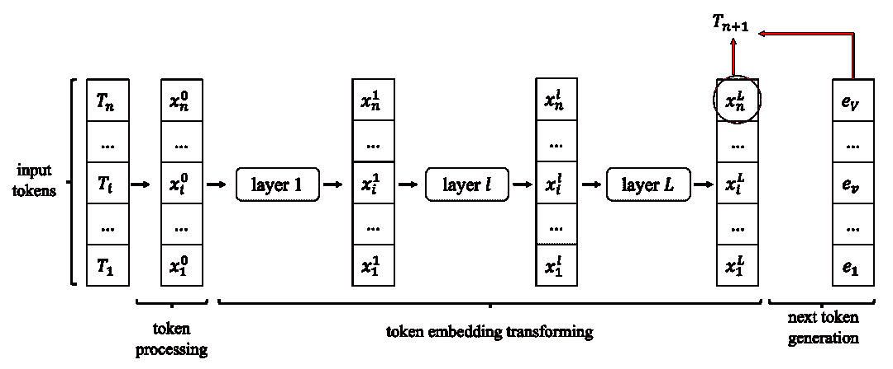
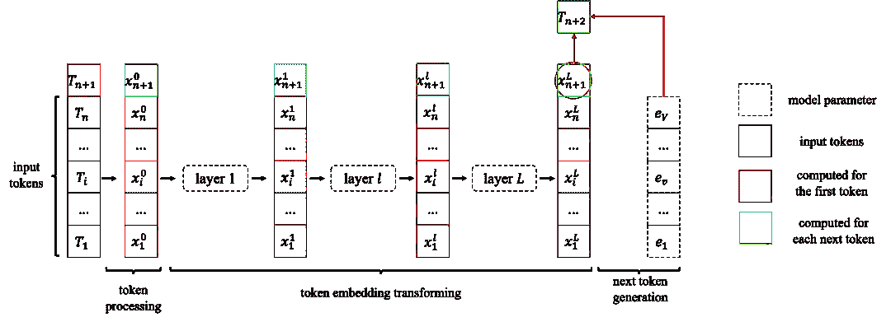

# 一文读懂KVCache

> 来源：[https://v11enp9ok1h.feishu.cn/docx/A9tBduqnUoBhDkxIQDPci3J0n7d](https://v11enp9ok1h.feishu.cn/docx/A9tBduqnUoBhDkxIQDPci3J0n7d)

在LLM的推理过程中，KVCache已经属于必备的技术了。然而，网上现有的解读文章并不够清晰。看了一些文章之后，我决定还是自己写一篇新的，以飨读者。

# Motivation: 为什么要KVCache

为了回答KVCache的必要性，我们首先需要对transformer类大语言模型的计算过程有个整体的理解。

对于LLM类模型的一次推理（生成一个token）的过程，我们可以将这个过程分解为下列过程：

+   输入n个token  ，每个token就是一个整数

+   token预处理阶段，将token处理成token embedding  ，每个token embedding就是一个向量，维度记为 。这里的上标 表示第0层，也就是输入，后面会用到。

+   token embedding变换阶段，模型内部包含$L$层，每层的输入是token embedding，输出也是token embedding。最后一层输出的token embedding是\{x_1^L, \cdots , x_i^L , \cdots , x_n^L\}

+   next token generation阶段，由最后一层的最后一个token embedding  ，结合vocabulary embedding （一般也叫lm_head）  ，生成每个token的概率 ，再从这个概率分布中采样得到一个具体的token  。

用一个流程图来表示，就是：



当我们已经生成了一个token（即 ），需要生成下一个token（即 ）时，我们可以再走一遍上述流程。然而，聪明的算法工程师发现这两次生成的计算之间存在可以复用的部分：当输入token序列为 时， 与输入token序列为 的时候计算得到的结果是一样的，所以我们可以复用上一次计算的结果。

我们可以用简单的代码来验证这一结论：

```
import torch
from transformers import GPT2Tokenizer, GPT2Model
tokenizer = GPT2Tokenizer.from_pretrained(&#x27;gpt2&#x27;)
model = GPT2Model.from_pretrained(&#x27;gpt2&#x27;)

# text: &quot;The quick brown fox jumps over the lazy&quot;
tokens = [[464, 2068, 7586, 21831, 18045, 625, 262, 16931]]
input_n = torch.tensor(tokens)
output_n = model(input_ids=input_n, output_hidden_states=True)

# text: &quot; dog&quot;
tokens[0].append(3290)
input_n_plus_1 = torch.tensor(tokens)
output_n_plus_1 = model(input_ids=input_n_plus_1, output_hidden_states=True)

for i, (hidden_n, hidden_n_plus_1) in enumerate(zip(output_n.hidden_states, output_n_plus_1.hidden_states)):
    print(f&quot;layer {i}, max difference {(hidden_n - hidden_n_plus_1[:, :-1, :]).abs().max().item()}&quot;)
    assert torch.allclose(hidden_n, hidden_n_plus_1[:, :-1, :], atol=1e-4)
```

输出结果：

```
layer 0, max difference 0.0
layer 1, max difference 3.814697265625e-06
layer 2, max difference 5.7220458984375e-06
layer 3, max difference 5.7220458984375e-06
layer 4, max difference 1.52587890625e-05
layer 5, max difference 9.5367431640625e-06
layer 6, max difference 7.62939453125e-06
layer 7, max difference 1.1444091796875e-05
layer 8, max difference 1.9073486328125e-05
layer 9, max difference 1.52587890625e-05
layer 10, max difference 2.288818359375e-05
layer 11, max difference 3.0517578125e-05
layer 12, max difference 3.0517578125e-05
```

于是，当我们计算 时，我们可以复用上一次计算的中间结果 ，只需要计算 也就是 的token embedding即可。

更具体的计算流程如下图所示：



我们使用不同的颜色来区分初始输入（黑色）、生成第一个token时计算得出的中间结果（红色）、后续生成每个token需要计算并保存的中间结果（蓝色）。

严格来说，本文中的表示输入prompt的token数目，随着generation进行，我们还需要引入另一个变量来表示generate的token个数。为了避免引入太多符号，下文中我们用表示prompt的token数目加上已经generate的token个数，也就是当前拥有的token数。这样我们就能聚焦在next token prediction本身了。

# **小插曲：神经网络计算的确定性**

有些强迫症患者可能看到上述GPT2的代码输出非常不爽，毕竟还有大约的误差。这里建议强迫症患者深呼吸一下，因为接下来的代码可能让他们更加震惊：

```
x = torch.randn(9990).abs()
z1 = x.sum().item()
z2 = x[:5000].sum().item() + x[5000:].sum().item()
print((z1 - z2 == 0)) # False
```

一个数组直接求和，与分段求和再整体求和的结果不一样（当然，相差不多）。这是因为，加法在数学上具有结合律，然而浮点数的加法并没有结合律。

更有甚至，同一段代码执行多次的结果也可能不一样：

```
x = torch.randn(9990).abs()
indices = torch.randint(0, 9990, (9000,))

def f(x, indices):
    y = x.clone()
    y[indices] += x[:9000]
    return y

y1 = f(x, indices)
y2 = f(x, indices)
print((y1 - y2).abs().max().item() == 0) # False
```

这是因为indices里面有重复的元素，所以**y[indices**] += x[:9000]涉及并行竞争。而并行的顺序一般是不确定的，所以这段代码的执行本身具有随机性。

一般来说，神经网络的计算并不会要求特别强的确定性，甚至不会要求特别高的精度，这也正是这几年算力突飞猛进的原因（使用低精度计算）。

# **KVCache的原理及设计细节**

当我们复用了中间结果时，每一层的计算输入为上次保存下来的 以及本次新来的 ，需要计算得到的输出为 。所以这是一个single-query attention计算。让我们把常见的attention计算方式改成single-query attention，只关注最后一个token的输出，就可以得到：

其中 分别为QKV的投影矩阵（模型参数的一部分）。为了保持公式简洁，这里省略了dot product之后的scaling factor  ，而且只展示了一个head的计算结果。多个head（数目为 ）之间的计算是并行的，最后拼接在一起。严格来说，拼接之后还需要进行layernorm、feedforward network等计算，因为它们都是对每个token的embedding单独计算的，token之间没有交互，所以这里就不展开了。

根据这一公式，我们可以进一步看出，如果我们只保存 ，那么每次我们都需要重新计算 和 。所以，KVCache的想法也很简单，我们就不要保存 ，直接保存 和 就行了，它们分别就是K cache和 V cache。

当然，其实还有别的cache选择，比如我们直接保存 也是一种选择（不妨称为 x cache）。更fancy一些，注意到矩阵乘法的一些运算性质， 我们也可以选择保存 ，不妨称之为s cache（此时依然要保存v cache）。

我们可以对比这几种选择的存储开销和计算开销（  是  的维度，  是  也就是q k v的维度，一般 ，其中 为multihead attention的头数）：

| Cache Type | Storage per cache | FLOPS per cache | FLOPS for next token |
| --- | --- | --- | --- |
| x cache | D | 0 | (n + 1) (3Dd + 2d)H |
| k cache + v cache | 2d | 2Dd | (n + 1) (Dd + 2d)H |
| s cache + v cache | D + d | 3Dd | (n + 1)(D + d)H |

考虑到一层里面有 个cache，三种方式的总FLOPS的主导项都是 ，在计算量上面是差不多的。因此我们选择存储占用最少的方案，也就是常用的KVCache（ 一般远大于 ）。如果哪一天某个奇怪的模型  ，或者存在非常明显的KVCache复用（本次的KVCache还会在下一轮对话中用到，比如针对长文本的多次summarization），那可能可以考虑一下s cache。

至此，我们不仅了解了KVCache的原理，而且还分析了它为什么设计成这样而不是别的样子。

# **KVCache的存储及实现细节**

KVCache的总大小为  ，正比于当前token数量、向量维度、层数。这里面，最令人头疼的是 ，它是在推理过程中不断变大的一个量。变长数据的存储总是很烦人的，具体解决起来无外乎三种方法：

+   分配一个最大容量的缓冲区，要求提前预知最大的token数量。而且现在大模型卷得厉害，动不动支持上百万长度，而大部分的用户请求都很短。因此，按照最大容量来分配是非常浪费的。

+   动态分配缓冲区大小，类似经典的vector append的处理方式，超过容量了就扩增一倍。这也是一种可行的解决方案，但是（在GPU设备上）频繁申请、释放内存的开销很大，效率不高。

+   把数据拆散，按最小单元存储，用一份元数据记录每一块数据的位置。

最后一种方案，就是目前采用最多的方案，也叫PageAttention。程序在初始化时申请一整块显存（例如4GB），按照KVCache的大小划分成一个一个的[小块，并记录每个token在推理时要用到第几个小块。小块显存的申请、释放、管理，](https://arxiv.org/abs/2309.06180)类似操作系统对物理内存的虚拟化过程，这就是大名鼎鼎的vLLM的思路（具体参见论文Efficient Memory Management for Large Language Model Serving with PagedAttention）。

# **KVCache成立条件**

KVCache是一种用更大的显存空间换取更快的推理速度的手段。那么，它是否能够无条件适用于所有的LLM呢？其实并不是的。分析了它的原理后，我们就可以得出它适用的条件：

如果把一层transformer层的计算效果记为 ，那么它是一个接受变长输入的函数，输出也是变长的： 。我们要研究输入增加时候的输出变化，那就再增加$m$个token一起推理：

(\hat{x}_1^{l+1}, \cdots, \hat{x}_i^{l+1}, \cdots, \hat{x}_n^{l+1}, \hat{x}_{n+1}^{l+1}, \cdots, \hat{x}_{n+j}^{l+1}, \cdots, \hat{x}_{n+m}^{l+1}) = f(x_1^{l}, \cdots, x_i^{l}, \cdots, x_n^{l}, x_{n+1}^{l}, \cdots, x_{n+j}^{l}, \cdots, x_{n+m}^{l})

要适用KVCache，新的推理结果必须满足 。

通俗来说，这一个性质可以称为“因果性”，每一个token的输出只依赖于它自己以及之前的输入，与之后的输入无关。在transformer类模型中，BERT类encoder模型不满足这一性质，而GPT类decoder模型因为使用了causal mask所以满足这一性质。

目前大家看到的LLM基本都是decoder-only的结构。那是不是意味着KVCache就能适用于所有的LLM呢？

为了回答这个问题，我们还需要深入分析常常被大家忽略的输入预处理层，也即 。为了分析它是否满足因果性，我们进一步分析加入更多的token时它的输入输出的变化：

(\hat{x}_1^{0}, \cdots, \hat{x}_i^{0}, \cdots, \hat{x}_n^{0}, \hat{x}_{n+1}^{0}, \cdots, \hat{x}_{n+i}^{0}, \cdots, \hat{x}_{n+m}^{0}) = g(T_1, \cdots, T_i, \cdots, T_n, T_{n+1}, \cdots, T_{n+i}, \cdots, T_{n+m})

这一层通常会将token ID转换成word embedding，然后加上positional embedding。问题就出在positional embedding上面：像一些[ReRope](https://zhuanlan.zhihu.com/p/649894197)之类的技术，在增加新的token时会把整个序列的positional embedding进行调整，同一个token，上一次的token embedding和这一次的token embedding不相同，也即$\hat{x}_i^0 \neq x_i^0$，所以KVCache的条件不再成立。而一旦输入预处理层不满足KVCache的条件，后续transformer层的输入（即预处理层的输出）就发生了改变，也将不再适用于KVCache。

# **总结**

本文分析了LLM推理中常用的KVCache技术的原理、设计细节以及成立条件，顺带提了神经网络计算（GPU计算）中的误差与不可避免的随机性。感谢@朱力耕 在本文撰写过程中提供了很多建议。