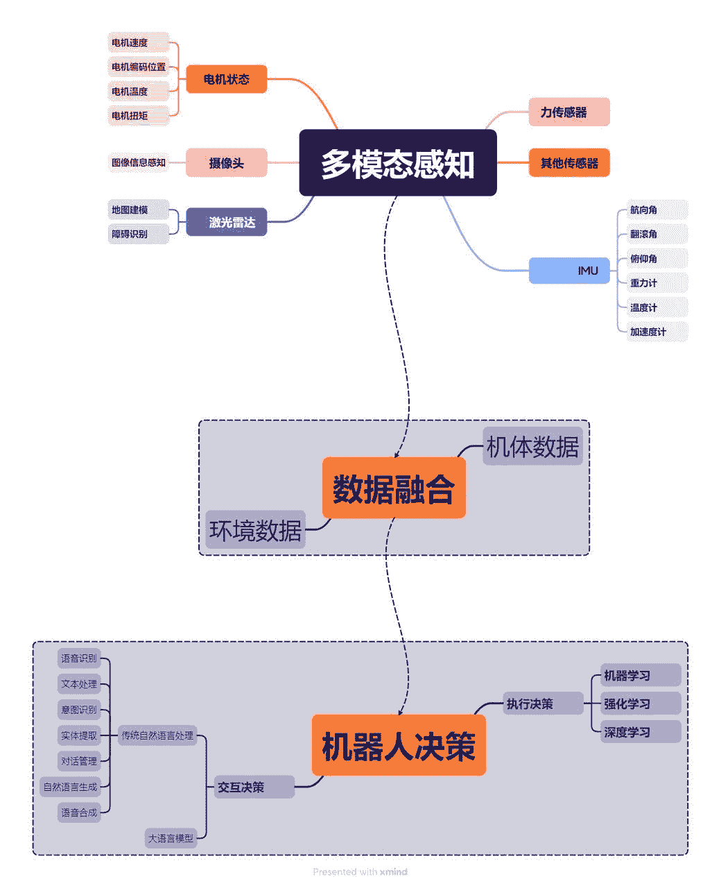

# 概论

> 来源：[https://v11enp9ok1h.feishu.cn/docx/Cc2adDX4Ro51f2xekq1c3kbzn88](https://v11enp9ok1h.feishu.cn/docx/Cc2adDX4Ro51f2xekq1c3kbzn88)

> **引言**：本文旨在深入探讨大模型与具身智能如何推动人工智能研究从理论迈向实践，并着重阐述机器人在这一进程中的核心理论基础、关键技术及实际应用。文章将分为几个关键章节，首先介绍机器人理论基础的演进与当前技术拓展，随后聚焦机器人操作系统（Robot Operating System, ROS）的发展与应用，接着详细解析多模态感知与自然语言理解这两项具身智能的核心技术。各章节将层层递进，共同构建一个全面理解机器人智能的框架。

大模型的兴起将人工智能的研究从理论向实践转变，并带来了新的机遇。而具身智能将人工智能的研究从单纯的计算模型转变为认知模型，从而使机器人具备了更丰富的智能能力，并将认知与实际问题相结合。

本文将从机器人理论基础，机器人操作系统，多模态感知，机器人决策(交互决策方向)逐步揭开具身智能的大门。

# **机器人理论基础**

机器人理论的研究始于1950年代，当时，人们对机器人的认识还停留在机械动力学的层面。1956年，约翰·麦卡锡提出了“机器人理论”的概念，并提出了机器人应该具备的四个特征：

1.  自主性：机器人应该能够在没有人类直接干预的情况下执行任务。

1.  感知能力：机器人需要能够感知其环境，这通常通过各种传感器来实现，如视觉、听觉、触觉等。

1.  决策能力：机器人应该能够基于感知到的信息做出决策。

1.  学习能力：机器人应该能够从经验中学习，以改进其性能和适应新的任务。

这些观点为如今的机器人研究奠定了基础。在目前的技术阶段，这些特征并被进一步的拓展

1.  多模态感知：机器人能够整合来自不同类型传感器的信息。

1.  自然语言理解：机器人能够理解和响应人类的自然语言指令。

1.  适应性：机器人能够适应不断变化的环境和任务需求。

1.  社会交互：机器人能够与人类或其他机器人进行有效的社会交互。

现代机器人开发大多使用机器人操作系统进行开发，以下我们将会介绍现代机器人操作系统的概念以及多模态感知和机器人决策如何在系统上的大致运行方式。

# **机器人操作系统（ROS）**

如今大多数的机器人都是基于ROS平台直接开发的，ROS（Robot Operating System）是一种开源的机器人操作系统，它提供了机器人开发的各种工具和库，包括传感器驱动、机器人控制、多模态感知、自然语言理解等。ROS的社区也提供了大量的资源和工具，如ROSCon、ROS Answers、ROS Discourse、ROS Answers等，为机器人开发者提供帮助。

ROS的发展历史起源于斯坦福大学，后由Willow Garage继续发展，并且现在由Open Robotics维护。ROS的核心系统及各种工具和库函数通常在ROS发行版本中发布，这些发行版本类似于Linux发行版本，并提供了一系列兼容此版本的可被使用或开发的软件。

# **多模态感知**

多模态感知是机器人具身智能的核心特征之一。多模态感知指的是机器人通过多种不同类型的传感器（如摄像头、激光雷达、IMU、触觉传感器等）来感知环境，这些传感器各自捕获环境的不同方面，例如视觉信息、距离测量、声音、触觉反馈等。

随着当今的技术发展，机器人操作系统（ROS）为机器人多模态感知提供了一个完全可以灵活实践的平台，ROS作为一个灵活的、开源的机器人软件平台，提供了丰富的工具和库，使得开发者能够轻松地构建复杂的机器人应用程序。ROS提供了框架和工具，使得这些不同类型的传感器数据可以被集成和融合，以获得更全面和准确的环境理解。

在ROS中进行多模态融合一般会涉及以下几个部分

+   数据采集：首先，需要从各种传感器（如摄像头、激光雷达、IMU等）收集数据。ROS提供了丰富的传感器驱动和接口，可以方便地接入和获取这些数据。

+   数据预处理：原始传感器数据通常需要预处理，如去噪、归一化、时间同步等，以提高数据质量。ROS中的cv_bridge和image_transport等包可以用于图像数据的转换和传输，而tf包可以用于坐标系的转换和数据对齐。

+   数据融合：多模态数据融合是关键步骤，可以通过不同的方法实现，如：

+   前融合（Early Fusion）：直接在原始数据层面进行融合，如将激光雷达点云和图像数据在空间上对齐。

+   深度融合（Deep Fusion）：在特征层面进行融合，通常在深度学习模型中实现，如通过卷积神经网络提取特征后进行融合。

+   后融合（Late Fusion）：在决策层面进行融合，如将不同传感器的检测结果进行逻辑组合。

+   实时处理：ROS的节点和话题系统允许分布式处理和实时通信，这对于实时处理至关重要。可以通过发布-订阅（pub-sub）机制来实现数据的实时传输和处理。

+   算法实现：ROS提供了大量的工具和库，如ros_control、move_base等，可以用于实现机器人的控制和导航。同时，也可以利用ROS与深度学习框架（如TensorFlow、PyTorch）的接口，实现复杂的数据处理和融合算法。

+   测试与验证：在ROS中，可以通过仿真环境（如Gazebo）进行初步测试，然后在实际机器人平台上进行验证。ROS的社区提供了大量的工具和资源，如rosbag用于数据录制和回放，便于测试和调试。

# **机器人决策(交互决策)**

自然语言理解是机器人具身智能对外交互的核心保证。这包括理解口语或书面语中的指令、问题或陈述的含义。NLU是机器人与人类进行有效交流的关键技术之一。

+   语音识别：如果输入是口语，首先需要通过语音识别技术将语音转换为文本。

+   文本处理：将识别后的文本进行预处理，包括分词、去除停用词、词干提取等，以便于进一步分析。

+   意图识别：分析文本数据以确定用户的意图，例如“开灯”、“播放音乐”等。

+   实体提取：从用户的语句中提取关键信息，如时间、地点、人名或其他特定的名词短语，这些信息对于执行任务至关重要。

+   对话管理：在交互过程中维护上下文信息，以便机器人可以在多轮对话中保持连贯性。

+   自然语言生成：为了回应用户，机器人需要能够生成自然语言。这可能涉及到从预定义的响应中选择，或者使用更高级的文本生成模型来创建回答。

+   语音合成：如果需要以语音形式回应，还需要将文本转换回语音，这通常涉及到文本到语音（TTS）技术。

在ROS中，NLU可以通过以下方式实现：

+   使用现有的NLU服务：集成如Google Dialogflow、Amazon Lex、Microsoft LUIS等现成的NLU服务。

+   开发自定义NLU系统：使用机器学习库（如TensorFlow或PyTorch）开发定制的NLU模型。

+   利用ROS包：使用ROS社区提供的NLU相关的包，如nlp_toolkit或robo_talk等