# 机器人感知技术与数据多模态融合详解篇（一）

> 来源：[https://v11enp9ok1h.feishu.cn/docx/Tbk0dw1F4oYcyvxE4vjcCzV7nwe](https://v11enp9ok1h.feishu.cn/docx/Tbk0dw1F4oYcyvxE4vjcCzV7nwe)

## 感知技术

机器人感知系统的基础硬件单元是由不同种类的传感器构成的，它们作为机器人身上的感觉器官，充当了眼睛、耳朵、鼻子等重要角色。不同类型的传感器用于收集不同的测量信息，经过数据处理阶段，输送到不同的感知算法，为机器人后续的规划、控制阶段提供支持。

感知技术是机器人获取和理解环境信息的基础，它可以给应用层带来更多可能。一般可分为视觉感知、听觉感知、触觉感知和运动姿态感知等大类。

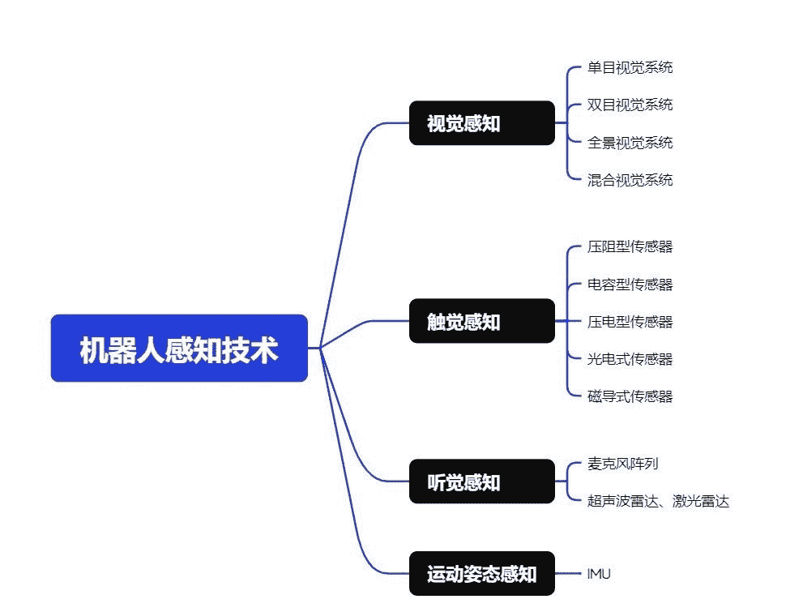

### 视觉感知(颜色、亮度感知)

机器人视觉感知技术包括硬件传感器的研发、软件算法的研发等。主流视觉传感器系统包括单目、双目立体、全景、混合等。依据不同的应用场景选择合适的传感器配置从而得到目标视觉信息的全周期、全覆盖。

下面我们将大致讲解一下几种视觉传感器之间的差别

> 单目视觉系统

+   仅使用一个摄像头，由于三维空间的深度信息在成像过程中丢失，这种系统无法直接测量物体的距离，通常依靠其他技术或算法间接估计深度。单目系统“的视角取决于摄像头镜头的参数，通常视角有限，但可以通过调整镜头来改变，广泛应用于目标跟踪、室内定位导航等不需要非常高精度深度信息的场合。

+   在许多的场合当中单目视觉通常适合于使用场景较为低调且单一，适用于工业场景居多。

> 双目视觉系统

+   通过两个摄像头模仿人眼的体视功能，利用三角测量原理获得场景的深度信息，可以比较准确地恢复视觉场景的三维形状和位置。双目系统的视角较宽，因为两个摄像头从不同角度捕获图像，有助于深度信息的获取。用于需要高精度深度信息的应用，如移动机器人的定位导航、避障和地图构建。

+   常使用于机器人对环境建模识别场景，适合场景为变化较多的且需要探测深度的场景中。

以下是双目系统视觉的成像步骤

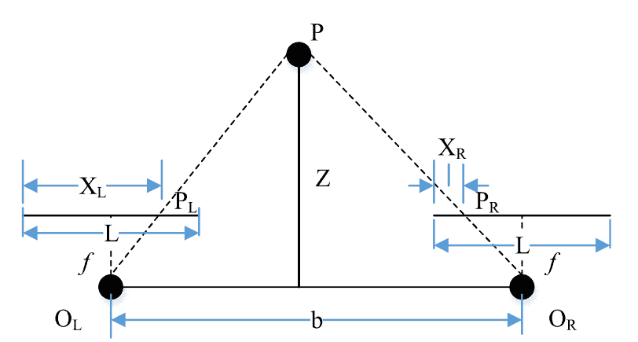

1.  双目摄像头几何关系

两个摄像头的坐标系中，设(xl,yl)(xl,yl)为左摄像头的图像坐标，(xr,yr)(xr,yr)为右摄像头的图像坐标，(X,Y,Z)(X,Y,Z)为世界坐标系中的三维坐标。两个摄像头的中心分别为ClCl和CrCr，基线为BB（即Cr−ClCr−Cl的距离）。

1.  建立针孔相机模型

每个摄像头可以被建模为一个针孔相机，其投影关系可以表示为：

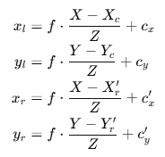

其中：

+   f 是焦距。

+   (cx,cy)(cx,cy) 和 (cx′,cy′)(cx′,cy′) 是主点坐标（图像中心）。

+   (Xc,Yc)(Xc,Yc) 和 (Xr′,Yr′)(Xr′,Yr′) 是世界坐标系中的摄像头中心坐标。

1.  视差计算

视差 d 是指在两个图像中匹配点的水平像素差：

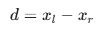

1.  深度计算

深度 D 可以通过以下公式计算：

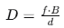

这里，B 是两个摄像头之间的物理距离（基线），ff 是焦距，dd 是视差。

1.  立体校正

在进行视差计算之前，通常需要对图像进行立体校正，以确保两个摄像头的图像在水平方向上对齐。这通常涉及到图像的旋转和平移。

1.  视差图生成

视差图是将每个像素的视差值映射到一个新的图像中，其中每个像素的值表示该点的视差。

1.  图像块匹配算法

+   **块匹配算法**：将图像分割成小块，然后在另一个图像中搜索匹配块。

+   **特征匹配算法**：使用特征检测算法（如SIFT、SURF）来找到图像中的关键点，然后匹配这些关键点。

+   **半全局匹配（SGM）**：考虑图像中的全局信息，通过动态规划来优化视差计算。

1.  视差优化

+   **视差平滑**：通过各种滤波技术（如高斯滤波）来平滑视差图，减少噪声。

+   **视差细化**：使用子像素精度的匹配技术来提高视差图的精度。

1.  深度图生成

最后，根据视差图和深度计算公式，生成深度图，该图表示场景中每个像素的深度信息。

> 全景视觉系统

+   是具有较大水平视场的多方向成像系统，突出的优点是有较大的视场，可以达到360度，全景视觉系统可以通过图像拼接的方法或者通过折反射光学元件实现适合需要大范围监测的应用，但本质上是一种单目系统，无法直接获取深度信息。

+   适用与机器人导航以及部分监控任务，需要大规模监视且不需要深度信息的场景

> 混合视觉系统

+   结合了多种视觉系统的优点例如单目或双目视觉系统与其他传感器如激光雷达的结合，能够同时提供宽广的视场和精确的深度信息。混合系统的视角取决于组合的各个传感器，可以实现广角监测同时也能精确测距。混合系统结构配置复杂，需要多种传感器的配合，多用于复杂的应用环境，如自动驾驶，既需要广阔的视野又需精确的障碍物检测与测距。

### 触觉感知(力感知)

机器人的触觉感知能力是实现与物体之间柔性交互的重要部分。触觉传感器“根据其信号转换机制的不同，可以分为多种类型，每种类型具有不同的工作原理和应用场景。

> 压阻型传感器

+   利用弹性体材料的电阻率随压力变化的性质制成。当外力作用在传感器上时，弹性体发生形变，导致电阻变化，进而将机械刺激转化为电信号。

> 电容型传感器

+   利用两极板间电容的变化来检测受力信息。当外力作用于传感器时，两极板间的相对位置或介质厚度发生变化，导致电容值变化，通过检测电容变化量来获取受力信息。

> 压电型传感器

+   基于压电效应，当受到外力作用时，材料内部发生电极化现象，从而产生电信号。常用的压电材料如锆钛酸铅因其高灵敏度和快速响应被广泛采用。

> 光电式传感器

+   利用光学原理进行工作，通常由光源和光电探测器构成。当施加在界面上的压力发生变化时，传感器敏感元件的反射强度和光源频率也会相应变化。

> 磁导式传感器

+   在外力作用下磁场发生变化，并把磁场变化转换为电信号，以此感受接触面上的压力信息。

### 听觉感知(波感知)

机器人听觉感知的应用包括让机器人能够听懂人说的话，此时需要在机器人系统上增加声波传感器、语音接口，对应的传感器阵列可以全面向接受声音信息，解析复杂的声波频率，提取连续自然语言中单独语音和词汇，结合自然语言处理技术实现人机语音交互。相比于视觉感知，听觉感知更多的用途在声源定位技术以及根据激光接触障碍物波反馈定位技术，多用于环境距离探测。

> 麦克风阵列

通过声音造成内部线圈共振，根据不同的共振频率来判断声音的相关特性以及远近距离，定位方法一般为时间差定位与相位差定位。

以下是麦克风阵列声波定位算法介绍

1.  声波传播模型

声波在空气中的传播速度为 cc（大约为 343 m/s 在标准大气条件下）。当声源发出声波时，声波会以球面波的形式向外传播。

1.  时间差定位（TDOA）

假设声源位于位置 (xs,ys,zs)，麦克风 M1 和 M2 分别位于 (x1,y1,z1) 和 (x2,y2,z2)。声波到达 M1 和 M2 的时间差 Δt 可以表示为

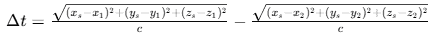

1.  相位差定位

如果麦克风阵列中的麦克风间距远小于声波的波长，可以使用相位差来估计声源方向。相位差 Δϕ 可以表示为：

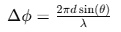

其中：

+   d 是相邻麦克风之间的距离。

+   θ 是声源方向与麦克风阵列法线之间的角度。

+   λ 是声波的波长。

1.  波束形成（Beamforming）

波束形成是一种通过调整麦克风信号的相位来增强特定方向信号的技术。波束形成增益G(θ) 可以表示为：

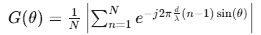

其中：

+   N 是麦克风的数量。

+   d 是麦克风之间的距离。

+   θ 是声源方向。

1.  声源定位算法

+   **最小方差无失真响应（MVDR）** 波束形成器的输出功率最小化准则可以表示为：

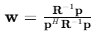

其中：

+   w**w** 是权重向量。

+   R**R** 是信号的协方差矩阵。

+   p**p** 是指向声源方向的矢量。

> 超声波雷达，激光雷达

激光雷达成像可以简单理解为使用激光发射部件向一定视场角FOV(Field OfView)内发射光线，同时使用接收部件接收范围内反射回的光线，利用已知和获取的发射光线与反射光线的相关信息，直接计算或推导出反射点的信息(速度、距离、高度、反射强度等)。一般有两种方法用来探测：飞行时间（ToF）法，相干探测法。

以下是激光雷达飞行时间定位算法介绍

1.  基本原理

激光雷达系统通常包括一个激光发射器、一个接收器（通常是光电探测器）、一个计时器和一个旋转装置（用于扫描环境）。激光雷达的工作原理基于以下步骤：

**发射激光**：激光发射器发出短脉冲的激光。

**接收反射光**：激光光束照射到物体上后，部分光被反射回来。

**测量时间差**：激光雷达接收器接收反射回来的光，并记录发射和接收之间的时间差。

**计算距离**：利用光速和时间差计算物体的距离。

1.  距离计算公式

激光雷达测量距离的基本公式是：

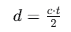

其中：

+   d 是激光雷达与物体之间的距离。

+   c 是光速，在空气中约为300000000米/秒。

+   t 是激光脉冲发射到接收的时间差。

+

1.  速度计算公式

如果激光雷达能够连续测量同一物体的距离变化，还可以计算物体的速度。速度 v 的计算公式是：

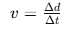

其中：

+   Δd 是两次测量的距离差。

+   Δt 是两次测量的时间间隔。

1.  角度测量

激光雷达通常配备有旋转装置，可以测量物体的角度位置。角度 θ 可以通过以下公式计算：

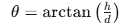

其中：

+   h 是激光雷达相对于地面的高度。

+   d 是测量的距离。

1.  三维坐标计算

结合距离和角度测量，可以计算物体在三维空间中的坐标。如果激光雷达在水平面上扫描，物体的三维坐标 (x,y,z) 可以通过以下公式计算：

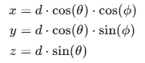

其中：

+   ϕ 是激光雷达的水平旋转角度。

1.  多普勒效应

如果物体相对于激光雷达有运动，可以通过多普勒效应测量其速度。多普勒频率偏移 Δf 与物体速度 v 的关系是：

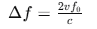

其中：

+   f0 是激光的频率。

### 运动姿态感知

运动姿态感知通常是指机器人或设备能够感知和理解其自身的运动状态和方向，这通常涉及到对加速度、角速度、磁场等的测量。IMU（惯性测量单元）是一种常用于实现运动姿态感知的传感器。它通过提供精确的运动和方向数据，使得设备能够更好地理解和响应其在环境中的运动状态。

> IMU

IMU通过结合加速度计、陀螺仪和磁力计的数据，可以提供设备在三维空间中的运动和方向信息。这些信息对于机器人的运动姿态感知至关重要，因为它们允许机器人：

+   **确定位置和方向**：通过融合加速度计和陀螺仪的数据，可以计算出设备在空间中的位置和方向。

+   **监测运动**：加速度计和陀螺仪的数据可以用来监测设备的运动状态，如行走、跳跃或旋转。

+   **导航和路径规划**：在移动机器人中，IMU数据可以用于辅助导航和路径规划，尤其是在GPS信号不可用的环境中。

IMU解算姿态估计如下所示

1.姿态可以通过以下方式估计：

+   **欧拉角**：通常表示为绕Z轴（偏航角 ψ）、绕Y轴（俯仰角 θ）和绕X轴（横滚角 ϕ）的旋转。

+   **四元数**：提供一种避免万向锁（Gimbal Lock）的方法来表示姿态。

姿态更新方程（以四元数为例）：

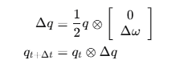

其中：

+   q 是四元数。

+   Δω 是角速度向量。

+   ⊗ 表示四元数乘法。

####

2.速度和位置更新

速度和位置可以通过积分加速度计的读数来更新：

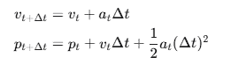

其中：

+   vt 是在时间 t 的速度。

+   at 是在时间 t 的加速度。

+   pt 是在时间 t 的位置。

####

3.磁力计数据融合

磁力计数据通常用于校正IMU的姿态估计，以消除由于加速度计和陀螺仪的偏差和漂移引起的误差。

####

4.卡尔曼滤波器

卡尔曼滤波器是一种常用的数据融合算法，用于估计动态系统的状态。在IMU中，卡尔曼滤波器可以表示为两个步骤：预测和更新。

+   **预测步骤**：

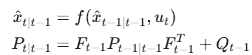

+   **更新步骤**：

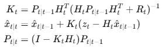

+   其中：

+   x^ 是状态估计。

+   P 是估计的协方差。

+   f 是状态转移函数。

+   u 是控制输入。

+   F 是状态转移矩阵。

+   Q 是过程噪声协方差。

+   z 是观测值。

+   H 是观测矩阵。

+   R 是观测噪声协方差。

+   K 是卡尔曼增益。

## 多模态融合

在自动驾驶、移动机器人应用里，当机器人处于未知环境中，移动机器人的运动规划前提是要有精确的自主定位和环境感知，虽然摄像头和激光雷达都可以产生对环境进行信息感知，同时配置两者在一定程度上可以做到信息互补，补完路况中不确定性。

将摄像头与激光雷达产生的信息进行融合，利用冗余互补的信息形成[更全面](https://zhida.zhihu.com/search?q=%E5%A4%9A%E6%A8%A1%E6%80%81&zhida_source=entity&is_preview=1)、更可靠的感知结果。目前比较常见的多模态传感器数据融合的方法有如下三种：

1、数据级融合（前融合）：直接将不同模态的原始数据在空间上对齐后进行融合。

2、特征级融合（深度融合）：分别对不同模态的原始数据进行特征提取并在特征空间中将各模态特征混合在一起。

3、目标级融合（后融合）：在每个模态都对目标进行预测，然后综合不同模态的结果形成单一的目标输出。这种方法可以当成一种集成学习方法。

目的是为了下一步机器人做决策以及具身智能做相关的信息准备以及有效信息处理，使得决策系统更有效地应对不同环境相关信息而做出决策。

在下一篇当中，我将会讲述如何根据感知技术进行数据融合从而得到机器人的决策数据，以及现有应用举例以及这部分的发展前景和方向，然后我们将会正式拉开具身智能的大门！