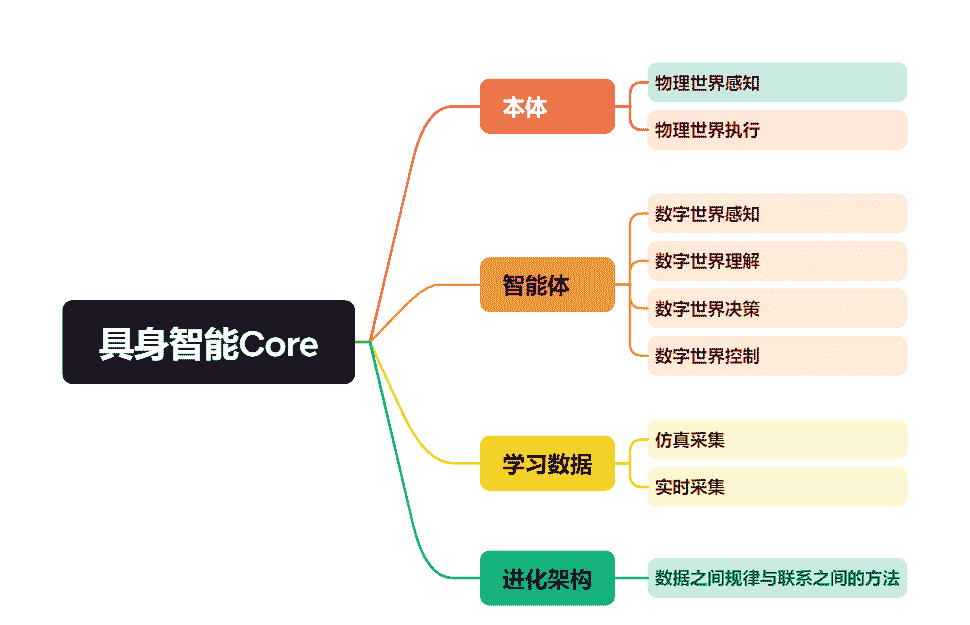
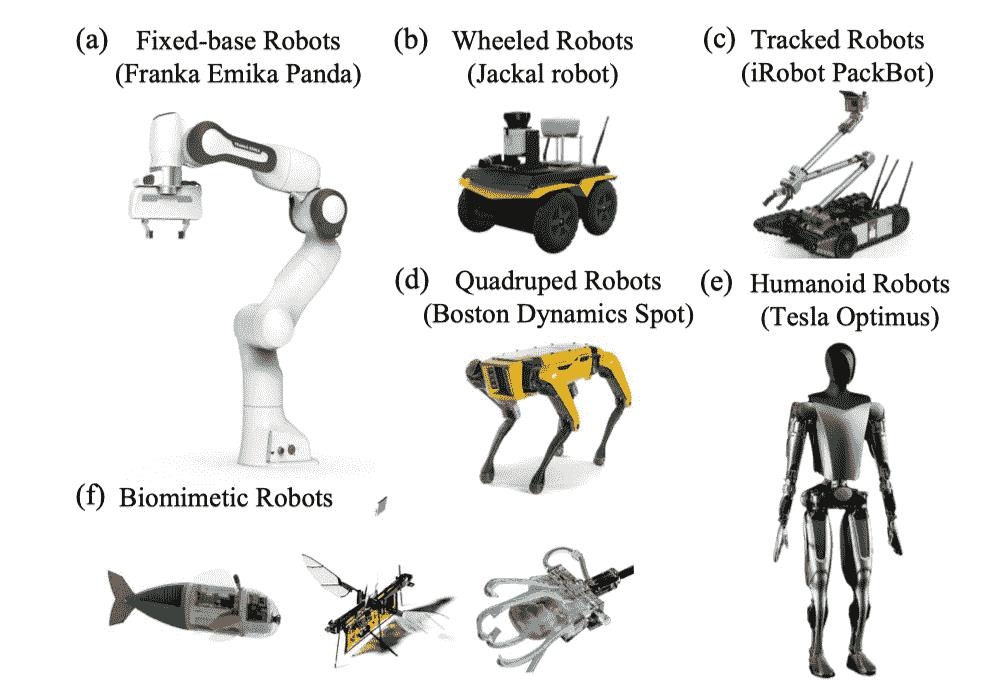
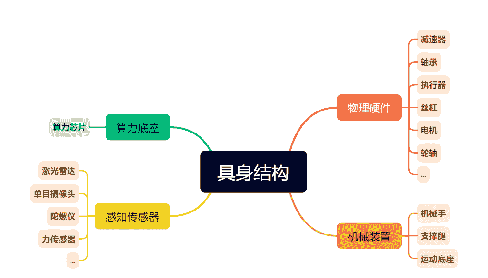
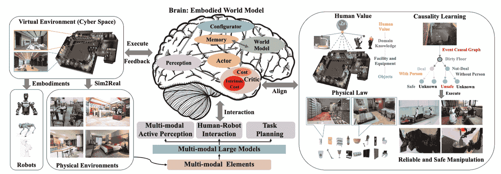
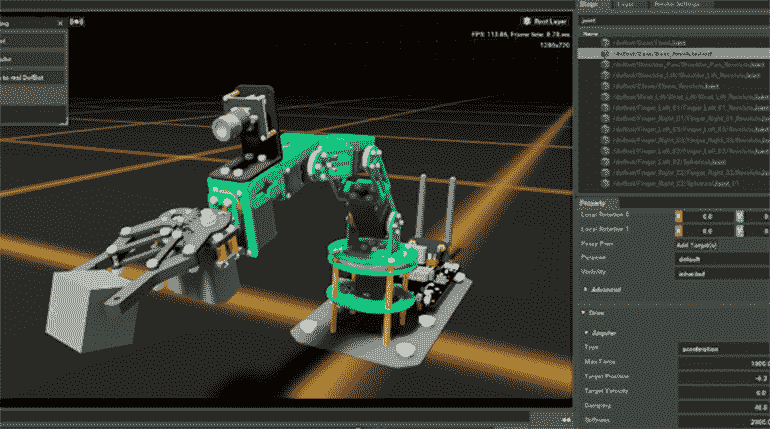
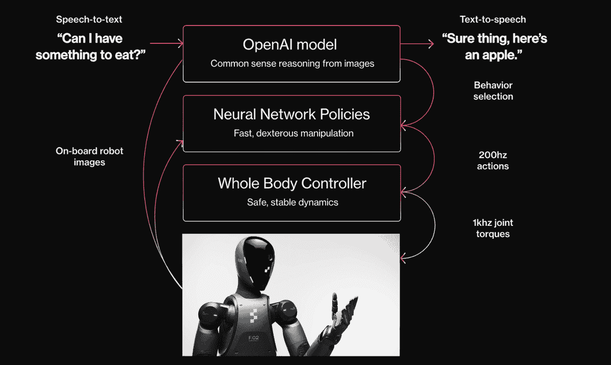
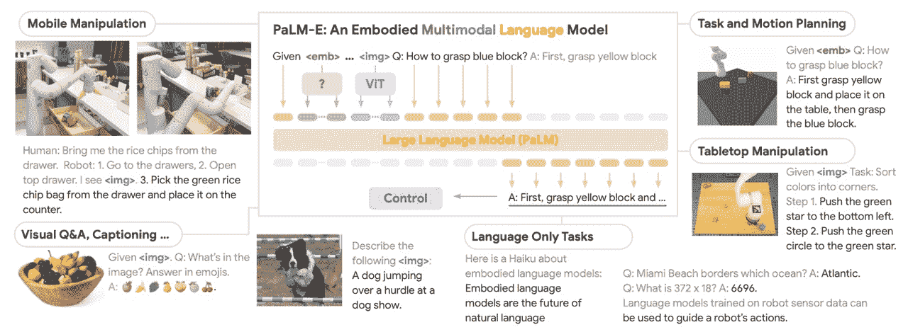

# 一文带你初步理解具身智能前世今生

> 来源：[https://v11enp9ok1h.feishu.cn/docx/CcU6dWEPcoYlYPxuCrkczQ1BnFd](https://v11enp9ok1h.feishu.cn/docx/CcU6dWEPcoYlYPxuCrkczQ1BnFd)

在如今的这个时代，随着大模型等等技术的发展和火爆，智能+的概念正在席卷全球。机器人从上世纪60年代诞生以来，不断地在我们的身边生根发芽，具身智能便是诞生在这个大背景之下。智能永远是承接在具身之上，我们将从具身开始了解和扩散这个概念、

# 1.何为具身？

“具身”（Embodiment）首先是一个心理学概念，具身的基本含义是指认知对身体的依赖性，即身体对于认知具有影响。具身还分为“弱具身”和“强具身”，前者认为认知依赖于身体，但保留了认知自身的计算和表征功能，后者则主张：“认知是被身体作用于世界的活动所塑造出来的，身体的特殊细节造就了认知的特殊性。

具身的性质和特征可以表现在四个方面：

1.  身体参与了认知，影响了思维、判断、态度、情绪等心智过程；

1.  对于客观的认知依赖于身体作用于世界的活动；

1.  意义源于身体——有着身体的“感觉——运动系统”的基础；

1.  身体的不同特征倾向，造就了不同的思维和认识方式。

从这点来看，“具身”所指代的，便是客观物理存在的“身体”，对于身体所承载的“认知”带来的各种影响。认知不能脱离身体单独存在。此外，“具身”相对的概念是“离身”（Disembodiment），指的是认知与身体解耦。

# 2.具身与智能

具身强调的是客观物理上的实体，可以是生物体也可以是机器人体，在此我们之后将会以单纯机器人具身进行讨论。具身与认知的概念强调的是人类认知与躯体之间的联系，则具身与智能之间强调的是机器人的认知与实体之间的联系。原有的具身控制发展无法超越其原始的设计思路，较难不能适应未知的环境，智能算法的发展，却能有效的去学习环境信息并对其进行决策，最初的具身智能的概念便由此诞生。

具身智能的发展意义在于，它能够提升当前的“弱人工智能”认知能力，使人工智能可以通过与环境的交互从真实的物理或虚拟的数字空间中学习和进步。具身智能也是产生超级人工智能的一条可能路径

# 3.具身智能的核心

具身智能通过在物理和数字世界中学习与进化，以试图理解这个世界和互动交互以及完成任务为最终目标。我将会以下四部分详细解释各部分在具身智能的发挥作用。

具身智能的核心大致由以下四点构成：

## 1.本体（Embodied Body）：

作为实际的执行者，在物理或虚拟世界中进行感知和任务执行的机构，通常是一个具有物理实体的机器人。

### 形态

机器人的本体常常有多种的形态，一般分为：

1.  固定基座型，如机械臂，常应用在实验室自动化合成、教育、工业等领域中；

1.  轮式机器人，因高效的机动性而闻名，广泛应用于物流、仓储和安全检查；

1.  履带机器人，具有强大的越野能力和机动性，在农业、建筑和灾难场景的应对方面显示出潜力；

1.  仿生机器人，通过模拟自然生物的有效运动和功能，在复杂和动态的环境中执行任务。

1.  四足机器人，以其稳定性和适应性而闻名，非常适合复杂地形的探测、救援任务和军事应用。

1.  人形机器人，以其灵巧手为关键，在服务业、医疗保健和协作环境等领域广泛应用。

### 结构构成

本体一般由物理硬件，机械装置，算力底座，感知机构组成。

+   **物理硬件由各种减速**器，轴承，执行器，丝杠，电机，轮轴等等硬件组成具身的受力本体。

+   **机械装置主要为机**械手与支撑腿以及其他运动装置组成具身执行本体。

+   感知器常用的有单目摄像头，激光雷达，除此之外**还有各种力学传感器，**通过各种传感器的组合完成世界对具身的交互。

**执行机构往往是关节电**机，通过驱动关节电机完成具身对世界的交互。

## 2.智能体（Embodied Agent）：

位于本体之上的智能核心，负责感知、理解、决策和控制等核心工作。

具**身智能是高级的机器智能形式，它使**机器人能够像人类一样感知和理解 环境，并通过自主学习和适应性行为来完成任务。机器人的能力和实现过程抽象为：感知perception - 决策Decision - 执行Action

对这个过程可以简单记为PDA

### 具身感知Embodied perception

负责通过具身上面的感知器获取和处理环境信息，为智能体的决策Decision和执行Action提供依据。可以通过两种方式实现：

1.  全感知，通过构建包含操作环境各种知识的大规模数据库或者环境来为后续决策提供执行依据；

1.  具身交互感知，通过智能体与环境实时交互获取感知反馈，利用算法拟合并构建环境表征，为后续提供执行依据。

### 具身决策Embodied Decision

这部分是具身智能核心当中的核心，需要类似大脑的处理能力，以满足机器人在理解指令、分解任务、规划子任务、识别物体等需求。

处理不同传感器的数据，并且根据这些数据进行数据融合和匹配，做出正确执行决策。

多模态的大模型技术为决策提供了更好的实现方法。根据不同的传感器的环境表征数据结合，对数据处理之后利用大模型的语言理解能力和生成能力可以与环境与世界进行多维度的交互，亦可以与人类进行直接交互，更好理解人类指令和意图，做出正确的行为。

### 具身执行Embodied Action

控制根据感知信息和决策指令，协调机器人各部件的运动，实现智能化的行为控制。

多传感器融合通过综合利用多传感器信息，提高对环境感知和理解能力，实现更好的控制。

## 3.学习数据（Learning Data）：

智能体进行学习和进化的基础，需要海量数据来支持其感知、决策和控制过程。

数据一般为以下两种数据，他们具有不同特性：

### **仿真数据**

在仿真环境当中具有多样环境中进行测试的可扩展性，快速的原型设计能力，能够为广泛研究群体提供便利， 提供用于精确研究的可控环境，生成用于训练和评估数据，并提供算法比较的标准化基准。，仿真数据相比于实际采样数据更易得到。

### 实际采样数据

基于不同机器人的直接采样数据，有较大的实践意义，但是由数据在于不同环境，以及采样频率和各种扰动带来的采集误差，数据可能会不适用，但是拥有较大的参考设计意义，能把主要的行动趋势从数据当中提取出来分析。

## 4.学习和进化架构（Software Structure）：

智能体与世界交互且适应新环境、学习新知识并强化解决问题方法。当前具身智能算法路径主要分为两条

### 一、以 OpenAI 与 Figure 合作为代表的分层决策模型

分层决策模型大致解读：

1.  第一层OPENAI model，通过OPENAI多模态大模型感知决策同时实现，模型整合任务、环境和本体的感知信息。

1.  第二层Neural Network Policies，以RL模型为具身模型，从而实现大模型的环境感知到动作的规划。

1.  第三层Whole Body Controller，最后通过传统的运动学控制算法k控制机器人完成具体动作

### 二、以 Google RT-2 为代表的端到端模型

端到端模型策略大致解读：

1.  第一步，先在大规模互联网数据上预训练 VLMs，然后在机器人任务上微调。

1.  第二步，输入是任务和对象的组合，输出是一系列动作。

1.  第三步，利用大模型完成从输入到感知、推理、决策和行为指令输出的全过程。

以上两种策略是目前世界上具身智能的两种开发策略，为此我们后面会详细有解读分别的开发论文，受限于篇幅，请关注后续的文章。

看完上述的文章我相信你对具身智能应该有一个大致的了解，我们接下来会逐步更新接下来相关的技术路线解读以及各部分是如何执行。

---

部分图像来自zomi大佬无私开源：https://github.com/chenzomi12/AIFoundation/