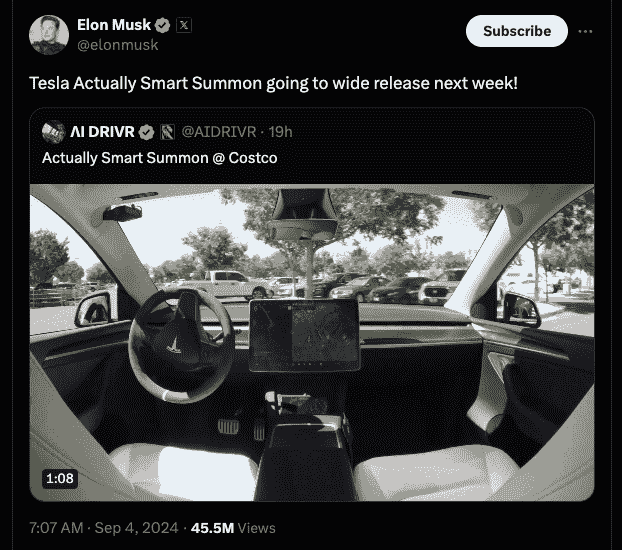
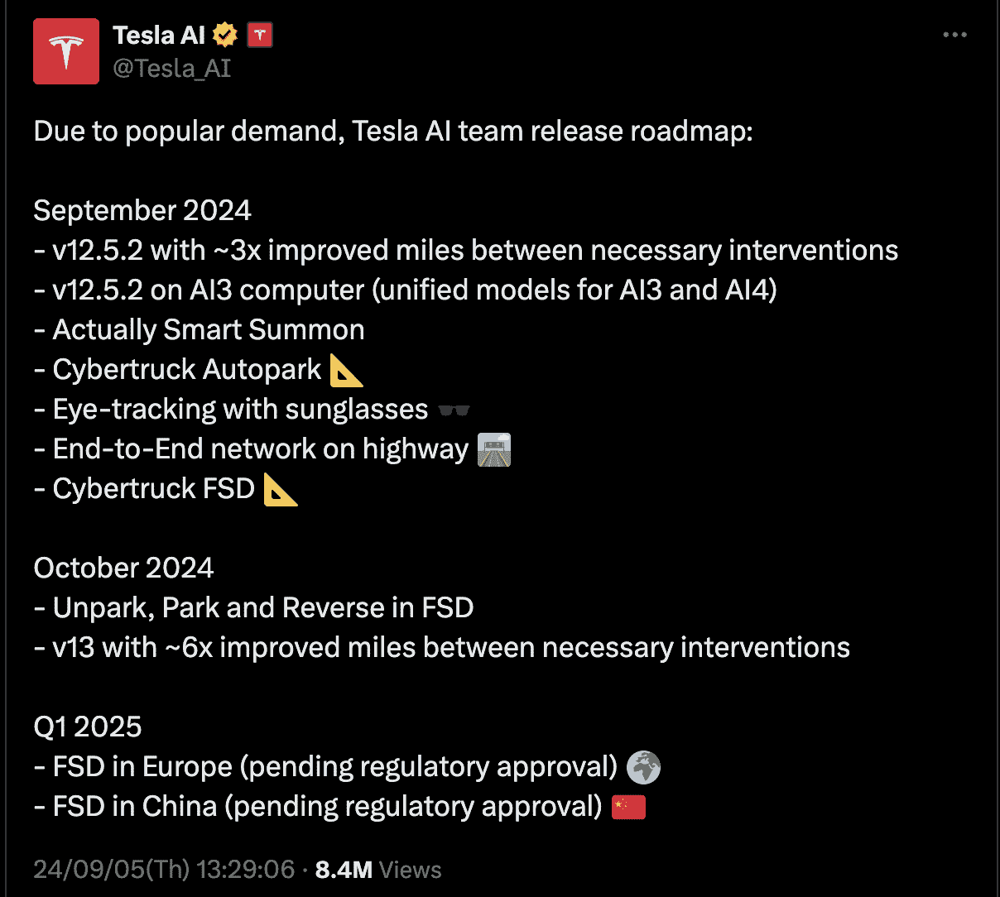
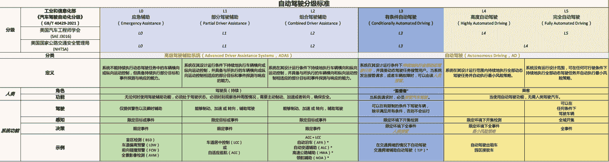
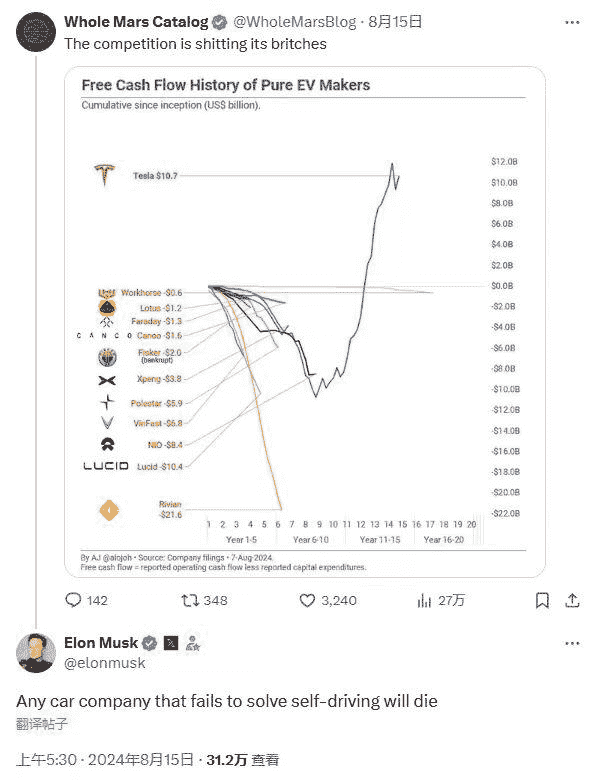
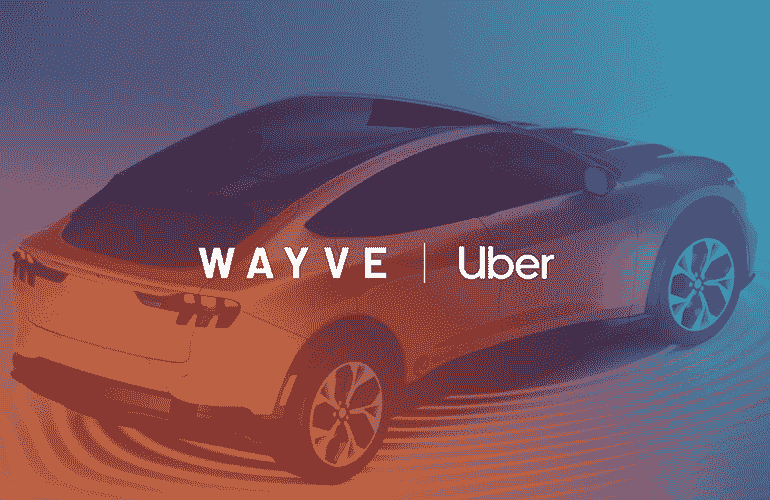
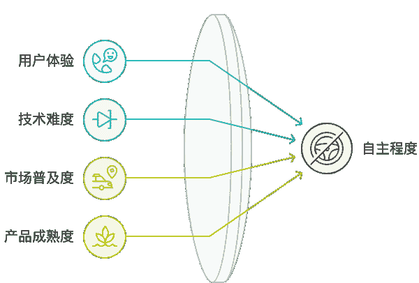
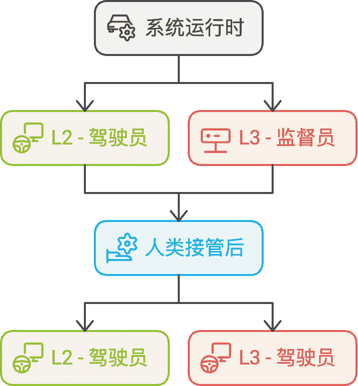
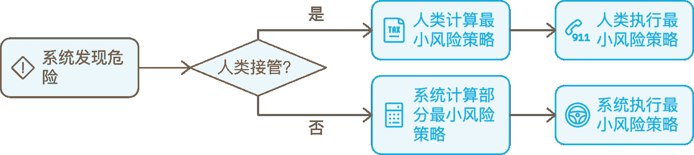

# 为什么我们很难用到真正的 L3 产品？

> 来源：[https://v11enp9ok1h.feishu.cn/docx/AaP3deBKGoa0NWxVgTtcOc4Rn9g](https://v11enp9ok1h.feishu.cn/docx/AaP3deBKGoa0NWxVgTtcOc4Rn9g)

这周新能源汽车品牌 Tesla 连续放出**两个重磅消息，先是在本**周二(9月3日)，FSD V12.5.3 中更新了跳票2年的真·智能泊车（Actual Smart Summon）；紧接着在周四（9月5日）， Tesla AI 的官号又宣布，计划在明年（2025）一季度在中国推出其高阶自动驾驶系统 FSD（Fully Self-Driving）。被 Musk 称作 L5 自动驾驶的 FSD 估计又要在国内的各大自动驾驶厂商中激起不小的浪花。借此机会，我们从零介绍自动驾驶（为自动驾驶祛魅🐶）！

**章节目录**

## **自动驾驶的分级**

提到自[动驾驶](http://c.gb688.cn/bzgk/gb/showGb?type=online&hcno=4754CB1B7AD798F288C52D916BFECA34)[就不得](https://www.sae.org/standards/content/j3016_201806)不提到美国汽车工程学会（SAE）在2014年提出的 L0~L5 分级标准，这个标准除了确定各级别自动驾驶的定义外，还确定了各级别的功能，为自动驾驶后续的功能开发和产品的定义奠定了基础。在 2021 年我国工信部还推出了适用于我国的《汽车驾驶自动化分级》[1] 标准，同样采用了 L0~L5 的分级方式，定义也与 SAE [2] 标准大体相同。

上表**是我根据《汽车驾驶自动化分级》和工作经验总结的，可以看出，**除了具体的定义和系统定义的细分方法，根据人类在系统中的角色，也可以将 L0~L2 和 L3~L5，区别为辅助人类驾驶的 高级驾驶辅助系统（Advanced Driver Assistance Systems，ADAS） 和代替人类驾驶的 自动驾驶（Autonomous Driving，AD） 。

ADAS 和 AD 的区别本质是用户角色不同，这将带来产品/功能定义上的巨大差异，因为这是“自动驾驶祛魅”系列的第一篇，为了方便理解和记忆，我们下面就用户的角度开始，一一介绍不同等级的自动驾驶概念和发展现状。

## **毫无驾驶乐趣的 L4 和 L5**

> L5 完全自动驾驶（Fully Automated Driving）：系统在任何可行驶条件下持续地执行全部动态驾驶任务并自动执行最小风险策略。

从定义上来说，L5 级别的自动驾驶是自动驾驶的理想形态，该级别的系统驾驶水平应该能够比肩甚至多数条件**下超越一般**的人类驾驶者，从大的 AI 范畴分类上，L5级别的自动驾驶应该归类于强人工智能。除了 Musk，还没听谁提过 L5 自动驾驶，也没见过任何实物或概念产品。L5 级别的自动驾驶没什么特别可讨论的，再次简单过一下。下面要讨论的 L4 自动驾驶可以理解为在有限条件下对 L5 自动驾驶的实现。

> L4 高度自动驾驶（Highly Automated Driving）：系统在其设计运行范围内持续地执行全部动态驾驶任务并自动执行最小风险策略。

L4 可以说是最接近大众幻想中自动驾驶概念的自动驾驶。根据法规和定义，安装有 L4 自动驾驶的汽车，不再强制安装方向盘、刹车和油门踏板等人类驾驶设施，只要在其设计运行范围内（可以是地理区域，也可以是天气和路况限制等），无论是自动驾驶出租还是代客泊车，人类的角色就仅限是乘客。这也是 ADAS 和 AD 的核心区别， ADAS 的真实用户是驾驶员，而 AD 的真实用户是交通系统。AD 系统搭载的乘客等价于“货物”，不再承担“驾驶员”职责的同时，也丧失了驾驶的乐趣。

在经历了资本、市场和消费者狂热后，乘用车生产厂家逐渐意识到，L4 自动驾驶与普通车辆的消费者和消费需求是背离的，前者是交通系统，需要的是效率和安全；后者则是机动车驾驶员，追求的是驾驶体验和便捷。加之开放道路情况复杂、众多未解决的技术难题和巨大的资金需求等挑战，市场对乘用车 L4 级的自动驾驶热情也在降温，近两年接连有国外的的初创企业倒闭和主机厂停止研发的消息传出。相对的，是一些创业企业的功能型产品和商业模式在逐步企稳，如无人快递车、无人园区接驳车等在稳步落地中。

不过最近无人出租车（Robot-Taxi）似乎又有回暖的迹象，前一段时间沸沸扬扬的萝卜快跑，和上个月 Uber CEO 宣布与 WAYVE 合作重新入局无人出租车，似乎无人出租车行业要迎来下一波热点？

L4 自动驾驶的技术、思路和研发体系对于未来 ADAS 的发展会很有启发，如果大家有兴趣，后面再细致的分享一些 L4 的经验技术和思考，欢迎大家评论留言~

## **车还是要人开的 L0 和 L1**

> L0 应急辅助（Emergency Assistance）：系统不能持续执行动态驾驶任务中的车辆横向或纵向运动控制，但具备持续执行部分目标和事件探测与响应的能力。

L0，类似于驾校教练，基本只说不做，在你旁边提醒你前边有红绿灯啊（TSR）、倒车要压线了（AVM）等等。好一点的带个副刹车，在你快撞马路牙子的时候一脚刹车踩死……有就比没有强，所以现在新的车型上，L0 功能基本是标配，后装市场也很丰富。

L0 的技术栈比较成熟，算法方面主要集中在传统机器视觉、小规模深度模型和传感器的信号处理，因为门槛相对较低，功能上又没有太多增益空间，市场竞争逐渐激烈，现在处于“卷”硬件价格和性能的阶段。

> **L1 部分驾驶辅助（Partia**l Driver Assistance）：系统在其设计运行条件下持续地执行车辆横向或纵向运动控制，并具备与所执行的车辆横向或纵向运动控制相适应的部分目标和事件探测与响应的能力。

**L1**** **辅助驾驶系统的功能是在速度或者方向上辅助纠偏，注意只能二选一。也因此，近年来随着能够在速度和方向上同时工作的 L2 出现，L1 的功能多数被并入 L2 功能重。

| 级别 | 产品成熟度 | 技术难度 | 市场普及率 | 用户体验 |
| --- | --- | --- | --- | --- |
| L0 | 高，功能定义清晰 | 低，实现容易 | 高，前后装都支持 | 高，无需主动操作 |
| L1 | 高，功能定义清晰 | 一般，有一定技术门槛 | 高 | 中，需手动开启 |
| L2 | 一般，复杂场景定义模糊 | 偏高，需要较强的研发实力 | 增加 迅速 | 中，需手动开启，不分功能开启复杂 |
| L3 | 低，功能边界定义较难 | 高 | 低，部分高端新能源车型 | 不确定 |

## **系统给我帮忙的 L2**

> **L2 组合驾驶辅助（Combine**d Driver Assistance）：系统在其设计运行条件下持续地执行车辆横向和纵向运动控制，并具备与所执行的车辆横向和纵向运动控制相适应的部分目标和事件探测与响应的能力。

L[**2 系统可谓是**](https://mp.weixin.qq.com/s?__biz=MzA5OTE1MjcxMw==&mid=2650600381&idx=4&sn=9cfcb550abf9f7393e1dca35f76ae4a1&scene=21#wechat_redirect)今年**的当红炸**子鸡，在今年（2024）上半年，L2 （包含各种 L2+ 和 L2++ ）级别辅助驾驶系统的装机量达到 424 万套，渗透率达到 51%（数据来源：盖世汽车研究院）。L2 辅助驾驶系统可以在驾驶员的监督下，在限定的场景下独立驾驶。此时，驾驶员类似于系统的教练，当发现有危险的情况的时候要主动接管（注意这里，后面要考）车辆的驾驶，驾驶员在整个行驶过程的状态都要保持驾驶状态，无论手脚是否离开方向盘或者刹车油门，注意力都要放在周围环境和车辆状态上，随时准备接管车辆。

**因此，用户**对于该**级别功能真正的**需求便是放松下手脚，或者降低自己对路面和周围环境的观察强度，这类用户是能够通过 L2 辅助的功能减轻驾驶疲劳感的。

还有一部分的用户需求是车技的“提升”。作为自**动驾驶开发者和用户，要有一个认**知，那就是再好的自动驾驶系统也比不上人类。这里的人类不指单个人类的个体，而是整体。因此任何一个 ADAS 或 AD 功能的开发的目标其实都只是在追赶人类在驾驶这一技能的平均水平。正因为如此，自动驾驶系统也给低于某领域平均水平的人类（比如新手）一个“开挂的”机会😁

作为一个有近 10 年经验的自动驾驶开发者，我印象最深的一次体验并不是第一次试乘自己研发的车，也不是第一次完成付费无人出租的行程，而是我朋友的一次下高架。那次我们一起去拜访一位朋友后从苏州返回上海，他开着新买的特斯拉，在进上海市区下高架的转弯（很急的弯）时他开启了车道线辅助功能，我问他是不是累了？他说不是，是因为他觉得辅助驾驶转弯转的比他好……

总的来说，L2 及以下的 ADAS 系统的核心用户需求是：让驾驶变得更容易。

回到 L2 的技术来说，在软件算法层面，经典的车道线居中、自动巡航等功能已经有了相对完善的解决方案；领航辅助和自动泊车等虽然容易受环境和 Corner Cases 影响的功能，但在 L2 的定义下，由于有着人类的干预，也可以进入“应用-反馈-迭代”的提升循环中。硬件方面无论是 L0、L1 还是 L2，想要刹车或控制油门和方向，需要接入汽车底盘的控制信号，传统的底盘厂商（特别是外资）不开放或者收高额费用开放信号，这也是乘用车自动驾驶开发的一个难题。另外 L2 及以下的传统辅助驾驶系统遵循的量产思路是：多传感器配多MCU（Micro Controller Unit，微控制单元），硬件和功能一对一绑定。近年来，为了降低成本和提供更好的用户体验，更多配备更高阶 ADAS 或 AD 的车型选择复用硬件和集中式计算单元来实现更低阶的功能。

## **我给系统“帮忙”的 L3**

> **L3 有条件自动驾驶（Conditionall**y Automated Driving）：系统在其设计运行条件下持续地执行全部动态驾驶任务，并具备动态驾驶任务接管用户。当系统发出接管请求，或者车辆故障时，可以由该人员接管。

说了这么多，终于说到了今天标题提到的 L3 自动驾驶。

通过上面的介绍应该不难看出，L0~L2 的 辅助驾驶系统依然维持着助手的角色，人类始终承担着大部分驾驶员的任务和责任；但是 L3 自动驾驶系统中，只有当系统觉得需要人类驾驶员的时候，人类才转变身份，承担驾驶员的任务。

是不是觉得功能很强大，用了 L3 系统就可以暂时溜号，刷刷手机、看看书或者小憩一会？只需要等待送达目的地或者系统对提示？但问题是，系统什么时候报警呢？

下图阐明了 L2 和 L3 系统在运行时以及触发接管后，人类的角色变化：

看似在系统运行时角色为一般乘客的人类，其实承担了监督员（这个在自动驾驶测试车辆里叫安全员）的角色，原本一个角色任务变成了两个，不仅要掌握驾驶员的开车技能，还要掌握“监督员”响应的识别系统提示的技能。其实这种监督员兼**驾驶员的角色已在我**们的交通系统中很常见，例如地铁、高铁的驾驶员、飞机的飞行员，还有大型缆车的驾驶员。这些角色都是为其所在的系统工作的工作人员，要接受相关的培训。从用户角色的角度来说，从让系统给我帮忙到我给系统“帮忙”，甚至“打工”的角色转换是不是本末倒置了？🤔

回到**定义，许多在技术**上可以归类为 L3 自动驾驶系统的功能，如高速公路辅助（HWA）和 领航辅助（NOA）等，在被冠以 L2+ 或 L2++。究其原因，除了法规限制和安全责任考虑，还有就是 L3 那诡异的关于“执行最小风险策略”的要求。按照《汽车驾驶自动化分级》 L4 自动驾驶系统需要具备发现危险，计算最小风险策略，执行最小危险策略的能力：

而对 L3 自动驾驶系统的要求则是：发现危险，要求人类接管；如果人类响应接管，则人类驾驶员计算最小风险策略，人类驾驶员执行最小风险策略；如果人类不响应接管，则系统计算部分最小风险策略，系统执行最小风险策略：

呃……似乎 L3 系统更复杂……如果考虑人类不接管的情况，那开发思路和整体技术要求一致，如果考虑人类接管的情况，那其实叫 L2+ 的系统也没毛病……因此无论从用户角色体验也好，还是系统定义也罢，L3 自动驾驶系统处于一个更复杂的 L2 和更简单的 L4 之间的尴尬地位，其功能和边界并不清晰。

而从技术角度考虑，L2 系统和 L4 系统因为清晰的产品边界和用户需求，反而更容易实现。因此对于汽车的一般消费者，很难真正用到 L3 自动驾驶系统。

> 从**用户端角度出发，L2 和 L3** 用户最大的需求区别是“是否想在驾驶中走神”，而能否实现 L3 功能的关键则变成了如何在驾驶过程中安全的“走神”？！

当然，L3 有一个非常适用的场景——远程驾驶，这个我们在聊无人出租车的时候再说~

## **用户为王**

以上的分级只是参考，真正定义产品和分析需求的时候，还要遵循用户为王的原则，明确用户群，确定核心需求。

当前阶段辅助驾驶/自动驾驶的核心需求是：让驾驶变得更容易。主要用户是：

1.  高频中长途高速的司机或商务人士，需要降低驾驶疲劳；

1.  新手或低于平均水平的驾驶者，需要提升特殊场景的车技；

1.  技术发烧友，喜欢追逐最新的自动驾驶技术。

除了按照上述分级来帮助功能定义，越来越多的厂家结合用户需求、自己的技术能力和使用场景，给出更加直观的分类，例如是否可以脱手/脱脚，是否可以脱离视线等。这些分类能够更加快速得帮助用户理解并学习自动驾驶功能。

## **自动驾驶与大模型**

良[好的用户需求和功能定义可](https://mp.weixin.qq.com/s/2AwxsOP_f7HyoMPHNCCCMw)以帮助自**动驾驶更快的落地，同时不断进步和创新的技**术将会帮助解决目前看似无解的难题，实现不可能的功能。前段时间李沐在上海交大的现场讲座中提到：大模型应用在自动驾驶等特定场景已经取得显著进展，但在与物理世界互动方面仍面临挑战。

技术领域，自动驾驶的控制算法已经相对成熟，目前的挑战集中在感知和决策方面，而大模型在感知开集和决策推理方面的引入可以在很大程度上帮助解决现在的困境。

下一篇“自动驾驶祛魅”将从传感器路线之争开始，讨论感知到底要看什么，然后来看看大模型解决感知困境的思路。

**Reference:**

> 《汽车驾驶自动化分级》推荐性国家标准（GB/T 40429-2021）：http://c.gb688.cn/bzgk/gb/showGb?type=online&hcno=4754CB1B7AD798F288C52D916BFECA34

> SAE J3016 《Taxonomy and Definitions for Terms Related to Driving Automation Systems for On-Road Motor Vehicles》：https://www.sae.org/standards/content/j3016_201806